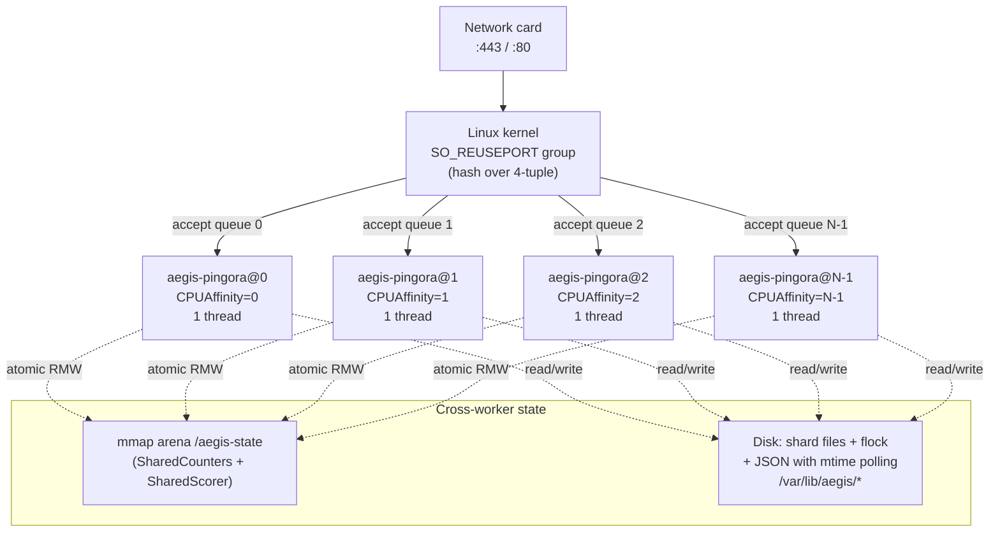
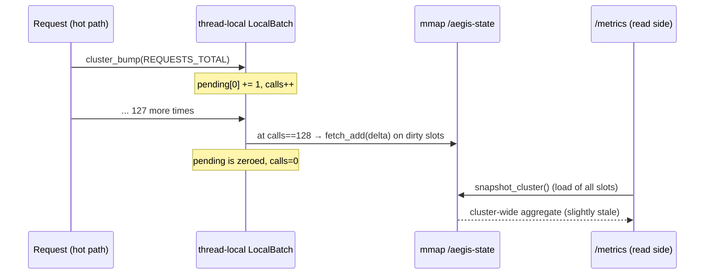

# Multi-process operation, REUSEPORT and workers

**Languages:** **English** · [Русский](../ru/06-workers.md) · [中文](../zh/06-workers.md)

AEGIS scales across cores not with threads inside a single process, but with **N independent processes** `aegis-pingora@0..N-1` that listen on the same port via `SO_REUSEPORT`. Each process is a separate address space; the Linux kernel hands it incoming connections, and cross-worker state consistency is achieved by two mechanisms: a shared-mmap arena for cluster counters/scorer, and on-disk shard files with mtime polling for everything else.

> Sources for this document: [src/bin/aegis-pingora.rs](../../src/bin/aegis-pingora.rs), [src/shared_state/](../../src/shared_state/) (`mod.rs`, `global.rs`, `counters.rs`), [src/topology.rs](../../src/topology.rs), [install.sh](../../install.sh). The historical document [docs/multi-process-deployment.md](../en/reference/multi-process-deployment.md) describes an early (V18, hyper path) implementation of the same pattern and is outdated in places — the code takes priority.

---

## 1. The model: N processes, not N threads

The AEGIS production data plane is the `aegis-pingora` binary (built with `--features pingora`), launched as systemd instances from the `aegis-pingora@.service` template. The production topology is **N separate OS processes with `SO_REUSEPORT`**, each pinned 1:1 to its own core.

Why processes rather than threads inside a single runtime:

- By default Pingora runs the runtime in **NoSteal** mode (`work_stealing=false`, the default since V81) — this is N single-threaded `current_thread` runtimes with no task migration between cores, which gives better cache locality for short WAF/cache tasks ([src/bin/aegis-pingora.rs:1633-1656](../../src/bin/aegis-pingora.rs)).
- `ServerConf::threads` defaults to **1** in Pingora 0.8. Without explicit configuration the whole proxy would run on a single core (on the V57 test rig this yielded ~44k RPS for pingora-1 against ~238k for hyper). That is why the binary itself sets `threads = num_cpus` unless `AEGIS_PINGORA_THREADS` is given ([src/bin/aegis-pingora.rs:1619-1632](../../src/bin/aegis-pingora.rs)).
- In the production layout `install.sh` does the opposite: **1 thread per worker** (`AEGIS_PINGORA_THREADS=1`), with parallelism obtained from the number of processes. This is the thread-per-core pattern of nginx/envoy/HAProxy.



---

## 2. SO_REUSEPORT — how workers share the port

`SO_REUSEPORT` allows several processes to bind the same `addr:port`. The kernel keeps a separate accept queue per socket in the group and distributes incoming connections by a hash over the 4-tuple (src/dst IP + port). There is no userspace accept coordination at all.

In `aegis-pingora` this is **opt-in** via the environment variable `AEGIS_PINGORA_REUSEPORT=1`:

```rust
// src/bin/aegis-pingora.rs:1756-1781
let reuseport = std::env::var("AEGIS_PINGORA_REUSEPORT")
    .map(|v| v == "1" || v.eq_ignore_ascii_case("true"))
    .unwrap_or(false);             // default: OFF
let downstream_sock_opt = build_downstream_sock_opt(reuseport);
service.add_tcp_with_settings(&listen, downstream_sock_opt.clone());
```

The `so_reuseport` option is set in Pingora's `TcpSocketOptions` ([`build_downstream_sock_opt`](../../src/bin/aegis-pingora.rs), src/bin/aegis-pingora.rs:583-609). The same option is applied to the TLS listener as well (src/bin/aegis-pingora.rs:1991-1994) — both downstream sockets are REUSEPORT-capable.

> The default for `AEGIS_PINGORA_REUSEPORT` is **off**. In production it is enabled precisely by the systemd template written by `install.sh` (`Environment=AEGIS_PINGORA_REUSEPORT=1`, install.sh:1252). Running the binary "by hand" without this variable gives a single process — which is fine for single-worker and dev scenarios.

### What does NOT take part in REUSEPORT

| Transport | Socket | REUSEPORT | Behaviour |
|---|---|---|---|
| HTTP/1.1, HTTP/2 (TCP, plain) | `add_tcp_with_settings` | ✅ yes | every worker binds the port, the kernel balances |
| HTTP/1.1, HTTP/2 (TLS) | TLS listener | ✅ yes | same + shared ticket key (see §6) |
| **HTTP/3 (QUIC, UDP)** | quinn UDP socket | ❌ **no** | **only the first worker** binds `:443/udp`; the rest get `AddrInUse` and log it as info, h3 is served for them by their neighbour |

The HTTP/3 sidecar (quinn) has no `SO_REUSEPORT` on the UDP socket: the first worker that wins the `:443/udp` bind serves all HTTP/3 traffic, the rest receive `AddrInUse` — this is **expected and harmless**, h1/h2 over TCP are unaffected ([src/bin/aegis-pingora.rs:1600-1612](../../src/bin/aegis-pingora.rs)).

### Socket defaults and accept backlog (important V231 caveat)

- **TCP_NODELAY** is enabled unconditionally by Pingora on every accepted stream (`apply_stream_settings`), there is no separate setting — Nagle (40 ms coalescing) is always off.
- **TCP keepalive** on accepted client connections is **opt-in** via `AEGIS_PINGORA_DOWNSTREAM_KEEPALIVE=1` (default OFF). When enabled it is applied per-accept synchronously, and at a high accept rate it causes a `setsockopt` storm which overflowed the accept backlog and produced mass `Connection refused (os error 111)` — hence it is off by default ([src/bin/aegis-pingora.rs:559-609](../../src/bin/aegis-pingora.rs)).
- **Accept backlog**: Pingora requests `listen(65535)`, but the kernel silently clamps it to `net.core.somaxconn`. This ceiling cannot be raised from code (there is no `backlog` field in `TcpSocketOptions`) — it is a sysctl drop-in at the `install.sh` level, not in the binary.

### Checking that the workers listen on the same port

```bash
sudo ss -ltnp | grep ':443'
# several users:(("aegis-pingora",pid=...,fd=...)) lines on the same port
sudo systemctl status 'aegis-pingora@*'
```

---

## 3. Core layout: N workers × 1 thread, CPU pinning

`install.sh::resolve_workers` determines the number of workers ([install.sh:156-191](../../install.sh)):

| Source | Priority | Behaviour |
|---|---|---|
| CLI `--workers N` | highest | explicit worker count |
| Panel (topology.json) | medium | `{"workers":"auto"\|"N"}`, written via `PUT /admin/api/topology` (see §5) |
| `auto` (default) | lowest | `AEGIS_WORKERS = nproc`, one worker per core |

In all cases `AEGIS_THREADS_PER_WORKER=1` — this is thread-per-core (V230). Instances are numbered `0..N-1` so that the templated `CPUAffinity=%i` maps 1:1 onto the core index (worker 0 → CPU 0, …, worker N-1 → CPU N-1).

A fragment of the systemd template written by `install.sh` ([install.sh:1233-1287](../../install.sh)):

```ini
# /etc/systemd/system/aegis-pingora@.service
[Service]
Environment=AEGIS_PINGORA_REUSEPORT=1
Environment=AEGIS_PINGORA_THREADS=1
ExecStart=/usr/local/bin/aegis-pingora -c /etc/aegis/aegis.conf --log-level info
Restart=on-failure
RestartSec=2
LimitNOFILE=1048576
CPUAffinity=%i          # worker %i is pinned to core %i
LimitMEMLOCK=infinity   # for BPF maps / locked XDP rings
Nice=-10                # priority above other userland (but not RT FIFO)
PartOf=aegis-pingora.target
```

The grouping `aegis-pingora.target` declares all instances via **`Wants=`** (not `Requires=`), which is critical for rolling restart (see §7), and via `PartOf` in the template — so that restarting the target still propagates to all instances.

### How many workers to run

The `auto` default = number of cores is a sensible starting point for a thread-per-core layout. By `/proc` measurement each worker typically occupies tens of MiB of RSS plus its own in-memory structures (per-worker scorer DashMap, fingerprint cache, response cache). Memory scales **linearly with N**, since part of the state is duplicated in every worker (see §4.3 on cache deduplication).

> ⚠️ The daemon **does not rescale itself "live"**: a running process cannot spawn or kill its siblings (that requires `systemctl` + root). This behaviour deliberately mirrors nginx, where changing `worker_processes` requires a reload ([src/topology.rs:16-24](../../src/topology.rs)).

---

## 4. Cross-worker state

Every REUSEPORT worker is a **separate process with its own address space**, so its per-worker `DashMap` structures (ThreatScorer, DynamicTrust, AnomalyDetector) only see their share of the traffic. A distributed attacker can saturate worker A's view of an IP while worker B still considers that IP clean ([src/shared_state/mod.rs:5-14](../../src/shared_state/mod.rs)). AEGIS counters this with two independent mechanisms.

### 4.1. Mechanism A — disk + mtime polling (config and cumulative state)

State that is mutated rarely (via the admin panel) or aggregated for the dashboard is shared **through files on disk** on the shared `/var/lib/aegis`. One worker writes the file atomically (temp + rename), the rest pick up the change by **comparing the file's mtime on every read** — so sibling workers see an edit within microseconds, not within a 30-second background tick ([src/bin/aegis-pingora.rs:965-970](../../src/bin/aegis-pingora.rs)).

The mtime polling is throttled so that per-request checks do not call `fs::metadata` on every request: a minimum interval is enforced between polls ([src/filters/engine.rs:49-67, 197-217](../../src/filters/engine.rs), the `RUNTIME_TOGGLE_POLL_INTERVAL`-like throttle from V179).

| State | Path env variable | Default path | Version | Sharing |
|---|---|---|---|---|
| Filter runtime toggles | `AEGIS_TOGGLES_PATH` | `/var/lib/aegis/runtime-toggles.json` | V168 | atomic write + mtime poll on read |
| Per-domain policy | `AEGIS_DOMAIN_POLICY_PATH` | `/var/lib/aegis/domain-policy.json` | V168 | same |
| Per-domain challenge config | `AEGIS_CHALLENGE_CONFIG_PATH` | `/var/lib/aegis/domain-challenge.json` | V245 | same |
| Arsenal leaky-bucket scenarios | `AEGIS_SCENARIOS_PATH` | `/var/lib/aegis/scenarios.yaml` | V246 | same |
| ACME challenge tokens | `AEGIS_ACME_STATE_DIR`/challenges | `/var/lib/aegis/acme/challenges` | V238 | disk directory (shared) |
| Honeypot store | `AEGIS_HONEYPOT_STATE` | `/var/lib/aegis/honeypots.json` | — | inline mtime hot reload in `HoneypotStore::check` |
| JA4 reputation / feeds | (see config) | feed files | V138/V176/V177 | `reload()` by mtime (the `threat_intel.rs` pattern) |
| Site map (cartography) | `AEGIS_SITEMAP_DIR` | `/var/lib/aegis/site-map` | V240 | flock shard per worker |
| Event store (request journal) | `AEGIS_EVENTS_DIR` | `/var/lib/aegis/events` | V243 | flock shard per worker |
| GeoIP aggregation by country | `AEGIS_GEO_DIR` | `/var/lib/aegis/geo` | V242 | flock shard per worker |
| Time-series store (metrics) | — | `default_store_dir()` | — | one writer by advisory flock, the rest read-only |

Why the disk share was needed, with concrete examples:

- **ACME challenge tokens (V238):** the validating GET from Let's Encrypt is routed by the kernel to a random worker; without a shared directory 3/4 of requests missed the in-memory map and validation fell into `state=Invalid` ([src/bin/aegis-pingora.rs:1698-1709](../../src/bin/aegis-pingora.rs)).
- **Scenarios and challenge config (V245/V246):** the panel PUTs to a single worker; without a file the setting would live only there, and sibling workers would know nothing about it ([src/bin/aegis-pingora.rs:1479-1493](../../src/bin/aegis-pingora.rs)).

### 4.2. The flock-shard pattern (cumulative counters for the dashboard)

The site map, event store and geo all use the same trick: each worker claims a **slot** with a non-blocking advisory `flock` on `.slot-<n>.lock` and owns exactly one shard file (`shard-<slot>.db` / `.json`) for the whole lifetime of the process — that is, **exactly one writer per shard** ([src/event_store.rs:11-21](../../src/event_store.rs)). On startup the worker re-reads its previous shard (counters survive a restart), and a background tick flushes it about every 30 s.

The **read side** (admin endpoints) **scans the whole directory**, merges all shards (`UNION ALL` for the SQLite event store, a merge for site map/geo) and returns a stable result **regardless of which worker answered the request**. That way the dashboard (world map, journal, cartography) is consistent under any REUSEPORT layout.

The time-series store (metrics) is a variation: one worker wins an advisory flock on `.sampler.lock` and writes, the rest work read-only and serve queries from the shared ring files ([src/bin/aegis-pingora.rs:931-961](../../src/bin/aegis-pingora.rs)).

### 4.3. What is NOT shared (honest limitations)

- **Response cache:** each worker has its own LRU. A hot URL may end up cached in all N workers → N× the memory. The hit ratio drops slightly (each worker warms its own cache separately).
- **Per-worker scorer / trust / anomaly DashMaps:** with the mmap arena disabled (see §4.4) they stay strictly per-worker — a distributed attacker hitting all workers is counted by each of them up to its own threshold independently.
- **Warm-up after a restart:** a restarted worker starts with empty in-memory structures (cache, dynamic trust, scorer history) and warms up within seconds under load; flock-shard state (§4.2) is meanwhile restored from its file.

### 4.4. Mechanism B — the shared mmap arena (cluster counters and scorer)

For the hot path, where a disk file is too slow, AEGIS uses a **single anonymous mmap arena** (`shm_open` + `mmap(MAP_SHARED)`) that every worker opens at startup. This is Phase D of the roadmap, implemented in [src/shared_state/](../../src/shared_state/).

Key properties ([src/shared_state/mod.rs](../../src/shared_state/mod.rs), [src/shared_state/global.rs](../../src/shared_state/global.rs)):

- **Linux only.** The arena relies on POSIX `shm_open`+`mmap`; on macOS/non-Linux a no-op stub is compiled (`stub.rs`), and everything degrades to per-worker state ([src/shared_state/mod.rs:37-74](../../src/shared_state/mod.rs)).
- **Arena name** defaults to `/aegis-state`, overridden by `AEGIS_SHARED_STATE_NAME` (two independent AEGIS deployments on the same host must not collide). **Size** is `AEGIS_SHARED_STATE_SIZE_MB` (default 4 MiB) ([src/shared_state/global.rs:86-97](../../src/shared_state/global.rs)).
- **Bump allocator** inside the arena: `alloc()` moves the head atomically via CAS, individual allocations are **never freed** (compaction happens only by recreating the whole arena). Named allocations (`alloc_named`) guarantee that all workers attach to **the same physical bytes** for a known purpose (for example `SHARED_SCORER_V4`): the first creator CASes the offset into the header registry, the rest read it and attach ([src/shared_state/mod.rs:104-210](../../src/shared_state/mod.rs)).
- **Graceful degradation:** if the arena cannot be opened (no `/dev/shm`, macOS, a restricted container) the daemon logs a warning and continues **without** cluster state; all accessors return `None`, and the hot path no-ops the counter bumps. This is the same degradation model as the XDP loader's ([src/shared_state/global.rs:9-12, 114-122](../../src/shared_state/global.rs)). Initialisation is **not fatal** for the proxy ([src/bin/aegis-pingora.rs:911-913](../../src/bin/aegis-pingora.rs)).

Two things live inside the arena:

**SharedCounters** ([src/shared_state/counters.rs](../../src/shared_state/counters.rs)) — a fixed-size array of `AtomicU64` slots. Any worker atomically does `fetch_add`/`load`; POSIX shared-mmap atomics are coherent on Linux x86_64 and aarch64. Slots are addressed by stable ordinal numbers (operators can build dashboards on indices — new counters are only APPENDed) ([src/shared_state/global.rs:46-70](../../src/shared_state/global.rs)):

| idx | Counter | idx | Counter |
|---|---|---|---|
| 0 | `REQUESTS_TOTAL` | 7 | `UPSTREAM_5XX` |
| 1 | `REQUESTS_DENIED` | 8 | `COMPACTIONS_TOTAL` |
| 2 | `REQUESTS_CHALLENGED` | 9 | `COMPACTIONS_REMOVED` |
| 3 | `CACHE_HITS` | 10 | `RATE_LIMITED` |
| 4 | `CACHE_MISSES` | 11 | `TARPIT` |
| 5 | `UPSTREAM_2XX` | 12 | `RTBH` |
| 6 | `UPSTREAM_4XX` | — | (16 slots in total) |

**SharedScorer** ([src/ddos/shared_score.rs](../../src/ddos/shared_score.rs)) — a distributed threat scorer on top of a lock-free open-addressing hash map in the arena (`AtomicHashMap` for IPv4, `AtomicHashMap128` for IPv6). It attaches at startup from the global arena: `from_global_arena(65536, 60s)` — 65536 IPv4 slots, a 60 s window. If the arena is unavailable — `None`, and scoring stays per-worker ([src/bin/aegis-pingora.rs:914-929](../../src/bin/aegis-pingora.rs)). This is exactly the "cure" for the distributed attack from §4.3: any worker reads/writes any other's per-IP score, and the cluster sees a single score.

#### Counter batching (V231)

`cluster_bump`/`cluster_bump_n` **do not write to the mmap on every call**. Increments accumulate in a thread-local buffer (`LocalBatch`) and are flushed into the arena with a single `fetch_add` per "dirty" slot once every `FLUSH_EVERY = 128` calls ([src/shared_state/global.rs:138-252](../../src/shared_state/global.rs)). At ~450k req/s × 16 workers this turns millions of contended cross-core atomic RMWs per second into a few thousand, removing the cache-line ping-pong (~1.6% CPU in the profile). Guarantees:

- **No increment is lost** — every `pending[i]` is either already flushed or will be flushed at the next batch boundary.
- The **read path** (`cluster_counter`, `snapshot_cluster`) sees slightly stale values (up to N−1 unflushed increments per thread) — acceptable for cluster metrics.
- Thread-local means per OS thread; since every Pingora worker is single-threaded (1 thread per core), this is effectively per-process. Admin/background threads have their own buffers.



---

## 5. Topology introspection for the panel ([src/topology.rs](../../src/topology.rs))

The "Workers" page in the admin panel shows how the proxy is laid out across the machine. Nothing in `topology.rs` **runs on the hot path** — `host_info()` + `enumerate_workers()` are called only by the `/admin/api/topology` handler (a few times a minute at most) and read `/proc` ([src/topology.rs:9-14](../../src/topology.rs)).

- **`host_info()`** — number of logical CPUs, CPU model from `/proc/cpuinfo`, load average. The core count is taken via `sysconf(_SC_NPROCESSORS_ONLN)` and **not** `available_parallelism()`: the latter is scoped by the process's affinity mask, and every worker is pinned to 1 core (`CPUAffinity=%i`), so `available_parallelism()` inside a worker would return `1` and the panel would consider a 16-core machine single-core ([src/topology.rs:105-135](../../src/topology.rs)).
- **`enumerate_workers()`** — scans `/proc`, looks for processes with `comm == "aegis-pingora"`, and for each collects: pid, instance (from `AEGIS_PINGORA_INSTANCE` in `/proc/<pid>/environ`), RSS (MiB), number of OS threads, uptime, lifetime-average CPU (`(utime+stime)/uptime`, as a percentage of one core). An empty result means "unknown" (no `/proc` or no permissions), **not** "zero workers" ([src/topology.rs:202-299](../../src/topology.rs)).
- **Desired-count knob** ([src/topology.rs:64-103, 301-323](../../src/topology.rs)): the panel writes the operator's *intent* into a small JSON `/var/lib/aegis/topology.json` (`DEFAULT_TOPOLOGY_PATH`) — `{"workers":"auto"|"N"}`. The daemon does not rescale itself; this file is read by `install.sh::resolve_workers` on the next deploy/reconcile (see §3). `effective()` resolves `"auto"` to the core count, clamps an explicit number to `1..=4096`, and falls back to the core count on garbage. The write is atomic (temp + rename).

---

## 6. The TLS session-ticket key for REUSEPORT workers (LEVER 3)

A subtlety specific to the N-process layout: by default each process gets its own random TLS 1.3 session-ticket key, so a client that reconnects to a **different** worker will not be able to decrypt the ticket → a silent full handshake on reconnection.

The fix ([src/bin/aegis-pingora.rs:611-867](../../src/bin/aegis-pingora.rs)): all REUSEPORT workers **share one ticket key** from the persistent file `/etc/aegis/tls_ticket.key` (override — `AEGIS_TLS_TICKET_KEY_FILE`). The file is generated once at the first startup with mode 0600 via `OsRng` (a CSPRNG), and the other workers load it; `create_new` is atomic, so if two workers race exactly one wins and the loser reads the winner's bytes — they all converge on the same key. The key length is **queried from OpenSSL at runtime** (48 bytes for legacy AES-128 / 80 bytes on OpenSSL 3.0+) rather than hardcoded. At the same time the per-worker server-side session cache is **disabled** (`SslSessionCacheMode::OFF`) — under REUSEPORT it is useless (a resumed session lands on a different worker → cache miss) and only eats memory.

> ⚠️ Honesty caveat: **ticket-key rotation is NOT implemented** — the key is static until the process restarts (`TODO(security): KEY ROTATION` in the code, src/bin/aegis-pingora.rs:630-641, 855-861). Forward secrecy is not weakened (TLS 1.3 ephemeral ECDHE remains per-handshake), 0-RTT/early data is not enabled. Until rotation appears, a short `ssl_session_timeout` is recommended.

---

## 7. Operations: restart, reload, metrics

### Rolling restart (near-zero downtime)

`install.sh` installs an `aegis-rolling-restart` helper that restarts the REUSEPORT instances one at a time ([install.sh:893-900](../../install.sh)). This works precisely because `aegis-pingora.target` declares the instances via `Wants=` rather than `Requires=`: restarting one worker does not make the target's dependency unsatisfied and does not cascade a stop onto its siblings ([install.sh:1298-1303](../../install.sh)). While one worker restarts, the kernel distributes its share of connections to the remaining N−1.

```bash
# Restart all workers in a "wave", one by one:
sudo aegis-rolling-restart
# Full restart of the target (all instances at once):
sudo systemctl restart aegis-pingora.target
# Status:
sudo systemctl status 'aegis-pingora@*'
```

### Crash isolation

If one worker panics or is OOM-killed, systemd restarts it (`Restart=on-failure`, `RestartSec=2`) and the remaining N−1 keep serving. A single process would have gone down entirely — this is a real availability gain.

### Metrics

Cluster counters (§4.4) are already aggregated in the arena, so `/metrics` from any worker returns a cluster snapshot. Per-worker Prometheus counters are summed on the Prometheus side when needed (`sum by (host) (...)`). Dashboard aggregates (journal, cartography, geo, time series) are assembled by a read-side scan of all shard files (§4.2).

### Config reload

Changes made through the panel (toggles, per-domain policy, challenge config, scenarios) **do not require a restart**: the receiving worker writes the file atomically and the rest pick it up by mtime polling within microseconds (§4.1). WAF rules and cert files are re-read by the background `PingoraBackground` poller (a ~30 s tick) in each worker independently.

---

## 8. Summary of fault tolerance and degradation

| Condition | Behaviour |
|---|---|
| `AEGIS_PINGORA_REUSEPORT` not set | a single process per port (fine for dev / 1 worker) |
| Non-Linux / no `/dev/shm` | mmap arena → no-op stub; cluster counters and SharedScorer disabled, state strictly per-worker |
| Arena failed to open (container, permissions) | warning, the proxy works, accessors return `None` |
| HTTP/3 UDP not bound by a sibling worker | info log `AddrInUse`, h3 is served by the winning worker, TCP unaffected |
| One worker crashes | systemd restarts it, the rest keep serving |
| Worker restart | empty in-memory structures, warm-up within seconds; flock-shard state is restored from file |
| ARM without a PMU (PERFMON) | XDP does not load, graceful fallback to nftables (orthogonal to workers) |

---

## Related documents

- [02-architecture.md](./02-architecture.md) — the overall request lifecycle
- [03-installation.md](./03-installation.md) — `install.sh`, systemd, modes
- [07-protocols.md](./07-protocols.md) — the h1/h2/h3 listeners and their binding
- [08-tls-certificates.md](./08-tls-certificates.md) — ACME, cert reload, session tickets

> **Honesty caveat (the general briefing caveat):** the RPS figures mentioned here and in [docs/multi-process-deployment.md](../en/reference/multi-process-deployment.md) (140k/worker, 875k→964k cache-warm, and so on) are in-process / test-rig measurements. The full `aegis-pingora` under production load gives ↓15–30% against the synthetic benchmark (Pingora I/O, syscalls, TLS handshakes). In a VM without SHA-NI/AES-NI, PoW/HMAC is 2–3× slower than bare metal. Do not quote absolute RPS without this caveat; the authoritative source for the issues found is SECURITY-AUDIT-CONSOLIDATED-2026-06-07.md.
