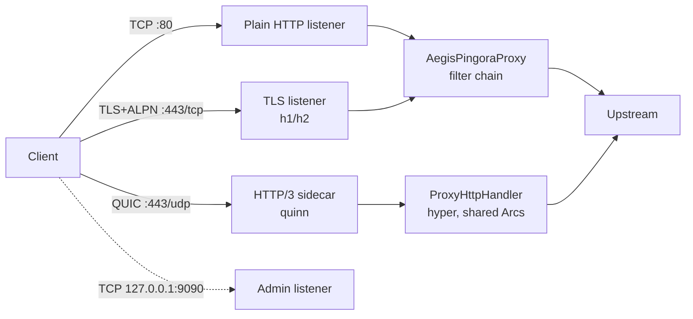

# Network listeners and protocols

**Languages:** **English** · [Русский](../ru/07-protocols.md) · [中文](../zh/07-protocols.md)

This document describes how AEGIS accepts incoming traffic: which listeners are brought up on which ports, how the HTTP/1.1, HTTP/2 and HTTP/3 (QUIC) protocols are negotiated, how ALPN and the h2 switch (`enable_h2`) work, which HTTP/2 limits protect against Rapid Reset (CVE-2023-44487), and how the real client IP is recovered behind a CDN or an L4 balancer (`real_ip` / PROXY protocol).

> All the statements below have been checked against the source code: [src/bin/aegis-pingora.rs](../../src/bin/aegis-pingora.rs), [src/proxy/http3.rs](../../src/proxy/http3.rs), [src/proxy/pingora_tls.rs](../../src/proxy/pingora_tls.rs), [src/real_ip.rs](../../src/real_ip.rs), [src/proxy_proto.rs](../../src/proxy_proto.rs), [src/config.rs](../../src/config.rs), [src/proxy/pingora_http.rs](../../src/proxy/pingora_http.rs).

---

## 1. A brief map of the listeners

The production data plane is the `aegis-pingora` binary (V71+, built with `--features pingora`). It brings up as many as **four** listeners; the legacy `aegis` (hyper) binary brings up an equivalent set along its own path. The source of truth is the `main()` function in [src/bin/aegis-pingora.rs](../../src/bin/aegis-pingora.rs).

| Listener | Transport | Protocols | Address source | Where in the code |
|---|---|---|---|---|
| **Plain HTTP** | TCP | HTTP/1.1 + HTTP/2 (h2c — no; see below) | `server.listen` / `AEGIS_LISTEN` (by default a `:80`-style value from the config) | `service.add_tcp_with_settings(&listen, ...)` (aegis-pingora.rs:1774-1781) |
| **TLS** | TCP | HTTP/1.1 + HTTP/2 (via ALPN) | `tls.listen` / `AEGIS_LISTEN_TLS` | `service.add_tls_with_settings(&tls_listen, ...)` (aegis-pingora.rs:1995) |
| **HTTP/3 sidecar** | UDP (QUIC) | HTTP/3 (ALPN `h3`) | `tls.h3_listen` (by default = `tls.listen`) | `maybe_spawn_h3()` (aegis-pingora.rs:2307) |
| **Admin** | TCP | HTTP/1.1 (metrics, `/health`, admin API) | `admin.listen` / `AEGIS_ADMIN_LISTEN` (by default `127.0.0.1:9090`) | `admin_service` (aegis-pingora.rs:2131-2132) |

The key architectural nuance: **plain HTTP and TLS are listeners of one and the same Pingora `http_proxy_service`** (`AegisPingoraProxy`). HTTP/3 is a **separate sidecar** brought up on the hyper handler `ProxyHttpHandler` (Pingora 0.8 cannot do h3), but it reuses the same filters/router/cache/scorer through shared `Arc`s (aegis-pingora.rs:1585-1599).



See also: [docs/06-workers.md](./06-workers.md) (REUSEPORT and workers), [docs/08-tls-certificates.md](./08-tls-certificates.md) (certificates, ACME, SNI, mTLS).

---

## 2. The :80 listener (plain HTTP)

The address comes from `server.listen` (DSL/TOML) with an override via the `AEGIS_LISTEN` variable (aegis-pingora.rs:892). The listener is always registered via `add_tcp_with_settings` so that `SO_REUSEPORT` (see section 6) and the optional TCP keepalive can be set:

```rust
// aegis-pingora.rs:1773-1781
let downstream_sock_opt = build_downstream_sock_opt(reuseport);
service.add_tcp_with_settings(&listen, downstream_sock_opt.clone());
```

Specifics as fixed in the code:

- **TCP_NODELAY (disabling Nagle's algorithm) is always on.** Pingora unconditionally calls `set_nodelay()` for every accepted stream in `apply_stream_settings` (pingora-core `listeners/l4.rs:385`). There is no separate flag for this — it is documented in the `build_downstream_sock_opt` comment (aegis-pingora.rs:552-557). The config field `server.tcp_nodelay` (default: `true`, config.rs:162) applies on the **hyper path**; on the Pingora path it is effectively always `true`.
- **The backlog cannot be raised from code.** Pingora requests `listen(65535)`, but the kernel silently truncates this to `net.core.somaxconn` (l4.rs:51,250). `TcpSocketOptions` has **no** `backlog` field (aegis-pingora.rs:574-582). The accept-queue ceiling is the sysctl `net.core.somaxconn`, which is set in [install.sh](../../install.sh) / a sysctl.d drop-in, not in the binary.
- **TCP keepalive on accepted connections is OFF by default** (`AEGIS_PINGORA_DOWNSTREAM_KEEPALIVE`, default: off). This is the V231 regression fix: keepalive is applied by Pingora **on every accept** synchronously inside the accept loop, which under load (500-1000 conn) led to accept-queue overflow and `Connection refused (os error 111)`. A detailed analysis is in the `build_downstream_sock_opt` doc comment (aegis-pingora.rs:559-608). Reaping dead clients is done by the request/idle timeouts anyway.

> A note on h2c (HTTP/2 cleartext): on the plain listener h2 without TLS is **not negotiated automatically** — `enable_h2()` is called only on the TLS settings (section 4). On the unencrypted port HTTP/1.1 is used.

### Slowloris guards (general)

[src/config.rs](../../src/config.rs) contains timeouts that protect connections from slow exhaustion:

| Field (`server.*`) | Default | Purpose |
|---|---|---|
| `header_read_timeout_ms` | `5000` | Slowloris: kill an HTTP/1.x connection that has not sent its headers within this time (config.rs:131) |
| `body_read_timeout_ms` | `30000` | Slow POST (R-U-Dead-Yet): kill the request if the body has not arrived in full; `0` disables (config.rs:136) |
| `request_timeout_ms` | — | Overall request timeout |
| `graceful_shutdown_secs` | — | Grace period on shutdown (on the hyper path) |

> 🟡 These fields are historically implemented on the hyper path ([src/server.rs](../../src/server.rs)). On the Pingora path the h3 body drain is protected by its own constant (section 5), and the shutdown grace period is set via `AEGIS_PINGORA_GRACE_SECS` (default: `10`, aegis-pingora.rs:1667-1670).

---

## 3. The :443 listener (TLS) and ALPN

The TLS listener is only brought up if the config contains a `tls` block with `enabled = true` (config.rs:259-260). The address is `tls.listen`, overridden via `AEGIS_LISTEN_TLS` (aegis-pingora.rs:1798).

TLS termination goes through Pingora's OpenSSL feature and the custom `AegisTlsAccept` callback ([src/proxy/pingora_tls.rs](../../src/proxy/pingora_tls.rs)), which does:

1. **Per-SNI certificate selection** — `certificate_callback` reads the SNI from the ClientHello and installs the required cert/key pair via `ssl.set_certificate` / `ssl.set_private_key` (pingora_tls.rs:866-871). The default certificate is served when the SNI is absent or did not match (pingora_tls.rs:382-390).
2. **JA3/JA4 fingerprinting** — capturing the ClientHello via `set_client_hello_callback` → `capture_client_hello` (pingora_tls.rs:745, registered in aegis-pingora.rs:1922-1928). More detail: [docs/11-tls-fingerprinting.md](./11-tls-fingerprinting.md).

### ALPN: negotiating h1 vs h2

ALPN (Application-Layer Protocol Negotiation) on the TLS listener is enabled by exactly one line:

```rust
// aegis-pingora.rs:1929
tls_settings.enable_h2();
```

In Pingora 0.8.0 `enable_h2()` **only sets ALPN** (`h2`, `http/1.1`). After that:

- if the client offers `h2` in the ClientHello — **HTTP/2** is negotiated;
- otherwise — **HTTP/1.1**.

This is confirmed in the code: the startup log writes `"...TLS listener active (h2 + h1, per-SNI cert via TlsAccept callback)"` (aegis-pingora.rs:1996-2001).

> 🟡 **An honest caveat about `enable_h2`.** In Pingora 0.8.0 `TlsSettings` **does not expose** `h2_options()` — the only public h2 method on `TlsSettings` is `enable_h2()`, which merely sets ALPN (verified against `pingora-core 0.8.0/src/listeners/tls/boringssl_openssl/mod.rs`, see the comment at aegis-pingora.rs:1930-1941). Therefore fine-tuning h2 parameters at the TLS-listener level is impossible here — it is done at the application level (`app.h2_options`, section 4).

### Fingerprinting can be switched off (LEVER 1)

Computing JA3 (MD5) + JA4 (2×SHA-256) costs ~18-22 heap allocations per full handshake. AEGIS computes them **ON by default**, but they can be suppressed via `AEGIS_TLS_FINGERPRINT=0` — however only if **no** consumer is active (aegis-pingora.rs:1839-1903). If there is a consumer (`ja3_deny_hashes`, `ja4_deny_prefixes`, Arsenal, JA4 reputation, an inline WAF rule with `field:"ja3"|"ja4"`, or any external `rule_files`), the explicit opt-out is **overridden** with a warn log — otherwise it would be a silent security regression.

### TLS features (controlled by the `tls.*` config)

| Field | Purpose | Where |
|---|---|---|
| `cert_path` / `key_path` | Default cert/key pair | config.rs:262-263 |
| `sni[]` (`SniEntry{host, cert_path, key_path}`) | Per-SNI certificates | config.rs:271 |
| `ja3_deny_hashes[]` | Close the socket at handshake by JA3-MD5 | config.rs:278 |
| `ja4_deny_prefixes[]` | Close by JA4 prefix (`starts_with`) | config.rs:287 |
| `mtls{enabled, ca_paths, require_cert}` | mTLS (client certificates) | config.rs:300-313 |

mTLS (off by default): with `mtls.enabled=true` a trust store + `SslVerifyMode::PEER` is installed (plus `FAIL_IF_NO_PEER_CERT` when `require_cert`), see `MtlsSetup::apply` (pingora_tls.rs:211-221). Details are in [docs/08-tls-certificates.md](./08-tls-certificates.md).

> 0-RTT / early data is not enabled on TLS: the Pingora context defaults to `max_early_data=0`, and the code does not touch it (aegis-pingora.rs:652-653).

---

## 4. HTTP/2 and limits against floods (Rapid Reset, CVE-2023-44487)

HTTP/2 parameters on the Pingora path are set **at the application level** (`HttpProxy.app_logic_mut().h2_options`), because that is where Pingora applies them during the h2 handshake (`server::handshake(stream, self.h2_options())`). This is the only supported hook — the built-in `h2_guard`/`h2_budget` modules cannot wedge in, since Pingora owns the frame loop (aegis-pingora.rs:1718-1726).

```rust
// aegis-pingora.rs:1727-1751
if let Some(app) = service.app_logic_mut() {
    let max_streams: u32     = env "AEGIS_H2_MAX_STREAMS"     | 128;
    let max_header_list: u32 = env "AEGIS_H2_MAX_HEADER_LIST" | 65536;
    let max_reset: usize     = env "AEGIS_H2_MAX_RESET"       | 100;
    let mut h2 = H2Options::default();
    h2.max_concurrent_streams(max_streams)
      .max_header_list_size(max_header_list)
      .max_pending_accept_reset_streams(max_reset);
    app.h2_options = Some(h2);
}
```

| ENV | Default | What it protects |
|---|---|---|
| `AEGIS_H2_MAX_STREAMS` | `128` | `max_concurrent_streams` — the ceiling on concurrent h2 streams per connection (protection against stream churn) |
| `AEGIS_H2_MAX_HEADER_LIST` | `65536` (64 KiB) | `max_header_list_size` — the ceiling on the header-block size (protection against CONTINUATION flood, **CVE-2024-27316**) |
| `AEGIS_H2_MAX_RESET` | `100` | `max_pending_accept_reset_streams` — the ceiling on "resetting" streams before the connection is closed (protection against **Rapid Reset, CVE-2023-44487**) |

Without these limits h2 would run with the permissive defaults of the `h2` library, leaving Rapid Reset and CONTINUATION flood effectively unbounded on a public listener (aegis-pingora.rs:1721-1724). Startup is logged: `"HTTP/2 flood limits applied (C3)"`.

### Relationship with the config fields

[src/config.rs](../../src/config.rs) contains parallel h2 fields in the `server` block:

| Field (`server.*`) | Default | Comment in the code |
|---|---|---|
| `h2_max_reset_streams` | `100` | Rapid Reset CVE-2023-44487 (config.rs:138-142) |
| `h2_max_concurrent_streams` | `200` | anti-RapidReset, "applies to both hyper and pingora H2" (config.rs:143-150) |
| `h2_initial_window_size` | `1048576` (1 MiB) | initial stream window (config.rs:151-154) |
| `h2_initial_window_size` (conn) | `8 MiB` | `h2_initial_connection_window_size` (config.rs:155-158) |

> 🟠 **An honest caveat.** On the Pingora path the h2 limits are set from the `AEGIS_H2_*` variables (defaults `128`/`64KiB`/`100`) and **not** directly from these `server.h2_*` config fields. The config fields `h2_initial_window_size` / `h2_initial_connection_window_size` cannot be applied to the Pingora 0.8.0 TLS listener — `TlsSettings` does not expose the corresponding setters (see the explicit TODO at aegis-pingora.rs:1930-1941: "If we move to pingora 0.9+ this is the place to call `set_max_concurrent_streams` / `set_initial_window_size` / `set_initial_connection_window_size`"). In other words:
> - **Rapid Reset protection is present** (via `AEGIS_H2_MAX_RESET` → `max_pending_accept_reset_streams`), which matches the briefing's security matrix: "HTTP/2 Rapid Reset (needs Pingora 0.9+)" — partially closed on 0.8 via app-level `h2_options`.
> - **Flow-control windows** on Pingora remain at Pingora's internal defaults until the move to 0.9+.

For additional context on the HTTP/2 frame-budget modules (`h2_budget`, Tempesta style, V182) — see [docs/14-rate-limiting.md](./14-rate-limiting.md); on the Pingora path they are not wired in for the reason above.

---

## 5. HTTP/3 (QUIC sidecar)

HTTP/3 is implemented on top of `quinn` (QUIC) in [src/proxy/http3.rs](../../src/proxy/http3.rs) and is brought up by the `maybe_spawn_h3` function in a separate OS thread with its own single-thread tokio runtime (aegis-pingora.rs:2372-2393).

### Startup conditions

```rust
// aegis-pingora.rs:2313-2319
let Some(tls) = cfg.tls.as_ref() else { return Ok(()); };
if !tls.enabled || !tls.h3_enabled { return Ok(()); }
let h3_listen_str = tls.h3_listen.as_deref().unwrap_or(&tls.listen);
```

| Field | Default | Purpose |
|---|---|---|
| `tls.h3_enabled` | `false` (config.rs:264-265) | The master switch for HTTP/3. **Off by default.** |
| `tls.h3_listen` | `None` → `tls.listen` is used (config.rs:266-267) | The UDP address of the QUIC endpoint |

> HTTP/3 is **opt-in**: until `h3_enabled=true` is set, the sidecar does not start.

### ALPN and TLS for QUIC

QUIC uses rustls (not OpenSSL) and the same SNI resolver as h1/h2 (`SniResolver::build`, http3.rs:72-73). ALPN is hardcoded as `h3`:

```rust
// http3.rs:77
tls.alpn_protocols = vec![b"h3".to_vec()];
tls.max_early_data_size = 0;   // 0-RTT disabled (M10)
```

**0-RTT/early data in QUIC is disabled deliberately** (`max_early_data_size = 0`, http3.rs:78-89): early data is replayable (RFC 8446 §8 / RFC 9001 §9.2), and AEGIS forwards the body upstream without anti-replay deduplication, so for a security proxy the safe default is to require a full 1-RTT handshake.

### QUIC resource limits (V233)

Conservative ceilings are set in h3 (http3.rs:23-62) — it is a sidecar, not the main entry point:

| Constant | Value | What it limits |
|---|---|---|
| `H3_BODY_READ_TIMEOUT` | `30s` | The budget for fully receiving the body of one h3 request (slowloris/R-U-Dead-Yet). Mirrors `body_read_timeout_ms` (http3.rs:31-39) |
| `H3_MAX_STREAMS_PER_CONN` | `256` | Max concurrent request-stream tasks per QUIC connection |
| `H3_MAX_STREAMS_GLOBAL` | `4096` | Process-wide ceiling on concurrent h3 stream tasks |
| `H3_MAX_CONCURRENT_BIDI` | `256` | `quinn` transport cap on bidi streams (a protocol-level backup for the semaphore) |
| `H3_MAX_CONCURRENT_UNI` | `16` | Cap on uni streams (h3 control / QPACK) |

Every stream takes a global + per-conn semaphore permit before being spawned (http3.rs:252-263), which limits both the number of tasks and the total body buffering. The slowloris drain is wrapped in `tokio::time::timeout(H3_BODY_READ_TIMEOUT, ...)` (http3.rs:325-333).

### The H3 fingerprint (coarse)

quinn 0.11 does not expose the raw Initial bytes or the individual transport parameters, so h3fp hashes only stable signals: the ALPN string and `max_datagram_size`. The QUIC version is hardcoded as `0x00000001` (RFC 9000 v1), since quinn does not expose a getter for the connection's version (http3.rs:168-208). This is coarser than a real JA4Q, but it distinguishes the main QUIC stacks (chromium/firefox/cronet/quiche/msquic).

> 🟡 **Honest caveats about HTTP/3:**
> - **HTTP/3 does not have process-level SO_REUSEPORT partitioning as cleanly as TCP.** The QUIC socket is bound with `SO_REUSEPORT` (http3.rs:108-127), but in a multi-worker REUSEPORT layout only the **first** worker successfully takes `:443/udp`, the rest fail with `AddrInUse` — this is **expected and harmless** (logged at `info` level, not `error`, aegis-pingora.rs:1600-1612). HTTP/3 continues to be served by the worker that won the bind; h1/h2 over TCP are unaffected.
> - **WAF hot reload for h3 is separate.** The h3 handler builds its own WAF from `cfg`, and its reload runs on its own 30-second poller on the h3 runtime (aegis-pingora.rs:2448-2466). The reaction to a rule change may diverge in time from the Pingora h1/h2 path.
> - **Cleanup of the honeypot hit tally is not implemented for the Pingora path** (including for the h3 sidecar) — `hits_by_ip` is not pruned on the pingora path (aegis-pingora.rs:19-26). The honeypot store hot reload itself does work (inline mtime).

### Announcing HTTP/3 to clients (Alt-Svc)

The `alt-svc` header (by which the server tells the client that h3 is available) is stamped **on the hyper path** (`stamp_alt_svc`, [src/proxy/http.rs](../../src/proxy/http.rs):298-305). The h3 sidecar itself is marked `for_h3()` and does **not** set Alt-Svc on its own responses (aegis-pingora.rs:2425-2427).

---

## 6. SO_REUSEPORT and multi-process operation (in brief)

`SO_REUSEPORT` allows N processes to listen on one port; the kernel balances the incoming connections. On the Pingora path this is opt-in:

```rust
// aegis-pingora.rs:1756-1758
let reuseport = env "AEGIS_PINGORA_REUSEPORT" == "1" | "true"  (default: false)
```

With `reuseport=true`, `so_reuseport=Some(true)` is set in `TcpSocketOptions` for the plain and TLS listeners (aegis-pingora.rs:583-587, 1994). The admin listener also shares REUSEPORT so that workers `aegis-pingora@1..N` do not fight over the admin port (aegis-pingora.rs:2133-2138).

A related nuance is the **shared TLS session-ticket key for the workers**: otherwise a client that reconnects to a different worker will not be able to resume the session. The key is read/generated from `/etc/aegis/tls_ticket.key` (override `AEGIS_TLS_TICKET_KEY_FILE`) and shared between workers; the per-worker server-side session cache is disabled at the same time (aegis-pingora.rs:611-654, 1943-1973). A full treatment of workers and REUSEPORT is in [docs/06-workers.md](./06-workers.md).

---

## 7. The real client IP: real_ip and PROXY protocol

Behind a CDN or an L4 balancer the TCP peer is not the client but an edge node. AEGIS recovers the real IP by two independent mechanisms.

### 7.1 Forwarded headers (real_ip)

The logic is in [src/real_ip.rs](../../src/real_ip.rs) (`TrustedProxies`). On the Pingora path a functionally identical inline implementation works in [src/proxy/pingora_http.rs](../../src/proxy/pingora_http.rs):1910-1948.

**The main security invariant:** the headers are consulted **only** if the TCP peer is in the trusted CIDR set. Otherwise the forwarded headers are silently ignored — an attacker who is not behind a trusted proxy cannot spoof their IP via `X-Forwarded-For` / `CF-Connecting-IP` (real_ip.rs:11-16, pingora_http.rs:1924-1927).

Configuration is via environment variables, **both off by default** (zero behaviour change until explicitly enabled, real_ip.rs:24-25):

| ENV | Effect |
|---|---|
| `AEGIS_BEHIND_CLOUDFLARE=1` | Trust `CF-Connecting-IP` when the TCP peer is in the built-in list of Cloudflare CIDRs (real_ip.rs:34-59) |
| `AEGIS_TRUSTED_PROXIES=cidr,cidr,...` | Additionally trust these CIDRs; consult `X-Forwarded-For` (rightmost-non-trusted algorithm) |

The `resolve_client_ip` algorithm (real_ip.rs:219-263):

1. Feature disabled (no trusted CIDRs) → return the peer as is.
2. Peer **not** in the trusted set → return the peer (the security gate).
3. `AEGIS_BEHIND_CLOUDFLARE` → read `CF-Connecting-IP` (a single IP, authoritative for CF); on absence/parse error — fall back to the peer.
4. Otherwise → walk `X-Forwarded-For` right to left and return the first IP **not** in the trusted set (the real client immediately before the trust boundary); fall back to the peer on error or if all hops are trusted.

The CIDR matcher is built in, dependency-free, and supports IPv4 and IPv6 (real_ip.rs:61-128). Invalid CIDRs are skipped with a warning, without panicking.

> The CF mode does **not** consult XFF: if `CF-Connecting-IP` is absent, the peer is returned (rather than the XFF value) — to avoid ambiguity (real_ip.rs:248-255, test `trusted_cf_peer_missing_cf_ip_ignores_xff`).

### 7.2 PROXY protocol (v1/v2)

The parser is in [src/proxy_proto.rs](../../src/proxy_proto.rs). It is needed when AEGIS sits behind an L4 balancer (AWS NLB, HAProxy, IPVS-DR) that prepends the original src/dst tuple to every connection.

The mode is the `server.proxy_protocol` field (config.rs:127-128), with values (config.rs:174-181):

| Value | Meaning |
|---|---|
| `off` | **Default.** Ignore the header, treat the connection as direct TCP |
| `v1` | Text format only (HAProxy 1.5+) |
| `v2` | Binary format only (HAProxy 1.6+, AWS NLB) |
| `auto` | Accept either |

The parser (`proxy_proto::parse`) returns the recovered `client_ip` and the number of bytes consumed (`consumed`), which the caller must strip before reading the real payload (proxy_proto.rs:23-70). Details:

- **v1**: an ASCII string up to `\r\n`, for example `PROXY TCP4 192.0.2.1 198.51.100.2 35692 80\r\n`; a hard limit of 108 bytes (proxy_proto.rs:72-101).
- **v2**: a 12-byte magic + a 4-byte header + an address block; AF_INET / AF_INET6 are supported, as are the LOCAL (health check, no override) and PROXY commands (proxy_proto.rs:107-166).
- `UNKNOWN` / AF_UNSPEC / AF_UNIX → `0.0.0.0` (no override).
- A mode mismatch (v2 magic while `mode=v1` and vice versa) → an error, the connection is closed.

> 🟠 **A critical honest caveat about the scope of the PROXY protocol.** The `proxy_proto.rs` parser is currently wired in **only on the hyper path** (the `aegis` binary, [src/server.rs](../../src/server.rs):676, 726, 892, 909). On the **production data plane (`aegis-pingora`)** `proxy_proto::parse` is **not called** anywhere in the code — Pingora 0.8 owns the accept loop, and peek-and-strip of the PROXY header is not wedged in there. The practical consequence: behind an L4 balancer that forwards the PROXY protocol, recovering the real IP on the Pingora path must be done via forwarded headers (section 7.1) or by running the hyper binary. The `server.proxy_protocol` field takes effect on the hyper path; for Pingora, rely on `AEGIS_BEHIND_CLOUDFLARE` / `AEGIS_TRUSTED_PROXIES`.

---

## 8. Environment variable cheat sheet (for this document)

| ENV | Default | Layer |
|---|---|---|
| `AEGIS_LISTEN` | from `server.listen` | plain HTTP address |
| `AEGIS_LISTEN_TLS` | from `tls.listen` | TLS address |
| `AEGIS_ADMIN_LISTEN` | `127.0.0.1:9090` | admin address |
| `AEGIS_PINGORA_REUSEPORT` | `false` | SO_REUSEPORT on the listeners |
| `AEGIS_PINGORA_DOWNSTREAM_KEEPALIVE` | `false` | TCP keepalive on accepted connections |
| `AEGIS_H2_MAX_STREAMS` | `128` | h2 `max_concurrent_streams` |
| `AEGIS_H2_MAX_HEADER_LIST` | `65536` | h2 `max_header_list_size` (CONTINUATION flood) |
| `AEGIS_H2_MAX_RESET` | `100` | h2 `max_pending_accept_reset_streams` (Rapid Reset) |
| `AEGIS_TLS_FINGERPRINT` | (on) | `0` suppresses JA3/JA4 if there are no consumers |
| `AEGIS_TLS_TICKET_KEY_FILE` | `/etc/aegis/tls_ticket.key` | the shared session-ticket key for REUSEPORT |
| `AEGIS_BEHIND_CLOUDFLARE` | off | trust `CF-Connecting-IP` from the CF ranges |
| `AEGIS_TRUSTED_PROXIES` | off | trusted CIDRs for `X-Forwarded-For` |

The build and deployment environment variables are authoritatively covered in [install.sh](../../install.sh); we do not duplicate them step by step here.

---

## 9. Consolidated honest caveats (mandatory)

1. **The AEGIS benchmark is an internal relay, not the full-stack binary.** The RPS figures from `src/bin/aegis-distbench.rs` / `bench/` come from an in-process filter relay with no real I/O (no networking, TLS handshakes or syscalls). The full `aegis-pingora` under production load gives ↓15-30% against the synthetic bench. Never quote absolute RPS without the clarification "in-process filter relay, not a real deployment". See [docs/PERFORMANCE.md](../en/reference/performance.md).
2. **Hardware SHA is per-core, and there is no HW acceleration in a VM.** This affects QUIC/TLS handshakes and h3 fingerprinting: in the test VM (without AES-NI/SHA-NI) handshake CPU is ↑2-3× against bare metal. On ARM without a PMU, XDP does not load (graceful fallback to nftables) — this affects the fast path, not the listeners themselves.
3. **Throughput does not claim to be "better than real proxies".** AEGIS is a security edge, not a bare forwarder: with full L7 protection the overhead is ~↓13% against a C forwarder; under attack nginx+ModSecurity loses ~−95% of throughput. See [docs/PERFORMANCE.md](../en/reference/performance.md).
4. **The security matrix is the only honest claim.** What actually works on the listeners: TLS termination + per-SNI, ALPN h1/h2, h2 flood limits (Rapid Reset partially — via app-level `h2_options` on Pingora 0.8; the full set of windows — Pingora 0.9+), the h3 sidecar with resource limits (opt-in), real_ip behind trusted proxies. What is NOT full protection: L3/L4 floods (upstream BGP/CDN is needed, see `src/bgp_rtbh.rs`); the PROXY protocol on the Pingora path (hyper only); the h2 flow-control windows from the config on Pingora 0.8. The authoritative source for the issues found and the status of the fixes is SECURITY-AUDIT-CONSOLIDATED-2026-06-07.md.
5. **The cache is not universal.** Under a volumetric DDoS even a cached response requires an incoming connection (TCP/QUIC accept), so the listeners are loaded regardless; without an upstream BGP drop the backend may remain overloaded. AEGIS reflects 0% of attacks onto the origin thanks to WAF + challenge, but L3 floods require upstream protection.

---

## See also

- [docs/02-architecture.md](./02-architecture.md) — the request lifecycle
- [docs/06-workers.md](./06-workers.md) — REUSEPORT, workers, session-ticket key
- [docs/08-tls-certificates.md](./08-tls-certificates.md) — SNI, ACME, mTLS, key rotation
- [docs/11-tls-fingerprinting.md](./11-tls-fingerprinting.md) — JA3/JA4 from the ClientHello
- [docs/14-rate-limiting.md](./14-rate-limiting.md) — rate limiting and h2 budget
