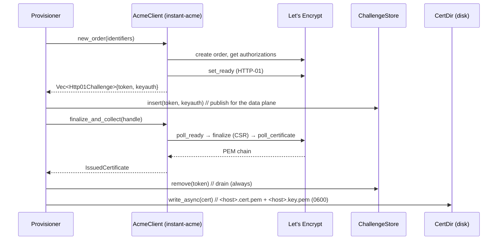

# TLS and certificates (ACME)

**Languages:** **English** · [Русский](../ru/08-tls-certificates.md) · [中文](../zh/08-tls-certificates.md)

This document describes how AEGIS serves TLS on the production data plane `aegis-pingora`: certificate selection by SNI, hot reload of certificates from disk, mTLS client authentication and the built-in ACME/Let's Encrypt client for auto-issuance and auto-renewal. Every statement is backed by the source code: [src/proxy/pingora_tls.rs](../../src/proxy/pingora_tls.rs), [src/tls_sni.rs](../../src/tls_sni.rs), [src/acme.rs](../../src/acme.rs), [src/acme_instant.rs](../../src/acme_instant.rs), as well as the orchestration in [src/bin/aegis-pingora.rs](../../src/bin/aegis-pingora.rs) and the admin endpoints in [src/proxy/pingora_admin.rs](../../src/proxy/pingora_admin.rs).

> **Which code runs where.** The production TLS stack lives in `aegis-pingora` on top of OpenSSL (feature `pingora`). It is the one that implements certificate selection by SNI, mTLS, JA3/JA4 fingerprinting during the handshake and hot reload — see [src/proxy/pingora_tls.rs](../../src/proxy/pingora_tls.rs). The legacy hyper binary `aegis` uses rustls and a separate per-SNI resolver [src/tls_sni.rs](../../src/tls_sni.rs) — it is simpler (no ACME path resolver, no mtime poller, no mTLS trust store), and is not used in the production configuration. For more on the binaries see [Architecture](./02-architecture.md) and [Protocols and listeners](./07-protocols.md).

---

## 1. TLS listener configuration

TLS is configured by the `TlsConfig` block (see [src/config.rs](../../src/config.rs):259). Fields:

| Field | Type | Purpose |
|---|---|---|
| `enabled` | bool | Enable the TLS listener. |
| `listen` | string | TLS listener address (for example, `0.0.0.0:443`). |
| `cert_path` | string | Path to the PEM chain of the **default** certificate (fallback when there is no SNI match). |
| `key_path` | string | Path to the private key of the default certificate. |
| `h3_enabled` | bool (default: false) | Enable the HTTP/3 sidecar. See [Protocols and listeners](./07-protocols.md). |
| `h3_listen` | Option\<string\> | Separate address for QUIC/h3. |
| `sni` | `Vec<SniEntry>` (default: empty) | Per-host certificate overrides. |
| `ja3_deny_hashes` | `Vec<String>` (default: empty) | JA3 MD5 hashes to reject during the handshake. See [TLS fingerprinting](./11-tls-fingerprinting.md). |
| `ja4_deny_prefixes` | `Vec<String>` (default: empty) | JA4 prefixes (`starts_with`) to reject during the handshake. |
| `mtls` | `MtlsConfig` (default: disabled) | Client certificate authentication (see §6). |

`SniEntry` ([src/config.rs](../../src/config.rs):322) is a triple `{ host, cert_path, key_path }`. The top-level `cert_path`/`key_path` are the default pair, served when no SNI entry matched.

> ⚠️ The TLS listener requires **both** halves — the default certificate is mandatory. Without a fallback, a handshake without SNI (or with an unknown SNI) will fail. This is explicitly recorded in the doc comment on `CertStore` ([src/proxy/pingora_tls.rs](../../src/proxy/pingora_tls.rs):100-109).

---

## 2. Certificate selection by SNI

### Production path (`aegis-pingora`, OpenSSL)

Certificate selection happens **in the middle of the handshake**, in the `certificate_callback` callback of the `TlsAccept` trait ([src/proxy/pingora_tls.rs](../../src/proxy/pingora_tls.rs):866). OpenSSL calls it after parsing the ClientHello but before sending the ServerHello — exactly the right moment to substitute the correct certificate:

```rust
let sni = ssl.servername(NameType::HOST_NAME).map(|s| s.to_string());
self.install(ssl, sni.as_deref());
```

`CertStore::pick` ([src/proxy/pingora_tls.rs](../../src/proxy/pingora_tls.rs):382) chooses the pair:

- SNI is present and there is an entry in `by_sni` (the key is the **lowercased** host) → that pair;
- SNI is absent or did not match → the **default** pair.

Matching is **case-insensitive**: both on load (`e.host.to_ascii_lowercase()`) and on selection (`host.to_ascii_lowercase()`). This is covered by the test `build_loads_default_and_per_sni` ([src/proxy/pingora_tls.rs](../../src/proxy/pingora_tls.rs):1190), where `B.EXAMPLE.COM` is correctly matched by a request for `B.example.COM`.

`install` ([src/proxy/pingora_tls.rs](../../src/proxy/pingora_tls.rs):513) sets on the SSL:

1. `set_certificate(leaf)` — the leaf certificate (the first one in the PEM);
2. `set_private_key(key)`;
3. `add_chain_cert(...)` for each intermediate certificate of the chain.

Installation errors are logged and ignored — this is a safe failure mode: the SSL is left without a certificate and the handshake naturally aborts rather than handing out someone else's key.

The pairs are pre-parsed into memory (`CertPair` holds an `X509` + a `Vec<X509>` chain + a `PKey`) so that the PEM is not re-read and re-parsed on every connection — the handshake is a hot path ([src/proxy/pingora_tls.rs](../../src/proxy/pingora_tls.rs):51-58).

### Legacy path (`aegis`, rustls)

The hyper binary uses `SniResolver` ([src/tls_sni.rs](../../src/tls_sni.rs)), which implements the rustls trait `ResolvesServerCert`. The logic is the same: `HashMap<host_lowercase → CertifiedKey>` + `default`; an unknown SNI and a missing SNI both fall back to the default ([src/tls_sni.rs](../../src/tls_sni.rs):52-63). Keys are read as PKCS#8 (`rustls_pemfile::pkcs8_private_keys`); an empty key list is an error ([src/tls_sni.rs](../../src/tls_sni.rs):78).

---

## 3. Fingerprinting during the handshake (JA3 / JA4)

Although this is the subject of [TLS fingerprinting](./11-tls-fingerprinting.md), the fingerprints are taken right here — at the TLS layer, and they are closely tied to certificate selection.

JA3/JA4 are computed in the **ClientHello callback** (`capture_client_hello`, [src/proxy/pingora_tls.rs](../../src/proxy/pingora_tls.rs):745), which is registered via `set_client_hello_callback` in [src/bin/aegis-pingora.rs](../../src/bin/aegis-pingora.rs):1922. This is the only handshake stage where the `SSL_client_hello_*` accessors return the ciphers and extensions offered by the client.

> 🟡 Historically (V50/V51) the computation was done in `certificate_callback` (OpenSSL `cert_cb`), which fires **later**, when the accessors are already empty — this produced a degenerate fingerprint `t12i000000_e3b0c44298fc`, identical for every client. V246 moved the computation into the ClientHello callback; the code in `certificate_callback` was kept only as a defensive fallback ([src/proxy/pingora_tls.rs](../../src/proxy/pingora_tls.rs):873-886).

The fingerprints are stored in the SSL `ex_data` (`TlsFingerprints`, [src/proxy/pingora_tls.rs](../../src/proxy/pingora_tls.rs):538), then `handshake_complete_callback` ([src/proxy/pingora_tls.rs](../../src/proxy/pingora_tls.rs):1025) publishes them into `SslDigest.extension`, and the hot path reads them back via `read_fingerprints` ([src/proxy/pingora_tls.rs](../../src/proxy/pingora_tls.rs):1091) into `ctx.ja3`/`ctx.ja4`.

> 🟠 **LEVER 1 gate.** Computing JA3 (MD5) + JA4 (2×SHA-256) plus ~18-22 heap allocations per full handshake can be disabled (`AEGIS_TLS_FINGERPRINT=0`), but **only** if every consumer of the fingerprints is confirmed inactive (no `ja3_deny_hashes`/`ja4_deny_prefixes`, Defence Arsenal disabled, no JA4 reputation, no WAF rules with `field:"ja3"|"ja4"`). By default the gate is **on** ([src/proxy/pingora_tls.rs](../../src/proxy/pingora_tls.rs):155-156, 417). Proof of honesty: an incorrect downcast in `read_fingerprints` (V245) caused `ctx.ja4 == None` silently across the entire live path — see the long comment at [src/proxy/pingora_tls.rs](../../src/proxy/pingora_tls.rs):1115-1134.

---

## 4. Hot reload of certificates

`aegis-pingora` updates certificates on the fly, **without a restart and without breaking live handshakes**.

### Mechanics

- `CertStore` is wrapped in `arc_swap::ArcSwap` ([src/proxy/pingora_tls.rs](../../src/proxy/pingora_tls.rs):131). The hot path is a single `load_full()` (≈5 ns `Arc::clone`) per `certificate_callback`.
- On load, a snapshot of the mtime of every tracked file is taken (`mtimes: Vec<(PathBuf, SystemTime)>`).
- A background poller calls `maybe_reload_certs` ([src/proxy/pingora_tls.rs](../../src/proxy/pingora_tls.rs):466): `stat()` on the same paths; if **any** mtime changed — a full rebuild via `CertStore::load` and an atomic `store.store(Arc::new(...))`.
- The poller runs on a **30-second interval** (see `proxy/pingora_background.rs`, referenced in [src/proxy/pingora_tls.rs](../../src/proxy/pingora_tls.rs):450-453).

Reload is fault-tolerant: if the rebuild failed (for example, a half-written file), the old `CertStore` stays in service and TLS keeps working — `tracing::warn!` + return 0 ([src/proxy/pingora_tls.rs](../../src/proxy/pingora_tls.rs):499-505). This is covered by the test `cert_reload_picks_up_disk_change` ([src/proxy/pingora_tls.rs](../../src/proxy/pingora_tls.rs):1242).

> 🟡 Reload is driven by **mtime changes**, not inotify. The delay between writing a new file and picking it up is up to 30 seconds. If the filesystem has coarse mtime resolution (1 s), a write within the same second may go unnoticed until the next tick.

### ACME cert-path resolver

When loading an SNI entry, `CertStore::load` ([src/proxy/pingora_tls.rs](../../src/proxy/pingora_tls.rs):234) does not blindly use the paths from the config — it first looks for auto-issued/operator-uploaded certificates by naming convention. Priority order (V238, [src/proxy/pingora_tls.rs](../../src/proxy/pingora_tls.rs):274-337):

1. **`/var/lib/aegis/certs/<host>.cert.pem` + `<host>.key.pem`** — auto-issued via the panel/ACME. The daemon under `ProtectSystem=strict` cannot write to `/etc/aegis`, so the ACME provisioner puts the PEM here (inside `ReadWritePaths`).
2. **`/var/lib/aegis/certs/<host>.crt` + `<host>.key`** — nginx-style names in the same root.
3. **`/etc/aegis/certs/<host>.cert.pem` (+ `.crt`)** — operator-uploaded (read-only for the daemon).
4. **Paths from the config** (`SniEntry.cert_path`/`key_path`) — fallback, preserving compatibility with existing deployments.

`<host>` is sanitised: everything except `[A-Za-z0-9.-]` is replaced with `_` ([src/proxy/pingora_tls.rs](../../src/proxy/pingora_tls.rs):263-273) — the same convention as in `CertDir::paths_for`.

Important: even when the resolver has fallen back to the config paths, the ACME candidates are **still added to the mtime list** ([src/proxy/pingora_tls.rs](../../src/proxy/pingora_tls.rs):360-372). That is why the very first ACME issuance (mtime jumped from `UNIX_EPOCH` to a real value) is detected by the next `maybe_reload_certs` tick, and the new certificate starts being served without a manual reload.

---

## 5. ACME / Let's Encrypt: auto-issuance and auto-renewal

AEGIS contains a built-in ACME client: an HTTP-01 challenge responder on the data plane plus an issuance/renewal orchestrator. The protocol is abstracted behind a trait, the concrete implementation is based on `instant-acme`.

### 5.1. Two-layer architecture

| Layer | Where | Responsibility |
|---|---|---|
| `AcmeClient` (trait) | [src/acme.rs](../../src/acme.rs):207 | Abstraction of the ACME protocol: `new_order`, `finalize_and_collect`, `days_until_expiry`. Keeps the core free of heavy crypto dependencies. |
| `InstantAcmeClient` | [src/acme_instant.rs](../../src/acme_instant.rs):74 | Concrete implementation on `instant-acme` 0.8.x (ECDSA P-256 account, ECDSA certificate key + CSR via the `rcgen` feature). |
| `Provisioner` | [src/acme.rs](../../src/acme.rs):343 | Orchestrator of a single issuance/renewal cycle: publishes challenges → finalises → writes to disk → drains the challenge store. |
| `ChallengeStore` | [src/acme.rs](../../src/acme.rs):49 | A `token → keyauth` map, read by the HTTP-01 handler on every request. |
| `CertDir` | [src/acme.rs](../../src/acme.rs):260 | On-disk PEM layout + tightening the key permissions to `0600`. |

### 5.2. HTTP-01 challenge

Let's Encrypt validates domain ownership by doing a GET on `/.well-known/acme-challenge/<token>` on port 80. AEGIS already occupies port 80 (front door), so an external ACME client would not be able to answer without coordination — the proxy answers itself.

On the hot path ([src/proxy/pingora_http.rs](../../src/proxy/pingora_http.rs):2251-2257):

```rust
if path_ref.starts_with(crate::acme::HTTP01_PATH_PREFIX)
    && let Some(keyauth) = self.acme_challenges.challenge_response_for_path(path_ref)
{ /* return keyauth */ }
```

`challenge_response_for_path` ([src/acme.rs](../../src/acme.rs):193) is safe against an attacker: empty tokens and tokens containing `/` (a subpath-traversal attempt) are rejected before the lookup, with no allocations on the miss path and no panics. In steady state the store is empty, so the typical case is a hashmap miss → a fast fall-through to normal routing. This is covered by the tests `challenge_path_matches_only_acme_prefix` and `store_method_challenge_response_for_path_matches_free_fn` (including `../../../etc/passwd`).

> 🟠 **Cross-worker sharing (SO_REUSEPORT).** AEGIS runs N worker processes, each with its own `DashMap`. The provisioner runs on one worker, so the token only lands in that worker's in-memory map. The GET from LE arrives at any of the N workers — 1/N to the right one, (N-1)/N to a miss → 302 → validation Invalid. The solution (V238): an on-disk token directory `/var/lib/aegis/acme/challenges/` ([src/acme.rs](../../src/acme.rs):52-65). `insert` writes the file atomically (tmp + rename), `remove` deletes it, `get` falls back to reading the file on a memory miss ([src/acme.rs](../../src/acme.rs):109-145). It is enabled via `with_disk_dir`; in the binary — `proxy.with_acme_challenges_disk_dir(...)` ([src/bin/aegis-pingora.rs](../../src/bin/aegis-pingora.rs):1704-1709). Without it, multi-process issuance is unreliable. For more on workers see [Multi-process operation and workers](./06-workers.md).

After the order completes (success **or** error) the challenge store is **always drained** ([src/acme.rs](../../src/acme.rs):391-396) — leftover tokens would allow someone to probe random ACME paths and learn the keyauth. This is covered by the test `issue_drains_challenges_even_on_finalize_error`.

### 5.3. Issuance cycle (`Provisioner::issue`)



`InstantAcmeClient` details:
- `new_order` ([src/acme_instant.rs](../../src/acme_instant.rs):237): identifiers → `Identifier::Dns`, HTTP-01 challenges are collected from all `Pending` authorizations (already-`Valid` ones are skipped), `set_ready` tells the server it is ready, the in-flight `Order` is stashed in a `DashMap<order_url, InFlightOrder>` (wrapped in a `tokio::sync::Mutex`, because `instant_acme::Order` is `!Send`).
- `finalize_and_collect` ([src/acme_instant.rs](../../src/acme_instant.rs):302): polling with a `RetryPolicy` (initial delay 2 s, backoff ×1.5, timeout 120 s), then `finalize()` generates an ECDSA key + CSR, and `poll_certificate` downloads the chain. `not_after` is parsed from the PEM via `x509-parser`; if parsing failed — a fallback of "now + 90 days".

### 5.4. Auto-renewal

- LE issues 90-day certificates. The renewal threshold is **`RENEW_AT_DAYS_REMAINING = 30`** ([src/acme.rs](../../src/acme.rs):338).
- `Provisioner::maybe_renew` ([src/acme.rs](../../src/acme.rs):360): if `days_until_expiry > 30` — skip (`Ok(None)`); otherwise a full `issue` + `write_async`.
- `days_until_expiry` ([src/acme_instant.rs](../../src/acme_instant.rs):395) reads `<host>.cert.pem` from the cert root and counts the days until `not_after`; `None` if the file does not exist.
- `next_renewal_delay` ([src/acme.rs](../../src/acme.rs):402) is a pure function: the next renewal happens at `not_after - 30 days`; if that moment has already arrived — `Duration::ZERO`. Covered by the tests `next_renewal_delay_when_far_future` (90-day → ~60 days) and `..._when_close_to_expiry`.

The background loop `acme_background_loop` ([src/bin/aegis-pingora.rs](../../src/bin/aegis-pingora.rs):295):
1. On startup it loads the saved order state from `orders/*.json`; for each `issued`/`expiring` one it schedules a renewal via `next_renewal_delay`.
2. `tokio::select!` waits for: the nearest scheduled renewal, a **6-hour catch-all tick** (a re-check of all issued certificates in case the previous renewal failed, [src/bin/aegis-pingora.rs](../../src/bin/aegis-pingora.rs):355), or a new `ProvisionRequest` from the admin API.
3. A per-host in-flight lock (`DashMap<host, Arc<Mutex<()>>>`) prevents a duplicate order when a scheduled renewal and a manual request fire simultaneously for the same host.
4. On success: `CertDir::write_async` writes `<host>.cert.pem` + `<host>.key.pem`; the cert-mtime poller picks them up within 30 s — no explicit nudge is needed.
5. On error: the error is written into the order state, logged at `warn`; retried on the next 6-hour tick.

### 5.5. On-disk layout

`CertDir::write` / `write_async` ([src/acme.rs](../../src/acme.rs):281, 300):
- the path is derived from the **first (primary)** identifier: `<primary>.cert.pem` + `<primary>.key.pem`, with the name sanitised (`[A-Za-z0-9.-]`, everything else → `_`);
- the key is written **first** and immediately `chmod 0600` (Unix), then the certificate ([src/acme.rs](../../src/acme.rs):324-330);
- `write_async` uses `tokio::fs` and `spawn_blocking` for tightening permissions, so that a worker thread is not parked on a disk flush during renewal.

The cert directory root: `AEGIS_ACME_CERT_DIR` (default `/var/lib/aegis/certs`, [src/bin/aegis-pingora.rs](../../src/bin/aegis-pingora.rs):2102-2103). ACME state: `AEGIS_ACME_STATE_DIR` (default `/var/lib/aegis/acme`, [src/bin/aegis-pingora.rs](../../src/bin/aegis-pingora.rs):1705).

Structure of `AEGIS_ACME_STATE_DIR`:

```
/var/lib/aegis/acme/
├── config.json                  # email, use_production, accepted_tos_at
├── accounts/
│   ├── staging/account.json     # LE staging account key (0600)
│   └── production/account.json  # LE production account key (0600)
├── challenges/                  # HTTP-01 tokens (cross-worker)
└── orders/<host>.json           # per-host order state
```

### 5.6. The LE account: staging vs production, rate limit, TOS

`InstantAcmeClient` ([src/acme_instant.rs](../../src/acme_instant.rs)) guarantees that:
- the account key is created **lazily** on the first order and saved with `O_CREAT|O_EXCL` + `chmod 0600` (`write_new_0600`, [src/acme_instant.rs](../../src/acme_instant.rs):414); if the file exists it is loaded, and the account is **never** regenerated (test `write_new_0600_refuses_to_overwrite_existing_file`);
- the keys are **separated by directory**: `accounts/staging/account.json` and `accounts/production/account.json` ([src/bin/aegis-pingora.rs](../../src/bin/aegis-pingora.rs):2089-2096) — the staging key is never used against production;
- email is **optional** (RFC 8555 §7.3): an empty email → a contact-less account, issuance works, but LE does not send expiry reminders ([src/acme_instant.rs](../../src/acme_instant.rs):153-191);
- `terms_of_service_agreed: true` is set when registering the account ([src/acme_instant.rs](../../src/acme_instant.rs):175).

Directory URL:
- staging: `instant_acme::LetsEncrypt::Staging.url()` ([src/acme_instant.rs](../../src/acme_instant.rs):48);
- production: `...::Production.url()` ([src/acme_instant.rs](../../src/acme_instant.rs):54).

> 🔴 **LE production rate limit.** By default AEGIS uses **staging** (`use_production = false`) — safe for dev/test. Production has a hard limit of **5 issuances per registered domain per week**. Switching to production requires an **explicit opt-in** via the admin API with acceptance of the TOS (see below). On repeated issuance, staging certificates are **not valid for browsers** (LE staging is a test CA).

Behaviour of `AcmeConfig` ([src/bin/aegis-pingora.rs](../../src/bin/aegis-pingora.rs):68): `use_production: true` **requires** `accepted_tos_at` to be set. This is an invariant checked at the level of `PUT /admin/api/acme/config`, not in the config itself ([src/proxy/pingora_admin.rs](../../src/proxy/pingora_admin.rs):2900-2904):

> "`use_production=true requires accepted_tos_at to be set`"

The config is read fault-tolerantly: a missing or corrupt `config.json` is treated as the default (staging, no email) rather than bringing the proxy down ([src/bin/aegis-pingora.rs](../../src/bin/aegis-pingora.rs):93).

### 5.7. Admin API

ACME endpoints ([src/proxy/pingora_admin.rs](../../src/proxy/pingora_admin.rs), dispatcher :4322-4353):

| Method + path | Role | Purpose |
|---|---|---|
| `GET /admin/api/acme/config` | Read | Current email / use_production / accepted_tos_at. |
| `PUT /admin/api/acme/config` | Write | Partial update. `use_production=true` without TOS → error. |
| `GET /admin/api/acme/orders` | Read | List of order state across all hosts. |
| `GET /admin/api/acme/orders/<host>` | Read | Order state for a single host. |
| `POST /admin/api/acme/orders` | Write | Queue an issuance for `{host}`. |
| `POST /admin/api/acme/orders/<host>/renew` | Write | Force re-issuance (ignores the remaining validity). |

`POST /admin/api/acme/orders` ([src/proxy/pingora_admin.rs](../../src/proxy/pingora_admin.rs):2956):
- validates the hostname (`validate_host`);
- `503` if the ACME client is not configured ("set account_email via PUT /admin/api/acme/config and restart");
- `409` if an order for the host is already in flight;
- **`429` cooldown**: after a completed order, a repeat one for the same host is rejected for `MIN_ACME_ORDER_INTERVAL_SECS = 3600` (1 hour, [src/proxy/pingora_admin.rs](../../src/proxy/pingora_admin.rs):411). This protects against a Write-role attacker who could otherwise burn the LE prod limit (5/week) in seconds (V237, [src/proxy/pingora_admin.rs](../../src/proxy/pingora_admin.rs):2982-2988);
- success → `202 {host, status:"pending"}`; issuance runs in a background task through the same `ChallengeStore` as the data plane.

> ⚠️ Changing the email via `PUT /admin/api/acme/config` requires a **restart** to recreate the client (the `503` message says so explicitly). For details on roles and authentication — see Admin API and Security model.

Example (create an order for a domain; Write-role token in the header):

```bash
curl -sS -X POST https://127.0.0.1:6280/admin/api/acme/orders \
  -H "Authorization: Bearer $AEGIS_ADMIN_TOKEN" \
  -H "Content-Type: application/json" \
  -d '{"host":"example.com"}'
# → 202 {"host":"example.com","status":"pending"}

# Switch to production (requires the TOS to have been accepted already):
curl -sS -X PUT https://127.0.0.1:6280/admin/api/acme/config \
  -H "Authorization: Bearer $AEGIS_ADMIN_TOKEN" \
  -H "Content-Type: application/json" \
  -d '{"use_production":true,"accepted_tos_at":1717804800}'
```

> Issuance management is designed to be **panel-first**: the operator initiates the order from the admin panel/API, no manual `systemctl`/`certbot` is needed. See Admin panel.

---

## 6. mTLS (client certificate authentication)

mTLS is configured by the `MtlsConfig` block ([src/config.rs](../../src/config.rs):300):

| Field | Type | Purpose |
|---|---|---|
| `enabled` | bool (default: false) | Master switch. False → no verification, `mtls_fp` is always `None`. |
| `ca_paths` | `Vec<String>` (default: empty) | CA PEM files trusted when verifying client certificates. Multiple files are concatenated into a single trust store. |
| `require_cert` | bool (default: false) | True → the handshake fails if the client did not present a certificate. False → "optional but verified if presented" (no-cert clients pass through with `mtls_fp = None`). |

The implementation is `MtlsSetup` ([src/proxy/pingora_tls.rs](../../src/proxy/pingora_tls.rs):162):
- `MtlsSetup::build` ([src/proxy/pingora_tls.rs](../../src/proxy/pingora_tls.rs):168): with `enabled=true` and an **empty** `ca_paths` — an error at startup ("cannot verify client certs without a trust anchor"). Otherwise it assembles an `X509Store` from all the CA files;
- `MtlsSetup::apply` ([src/proxy/pingora_tls.rs](../../src/proxy/pingora_tls.rs):211): sets the cert store on the `SslAcceptorBuilder`, mode `SslVerifyMode::PEER`; with `require_cert=true` it adds `FAIL_IF_NO_PEER_CERT` (dropping unverified handshakes);
- it is applied **once at startup** from `aegis-pingora.rs` ([src/bin/aegis-pingora.rs](../../src/bin/aegis-pingora.rs):1980), before pingora takes over the worker threads.

The mTLS fingerprint is computed **after** the handshake (the client certificate arrives after the ServerHello). `compute_mtls_fp_from_ssl` ([src/proxy/pingora_tls.rs](../../src/proxy/pingora_tls.rs):1054) exports the leaf to DER and calls the same DER helpers from `mtls_fp` as the hyper path — the fingerprints are **byte-identical** between the two binaries (the V55 fix removed a hash divergence). The result is backfilled into `TlsFingerprints.mtls` in `handshake_complete_callback` and ends up in `RequestContext.mtls_fp` for filtering rules.

> 🟡 If `require_cert=false`, no-cert clients pass through and `mtls_fp` stays `None` — the decision to reject such connections is taken by downstream rules, not by the TLS layer. Without an `mtls` block, mTLS is completely disabled.

---

## 7. Honesty caveats (mandatory section)

1. **Benchmarks are not full-stack.** The throughput numbers from `bench/` and `aegis-distbench` measure an in-process filter relay without network I/O. A real `aegis-pingora` under load gives ↓15-30% because of I/O, syscalls, TCP/TLS handshakes. The TLS handshake itself (computing JA3/JA4, selecting the cert, mTLS) is a per-connection cost that is entirely absent in the synthetic setup. Never quote absolute RPS without an explanation. See Benchmarking.
2. **SHA/crypto is per-core, with no HW acceleration in a VM.** JA3 (MD5) and JA4 (2×SHA-256) during the handshake run ×2-3 slower in a test VM without SHA-NI/AES-NI than on bare-metal Intel. The LEVER 1 gate exists precisely so that this cost is not paid when nobody needs the fingerprints.
3. **ACME ≠ full protection against misconfiguration.** By default LE **staging** is used — its certificates are **not trusted by browsers**. Switching to production is an explicit opt-in with the TOS and a limit of 5/week; the cooldown gate (1 h) and the in-flight lock protect against accidentally burning through the limit, but not against a wrongly specified domain.
4. **Reload is mtime-based, not event-driven.** The delay before a new certificate is picked up is up to 30 seconds; on filesystems with coarse mtime, writes within the same second can be missed.
5. **What actually works (security matrix).** Confirmed working: per-SNI cert routing, hot reload, ACME HTTP-01 issuance/renewal, mTLS verification and mTLS fingerprinting, JA3/JA4 during the handshake. The authoritative source for the issues found and the status of the fixes is SECURITY-AUDIT-CONSOLIDATED-2026-06-07.md; the summary is in Security model.

---

## 8. Environment variables (summary)

| Variable | Default | Purpose |
|---|---|---|
| `AEGIS_ACME_STATE_DIR` | `/var/lib/aegis/acme` | Root of the ACME state (config.json, accounts/, challenges/, orders/). |
| `AEGIS_ACME_CERT_DIR` | `/var/lib/aegis/certs` | Root for the issued `<host>.cert.pem`/`.key.pem`. |
| `AEGIS_TLS_FINGERPRINT` | (gate ON) | `0` disables computing JA3/JA4 during the handshake — **only** if no consumer is active. |

The build and the systemd units (`ProtectSystem=strict`, `ReadWritePaths=/var/lib/aegis`) are automated in [install.sh](../../install.sh); the environment variables are in its header. See [Installation and operation](./03-installation.md).

---

## See also

- [Protocols and listeners](./07-protocols.md) — TLS/HTTP3 listeners, ALPN.
- [TLS fingerprinting (JA3/JA4)](./11-tls-fingerprinting.md) — what is done with the fingerprints taken here.
- [Multi-process operation and workers](./06-workers.md) — why ACME challenges need an on-disk directory.
- Admin API and Admin panel — managing ACME.
- Security model, SECURITY-AUDIT.
