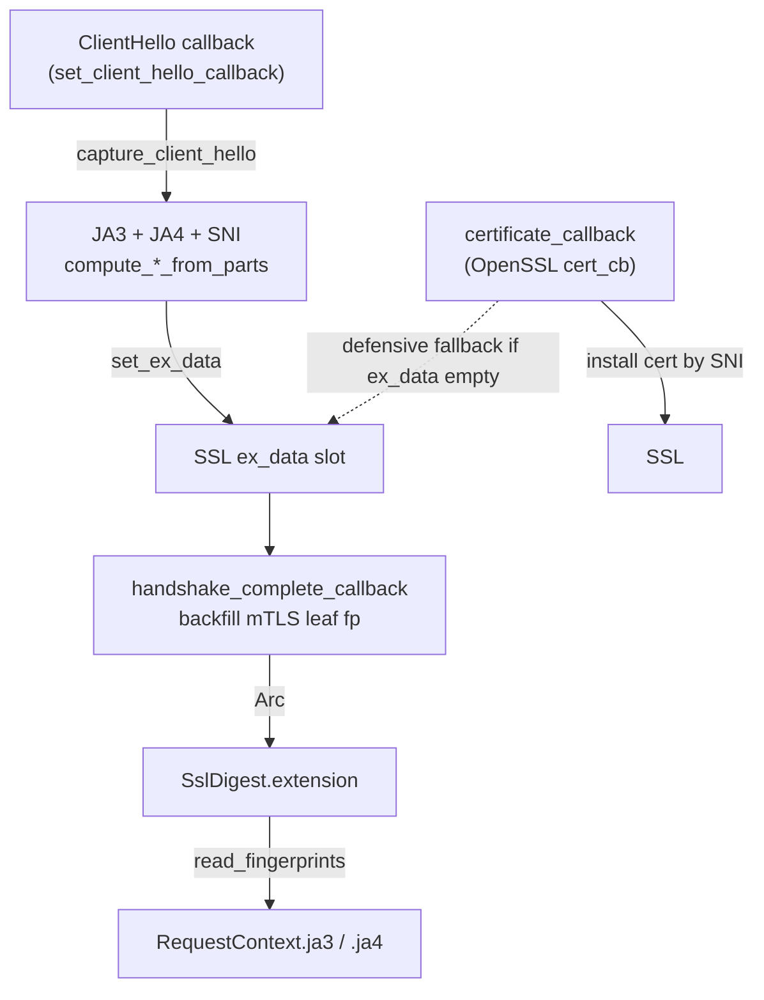

# TLS fingerprinting (JA3/JA4)

**Languages:** **English** · [Русский](../ru/11-tls-fingerprinting.md) · [中文](../zh/11-tls-fingerprinting.md)

AEGIS takes a family of fingerprints from every TLS/QUIC connection (JA3, JA4, JA4H, JA4T, JA4L, plus the server-side JA4S/JA4X/JA4TS/JA4LS, h2/h3 fp and mTLS fp) and uses them as signals for bot detection, deny lists, WAF rules, the ML scorer and Defence Arsenal. This document describes what exactly is computed in the code, **where** it is captured on the production path (Pingora) and which limitations should honestly be taken into account.

> Related documents: [WAF](./10-waf.md) (`field:"ja3"/"ja4"` rules), [Reputation](./12-reputation.md) (JA4 feeds), ML and the risk engine (the `ja4_churn`, `grease_anomaly` features, correlation), Arsenal, [TLS and certificates](./08-tls-certificates.md), [Architecture](./02-architecture.md).

---

## 1. Overview of the fingerprint family

| Fingerprint | Layer | Source in the code | What it hashes | Status |
|---|---|---|---|---|
| **JA3** (legacy) | TLS ClientHello | [`src/ja3.rs`](../../src/ja3.rs) | version, ciphers, extensions, groups, ec_point_formats → MD5 | works |
| **JA4** | TLS ClientHello | [`src/ja4.rs`](../../src/ja4.rs) `compute_ja4` | sorted ciphers/extensions + sig_algos → SHA-256 prefix | works |
| **JA4H** | HTTP request | [`src/ja4.rs`](../../src/ja4.rs) `compute_ja4h` | method, version, header names, cookie | works |
| **JA4T** | TCP SYN (client) | [`src/ja4.rs`](../../src/ja4.rs) `compute_ja4t` | window, options, MSS, wscale | partial (see §7) |
| **JA4L** | latency (client leg) | [`src/ja4.rs`](../../src/ja4.rs) `compute_ja4l_pair` | client_to_server_us / server_to_client_us | partial (see §7) |
| **JA4S** | TLS ServerHello | [`src/ja4_server.rs`](../../src/ja4_server.rs) `compute_ja4s_from_parts` | server version, ALPN, cipher, extensions | works (invoked from the glue code) |
| **JA4X** | X.509 certificate | [`src/ja4_server.rs`](../../src/ja4_server.rs) `compute_ja4x` | issuer DN, subject DN, ext OIDs | works (x509-parser) |
| **JA4TS** | TCP SYN-ACK (server) | [`src/ja4_server.rs`](../../src/ja4_server.rs) `compute_ja4ts` | window, MSS, scale, option kinds | partial (needs SYN capture) |
| **JA4LS** | latency (server leg) | [`src/ja4_server.rs`](../../src/ja4_server.rs) `compute_ja4ls` | SYN → SYN-ACK delta (ms) | partial |
| **H2FP** | HTTP/2 preface | [`src/h2_fp.rs`](../../src/h2_fp.rs) `parse_prefix` | SETTINGS, WINDOW_UPDATE, PRIORITY, pseudo-header order | works |
| **H3FP** | QUIC/HTTP3 | [`src/h3_fp.rs`](../../src/h3_fp.rs) `compute` | QUIC version, ALPN, transport parameters | approximation (see §6) |
| **mTLS fp** | client certificate | [`src/mtls_fp.rs`](../../src/mtls_fp.rs) `compute` | key type, chain/SAN count, issuer DN, leaf DER | works (only with mTLS) |

Derived signals:

- **JA4 churn** — per-IP JA4 rotation: [`src/ja4_churn.rs`](../../src/ja4_churn.rs).
- **GREASE anomaly** — a detector for utls/curl-impersonate spoofing: [`src/grease_anomaly.rs`](../../src/grease_anomaly.rs).
- **fp↔UA correlation** — a cross-check of JA4 vs User-Agent vs H2FP: [`src/fp_correlation.rs`](../../src/fp_correlation.rs).

---

## 2. JA3 (legacy, MD5)

JA3 (Salesforce) is a canonical string of 5 fields:

```
SSLVersion,Cipher,SSLExtension,EllipticCurve,EllipticCurvePointFormat
```

Each field is a hyphen-separated list of decimal numbers; the resulting MD5 hash (32 hex) matches what the abuse.ch / SSL Blacklist feeds publish, so an operator can paste the hash straight into a deny list.

There are two entry points in the code ([`src/ja3.rs`](../../src/ja3.rs)):

- `compute_ja3(buf)` — parses the raw bytes of the TLS record + ClientHello (used on the hyper path / in tests).
- `compute_ja3_from_parts(client_version, ciphers, extension_types, supported_groups, ec_point_formats)` — assembles the string from already-parsed fields. **This is the Pingora path**: inside the ClientHello callback, openssl returns the fields through accessors rather than as a raw record (`src/ja3.rs:108`).

GREASE values (RFC 8701) are dropped from ciphers, extensions and supported_groups — `ec_point_formats` is left as is (`src/ja3.rs:121`). This gives a stable hash for browsers that sprinkle in random GREASE code points.

Example (from the test `from_parts_with_grease_filters_identically`, `src/ja3.rs:413`):

```
input: ciphers=[0x0a0a,0x1301,0x1302,0x2a2a], exts=[0x0a0a,0,10,11,0xfafa]
JA3:   771,4865-4866,0-10-11,29-23,0   (GREASE 0x0a0a/0x2a2a/0xfafa removed)
```

The test `from_parts_matches_byte_parser` (`src/ja3.rs:369`) guarantees a **byte-for-byte** match between the byte parser and `from_parts`: the same client produces the same JA3 on both binaries.

`is_grease(v)` (`src/ja3.rs:190`) is a public function: both nibbles are equal and the low nibble is `a` (that is, `0x0A0A`, `0x1A1A`, …, `0xFAFA`).

---

## 3. JA4 (TLS ClientHello)

JA4 (FoxIO) is the successor to JA3. Advantages (from the header of [`src/ja4.rs`](../../src/ja4.rs)):

1. **Stability** — JA4 sorts ciphers/extensions before hashing, so a cosmetic reordering does not change the fingerprint.
2. **Human-readable prefix** — segment `a` is written in plain text.
3. **Several variants** — together they survive single-step evasion.

### 3.1. The JA4 string format

The canonical form is three segments separated by `_`:

```
<a>_<b>_<c>     for example  t13d1516h2_8daaf6152771_b186095e22b6
```

**Segment `a`** (`src/ja4.rs:225-237`) is assembled as: `{proto}{ver}{sni}{cipher_count}{ext_count}{alpn}`

| Part | Value | Where from |
|---|---|---|
| `proto` | `t` (TLS over TCP) or `q` (QUIC) | the `is_quic` flag |
| `ver` | `13`/`12`/`11`/`10`/`s3`/`00` | `tls_version_label` (`src/ja4.rs:361`) — the **highest** version from `supported_versions` is taken, not the legacy field |
| `sni` | `d` if SNI is present, otherwise `i` | extension 0 |
| `cipher_count` | hex(2), capped at `0x99` | `cap_hex_2`, GREASE already filtered out |
| `ext_count` | hex(2), **excluding** SNI(0) and ALPN(16) — a quirk of the specification | `src/ja4.rs:231` |
| `alpn` | first+last character of the first ALPN protocol, lowercase; empty → `00` | `alpn_tag` (`src/ja4.rs:383`) |

**Segment `b`** — SHA-256-prefix(12) of the sorted cipher list (hex4, comma-separated) (`src/ja4.rs:239`).

**Segment `c`** — SHA-256-prefix(12) of the sorted extensions (without SNI/ALPN), to which the signature_algorithms are appended via `_` (`src/ja4.rs:249-271`).

The hash is the first 6 bytes of SHA-256 in hex = 12 characters (`sha_prefix12`, `src/ja4.rs:766`), which is convenient for tracing fields and dashboards.

An example from the test `computes_ja4_prefix` (`src/ja4.rs:907`): a ClientHello with 2 ciphers (after stripping GREASE), SNI, ALPN `h2`, supported_versions `[0x0304,0x0303]`, 2 "counted" extensions → `a = t13d0202h2`.

### 3.2. Two entry points

- `compute_ja4(buf, is_quic)` — a raw ClientHello parser (`src/ja4.rs:126`).
- `compute_ja4_from_parts(...)` — from parsed fields; **this is the Pingora path** (`src/ja4.rs:290`). It expects the caller to have already filtered GREASE out of the ciphers/extensions; it picks the highest non-GREASE version itself.

The test `from_parts_matches_byte_parser_tls13` (`src/ja4.rs:1033`) confirms byte-identity of the full string and of all three segments between the two paths.

---

## 4. JA4H (TLS + HTTP)

JA4H fingerprints the HTTP request and protects against UA spoofing. The format is 4 segments: `<a>_<b>_<c>_<d>` ([`src/ja4.rs`](../../src/ja4.rs) `compute_ja4h`, `src/ja4.rs:426`).

**Segment `a`** = `{method2}{ver}{cookie}{referer}{header_count}{lang4}`:

- `method2` — the first 2 characters of the method, lowercase, padded with `0` (for example `DELETE`→`de`, `X`→`x0`).
- `ver` — `10`/`11`/`20`/`30`/`00`.
- `cookie` — `c` if there is a Cookie header, otherwise `n`.
- `referer` — `r`/`n`.
- `header_count` — hex(2) of the counted headers, **excluding** cookie, referer and the HTTP/2 pseudo-headers (`:method`, `:path`, …).
- `lang4` — the normalised primary range from `Accept-Language` (`en-US,en;q=0.9` → `enus`), padded to 4 characters with zeros.

**Segment `b`** — SHA-256-prefix(12) of the header names **in arrival order** (lowercase, comma-separated; cookie/referer excluded).

**Segments `c`/`d`** — SHA-256-prefix(12) of the **sorted** cookie names and of `name=value` respectively. Sorting makes the fingerprint resistant to cookie ordering (test `ja4h_basic_get_request`, `src/ja4.rs:951`).

Example: `GET`, HTTP/1.1, Cookie+Referer present, 3 counted headers, `en-US` → `a = ge11cr03enus`.

The hot path uses the zero-alloc variant `compute_ja4h_from_headermap` (`src/ja4.rs:539`), which works directly over `http::HeaderMap` — the behaviour is identical.

---

## 5. H2FP — the HTTP/2 fingerprint (Akamai-style)

[`src/h2_fp.rs`](../../src/h2_fp.rs) captures the state that an HTTP/2 client reveals at the start of a connection, **before** the application request. The `full()` format (`src/h2_fp.rs:59`):

```
SETTINGS|WINDOW_UPDATE|PRIORITY|PSEUDO
```

- **SETTINGS** — `id:value` pairs in arrival order, separated by `;`.
- **WINDOW_UPDATE** — the connection-level increment (or `0`).
- **PRIORITY** — a counter + the first tuple `count:stream:excl:dep:weight`.
- **PSEUDO** — the pseudo-header order from the first HEADERS frame: the letters `m`(method), `a`(authority), `s`(scheme), `p`(path).

`parse_prefix(buf)` reads frames from the preface (`PRI * HTTP/2.0...`) up to the first HEADERS (at most 16 frames), then stops. The SETTINGS ACK is ignored. If the buffer is truncated, a partial fingerprint is returned — the connection is not blocked because of a sniffing miss (`src/h2_fp.rs:90`).

The pseudo-header order is extracted without a full HPACK decoder: static-table indices 1–7 are scanned (`:authority`, `:method GET/POST`, `:path //index.html`, `:scheme http/https`) — enough for any well-formed request (`src/h2_fp.rs:156`). The dynamic table is not supported — a deliberate simplification.

Capturing the bytes before hyper is done by the `SniffedStream` adapter (`src/h2_fp.rs:382`): it buffers the bytes read, lets the sniffer inspect them, then transparently "replays" them to the downstream reader and immediately frees the buffer.

> Most "JA3/JA4-as-Chrome" spoofers do not bother matching at the HTTP/2 layer, so H2FP is a strong additional signal (see the correlation in §9).

---

## 6. H3FP — the HTTP/3 / QUIC fingerprint

⚠️ **Honest caveat.** A full JA4Q (FoxIO's QUIC variant) requires the raw bytes of the Initial packet — the length of the Initial header, the layout of the encrypted CRYPTO frame and the order of the transport_parameters inside the inner ClientHello. **quinn does not expose this** in user space (it consumes it inside the handshake state machine). Therefore [`src/h3_fp.rs`](../../src/h3_fp.rs) produces an **approximation** based on what quinn exposes after the handshake:

- the QUIC version (u32, `00000001` = RFC 9000),
- ALPN (`h3`, `h3-29`, …),
- the set of `(id, value)` transport parameters that quinn hands over.

Format: `q{version}{alpn}_{params_sha12}` (`src/h3_fp.rs:46`). The parameters are sorted before hashing, so the frame order does not matter (test `param_order_doesnt_change_hash`). The ALPN tag is consistent with JA4 (first+last character) so that Chrome-h3 lands next to Chrome-h2.

This is enough for a coarse distinction between major QUIC implementations (chromium / firefox / cronet / quiche / msquic), but it is **not** a byte-accurate JA4Q.

---

## 7. JA4T / JA4L and the server-side variants

### JA4T / JA4S / JA4X / JA4TS / JA4LS

- **JA4T** (`compute_ja4t`, `src/ja4.rs:666`): `{window}_{options}_{mss}_{wscale}`. ⚠️ The `options_order` and `window` fields are not exposed directly by the Linux kernel; without an eBPF SYN capture they are best-effort. On empty input the sentinel `0_0_0_0` is returned.
- **JA4L** (`compute_ja4l_pair`, `src/ja4.rs:700`): `{client_us}_{server_us}` in **microseconds**. ⚠️ `compute_ja4l(observed, done)` is the legacy form, producing `{rtt_us}_{rtt_us}` (identical halves) and kept for migration compatibility.
- **JA4S** (`compute_ja4s_from_parts`, `src/ja4_server.rs:54`): `t{ver}{proto}{alpn}_{cipher_hex4}_{ext_hash}`. For detecting upstream substitution: the JA4S of our upstream must not change between deployments.
- **JA4X** (`compute_ja4x`, `src/ja4_server.rs:91`): `{issuer_hash}_{subject_hash}_{ext_hash}` from the DER certificate (via `x509-parser`). Invalid DER → `None`.
- **JA4TS** (`compute_ja4ts`, `src/ja4_server.rs:122`): the SYN-ACK variant of JA4T. ⚠️ Requires a SYN-ACK capture.
- **JA4LS** (`compute_ja4ls`, `src/ja4_server.rs:147`): `{delta_ms:04}_00`, the SYN → SYN-ACK delta, capped at 9999.

All functions in [`src/ja4_server.rs`](../../src/ja4_server.rs) are pure and hot-path-safe (no allocations beyond the output string). V126.

---

## 8. The mTLS fingerprint

When the proxy is configured for client certificate authentication, [`src/mtls_fp.rs`](../../src/mtls_fp.rs) hashes the leaf certificate in a way that is stable against cosmetic changes. The format (`src/mtls_fp.rs:60`):

```
mtls_{kty}{chain_len}{san_count}{policy_hash}_{leaf_sha256_12}
```

- `kty`: `r`(RSA) / `e`(ECDSA) / `d`(Ed25519) / `?`(other) — detected from the OID bytes in the DER (`classify_key_type`, `src/mtls_fp.rs:150`).
- `chain_len`, `san_count` — one hex character each, capped at 9.
- `policy_hash` — SHA-256-prefix(12) of the issuer DN.
- `leaf_sha256_12` — SHA-256-prefix(12) of the DER leaf certificate.

The issuer DN is extracted by a bespoke mini ASN.1 parser (`extract_issuer_dn`, `src/mtls_fp.rs:188`) — two levels of SEQUENCE are traversed (Certificate → tbsCertificate). A comment in the code honestly records that the pre-V55 version silently returned `""` for every real certificate because of a missed nesting level.

Purpose: detecting "certificate leakage across a fleet" — a single stolen client certificate used from many IPs yields the same `mtls_*` regardless of the TLS version, JA3/JA4 and geolocation.

The DER helpers (`classify_key_type`, `count_san_entries`, `extract_issuer_dn`) are shared between hyper and Pingora — both binaries produce a **byte-identical** fingerprint (V55, `src/mtls_fp.rs:137`).

---

## 9. Where it is captured: the ClientHello callback (Pingora)

This is the key section for operators. On the production data plane ([`aegis-pingora`](../../src/proxy/pingora_tls.rs)), JA3/JA4 are taken in the OpenSSL **ClientHello callback**, registered via `set_client_hello_callback` in `aegis-pingora.rs`.

### 9.1. Why the ClientHello callback and not certificate_callback

This is recorded in the code and backed by a real bug (V246). The `SSL_client_hello_*` accessors (offered ciphers + extensions) return data **only** at the ClientHello stage. `certificate_callback` maps to the later OpenSSL `cert_cb`, where these accessors are **empty**, which produced a degenerate fingerprint `t12i000000_e3b0c44298fc`, **identical for every client** (`src/proxy/pingora_tls.rs:736-744`, `873-881`).

Therefore the actual capture is done by `capture_client_hello` (`src/proxy/pingora_tls.rs:745`), invoked from the ClientHello callback. Inside `certificate_callback` only the SNI-based certificate installation remains, plus a **defensive fallback** in case the ClientHello capture did not run (`src/proxy/pingora_tls.rs:882-886`).

### 9.2. Data flow



1. **`capture_client_hello`** reads the SNI, ciphers, extensions, supported_groups, ec_point_formats, sig_algorithms, supported_versions and ALPN via FFI helpers (`SSL_client_hello_get1_extensions_present`, `SSL_client_hello_get0_ext`) and `client_hello_ciphers()`/`client_hello_legacy_version()`, then calls `compute_ja3_from_parts` + `compute_ja4_from_parts`. The result is put into the **SSL ex_data** (`src/proxy/pingora_tls.rs:808-857`).
2. **`handshake_complete_callback`** re-reads the ex_data, fills in the mTLS leaf fp (which only becomes available after the handshake — the client certificate is sent **after** the ServerHello) and returns `TlsFingerprints` as an `Arc<dyn Any>`, which pingora puts into `SslDigest.extension` (`src/proxy/pingora_tls.rs:1025-1071`).
3. **`read_fingerprints(session)`** on the hot proxying path retrieves the fingerprints and sets `RequestContext.ja3` / `.ja4` (`src/proxy/pingora_tls.rs:1091`).

### 9.3. Critical type-erasure bugs (honestly)

🔴 The comment history in the code records two real bugs that caused JA3/JA4 to be **silently absent across the entire production path**:

- **V245** — `read_fingerprints` downcast to `Arc<TlsFingerprints>` (a double Arc), which nobody publishes, so the downcast **always** failed and returned `None`. Consequence: `ctx.ja4 == None`, JA3/JA4 deny lists, the `field:"ja4"/"ja3"` WAF rules, the JA4 ML features, the Arsenal corpus and JA4 reputation **did not fire** (`src/proxy/pingora_tls.rs:1115-1130`).
- **V250** — the move to the canonical `SslDigestExtension::get::<TlsFingerprints>()` (a downcast to the concrete type `TlsFingerprints`, not to `Arc<dyn Any>`), otherwise `get()` returns `None` (`src/proxy/pingora_tls.rs:1100-1112`).

The lesson for an operator: if on a production rig `ctx.ja4` is empty on every request, check exactly this glue code rather than the parsers. These bugs have already been fixed, but they are an example of a "silent" security regression.

### 9.4. The mTLS listener

mTLS is configured via `MtlsConfig` (`mtls.enabled`, `mtls.ca_paths`, `mtls.require_cert`) and applied to the `SslAcceptorBuilder` once at startup (`MtlsSetup`, `src/proxy/pingora_tls.rs:162`). With `require_cert=true`, `FAIL_IF_NO_PEER_CERT` is set (a handshake without a client certificate fails); with `false` — "verify if presented", and the `mtls` fp stays `None` for clients without a certificate.

---

## 10. LEVER 1 — the fingerprinting gate

Computing JA3 (MD5) + JA4 (2×SHA-256) costs ~18–22 heap allocations per full handshake. The `fingerprinting_enabled` flag (an atomic bool in `AegisTlsAccept`) allows skipping this, but it still stores a `TlsFingerprints` with `None` fields so that downstream handling of `None` is uniform (`src/proxy/pingora_tls.rs:140-156`, `756-770`).

**By default the gate is ON** (`build()` sets `true`, `src/proxy/pingora_tls.rs:417`). The binary sets `false` via `set_fingerprinting(false)` **only** when ALL detectable consumers are absent AND the operator has explicitly opted out via `AEGIS_TLS_FINGERPRINT=0`.

The gate MUST be `true` if at least one consumer is active (`src/proxy/pingora_tls.rs:142-149`):

- `ja3_deny_hashes` / `ja4_deny_prefixes` are configured;
- Defence Arsenal is enabled (ja4_corpus, ja4_churn, GREASE scoring);
- the `ja4_reputation` feed is active;
- there are WAF rules with `field:"ja3"`/`field:"ja4"` (inline rules are scanned at startup; external `rule_files` **forcibly** enable the gate, because their predicates cannot be inspected in advance and they are reloaded at runtime).

> The principle from the code: "when in doubt, compute — a miss here is a silent security regression". Enabling the gate is always safe (only ~18–22 allocations are spent); disabling it by mistake means silently breaking every fingerprint filter. It is set once at startup after all pipeline components have been assembled.

---

## 11. JA4 churn — the per-IP rotation detector

[`src/ja4_churn.rs`](../../src/ja4_churn.rs) (V177) catches attackers that rotate TLS fingerprints (utls, curl-impersonate, golang fhttp) and present a different JA4 every few requests from the same IP. A real browser keeps a single JA4 for hundreds of consecutive requests until a Chrome upgrade.

**Score** = the ratio of unique JA4s to the total number of observations in a per-IP sliding window:

- `0.0` — all requests with a single JA4 (a normal browser);
- `1.0` — every request is unique (rotation is happening);
- in between — typical of NAT (several real browsers behind one egress IP).

The RiskEngine treats `> 0.6` as suspicious and `> 0.9` as enforcement-grade (header of `src/ja4_churn.rs:21`).

Default configuration (`default_config`, `src/ja4_churn.rs:92`): a window of **60 s**, the last **16** samples. Storage is a `DashMap` with 128 shards (V230, to reduce contention under fan-in, `src/ja4_churn.rs:83`). A background `gc()` drops windows that have seen no traffic for longer than 4×TTL. An atomic `is_empty()` gives a fast path without locking a shard when the tracker is empty.

The score is fed into the ML scorer as the `ja4_churn` feature (see ML and the risk engine).

---

## 12. GREASE anomalies — the utls spoofing detector

[`src/grease_anomaly.rs`](../../src/grease_anomaly.rs) (V178). The idea: a client claiming through its JA4 to be Chrome must have Chrome-like GREASE values in the right positions. Real Chrome puts GREASE simultaneously in three slots:

1. a GREASE cipher at the start of the cipher list;
2. a GREASE extension at the start of the extension list;
3. a GREASE value at the start of the supported_versions payload.

utls/curl-impersonate often hardcode a single permutation and end up "2 out of 3" or put GREASE in the wrong place.

**Score** (`src/grease_anomaly.rs:42`):

```
score = 1 - (matches / 3)   if the JA4 looks like Chrome
score = 0                    if the client does not claim to be Chrome
```

`ja4_looks_like_chrome` (`src/grease_anomaly.rs:77`) is a cheap heuristic: the JA4 starts with `t13d15`/`t13d16` OR contains the cipher hash `_8daaf6152771_` (the Chrome seed from V176). The comment honestly notes that a "real" implementation should check against the V176 Ja4Corpus.

Where it is computed: the GREASE positions are extracted before filtering — in the Pingora capture, `ciphers.first()`, `extensions.first()`, `supported_versions.first()` (these are the **wire-order** lists before stripping) are fed into `grease_anomaly::observe`, then `score_against_ja4` is run against the JA4 just computed (`src/proxy/pingora_tls.rs:830-845`, `974-994`). There is also a separate function `extract_grease_positions` in the parser ([`src/ja4.rs`](../../src/ja4.rs)`:63`) for the byte path.

When Arsenal is present, the counters `grease_checks` and (when score > 0.5) `grease_anomalies` are incremented. Without Arsenal it is a no-op.

---

## 13. fp↔UA correlation (cross-fingerprint consistency)

[`src/fp_correlation.rs`](../../src/fp_correlation.rs) (V137) reduces the set of fingerprints to a single `CorrelationScore` ∈ [0.0, 1.0], where 0 = all signals agree and 1 = they contradict each other (almost certainly a tool pretending to be a browser). The canonical case: a Chrome JA4 + a curl User-Agent.

Weights (`correlate`, `src/fp_correlation.rs:166`):

| Indicator | Reason tag | Weight |
|---|---|---|
| JA4 family ≠ UA family, UA = Tool (curl/wget/python/Go/…) | `ja4_browser_ua_tool` | +0.55 |
| JA4 family ≠ UA family (browser vs browser) | `ja4_ua_family_mismatch` | +0.45 |
| H2FP family ≠ JA4 family | `ja4_h2fp_family_mismatch` | +0.35 |
| UA claims a browser, but there is no `Accept-Language` | `browser_ua_no_accept_language` | +0.15 |
| UA claims a browser, but there is no `Accept-Encoding` | `browser_ua_no_accept_encoding` | +0.10 |
| JA4 is present, JA4H is absent (a protocol probe) | `ja4_present_ja4h_missing` | +0.10 |

The total is clipped into [0, 1]. The reason tags are stable `&'static str` values, safe as Prometheus labels.

The family by JA4 (`ja4_family`, `src/fp_correlation.rs:97`) is determined from the cipher hash (segment `b`); the prefix table in the code is illustrative (`8daa`/`9b0f`/`1f4f`→Chrome and so on), a production deployment overrides it via a reputation feed (V138, see [Reputation](./12-reputation.md)). The UA classifier (`ua_family`, `src/fp_correlation.rs:119`) is substring-based, and the order of the checks matters (Edge before Chrome, because the Edge UA contains "Chrome").

> ⚠️ Why a score and not a hard rule: legitimate edge cases exist (corporate MITM proxies rewrite TLS and the UA independently, mobile networks compress headers, extensions add custom UAs). A hard "mismatch → deny" would produce false positives, so the score is combined with the other signals in the risk engine (V108). This score is a feature of the ML scorer (V122/V136) and a signal for the WAF risk engine.

A close but separate module is `client_consistency.rs` (CreepJS-style, V145), see [client-consistency.md](../en/reference/client-consistency.md).

---

## 14. Consistency with the hyper path, and application

- **Binary parity.** The tests `from_parts_matches_byte_parser` (JA3, `src/ja3.rs:369`) and `from_parts_matches_byte_parser_tls13` (JA4, `src/ja4.rs:1033`) guarantee that the byte parser (the rustls/quinn edge in hyper) and `from_parts` (the openssl TlsAccept in Pingora) produce identical fingerprints. For mTLS — shared DER helpers (V55).
- **Application of the fingerprints.** `RequestContext.ja3`/`.ja4` are consumed by: the `ja3_deny_hashes` / `ja4_deny_prefixes` deny lists, the `field:"ja3"/"ja4"` WAF rules, the ML features, the JA4 corpus and Arsenal reputation. (JA3 is not stored separately in `RequestContext` — it stays in `TlsFingerprints` for `/admin/tls/debug`, `src/proxy/pingora_tls.rs:536`.)

---

## 15. Honest caveats

1. **H3FP is an approximation, not JA4Q.** quinn does not expose the raw Initial bytes; the fingerprint is built from version/ALPN/transport params (§6). For strict QUIC fingerprinting this is not sufficient.
2. **JA4T/JA4L/JA4TS/JA4LS are best-effort.** Precise TCP SYN/SYN-ACK fields and sub-microsecond latency require an eBPF SYN capture, which the kernel does not provide out of the box; without it the fields are partial or sentinel (`0_0_0_0`).
3. **The browser families by JA4 are illustrative prefixes.** The tables in `fp_correlation.rs` and `grease_anomaly.rs` are community-derived and are meant to be overridden by a reputation feed (V138/V176). Do not treat them as a complete corpus.
4. **The Chrome GREASE heuristic is coarse.** `ja4_looks_like_chrome` checks against a prefix/a single cipher hash rather than against the full corpus.
5. **The silent type-erasure regression.** The V245/V250 bugs show that the parsers can be correct while the fingerprints are absent across the entire production path because of the `SslDigest.extension` glue code. Check `read_fingerprints` (§9.3).
6. **Fingerprinting benchmarks are in-process.** Any speed figures for JA3/JA4 computation from synthetic tests do not account for Pingora's I/O, syscalls and TLS negotiation. A full `aegis-pingora` under production load gives ↓15–30% vs synthetic; on a VM without AES-NI/SHA-NI the hashes are a further ×2–3 slower than on bare metal. Do not quote absolute numbers without these caveats. See Benchmarking and the authoritative SECURITY-AUDIT.

---

## 16. Where to look in the code

| Topic | File |
|---|---|
| JA3 | [`src/ja3.rs`](../../src/ja3.rs) |
| JA4 / JA4H / JA4T / JA4L | [`src/ja4.rs`](../../src/ja4.rs) |
| JA4S / JA4X / JA4TS / JA4LS | [`src/ja4_server.rs`](../../src/ja4_server.rs) |
| H2FP | [`src/h2_fp.rs`](../../src/h2_fp.rs) |
| H3FP | [`src/h3_fp.rs`](../../src/h3_fp.rs) |
| JA4 churn | [`src/ja4_churn.rs`](../../src/ja4_churn.rs) |
| mTLS fp | [`src/mtls_fp.rs`](../../src/mtls_fp.rs) |
| fp↔UA correlation | [`src/fp_correlation.rs`](../../src/fp_correlation.rs) |
| GREASE anomaly | [`src/grease_anomaly.rs`](../../src/grease_anomaly.rs) |
| Capture on Pingora (ClientHello callback, LEVER 1, ex_data) | [`src/proxy/pingora_tls.rs`](../../src/proxy/pingora_tls.rs) |
