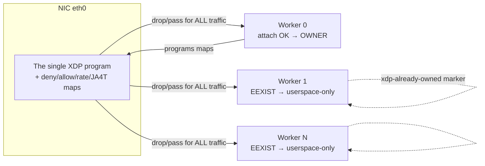

# XDP/eBPF kernel fast-path

**Languages:** **English** · [Русский](../ru/13-xdp-ebpf.md) · [中文](../zh/13-xdp-ebpf.md)

XDP (eXpress Data Path) is an eBPF program attached to the network card (NIC) that drops packets **in the kernel before they ever reach userspace**: known-forbidden IPs, rate-limit violations and SYN floods are cut off at the earliest possible stage. In AEGIS this is an **optional** accelerator for coarse L3/L4 filtering, not a replacement for L7 protection; when XDP is unavailable, everything degrades correctly to userspace filtering with no loss of functionality.

> Sources of truth for this document: [`src/xdp.rs`](../../src/xdp.rs), [`install.sh`](../../install.sh) (the `build_xdp_object`, `resolve_xdp_enable`, `resolve_xdp_iface` functions and systemd unit generation), [`src/filters/dynamic_trust.rs`](../../src/filters/dynamic_trust.rs), [`src/server.rs`](../../src/server.rs) (loading and counter export). Every statement below has been checked against this code.

---

## 1. What XDP does in AEGIS

The XDP program runs on the NIC (ideally in the driver) and, for every incoming packet, takes an `XDP_DROP` / `XDP_PASS` decision **before the `sk_buff` is allocated** in native mode. This gives line-rate rejection of junk and takes load off the softirq stack, conntrack, sockets and the AEGIS workers.

The in-kernel program (`aegis_xdp`, the program section; see `program_mut("aegis_xdp")` in [`src/xdp.rs:211`](../../src/xdp.rs)) performs the following checks. The order matters: the allow-list is checked **first** and bypasses all the rest entirely.

| Stage | What it does | Counter | Controlled from userspace via |
|---|---|---|---|
| **Allow-list (fast-pass)** | A packet from an IP in the allow map bypasses all downstream checks (deny / rate / SYN / WAF) | `fast_pass` | `ALLOW_V4` / `ALLOW_V6` map |
| **Deny-list** | Drops packets from IPs in the deny map | `drop_deny` | `DENY_V4` / `DENY_V6` map |
| **Rate-limit (token bucket)** | Drops if a source IP exceeds `burst` packets per `window_ns` | `drop_rate` | `RATE_CFG` (`WINDOW_NS`, `BURST`) |
| **SYN-flood guard** | A separate budget for TCP SYNs: drop above `syn_burst` SYNs per window | `drop_syn` | `RATE_CFG` (`SYN_BURST`) |
| **Allow-only mode** | Whitelist mode: everything except the allow-list is dropped | `drop_allowonly` | `RATE_CFG` (`ALLOW_ONLY`) |
| **Inline kernel WAF (Phase 3X)** | Drops packets whose HTTP request line matched a known scanner path prefix — they never reach userspace | `drop_waf` | (signatures inside the eBPF object) |
| **PASS** | The packet is handed to userspace (the normal path) | `pass` | — |

In addition, the XDP program **captures the JA4T SYN fingerprint** on the fly (TCP parameters from the SYN: window, MSS, WSCALE, the order of TCP options) into the `JA4T_V4` map. Userspace reads it through `read_ja4t_v4(src_ip, src_port)` ([`src/xdp.rs:394`](../../src/xdp.rs)) — this is used as the preferred source for passive TCP classification (`src/tcp_info.rs::capture_with_xdp`, see [`src/p0f.rs`](../../src/p0f.rs)). The capture exists for IPv4 only; for IPv6 `read_ja4t_v4` always returns `None` and the calling code falls back to `TCP_INFO`.

> ⚠️ An honest caveat about coverage. Rate limiting, the SYN guard, JA4T capture and allow/deny are **IPv4-first**. For IPv6 only the allow/deny maps are supported (`DENY_V6` / `ALLOW_V6`); the kernel rate limiter (`RATE_V4`) and JA4T capture (`JA4T_V4`) work over IPv4. This matches the overall status of IPv6 in AEGIS (see Security model).

### What XDP does NOT do

- **XDP does not by itself repel a volumetric L3/L4 flood.** It drops at the host already; if the link to the host is saturated, you need upstream — see BGP RTBH. XDP closes the "last mile" at the server, BGP/CDN covers the wire above it.
- **XDP does not replace L7 protection.** The inline kernel WAF only catches coarse scanner prefixes of the request line; full SQLi/XSS/traversal signatures, normalisation, JA4 fingerprinting and ML scoring remain in userspace (see [WAF](./10-waf.md), [TLS fingerprinting](./11-tls-fingerprinting.md), ML and risk engine).
- **XDP does not receive earned trust.** Earned dynamic trust is **deliberately** not pushed into the kernel allow map (section [4](#4-interaction-with-earned-trust-dynamic_trust)).

---

## 2. Building the eBPF object

The eBPF object is built separately from the main binary, because the kernel target (`bpfel-unknown-none`) requires a nightly toolchain and `build-std`. The logic lives in `build_xdp_object()` ([`install.sh:469`](../../install.sh)).

```sh
# From install.sh: build_xdp_object()
cargo +nightly build --release          # in the xdp/aegis-xdp-ebpf directory
# → target/bpfel-unknown-none/release/aegis-xdp
install -m 0644 -o root -g root <obj> "$AEGIS_XDP_OBJ"   # /var/lib/aegis/aegis-xdp.o by default
```

Key facts (all taken from the code):

- **Toolchain: nightly.** The `xdp/aegis-xdp-ebpf` crate is a separate workspace with its own `.cargo/config.toml`, which pins the `bpfel-unknown-none` target and `-Z build-std=core` ([`install.sh:476-477`](../../install.sh)). Hence `cargo +nightly`.
- **The `bpfel` target** = BPF little-endian. The object is an ELF in the format the kernel verifier understands.
- **`bpf-linker`.** aya 0.13 requires the `bpf-linker` binary to build for `bpfel-unknown-none` (it can emit BPF ELF). The installer installs it via `cargo install bpf-linker --locked` ([`install.sh:310-314`](../../install.sh)). Without it the eBPF build fails.
- **rust-src.** The installer installs `nightly` plus the `rust-src` component (for `build-std`) ([`install.sh:299-301`](../../install.sh)).
- **When it is built.** Only if `AEGIS_ENABLE_XDP=1` (the very first line of `build_xdp_object` is an early `return` otherwise) and only in `pingora` / `both` modes ([`install.sh:521`, `526`](../../install.sh)). In `hyper` mode XDP is forcibly disabled (`resolve_xdp_enable`, [`install.sh:137-140`](../../install.sh)), because the kernel fast path is wired through the pingora data plane.
- **The build fails loudly.** If the build did not produce `aegis-xdp`, the installer calls `fatal` ([`install.sh:481`](../../install.sh)) — there is no silent skip.

> The build is automatic in [install.sh](../../install.sh); there is no need to duplicate manual steps. Environment variables are documented in the script header and in section [3](#3-enabling-configuration-and-environment-variables) below. See also [Installation and operations](./03-installation.md).

---

## 3. Enabling, configuration and environment variables

### 3.1 Installer environment variables

| Variable / flag | Default value | Purpose |
|---|---|---|
| `AEGIS_ENABLE_XDP` | `auto` | `auto` \| `1` \| `0`. `auto` enables XDP on kernel ≥ 4.18 and in pingora/both mode |
| `--xdp` / `--no-xdp` | — | Force `AEGIS_ENABLE_XDP=1` / `=0` ([`install.sh:78-79`](../../install.sh)) |
| `AEGIS_XDP_IFACE` | `auto` | Interface to attach to. `auto` = the first non-`lo` interface in the `UP` state |
| `--xdp-iface <ifc>` | — | Explicit interface ([`install.sh:81`](../../install.sh)) |
| `AEGIS_XDP_OBJ` | `/var/lib/aegis/aegis-xdp.o` | Install path of the compiled eBPF object |

The `auto` logic:

- **`AEGIS_MODE=hyper` → XDP is always off** ([`install.sh:137`](../../install.sh)).
- **kernel < 4.18 → XDP is off** with a warning (`aya-ebpf` XDP support starts at 4.18; [`install.sh:146-150`](../../install.sh)).
- Otherwise it is on.

Interface selection under `auto` (`resolve_xdp_iface`, [`install.sh:197-207`](../../install.sh)): the first interface from `ip -br link show` for which `lo != $1` and `$2 == UP` is taken. If there is no UP interface at all, it falls back to `eth0` with a warning that the attach will end up in skb mode.

### 3.2 The `xdp { }` block in the config

The installer generates the following block in `aegis.conf` (only when `AEGIS_ENABLE_XDP=1`, [`install.sh:1024-1040`](../../install.sh)):

```conf
# Phase A XDP fast-path. Loaded into the kernel at startup; deny/allow
# maps are programmed from userspace. Detach happens automatically at shutdown.
xdp {
    enabled true;
    interface eth0;                       # from $AEGIS_XDP_IFACE
    bpf_object_path /var/lib/aegis/aegis-xdp.o;   # from $AEGIS_XDP_OBJ

    # Per-IPv4 kernel rate-limit. Both fields must be > 0, otherwise it is off.
    rate_window_ms 1000;
    rate_burst 200;
    # Per-IPv4 TCP-SYN budget (separate from the general limiter).
    syn_burst 100;
}
```

The field semantics correspond to `set_rate_config(window_ns, burst, syn_burst, allow_only)` ([`src/xdp.rs:358`](../../src/xdp.rs)):

- `window_ns == 0 || burst == 0` → the general rate limiter is off.
- `syn_burst == 0` → the dedicated SYN guard is off (the general limiter still applies).
- `allow_only` → whitelist mode (off by default; enabled by defensive actuators).

Loading at startup: `server.rs` reads `cfg.xdp` and, if `enabled`, calls `xdp::load(interface, bpf_object_path)` ([`src/server.rs:438-457`](../../src/server.rs)).

---

## 4. Interaction with earned trust (`dynamic_trust`)

This is a security-critical detail, fixed directly in the code. Earned dynamic trust (reputation earned by an IP over a series of clean requests) is **deliberately NOT pushed into the kernel allow map** (comment C2, [`src/filters/dynamic_trust.rs:241-260`](../../src/filters/dynamic_trust.rs)):

> The kernel allow map is a line-rate kernel fast-pass: a matching packet skips the **entire** downstream pipeline (deny / rate / SYN / WAF). If earned-trust IPs were promoted into it, their subsequent requests would never be inspected again, and trust could not self-correct — `observe_denied` and the WAF simply would not see the traffic to revoke trust. An attacker who built up reputation and then attacked would ride the kernel bypass indefinitely.

Therefore:

- **Trust promotion stays userspace-only.** `is_trusted` still gives a bypass fast path in the userspace handler, but the WAF and `observe_denied` keep working, so a single bad request demotes the IP.
- **The kernel allow map is reserved exclusively for operator-curated STATIC bypass entries** (`sync_allow_list`, programmed from `server.rs:133`).
- **The XDP handle in `dynamic_trust` is used ONLY for revocation** (`unallow`), not for addition (`with_xdp`, [`src/filters/dynamic_trust.rs:128-136`](../../src/filters/dynamic_trust.rs)). On trust revocation (`observe_denied`), on TTL/staleness eviction and on LRU eviction the code defensively calls `xdp.unallow(ip)` ([`src/filters/dynamic_trust.rs:300-302`, `342-344`, `390-392`](../../src/filters/dynamic_trust.rs)), so that no kernel allow entry outlives its userspace grant (for example a leaked operator entry).

The `dynamic_trust` tests (the `CountingXdp` struct, [`src/filters/dynamic_trust.rs:428`](../../src/filters/dynamic_trust.rs)) explicitly verify that earned trust **never** touches `allow_v4`/`allow_v6`.

The defence arsenal programs kernel deny through the `XdpDeny` actuator (`ActionKind::XdpDeny`, [`src/actuator.rs:51`](../../src/actuator.rs)) with a revert TTL (auto-undo). See Defence Arsenal.

---

## 5. Single owner per NIC (REUSEPORT siblings → EEXIST)

A NIC hosts **exactly one** XDP program. In production AEGIS runs as N workers with `SO_REUSEPORT` (see [Multiprocessing and workers](./06-workers.md)), and all of them try to attach XDP to the same interface — but only one wins. The rest get `EEXIST` (`os error 17`, "File exists").

This is **not an error** but the expected single-owner condition, and the code recognises it specifically:

- `is_already_attached()` ([`src/xdp.rs:163-178`](../../src/xdp.rs)) walks the error source chain and catches an `io::Error` with `raw_os_error() == Some(17)`, or the strings "File exists" / "os error 17".
- On EEXIST, `load_impl` returns an error with the sentinel marker `XDP_ALREADY_OWNED_MARKER = "xdp-already-owned-by-sibling-worker"` ([`src/xdp.rs:17`, `234`, `244`](../../src/xdp.rs)).
- The calling code logs this as an informational condition: this worker filters in userspace, while the **owner worker** of the program applies the deny/allow maps on the NIC for **all** traffic. Kernel maps are global to the interface, so a single owner is enough.



---

## 6. Attach modes: native (DRV) → SKB (generic)

`load_impl` first tries native mode, then falls back to SKB ([`src/xdp.rs:231-252`](../../src/xdp.rs)):

1. **Native / DRV** (`XdpFlags::default()`) — the program runs in the NIC driver, at line rate, before the `sk_buff` is allocated.
2. **SKB / generic** (`XdpFlags::SKB_MODE`) — the fallback if the driver cannot host XDP natively. Slower (packets are re-injected after the `sk_buff` is allocated), but it works on **any** Linux NIC, including `virtio-net` under hypervisors. Without this fallback, deployments on cloud VMs without native XDP would silently lose the kernel fast path.

EEXIST is recognised in both branches; any other SKB attach error yields an explicit fatal noting that both modes were tried.

---

## 7. Requirements

From the comments in the systemd unit generator ([`install.sh:1223-1231`](../../install.sh)) and `resolve_xdp_enable`:

| Requirement | Why | Where it is set |
|---|---|---|
| **Linux** + the `xdp` Cargo feature | Outside of this — `NoopXdp` (a no-op on all operations) | `cfg(all(target_os = "linux", feature = "xdp"))` in [`src/xdp.rs:132`](../../src/xdp.rs); the `pingora xdp` features in [`install.sh:452-453`](../../install.sh) |
| **Kernel ≥ 4.18** | The lower bound of XDP support in aya-ebpf | `resolve_xdp_enable` ([`install.sh:146`](../../install.sh)) |
| **`CAP_BPF`** | Loading/verifying the eBPF program | `AmbientCapabilities` / `CapabilityBoundingSet` |
| **`CAP_PERFMON`** | On kernel 6.x the verifier gates pointer/packet-data operations behind `perfmon_capable()`; without `CAP_PERFMON`, `BPF_PROG_LOAD` fails with `EACCES` (os err 13) **even when `CAP_BPF` is present** | same |
| **`CAP_NET_ADMIN`** | Attaching the program to the NIC | same |
| **`AF_NETLINK`** | The XDP attach goes through rtnetlink | `RestrictAddressFamilies` |
| **`CAP_SYS_RESOURCE`** + `LimitMEMLOCK=infinity` | Growth of BPF maps / locked memory above the default 64 KiB rlimit | `svc_cap`; `LimitMEMLOCK` ([`install.sh:1266`](../../install.sh)) |

With `AEGIS_ENABLE_XDP=1` the installer widens the worker capability set to
`CAP_NET_BIND_SERVICE CAP_NET_ADMIN CAP_SYS_RESOURCE CAP_BPF CAP_PERFMON`
and the address families to `AF_INET AF_INET6 AF_UNIX AF_NETLINK` ([`install.sh:1230-1231`](../../install.sh)). Without XDP the set is minimal (`CAP_NET_BIND_SERVICE`, no `AF_NETLINK`).

> ⚠️ ARM / VMs without a PMU. If the environment has no PMU (no `CAP_PERFMON` functionality), XDP will not load on kernel 6.x — this is expected. A graceful fallback to userspace filtering happens (see section [8](#8-degradation-if-xdp-is-unavailable)), and coarse L3/L4 dropping is taken over by the nftables backend where needed ([`src/nftables_backend.rs`](../../src/nftables_backend.rs)). See also [System requirements](./05-requirements.md).

For the full systemd hardening (`NoNewPrivileges`, `ProtectSystem=strict`, `RestrictNamespaces`, etc.) see Security model and [Installation and operations](./03-installation.md).

---

## 8. Degradation if XDP is unavailable

XDP is an **optional accelerator**. Architecturally, all the other code **never branches** on `cfg(target_os)`: the `XdpHandle` facade ([`src/xdp.rs:23`](../../src/xdp.rs)) is implemented by two types — `LinuxXdp` (the real one) and `NoopXdp` (all methods return `Ok(())`, `counters()` returns zeros, [`src/xdp.rs:100-127`](../../src/xdp.rs)).

`NoopXdp` is substituted in the following cases:

- The build is not Linux **or** is without the `xdp` feature (`xdp::load` immediately returns `NoopXdp` with a warning, [`src/xdp.rs:136-142`](../../src/xdp.rs)).
- There is no `xdp` block in the config, or `enabled = false` ([`src/server.rs:455-456`](../../src/server.rs)).
- **`xdp::load` failed** (for any reason, including missing capabilities or the verifier): `server.rs` logs the warning "XDP load failed — falling back to userspace filtering" and substitutes `NoopXdp` ([`src/server.rs:446-453`](../../src/server.rs)). The proxy startup is **not** aborted in this case.
- EEXIST from a sibling worker: the handle also becomes `NoopXdp`, but this is the normal single-owner situation — filtering goes through the owner's kernel maps (section [5](#5-single-owner-per-nic-reuseport-siblings--eexist)).

With `NoopXdp`:

- `sync_deny_list` / `sync_allow_list` run but program nothing (a no-op "success"); IP filtering is performed in userspace.
- All XDP counters are exported as zeros (see below).
- JA4T capture is unavailable → `read_ja4t_v4` → `None` → classification falls back to `TCP_INFO`.

In other words: without XDP, only the performance of the kernel fast path is lost, while the **filtering functionality is preserved** in userspace and (where present) in the nftables/iptables backends.

---

## 9. Fast-path counters and observability

The XDP counters are a per-CPU array in the kernel; userspace sums the values across all CPUs (`PerCpuArray`, [`src/xdp.rs:373-392`](../../src/xdp.rs)). The `XdpCounters` struct ([`src/xdp.rs:80-98`](../../src/xdp.rs)):

| Field | Prometheus metric | Meaning |
|---|---|---|
| `pass` | `aegis_xdp_pass` | Packets handed to userspace |
| `drop_deny` | `aegis_xdp_drop_deny` | Drops due to the deny list |
| `drop_rate` | `aegis_xdp_drop_rate` | Drops due to the per-IP token bucket |
| `drop_allowonly` | `aegis_xdp_drop_allowonly` | Drops in allow-only (whitelist) mode |
| `drop_syn` | `aegis_xdp_drop_syn` | Drops by the SYN-flood guard |
| `drop_waf` | `aegis_xdp_drop_waf` | Drops by the inline kernel WAF (Phase 3X, scanner paths) |
| `fast_pass` | — (present in the struct) | Packets that passed via the allow list and skipped all downstream checks |

> `fast_pass` is separated from `pass` so that the operator can see the share of trusted-bypass traffic without subtracting other PASS sources.

Export: the `GET /metrics` endpoint appends the XDP counters to the main runtime metrics in a single scrape ([`src/server.rs:1322-1336`](../../src/server.rs); `aegis_xdp_drop_waf` is the last metric in that block). On the hyper path there is also a simplified textual block `xdp_pass`/`xdp_drop_*` ([`src/server.rs:1481-1489`](../../src/server.rs)). When XDP is off, `xdp_h.counters().unwrap_or_default()` returns zeros — the metrics are present but equal to 0 (this is documented in [`src/proxy/pingora_admin.rs:3613`](../../src/proxy/pingora_admin.rs)).

For more on export and the panel, see Metrics and telemetry and the Admin panel.

---

## 10. Maintaining the JA4T map (eviction)

The eBPF program **never evicts entries by itself** — JA4T SYN fingerprints accumulate in `JA4T_V4`, and during port-scan bursts the map can fill up with dead 4-tuples. Userspace periodically sweeps out stale entries via `evict_ja4t_v4(max_age_ns)` ([`src/xdp.rs:413-442`](../../src/xdp.rs)): it scans the map, marks entries with `captured_at_ns < now - max_age_ns` and deletes them, returning the number removed. The timestamps are `CLOCK_MONOTONIC` in ns (the same clock that `bpf_ktime_get_ns` stamps in the kernel, so the comparison is direct; `read_ktime_ns`, [`src/xdp.rs:291-303`](../../src/xdp.rs)). On `NoopXdp` this operation is a no-op (`Ok(0)`).

---

## 11. Short checklist for the operator

1. Mode **pingora** or **both** (in hyper, XDP is disabled by design).
2. Kernel **≥ 4.18** (for 6.x, `CAP_PERFMON` is mandatory, otherwise `BPF_PROG_LOAD` → EACCES).
3. Installation: `sudo bash install.sh` (XDP in `auto` will enable itself); or explicitly `--xdp` / `--no-xdp`, with the interface via `--xdp-iface`.
4. Checking the load: in the logs `XDP fast-path loaded` / `XDP attached in SKB mode`; sibling workers will show the informational `xdp-already-owned-by-sibling-worker`.
5. Checking operation: `curl http://<host>:<admin>/metrics | grep aegis_xdp_` — non-zero `drop_*` under attack.
6. If there are verifier/permission problems: look for the warning "XDP load failed — falling back to userspace filtering" — the proxy will keep working in userspace. For diagnostics see FAQ and troubleshooting.

---

## Related documents

- BGP RTBH — upstream protection against volumetric floods (XDP only covers the host).
- [Rate limiting](./14-rate-limiting.md) — userspace per-IP/per-endpoint limits (XDP is the coarse kernel level).
- Defence Arsenal, scenarios and actuators — the `XdpDeny` actuator and revert TTL.
- [Multiprocessing, REUSEPORT and workers](./06-workers.md) — the single-owner model.
- [System requirements](./05-requirements.md), Security model — capabilities and hardening.
- Metrics and telemetry — counter export.
