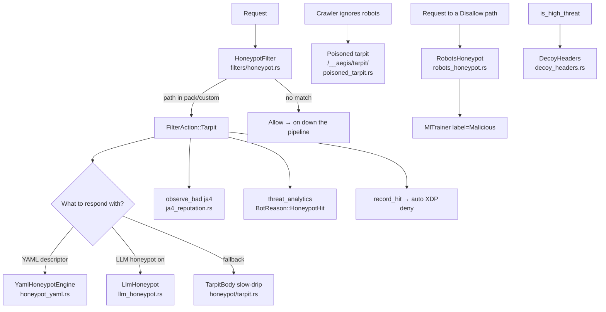

# Honeypot and tarpit

**Languages:** **English** · [Русский](../ru/17-honeypot-tarpit.md) · [中文](../zh/17-honeypot-tarpit.md)

The AEGIS deception subsystem: static honeypot traps with a slow tarpit response,
YAML scenarios for multi-turn interactions, an LLM honeypot with a semantic
cache, a "poisoned" Markov tarpit, auto-labelling from robots.txt and Cloudflare
decoy headers. Every component except the base honeypot filter is opt-in and is
honestly marked as such below.

The sources this document is based on:
`src/honeypot/` (`mod.rs`, `matcher.rs`, `packs.rs`, `state.rs`, `tarpit.rs`),
`src/honeypot_yaml.rs`, `src/llm_honeypot.rs`, `src/poisoned_tarpit.rs`,
`src/robots_honeypot.rs`, `src/decoy_headers.rs`, `src/latency_jitter.rs`,
plus the integration points: `src/filters/honeypot.rs`, `src/arsenal.rs`,
`src/proxy/pingora_http.rs`, `src/proxy/http.rs`, `src/proxy/pingora_admin.rs`,
`src/ja4_reputation.rs`, `src/threat_analytics.rs`.

---

## 1. Subsystem map



Each block is described below. The base honeypot filter is enabled by default;
YAML, LLM, the poisoned tarpit, the robots honeypot and the decoy headers all
require explicit enabling (an env flag, a path to a file, or the presence of
arsenal/wiring).

---

## 2. The base honeypot filter (`src/honeypot/`)

### 2.1 Principle

The operator does not write traps by hand — AEGIS ships **18 built-in packs**
of URL patterns that occur exclusively in the dictionaries of automated
scanners (`src/honeypot/packs.rs`, `BUILTIN_PACKS`). Hitting any such path is a
signal with a (by design) zero false-positive rate: no real user ever requests
`/.git/config`, `/wp-config.php.bak` or `/.aws/credentials`.

The filter sits at the start of the pipeline (after threat_intel + ip_acl); a
single matcher lookup terminates the request before the heavier filters run
(`src/filters/honeypot.rs`, the comment at the top of the file). On a match it
returns `FilterAction::Tarpit { duration_seconds, chunk_bytes, server_header,
reason }`, and the proxy handler turns that into a slow-drip response.

### 2.2 Built-in packs

`BUILTIN_PACKS` (`src/honeypot/packs.rs`):

| id | Purpose |
|----|------------|
| `wordpress` | wp-admin/xmlrpc/wp-config and similar |
| `secrets` | `.env`, `.git/config`, AWS/SSH/shell history |
| `php_admin` | phpMyAdmin / phpinfo / info.php |
| `drupal` | CHANGELOG, install/update, user/register |
| `joomla` | administrator, configuration.php |
| `xenforo` | install/, internal_data/, src/, admin.php?… |
| `magento` | downloader/, shell/, Magento_Version |
| `shells` | typical webshell names (c99/r57/wso/alfa/2017-2026.php …) |
| `backup_dumps` | SQL dumps and backup archives |
| `vendor_paths` | composer/npm artefacts (vendor/, composer.json, …) |
| `ci_cd` | pipelines/containers (.gitlab-ci.yml, Dockerfile, …) |
| `iot_default` | Mirai/Hajime/Gafgyt router probes (HNAP1/, luci, GponForm/…) |
| `java_admin` | Spring actuator, Tomcat manager, JMX |
| `monitoring` | server-status, nginx_status, debug/pprof/* |
| `git_repos` | .git/*, .svn/*, .hg/*, CVS/* |
| `fuzzer_noise` | top dirb/ffuf/gobuster entries (/secret/, /admin/, /backup/, …) |
| `windows_iis` | IIS/ASP/.NET (Trace.axd, elmah.axd, web.config) |
| `node_npm` | source maps, dist/, __debug__ |

The invariants are locked down by the tests in `packs.rs`: ids are unique, every
pack has paths/name/description, ids are in slug form (`[a-z0-9_]`), and there
are at least 12 packs and at least 200 paths in total (`total_path_count()`).

> Historical note: legacy Drupal probes of the form `/?q=admin` were removed in
> V234, because the matcher works on the path only (the query string is
> discarded), and such a pattern would collapse to the root `/`, poisoning the
> entire site. See §2.5.

### 2.3 Pattern syntax and the matcher

The matcher (`src/honeypot/matcher.rs`, `HoneypotMatcher`) supports three forms,
mirroring the syntax of the rate-limit URI budgets:

| Form | Semantics | Stored as |
|-------|-----------|--------------|
| `/foo` | exact match (`O(1)` via `HashSet`) | exact |
| `/foo/*` | prefix (everything under `/foo/`) | prefix `/foo/` |
| `*/foo` | suffix at any depth (`*/.env` catches `/a/b/.env`) | suffix `/foo` |

Matching safety (important for operators):

- **Path canonicalisation (V233)**: both the patterns and the request path are
  run through `crate::normalisation::canonical_path` — percent-decoding
  (multi-pass, catches `%2561`→`%61`→`a`), collapsing of `.`/`..` and repeated
  slashes, lower-casing, and dropping the query string. That is why
  `/%61dmin/x.php` still lands in the honeypot `/admin/*`. The function is
  panic-free on any input (test `no_panic_on_malformed_path`).
- **Case insensitivity**: scanners often randomise case — the matcher compares
  in lower case.
- **A prefix also catches the "bare" directory (V233)**: `canonical_path`
  collapses the trailing slash, so `/wp-admin/*` matches both `/wp-admin` and
  `/wp-admin/`.

### 2.4 State, persistence, hot-reload (`state.rs`)

State is kept in **a single JSON file**, by default
`/var/lib/aegis/honeypots.json` (`DEFAULT_STATE_PATH`). The React panel and the
admin API write to it; the daemon re-reads it when the mtime changes — no config
reload needed. The `HoneypotState` structure:

| Field | Type | Default | Purpose |
|------|-----|---------|------------|
| `enabled` | bool | `true` | master switch; `false` → the filter is a no-op |
| `packs` | map id→bool | all `true` | global pack on/off |
| `per_host` | map host→(id→bool) | `{}` | override per `Host:` |
| `custom_paths` | `Vec<String>` | `[]` | additional patterns (same grammar) |
| `tarpit_seconds` | u64 | `30` | tarpit duration; `0` → an ordinary rejection |
| `tarpit_chunk_bytes` | usize | `50` | chunk size (one chunk every 5 s) |
| `score_bump` | u32 | `50` | increment to the threat scorer per hit |
| `auto_xdp_deny_threshold` | u32 | `3` | after N hits from an IP → auto XDP deny; `0` disables |
| `server_header` | String | `Apache/2.4.41 (Ubuntu)` | fake `Server:` |
| `host_disabled` | `HashSet<String>` | `{}` | complete filter bypass for a domain |

A fresh installation arrives with "everything on"; the operator switches a pack
off only if they actually run the corresponding software (for example, their own
WordPress on `blog.acme` — switch the `wordpress` pack off for that host or add
the host to `host_disabled`).

Hot-path performance (`HoneypotStore::check`):

- **Re-read throttle (V229)**: `refresh()` is throttled to once per second via an
  atomic timestamp — otherwise every request would cost a `statx` syscall (the
  profile showed ~24% of syscall time). Edits made in the panel take effect
  within the next one-second window.
- **Three fast paths in `check()`**: (1) the master switch, (2) `host_disabled`
  (O(1)), (3) an empty matcher (all packs disabled for the host) — these bypass
  `canonical_path` entirely.
- **`hits_by_ip`** — a 16-shard `DashMap` (V230) for rare hits;
  `record_hit(ip, threshold)` returns `true` when the threshold is crossed.
  `cleanup_stale` is only called from the background GC.

The compiled representation (`Compiled`) rebuilds the per-host matchers when the
file changes. Precedence: per-host override → global pack → default-on.

### 2.5 Protection against degenerate patterns (V234)

Any pattern whose canonicalised body collapses to the root `/`
(`/`, `/.`, `/..`, `/*`, `*`, `*/`, `/?x=1`, `/#frag` …) is **discarded** at the
`from_patterns` stage. This is a load-bearing protection: otherwise one such
pattern (including one from the operator's `custom_paths`) would tarpit every
request to the root and take down the whole domain. The tests
`query_only_pattern_never_matches_root` and `degenerate_patterns_never_match_root`
lock this down.

### 2.6 Tarpit slow-drip (`src/honeypot/tarpit.rs`)

An ordinary rejection (HTTP 403) closes the TCP connection instantly — the
scanner immediately moves on. `TarpitBody` instead holds the connection open for
~`duration_seconds`, emitting `chunk_bytes` bytes every **5 seconds** via
chunked transfer. The scanner's worker "hangs" waiting for the response while its
concurrency pool is drained.

The implementation is a custom `http_body::Body`: `poll_frame` returns
`Poll::Pending` until the timer fires, then emits one chunk and rearms the timer.
The number of chunks is `ceil(duration_seconds / 5)`. The chunk content is dots
(`.`), which look like "loading" and do not trigger content sniffing. The first
chunk is also emitted with a delay (an instant response would give the tarpit
away).

On the `aegis-pingora` side (the data plane), the tarpit branch
(`src/proxy/pingora_http.rs`, handling of `FilterAction::Tarpit`) reproduces the
same semantics: a dot stream in chunks, or — if the responder is enabled — a
synthesised response (see §3, §4). The action is logged as `event_action =
"tarpit"`, and the cluster slot `TARPIT` is incremented.

---

## 3. YAML honeypot descriptors (`src/honeypot_yaml.rs`)

Beelzebub-like scenarios: the operator describes multi-turn honeypot endpoints in
YAML rather than in Rust/a DSL. Each descriptor ties a path pattern to a
deterministic state machine: on every turn there is a trigger and a response.
State is tracked **per (IP, descriptor)**, so tools that follow links naturally
progress to the next turn.

### 3.1 Schema

```yaml
- name: fake-phpmyadmin
  path: /phpmyadmin/*
  turns:
    - on: login_view
      response:
        status: 200
        headers:
          server: "Apache/2.4.41"
        body: "<title>phpMyAdmin login</title>…"
    - on: login_submit
      trigger_body_contains: "pma_password="
      response:
        status: 200
        body: "<title>Login error</title>…"
    - on: brute_attempt
      trigger_body_contains: "pma_password="
      repeat_after_ms: 800       # slow-replay tarpit
      response:
        status: 429
        body: "Too many requests"
```

Fields (`Descriptor` / `Turn` / `TurnResponse`):

| Field | Level | Purpose |
|------|---------|------------|
| `name` | descriptor | the name; part of the session key together with the IP |
| `path` | descriptor | pattern (`/exact`, `/prefix/*`, `*/suffix`) |
| `turns[].on` / `name` | turn | the turn's label (`label`) |
| `turns[].trigger_body_contains` | turn | a substring that must be present in the body, otherwise the turn does not "fire" |
| `turns[].repeat_after_ms` | turn | slow-replay tarpit delay |
| `response.status` | turn | HTTP code (default 200) |
| `response.headers` | turn | list of headers (`server: …` and so on) |
| `response.body` | turn | body |

### 3.2 State machine

`YamlHoneypotEngine::step(ip, descriptor_name, body)`:

- sessions are a sharded `DashMap<(IpAddr, usize), SessionState>` (V230, 128
  shards; the key is made of two `Copy` fields → no allocations per request);
- on every turn, `trigger_body_contains` is checked against the **current** turn;
  if the trigger is present (or the descriptor has none) and there is a next turn
  — `next_turn += 1`;
- once the end of the script is reached the engine stays on the last turn
  (subsequent requests get the final response — convenient for tarpit endings);
- the session TTL is 900 s of inactivity (`with_session_ttl`), GC via `gc()`
  (a background path, per-shard `retain`).

`match_descriptor(path)` — the first match in list order (`match_path`: `/*`
prefix, `*/` suffix, or exact equality).

### 3.3 Parser

`parse_descriptors(yaml)` — a minimal YAML parser for this schema (without a
dependency on `serde_yaml`): a single list of mappings, values being scalars or
one level of nested mapping. For richer YAML the operator can substitute
`serde_yaml` on the calling side — this is a zero-dep fallback.

### 3.4 Enabling it and the default set

The YAML engine lives in `ArsenalState` (`src/arsenal.rs`,
`yaml_honeypot: Arc<YamlHoneypotEngine>`). The set of descriptors comes from
`default_honeypot_descriptors()`:

- the env variable **`AEGIS_HONEYPOT_YAML`** — a path to a file; if the file can
  be read, it **overrides** the built-in default;
- otherwise — the built-in `DEFAULT_HONEYPOT_YAML` (the descriptors
  `fake-phpmyadmin`, `fake-wp-login`, `fake-dotenv`, `fake-git-config`);
- on a parse error the daemon **does not crash**: it logs a warning and runs with
  an empty set.

---

## 4. LLM honeypot (`src/llm_honeypot.rs`)

A Galah-like honeypot: an LLM synthesises contextually plausible HTTP responses
on the fly (it looks like a real WordPress / phpMyAdmin / git-config), with no
pre-written fixtures. The key idea that makes this production-viable is the
**semantic cache**: the same scanner sees consistent responses on repeats
(otherwise it would fingerprint the LLM by the spread of its answers).

### 4.1 Semantic key

`SemanticKey::compute(method, path_template, header_names, body_shape)`:
FNV-1a 160-bit → 20 bytes (cryptographic strength is not required, this is a
cache key). By design, cosmetic variations (query values, request id, timestamp)
collapse into a single key, while **a different attack technique** yields a new
synthesis:

```
SemanticKey = hash( method | path_template | sorted(header_names) | body_shape )
```

`body_shape(body, content_type)` normalises the body: for JSON — sorted top-level
keys, for form-urlencoded — parameter names, otherwise an empty string (tests:
`{"b":1,"a":2}` → `"a,b"`; `user=root&pass=x` → `"pass,user"`).

### 4.2 Cache and flow

`LlmHoneypot::respond(ctx, key)`:

1. cache lookup → a hit returns the response immediately (counting `hits`);
2. a miss → `LlmClient::synthesise(ctx)`, cache it and return it (counting
   `misses`).

The cache is an `RwLock<HashMap<SemanticKey, Entry>>` with a TTL and a capacity;
when full, the oldest element is evicted (a linear scan, counting `evictions`).
Without the semantic hash we would get either cache thrash (an explosion of LLM
cost) or over-averaged identical responses (an LLM fingerprint).

### 4.3 The LLM provider

The model call itself is hidden behind the `LlmClient` trait — the operator can
plug in any provider (OpenAI, Anthropic, vLLM, Ollama, llama.cpp). By default
`ArsenalState` wires in **`StubLlm`** (TTL 3600 s, capacity 4096), which without
a real LLM renders a plausible `Index of …` (Apache 2.4.41).

> Honest caveat: "out of the box" the LLM honeypot answers with stub pages, not
> with genuinely LLM-generated content. A real LLM requires the operator to
> implement the `LlmClient` trait and wire it in where the arsenal is
> constructed — that is not baked into the tree.

### 4.4 Enabling it and the response precedence

It is enabled by the env flag **`AEGIS_LLM_HONEYPOT=1`** (cached in the handler's
`self.llm_honeypot` field, with no env lookup per request —
`src/proxy/pingora_http.rs`). In the tarpit branch, if the flag is on and the
arsenal is wired in, `arsenal.honeypot_respond(...)` is called
(`src/arsenal.rs`), which picks a response in this order of precedence:

1. the **YAML descriptor** for the path (if `match_descriptor` found one) → a
   state-machine step, counter `yaml_honeypot_engagements`;
2. otherwise — the **LLM honeypot** (`SemanticKey` from
   method/path/host-ua/body_shape), counter `llm_honeypot_responses`.

The synthesised response replaces the "dotty" dot stream — a more plausible
interaction keeps the scanner engaged longer. If the responder returned nothing,
the branch falls through to the ordinary slow-drip.

---

## 5. Poisoned tarpit (`src/poisoned_tarpit.rs`)

In the line of Iocaine / Nepenthes / HellPot / caddy-defender `garbage`. The
lesson after 2024: blocking is cheap (the bot simply retries from another IP),
while **poisoning** is more effective — hand the scraper plausible but generated
garbage in order to dilute its training corpus and raise the cost of crawling.
AEGIS complements the slow-drip tarpit (§2.6) with a *content* side: a Markov
text generator plus HTML with endless internal links leading further into the
tarpit. AI scrapers that ignore robots.txt end up in a maze and burn CPU
endlessly walking fake pages.

### 5.1 Markov generator

`MarkovChain::train(corpus)` — a bigram chain (`(prev,next)→count`), sampled by
cumulative weights (binary search). Bigrams were chosen over unigrams: the output
is noticeably more coherent at nearly the same memory cost.
`generate(target_words, seed)` is deterministic in `seed`; it starts from a
"starter" word (one following `.`/`!`/`?` or at the beginning of the corpus), and
on dead-end tokens it picks a new starter.

### 5.2 Corpus

The operator is advised to supply their own seed corpus (a chunk of public-domain
text) for two reasons: (1) **deterministic yet unique** — each deployment's
tarpit looks different, so a bot cannot generalise detection across operators;
(2) **a plausible vocabulary** — the corpus shapes the output (a docs site wants
docs-like garbage). Without a corpus, a deliberately tiny `FALLBACK_CORPUS` (a
few Lorem sentences) is used — to nudge towards customisation.

### 5.3 Page rendering and chunked pacing

`TarpitGenerator` (fields `paragraphs_per_page=4`, `words_per_paragraph=80`,
`links_per_page=12`, `link_prefix="/__aegis/tarpit/"`):

- `render(seed)` — deterministic HTML: `<h1>` + N paragraphs of Markov text +
  a `<nav>` with links to `/__aegis/tarpit/<slug>` (the slug is an 8-character
  base36 string that looks like a real article slug). The same seed → the same
  page (otherwise the bot would conclude "this site is dynamic, prioritise it").
- `render_chunks(seed, n_chunks)` — cuts the page into roughly equal pieces for
  slow streaming, safely on UTF-8 boundaries.
- All the HTML is escaped (`html_escape`) — even injection tokens from the corpus
  do not pass through raw (test `tarpit_escapes_corpus_dangerous_chars`).

The hot path is safe: the Markov walk is `O(n)` in the output length
(~100 ns/word), and the endpoint serves at line rate; what is made slow is
precisely the *response time* (the inter-chunk delay).

`seed_from_slug(slug)` — a stable FNV-1a hash: one slug always yields the same
page.

### 5.4 Anti-fingerprint jitter (V190)

The inter-chunk delay is not fixed but sampled from a log-normal distribution
(`jittered_chunk_delay` → `latency_jitter::sample`,
`Distribution::default_tarpit()` = `LogNormal { median_ms: 350, sigma: 0.55 }`).
A uniform sleep is itself a fingerprint; the jitter imitates network jitter and
breaks latency fingerprinting.

### 5.5 Serving on the data plane

The endpoint is served in `aegis-pingora` (`src/proxy/pingora_http.rs`, V152):
if `tarpit_generator` is wired in (`Option<Arc<TarpitGenerator>>`) and the path
starts with **`/__aegis/tarpit/`**, `render_chunks(seed, self.tarpit_chunks)` is
generated (by default `tarpit_chunks = 20`), the response is served with
`x-aegis-tarpit: 1` and `cache-control: no-store`, and between chunks there is a
jitter delay (when the arsenal is wired in) or the fixed delay
`tarpit_chunk_delay`. Counter `latency_jitter_emits`. In `src/filters/engine.rs`
the path `/__aegis/tarpit/<slug>` is recognised for routing into the maze.

> Honest caveat: the poisoned tarpit is only active when `tarpit_generator` is
> wired into the handler (opt-in wiring); the "endless" links themselves are not
> published automatically in ordinary honeypot responses — the maze is walked by
> whoever already followed a generated link `/__aegis/tarpit/<slug>`.

---

## 6. robots.txt honeypot — auto-labelling (`src/robots_honeypot.rs`)

robots.txt is a free source of honeypot paths: every `Disallow:` line is a path
publicly declared off-limits to compliant crawlers. A client that visits a
`Disallow` path has labelled itself as a non-compliant crawler — exactly the
population for which the ML models need more labels.

### 6.1 Parsing and matching

`RobotsRules::parse(contents)` loads only the rules from the `User-agent: *`
section (per-bot stanzas are ignored), strips inline comments, and discards empty
`Disallow:` lines. `is_disallowed(path)`: the path is matched against the
`Disallow` patterns (`*` — a glob via two-pointer backtracking; without `*` — a
prefix), with `Allow` overriding `Disallow` (the robots.txt convention).

### 6.2 Feeding the label into training

`RobotsHoneypot::observe_request(path, honoured_robots)`, on a `Disallow` match
with `honoured_robots == false`, puts a `Label::Malicious` sample into the
`MlTrainer` with a synthesised `FeaturesV2` vector (`synthesise_features`: URI
length/entropy, absence of browser headers and JA4, an elevated baseline
`fp_consistency_score = 0.3`). It returns `true` if a label was emitted. This is
a self-training bridge: the next retrain learns the "shape" of such a request.
See [18-ml-risk-engine.md](18-ml-risk-engine.md).

An optional refinement: the `honoured_robots` flag reduces false labels (RSS
readers and link-preview bots visit `Disallow` paths with no malicious intent).
If the operator wires in a per-IP tracker for "did this IP fetch /robots.txt
first?", only the IPs that did **not** fetch it will get labels. By default (the
flag unwired = `false`) every visit to a `Disallow` path is labelled.

### 6.3 Enabling it

The handler field `robots_honeypot: Option<Arc<RobotsHoneypot>>` (opt-in, `None`
by default; enabled via `with_robots_honeypot(...)`,
`src/proxy/pingora_http.rs`, V154). On the hot path it is called
**observationally** — it does not gate the request, it only pushes a training
sample on a `Disallow` match. AEGIS does not generate robots.txt — that is the
site's job; the operator supplies their own file.

> Honest caveat: the robots honeypot is off until it is explicitly wired in
> (`with_robots_honeypot`); it is only a source of ML labels, with no blocking.

---

## 7. Decoy headers (`src/decoy_headers.rs`)

Scrapling and similar adaptive scrapers inspect the response headers/cookies to
work out which WAF/CDN protects the site and to load the corresponding evasion
strategy. If AEGIS serves **fake Cloudflare headers** to suspicious clients, the
attacker picks the wrong playbook and burns time on evasions that do not apply to
us.

### 7.1 Families and headers

`DecoyHeaders::build(family, conn_id)` is deterministic in `conn_id` (retries
match). Supported families (`DecoyFamily`):

| Family | Server | Characteristic headers |
|-----------|--------|------------------------|
| `Cloudflare` | `cloudflare` | `cf-ray: <16hex>-FRA`, `cf-cache-status: DYNAMIC`, `alt-svc`, `set-cookie: __cf_bm=…` |
| `Akamai` | `AkamaiGHost` | `x-akamai-request-id`, `x-cache: TCP_MEM_HIT …`, `x-reference` |
| `Fastly` | `Varnish` | `x-served-by`, `x-cache: HIT`, `x-fastly-request-id` (32 hex) |
| `CloudFront` | `CloudFront` | `x-amz-cf-pop`, `x-amz-cf-id`, `via: 1.1 ….cloudfront.net (CloudFront)` |

The idea behind the alternative families: pick the platform for which
Scrapling/Botasaurus have the deepest evasion code, so that they waste maximum
effort for nothing. The hex/decimal values are written by hand (without
`format!`) — this is assembly on a hot-ish path under a sustained attack; the
test `hex_writers_match_format_macros` locks down wire equivalence.

### 7.2 Serving policy

`should_decoy(challenge_fired, ml_score, honeypot_hit)` →
`challenge_fired || honeypot_hit || ml_score >= 0.65`. Clean traffic does **not**
get a decoy — otherwise the deception would leak to legitimate users.

### 7.3 Serving on the data plane

In `aegis-pingora` (`src/proxy/pingora_http.rs`, V188, the `response_filter`
phase): when the arsenal is wired in and `ctx.is_high_threat` (the client has
just passed a challenge or carries a high threat score), Cloudflare decoy headers
are added to the response (`conn_id` is derived from the client IP), counter
`decoy_header_emits`.

> Caveat: the data plane currently hard-codes the `Cloudflare` family; the other
> families are implemented and tested in the module, but a family switch is not
> exposed on the hot path.

---

## 8. JA4 self-learning and threat analytics

Honeypot/tarpit are high-precision sources of "confirmed bad" clients, so they
feed several self-learning subsystems.

### 8.1 JA4 reputation self-learning (V244)

`Ja4Reputation::observe_bad(ja4, tag)` (`src/ja4_reputation.rs`) — records the
JA4 of a client caught in an unambiguously malicious outcome. This is a
self-populating signal with no external feed: the same fingerprint will be
flagged on future requests. Safeguards:

- a no-op if auto-learn is off (`observed_path` not set), the JA4 is empty, or it
  does not contain `_`;
- **refusal to learn a degenerate JA4 (V246)**: if the ClientHello field capture
  is empty, the cipher/extension hash = SHA256("") (identical for everyone) —
  `is_degenerate_ja4` filters those out, otherwise we would flag all traffic;
- dedup + cap (`OBSERVED_CAP`): disk I/O happens at most once per *new*
  fingerprint; writing via `O_APPEND` (atomic for sub-4 KB lines).

Call sites (`src/proxy/pingora_http.rs`):

| Outcome | tag |
|-------|-----|
| Deny by the `honeypot` filter | `"honeypot"` |
| Deny by the `waf` filter | `"waf"` |
| Tarpit engagement | `"tarpit"` |

See [12-reputation.md](12-reputation.md) and [11-tls-fingerprinting.md](11-tls-fingerprinting.md).

> A subtlety about precision: effectiveness depends on actually capturing the
> ClientHello fields (gate fingerprinting / `set_client_hello_callback`). Without
> it, the JA4 may degenerate, and the V246 safeguard will simply refuse to learn
> — a deliberate trade-off in favour of having no false labels.

### 8.2 threat analytics (V121)

On a deny outcome the handler calls `record_bot(client_ip, bot_reason)`
(`src/threat_analytics.rs`). For the `honeypot` filter the reason is
`BotReason::HoneypotHit` (the string tag `"honeypot_hit"`), for `waf` it is
`WafSignature`. In parallel, `observe_endpoint_hit(host, generalise_path(path),
ip)` separates "a single-IP bot" from "a distributed attack on an endpoint" for
the admin UI. A honeypot hit also bumps the sliding-window threat scorer
(`record_denied`), which ranks IPs in `/admin/threats`. See
[25-metrics-telemetry.md](25-metrics-telemetry.md).

### 8.3 Auto XDP deny and BGP RTBH

- **Auto XDP deny**: `HoneypotStore::record_hit(ip, threshold)` (threshold 3 by
  default); when it is crossed the IP is added to the XDP deny set
  (`src/proxy/http.rs`: `xdp.deny_v4/deny_v6`), and future SYNs are dropped at
  line rate. See [13-xdp-ebpf.md](13-xdp-ebpf.md).
- **BGP RTBH (V187)**: a honeypot deny (or a threat score ≥ 80) with the arsenal
  wired in announces a /32 via the ExaBGP dispatcher (`bgp_rtbh.announce`),
  counter `bgp_rtbh_announces`. See [19-bgp-rtbh.md](19-bgp-rtbh.md).

### 8.4 Online signature miner (V107)

In the tarpit branch, `self.tarpit_logger.record(path)` logs the payload for the
online signature miner (a no-op until `AEGIS_TARPIT_LOG` is set). See
[10-waf.md](10-waf.md).

---

## 9. Admin API and panel

Honeypots are managed through the admin API (`src/proxy/pingora_admin.rs`), panel
page `/admin/ui/honeypots`. The state is read/written as a whole
`HoneypotState` (see §2.4). The main routes:

| Method | Path | Action |
|-------|------|----------|
| GET | `/admin/api/honeypots` | the full `HoneypotState` |
| GET | `/admin/api/honeypots/builtin` | the list of built-in packs with their paths |
| PUT | `/admin/api/honeypots` | replace the entire state |
| PUT | `/admin/api/honeypots/global` | enable/disable a pack globally |
| PUT | `/admin/api/honeypots/host` | enable/disable a pack for a host |
| PUT | `/admin/api/honeypots/host/enabled` | filter bypass for a host (`host_disabled`) |
| POST | `/admin/api/honeypots/packs/<pack_id>` | enable/disable a pack (React) |
| POST | `/admin/api/honeypots/hosts/<host>/packs/<pack_id>` | per-host pack |
| DELETE | `/admin/api/honeypots/hosts/<host>` | reset the per-host override |

Important: the route `PUT …/host/enabled` is dispatched **before** the more
general `PUT …/host` (the order in the router matters). The full list of admin
routes and roles is in [30-admin-api.md](30-admin-api.md), and the panel is
described in [29-admin-panel.md](29-admin-panel.md).

The deception counters are available through the arsenal metrics (`Counters`):
`yaml_honeypot_engagements`, `llm_honeypot_responses`, `decoy_header_emits`,
`latency_jitter_emits` — and they end up in the Prometheus `/metrics`.

---

## 10. Summary: what is on by default and what is opt-in

| Component | By default | How to enable |
|-----------|--------------|--------------|
| Honeypot filter + 18 packs | **on** | `HoneypotState.enabled` (master switch) |
| Slow-drip tarpit | **on** (30 s) on a hit | `tarpit_seconds` (0 → an ordinary rejection) |
| Auto XDP deny | **on** (threshold 3) | `auto_xdp_deny_threshold` (0 → off) |
| YAML descriptors | the default set in the arsenal | `AEGIS_HONEYPOT_YAML=<file>` for your own set |
| LLM honeypot responses | **off** (and a stub provider) | `AEGIS_LLM_HONEYPOT=1` + an `LlmClient` implementation |
| Poisoned tarpit (`/__aegis/tarpit/`) | **off** | wire in `tarpit_generator` (optionally your own corpus) |
| robots.txt honeypot (ML labels) | **off** | `with_robots_honeypot(...)` + your own robots.txt |
| Decoy headers | on `is_high_threat` (arsenal required) | wire in the arsenal; policy `should_decoy` |
| JA4 self-learning (`observe_bad`) | when `observed_path` is set | see [12-reputation.md](12-reputation.md) |

---

## See also

- [10-waf.md](10-waf.md) — WAF signatures, the online signature miner
- [11-tls-fingerprinting.md](11-tls-fingerprinting.md) — JA3/JA4/JA4H/JA4T
- [12-reputation.md](12-reputation.md) — JA4 reputation, self-learn, ASN/CIDR/CrowdSec
- [13-xdp-ebpf.md](13-xdp-ebpf.md) — the XDP deny set (auto-deny)
- [18-ml-risk-engine.md](18-ml-risk-engine.md) — the ML engine and training (robots labels)
- [19-bgp-rtbh.md](19-bgp-rtbh.md) — BGP RTBH via ExaBGP
- [21-arsenal-scenarios.md](21-arsenal-scenarios.md) — the Defence Arsenal and scenarios
- [25-metrics-telemetry.md](25-metrics-telemetry.md) — deception metrics
- [29-admin-panel.md](29-admin-panel.md), [30-admin-api.md](30-admin-api.md) — management
