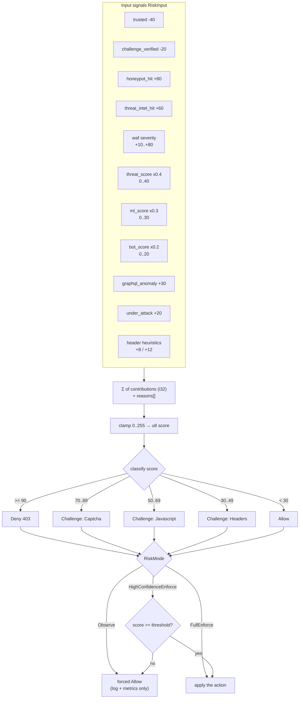
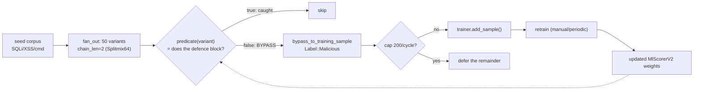

# ML and risk engine

**Languages:** **English** · [Русский](../ru/18-ml-risk-engine.md) · [中文](../zh/18-ml-risk-engine.md)

AEGIS combines dozens of weak signals (WAF, TLS fingerprints, reputation, behaviour, ML inference) into a single explainable score via the **Risk Engine** (`src/ddos/risk_engine.rs`), and one of the inputs to that score is the built-in **ML engine** — V97/V122 logistic regression or V136 GBM trees (`src/ddos/`). All of the ML runs inside the `aegis-pingora` process: no Python, no external model server, inference at ~50–500 ns per request, online incremental training and adversarial self-training.

> Neighbouring documents: [10-waf.md](10-waf.md), [11-tls-fingerprinting.md](11-tls-fingerprinting.md), [12-reputation.md](12-reputation.md), [15-challenge-ladder.md](15-challenge-ladder.md), [17-honeypot-tarpit.md](17-honeypot-tarpit.md), [20-geoip.md](20-geoip.md), [22-enrichment.md](22-enrichment.md), [24-request-log.md](24-request-log.md), [25-metrics-telemetry.md](25-metrics-telemetry.md). Detailed operator guide to the ML pipeline: [ml-pipeline.md](../en/reference/ml-pipeline.md).

---

## 1. Two levels: Risk Engine and the ML scorer

It is important not to confuse the two components — they work together, but they are different subsystems:

| Component | File | What it does | Scale |
|---|---|---|---|
| **Risk Engine** (V108) | `src/ddos/risk_engine.rs` | Fuses ALL signals (including the ML output) into one score with intelligible `reasons`, picks an action (Allow/Challenge/Deny) according to the mode | `0..255` (u8) |
| **ML scorer** (V97/V122/V136) | `src/ddos/ml_score.rs`, `ml_score_v2.rs`, `ml_gbm.rs`, `ml_model.rs` | One feature vector → one "maliciousness" probability | `0..1` → `*100` = `0..100` |

The ML scorer is **one of the inputs** to the Risk Engine (the `ml_score: f64` field of `RiskInput`). The Risk Engine can work without ML too (in which case `ml_score = 0`), and the ML scorer can be used separately for routing the cache by `ThreatTier` (see [ml-pipeline.md](../en/reference/ml-pipeline.md)).

---

## 2. Risk Engine: Observe / HighConfidenceEnforce / FullEnforce modes

Before V108 each filter (WAF, bot, adaptive, challenge, ml_scorer, threat_intel, honeypot) made its own independent `Allow/Deny/Challenge` decision and short-circuited the pipeline. That is fast, but blind to L7 attacks that are only visible as the **sum of weak signals** — a rare JA4 + an empty Accept-Language + URI entropy + a burst of 404s. The Risk Engine is a single explainable component: it takes all signals as input and produces `RiskDecision { score, action, reasons }`.

### 2.1. Three modes (`RiskMode`)

Defined in `src/ddos/risk_engine.rs`:

| Mode | Behaviour | Purpose |
|---|---|---|
| `Observe` | The score is computed and logged, **the action is NEVER applied** — `Allow` is always returned. This is the default value (`#[default]`). | A safe start: the operator watches the metrics/score distribution for a week. |
| `HighConfidenceEnforce` | The action is applied **only** if `score ≥ enforce_threshold`. Below the threshold `Allow` is returned and the legacy per-filter decision pipeline applies. | The recommended production mode until the score distribution has been validated on real traffic. |
| `FullEnforce` | The engine's decision is applied regardless of the score. | Only after prolonged observation + shadow validation (scope of V109+). |

Default threshold: `DEFAULT_ENFORCE_THRESHOLD = 90` (`with_threshold(t)` allows overriding it).

> **Honest caveat (from the code).** The configuration knows three mode values — `Off | Observe | Enforce` (`crate::config::RiskEngineMode`). When `Enforce` is chosen, `aegis-pingora` creates the engine in `HighConfidenceEnforce` mode, but logs a warning: *"action-application (Stage 3) is NOT yet wired, so the engine runs in SHADOW (scores logged, live allow/deny decisions UNCHANGED)"* (`src/proxy/pingora_http.rs`). That is, at the current snapshot of the code the Risk Engine effectively works as a shadow scorer: it computes, logs and exports metrics, but does not replace the live allow/deny decisions of the legacy filters. `FullEnforce` exists in the `RiskMode` type but cannot be selected from the configuration.

### 2.2. Enabling it

`AEGIS_RISK_ENGINE_MODE` overrides the configuration (as do the other `AEGIS_*` runtime knobs):

```sh
# /etc/aegis/aegis.env
AEGIS_RISK_ENGINE_MODE=observe   # off | observe | enforce
# a restart applies the change
systemctl restart aegis-pingora.target
```

With `off` (the default) the engine is not created at all (`Option<Arc<RiskEngine>> = None`), and the hot path pays only a single `Option` check. A typo in the value (`OBSERVE`, `on`) does **not** silently apply the default — a loud `warn` is written, after which the mode from the configuration is used.

### 2.3. Classifying a score into an action

The `classify` / `classify_score` curve (`src/ddos/risk_engine.rs`) is deliberately conservative; high scores require several corroborating signals:

| Score | Action (`RiskAction`) | Challenge tier |
|---|---|---|
| `≥ 90` | `Deny { status: 403 }` | — |
| `70..89` | `Challenge` | `Captcha` |
| `50..69` | `Challenge` | `Javascript` |
| `30..49` | `Challenge` | `Headers` |
| `0..29` | `Allow` | — |

For the challenge tiers see [15-challenge-ladder.md](15-challenge-ladder.md).

---

## 3. Signals and their weights in the fusion

The Risk Engine takes a `RiskInput<'a>` (all fields are `Option`/defaulted, the engine survives partial state). The `evaluate()` method sums the contributions into an `i32`, then clamps to `0..255 → u8`. Every contribution that fires adds a stable `&'static str` to `reasons` (for aggregation in a SIEM and for Prometheus labels with bounded cardinality).

### 3.1. Contribution table (exactly as in `evaluate()`)

| Signal (`RiskInput` field) | Contribution to the score | `reason` (condition) | Source |
|---|---|---|---|
| `trusted` | **−40** | `trusted` | bypass / dynamic-trust / fp-cookie |
| `challenge_verified` | **−20** | `challenge_verified` | passed challenge / fp-cookie |
| `honeypot_hit` | **+80** | `honeypot_hit` | honeypot path/pack ([17](17-honeypot-tarpit.md)) |
| `threat_intel_hit` | **+60** | `threat_intel_hit` | threat-intel feed by IP ([12](12-reputation.md)) |
| `waf` = Critical | **+80** | `waf_critical` | `WafSignal.severity` ([10](10-waf.md)) |
| `waf` = High | **+50** | `waf_high` | — |
| `waf` = Medium | **+25** | `waf_medium` | — |
| `waf` = Low | **+10** | `waf_low` | — |
| `threat_score` (0..100) | `×0.4` → `0..40` | `threat_score_high` (≥30) / `threat_score_medium` (≥15) | V37 ThreatScorer (clustered since V90+) |
| `ml_score` (0..100) | `×0.3` → `0..30` | `ml_high` (≥20) | ML scorer V97/V122/V136 |
| `bot_score` (0..100) | `×0.2` → `0..20` | `bot_reputation_high` (≥15) | V37 BotFilter |
| `graphql_anomaly` | **+30** | `graphql_anomaly` | GraphQL cheap-guard |
| `under_attack` | **+20** | `under_attack` | per-domain AnomalyDetector ([§5.1](#51-anomalydetector--under-attack-mode)) |
| browser UA without Accept-Language | **+12** | `browser_ua_no_accept_language` | heuristic over `ctx` |
| empty/absent User-Agent (not trusted) | **+8** | `no_user_agent` | heuristic over `ctx` |

Note the "ceilings": the ML contribution is capped below the ThreatScorer (`×0.3` against `×0.4`) — because ML is heuristic, and we do not want it to dominate the established history of an IP. Bot reputation is capped lower still (`×0.2`).

### 3.2. Trust shortcut

`trusted` gives a strong negative shift (−40) so that an operator override dominates even when flags have fired. Example from the tests: `trusted` (−40) + `waf_medium` (+25) = −15 → clamped to 0 → `Allow`, but both `trusted` and `waf_medium` remain in `reasons` — the operator sees that the WAF fired but was overridden by trust.

### 3.3. Engine metrics

`RiskEngineMetrics` (atomic `AtomicU64`, the engine stays `&self`): `evaluations_total`, `decisions_allow`, `decisions_challenge`, `decisions_deny`, `max_score` (a diagnostic gauge — helps choose the enforcement threshold). More about the export in [25-metrics-telemetry.md](25-metrics-telemetry.md).

### 3.4. Mermaid: signal fusion



---

## 4. The ML engine: features, models, training

The ML scorer is the `ml_score` for the Risk Engine, and also a standalone driver of `ThreatTier` for cache routing. The single handle is `MlModel` (`src/ddos/ml_model.rs`), an enum dispatcher `Logistic | Gbm` (an enum, not a `dyn` trait — on the hot path this saves ~5 ns per call).

### 4.1. Model versions

| Model | File | Features | Type | Online incremental training |
|---|---|---|---|---|
| **V97** | `ml_score.rs` | 8 | logistic regression | yes (SGD) |
| **V122/V139** | `ml_score_v2.rs` | **23** (`N_FEATURES_V2`) | logistic regression | yes (SGD + L2 + class weight) |
| **V136** | `ml_gbm.rs` | 23 (the same `FeaturesV2`) | GBM (trees) | no — batch only, trained offline, loaded from JSON |

Inference everywhere ends with `sigmoid(z)` → a probability in `[0,1]`; `score_pct()` = `×100`.

#### V97 — 8 features (legacy fallback)

`Features` (`ml_score.rs`): `uri_length`, `header_count`, `body_length`, `has_user_agent`, `method_is_post`, `ja4_unusual` (an FNV bucket over JA4 against a set of popular fingerprints), `recent_denied_rate`, `recent_challenged_rate`. The default weights are conservative (`has_user_agent = -1.5`, `ja4_unusual = 2.0`, `recent_denied_rate = 3.0`, bias `-2.0`). Persistence is a single TOML line (~200 bytes), hot-reloaded by mtime polling.

#### V122/V139 — 23 features (`FeaturesV2`)

Stable indices (append-only, never reorder; `N_FEATURES_V2 = 23`, `schema_version = 3`):

| # | Feature | Group | What it means | Default weight |
|---|---|---|---|---|
| 0 | `uri_length` | shape | length of path+query / 8192 | +0.6 |
| 1 | `query_param_count` | shape | number of query parameters / 32 | +0.3 |
| 2 | `uri_entropy` | shape | Shannon entropy of the path (normalised by log2 128) | +1.2 |
| 3 | `query_entropy` | shape | entropy of the query | +0.8 |
| 4 | `header_count` | header | number of headers / 64 | +0.2 |
| 5 | `has_user_agent` | header | 1 = present | **−1.5** |
| 6 | `has_accept_language` | header | 1 = present | **−1.0** |
| 7 | `has_accept_encoding` | header | 1 = present | **−0.8** |
| 8 | `has_referer` | header | 1 = present | **−0.6** |
| 9 | `method_is_post` | method | POST/PUT/PATCH/DELETE | +0.1 |
| 10 | `body_length` | body | content-length / 64 KiB | +0.3 |
| 11 | `ja4_present` | fp | JA4 captured | **−1.0** |
| 12 | `ja4_browser_family` | fp | **UA↔JA4 mismatch** (see below) | **−1.2** |
| 13 | `h2fp_present` | fp | H2FP captured | **−0.7** |
| 14 | `recent_denied_rate` | rep | deny rate for the IP | **+3.0** |
| 15 | `recent_challenged_rate` | rep | challenge rate for the IP | +1.5 |
| 16 | `bot_score_rate` | rep | bot reputation | +2.0 |
| 17 | `requests_per_min` | temporal | RPS×60/100 (100/min = 1.0) | +1.0 |
| 18 | `fast_repeat` | temporal | repeat from the same IP within <1 s | +1.5 |
| 19 | `night_window` | temporal | UTC hour ∈ [0,6) | +0.4 |
| 20 | `fp_consistency_score` | cross | cross-fingerprint correlation (V137+V145) | +1.5 |
| 21 | `ja4_reputation` | cross | JA4 reputation (V138) | +2.0 |
| 22 | `asn_reputation` | cross | ASN reputation (opt-in) | **0.0** |

> **A subtlety about index 12 (`ja4_browser_family`).** Despite the default weight of `−1.2`, in the actual feature extraction (`extract_ml_features_v2`, `src/proxy/pingora_http.rs`) this feature became a **mismatch signal** rather than an "is this a browser?" flag (correction H9c). The feature is 1.0 **only** when both families (UA and JA4) are confidently classified (neither is `Unknown`) AND they differ. Otherwise it is 0.0. That is, the negative weight now penalises a UA↔JA4 contradiction rather than rewarding the presence of a browser UA (which a bot forges trivially).

> **`asn_reputation` (index 22) is honestly opt-in.** The default weight is 0.0: the AEGIS core does not ship an ASN list (operators have strong opinions), so the slot stays neutral until the operator connects a feed and retrains the model with a non-zero weight. The `asn_reputation_is_neutral_by_default` test pins this down.

### 4.2. Logistic vs GBM — when to use which

| | Logistic (V122) | GBM (V136) |
|---|---|---|
| Inference cost | ~50 ns (one FMA per feature) | ~500 ns (50 trees × depth 4) |
| Captures feature interactions | NO (additive only) | YES (each leaf is a conjunction of thresholds) |
| Online incremental training | YES (single-sample SGD + L2) | NO (batch only, offline → JSON) |
| Cold start | sensible out-of-the-box defaults | an empty model = bias only |
| Memory | ~200 bytes (weight vector) | ~10–50 KB (trees) |

GBM (`GbmModel`, `ml_gbm.rs`): shallow trees (`max_depth=4`, `n_trees=50`, `min_samples_leaf=10`, `learning_rate=0.1`), stage-wise fitting of the residuals of the logistic loss `y − σ(F(x))`, splits by SSE minimisation. The goal is to catch conjunctions such as "high `uri_entropy` AND no UA → worse than either separately", which logistic regression cannot represent. The `captures_conditional_interaction_logistic_struggles_with` test demonstrates that GBM even catches a signal cancellation (`high entropy + UA present → benign`, as a "legitimate scanner").

Recommendation: start with logistic, switch to GBM only when you observe operator-labelled interaction patterns.

### 4.3. Enabling the ML scorer

V97 (8 features) is the default. V139 (23 features) is opt-in:

```sh
# /etc/aegis/aegis.env
AEGIS_ML_SCORER=1                              # V97 (8-feature)
AEGIS_ML_V2=1                                  # V139 (23-feature)
AEGIS_ML_V2_KIND=logistic                      # logistic | gbm
AEGIS_ML_V2_GBM_FILE=/var/lib/aegis/gbm.json   # only when kind=gbm
AEGIS_ML_WEIGHTS_FILE=/var/lib/aegis/ml-weights.toml  # weight persistence (V97/logistic)
AEGIS_ML_SAMPLES_PATH=/var/lib/aegis/ml-samples.ndjson # persistence of labelled samples
AEGIS_ML_V2_SAMPLES=/var/lib/aegis/ml-samples.ndjson   # alias path to the samples
```

All keys are present in the admin panel allowlist (`src/proxy/pingora_admin.rs`, `EnvEntry`). Without the env variables set, the V139 scorer slot stays empty and the panel renders "not configured" with a hint. `MlModelKind::parse` accepts aliases: `logistic|linear|lr` and `gbm|tree|trees`.

### 4.4. Where the features are extracted

`extract_ml_features_v2` (`src/proxy/pingora_http.rs`) assembles `FeaturesV2` from `RequestContext`. Besides the trivial shape/header features, it contains:

- **`fp_consistency_score`** = `max(server_fp_score, client_score)` — the server-side cross-fingerprint correlation (V137) is combined with the client-side CreepJS score (V145) if there is a payload for the IP (the maximum is taken — whichever layer fired dominates). Timing entropy (V189) is also threaded through inside it.
- **`ja4_reputation`** — a V138 lookup against the operator's CTI feed + the arsenal JA4 corpus (Deny→`max(1.0)`, Allow→soft credit, but with the H9b protection: a client-chosen JA4 cannot lower the reputation below the baseline from a non-spoofable feed) + JA4 churn (if `churn > 0.6`, it is folded into `ja4_reputation` without extending the schema).
- **`asn_reputation`** = `self.asn_reputation.feature(ctx.client_ip)` or 0.0 if no feed is connected (`src/asn_reputation.rs`).
- `recent_denied_rate` / `recent_challenged_rate` / `requests_per_min` / `fast_repeat` are taken from the per-worker ThreatScorer (`self.scorer.*`).

> These features are computed **only** inside `extract_ml_features_v2`, which runs only when `AEGIS_ML_V2=1`. On a stock deployment without V2 this is a "cold" path.

---

## 5. Auxiliary signals (inputs to the fusion and to the features)

### 5.1. AnomalyDetector — "under attack" mode

`src/anomaly.rs` (V230): a per-domain anomaly detector. On the hot path it is a single `AtomicU64::fetch_add(1, Relaxed)` (~5 ns); the EMA/detection is moved to a background tick (1 s by default). The `under_attack` flag is raised when `current_rps > baseline_ema × multiplier` AND `baseline_ema ≥ min_baseline_rps`; it is held for `attack_duration` (60 s by default). Under attack the flag raises the "floor" of suspicion for all requests to the domain (`+20` in the Risk Engine), and the challenge ladder requires a minimum tier. The defaults are disabled (`enabled: false`), `multiplier=3.0`, `min_baseline_rps=10.0`, `min_challenge_level=Javascript`.

### 5.2. GREASE anomaly

`src/grease_anomaly.rs` (V178): clients that claim to be Chrome via JA4 should have Chrome-shaped GREASE values (RFC 8701, `0x{n}A{n}A`) in three positions — the first cipher, the first extension, the head of supported_versions. Real Chrome puts GREASE in all three; utls/curl-impersonate often get 2-of-3 or the wrong position.

```
score = (1 − matches/3)   when the JA4 looks like Chrome
      = 0                 when the client does not claim Chrome
```

It is fed to the V139 scorer as `grease_anomaly` and to the Risk Engine as a strong "the anti-detect tool is lying about being Chrome" signal. `ja4_looks_like_chrome` is a cheap heuristic (`t13d15`/`t13d16` or a known cipher hash). Capturing the raw GREASE positions is done in `src/ja4.rs` (`extract_grease_positions`).

### 5.3. fp↔UA correlation (server-side, V137)

`src/fp_correlation.rs`: turns a set of fingerprints (JA4/JA4H/H2FP/UA/Accept-*) into a `CorrelationScore` ∈ `[0,1]` (0 = everything is consistent, 1 = a contradiction). Contributions:

| Mismatch | Contribution | reason |
|---|---|---|
| JA4 family ≠ UA family, UA = Tool (curl/python/go…) | +0.55 | `ja4_browser_ua_tool` |
| JA4 family ≠ UA family (browser↔browser) | +0.45 | `ja4_ua_family_mismatch` |
| JA4 family ≠ H2FP family | +0.35 | `ja4_h2fp_family_mismatch` |
| Browser UA without Accept-Language | +0.15 | `browser_ua_no_accept_language` |
| Browser UA without Accept-Encoding | +0.10 | `browser_ua_no_accept_encoding` |
| JA4 present, JA4H absent (protocol probe) | +0.10 | `ja4_present_ja4h_missing` |

The score is clamped to `[0,1]`. The family is derived from the JA4 cipher hash, UA substrings and the H2FP SETTINGS. This is **a score, not a hard rule** — there are legitimate edge cases (corporate MITM, mobile header compression, extensions). More about fingerprints in [11-tls-fingerprinting.md](11-tls-fingerprinting.md).

### 5.4. client_consistency (client-side, V145, opt-in)

`src/client_consistency.rs`: CreepJS-style checks. The next frontier after V137 — an attacker can align the TLS+HTTP fingerprints by routing traffic through a real Chrome behind SOCKS, but the client-side JS environment still gives away inconsistencies. A JS snippet (`CREEPJS_CLIENT_JS`, ~3 KB, no external libraries) collects `navigator.*`, timezone, WebGL vendor/renderer, `webdriver`, `hardwareConcurrency`, plugin count, canvas hash and POSTs it to `COLLECTION_PATH = /.well-known/aegis/consistency`. The server-side rule set `consistency_score`:

| Rule | Weight | reason |
|---|---|---|
| UA header ≠ navigator.userAgent | +0.4 | `ua_header_vs_navigator` |
| `navigator.webdriver == true` | +0.5 | `webdriver_true` |
| `hardwareConcurrency == 0` | +0.3 | `zero_hw_concurrency` |
| UA platform ≠ navigator.platform | +0.35 | `ua_platform_vs_navigator_platform` |
| Chrome UA + Mesa/SwiftShader/llvmpipe WebGL (headless) | +0.4 | `chrome_ua_mesa_webgl` |
| desktop browser + 0 plugins | +0.2 | `desktop_ua_zero_plugins` |
| timezone↔language contradiction | +0.15 | `timezone_language_mismatch` |
| synthetic timing entropy (V189) | up to +0.5 | `timing_entropy_synthetic` |

The score is clamped to `[0,1]` and stored in an LRU `ClientSignalsStore` (10000 IPs by default). `timezone_language_mismatch` is deliberately conservative (it flags only strong contradictions — `ru`/`pl`/`cs`/`ja`/`ko`/`zh`/`th`/`vi` against the wrong continent; `en-US` + any TZ is not flagged). The result is folded into the `fp_consistency_score` feature (the max with the server-side V137 score is taken).

### 5.5. JA4 reputation and JA4 churn

- **JA4 reputation** (`src/ja4_reputation.rs`): `reputation_feature(hit)` → `Full match = 1.0`, `CipherPrefix = 0.6`, no hit = 0.0. Self-learned from honeypot/WAF/tarpit + a CTI feed. See [12-reputation.md](12-reputation.md).
- **JA4 churn** (`src/ja4_churn.rs`, V177): the ratio of unique JA4s to the number of observations in a sliding per-IP window (60 s by default, the last 16 samples). `0.0` = a single JA4 (a normal browser), `1.0` = every request with a new JA4 (utls/curl-impersonate/fhttp rotation). The Risk Engine treats `> 0.6` as suspicious and `> 0.9` as enforcement-grade; in `extract_ml_features_v2` a churn `> 0.6` is folded into `ja4_reputation`.

---

## 6. Training, retraining, persistence

The trainer is `MlTrainer` (`src/ddos/ml_training.rs`, V123/V135); it stores labelled samples and retrains the V122 logistic model.

### 6.1. Sample collection

Three streams that are "enabled by default" give the model 100+ samples/day in production:

- **V149 robots.txt honeypot** — every visit to a `Disallow` path is auto-labelled `Malicious` (`src/robots_honeypot.rs`).
- **V151 adversarial loop** — a mutation engine generates SQLi/XSS/cmd variants, runs them past the current defence and labels the bypasses `Malicious` ([§7](#7-adversarial-self-training-v146v148v151)).
- **V107 online signature miner** — promotes mined ngram signatures.

Optional persistence: `AEGIS_ML_SAMPLES_PATH` (NDJSON, append-only, re-read on start). Manual labelling via the JSON API — the slot is reserved (`POST /admin/api/ml/sample`), see [30-admin-api.md](30-admin-api.md).

### 6.2. Retraining

`retrain_ex(RetrainOptions)` → `RetrainResultEx`. Through the admin API:

```sh
curl -sS -H "x-admin-token: $T" -X POST \
  http://localhost:6280/admin/api/ml/retrain \
  -H 'Content-Type: application/json' \
  -d '{ "epochs": 50, "learning_rate": 0.1, "l2_lambda": 1e-3,
        "test_split": 0.2, "split_seed": 42, "class_balance": true }'
```

Weight updates are online SGD with L2 decay and a per-sample weight (`train_step_ex`): `w_i ← (1 − lr·λ)·w_i + lr·err·sample_weight·x_i` (the bias is NOT decayed). The weights are stored in an `ArcSwap` — `score()` readers on the hot path never see a "torn" mixture.

**Class balance** (`class_balance: true`, the default): in production ~99% of traffic is benign, and without balancing the model learns "always benign" (recall ~0). Malicious samples are weighted by `neg_count/pos_count` so that the rare class contributes equally to the gradient. The `class_balance_lifts_rare_class_recall` test demonstrates this.

Metrics from `RetrainResultEx` (the `ml_eval.rs` module): `accuracy`, `precision`, `recall`, `f1` (the headline metric under imbalance), `fpr`, `auc`, `ece` (calibration), `mean_squared_error` — both initial and final, on train and test. The full breakdown and how to fight overfitting: [ml-pipeline.md](../en/reference/ml-pipeline.md).

### 6.3. Explainability

`explain(&FeaturesV2)` → `ScoreBreakdown { feature_contributions, bias, raw_z, sigmoid, score_pct }` — each row is `feature_value × weight` = the contribution to `raw_z`. Via `POST /admin/api/ml/explain`. The sum of contributions + bias = `raw_z` (the `explain_breakdown_sums_to_raw_z` test).

### 6.4. Weight persistence

- Logistic/V97: TOML (`AEGIS_ML_WEIGHTS_FILE`), atomic write (temp + rename), hot reload by mtime polling. The format is versioned (`schema_version`): an incompatible file (N ≠ current) is loaded as "fall back to the defaults" rather than corrupting the model.
- GBM: a JSON blob (`AEGIS_ML_V2_GBM_FILE`), serde-roundtrip compatible with `GbmModel`. The operator trains offline (xgboost/notebook), exports JSON, drops it in place and restarts.

---

## 7. Adversarial self-training (V146/V148/V151)

`src/ml_adversarial.rs` — a WAF-A-MoLE-like mutation loop. The idea: an ML WAF is defeated by semantics-preserving mutations; the defence is to feed every discovered bypass back into the trainer as a hard negative.

### 7.1. Mutators (22 of them)

Each is a `Mutator::mutate(input, rng) -> Option<String>` (None when the input does not admit the mutation). A deterministic `Splitmix64` PRNG for reproducibility.

| Set (`MutationSet`) | Mutators |
|---|---|
| **SQLi** (`sqli_default`) | `case_mix`, `inline_sql_comment` (` `→`/**/`), `whitespace_shuffle` (`\t\n` NBSP), `operator_swap` (`1=1`→`'a'='a'`, `=`→`LIKE`), `keyword_comment_split` (`UNION`→`UN/**/ION`), `percent_encode`, `double_encode` (`'`→`%2527`), `string_concat` (`'admin'`→`'adm'||'in'`) |
| **XSS** (`xss_default`) | `case_mix`, `html_entity_encode`, `tag_whitespace`, `event_handler_swap` (`onerror`→`onclick`), `js_unicode_escape`, `percent_encode`, `double_encode` |
| **cmd** (`cmd_default`) | `case_mix`, `ifs_substitution` (` `→`${IFS}`), `cmd_separator_swap` (`;`→`&&`/`\|\|`/`\|`), `backtick_to_dollar_paren` (`` `id` ``→`$(id)`), `path_globbing` (`/etc/passwd`→`/etc/p?sswd`), `whitespace_shuffle`, `percent_encode` |

The seed corpora (`default_sqli_seed_corpus`/`xss`/`cmd`) are canonical payloads from sqlmap/OWASP CRS/PortSwigger. `fan_out(seed, n_variants, chain_len, seed)` deterministically expands a single payload into up to `n_variants` unique mutations.

### 7.2. The background `AdversarialLoop` (V151)

```sh
# /etc/aegis/aegis.env
AEGIS_ML_ADVERSARIAL=1
```

`with_default_mutation_sets`: SQLi+XSS+cmd, 50 variants/seed, `chain_len=2`, a cap of `max_bypasses_per_cycle=200` (protection against a runaway predicate flooding the trainer with duplicates). Each cycle (`run_once`):

```
for (mutation_set, seed_corpus):
    for seed:
        for variant in fan_out(seed, 50, chain_len=2):
            if !predicate(variant):        # the defence did NOT catch it
                bypasses_found += 1
                trainer.add_sample(bypass_to_training_sample(variant))  # Label::Malicious
```

`predicate(payload) -> bool` = "does the defence BLOCK the payload?", `false` = a bypass. The predicate is operator-supplied; the typical binding is `MlModel::payload_predicate(threshold_pct)` (`ml_model.rs`), which synthesises attacker-shaped `FeaturesV2` (high entropy, no browser headers, no JA4 — `synth_features_from_payload`) and compares the score against the threshold. In the `aegis-pingora` binary the predicate is bound to the wired WAF+ML chain.

`bypass_to_training_sample` synthesises **not** a literal feature extraction from the string (that would require the full HTTP context), but the attack *category*: high `uri/query_entropy`, zero browser headers, `ja4_reputation=0`, `fp_consistency_score=0.5`. This way retraining moves the weights towards catching shaped-like inputs in production.

Loop telemetry is `AdversarialCycleStats { seeds_run, variants_tested, bypasses_found, samples_emitted }`, exported to `/metrics` ([25-metrics-telemetry.md](25-metrics-telemetry.md)). An `INFO` log is written on cycles where bypasses were found:

```
INFO adversarial loop: bypasses fed back to trainer seeds=30 variants=1500 bypasses=12 samples=12
```

> **Honest caveat.** The adversarial loop closes **blind spots**; it does not discover new attacks: the mutators are public knowledge from sqlmap/XSS cheat sheets. It catches operators who have not seen these mutation classes, but it does NOT detect novel CVE-class attacks. For that, use V107-mined signatures + traditional WAF feeds ([10-waf.md](10-waf.md)).

### 7.3. Mermaid: the self-training loop



---

## 8. SecurityEvent: a single output for decisions

`src/security_event.rs` (V116): every security decision is serialised into a `SecurityEvent` (small, JSON, no high cardinality). `SecurityEventEmitter` writes to:

1. a structured tracing log (`target = "aegis::security_event"`) — the operator pipes it into an aggregator;
2. cardinality-bounded Prometheus counters `aegis_security_decisions_total{action, reason}`.

`DecisionKind`: `Allow | Challenge | Deny | Throttle | Observed`. **`Observed`** is a separate "match-but-don't-act" category for the V108 observe-mode Risk Engine and the V109 shadow-mode WAF: dashboards distinguish "would have blocked" from "blocked". The event fields include `risk_score: Option<u8>` (from the Risk Engine) and `extra_reasons: Vec<&'static str>` (the engine's `reasons` vector, beyond the primary one). `reason` uses the same `&'static str` values emitted by the Risk Engine / WAF severity / UA-JA4 mismatch (~30 values, bounded cardinality). More about the export/SIEM in [24-request-log.md](24-request-log.md) and [25-metrics-telemetry.md](25-metrics-telemetry.md).

---

## 9. Summary of env variables

| Variable | Purpose |
|---|---|
| `AEGIS_RISK_ENGINE_MODE` | `off`\|`observe`\|`enforce` (enforce = SHADOW/HighConfidenceEnforce) |
| `AEGIS_ML_SCORER` | enable V97 (8-feature) |
| `AEGIS_ML_V2` | enable V139 (23-feature) |
| `AEGIS_ML_V2_KIND` | `logistic`\|`gbm` |
| `AEGIS_ML_V2_GBM_FILE` | path to the GBM JSON (when kind=gbm) |
| `AEGIS_ML_WEIGHTS_FILE` | weight persistence for logistic/V97 (TOML) |
| `AEGIS_ML_SAMPLES_PATH` / `AEGIS_ML_V2_SAMPLES` | persistence of labelled samples (NDJSON) |
| `AEGIS_ML_ADVERSARIAL` | enable the V151 adversarial loop |

---

## 10. Best practices (from the code and the pipeline guide)

- **Start in Observe.** The Risk Engine is observe-only by default — watch the score distribution and the FPR on known-good IPs for a week before enforcing.
- **Train once a day/week, not hourly.** SGD is noisy; frequent retraining makes the weights oscillate.
- **Keep the "off" path.** `AEGIS_ML_V2=0` instantly rolls back to V97 — both models read a compatible feature shape, no state migration is needed.
- **Watch the FPR on benign traffic.** If legitimate users score >50%, they will land in the challenge ladder.
- **Class balance changes the meaning of the 0.5 threshold** — you are optimising F1, not raw accuracy; for a target FPR, raise the threshold in the predicate (`threshold_pct`).
