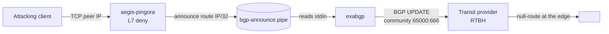

# BGP RTBH

**Languages:** **English** · [Русский](../ru/19-bgp-rtbh.md) · [中文](../zh/19-bgp-rtbh.md)

The BGP RTBH (Remote-Triggered Black Hole) subsystem announces host routes `/32` (IPv4) or `/128` (IPv6) with a blackhole community to your transit provider through an ExaBGP file pipe, so that hostile traffic is dropped at the carrier's network edge rather than at the bottleneck of your own host. The blackholing decision is made at L7 (WAF/honeypot/risk-engine verdicts), not only at L3/L4, so the very same `/32` is propagated both during a volumetric attack and when a high-confidence rule fires on a scraper farm.

Sources of truth: [`src/bgp_rtbh.rs`](../../src/bgp_rtbh.rs) (dispatcher, announcer, the `is_blackholeable` gate), [`src/arsenal.rs`](../../src/arsenal.rs) (initialisation, counters, the `with_bgp_announcer` builder), [`src/bin/aegis-pingora.rs`](../../src/bin/aegis-pingora.rs) (env wiring), [`src/proxy/pingora_http.rs`](../../src/proxy/pingora_http.rs) (the trigger on the deny path), [`src/proxy/pingora_admin.rs`](../../src/proxy/pingora_admin.rs) (admin API).

> Maturity: the module is marked `V187`, status `live` in the arsenal registry ([`pingora_admin.rs`](../../src/proxy/pingora_admin.rs), the `bgp_rtbh` entry). Announcements and manual withdrawal work on the live path. TTL auto-withdrawal is implemented, but a background collector is not yet scheduled to be called in production — see the section [TTL and auto-withdrawal](#ttl-and-auto-withdrawal-partial).

---

## Why this is needed

The drop backends in AEGIS (nftables/iptables/XDP — see [13-xdp-ebpf.md](13-xdp-ebpf.md)) suppress hostile traffic at the edge of the host itself. For volumetric attacks, where the bottleneck becomes the host's own link/NIC, the right answer is an *upstream* blackhole: announcing a `/32` into the transit provider's RTBH community, so that the drop happens on the carrier's equipment (the header comment in [`src/bgp_rtbh.rs`](../../src/bgp_rtbh.rs)).

FastNetMon does this at L3/L4; AEGIS does it driven by L7 verdicts: a `FullEnforce`-class deny on a scraper farm propagates the same `/32` list that a volumetric attack would have produced.



---

## Module architecture

The `bgp_rtbh` module is a *dispatcher*: it makes blocking decisions and writes them into an implementation of the `BgpAnnouncer` trait. The disk/BGP "heavy lifting" is done by the external `exabgp`.

| Component | Type | Role |
|---|---|---|
| `BgpAnnouncer` | trait | The announcer abstraction: `announce(ip, community)` / `withdraw(ip)`. |
| `InMemoryAnnouncer` | struct | A no-op announcer for tests and dry runs; accumulates announcements/withdrawals in a `Vec` and sends nothing outward. **The default** in `new_default()`. |
| `ExabgpPipeAnnouncer` | struct | Append-only writing to a file/pipe compatible with exabgp's stdin-from-file mode. Fields: `path`, `next_hop`. |
| `BgpRtbhDispatcher` | struct | The active set `HashMap<IpAddr, Entry>` under an `RwLock`, idempotent `announce`, `withdraw`, `expire_ttl`, `active()`. |

`Entry` stores `inserted: Instant` and `community: String`. The dispatcher stores `default_community` and `ttl`.

### The `BgpAnnouncer` trait

```rust
pub trait BgpAnnouncer: Send + Sync {
    fn announce(&self, ip: IpAddr, community: &str) -> std::io::Result<()>;
    fn withdraw(&self, ip: IpAddr) -> std::io::Result<()>;
}
```

Operators running goBGP / FRR can substitute their own announcer by implementing this trait and passing it via `ArsenalState::with_bgp_announcer(...)` ([`src/arsenal.rs`](../../src/arsenal.rs)).

### ExaBGP line format

`ExabgpPipeAnnouncer` writes exactly these lines (with a newline):

```text
announce route 1.2.3.4/32 next-hop 192.0.2.1 community 65000:666
withdraw route 1.2.3.4/32 next-hop 192.0.2.1
```

The mask is produced by the `host_mask` function: `/32` for IPv4, `/128` for IPv6. Writing is done by `write_line` through `OpenOptions::new().create(true).append(true)` — the file is created if missing, so writing is safe even before exabgp has started: the lines simply accumulate in the file (comment in [`src/bin/aegis-pingora.rs`](../../src/bin/aegis-pingora.rs)).

---

## Decision lifecycle

From the header of [`src/bgp_rtbh.rs`](../../src/bgp_rtbh.rs):

| Method | Behaviour |
|---|---|
| `announce(ip)` | Adds to the active set; the announcer emits the route. **Idempotent** — re-announcing the same IP writes nothing (a `contains_key` check). Uses `default_community`. |
| `announce_with_community(ip, community)` | The same, but with an explicit community; the `is_blackholeable` gate is applied here as well. |
| `withdraw(ip)` | Removes from the set; the announcer emits a withdraw. If the IP was not in the set — a no-op (no spurious withdraw is written). |
| `expire_ttl()` | Periodic GC: entries older than `ttl` are auto-withdrawn (so that an attacker does not stay in the blackhole forever). Returns the number withdrawn. |
| `active()` | Returns `Vec<(IpAddr, String /*community*/, Duration /*age*/)>`. |
| `len()` / `is_empty()` | The size of the active set. |

---

## When an announcement fires

The trigger on the live path is in [`src/proxy/pingora_http.rs`](../../src/proxy/pingora_http.rs) (the `V187` block), inside the handling of a deny verdict (after the request has already been blocked by a filter):

```rust
if let Some(arsenal) = &self.arsenal {
    let recent = self.scorer.score(client_ip).0;
    if (recent >= 80.0 || filter_name == "honeypot")
        && arsenal.bgp_rtbh.announce(client_ip).is_ok()
    {
        arsenal.counters.bgp_rtbh_announces.fetch_add(1, Ordering::Relaxed);
        cluster_bump(cluster_idx::RTBH);
    }
}
```

The announcement condition is a **logical OR**:

| Condition | Meaning |
|---|---|
| `recent >= 80.0` | The client's current risk score (`self.scorer.score(client_ip).0`) >= 80 — a high-confidence class of deny. |
| `filter_name == "honeypot"` | The request hit a honeypot trap — an unambiguously malicious client, announced regardless of score. |

Key properties:

- **`client_ip` is the TCP peer address** (see the security invariant below), not a value taken from a header.
- The announcement is **best-effort**: an unsuccessful `announce()` (for example, a rejection by the gate check) simply does not count and is not surfaced to the visitor — the `bgp_rtbh_announces` counter is only bumped on `Ok(())`.
- The same deny path also calls `record_bot(...)` in parallel and (for `honeypot`/`waf`) the JA4 reputation auto-learning `observe_bad(...)` — see [12-reputation.md](12-reputation.md).
- The announcement is mirrored into the cluster slot `cluster_idx::RTBH` for the time-series sampler, so that BGP events reach the fleet telemetry ([25-metrics-telemetry.md](25-metrics-telemetry.md)).

> On the relation to the score: the `>=80` thresholds and the enforce modes are set by the risk engine — see [18-ml-risk-engine.md](18-ml-risk-engine.md). The RTBH announcement happens at the point of the actual deny; the fact of the deny itself is determined by the WAF/bot/honeypot/rate filters.

---

## Security invariant (mandatory for the caller to uphold)

The documentation of the `announce` method ([`src/bgp_rtbh.rs`](../../src/bgp_rtbh.rs)) states directly:

> `ip` **MUST** be the kernel-level TCP peer address of the connection (the remote end of the accepted socket according to the OS). It **MUST NEVER** be an address derived from a request header (`X-Forwarded-For`, `X-Real-IP`, `Forwarded`, `CF-Connecting-IP` and so on).

The reason: this procedure asks the *transit provider* to blackhole an address. Headers are fully attacker-controlled, so a header-derived IP would let any client name a **victim's** IP and force the carrier to null-route it — a remotely triggered DoS / abuse primitive. The address must come from the socket (it cannot be forged, other than by on-path spoofing, against which BGP RTBH is powerless anyway).

### Defence-in-depth: the `is_blackholeable` gate

In addition, `announce_with_community` rejects targets that must not be blackholed at the carrier, **regardless of where the IP came from**. A rejected target returns `ErrorKind::InvalidInput` and announces nothing. Rejected are:

| Category | IPv4 | IPv6 |
|---|---|---|
| unspecified | `0.0.0.0` | `::` |
| loopback | `127.0.0.0/8` | `::1` |
| multicast | `224.0.0.0/4` | `ff00::/8` |
| broadcast | `255.255.255.255` | — |
| link-local | `169.254.0.0/16` | `fe80::/10` |
| private (RFC1918) | `10/8`, `172.16/12`, `192.168/16` | — |
| unique-local | — | `fc00::/7` |
| documentation (TEST-NET) | `is_documentation()` (`192.0.2/24`, `198.51.100/24`, `203.0.113/24`) | — |
| CGNAT (RFC6598) | `100.64.0.0/10` | — |

IPv4-mapped IPv6 (`::ffff:0:0/96`) is unwrapped into IPv4 and checked against the IPv4 rules, so that a mapped private/loopback address cannot "slip through" via the v6 branch.

This means only a plausibly public unicast host can be blackholed. Documentation ranges (`203.0.113.x` and the like) are now rejected — the dispatcher's tests use real public space (`9.9.9.x`, Quad9).

---

## Configuration (env)

The wiring lives in [`src/bin/aegis-pingora.rs`](../../src/bin/aegis-pingora.rs). `ArsenalState::new_default()` builds the dispatcher with the in-memory/noop announcer (decisions never leave the process). On a live start the binary installs a real file-based `ExabgpPipeAnnouncer` by default.

| Variable | Purpose | Default |
|---|---|---|
| `AEGIS_BGP_PIPE` | The path to the pipe/file into which `announce route …` / `withdraw route …` are written. **An empty string** leaves the in-memory noop announcer in place (no propagation at all). | `/var/lib/aegis/bgp-announce.pipe` |
| `AEGIS_BGP_NEXTHOP` | The BGP next-hop for the announced `/32`/`/128`. | `192.0.2.1` (TEST-NET-1, RFC5737 — **a non-routable placeholder; MUST be overridden** with the real RTBH next-hop) |
| `AEGIS_ARSENAL` | `0` disables the entire arsenal (including BGP RTBH) for benchmark baselining. | enabled |

> The community is hard-coded as `"65000:666"` in `new_default()` and `with_bgp_announcer()` ([`src/arsenal.rs`](../../src/arsenal.rs)). At the time of writing it has no env variable of its own. It can be changed either by editing the code or by substituting your own `BgpAnnouncer` that forms the required community itself. The `announce_with_community` logic accepts an arbitrary community, but the deny path calls `announce(ip)`, which uses `default_community`.

The announcer selection logic (simplified, from the binary):

```rust
let bgp_pipe = std::env::var("AEGIS_BGP_PIPE")
    .unwrap_or_else(|_| "/var/lib/aegis/bgp-announce.pipe".to_string());
if bgp_pipe.trim().is_empty() {
    // noop: blackhole decisions stay inside the process
    ArsenalState::new_default()
} else {
    let next_hop = std::env::var("AEGIS_BGP_NEXTHOP")
        .unwrap_or_else(|_| "192.0.2.1".to_string());
    let announcer = Arc::new(ExabgpPipeAnnouncer::new(bgp_pipe.into(), next_hop));
    ArsenalState::new_default().with_bgp_announcer(announcer)
}
```

These variables are also declared in the admin env registry ([`pingora_admin.rs`](../../src/proxy/pingora_admin.rs): `EnvEntry { key: "AEGIS_BGP_PIPE", ... }`, `EnvEntry { key: "AEGIS_BGP_NEXTHOP", ... }`).

### An example exabgp configuration

AEGIS only writes lines into a file; starting and connecting exabgp is the operator's job. A typical arrangement:

```ini
# /etc/exabgp/exabgp.conf
neighbor 198.51.100.1 {     # your transit/upstream router
    router-id 203.0.113.10;
    local-address 203.0.113.10;
    local-as 65010;
    peer-as 65000;
    family { ipv4 unicast; ipv6 unicast; }
    api { processes [ aegis-feed ]; }
}

process aegis-feed {
    run /usr/bin/tail -F /var/lib/aegis/bgp-announce.pipe;
    encoder text;
}
```

```bash
# Startup consistent with the AEGIS default
export AEGIS_BGP_PIPE=/var/lib/aegis/bgp-announce.pipe
export AEGIS_BGP_NEXTHOP=192.0.2.1   # replace with your provider's real RTBH next-hop
exabgp /etc/exabgp/exabgp.conf
```

> Agree the exact community and next-hop for RTBH with your carrier. `65000:666` and `192.0.2.1` are placeholders.

---

## Withdrawal (unallow) and clean-up

There are three ways to remove an announcement:

1. **Manual withdrawal through the admin API** — `POST /admin/api/bgp/withdraw` with the body `{"ip": "1.2.3.4"}`.
2. **TTL auto-withdrawal** — `expire_ttl()` withdraws entries older than `ttl` (`3600` seconds by default) — see the caveat below.
3. **Programmatically** — `dispatcher.withdraw(ip)`.

`withdraw` is idempotent: if the IP is not in the active set, no withdraw is written outward.

### TTL and auto-withdrawal (partial)

`ttl` is set in `BgpRtbhDispatcher::new(...)` and equals `Duration::from_secs(3600)` (1 hour) in `new_default()`/`with_bgp_announcer()`. The `expire_ttl()` method is implemented correctly and covered by a test (`expire_ttl_withdraws_old_entries`), withdrawing expired entries and emitting a withdraw outward.

> **Honest caveat:** at the time of writing there is no background scheduler in the production code that periodically calls `expire_ttl()` — the only call sites are within the module itself and in the tests ([`src/bgp_rtbh.rs`](../../src/bgp_rtbh.rs)). This means that *automatic* withdrawal by TTL does not yet happen by itself while the daemon runs; rely on manual withdrawal through the admin API (`/admin/api/bgp/withdraw`) until the periodic GC is wired in. Until then an announcement is held until an explicit withdraw or a worker restart.

> The state of the active set is **in-process** (`RwLock<HashMap>`), not persistent and not shared between SO_REUSEPORT workers. Each `aegis-pingora@N` worker keeps its own set and writes into the same file pipe. Restarting a worker clears its in-memory set (but does not automatically withdraw the routes already written to the file/handed to exabgp). See [06-workers.md](06-workers.md).

---

## Admin API and observability

Routes ([`src/proxy/pingora_admin.rs`](../../src/proxy/pingora_admin.rs)):

| Method | Path | Action |
|---|---|---|
| `GET` | `/admin/api/bgp/announces` | The list of active announcements (`api_bgp_list`). |
| `POST` | `/admin/api/bgp/withdraw` | Manual withdrawal of a `/32` (`api_bgp_withdraw`), body `{"ip": "..."}`. |

Authentication and roles are as for the rest of the admin API (`x-admin-token`/session/roles), see [30-admin-api.md](30-admin-api.md).

An example response for `GET /admin/api/bgp/announces`:

```json
{
  "wired": true,
  "active_count": 1,
  "active": [
    { "ip": "9.9.9.9", "community": "65000:666", "age_secs": 42 }
  ]
}
```

If the arsenal is not wired in, `{ "wired": false, "active": [] }` is returned.

`POST /admin/api/bgp/withdraw`:

```bash
curl -X POST https://<host>/admin/api/bgp/withdraw \
  -H "x-admin-token: $AEGIS_ADMIN_TOKEN" \
  -H "content-type: application/json" \
  -d '{"ip":"9.9.9.9"}'
# 200 -> {"ok":true,"ip":"9.9.9.9"}
# 400 -> {"error":"bad ip"}  on an invalid IP
# 503 -> {"error":"arsenal not wired"}  if the arsenal is disabled
```

### Counters

In `Counters`/`CounterSnapshot` ([`src/arsenal.rs`](../../src/arsenal.rs)) there are two sharded counters:

| Counter | Bumped |
|---|---|
| `bgp_rtbh_announces` | On a successful announcement on the deny path. |
| `bgp_rtbh_withdraws` | On a withdrawal (bumped in the integration tests; on the live path the deny logic only increments announces). |

They are exposed through `/admin/api/arsenal` as a block:

```json
"bgp_rtbh": { "announces": N, "withdraws": M, "active": K }
```

where `active` = `arsenal.bgp_rtbh.len()`. See [25-metrics-telemetry.md](25-metrics-telemetry.md) and [29-admin-panel.md](29-admin-panel.md).

---

## Relation to the Defence Arsenal / actuators

`ActionKind::BgpAnnounce` exists in the actuator registry ([`src/actuator.rs`](../../src/actuator.rs), the string `"bgp_announce"`), and `new_default()` pre-registers a `NoopActuator` for it so that the standard action kinds show up in `/admin/api/arsenal` even before a real backend is wired in. That is, the "scenario/actuator → bgp_announce" path is present at the registry level as a **no-op stub**; the actual propagation of announcements goes through the direct `arsenal.bgp_rtbh.announce(...)` call on the deny path described above. More about actuators and scenarios — [21-arsenal-scenarios.md](21-arsenal-scenarios.md).

---

## Operations checklist

1. Agree the RTBH community and next-hop with your carrier.
2. Bring up exabgp reading `AEGIS_BGP_PIPE` (a `tail -F` process or an equivalent).
3. Set `AEGIS_BGP_PIPE` (or leave the default) and `AEGIS_BGP_NEXTHOP=<real next-hop>`.
4. Make sure `AEGIS_ARSENAL` is not equal to `0`.
5. Verify that AEGIS sees the real TCP peer IP (and not just the upstream LB's address) — otherwise it will be the proxy/balancer address that gets blackholed. See [07-protocols.md](07-protocols.md).
6. Monitor the active set through `/admin/api/bgp/announces` and remove erroneous announcements through `/admin/api/bgp/withdraw`.
7. Until the background TTL GC is wired in, plan for periodic manual clean-up of stale announcements.

---

## See also

- [13-xdp-ebpf.md](13-xdp-ebpf.md) — local dropping at the host edge (XDP/eBPF).
- [14-rate-limiting.md](14-rate-limiting.md) — rate limiting before escalating to a blackhole.
- [18-ml-risk-engine.md](18-ml-risk-engine.md) — the risk score (the `>=80` threshold) and the enforce modes.
- [17-honeypot-tarpit.md](17-honeypot-tarpit.md) — the honeypot verdict that triggers an announcement.
- [12-reputation.md](12-reputation.md) — JA4 auto-learning on the same deny events.
- [21-arsenal-scenarios.md](21-arsenal-scenarios.md) — the arsenal, actuators, scenarios.
- [25-metrics-telemetry.md](25-metrics-telemetry.md) — the counters and the RTBH cluster slot.
- [30-admin-api.md](30-admin-api.md) — admin API authentication and routes.
