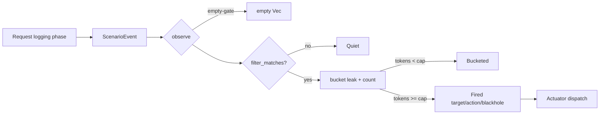

# Defence Arsenal, scenarios and actuators

**Languages:** **English** · [Русский](../ru/21-arsenal-scenarios.md) · [中文](../zh/21-arsenal-scenarios.md)

The Defence Arsenal (`src/arsenal.rs`) is the "umbrella" holder for every optional
defensive subsystem from V176–V205+: the JA4 corpus, payload normalisation,
the H2 budget, honeypots, route difficulty, BGP RTBH, enrichment, behavioural
scenarios (CrowdSec-style), active-response actuators, the challenge arsenal and the
deception layer. This document describes exactly what the arsenal contains, how it is
enabled (`with_arsenal`), how the scenario YAML DSL is built (bucket matching on
events, `Fired` actions, cross-worker persistence
`/var/lib/aegis/scenarios.yaml`), how the actuators work (`ActionKind`),
route difficulty, deception tactics and the Sicherheitstacho event format.

> An honest note about "opt-in". The arsenal is optional infrastructure, not
> part of the critical correctness path. Many modules ship with
> `NoopActuator`/`StubLlm`/empty sets that "record the intent" and
> move counters but perform no real side effect until the operator wires up a
> real backend. Every such case is explicitly flagged below.

Related documents: [WAF](10-waf.md), [TLS fingerprinting](11-tls-fingerprinting.md),
[reputation](12-reputation.md), [XDP/eBPF](13-xdp-ebpf.md),
[rate limiting](14-rate-limiting.md), [challenge ladder](15-challenge-ladder.md),
[Privacy Pass](16-privacy-pass.md), [honeypot/tarpit](17-honeypot-tarpit.md),
[ML risk engine](18-ml-risk-engine.md), [BGP RTBH](19-bgp-rtbh.md),
[GeoIP](20-geoip.md), [enrichment](22-enrichment.md),
[security model](23-security-model.md),
[metrics/telemetry](25-metrics-telemetry.md),
[admin panel](29-admin-panel.md), [admin API](30-admin-api.md).

---

## 1. What the Defence Arsenal is

`ArsenalState` (`src/arsenal.rs`) holds every module behind an `Arc<…>`, so that code on
the request path can take a shared handle (`arsenal.route_difficulty`,
`arsenal.scenarios`, …) without locking. Activity counters are `ShardedCounter`
(per-CPU cache-padded shards, V229), so the request path increments them
lock-free while the `/admin/api/arsenal` endpoint reads a snapshot.

### 1.1. Contents (`ArsenalState` fields)

| Field | Type | Purpose | File |
|------|-----|------------|------|
| `ja4_corpus` | `Arc<Ja4Corpus>` | allow/deny verdicts by JA4 | `src/ja4_corpus.rs` |
| `ja4_churn` | `Arc<Ja4ChurnTracker>` | detects JA4 rotation from a single IP | `src/ja4_churn.rs` |
| `param_profile` | `Arc<ParamProfileStore>` | profiling of parameter values | `src/param_profile.rs` |
| `h2_budget` | `Arc<H2BudgetTracker>` | token bucket for HTTP/2 control frames (Rapid Reset) | `src/h2_budget.rs` |
| `llm_honeypot` | `Arc<LlmHoneypot>` | LLM honeypot (`StubLlm` by default) | `src/llm_honeypot.rs` |
| `yaml_honeypot` | `Arc<YamlHoneypotEngine>` | multi-step YAML honeypots | `src/honeypot_yaml.rs` |
| `route_difficulty` | `Arc<DifficultyTable>` | per-route challenge difficulty | `src/route_difficulty.rs` |
| `bgp_rtbh` | `Arc<BgpRtbhDispatcher>` | RTBH announcements (ExaBGP) | `src/bgp_rtbh.rs` |
| `rule_plan` | `ArcSwapOption<RulePlan>` | dispatch plan for WAF rules by phase | `src/rule_planner.rs` |
| `actuators` | `Arc<ActuatorRegistry>` | active response + timer wheel | `src/actuator.rs` |
| `enrichment` | `Arc<RwLock<EnrichmentFacade>>` | WISE-style enrichment facade | `src/enrichment.rs` |
| `scenarios` | `Arc<ScenarioEngine>` | behavioural leaky-bucket DSL | `src/scenarios.rs` |
| `chained_trust` | `Arc<ChainedTrustStore>` | trust progression after a captcha | `src/chained_trust.rs` |
| `privacy_pass` | `Arc<PrivacyPassVerifier>` | Privacy Pass token verification | `src/privacy_pass.rs` |
| `adaptive_ladder` | `Arc<AdaptiveLadder>` | adaptive challenge ladder | `src/adaptive_ladder.rs` |
| `deception` | `Arc<DeceptionStats>` | counters for decoys/honeypot fields/varied errors | `src/challenge_deception.rs` |
| `domain_challenge` | `ArcSwap<HashMap<String, DomainChallengeConfig>>` | per-domain challenge overrides | `src/arsenal.rs` |
| `counters` | `Arc<Counters>` | per-module activity counters | `src/arsenal.rs` |

The `aegis-pingora` binary (`src/bin/aegis-pingora.rs`) logs `modules = 18` at
startup — that is the size of the set bound to the arsenal.

### 1.2. Optionality and defensive defaults

If the arsenal is not bound, every getter returns `None` and the request path
short-circuits cleanly (`src/lib.rs:164`). The `ArsenalState::new_default()` constructor
immediately registers "live" defaults so that the counters can actually fire:

* **YAML honeypot** — built-in descriptors (`fake-phpmyadmin`, `fake-wp-login`,
  `fake-dotenv`, `fake-git-config`) from the `DEFAULT_HONEYPOT_YAML` constant. The operator
  overrides the whole set with a file from `AEGIS_HONEYPOT_YAML`.
* **Enrichment** — the `ja4-corpus` source is registered
  (`Ja4CorpusEnrichmentSource`) so that `enrich_ja4()` does real work.
* **Route difficulty** — the `enable_ai_scraper_preset(true)` and
  `enable_auth_preset(true)` presets are enabled.
* **Actuators** — a `NoopActuator` is pre-registered for `XdpDeny`, `NftDrop`,
  `BgpAnnounce`, `ChallengeFloorRaise`, so that the standard action kinds are visible
  in `/admin/api/arsenal` even before a real backend is wired up (intent-only).

---

## 2. Enabling the arsenal: `with_arsenal`

The arsenal is bound to three data-plane subsystems via three identically named
builder methods `with_arsenal(...)`:

| Subsystem | File | What binding provides |
|------------|------|-------------------|
| `AegisPingoraProxy` | `src/proxy/pingora_http.rs:1120` | the request path gains access to scenarios/honeypot/route difficulty/h2 budget |
| Admin server | `src/proxy/pingora_admin.rs:892` | the `/admin/api/arsenal`, `/admin/api/scenarios`, `/admin/api/actions`, `/admin/api/challenge` endpoints start returning real data |
| Background service | `src/proxy/pingora_background.rs:166` | background tick: `actuators.tick()`, `scenarios.gc(...)`, `scenarios.maybe_reload()` |

### 2.1. The `AEGIS_ARSENAL` environment gate

In the binary (`src/bin/aegis-pingora.rs:1434`):

```rust
let arsenal_enabled = std::env::var("AEGIS_ARSENAL").ok().as_deref() != Some("0");
```

So the arsenal is enabled by default; `AEGIS_ARSENAL=0` disables it (all three
builders then receive `None`). The value is visible in `/admin/api/...`
(`pingora_admin.rs:2848`: `"arsenal_enabled": ... != Some("0")`) and is
registered in the env-variable registry (`pingora_admin.rs:115`,
`EnvKind::Bool`).

### 2.2. Related startup env variables

| Variable | Default | Purpose |
|------------|--------|------------|
| `AEGIS_ARSENAL` | (on) | `0` disables the arsenal entirely |
| `AEGIS_HONEYPOT_YAML` | (built-in) | path to the file of YAML honeypot descriptors |
| `AEGIS_BGP_PIPE` | `/var/lib/aegis/bgp-announce.pipe` | pipe/file for ExaBGP announcements; an empty string → noop announcer |
| `AEGIS_BGP_NEXTHOP` | `192.0.2.1` (TEST-NET-1, placeholder) | next hop for RTBH `/32`/`/128` routes — MUST be overridden |
| `AEGIS_CHALLENGE_CONFIG_PATH` | `/var/lib/aegis/domain-challenge.json` | persistence for the per-domain challenge config (V245) |
| `AEGIS_SCENARIOS_PATH` | `/var/lib/aegis/scenarios.yaml` | scenario persistence (V246) |
| `AEGIS_EVENT_FORMAT` | `native` | `sicherheitstacho`/`tpot` switch the EventBridge NDJSON format |

BGP wiring: `new_default()` builds a `BgpRtbhDispatcher` with an in-memory/noop
announcer (announcements never leave the process). By default the binary installs the
file-based `ExabgpPipeAnnouncer` via `with_bgp_announcer(...)`
(`src/bin/aegis-pingora.rs:1476`). See [BGP RTBH](19-bgp-rtbh.md).

---

## 3. Scenarios (CrowdSec-style leaky-bucket DSL)

The `src/scenarios.rs` module (V199) is a tiny YAML DSL for behavioural
detection of "N events within T time", something the flat rate-limit knobs
(`rps`/`burst`/`per-host`) cannot express.

### 3.1. Grammar

```yaml
name: http_login_brute
description: "Many 401s on /login from a single IP"
filter:
  path_prefix: /login
  status_min: 400
  status_max: 499
groupby: client_ip       # bucket key
distinct: path           # opt. — count only unique values
capacity: 10             # bucket size
leak_speed: 10s          # one token leaks every 10s
blackhole: 5m            # block the target for 5 minutes
action: block            # block | challenge | tarpit | log
```

`ScenarioEngine::parse_yaml` accepts either a single scenario or a list.

### 3.2. `ScenarioConfig` fields

| Field | Type | Req. | Note |
|------|-----|:-----:|------------|
| `name` | `String` | yes | scenario name; part of the bucket key |
| `description` | `String` | no | defaults to `""` |
| `filter` | `ScenarioFilter` | no | defaults to empty (matches everything) |
| `groupby` | `GroupBy` | yes | bucketing key |
| `distinct` | `Option<DistinctField>` | no | dedupe by a field value within the bucket |
| `capacity` | `u32` | yes | the scenario fires when `tokens >= capacity` |
| `leak_speed` | `Duration` | yes | as a string: `100ms`/`5s`/`2m`/`1h`/`1d`/bare seconds |
| `blackhole` | `Option<Duration>` | no | action TTL, passed to the actuator |
| `action` | `ScenarioAction` | yes | `block`/`challenge`/`tarpit`/`log` |

**`ScenarioFilter`** (all fields are `Option`; an absent one imposes no constraint):
`method`, `path_prefix`, `path_contains`, `path_suffix`, `host`,
`user_agent_contains`, `status`, `status_min`, `status_max`, `asn`, `country`.
Matching: `method`/`host` are case-insensitive; `user_agent_contains` is a
case-insensitive `contains`; status ranges use `status_min`/`status_max`
(an event without a status does not pass min/max).

**`GroupBy`** (`snake_case`): `client_ip`, `client_ip_user_agent`, `host`,
`host_path`, `user_agent`, `asn`.

**`DistinctField`** (`snake_case`): `path`, `user_agent`, `host`, `status`.

**`ScenarioAction`** (`snake_case`): `block`, `challenge`, `tarpit`, `log`.

### 3.3. Bucket matching on events

Events are `ScenarioEvent` (`client_ip`, `method`, `host`, `path`, `user_agent`,
`status`, `asn`, `country`). On the request path (`src/proxy/pingora_http.rs:3746`) the
event is constructed in the logging phase. Today `client_ip`,
`method`, `host`, `path`, `status` are populated; the `user_agent`, `asn`, `country` fields are passed
as `None` (an honest note: UA/ASN/country filters in the DSL are supported by the parser and
will only match if the event carries those fields — on the live path they are currently empty).

`ScenarioEngine::observe(event)` walks every loaded scenario **in load
order** and returns a `Vec<FireOutcome>` (non-matches are `Quiet`, so results can be
correlated by index). Bucket logic:

1. **Empty gate**: if nothing is loaded — a single relaxed atomic load and an
   empty `Vec` (the hot logging path never touches the RwLock).
2. **filter_matches** — otherwise `Quiet`.
3. The bucket key is `(scenario_name, groupby_value)` in a `DashMap` (128 shards, V230).
4. **Leak first**: `leak_ticks = floor(elapsed / leak_speed)` tokens leak out.
5. **distinct**: a token is only added if the `distinct` value has not yet been
   seen in this bucket (`HashSet::insert`).
6. **Fire**: when `tokens >= capacity` — the bucket is reset (tokens=0, distinct/recent
   cleared) and `FireOutcome::Fired { target, action, blackhole }` is returned. Otherwise —
   `FireOutcome::Bucketed { tokens, capacity }`.

The semantics are "N strikes and you're out": `capacity: 10` fires on the 10th event
(`>=`), not the 11th. The reset on fire guarantees a single firing rather than one on every
subsequent request until the bucket leaks.



### 3.4. `Fired` → actuator dispatch

On the request path (`src/proxy/pingora_http.rs:3756`) each `Fired` is mapped to an
`ActionKind` and applied through the actuator registry with TTL = `blackhole`:

| `ScenarioAction` | `ActionKind` |
|------------------|--------------|
| `Block` | `ActionKind::XdpDeny` |
| `Challenge` | `ActionKind::ChallengeFloorRaise` |
| `Tarpit` | `ActionKind::Custom("scenario_tarpit")` |
| `Log` | `ActionKind::Custom("scenario_log")` |

`target` is parsed into `Target::Ip(...)` or, on failure, into `Target::Custom(...)`.
`ActionParams { reason: "scenario_fired", source_module: "scenarios", .. }`.
Every firing moves `counters.scenario_fires` and `counters.actuator_applies`;
every event moves `counters.scenario_events`.

> An honest note: a real side effect (insertion into the XDP deny map, nft, BGP) only occurs
> if the operator has replaced `NoopActuator` with a real backend for the relevant
> `ActionKind`. By default `XdpDeny`/`ChallengeFloorRaise` are Noop, i.e.
> "intent recorded" — the action is visible in `/admin/api/actions` but is not enforced.
> `Custom("scenario_tarpit"/"scenario_log")` are not pre-registered at all — without
> registration `apply` returns `Outcome::Failed` (the `failed` counter).

### 3.5. Statistics and GC

`ScenarioStats`: `events_observed`, `events_matched`, `events_bucketed`,
`buckets_fired` (atomics, snapshot via `stats()`). `bucket_count()` is the
number of live buckets. `gc(idle)` removes buckets with no observations for longer than `idle`;
the background service calls `gc(600s)` (`pingora_background.rs:344`).

### 3.6. Cross-worker persistence (`/var/lib/aegis/scenarios.yaml`)

Because of `SO_REUSEPORT`, each `aegis-pingora@0..N` worker is a separate process
(see [multiprocessing](06-workers.md)). Without disk, a "Load" from the panel
would settle in a single worker. V246 solves this:

* `ScenarioEngine::set_persistence(path)` (`src/scenarios.rs:221`) — called from
  the binary (`src/bin/aegis-pingora.rs:1493`) with the path from `AEGIS_SCENARIOS_PATH`
  (default `/var/lib/aegis/scenarios.yaml`); it loads any existing file immediately.
* `save_yaml(yaml)` — atomic write of the operator's **raw YAML** (via `.tmp` +
  `rename`). Raw text rather than parsed structures: `leak_speed`/`blackhole`
  deserialise from strings (`"10s"`) but would serialise into `{secs,nanos}`,
  which the YAML parser would reject on reload.
* `maybe_reload()` — mtime polling: a cheap `stat()`, and when the file changes it
  REPLACEs the in-memory set. Called from every worker's background tick
  (`pingora_background.rs:348`), so a "Load" on one worker converges across the whole
  fleet within the poll window and survives a restart.
* `load_many(cfgs)` — a **REPLACE** (not an append): the panel sends the full
  desired set; an empty `load_many` correctly clears the scenarios.

Endpoints (see [admin API](30-admin-api.md)): `GET /admin/api/scenarios` returns the
loaded set + statistics + `buckets_active`; writing through the arsenal
handler calls `load_many(...)` and then `save_yaml(...)`
(`pingora_admin.rs:1898`, `:1903`).

---

## 4. Actuators (active response, `ActionKind`)

The `src/actuator.rs` module (V197) is a unified registry of active responses with a
centralised timer wheel. The idea (Wazuh active response + Falco Talon): one
registry of `(action_kind, target, params, revert_after, applied_at)` instead of
each subsystem reinventing its own timer.

### 4.1. `ActionKind`

| Variant | `as_str()` | Noop pre-registered in `new_default()` |
|---------|------------|:----------------------------------------:|
| `XdpDeny` | `xdp_deny` | yes |
| `NftDrop` | `nft_drop` | yes |
| `BgpAnnounce` | `bgp_announce` | yes |
| `ChallengeFloorRaise` | `challenge_floor_raise` | yes |
| `ResponseCachePoison` | `response_cache_poison` | no |
| `Custom(&'static str)` | the name | no |

`Custom` carries a `&'static str` so that the cardinality of the counter map stays
bounded.

### 4.2. `Target`

`Ip(IpAddr)`, `Subnet(IpAddr, u8)`, `UserAgent(String)`, `Path(String)`,
`Custom(String)`. The `as_display()` method renders human-readable output
(`10.0.0.0/24`, `ua:curl/8`, `path:/admin`, …).

### 4.3. The `Actuator` trait and `NoopActuator`

```rust
pub trait Actuator: Send + Sync {
    fn kind(&self) -> ActionKind;
    fn apply(&self, target: &Target, params: &ActionParams) -> Outcome;
    fn revert(&self, target: &Target) -> Outcome;
}
```

`Outcome`: `Applied` / `AlreadyApplied` / `Failed`. `NoopActuator` is the reference
implementation: it keeps a `HashSet<Target>`, `apply` returns `Applied`/`AlreadyApplied`,
and `revert` clears the entry. Useful in tests and as an "intent-only" stub until
the operator wires up a real backend — the action still appears in
`/admin/api/actions`.

### 4.4. `ActuatorRegistry`: semantics

* `register(actuator)` — the last registration for a kind wins (a Noop can be
  swapped for a real one without a restart).
* `apply(kind, target, params, revert_after)` — **idempotent**: reapplying
  to the same `(kind, target)` shifts `revert_at` rather than creating more entries.
  If there is no actuator for the kind — `Failed` + the `failed` counter. `revert_after = None`
  means "until manually reverted".
* `revert(kind, target)` — manual revert (operator/DELETE).
* `tick()` — background sweep (called once per second from the background service,
  `pingora_background.rs:336`): reverts everything whose `revert_at` has passed; moves
  `reverted_on_expiry`.
* `active_actions()` / `active_count()` — the list/count of active actions.
* `registered_kinds()` — the registered kinds (for the panel).

`ActuatorStats`: `applied`, `already_applied`, `failed`, `reverted_on_expiry`,
`reverted_manually`.

Design principles: a single source of truth (`/admin/api/actions` — all active
responses across all subsystems), a bounded blast radius (every action has a
revert deadline, or an explicit `Never`), idempotency, auditing via `SecurityEvent`.

### 4.5. Admin API

`/admin/api/actions` (GET) — the list of active actions + statistics
(`pingora_admin.rs:1929`). The DELETE handler calls
`arsenal.actuators.revert(kind, &target)` (`pingora_admin.rs:1994`). Details in
[admin API](30-admin-api.md).

---

## 5. Route difficulty (per-route challenge difficulty)

The `src/route_difficulty.rs` module (V186, Anubis-style): PoW gates work better
when the difficulty scales with the cost of the route being protected. Cheap
routes (static assets) get low difficulty; expensive ones (search, password reset) can
afford to make the client "pay" in CPU seconds.

### 5.1. Types

* `ChallengeKind`: `CookieRedirect`, `Captcha`, `JsPow { difficulty_bits: u8 }`.
* `DifficultyOverride`: `host`, `path_pattern`, `difficulty_bits`,
  `force_kind: Option<ChallengeKind>`.

### 5.2. Presets (enabled in `new_default()`)

* **`ai-scraper-mode`** (`enable_ai_scraper_preset`): if the UA contains
  `gptbot`/`ccbot`/`claude-web`/`anthropic-ai`/`perplexitybot`/`youbot`/
  `facebookbot`/`amazonbot`/`google-extended`/`bytespider` — a +4 bit bonus.
* **`auth-endpoint`** (`enable_auth_preset`): the patterns `*/login`, `*/signup`,
  `*/register`, `*/reset`, `*/forgot` for host `*` get `difficulty_bits = 22`
  (baseline 16 + 6) and a forced `JsPow { 22 }`.

### 5.3. `decide(host, path, ua, baseline_bits, baseline_kind)`

Returns `(ChallengeKind, u8)`. Logic: it takes the `max` across all matched
overrides, applies `force_kind`, then adds the UA bonus (the `max` of the
matched needles), and normalises: if the resulting bits have grown above the baseline and
the current kind is not PoW — it upgrades to `JsPow` with the raised difficulty.

### 5.4. Pattern matching (V162 domain-policy syntax)

| Pattern | Semantics |
|--------|-----------|
| `/foo` | exact match |
| `/foo/*` | prefix: `/foo` or `/foo/...` |
| `*/bar` | suffix: `.../bar` or `bar` |

`host`: `*` (any) or an exact value (case-insensitive). For the link with the challenge ladder —
see [challenge ladder](15-challenge-ladder.md). The counter is
`counters.route_difficulty_bumps`; the number of overrides is in `/admin/api/arsenal`.

---

## 6. Adaptive ladder (`adaptive_ladder.rs`)

The `src/adaptive_ladder.rs` module (V204) — two layers on top of the V42 ladder:

1. **Adaptive difficulty under anomaly**: when the anomaly detector (V38) sets
   attack mode, every level is bumped by `+attack_mode_bits` (default +4).
2. **Randomised order**: a new client does not always get the cookie level
   first; the order rotates deterministically by IP hash so that an attacker cannot
   precompute the sequence.

### 6.1. `AdaptiveConfig`

| Field | Default | Purpose |
|------|--------|------------|
| `attack_mode_bits` | `4` | bit bonus in attack mode |
| `randomize_order` | `true` | randomise the level by IP hash |
| `fast_track_threshold` | `0.75` | suspicion threshold for fast-track |

### 6.2. `decide(ip_hash, suspicion, baseline_bits) -> LadderDecision`

* `attack_mode` → `effective_bits = baseline + bonus`, counter `attack_mode_bumps`.
* **fast-track**: `suspicion >= fast_track_threshold` → `Captcha` when
  `suspicion >= 0.9`, otherwise `Pow`; bits `>= 20`; `reason = "fast_track_high_suspicion"`.
* otherwise, with `randomize_order` — `pick_by_hash` (≈50% Cookie, 25% Reload, 15%
  Interaction, 9% Pow, 1% Captcha by the low byte of the hash), counter
  `randomized_picks`; with randomisation off — `pick_by_floor` (an atomic
  `current_floor`, raised via `set_floor(0..=4)`).

`ChallengeLevel`: `Cookie`, `Reload`, `Interaction`, `Pow`, `Captcha`.
`LadderStats`: `fast_track_hits`, `attack_mode_bumps`, `randomized_picks`.
Attack mode is set with `set_attack_mode(on)` — admin API
`POST /admin/api/challenge/attack-mode` (`pingora_admin.rs:1786`).

---

## 7. Per-domain challenge arsenal (`DomainChallengeConfig`)

`DomainChallengeConfig` (`src/arsenal.rs`) holds per-host overrides. The operator
writes them via `/admin/api/sites/<host>/challenge`
(`set_domain_challenge_config`, `pingora_admin.rs:1759`); the daemon reads them
per request (`domain_challenge_config(host)`).

### 7.1. Fields (V205 phase)

`argon2_pow`, `argon2_bits`, `argon2_memory_kb`, `privacy_pass`, `chained_trust`,
`adaptive`, `varied_errors`, `decoy_captcha`, `honeypot_fields`, `trust_for_auth`,
`fast_track_threshold`, `attack_mode_bits`.

### 7.2. Challenge-arsenal fields (V233+ phase, opt-in)

> An honest note: V233+ is **phase 1 (foundation)**. All new fields default to
> `None`/`false`, so existing hosts are unchanged. Phase 1 lays down the
> config shape + counters; the real logic for some signals lands in
> later phases. Each signal has a corresponding `challenge_*_hits` counter
> in `Counters`, exposed through `/admin/api/challenge`.

| Field | Category | Signal |
|------|-----------|--------|
| `ja4_ua_consistency` | passive | TLS JA4 vs the declared User-Agent |
| `header_fingerprint` | passive | order/case of HTTP headers |
| `h2_fingerprint` | passive | HTTP/2 SETTINGS/window/pseudo-header |
| `datacenter_asn_challenge` | passive | escalation on a hosting/VPN ASN |
| `headless_detection` | JS | `navigator.webdriver`/automation artefacts |
| `webgl_audio_fp` | JS | WebGL renderer + AudioContext |
| `dom_timing_entropy` | JS | rAF cadence / timer faking |
| `reputation_difficulty` | enforcement | scaling PoW by suspicion |
| `fail_to_xdp_deny` | enforcement | N failed challenges → XDP deny |
| `turnstile` | top rung | Cloudflare Turnstile when keys are present |
| `proof_of_click` | gesture | hold/click-to-verify |

### 7.3. Persistence (`/var/lib/aegis/domain-challenge.json`)

V245 (mirroring the `DomainPolicyStore` model): without disk the `ArcSwap` would be per worker.
`attach_challenge_persistence(path)` (`src/arsenal.rs:773`) loads an existing
file; each `set/clear` writes the whole map atomically (`.json.tmp` + `rename`); reads
mtime-poll the file (`refresh_domain_challenge`). The binary
(`src/bin/aegis-pingora.rs:1485`) takes the path from `AEGIS_CHALLENGE_CONFIG_PATH`
(default `/var/lib/aegis/domain-challenge.json`). Fast path:
`domain_challenge_configured` — a single atomic, so the snapshot is skipped while
no host is configured.

See [challenge ladder](15-challenge-ladder.md), [Privacy Pass](16-privacy-pass.md),
[cartography and domains](26-sites-and-domains.md).

---

## 8. Deception (the deception layer)

Four cooperating modules. All of them only engage for already-suspicious
traffic — never for clean traffic.

### 8.1. `challenge_deception.rs` — decoy CAPTCHA + honeypot fields + varied errors

* **Decoy CAPTCHA** (`build_decoy_form_html(scenario_id, salt)`): shows a
  captcha form to clients with very high suspicion and accepts nothing (the
  `DecoyVerdict::BlackHole` mode), burning the solver's quota. The form is deterministic on
  `salt` (the same fingerprint sees the same form across retries).
* **Honeypot fields** (`build_honeypot_fields` / `detect_honeypot_fill`): hidden
  fields (`class="honeypot"`, `tabindex="-1"`, CSS off-screen) from a pool of
  `email_confirm`, `phone_number`, `zip_code`, `company`, `fax`. Real users do not
  fill them in; automation that fills everything gets caught. A non-empty value in
  any honeypot field → instant deny.
* **Varied error pages** (`ErrorMask`): rotation by `salt` among
  `OriginDnsError`(502), `GatewayTimeout`(504), `ServiceUnavailable`(503),
  `ConnectionReset`(502), `UpstreamProtocolError`(502). The attacker cannot tell
  whether Aegis caught them or the site is down — which slows down reverse engineering.

`DeceptionStats`: `decoy_forms_rendered`, `honeypot_fills_detected`,
`varied_errors_rendered` (exposed through `/admin/api/challenge`,
`pingora_admin.rs:1316`).

### 8.2. `decoy_headers.rs` — Scrapling-inverted CDN headers

The `src/decoy_headers.rs` module (V188): adaptive scrapers (Scrapling/Botasaurus)
identify the WAF/CDN from headers/cookies and load the matching bypass. If
Aegis passes itself off as somebody else's CDN, the attacker picks the wrong playbook.

`DecoyFamily`: `Cloudflare`, `Akamai`, `Fastly`, `CloudFront`.
`DecoyHeaders::build(family, conn_id)` → `Vec<(&'static str, String)>`,
deterministic on `conn_id` (retries match). Examples:

| Family | Headers |
|-----------|-----------|
| Cloudflare | `server: cloudflare`, `cf-ray: <16hex>-FRA`, `cf-cache-status: DYNAMIC`, `alt-svc: h3=":443"; ma=86400`, `set-cookie: __cf_bm=…` |
| Akamai | `server: AkamaiGHost`, `x-akamai-request-id`, `x-cache`, `x-reference` |
| Fastly | `server: Varnish`, `x-served-by`, `x-cache: HIT`, `x-fastly-request-id` (32 hex) |
| CloudFront | `server: CloudFront`, `x-amz-cf-pop`, `x-amz-cf-id`, `via` |

Policy: `should_decoy(challenge_fired, ml_score, honeypot_hit)` → `true` if
a challenge fired, a honeypot was hit, or `ml_score >= 0.65`. Counter
`counters.decoy_header_emits`.

### 8.3. `latency_jitter.rs` — shape-correct latency jitter

The `src/latency_jitter.rs` module (V190): a naive tarpit `sleep(N)` produces sub-ms
uniformity that is trivially detectable. This module draws the delay from:

* `LogNormal { median_ms, sigma }` — the general RTT model; `default_tarpit()` =
  `{ median_ms: 350, sigma: 0.55 }`.
* `BimodalCdn { fast_ms, slow_ms, slow_prob }` — imitating CDN cache hit/miss;
  `default_decoy()` = `{ fast_ms: 18, slow_ms: 220, slow_prob: 0.15 }` (a pair to
  the V188 decoy headers).
* `Fixed(ms)` — an explicit override.

`sample(dist, seed)` → `Duration` (the caller sleeps itself — the module is not tied to a
runtime). Seed = `conn_id ⊕ the request counter`. Counter
`counters.latency_jitter_emits`.

### 8.4. `timing_entropy.rs` — ML features from input timing

The `src/timing_entropy.rs` module (V189): headed-Chrome scrapers
(Botasaurus, undetected_chromedriver) are bad at imitating **human input timing**.
It computes, from the JS collector data (V145 `client_consistency`):

* `move_interval_entropy` — the Shannon entropy of mouse inter-arrival times (8ms bins; humans
  > 3.0, synthetic < 1.5).
* `move_interval_cv` — the coefficient of variation (humans > 0.5, a uniform timer
  < 0.1).
* `scroll_cadence_mad` — the median absolute deviation of scroll intervals.

`extract(&TimingSample) -> TimingFeatures { …, anomaly_score }` (0.0 — human,
1.0 — synthetic; the scroll axis is discarded when there is no data). Counters
`counters.timing_entropy_calls`, `counters.timing_entropy_synthetic_flags`.
It is fed to the ML engine — see [ML risk engine](18-ml-risk-engine.md).

---

## 9. The Sicherheitstacho (T-Pot) event format

The `src/sicherheitstacho.rs` module (V185) — export to the normalised
Telekom CERT "Sicherheitstacho" format, on which dozens of T-Pot honeypots converge.
This gives free interoperability with ELK mappings, threat-feed aggregators
and the public Sicherheitstacho dashboard.

### 9.1. Schema (the relevant subset)

```json
{
  "@timestamp": "2026-05-22T12:34:56.000Z",
  "type":       "Aegis",
  "src_ip":     "203.0.113.7",
  "src_port":   51234,
  "dst_port":   443,
  "country":    "RU",
  "asn":        "AS12345",
  "transport":  "TCP",
  "service":    "aegis-waf",
  "category":   "honeypot",
  "tags":       ["sqlmap", "phpmyadmin-probe"],
  "request": { "method": "POST", "host": "evil.test",
               "path": "/phpmyadmin/index.php", "ua": "sqlmap/1.7" }
}
```

### 9.2. Implementation

* `EventInput<'a>` — borrows strings (`&'a str`/`&[&str]`), with no allocations beyond
  the output string.
* `Category`: `Waf`(`waf`), `Honeypot`(`honeypot`), `Tarpit`(`tarpit`),
  `Challenge`(`challenge`), `Block`(`block`).
* `render(&EventInput) -> String` — single-line JSON, ready for an NDJSON socket.
  `country`/`asn`/`ua` are omitted when `None`. No serde dependency (a hand-written
  serialiser + `push_json_string` escaping); a built-in ISO-8601 renderer
  `unix_ms_to_iso` (Hinnant's algorithm, without chrono/jiff).

### 9.3. Choosing the format in production

The EventBridge NDJSON format is switched by `AEGIS_EVENT_FORMAT`
(`src/event_bridge.rs:78`): `sicherheitstacho` or `tpot` → `WireFormat::Sicherheitstacho`;
otherwise the native `SecurityEvent` JSON. Env registry: `pingora_admin.rs:130`
(`EnvKind::Enum(["native","sicherheitstacho","tpot"])`).

> An honest note about the counter. The `sicherheitstacho.emits` increment mechanism
> is wired up (`with_sicherheitstacho_counter`, `event_bridge.rs:103`): every emit in
> the Sicherheitstacho format moves the arsenal shard `sicherheitstacho_emits`.
> The counter only grows when this format is selected AND the arsenal is bound; with the native
> format it stays at zero (`pingora_admin.rs:1170`).

More on export/SIEM — [metrics and telemetry](25-metrics-telemetry.md),
[request log](24-request-log.md).

---

## 10. Arsenal counters (`/admin/api/arsenal`)

`Counters` (`src/arsenal.rs`) — a per-module `ShardedCounter`; `snapshot()` returns a
`CounterSnapshot`. The key groups visible in `/admin/api/arsenal`
(`pingora_admin.rs:1251`):

| Group | Counters |
|--------|----------|
| `ja4_corpus` | `lookups`, `allow_hits`, `deny_hits`, `entries` |
| `ja4_churn` | `observations`, `tracked_ips` |
| `param_profile` | `observations`, `anomalies`, `keys` |
| `h2_budget` | `allows`, `rejects`, `tracked_conns` |
| `honeypot_yaml` | `engagements`, `sessions`, `descriptors` |
| `llm_honeypot` | `responses`, `cached` |
| `sicherheitstacho` | `emits` |
| `route_difficulty` | `bumps`, `overrides` |
| `bgp_rtbh` | `announces`, `withdraws`, `active` |
| `actuators` | `applied`/`failed`/`reverted_*`, `active`, `kinds` |
| `enrichment` | `lookups`, `cache_hits`, `sources` |
| `scenarios` | `events`, `fires`, `loaded`, `buckets` |
| deception/challenge | `decoy_header_emits`, `latency_jitter_emits`, `timing_entropy_*`, `challenge_*_hits`, `adaptive_ladder_decisions`, … |

The `wired` field (`pingora_admin.rs:1163`) shows whether the arsenal is bound. The registry of
modules with metadata (id/version/family/label) is listed in the same place
(`pingora_admin.rs:1203`).

---

## 11. Summary of paths and wiring

| What | Where |
|-----|-----|
| Arsenal holder | `src/arsenal.rs` (`ArsenalState`, `Counters`) |
| Scenarios (DSL) | `src/scenarios.rs` (`ScenarioEngine`, `ScenarioConfig`, `FireOutcome`) |
| Actuators | `src/actuator.rs` (`ActuatorRegistry`, `ActionKind`, `Actuator`) |
| Route difficulty | `src/route_difficulty.rs` (`DifficultyTable`) |
| Adaptive ladder | `src/adaptive_ladder.rs` (`AdaptiveLadder`) |
| Deception (forms/errors) | `src/challenge_deception.rs` |
| Decoy CDN headers | `src/decoy_headers.rs` |
| Latency jitter | `src/latency_jitter.rs` |
| Timing entropy | `src/timing_entropy.rs` |
| Sicherheitstacho | `src/sicherheitstacho.rs` |
| Binding to the proxy | `src/proxy/pingora_http.rs:1120` (`with_arsenal`), `:3756` (observe/fire) |
| Binding to admin | `src/proxy/pingora_admin.rs:892` |
| Binding to background | `src/proxy/pingora_background.rs:166` (tick/gc/reload) |
| Startup/persistence | `src/bin/aegis-pingora.rs:1434`–`1504` |
| EventBridge format | `src/event_bridge.rs:78`, `:103` |
