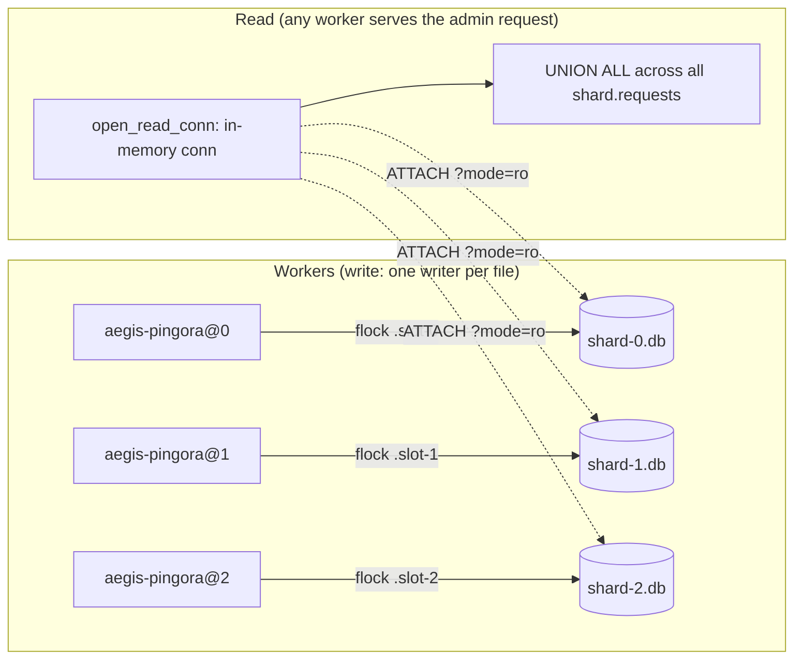

# Request log (event log)

**Languages:** **English** · [Русский](../ru/24-request-log.md) · [中文](../zh/24-request-log.md)

AEGIS's persistent request log: every served request may be written as a single row into a local SQLite database, after which the admin panel builds per-domain analytics, bot/DDoS history "over any period", WAF trigger history and full-text search across requests from that data. The subsystem is implemented in [`src/event_store.rs`](../../src/event_store.rs); alongside it runs the streaming event bus [`src/event_bridge.rs`](../../src/event_bridge.rs) (NDJSON over a Unix socket) for SIEM.

> Sources this document is grounded in: [`src/event_store.rs`](../../src/event_store.rs), [`src/event_bridge.rs`](../../src/event_bridge.rs), the `api_logs` / `api_logs_stats` handlers in [`src/proxy/pingora_admin.rs`](../../src/proxy/pingora_admin.rs), the hot-path write site in [`src/proxy/pingora_http.rs`](../../src/proxy/pingora_http.rs) and the initialisation in [`src/bin/aegis-pingora.rs`](../../src/bin/aegis-pingora.rs).

These are two different, independent things that are easy to confuse:

| Subsystem | What it is | Transport | Purpose | File |
|---|---|---|---|---|
| **Event store** | Persistent request log in SQLite | Local shard files on disk | History/analytics in the admin panel (`/admin/api/logs*`) | [`src/event_store.rs`](../../src/event_store.rs) |
| **EventBridge** | Streaming bus of security decisions | Unix socket, NDJSON | Real-time export to SIEM (Wazuh/Loki/Splunk/Vector/…) | [`src/event_bridge.rs`](../../src/event_bridge.rs) |

For more on metrics, Prometheus and streaming telemetry see [docs/25-metrics-telemetry.md](25-metrics-telemetry.md).

---

## 1. Event store: sharding model (SQLite per worker)

AEGIS runs multi-process via `SO_REUSEPORT` (`aegis-pingora@0..N`, see [docs/06-workers.md](06-workers.md)). Each worker process owns **its own** SQLite file `<dir>/shard-<slot>.db`, where `<slot>` is obtained through a non-blocking advisory `flock` on `<dir>/.slot-<n>.lock` — exactly the same scheme as in `site_map` (`crate::site_map::SiteMap::acquire_slot` is reused). Since the slot is held for the whole lifetime of the process, there is **exactly one writer** per database file — the write path never contends with another process and never blocks on SQLite's busy handler.

* The default directory is `/var/lib/aegis/events`, overridden via `AEGIS_EVENTS_DIR`.
* The maximum number of slot probes is `MAX_SLOTS = 16` (matching `site_map::MAX_SLOTS`).
* If no free slot is available / the directory cannot be created / the database cannot be opened, the store degrades to a **no-op** (logs a warning, `record` does nothing, `shard_path()` returns `None`), but process startup does not fail.



### Reading: ATTACH + UNION ALL

The read side (`EventStore::query` / `EventStore::stats`) opens a fresh in-memory connection (`Connection::open_in_memory`) and `ATTACH`es **every** existing `shard-*.db` as `s0`, `s1`, … in read-only mode via the URI `file:<path>?mode=ro`. A subquery is then built over those aliases: `SELECT … FROM s0.requests UNION ALL SELECT … FROM s1.requests …` (`union_all_subquery`). This way the query returns a stable aggregate **across all workers**, whichever worker happens to serve the admin request.

* Shards that could not be attached (locked/corrupted) are silently skipped (`tracing::debug`) rather than failing the whole query.
* If no shard could be attached, `query` returns an empty vector and `stats` returns `LogStats::default()`.
* The shard list (`shard_files`) is all files matching `shard-*.db`, sorted for determinism.

---

## 2. Row fields (`EventRow`)

A single log row is the `EventRow` struct (`Serialize`/`Deserialize`, so the admin API returns query results directly as JSON). The `requests` table schema mirrors these fields.

| Field | SQLite type | Description |
|---|---|---|
| `ts` | INTEGER | Time in Unix **milliseconds** |
| `host` | TEXT | Request Host |
| `method` | TEXT | HTTP method |
| `path` | TEXT | Original request path |
| `path_pattern` | TEXT | Generalised path, e.g. `/api/users/:id` (via `crate::site_map::generalise_path`) — used for per-endpoint aggregation |
| `status` | INTEGER | HTTP response status |
| `action` | TEXT | Decision: `pass` / `deny` / `challenge` / `tarpit` / `rate` / `rtbh` |
| `reason` | TEXT | Reason (for example, who denied it — `ctx.denied_by`) |
| `waf_rule` | TEXT | WAF rule that fired (if any) |
| `client_ip` | TEXT | Client IP |
| `country` | TEXT | Country (GeoIP, see [docs/20-geoip.md](20-geoip.md)) |
| `ja4` | TEXT | JA4 fingerprint (see [docs/11-tls-fingerprinting.md](11-tls-fingerprinting.md)) |
| `latency_ms` | INTEGER | Serving latency, ms |
| `bytes` | INTEGER | Response size, bytes |
| `protocol` | TEXT | Version/protocol (`http_version_label`) |
| `user_agent` | TEXT | User-Agent |

The constructor `EventRow::now(host, method, path, path_pattern, status, action)` sets the current timestamp and leaves the remaining string fields empty — the caller fills in whatever it has to hand.

### Indexes

The schema (`SCHEMA_SQL`) creates five indexes for typical analytics queries:

```sql
CREATE INDEX IF NOT EXISTS idx_host_ts          ON requests (host, ts);
CREATE INDEX IF NOT EXISTS idx_host_pattern_ts  ON requests (host, path_pattern, ts);
CREATE INDEX IF NOT EXISTS idx_action_ts        ON requests (action, ts);
CREATE INDEX IF NOT EXISTS idx_client_ip_ts     ON requests (client_ip, ts);
CREATE INDEX IF NOT EXISTS idx_ts               ON requests (ts);
```

### Writer connection pragmas

`open_writer_conn` opens the shard in single-writer mode:

```sql
PRAGMA journal_mode=WAL;
PRAGMA synchronous=NORMAL;       -- WAL-safe
PRAGMA busy_timeout=5000;
PRAGMA auto_vacuum=INCREMENTAL;  -- so that PRAGMA incremental_vacuum can reclaim space
PRAGMA wal_autocheckpoint=1000;
```

---

## 3. Non-blocking write (hot path)

`EventStore::record` is called **on the proxy hot path, once per request**, from the `logging()` phase. The contract is strict and marked in the code as "do not regress" (there has already been a production latency incident caused by synchronous logging I/O on the hot path; the current design rules that out by construction):

1. **No-op** if logging is disabled or persistence did not come up.
2. **Sampling** (see below) — by counter, with no RNG on the hot path.
3. `try_send` into a **bounded** channel (`sync_channel`, capacity `CHANNEL_CAP = 16_384`). If the channel is full the row is **dropped** and the `dropped` counter is incremented. It never blocks and never touches SQLite in the caller's thread.

In addition, the whole (cheap) row assembly on the `pingora_http.rs` side is hidden behind `self.event_store.is_enabled()` — a disabled store costs nothing beyond a single `bool` load. The only extra work with the store enabled is path generalisation (`generalise_path`) and one optional GeoIP country lookup, both O(path length).

### Background writer and batching

A separate `aegis-eventlog` thread drains the channel and commits **in batches within a single transaction** (`flush_batch`):

| Parameter | Value | Meaning |
|---|---|---|
| `CHANNEL_CAP` | `16_384` | Capacity of the bounded write channel (~a few MiB of backlog at ~200 bytes/row) |
| `BATCH_MAX` | `1_000` | Flush the batch once it reaches this row count |
| `FLUSH_INTERVAL` | `500 ms` | Minimum batch flush frequency, even if the batch is not full |
| `RETENTION_INTERVAL` | `3_600 s` (1 h) | How often the writer runs retention + checkpoint |
| `HARD_ROW_CAP` | `5_000_000` | Hard safety valve: row count per shard |

The writer blocks on `recv_timeout` (for the remainder of the flush interval, minimum 10 ms), then greedily drains whatever else is in the queue without blocking. On shutdown (the store's `Drop` sets `stop` and clears `tx` → the channel disconnects) the thread drains the remainder, performs a final flush and a final `PRAGMA wal_checkpoint(TRUNCATE)`, after which `Drop` joins the thread so that the last batch lands before the process exits.

Insert errors are logged and the **batch is dropped** — the writer thread never panics.

### Diagnostic counters

| Method | What it counts |
|---|---|
| `dropped_count()` | Rows dropped due to channel overflow (or a disconnected channel) |
| `accepted_count()` | Rows accepted into the channel (not necessarily committed yet) |
| `shard_path()` | This worker's shard path (`None` if persistence is not active) |
| `is_enabled()` | Whether the enable gate was passed |

---

## 4. Retention (`AEGIS_EVENTS_RETENTION_DAYS`)

`run_retention` is run by the writer once an hour (`RETENTION_INTERVAL`) and does three things on a best-effort basis:

1. **Time-based deletion**: `DELETE FROM requests WHERE ts < cutoff`, where `cutoff = now_ms − retention_days × 86_400_000`. The window is set by `AEGIS_EVENTS_RETENTION_DAYS` (default **14** days).
2. **Hard row-count safety valve**: if after deletion there are still more rows than `HARD_ROW_CAP` (5 million), the oldest excess rows are deleted (`ORDER BY ts ASC LIMIT overflow`) — regardless of the time window.
3. **Checkpoint + space reclamation**: `PRAGMA wal_checkpoint(TRUNCATE); PRAGMA incremental_vacuum;` — bounds the WAL size and returns freed pages.

Retention errors are logged (`tracing::warn`) but do not take the writer down.

---

## 5. Sampling (`AEGIS_EVENTS_SAMPLE_PASS`)

`AEGIS_EVENTS_SAMPLE_PASS` is a float in `0.0..=1.0`, default `1.0`. It is the **fraction of retained rows with `action == "pass"`**. All **non-pass** actions (`deny` / `challenge` / `tarpit` / `rate` / `rtbh` / …) are **always** retained.

The sampler is a cheap "keep every Nth" counter, with no RNG on the hot path. The fraction is converted into a divisor by `sample_n_from_fraction`:

| `AEGIS_EVENTS_SAMPLE_PASS` | Effective N (`keep every Nth`) | Behaviour |
|---|---|---|
| `1.0` (or ≥1) | `1` | Keep all pass |
| `0.5` | `2` | Keep every 2nd pass |
| `0.1` | `10` | Keep every 10th pass |
| `0.0` (or negative) | `u64::MAX` | Effectively keep no pass (without dividing by zero) |

> This is an **opt-in optimisation**: the default value of `1.0` samples nothing. Sampling only affects successful `pass` requests; the entire security history (deny/challenge/tarpit/rate/rtbh) is retained without gaps.

---

## 6. API: `GET /admin/api/logs` and `/admin/api/logs/stats`

Both routes are served in [`src/proxy/pingora_admin.rs`](../../src/proxy/pingora_admin.rs) (`api_logs` / `api_logs_stats`) and require admin authentication (`x-admin-token` / session / roles — see [docs/30-admin-api.md](30-admin-api.md)). In the router `/admin/api/logs/stats` is checked **before** `/admin/api/logs` (longer path first). If the store is not attached, both respond `200` with an empty result.

### `GET /admin/api/logs` — row selection

Query-string parameters are parsed into `LogFilter`. Any missing/empty field means "no constraint".

| Query parameter | `LogFilter` field | SQL semantics |
|---|---|---|
| `host` | `host` | `host = ?` (exact match) |
| `endpoint` | `endpoint` | `path_pattern = ?` (by generalised path) |
| `action` | `action` | `action = ?` |
| `ip` | `client_ip` | `client_ip = ?` |
| `q` | `q` | free text: `(path LIKE %q% OR user_agent LIKE %q%)` |
| `from` | `from_ms` | `ts >= ?` (Unix ms) |
| `to` | `to_ms` | `ts <= ?` (Unix ms) |
| `limit` | `limit` | selection size, **hard cap of 1000** (`QUERY_LIMIT_CAP`) |
| `offset` | `offset` | offset (pagination) |

The result is `ORDER BY ts DESC` (newest first). Response:

```json
{ "entries": [ /* EventRow[] */ ], "total": 42 }
```

`total` here is the number of **returned** rows (the selection is bounded by `limit`/the cap of 1000), not the total number of matching rows in the database.

```bash
# Latest denies for domain example.com within a time window
curl -s -H "x-admin-token: $TOKEN" \
  'http://127.0.0.1:PORT/admin/api/logs?host=example.com&action=deny&from=1733600000000&to=1733700000000&limit=200'

# Full-text search over path/user-agent
curl -s -H "x-admin-token: $TOKEN" \
  'http://127.0.0.1:PORT/admin/api/logs?q=/wp-admin&limit=50'
```

### `GET /admin/api/logs/stats` — aggregated analytics

Parameters: `host` (optional), `from`, `to` (Unix ms). If `from`/`to` are omitted, the default is the **last 24 hours** (`now − 86_400_000 … now`). Returns a JSON object `LogStats`:

| `LogStats` field | Type | What it is |
|---|---|---|
| `total` | i64 | Total rows in the window |
| `by_action` | `Count[]` | Breakdown by `action` (top-20) |
| `top_endpoints` | `Count[]` | Top by `path_pattern` (top-20) |
| `top_ips` | `IpStat[]` | Top IPs broken down by `hits/deny/challenge/country` (top-50) |
| `top_reasons` | `Count[]` | Top non-empty `reason` values (top-20) |
| `status_dist` | `Count[]` | HTTP status distribution (top-20) |
| `endpoint_fanout` | `EndpointStat[]` | `(host, path_pattern, hits, distinct_ips)`, sorted by `distinct_ips` — feeds the DDoS "endpoint under attack" view (top-50) |
| `series` | `TimeBucket[]` | Time series `(ts, hits, deny, challenge)` |
| `bucket_ms` | i64 | Series bucket width, ms |

The bucket width is chosen automatically (`auto_bucket_ms`) so as to yield on the order of ≤120 points across the range, snapped to "human" intervals: 1s / 5s / 15s / 1m / 5m / 15m / 1h / 6h / 1d / 1w / 30d / 90d / 1y.

```bash
# Analytics for the last 24 hours (default)
curl -s -H "x-admin-token: $TOKEN" 'http://127.0.0.1:PORT/admin/api/logs/stats'

# Analytics for a domain over an arbitrary period
curl -s -H "x-admin-token: $TOKEN" \
  'http://127.0.0.1:PORT/admin/api/logs/stats?host=example.com&from=1733000000000&to=1733600000000'
```

### Bot/DDoS history "over a period"

It is precisely these aggregates that feed the panel's "bots/DDoS over any period" sections:

* **bots/abuse** — `top_ips` (with deny/challenge breakdown) + `by_action` + `series` (spikes of deny/challenge over time);
* **DDoS / endpoint under attack** — `endpoint_fanout`: the number of distinct IPs (`distinct_ips`) per `(host, path_pattern)` surfaces precisely targeted endpoints, sorted by source fan-out.

Since the read side does `ATTACH + UNION ALL` across all shards, these figures are a cross-worker aggregate over the whole retention period (subject to retention and pass-row sampling).

---

## 7. EventBridge — NDJSON over a Unix socket (for SIEM)

A separate subsystem ([`src/event_bridge.rs`](../../src/event_bridge.rs)): a single endpoint that emits **one JSON object per security decision**. The data is `SecurityEvent`; EventBridge is the transport.

Properties:

* **Unix socket** (`/var/run/aegis-events.sock` by default) — no network exposure, ACL by file permissions (`chmod 0600` on bind; the operator chmods/chowns it for their own SIEM user). Subscribe via `nc -U` / `socat` / the SIEM's unix-socket reader.
* **NDJSON broadcast** — every connected subscriber receives every event; new connections start "from a clean slate" (no history replay).
* **Lossy bounded queue per subscriber** (`SUBSCRIBER_CHANNEL_CAP = 1024`): if a slow subscriber cannot keep up, the proxy never blocks and its event for that subscriber is dropped (`try_send` Full). Dead subscribers (`Closed`) are pruned on the next `emit`. The principle: AEGIS is a proxy that emits, not a logging system; drop > block.
* **Best-effort**: if the socket is unavailable / the path is not configured, `emit` is a no-op. The hot-path cost is one `try_send` per event; sub-µs when there are no subscribers.

### Wire format (`AEGIS_EVENT_FORMAT`)

| `AEGIS_EVENT_FORMAT` | `WireFormat` | Schema |
|---|---|---|
| (unset) / `native` | `Native` (default) | Native `SecurityEvent` JSON |
| `sicherheitstacho` / `tpot` | `Sicherheitstacho` | NDJSON compatible with T-Pot Sicherheitstacho |

In `Sicherheitstacho` mode every emit, if an arsenal counter is bound (`with_sicherheitstacho_counter`), increments `sicherheitstacho_emits` so that the Defence Arsenal panel (`/admin/api/arsenal` → `sicherheitstacho.emits`) reflects the real export volume in the T-Pot schema.

```bash
# Subscribe to the event stream manually
nc -U /var/run/aegis-events.sock
# or
socat - UNIX-CONNECT:/var/run/aegis-events.sock
```

> **Honest caveat.** EventBridge is constructed and emits events **only if the operator has attached the socket themselves** (`socket_path = Some(...)`, env `AEGIS_EVENT_SOCKET`). At present, in the code of [`src/bin/aegis-pingora.rs`](../../src/bin/aegis-pingora.rs), `EventBridge` is **not constructed by default** on the pingora data plane — which is why the Sicherheitstacho module in `api_arsenal` is honestly marked `planned` ("the code path is ready, but until an operator attaches it, nothing is emitted"). The `EventStore` (the SQLite log), by contrast, is **enabled by default** and is brought up in `aegis-pingora.rs` via `EventStore::from_env()`, after which it is bound both to the proxy (`with_event_store`) and to admin (`with_event_store`).

---

## 8. Summary of env knobs

| Variable | Default | Type | Effect | File |
|---|---|---|---|---|
| `AEGIS_EVENT_LOG` | ON (enabled) | Bool | Enables the whole log subsystem. `0`/`false`/`off`/`no` → `record` becomes a no-op | `event_store.rs` |
| `AEGIS_EVENTS_DIR` | `/var/lib/aegis/events` | Path | Directory of `shard-*.db` shard files | `event_store.rs` |
| `AEGIS_EVENTS_RETENTION_DAYS` | `14` | Uint | How many days to keep rows before time-based deletion | `event_store.rs` |
| `AEGIS_EVENTS_SAMPLE_PASS` | `1.0` | Float `0.0..=1.0` | Fraction of retained `pass` rows (non-pass always kept) | `event_store.rs` |
| `AEGIS_EVENT_FORMAT` | `native` | Enum `native`/`sicherheitstacho`/`tpot` | NDJSON format of the EventBridge bus | `event_bridge.rs` |
| `AEGIS_EVENT_SOCKET` | (unset) | Path | EventBridge Unix socket path (if unset, the bus is a no-op) | `event_bridge.rs` |

The first four variables are in the admin allowlist (`ENV_ALLOWLIST` in [`src/proxy/pingora_admin.rs`](../../src/proxy/pingora_admin.rs)) with types `Bool`/`Path`/`Uint`/`Float` and are **applied on restart** (`restart_required: true` when saved). On restarting workers without downtime see [docs/06-workers.md](06-workers.md); on configuration in general see [docs/04-configuration.md](04-configuration.md).

---

## 9. Operational notes

* **Where the data lives.** By default `/var/lib/aegis/events/shard-<slot>.db` (+ WAL). Each worker gets its own file; you can read the database directly with `sqlite3` in read-only mode, but the supported path is the admin API.
* **Losing rows under overload is by design.** When the write channel overflows, the row is dropped (the `dropped` counter) rather than delaying the request. The log is observability, not a source of truth for billing.
* **Sampling does not touch security events.** Even with an aggressive `AEGIS_EVENTS_SAMPLE_PASS=0.01`, all deny/challenge/tarpit/rate/rtbh are retained in full.
* **On-disk size is bounded** by time-based retention (`AEGIS_EVENTS_RETENTION_DAYS`), the hard row cap (`HARD_ROW_CAP = 5 million`/shard) and the periodic `wal_checkpoint(TRUNCATE)` + `incremental_vacuum`.
* **Disabling.** `AEGIS_EVENT_LOG=0` disables the log completely: no writer thread, no slot, no database file; `/admin/api/logs*` then return empty responses.

### Cross-references

* [docs/25-metrics-telemetry.md](25-metrics-telemetry.md) — Prometheus `/metrics`, timeseries rings, streaming telemetry.
* [docs/26-sites-and-domains.md](26-sites-and-domains.md) — `site_map`, `generalise_path`, per-domain policy.
* [docs/29-admin-panel.md](29-admin-panel.md) — the pages that render this data.
* [docs/30-admin-api.md](30-admin-api.md) — authentication and the full list of `/admin/api/*` routes.
* [docs/06-workers.md](06-workers.md) — slots, `SO_REUSEPORT`, cross-worker state.
