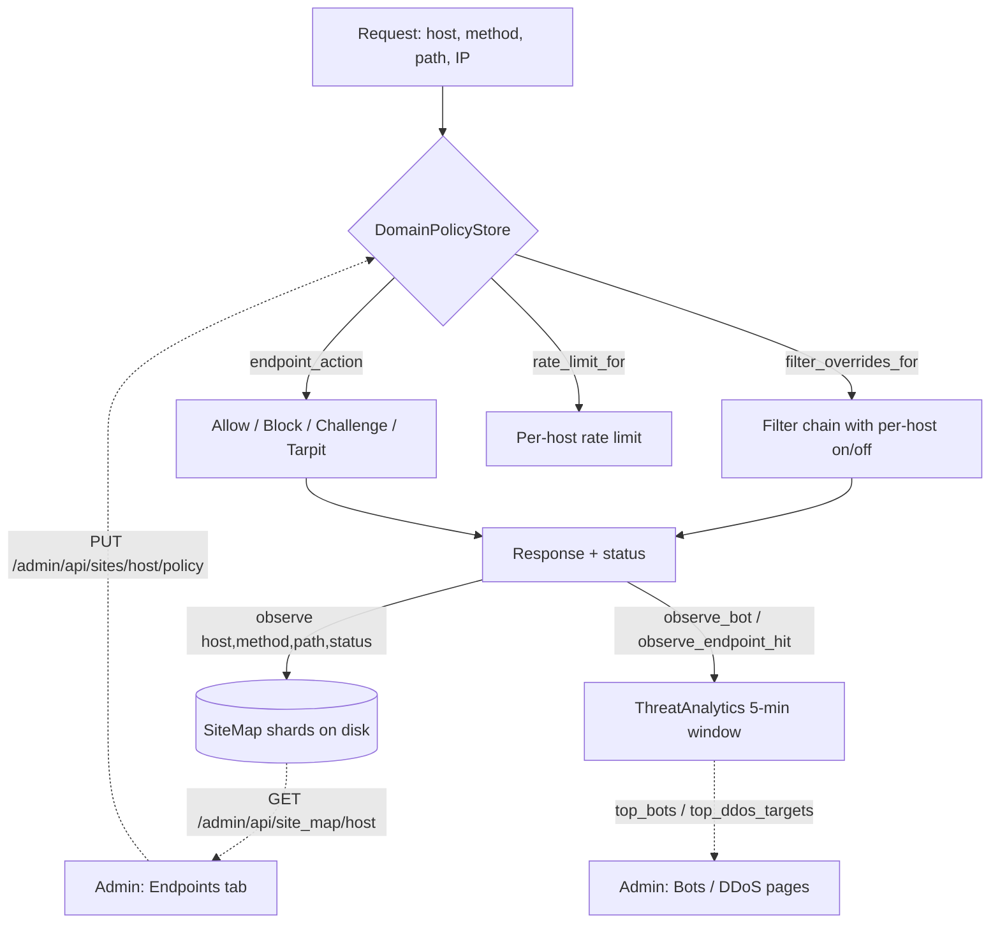

# Site cartography and per-domain policies

**Languages:** **English** · [Русский](../ru/26-sites-and-domains.md) · [中文](../zh/26-sites-and-domains.md)

The cartography subsystem (`src/site_map.rs`) automatically reconstructs the shape of every site from live traffic — which endpoints are being hit, with which methods, with what mix of statuses — while the per-domain policy layer (`src/domain_policy.rs`) and the domain registry (`src/domains.rs`) let you overlay your own policy onto a specific host (and a specific path): filters on/off, `allow`/`block`/`challenge`/`tarpit` actions per endpoint, rate-limit overrides. Threat analytics (`src/threat_analytics.rs`) separates two distinct views of an attack: lone bots and distributed DDoS.

This document covers three tightly coupled subsystems:

| Subsystem | File | Purpose |
|---|---|---|
| `site_map` — cartography | `src/site_map.rs` | Endpoint auto-discovery, path generalisation, shards, persistence |
| per-domain policy | `src/domain_policy.rs` | Per-host filter overrides, per-endpoint actions, rate overrides |
| domain registry | `src/domains.rs` | Domain registry + aggregated counters (`config/domains.toml`) |
| threat analytics | `src/threat_analytics.rs` | Top bots and top DDoS targets in a sliding window |

> Every statement below has been cross-checked against the source code; file paths are given for each. Partial/planned features are flagged honestly (see the "Honest caveats" section).

Related docs: [WAF](10-waf.md), [rate limiting](14-rate-limiting.md), [challenge ladder](15-challenge-ladder.md), [honeypot/tarpit](17-honeypot-tarpit.md), [metrics/telemetry](25-metrics-telemetry.md), [request log](24-request-log.md), [multiprocessing and workers](06-workers.md), [admin panel](29-admin-panel.md), [admin API](30-admin-api.md). Original specification: [`docs/per-domain-policy.md`](../en/reference/per-domain-policy.md).

---

## 1. Site cartography (`site_map`)

### 1.1. The idea

The operator adds a domain to Aegis, points DNS at it — and traffic starts flowing. Within minutes the proxy sees the real shape of the site and folds it into a per-host `SiteMap`, which the admin panel renders as a table, so that per-endpoint policy can be applied without enumerating the API by hand (`src/site_map.rs:1-40`).

Key design properties (doc comment `src/site_map.rs:10-29`):

- **Path generalisation** — `/api/users/12345` and `/api/users/67890` collapse into `/api/users/:id`, so the map does not explode on high-cardinality URLs.
- **Method awareness** — `GET /api/users` and `POST /api/users` are tracked as separate records with separate statistics.
- **Bounded memory** — per-host LRU cap (1024 endpoints by default), new entries evict the least recent.
- **Hot-path safety** — one `observe()` call per request; the internal store is a sharded `DashMap` keyed by `(host, method, pattern)`, so concurrent writers from different workers hit different shards.

### 1.2. What is observed per request

The hot path is `SiteMap::observe(host, method, path, status)` (`src/site_map.rs:405-459`), called once per request in the logging phase with the final status code.

Logic:

1. An empty `host` is ignored (`src/site_map.rs:406-408`).
2. The path is generalised via `generalise_path` (`src/site_map.rs:409`).
3. The method is upper-cased (`src/site_map.rs:410`).
4. Key `(host, method, pattern)` — first a lookup-only `get()` (fast path, incrementing atomic counters, `src/site_map.rs:427-432`); on a miss, the slow path with a per-host cap check and `entry().or_insert_with()` to handle a race between two workers (`src/site_map.rs:434-458`).

Each `EndpointEntry` record holds atomic counters (`src/site_map.rs:128-137`): `hits`, `last_seen`, `status_2xx`, `status_3xx`, `status_4xx`, `status_5xx`. Mapping a status into a bucket is done by `bump_status` via `status / 100` (`src/site_map.rs:529-538`); codes outside 2xx–5xx (1xx, for example) are counted in no bucket at all.

### 1.3. Path generalisation `/:id`

`generalise_path` (`src/site_map.rs:693-708`) drops query and fragment (`?`/`#`, `src/site_map.rs:694`) and classifies the path segment by segment via `classify_segment`. Recognised forms (check order in `src/site_map.rs:710-740`):

| Segment form | Placeholder | Condition |
|---|---|---|
| UUID v4 (8-4-4-4-12 hex, 36 bytes long) | `:uuid` | `looks_like_uuid` (`src/site_map.rs:742-757`) |
| Digits only (≥1 character) | `:id` | `is_ascii_digit` across the whole segment |
| 24-character hex (MongoDB ObjectId) | `:oid` | length 24, all hex |
| ≥16 hex (token) | `:token` | length ≥16, all hex |
| Date `YYYY-MM-DD` (10 bytes) | `:date` | hyphens at positions 4 and 7, digits elsewhere |
| Otherwise | verbatim | — |

> **Optional / honest caveat.** The doc comment at the top of the file (`src/site_map.rs:13-16`) mentions "operator-overridable patterns" — configurable operator generalisation rules. In the current code `classify_segment`/`looks_like_uuid` are hard-wired statically; there are no user-defined generalisation patterns in `site_map.rs`. Treat this as an unimplemented part.

Slicing safety (V233): both `classify_segment` (date) and `looks_like_uuid` index a byte slice rather than a `&str`, because a 10-byte/36-byte segment may contain multi-byte UTF-8 characters; indexing `&s[..]` would fail on a code-point boundary → worker SIGABRT under `panic = "abort"` (`src/site_map.rs:723-757`, tests `src/site_map.rs:804-830`).

Examples (from the tests `src/site_map.rs:763-851`):

```text
/api/users/12345                                  → /api/users/:id
/api/users/12345/posts/678                        → /api/users/:id/posts/:id
/api/orders/550e8400-e29b-41d4-a716-446655440000  → /api/orders/:uuid
/api/doc/507f1f77bcf86cd799439011                 → /api/doc/:oid
/auth/token/abcdef0123456789                       → /auth/token/:token
/posts/2025-01-15/comments                         → /posts/:date/comments
/api/users?page=1                                  → /api/users      (query dropped)
```

### 1.4. Cardinality caps and eviction

Two levels of limits:

**Per-host LRU in memory.** `DEFAULT_PER_HOST_CAP = 1024` (`src/site_map.rs:67`), minimum 8 via `with_per_host_cap` (`src/site_map.rs:191-194`). Before inserting a new endpoint, `enforce_host_cap` scans that host's keys, and if there are `>= cap` of them, removes the coldest one (minimum `last_seen`) (`src/site_map.rs:465-485`). This is best-effort: a race may momentarily exceed the cap by one.

**Caps at snapshot/flush time.** On export, `SNAPSHOT_HOST_CAP = 200` (top hosts by total hits) and `SNAPSHOT_ENDPOINT_CAP = 500` (top endpoints per host, sorted by hits descending) apply — `src/site_map.rs:69-71`, `build_snapshot` (`src/site_map.rs:553-586`).

**Periodic eviction of cold entries.** `evict_idle(idle)` removes records not seen for longer than `idle` (`src/site_map.rs:515-526`); called from the `PingoraBackground` tick. `ThreatAnalytics` has an analogous `evict_stale` with a fixed 5-minute window (see section 4).

### 1.5. p99 / latency — status as it actually stands

> **Honest caveat.** The file header promises a `p99_ms` field in the JSON for the UI (`src/site_map.rs:34-35`), but **in the current code latency is neither collected nor stored**. `EndpointStats`/`PersistedEndpoint`/`EndpointEntry` contain only `hits`, `last_seen` and the 2xx/3xx/4xx/5xx status counters (`src/site_map.rs:77-101, 128-137`); `observe()` does not take a request duration. So p99 today is a declared but unimplemented item; do not rely on it.

### 1.6. Shards and persistence (V240+)

Each SO_REUSEPORT worker claims a slot via `flock` on `.slot-<n>.lock` files in the `AEGIS_SITEMAP_DIR` directory (`/var/lib/aegis/site-map` by default), every 30 s atomically writes its own snapshot shard `shard-<slot>.json`, and on restart loads its own shard. The admin API reads **all** shards and merges them (union of keys; sum of counters; max `last_seen`), so that the response is stable regardless of which worker answered (`src/site_map.rs:42-50`).

Specifics from the code:

| Mechanism | Code | Details |
|---|---|---|
| Slot acquisition | `acquire_slot` (`src/site_map.rs:600-608`), `try_flock_nb` (`src/site_map.rs:589-595`) | Non-blocking `LOCK_EX|LOCK_NB`, tries `.slot-0.lock` … `.slot-15.lock` (`MAX_SLOTS = 16`, `src/site_map.rs:73`). The `File` is kept alive for the whole life of the process. |
| Enabling persistence | `with_persistence(dir)` (`src/site_map.rs:206-240`) | Creates the directory; if no slot is acquired — a warning and in-memory-only mode (`flush_shard` becomes a no-op). On success it bootstraps counters from its own previous shard via `import_merge`. |
| Writing a shard | `flush_shard` (`src/site_map.rs:364-374`) → `write_snapshot_to` (`src/site_map.rs:618-637`) | Writes to a neighbouring `.tmp` file, `set_permissions(0o640)`, then an atomic `rename`. Errors are logged as warnings; serving is not interrupted. |
| Reading all shards | `read_all_shards(dir, max_age_secs)` (`src/site_map.rs:392-394`, implementation `643-678`) | Takes only `shard-*.json`; skips "orphaned" shards whose `written_at_unix_secs` OR file mtime is older than `cutoff` (double check). |
| Merge for the admin panel | `merge_snapshots(&[...])` (`src/site_map.rs:322-357`) | Pure function: union of keys, sum of all counters, max `last_seen`, cardinality caps re-applied. |
| Boot merge | `import_merge(&snap)` (`src/site_map.rs:277-314`) | Adds counters into existing records, `last_seen` taken via CAS-max. |

Serialisable types: `PersistedEndpoint` (`src/site_map.rs:91-101`), `HostSnapshot` (with `total_hits`/`last_seen`/`endpoints`, `src/site_map.rs:104-113`), `SiteMapSnapshot` (with `written_at_unix_secs` + `hosts`, `src/site_map.rs:117-124`).

Store concurrency: `DashMap::with_shard_amount(128)` (V230, `src/site_map.rs:179`) — many shards for parallel writes across endpoints.

### 1.7. JSON for the admin UI

The UI contract (`src/site_map.rs:31-40`):

```text
GET /admin/api/site_map/<host>
→ { endpoints: [{ method, path_pattern, hits, last_seen,
                  status_2xx, status_4xx, status_5xx, p99_ms }] }
```

The consumer is the per-domain editing page: it renders a table plus an "Apply rule" button in each row, which jumps into the per-endpoint policy editor with path/method pre-filled. For the exact admin API routes see [admin API](30-admin-api.md). (`p99_ms` — see caveat 1.5.)

`SiteMap` API surface for integrators: `snapshot(host)` — the host's endpoints, sorted by hits descending (`src/site_map.rs:488-497`); `hosts()` — the list of hosts (`src/site_map.rs:500-506`); `total_endpoints()` — diagnostics (`src/site_map.rs:509-511`); `export_snapshot()` — a full snapshot with caps (`src/site_map.rs:253-272`).

---

## 2. Domain registry (`domains`)

The file `src/domains.rs` is a separate, simpler layer: a static registry of configured domains with aggregated counters, stored in `config/domains.toml` (`src/domains.rs:14`).

### 2.1. Structure

```rust
DomainStats {
    total_requests, denied_requests, challenged_requests,
    last_seen_unix: Option<u64>,
}
DomainRegistry { domains: BTreeMap<String, DomainStats> }
```

(`src/domains.rs:16-28`). `BTreeMap` gives a deterministic (sorted) order on serialisation.

### 2.2. CLI (the `aegis` binary)

| Function | Behaviour | Code |
|---|---|---|
| `add_domain(d)` | Creates an empty record, prints `Domain added: <d>` | `src/domains.rs:80-86` |
| `remove_domain(d)` | Removes it; prints `Domain removed` / `Domain not found` | `src/domains.rs:88-97` |
| `list_domains()` | Prints the names (or `No domains configured`) | `src/domains.rs:99-109` |
| `stats_domain(d)` | Prints `total/denied/challenged/last_seen` | `src/domains.rs:111-133` |
| `metrics_summary()` | The line `domains=… total_requests=… denied_requests=…` | `src/domains.rs:135-143` |

### 2.3. Counter persistence

`apply_runtime(metrics)` merges live counters from `RuntimeMetrics.domain` into the registry, **replacing** the previous totals with the snapshot value and updating `last_seen_unix` (`src/domains.rs:52-65`). The background loop `spawn_persister(metrics, interval)` ticks on the interval, re-reads the file, applies the runtime and writes atomically (`src/domains.rs:148-165`). The counter source is `RuntimeMetrics::observe_domain_outcome` (see [metrics/telemetry](25-metrics-telemetry.md)).

> Distinguish the two "domain" stores: **`domains.rs`** is config + aggregates (TOML, `config/domains.toml`), whereas **`domain_policy.rs`** (section 3) is runtime policy (JSON, `/var/lib/aegis/domain-policy.json`). Different files, different lifecycles.

---

## 3. Per-domain policy (`domain_policy`)

Before per-domain policy, every filter was globally on/off via `RuntimeToggles`. Real operators need different policy per host (`src/domain_policy.rs:1-12`):

- `api.example.com` — WAF + rate limiting, but no challenge;
- `admin.example.com` — all filters at maximum;
- `static.example.com` — WAF off (there is no user input there).

`DomainPolicyStore` holds per-host overrides; the filter engine consults it **before** falling back to the global `RuntimeToggles`. Per-endpoint actions (V166) are a separate layer on top (`src/domain_policy.rs:9-12`).

### 3.1. Three policy layers in one `DomainPolicy`

The `DomainPolicy` struct (`src/domain_policy.rs:100-141`) is empty by default; each field is an override which, when absent, falls back to the global config:

| Field | Type | Purpose |
|---|---|---|
| `filter_enabled` | `HashMap<String, bool>` | Per-filter on/off. The filter name is the same `&'static str` returned by `TrafficFilter::name()` (`"waf"`, `"bot"`, `"challenge"`, `"rate_limit"`, …) (`src/domain_policy.rs:104-107`) |
| `endpoint_policies` | `HashMap<String, EndpointAction>` | Per-endpoint short-circuit by path pattern (`src/domain_policy.rs:108-116`) |
| `rate_limit` | `Option<RateLimitOverride>` | Per-host rate-limit override (`rps`, `burst`), V234 (`src/domain_policy.rs:117-128`) |

The utility field `sorted_matchers: OnceLock<Arc<Vec<CompiledMatcher>>>` (`src/domain_policy.rs:139-140`) is a lazily built cache of compiled matchers, `#[serde(skip)]`, not persisted; it is reset on `clone` (`src/domain_policy.rs:180-195`).

### 3.2. Filter overrides (on/off)

The effective state of a filter (from [`docs/per-domain-policy.md:141-156`](../en/reference/per-domain-policy.md)):

```text
effective_state(filter, host) =
    if host has explicit override → override
    else if global runtime toggle exists → global toggle
    else → enabled (default)
```

That is:

- Globally `waf: off`, host override `waf: on` → WAF runs for **this** host.
- Globally `waf: on`, host override `waf: off` → WAF is skipped for **this** host.
- Globally `waf: on`, no override → WAF runs (default).

The list of filters that support overrides (from the specification): `waf` / `bot` / `challenge` / `rate_limit` / `honeypot` / `threat_intel` / `adaptive` / `ip_acl` (`docs/per-domain-policy.md:9-14`).

Read performance (V230/V229): the filter engine pulls overrides 7–8× per request. `filter_overrides_for(host)` (`src/domain_policy.rs:514-542`) collapses this into a single call: one lowercase allocation (only if the host contains uppercase bytes), one shard lock, one cloned `Arc<HashMap>`. The legacy API `filter_override(host, name)` delegates to it (`src/domain_policy.rs:494-497`).

### 3.3. Per-endpoint actions

`EndpointAction` (`src/domain_policy.rs:51-78`) is a short circuit applied **before** the ordinary filter chain:

| Action | Semantics | From code / docs |
|---|---|---|
| `Allow` | Bypasses the entire filter chain — the request passes unconditionally (but is still subject to the upstream) | `src/domain_policy.rs:54-56`; "bypasses entire filter chain" (`docs/per-domain-policy.md:109-113`) |
| `Block` | Hard 403, reason `"endpoint_policy"`, never reaches the upstream and is not challenged | `src/domain_policy.rs:57-59`; `docs/per-domain-policy.md:115-118` |
| `Challenge` | Forces the challenge ladder even if challenge is globally disabled. For `/login`, `/admin/*`, password reset | `src/domain_policy.rs:60-62`; `docs/per-domain-policy.md:121-128` |
| `Tarpit` | Routes into the poisoned tarpit (V147). For `/.git/config`, `/.env`, `/wp-config.php` | `src/domain_policy.rs:63-66`; `docs/per-domain-policy.md:130-136` |

> **Honest caveat on `Tarpit`.** The specification states plainly: as of today `tarpit` marks the request and **returns 403 with reason `"endpoint_tarpit"`**; full routing into a slowly streamed Markov response is a future version (`docs/per-domain-policy.md:130-137`). See also [honeypot/tarpit](17-honeypot-tarpit.md).

Serialisation is snake_case (`src/domain_policy.rs:52`, test `src/domain_policy.rs:896-902`): `"allow"`/`"block"`/`"challenge"`/`"tarpit"`. Helper `as_str()` (`src/domain_policy.rs:69-78`).

#### Path pattern syntax

`compile_matcher` (`src/domain_policy.rs:290-320`) and `path_matches` (`src/domain_policy.rs:332-344`) support three forms:

| Syntax | Match | Implementation |
|---|---|---|
| `/foo` | exactly `/foo` | `MatchKind::Exact` |
| `/foo/*` | `/foo` plus everything under `/foo/` | `MatchKind::Prefix` (`starts_with("/foo/")` OR `== "/foo"`) |
| `*/foo` | any path ending in `/foo` (e.g. `*/login` → `/auth/login`, `/api/v1/login`) | `MatchKind::Suffix` (`ends_with("/foo")` OR `== "foo"`) |

**The alphabetically first pattern wins** (`endpoint_action` sorts the keys before iterating — deterministic regardless of insertion order, `src/domain_policy.rs:264-277`). If you set both `/admin/*` → block and `/admin/health` → allow, then `/admin/health` wins, because it comes earlier alphabetically (`docs/per-domain-policy.md:100-104`).

**Path canonicalisation (V233 — auth-bypass / path-traversal fix).** Both the request path and the pattern body are run through `crate::normalisation::canonical_path` before comparison (`src/domain_policy.rs:219-257`, `290-320`). Otherwise `/%61dmin/users` (where `%61`=`a`) would decode into `/admin/users` at the upstream, bypassing the rule that should have matched, and `/public/..%2finternal` would collapse into `/internal`. The `/*` and `*/` sigils are stripped **before** canonicalisation so that the wildcard markers are not folded away. Tests — `src/domain_policy.rs:1029-1098` (including "no panic on malformed path").

> **Pitfall (from the specification, `docs/per-domain-policy.md:208-214`).** Matching is exact: `/login?foo=bar` → path `/login` (query dropped), matches `/login`; `/login/` is a different path and does NOT match `/login`; `/users/login` matches `*/login`, but not `/login`.

### 3.4. Rate-limit override (V234)

`RateLimitOverride { rps, burst }` (`src/domain_policy.rs:85-89`): `rps` is the token refill rate (req/sec), `burst` is the bucket capacity (maximum instantaneous spend). Both are per-IP, as with the global filter. Resolved via `rate_limit_for(host) -> Option<(u64, u64)>` (`src/domain_policy.rs:550-570`); on `None` it falls back to the global / static limits from the config.

The key difference from `[rate_limit]` in the `.conf`: the override is set through the admin API (`PUT /admin/api/sites/<host>/policy`), it is disk-backed and cross-worker, so the panel can change a per-host limit **without** editing the read-only site config files (`src/domain_policy.rs:121-127`). More on the token bucket — [rate limiting](14-rate-limiting.md).

### 3.5. Store, persistence and cross-worker synchronisation

`DomainPolicyStore` (`src/domain_policy.rs:358-379`) is a cheap clone via a shared `Arc<DashMap<String, DomainPolicy>>`. Fields:

| Field | Purpose |
|---|---|
| `inner: Arc<DashMap<...>>` | live in-memory policies, keyed by lower-case host |
| `path: Arc<Mutex<Option<PathBuf>>>` | optional path for cross-worker sync |
| `last_mtime` | mtime cache to skip reading when the file is unchanged |
| `has_entries: AtomicBool` (V229) | empty-gate: on `false`, reads short-circuit with no locks and no allocations |
| `persistence_attached: AtomicBool` (V229) | when detached, reads skip the Mutex on `path` |

**Persistence.** `attach_persistence(path)` (`src/domain_policy.rs:394-417`) loads existing records from the file and enables writing on every mutation. Stored in `/var/lib/aegis/domain-policy.json`, the path overridable via the env var `AEGIS_DOMAIN_POLICY_PATH` (`docs/per-domain-policy.md:186-188`). Atomic write `write_atomic` — temp `.json.tmp` + rename (`src/domain_policy.rs:665-673`). The on-disk format is `PersistedSnapshot { entries: HashMap<host, DomainPolicy> }` (`src/domain_policy.rs:349-354`).

**Cross-worker via mtime polling.** `refresh()` (`src/domain_policy.rs:422-457`) is called from every read path: when detached — an instant no-op (V229 atomic short-circuit); otherwise one `stat()` syscall, and if the mtime has changed — an atomic replacement of `inner` (clear + re-insert). This is the same disk-plus-mtime-poll mechanism for cross-worker state as in the rest of Aegis (see [multiprocessing and workers](06-workers.md)). The specification claims propagation of ~50 ms between REUSEPORT workers (`docs/per-domain-policy.md:16-18`).

The file is **safe to edit by hand** (atomic temp+rename), JSON without comments (`docs/per-domain-policy.md:181-184`). It is **runtime state, not part of the DSL config**: restarting `aegis-pingora.target` preserves the JSON but resets `RuntimeToggles` to `defaults { filters { } }` from the DSL (`docs/per-domain-policy.md:240-257`). The DSL blocks `server { policy { … } }` are not implemented yet.

**Mutating store API:** `put(host, policy)` (an empty policy = removing the record, `src/domain_policy.rs:573-588`), `get(host)` (`src/domain_policy.rs:591-602`), `endpoint_action(host, path)` (`src/domain_policy.rs:606-630`), `snapshot()` (sorted by host, for the admin panel's listing endpoint, `src/domain_policy.rs:634-643`), `remove(host)` (`src/domain_policy.rs:645-659`). Host lookup is case-insensitive (lower-case per RFC 9110 §5.5, `src/domain_policy.rs:485-493`).

### 3.6. Workflow via the admin API

From the specification (`docs/per-domain-policy.md:60-88`):

```sh
export TOKEN=$(cat /etc/aegis/admin-token)
HOST=api.example.com

# 1. Read the current state (per-host + global view).
curl -sS -H "x-admin-token: $TOKEN" \
  http://localhost:6280/admin/api/sites/$HOST/policy | jq

# 2. Write policy: WAF off, captcha on /login, tarpit on /.env.
curl -sS -H "x-admin-token: $TOKEN" \
  -X PUT http://localhost:6280/admin/api/sites/$HOST/policy \
  -H 'Content-Type: application/json' \
  -d '{
    "filter_enabled": { "waf": false },
    "endpoint_policies": {
      "/login": "challenge",
      "/.env": "tarpit",
      "/admin/secret": "block"
    }
  }'

# 3. Clear all overrides for the host.
curl -sS -H "x-admin-token: $TOKEN" \
  -X DELETE http://localhost:6280/admin/api/sites/$HOST/policy
```

The UI flow: the site's **Security** tab — for every global filter a choice of `inherit` / `force on` / `force off` (the row shows global state · override · computed effective, `docs/per-domain-policy.md:36-48`). The **Endpoints** tab — endpoints auto-discovered from `site_map` with buttons `inherit · allow · challenge · tarpit · block` (saving is immediate, optimistic update + persist to disk, `docs/per-domain-policy.md:50-56`). Admin API authentication — `x-admin-token`/session/roles, see [admin API](30-admin-api.md) and [admin panel](29-admin-panel.md).

> **Ordering pitfall (`docs/per-domain-policy.md:215-223`).** Policy is applied BEFORE the filter chain, but AFTER the bypass + trusted-IP fast path. If an IP is on the bypass list or dynamic-trust-promoted, the cache fast path serves the request and neither the policy nor the chain runs.

> **Single-key deletion pitfall (`docs/per-domain-policy.md:225-237`).** The API offers no per-key delete — do a GET + `jq del(...)` + PUT roundtrip (the `inherit` button in the UI does exactly this).

---

## 4. Threat analytics (`threat_analytics`)

`src/threat_analytics.rs` splits attack data into two lenses, which the admin UI shows on two separate pages (`src/threat_analytics.rs:1-28`):

- **Lone bots** — a single IP with bot behaviour (fingerprint mismatch, UA faking, sustained per-IP rate). Operator action: deny / challenge / rate-limit that IP.
- **DDoS / botnet** — many different IPs hitting one endpoint simultaneously, where no single IP exceeds the per-IP limit but the aggregate is enormous. Action: aggressive per-endpoint rate limiting, geo filtering, attack-mode challenge floor.

### 4.1. Top bots

`observe_bot(ip, reason)` (`src/threat_analytics.rs:126-155`) tracks per-IP signals. `BotReason` (`src/threat_analytics.rs:46-70`): `UaFpMismatch`, `NoUserAgent`, `HighThreatScore`, `HighMlScore`, `HoneypotHit`, `WafSignature`, `Compound`. On a second distinct signal for the same IP, `primary_reason` is promoted to `Compound` (bitmask `reasons_seen`, `src/threat_analytics.rs:137-141`). `top_bots(limit)` returns `BotEvidence { client_ip, primary_reason, hits, last_seen_unix_secs }`, sorted by hits descending (`src/threat_analytics.rs:191-205`).

### 4.2. Top DDoS targets

`observe_endpoint_hit(host, path_pattern, ip)` (`src/threat_analytics.rs:160-188`) accumulates per-endpoint hits plus the set of distinct IPs. `top_ddos_targets(limit)` filters endpoints with `distinct_ips >= DDOS_DISTINCT_IP_THRESHOLD` (= 10, `src/threat_analytics.rs:41-43`), sorts by distinct_ips descending, and returns `DdosEvidence { host, path_pattern, total_hits, distinct_ips, last_seen_unix_secs }` (`src/threat_analytics.rs:209-229`). It is precisely "many different IPs on one endpoint" that distinguishes DDoS from a lone bot (tests `src/threat_analytics.rs:298-323`: 1000 hits from one IP — not DDoS; 12 different IPs — DDoS).

### 4.3. Memory bounds and window

| Parameter | Value | Code |
|---|---|---|
| Aggregation window | 5 minutes (`WINDOW = 300s`) | `src/threat_analytics.rs:38` |
| Max tracked bots | 256 | `src/threat_analytics.rs:39` |
| Max tracked endpoints | 256 | `src/threat_analytics.rs:40` |
| DDoS threshold | ≥10 distinct IPs | `src/threat_analytics.rs:43` |

When the limit is exceeded, the record with the smallest `last_seen` is evicted (`src/threat_analytics.rs:145-154`, `178-187`). The periodic `evict_stale()` drops everything outside the 5-minute window and is called from the `PingoraBackground` tick (`src/threat_analytics.rs:241-247`). Diagnostics — `summary()` → `ThreatAnalyticsSummary { tracked_bots, tracked_endpoints }` (`src/threat_analytics.rs:232-237`). Both `DashMap`s are `with_shard_amount(128)` (V230, `src/threat_analytics.rs:110-114`).

> **Note on `last_seen_unix_secs`.** This is a best-effort conversion of a monotonic `Instant` into wall-clock UNIX seconds (`unix_secs`, `src/threat_analytics.rs:256-267`); it is used by the UI only for a relative "last seen", so slight drift is acceptable.

---

## 5. How it all fits together



The operator loop: `SiteMap` discovers endpoints from traffic → the UI shows them in the Endpoints tab → the operator clicks an action → `DomainPolicyStore` persists it into `domain-policy.json` → mtime polling spreads it to all workers → on the next request `endpoint_action`/`filter_overrides_for`/`rate_limit_for` apply it before the filter chain. In parallel, `ThreatAnalytics` highlights which IPs and endpoints are under attack, to hint at where policy should go.

---

## 6. Honest caveats

| Claimed | Actually in the code |
|---|---|
| `p99_ms` in the site_map JSON (`src/site_map.rs:34`) | **Neither collected nor stored** — `observe()` does not take latency, `EndpointStats` does not contain it. Unimplemented. |
| Operator-overridable generalisation patterns (`src/site_map.rs:13-16`) | Segment classification is hard-wired statically in `classify_segment`/`looks_like_uuid`. There are no user-defined patterns. |
| `Tarpit` routes into a slow Markov response | Currently marks the request and **returns 403 `"endpoint_tarpit"`**; full routing is a future version (`docs/per-domain-policy.md:130-137`). |
| DSL blocks `server { policy { … } }` | Not implemented; the only policy persistence layer is the JSON file (`docs/per-domain-policy.md:240-257`). |
| `/admin/api/runtime/trust-clear` for resetting a trust grant | Not exposed; the temporary workaround is restarting the target (`docs/per-domain-policy.md:218-223`). |
| Per-key delete of an endpoint policy | The API does not offer it; a GET+PUT roundtrip is required (`docs/per-domain-policy.md:225-237`). |

---

## See also

- [10-waf.md](10-waf.md) — the WAF, whose enablement is overridden per domain.
- [14-rate-limiting.md](14-rate-limiting.md) — the token bucket that `RateLimitOverride` overrides.
- [15-challenge-ladder.md](15-challenge-ladder.md) — the challenge ladder forced by `EndpointAction::Challenge`.
- [17-honeypot-tarpit.md](17-honeypot-tarpit.md) — the tarpit engine, the target of `EndpointAction::Tarpit`.
- [06-workers.md](06-workers.md) — the disk-plus-mtime-poll mechanism for cross-worker state.
- [25-metrics-telemetry.md](25-metrics-telemetry.md) — `RuntimeMetrics`, which feeds `domains.rs`.
- [24-request-log.md](24-request-log.md) — the event store where the same decisions settle.
- [29-admin-panel.md](29-admin-panel.md) / [30-admin-api.md](30-admin-api.md) — the UI and the `/admin/api/*` routes.
