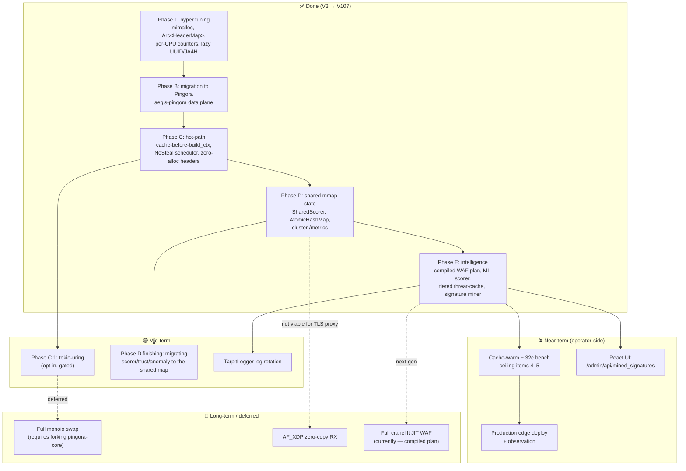
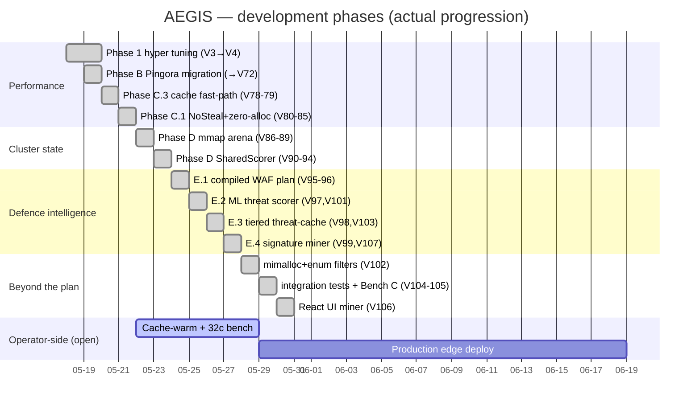

# Roadmap

**Languages:** **English** · [Русский](../ru/40-roadmap.md) · [中文](../zh/40-roadmap.md)

A single, consolidated map of AEGIS development: what is **already done**, what is in the **near-term plans**, what is **mid-term** and what is **long-term**. The document brings together the four root roadmap files (`AEGIS-X-ROADMAP.md`, `ROADMAP-NEXT.md`, `ROADMAP-STATUS.md`, `PERF-ROADMAP.md`) and checks their claims against the real code — partial and opt-in features are marked honestly.

> Related docs: a detailed list of future work — [41-development-plan.md](41-development-plan.md); an honest snapshot of the current state — 42-текущее-состояние-STATUS.md; benchmark numbers and methodology — [28-benchmarking.md](28-benchmarking.md); performance tuning — [27-performance-tuning.md](27-performance-tuning.md).

---

## 1. Sources and how to read this map

The map consolidates four historical documents from the repository root. Each covered its own era of the project:

| Source | Era | Role | Final recorded status |
|---|---|---|---|
| `PERF-ROADMAP.md` | V3–V4 (2026-05-18/19) | "Catch up with nginx" — Phase 1 (squeeze hyper), Phase 2 (architecture), Phase 3 (trump cards) | V4 = 111k RPS, ~48 % of nginx |
| `AEGIS-X-ROADMAP.md` | V4–V11 + plan A–E | "Top-0 commodity edition" — 4 layers, 5 phases (A XDP → E intelligence) | V11 = "honest hyper ceiling" |
| `ROADMAP-NEXT.md` | V77–V100 | Plan up to the technology ceiling, blocks 1–4 | V100 = Phase A–E feature-complete |
| `ROADMAP-STATUS.md` | V100–V107 (2026-05-21) | "Plan vs reality" snapshot | V107, 30 ships on `main`, 397 lib tests |

> An important caveat about versions: the labels `V3…V107` are internal development steps (per commit), **not** product release versions. The RPS numbers in the sources were obtained on specific rigs (OrbStack arm64 16c, i9-9900K WSL2/native) and measure the **in-process engine**, not the full pingora binary under production load. More on benchmark honesty — section 7 and [28-benchmarking.md](28-benchmarking.md).

---

## 2. Map of directions (flowchart)

AEGIS development followed two converging axes: **performance** (PERF → Phase A–E) and **defensive coverage** (WAF/TLS-fp/reputation/ML). Below are the directions and their current state.

---

## 3. Timeline by phases (Gantt)

The diagram reflects the actual progression (V3–V107, all closed over a series of sessions rather than the plan's nominal weeks) and the remaining operator-side work. The dates are relative steps, not a calendar.

---

## 4. Done (feature-complete, in `main`)

Everything listed below is present in the code on the current branch. Paths are quoted so the claims can be verified.

### 4.1 Performance (PERF Phase 1 → Phase C)

| Step | What was done | Where in the code | Effect (per the sources) |
|---|---|---|---|
| F1.1 | mimalloc as the global allocator | `Cargo.toml`, `src/main.rs` | +2–5 % (V4) |
| F1.3 | Lazy UUID / lazy JA4H for trusted | eliminating per-request UUID alloc (V85) | slow-path +5–15 % |
| F1.5 | `Arc<HeaderMap>` in the context | `CachedResponse` (V84) | header deep-copy eliminated |
| F1.6 | Per-CPU sharded counters | `src/metrics/` | reduced cache-line contention |
| C.3 | Cache lookup **before** `build_ctx` for trusted | `src/proxy/pingora_http.rs` | 770k → 884k (+15 %) |
| — | HEAD from the GET cache + `is_already_lowercase` fast-skip | `pingora_http.rs` (V79) | correctness + coverage |
| C.1 | NoSteal scheduler as the default | `src/bin/aegis-pingora.rs:1653` (env `AEGIS_PINGORA_WORK_STEALING`) | 950–966k stable |
| C.1 | Zero-alloc header forwarding (`&HeaderName`) | cache serve loops (V82) | ⭐ first 1.0M stable |

> Fast-path observability: the response headers `x-aegis-cache: HIT-FAST` / `HIT-FAST-HEAD` (`src/proxy/pingora_http.rs:2469`) let the operator see the share of traffic taking the fast path that bypasses `build_ctx` and the filter chain.

### 4.2 Data plane: Phase B (Pingora)

- The main binary `aegis-pingora` (features `pingora+xdp`) — a full migration off the hyper stack, filters via the `ProxyHttp` trait. See [02-architecture.md](02-architecture.md), [07-protocols.md](07-protocols.md).
- TLS termination on the openssl backend, per-SNI cert routing, mTLS — see [08-tls-certificates.md](08-tls-certificates.md).
- Real JA3-MD5 / JA4 / JA4H / JA4T from the ClientHello callback — see [11-tls-fingerprinting.md](11-tls-fingerprinting.md).
- Multi-process operation via SO_REUSEPORT through a systemd template — see [06-workers.md](06-workers.md).

### 4.3 Cluster state: Phase D (shared mmap)

| Step | What | Where in the code |
|---|---|---|
| V86–88 | shared anon mmap arena + bump allocator + `AtomicHashMap` (open addressing, CAS, tombstones) | `src/ddos/shared_score.rs` |
| V89 | integration into the daemon: cluster-wide `aegis_cluster_*` metrics | `src/proxy/pingora_background.rs` |
| V90–94 | `SharedScorer` (dual-record), `AtomicHashMap128` for IPv6, compaction (background + admin trigger) | `src/ddos/shared_score.rs`, `src/proxy/pingora_admin.rs` |

**Why:** before Phase D each of the N workers kept an independent scorer — a distributed attacker could hit worker A while worker B saw a clean score. SharedScorer closes that hole across workers without losing throughput. More — [12-reputation.md](12-reputation.md), [18-ml-risk-engine.md](18-ml-risk-engine.md).

### 4.4 Defence intelligence: Phase E

| Sub-block | What landed | Where in the code | Honest caveat |
|---|---|---|---|
| E.1 | **Compiled WAF rule plan**: per-field Aho-Corasick over contains/regex, O(1) equals via HashMap, LeftmostFirst (~560–650 ns/req @ 250 rules on arm64) | `src/waf*` | This is **not** the cranelift JIT from the original plan — it is a compiled rule plan. Full JIT remains long-term |
| E.2 | **ML threat scoring**: logistic regression over 8 features (~300 B model, <100 ns inference), online SGD + hot reload | `src/ddos/ml_score.rs`, `src/ddos/ml_model.rs`, `src/ddos/risk_engine.rs` | Modes Observe / HighConfidenceEnforce / FullEnforce — see [18-ml-risk-engine.md](18-ml-risk-engine.md) |
| E.3 | **Tiered threat-cache**: `ThreatTier {Low,Medium,High}`, per-tier counters, TTL/half-life with per-host/per-status override | `src/proxy/response_cache.rs` | |
| E.4 | **Self-improving signatures**: document-frequency n-gram miner, `POST /admin/signature_mine`, online tarpit→miner pipeline | `src/signature_mine.rs`, `src/online_signature_miner.rs`, `src/admin_auth.rs:187` | **Deliberately without auto write-back** — the operator promotes candidates manually |

### 4.5 Beyond the original plan (V101–V107)

- V101 — wiring the ML scorer + `ThreatTier` into the pingora hot path.
- V102 — mimalloc + enum-dispatch filters + body buffer pool.
- V103 — DSL cache config + tier-override fix (487k RPS cache-warm on OrbStack).
- V104 — synchronisation of the integration tests.
- V105 — `aegis-distbench` + Bench C (distributed attacker): 50 IPs × 200 SQLi → all 50 visible in `/admin/threats?source=cluster`, which confirmed the Phase D threat-integrity model end-to-end.
- V106 — React UI for the signature miner.
- V107 — online tarpit→miner pipeline.

---

## 5. Near-term (operator-side, not code)

From `ROADMAP-STATUS.md` § "What is left". The main point: **feature development is complete**, what remains is gated on hardware and a production deployment, not on code.

| Task | Who | Time | What it closes |
|---|---|---|---|
| Cache-warm bench on the i9 (alias loopback + V103 config) | together | ~15 min | will confirm cache-warm on native Linux |
| 32-core node bench (e.g. Hetzner CPX41) | operator | ~1 hour | technology-ceiling item 4 |
| Production edge deploy + 1–2 weeks of observation | operator | weeks | technology-ceiling item 5 |
| Wire `/admin/api/mined_signatures` into the React UI next to the manual mine | V108+ | ~2 hours | UI completeness |
| Rotation / size-based truncation for `TarpitLogger` | V108+ | ~1 hour | long-running deployments |

---

## 6. Mid-term and long-term

### Mid-term (planned, partially laid in)

- **Phase C.1 — tokio-uring socket I/O** (Linux 5.10+, feature flag, gated). In `ROADMAP-NEXT.md` marked "not started yet", expected effect +15–25 %. Incremental, without replacing the runtime.
- **Phase D finishing (V90-class)** — migrating `ThreatScorer` / `DynamicTrust` / `AnomalyDetector` from a per-worker DashMap to the shared `AtomicHashMap` (requires packing `WindowStats` + handling IPv4 keys). The foundation is ready, what remains is the wiring to the existing scorer API.
- **Logger rotation for TarpitLogger** — see the table above.

### Long-term / deliberately deferred

From `ROADMAP-NEXT.md` § "What is NOT in the plan" — rejections with rationale:

| Deferred | Why |
|---|---|
| Full monoio swap (the maximalist Phase C.1) | requires forking `pingora-core` (4–6 weeks) + maintenance burden |
| `XDP_REDIRECT` to upstream | not viable for a TLS-terminating proxy (no DSR) |
| AF_XDP zero-copy receive | requires rewriting the TCP layer, niche use case |
| WASM filters | already covered by the existing Lua plugins ([31-plugins.md](31-plugins.md)) |
| HTTP/3 server push | deprecated in the HTTP/3 RFC |
| Full cranelift JIT WAF | the current compiled plan covers a 5–10× gain; JIT is a next-gen goal |

---

## 7. Performance: plan vs reality (honestly)

From `ROADMAP-STATUS.md` § "Where we fell short" and the technology-ceiling checklist.

| Plan metric | Reality | Reason |
|---|---|---|
| Block 2: 1.5–1.8M RPS | 1.10M peak / 1.0M stable (~73 %) | tokio overhead > expected; monoio swap deliberately deferred |
| 3–5M cached on OrbStack | 487k cached (V103) | OrbStack 8-vCPU shared with the macOS host — oversubscription, not the code |
| 10M cached bare-metal x86 32c | not measured | no 32c hardware available in the sessions |

Technology-ceiling checklist (4 out of 5 required):

| # | Condition | Status |
|---|---|---|
| 1 | OrbStack arm64 ≥3–5M cached / mixed 1.5–2M | ⚠ Partial — 487k cache-warm on a shared VM |
| 2 | Bench A vs nginx ×10 cache-warm / ×3 no-defense | ⚠ Partial — ×3.5 no-defense on the i9 confirmed; ×10 not measured |
| 3 | Full defensive stack (eBPF + WAF plan + ML + threat-cache + Phase D) | ✅ DONE — 5/5 layers + online miner |
| 4 | Bare-metal x86 32c: 5–10M cached | ⏳ no hardware |
| 5 | Production deployment validated | ⏳ operator-side |

> **Honest caveats (no inflation):**
> - The AEGIS bench lanes measure the **in-process engine**, not the full pingora binary under production traffic.
> - The hardware SHA bench is per-core, and low inside a VM without hardware SHA acceleration; a capacity forecast in such an environment is pessimistic.
> - **We do NOT claim that AEGIS is faster than real proxies on raw speed.** The strong honest argument for AEGIS is its **security matrix**: no open-source reverse proxy simultaneously carries an eBPF/XDP fast path with inline WAF, a user-space WAF with a compiled plan, per-IP ML scoring, a tiered threat-aware cache, cross-worker shared-mmap scorer integrity and self-improving signature mining. That is the differentiator.

---

## 8. Where we are now

From `ROADMAP-STATUS.md`: "After Phase E completes — stop feature dev, move to maintenance + operator UX polish + docs". **The project is at that point.** Phases A–E are feature-complete, +7 ships beyond the plan, 3 of the 5 ceiling conditions closed/partially closed. Further progress is operational (32c node + production deploy), not code.

For the full "plan vs reality" reconciliation per Block see 42-текущее-состояние-STATUS.md. A detailed list of future candidates — [41-development-plan.md](41-development-plan.md).
