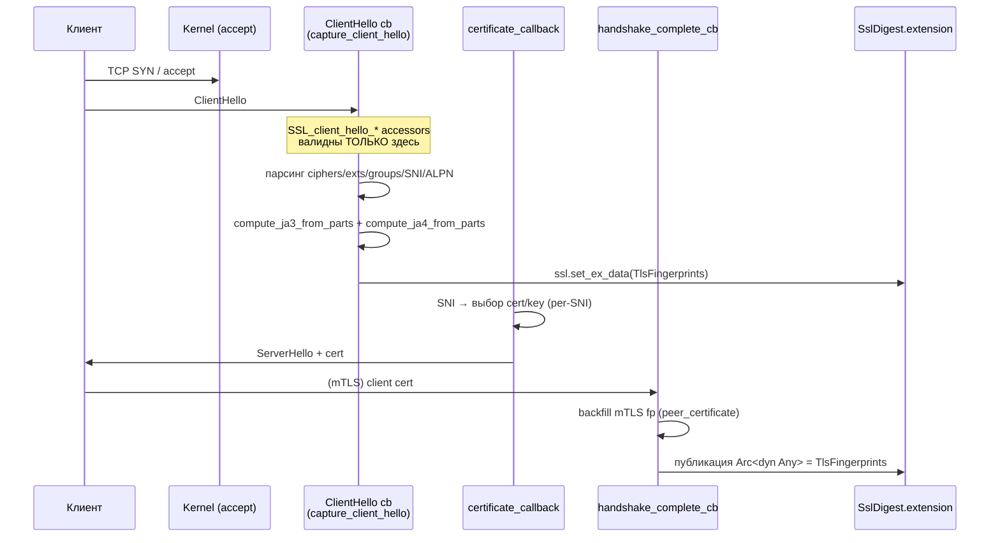
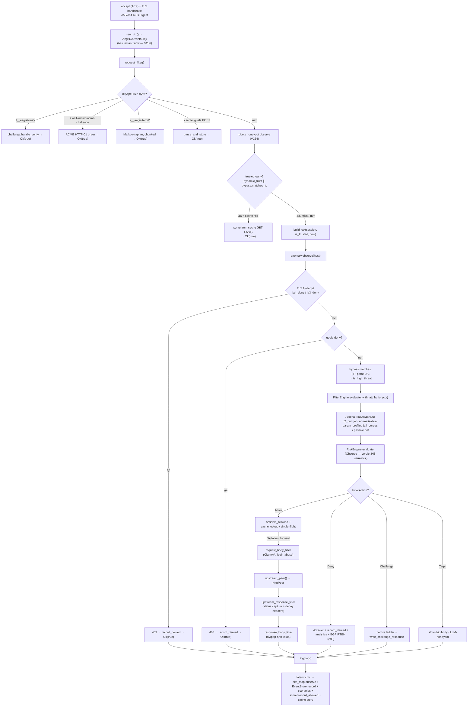

# Архитектура и жизненный цикл запроса

AEGIS — это reverse proxy / edge gateway на Rust, чей боевой data plane построен на [Cloudflare Pingora](../../src/bin/aegis-pingora.rs) (V71+). Этот документ описывает, как пакет проходит путь от TCP-accept и TLS-рукопожатия через построение `RequestContext`, цепочку фильтров и принятие решения (allow / deny / challenge / tarpit / rate) до апстрима и записи в журнал событий, а также как связаны между собой подсистемы.

> Связанные документы: [Обзор продукта](./01-overview.md), [Многопроцессность и воркеры](./06-workers.md), [Сетевые слушатели и протоколы](./07-protocols.md), [TLS и сертификаты](./08-tls-certificates.md), [WAF](./10-waf.md), [TLS-фингерпринтинг](./11-tls-fingerprinting.md), [Challenge ladder](./15-challenge-ladder.md), Журнал запросов, Метрики и телеметрия.

---

## 1. Два data plane: Pingora и hyper

В кодовой базе сосуществуют **два** независимых бинаря, собирающих один и тот же `FilterEngine` и `UpstreamRouter`:

| Бинарь | Источник | Роль | Транспорт |
|---|---|---|---|
| **`aegis-pingora`** | [`src/bin/aegis-pingora.rs`](../../src/bin/aegis-pingora.rs) (требует `--features pingora`) | ✅ Production data plane (V71+) | TCP H1/H2 через OpenSSL + HTTP/3 sidecar |
| **`aegis`** (гипер) | [`src/proxy/http.rs`](../../src/proxy/http.rs) | legacy / HTTP/3 dev / compat | TCP H1/H2 через rustls + QUIC native |

Ключевая инвариантa: **порядок фильтров и логика — единый источник истины**. Pingora-бинарь строит конвейер через `build_pipeline()` ([`src/proxy/pingora_http.rs:130`](../../src/proxy/pingora_http.rs)), а тот же helper `build_filter_engine_and_router()` ([`src/proxy/pingora_http.rs:120`](../../src/proxy/pingora_http.rs)) переиспользуется и для HTTP/3-handler'a (hyper-путь). Комментарий в коде явно говорит: «Filter ordering mirrors `server::build_handler` exactly».

> 🟡 **Честная оговорка.** Pingora-модуль ([`src/proxy/pingora_http.rs`](../../src/proxy/pingora_http.rs)) исторически начинался как «минимальный proof» (V22). Сегодня он несёт полную WAF + ML + challenge + cache + tarpit логику, но HTTP/3 по-прежнему обслуживается отдельным hyper-based handler'ом через quinn (`maybe_spawn_h3`, [`src/bin/aegis-pingora.rs:2303`](../../src/bin/aegis-pingora.rs)), а **не** самим Pingora. Поэтому h2fp/h3fp/JA4T/JA4L поля `RequestContext` на Pingora-пути в текущем коммите остаются `None` (см. §5).

---

## 2. Карта подсистем (как модули связаны)

`build_pipeline()` собирает `BuiltPipeline` — структуру, которая держит все живые подсистемы вместе. Главные связи:

```mermaid
graph TD
    subgraph bin["aegis-pingora.rs (main)"]
        CFG["dsl::load_any<br/>(DSL или TOML)"]
        HP["HoneypotStore::open"]
        SS["shared_state::global::init<br/>(mmap-арена)"]
        TS["TimeSeriesStore<br/>(flock-шард)"]
        EV["EventStore::from_env<br/>(SQLite-шард)"]
        SM["SiteMap (картография)"]
    end

    subgraph pipe["build_pipeline → BuiltPipeline"]
        ENG["FilterEngine<br/>(упорядоченная цепочка)"]
        RT["UpstreamRouter"]
        WAF["WafFilter"]
        DT["DynamicTrust"]
        RC["ResponseCache"]
        BP["BypassMatcher"]
        SC["ThreatScorer"]
        AN["AnomalyDetector"]
        GEO["GeoIpLookup (MaxMind)"]
        CH["ChallengeContext"]
        RL["RateLimitFilter"]
        XDP["XdpHandle (eBPF/NoopXdp)"]
        RE["RiskEngine (опц.)"]
    end

    subgraph proxy["AegisPingoraProxy (ProxyHttp)"]
        PX["request_filter →<br/>upstream_peer →<br/>logging"]
        ARS["ArsenalState (опц.)<br/>V176-V190 модули"]
        SHS["SharedScorer (опц.)"]
        MLV2["MlModel V2 (опц.)"]
    end

    CFG --> ENG
    CFG --> RT
    HP --> ENG
    ENG --> PX
    RT --> PX
    WAF --> ENG
    DT --> PX
    RC --> PX
    BP --> PX
    SC --> PX
    AN --> PX
    GEO --> PX
    CH --> PX
    RL --> ENG
    XDP --> DT
    XDP --> PX
    RE --> PX
    SS --> SHS
    SHS --> PX
    EV --> PX
    SM --> PX
    ARS --> PX
    MLV2 --> PX
```



Логические группы (полный реестр — в [`src/lib.rs`](../../src/lib.rs), здесь — те, что участвуют в hot-path):

- **Цепочка фильтров (`FilterEngine`):** honeypot → threat-intel → IP-ACL → WAF → bot → adaptive → плагины → challenge → rate-limit. Порядок — load-bearing (см. §6).
- **Доверие вне цепочки:** `DynamicTrust` ([`src/filters/dynamic_trust.rs`](../../src/filters/dynamic_trust.rs)) и `BypassMatcher` ([`src/filters/bypass.rs`](../../src/filters/bypass.rs)) не возвращают `FilterAction` — они выставляют `ctx.is_trusted`, которое throttling-фильтры (rate_limit, bot, challenge) уважают как «не троттлить», но **не** «пропустить проверки безопасности» (см. doc-комментарий поля `is_trusted` в [`src/proxy/request_context.rs:104`](../../src/proxy/request_context.rs)).
- **Scoring:** `ThreatScorer` (per-IP скользящее окно), `SharedScorer` (кластерная mmap-арена, [`src/ddos/shared_score.rs`](../../src/ddos/shared_score.rs)), `MlModel` V2 (logistic/GBM, [`src/ddos/ml_model.rs`](../../src/ddos/ml_model.rs)), `RiskEngine` ([`src/ddos/risk_engine.rs`](../../src/ddos/risk_engine.rs)).
- **Защита по краям:** `XdpHandle` (kernel fast-path), `ResponseCache` (threat-aware кэш), `Arsenal` (V176-V190: ja4_corpus, param_profile, h2_budget, decoy_headers, scenarios, и т.д.).
- **Observability:** `RuntimeMetrics` (Prometheus), `EventStore` (SQLite, [`src/event_store.rs`](../../src/event_store.rs)), `SiteMap` (картография), `TimeSeriesStore` (исторические ряды для дашборда).

---

## 3. Запуск процесса (bootstrap)

`main()` в [`src/bin/aegis-pingora.rs:869`](../../src/bin/aegis-pingora.rs) выполняет до приёма трафика:

1. **Логирование и crypto-provider.** `logging::init_logging`; устанавливается rustls `ring` CryptoProvider — он нужен прямому rustls-использованию (HTTP/3 через quinn и tokio-rustls для h3-handler'a), хотя сам Pingora использует OpenSSL.
2. **Конфиг.** `dsl::load_any(&args.config)` (по умолчанию `/etc/aegis/aegis.conf`) — авто-детект DSL или legacy TOML. Адрес слушателя можно переопределить `AEGIS_LISTEN`.
3. **Honeypot store.** `HoneypotStore::open` — каталог bait-путей, читаемый `HoneypotFilter` на каждом запросе. Hot-reload по mtime встроен в `HoneypotStore::check`.
4. **Shared-state арена.** `shared_state::global::init()` — mmap для кросс-воркерного `SharedScorer`. Падение **не фатально** (graceful degradation к per-worker scorer).
5. **TimeSeriesStore / GeoIP-агрегация / SiteMap / EventStore.** Каждый — slot-based flock-шард под `/var/lib/aegis/{...}` (V240/V242/V243). Каждый SO_REUSEPORT-воркер владеет одним шардом; админ-эндпоинты сливают шарды всех воркеров. Все эти подсистемы degrade-to-noop при ошибке.
6. **`build_pipeline()`** — конструирование `FilterEngine` + всех движков.
7. **Персистентность runtime-toggles и per-domain policy** (V168): атомарная запись, mtime-poll на чтении — sibling-воркеры видят изменения за микросекунды (`AEGIS_TOGGLES_PATH`, `AEGIS_DOMAIN_POLICY_PATH`).
8. **ML-скореры** (опционально, см. §7), **admin token registry**, **web-admin store**.
9. **Слушатели** — см. §4.

> Сборка и переменные окружения авторитетно описаны в шапке [install.sh](../../install.sh). Не дублируйте их здесь.

---

## 4. Слушатели и Pingora Server

Бинарь поднимает Pingora `Server` и регистрирует сервисы ([`src/bin/aegis-pingora.rs:1678`](../../src/bin/aegis-pingora.rs)):

```text
Server::new_with_opt_and_conf → server.bootstrap()
  ├── http_proxy_service(AegisPingoraProxy)   ← data plane
  │     ├── add_tcp_with_settings(listen, sock_opt)             — plain H1/H2
  │     └── add_tls_with_settings(tls_listen, sock_opt, tls)    — TLS H1/H2 (если cfg.tls.enabled)
  ├── http_proxy_service(AdminProxy)
  │     └── add_tcp_with_settings(admin_addr, sock_opt)         — :6280 admin
  ├── background_service(PingoraBackground)                     — hot-reload, eviction
  └── maybe_spawn_h3(...)  → отдельный OS-thread + quinn        — HTTP/3 sidecar
server.run_forever()  // блокирует; останов по SIGTERM
```

### 4.1 TCP-сокет и SO_REUSEPORT

`build_downstream_sock_opt(reuseport)` ([`src/bin/aegis-pingora.rs:583`](../../src/bin/aegis-pingora.rs)) строит `TcpSocketOptions`:

- `so_reuseport = Some(true)` включается при `AEGIS_PINGORA_REUSEPORT=1` — несколько процессов слушают один порт, kernel балансирует входящие соединения. Подробнее: [Многопроцессность и воркеры](./06-workers.md).
- **TCP_NODELAY** не является полем `TcpSocketOptions` в Pingora 0.8.0 — Pingora безусловно вызывает `set_nodelay()` для каждого accepted-стрима, так что Nagle всегда отключён.
- **TCP keepalive на accepted-стримах** — opt-in через `AEGIS_PINGORA_DOWNSTREAM_KEEPALIVE`, **выключено по умолчанию** (V231 regression fix: per-accept setsockopt-шторм переполнял accept-backlog под нагрузкой и давал `Connection refused`).
- `TcpSocketOptions` **не имеет** поля `backlog`; потолок accept-очереди регулируется `net.core.somaxconn` (sysctl), а не кодом.

### 4.2 TLS-листенер и shared session-ticket key

При `cfg.tls.enabled` строится `TlsSettings::with_callbacks(callbacks)` ([`src/bin/aegis-pingora.rs:1911`](../../src/bin/aegis-pingora.rs)), включается `enable_h2()` (ALPN h2), регистрируется `set_client_hello_callback` для JA3/JA4-capture.

Под REUSEPORT каждый процесс имеет свой `SslContext` — без общего ключа клиент, который реконнектит на **другой** воркер, не может расшифровать свой session-ticket. `apply_shared_ticket_key()` ([`src/bin/aegis-pingora.rs:795`](../../src/bin/aegis-pingora.rs)) решает это: все воркеры читают один файл `/etc/aegis/tls_ticket.key` (override: `AEGIS_TLS_TICKET_KEY_FILE`), генерируемый один раз с правами `0600` через `OsRng`, и **выключают** per-worker session-cache (под REUSEPORT он бесполезен).

> 🟠 **Ротация ticket-key НЕ реализована** (`TODO(security)` в коде, [`src/bin/aegis-pingora.rs:630`](../../src/bin/aegis-pingora.rs)). Ключ статичен до перезапуска процесса. Forward secrecy не ослаблена (TLS 1.3 ECDHE по-прежнему per-handshake), 0-RTT не включён. Подробнее: [TLS и сертификаты](./08-tls-certificates.md).

---

## 5. TLS-рукопожатие, ClientHello и JA3/JA4

TLS терминируется в собственном acceptor'е `AegisTlsAccept` ([`src/proxy/pingora_tls.rs:130`](../../src/proxy/pingora_tls.rs)), реализующем pingora-трейт `TlsAccept`. Стадии рукопожатия и где они срабатывают:



Ключевые детали из кода:

- **JA3/JA4 считаются в ClientHello-колбэке** (`capture_client_hello`, [`src/proxy/pingora_tls.rs:745`](../../src/proxy/pingora_tls.rs)), зарегистрированном через `set_client_hello_callback` в бинаре (V246). Это единственная стадия, где OpenSSL-accessors `SSL_client_hello_get1_extensions_present` / `_get0_ext` возвращают офферы клиента. `certificate_callback` (OpenSSL `cert_cb`) срабатывает позже, где accessors уже пусты — раньше это давало вырожденный одинаковый для всех `t12i000000_e3b0c44298fc`.
- **Cert routing по SNI:** `certificate_callback` ([`src/proxy/pingora_tls.rs:866`](../../src/proxy/pingora_tls.rs)) читает SNI и ставит cert/key из `CertStore` (`ArcSwap` — горячий swap без блокировки рукопожатия). Резолвер cert'ов проверяет ACME-пути `/var/lib/aegis/certs` → `/etc/aegis/certs`, оба в форматах `.cert.pem/.key.pem` и `.crt/.key` (V238). Фоновой поллер `maybe_reload_certs()` по mtime подхватывает свежий ACME-cert на следующем тике (30 с).
- **LEVER 1 — гейт фингерпринтинга.** `fingerprinting_enabled` (по умолчанию `true`). Бинарь выставляет `false` только если ВСЕ потребители JA3/JA4 отсутствуют И оператор явно задал `AEGIS_TLS_FINGERPRINT=0` ([`src/bin/aegis-pingora.rs:1874`](../../src/bin/aegis-pingora.rs)). Потребители: `ja4_deny_prefixes`/`ja3_deny_hashes`, Arsenal (ja4_corpus/ja4_churn/GREASE), ja4_reputation, WAF-правила с `field:"ja3"/"ja4"`. «When in doubt, compute».
- **Публикация в сессию.** `handshake_complete_callback` ([`src/proxy/pingora_tls.rs:1025`](../../src/proxy/pingora_tls.rs)) возвращает фингерпринты как **единый** `Arc<dyn Any>` с конкретным типом `TlsFingerprints`; Pingora кладёт его в `SslDigest.extension`. Hot-path читает обратно через `read_fingerprints()` ([`src/proxy/pingora_tls.rs:1091`](../../src/proxy/pingora_tls.rs)) с `get::<TlsFingerprints>()`.

> 🔴 **Исторический баг (исправлен V245/V250).** `read_fingerprints` ранее даункастил к `Arc<TlsFingerprints>` (двойной Arc, который никогда не публикуется), из-за чего JA3/JA4/mTLS **молча отсутствовали на всём боевом Pingora-пути**: ja4_deny/ja3_deny, WAF-правила `field:"ja4"`, ML JA4-фичи и Arsenal JA4-corpus видели `ctx.ja4 == None` и не срабатывали. Сейчас даункаст идёт к голому `TlsFingerprints`. Это иллюстрирует, почему каждое утверждение в этой документации привязано к коду, а не к маркетингу.

**mTLS** ([`src/proxy/pingora_tls.rs:1054`](../../src/proxy/pingora_tls.rs)): `MtlsSetup::build` ставит trust store; `require_cert=true` → `FAIL_IF_NO_PEER_CERT`. Fingerprint считается post-handshake (`compute_mtls_fp_from_ssl`) и совпадает байт-в-байт с hyper-путём.

---

## 6. ПОЛНЫЙ жизненный цикл запроса

`AegisPingoraProxy` реализует трейт `pingora_proxy::ProxyHttp` ([`src/proxy/pingora_http.rs:2163`](../../src/proxy/pingora_http.rs)). Pingora вызывает фазы в строгом порядке. Ниже — полная карта потока для одного HTTP-запроса.



### 6.1 `new_ctx` — per-request scratch

`new_ctx()` возвращает `AegisCtx::default()` ([`src/proxy/pingora_http.rs:2166`](../../src/proxy/pingora_http.rs)). V236-оптимизация: `default()` **не** вызывает `Instant::now()` (поле `now: Option<Instant>` = `None`), так как `new_ctx` срабатывает на каждом запросе, а `request_filter` всё равно сразу перезапишет `now`. `AegisCtx` нарочно мал — всё, что выводимо из `Session`, не хранится.

### 6.2 `request_filter` — главная фаза

Это сердце data plane ([`src/proxy/pingora_http.rs:2179`](../../src/proxy/pingora_http.rs)). Возвращает `Ok(true)` (ответ записан inline, апстрим не вызывать) или `Ok(false)` (форвардить). Шаги по порядку:

1. **Единый timestamp** (V229): один `Instant::now()` на весь запрос, кладётся в `ctx.now`/`ctx.start`. Профиль показывал `clock_gettime` (vdso) на 4.35% CPU из-за ~10 избыточных вызовов на slow-path.
2. **Внутренние короткие замыкания ДО цепочки фильтров** (по `path_ref`, без аллокаций):
   - `/__aegis/verify` (`VERIFY_PATH`) — валидация challenge-cookie, выдача `aegis_fp`, 302. Использует **реальный** client IP (важно за Cloudflare — фикс бесконечного challenge-loop).
   - `/.well-known/acme-challenge/<token>` — ответ из in-memory `ChallengeStore` (ACME HTTP-01).
   - `/__aegis/tarpit/<slug>` — Markov-тарпит из `TarpitGenerator` (если включён), chunked с задержками (V190 jitter из log-normal распределения).
   - `client_consistency::COLLECTION_PATH` POST — CreepJS-сбор клиентских сигналов (тело ≤ 8 KiB).
3. **robots honeypot** observe (наблюдательно, не гейтит).
4. **Cache fast-path для trusted-клиентов ДО `build_ctx`** (V78): если `dynamic_trust.is_trusted ∥ bypass.matches_ip` и кэш-HIT — отдать ответ немедленно (тег `x-aegis-cache: HIT-FAST`), пропустив `build_ctx` и всю цепочку. HEAD может обслуживаться из GET-записи (V79). Семантика идентична `nginx + proxy_cache` для trusted-трафика; untrusted всегда идёт полным путём.
5. **`build_ctx`** — построение `RequestContext` (см. §6.3).
6. **`anomaly.observe(host)`** — per-host EMA attack-mode (гейтится `enabled()`, по умолчанию off).
7. **H9a — TLS fingerprint deny** (`tls_fingerprint_denied`, [`src/proxy/pingora_http.rs:1084`](../../src/proxy/pingora_http.rs)): JA4 по `starts_with` префиксов, JA3 по `eq_ignore_ascii_case` хеша. Short-circuit к одной паре `is_empty()` при пустых списках.
8. **GeoIP deny** (`geoip_deny`): country-based блок, опц. гейтится attack-mode.
9. **Полный bypass** (IP + path + UA) → вычисление `is_high_threat = !bypass && !dynamic_trusted` (для cache-политики и decoy-headers).
10. **`FilterEngine.evaluate_with_attribution(ctx)`** — цепочка фильтров (см. §6.4). Возвращает `(FilterAction, &'static str filter_name)`.
11. **Arsenal-наблюдатели** (только slow-path, no-op без arsenal): H2 frame-budget (V182), multi-pass нормализация SQLi (V179), param-profile (V180), JA4-corpus, passive bot signals (V233+). Некоторые **эскалируют** вердикт `Allow → Deny/Challenge` (JA4-corpus Deny → 403; passive_score ≥ 50 → challenge), но **никогда не понижают** Deny/Challenge.
12. **RiskEngine** (V108, [`src/proxy/pingora_http.rs:2784`](../../src/proxy/pingora_http.rs)): корреляционный скоринг ПОСЛЕ вердикта.

> 🟠 **RiskEngine в Observe/Enforce оба работают как SHADOW.** В Observe вердикт не меняется по дизайну. Даже в `enforce` Stage-3 (применение действий) НЕ реализован — `decision.action` отбрасывается во всех режимах (`let _ = &decision.action;`). Код прямо предупреждает: «do not rely on enforcement until Stage 3 lands». См. ML и risk engine.

13. **`match action`** — финальное действие (см. §6.5).

### 6.3 `build_ctx` — построение `RequestContext`

`build_ctx` ([`src/proxy/pingora_http.rs:1965`](../../src/proxy/pingora_http.rs)) собирает структуру `RequestContext` ([`src/proxy/request_context.rs:99`](../../src/proxy/request_context.rs)). Hot-оптимизации:

- **Single-pass извлечение заголовков** (V230): один `iter()` по `HeaderMap` вытаскивает и `host`, и `user-agent`, вместо двух hash-lookup'ов.
- **HTTP/2 fallback для host** (V238): h2 несёт authority в псевдо-заголовке `:authority`, который `req.headers.iter()` не отдаёт — fallback на `req.uri.host()`. Без него у всех h2-запросов был `ctx.host = ""`, что тихо ломало per-host policy.
- **Real-IP resolution** (`resolve_client_ip`): при `AEGIS_BEHIND_CLOUDFLARE=1` или `AEGIS_TRUSTED_PROXIES=<cidrs>` и TCP-peer в trusted-CIDR — реальный IP из `CF-Connecting-IP` или правого non-trusted hop в `X-Forwarded-For` (`resolve_xff`, [`src/proxy/pingora_http.rs:709`](../../src/proxy/pingora_http.rs)). По умолчанию **выключено** — прямой возврат TCP-peer, ноль overhead.
- **GeoIP per-country tally** для дашборд-карты (NoopGeoIp без БД — near-free).
- **Trust-гейты:** `is_trusted = dynamic_trust ∥ bypass.matches_ip ∥ fp_cookie_valid`. Когда caller уже посчитал trusted (V78 fast-path), `build_ctx` short-circuit'ит и пропускает три lookup'a включая HMAC fp-cookie.
- **TLS fp:** `read_fingerprints(session)` → `ctx.ja3` (MD5-хеш), `ctx.ja4`, `ctx.mtls_fp`.

Раскладка полей `RequestContext` (V230) — горячие скаляры впереди для кэш-локальности:

| Группа | Поля | Когда читается |
|---|---|---|
| **Hot** | `client_ip`, `is_trusted`, `method`, `host`, `path`, `headers` (`Arc<HeaderMap>`), `timestamp`, `request_id` (raw `u64`), `user_agent` | каждым фильтром на allow-пути |
| **Cold** | `ja3`, `ja4`, `http_version`, `ja4h_cache` (`OnceLock`), `ja4t`, `ja4l`, `h2fp`, `h3fp`, `mtls_fp` | только WAF/scorer/plugin |

> 🟡 **Что в текущем коммите всегда `None` на Pingora-пути:** `ja4t`, `ja4l`, `h2fp`, `h3fp`. Они требуют более глубоких хуков (XDP SYN-capture для JA4T, frame-level для h2fp). `ja4h` считается **лениво** (`ja4h()` через `OnceLock`) только при первом обращении фильтра — экономит ~2.7% CPU на allow-пути. `request_id` — raw `u64` (thread-local счётчик), hex-строка рендерится лениво только на cold-пути (deny/challenge body, access-log).

### 6.4 Цепочка фильтров (`FilterEngine`)

`evaluate_with_attribution` ([`src/filters/engine.rs:347`](../../src/filters/engine.rs)) — упорядоченный конвейер. Порядок построения в `build_pipeline` ([`src/proxy/pingora_http.rs:162`](../../src/proxy/pingora_http.rs)) — «cheapest exact-match checks first»:

```text
1. Honeypot        — exact-match bait-путей
2. ThreatIntel     — IP/feed lookup
3. IpAcl           — deny/allow списки
4. Waf             — сигнатуры/regex/JIT-план (CPU-heavy)
5. Bot             — bot-фингерпринт
6. Adaptive        — adaptive threat escalation
7. <плагины>       — Lua/WASM PluginSet
8. Challenge       — challenge ladder dispatcher
9. RateLimit       — per-IP/per-endpoint (last)
```

Логика `evaluate_with_attribution`:

1. **`toggles.refresh_now()`** — ОДИН раз на запрос (V232). Раньше `is_enabled()` дёргал `SystemTime::now()` на каждый из ~8 фильтров; теперь `is_enabled()` clock-free, а mtime-poll throttled до 1 раза в секунду (`MIN_REFRESH_INTERVAL_MICROS`).
2. **Endpoint-policy short-circuit** (V166): operator-set правила (`/.env → tarpit`, `/login → challenge`) применяются ДО цепочки и авторитетны (`endpoint_action`).
3. **Batched per-host overrides** (V230): один `filter_overrides_for(host)` вместо per-filter lookup.
4. **Цикл по фильтрам** (V232): для каждого `i` проверяется `toggle_handles[i]` (прямой `Arc<AtomicBool>::load(Relaxed)` — без hash, без shard-lock) ИЛИ per-host override. Первый не-`Allow` вердикт short-circuit'ит и возвращается с именем фильтра.
5. **default_action** (`Allow`/`Deny`), если ничего не сработало.

Runtime-toggles (V160) и per-domain policy (V162) дают админ-панели включать/выключать фильтры без рестарта — см. Картография и домены, Admin API.

`FilterAction` — это `Allow` / `Deny{status, reason}` / `Challenge{level, reason}` / `Tarpit{duration_seconds, chunk_bytes, server_header, reason}`.

### 6.5 Принятие решения (match action)

| Действие | Что делает ([`pingora_http.rs:2923`](../../src/proxy/pingora_http.rs)) | `event_action` |
|---|---|---|
| **Allow** | `observe_allowed`, cache lookup + single-flight (V32/V34), затем `Ok(false)` для форварда | `pass` |
| **Deny** | 4xx/403, `observe_denied` + `record_denied`, analytics split (bot vs endpoint), auto-learn JA4-reputation (honeypot/waf), BGP RTBH при score ≥ 80 или honeypot | `deny` или `rate` (для rate_limit/distributed_rate) |
| **Challenge** | cookie-based ladder, `write_challenge_response` с per-host config и reputation-difficulty; route-difficulty bump (V186) | `challenge` |
| **Tarpit** | slow-drip body (chunk каждые 5 с, маскировка под Apache); LLM/YAML-honeypot ответ при `AEGIS_LLM_HONEYPOT=1` | `tarpit` |

Visitor-facing страницы рендерятся через `respond_visitor_error` / `write_challenge_response` с `trace_id = request_id`. Для каждого исхода обновляются `RuntimeMetrics`, cluster-slot'ы (`shared_state::global::cluster_bump`) и (для deny) `ThreatAnalytics`.

### 6.6 `request_body_filter`

([`src/proxy/pingora_http.rs:3375`](../../src/proxy/pingora_http.rs)) Тело буферизуется **только** когда оно реально нужно: ClamAV включён (`AEGIS_CLAMAV_ADDR`) ИЛИ путь — login-кандидат. Иначе возврат на первой строке с нулевым cost. На end-of-stream: ClamAV `Infected` → abort (Err, разрыв соединения); login-abuse guard извлекает username → не-`Allow` → abort. Username кладётся в `ctx.login_username` для фазы logging.

### 6.7 `upstream_peer`

([`src/proxy/pingora_http.rs:3497`](../../src/proxy/pingora_http.rs)) Резолвит апстрим по `host` через `UpstreamRouter` (per-domain или default). Строит `HttpPeer(host:port, tls, sni)`. `idle_timeout = 60s` (V229, CDN-профиль). Upstream HTTP/2 multiplexing включается `AEGIS_PINGORA_UPSTREAM_H2=1` (читается из кэшированного поля, не env per-request — V236): `set_http_version(2,1)` + `max_h2_streams = 100`.

### 6.8 `upstream_response_filter` / `response_body_filter`

- `upstream_response_filter` ([`src/proxy/pingora_http.rs:3560`](../../src/proxy/pingora_http.rs)): захват `status` в `ctx.upstream_status`, бакетирование (`observe_upstream_status`), сохранение status+headers для кэша; **decoy-headers** (V188, Cloudflare-shaped) для high-threat клиентов.
- `response_body_filter` ([`src/proxy/pingora_http.rs:3608`](../../src/proxy/pingora_http.rs)): накопление body для кэша, ограничено `max_body_bytes` (overflow → drop). Буферы recycling'уются через thread-local `body_pool`.

### 6.9 `logging` — финальная фаза

([`src/proxy/pingora_http.rs:3642`](../../src/proxy/pingora_http.rs)) Единственная фаза, гарантированно срабатывающая для **каждого** запроса (включая deny-short-circuit). Делает:

1. **Latency histogram** (`start.elapsed()`).
2. **Login-abuse outcome** (2xx/3xx → success/reset, иначе failure).
3. **SiteMap.observe** (host, method, path, status) — картография безусловно (и для атак).
4. **EventStore.record** (V243) — non-blocking `try_send` в bounded-канал (drop-on-full, без SQLite I/O в этом потоке), гейтится `is_enabled()`. Строка несёт action (`pass`/`deny`/`challenge`/`tarpit`/`rate`), protocol (`h1`/`h2`/`h3`), JA4, UA, country. См. Журнал запросов.
5. **Scenarios** (V199): каждый запрос → `ScenarioEvent`; сработавшие сценарии диспатчат actuator-действия (XdpDeny / ChallengeFloorRaise / Custom). См. Defence Arsenal.
6. **scorer.record_allowed** на чистом allow — гейтится `score_consumers_active` (V236: если нет cache/ML/arsenal, запись score'a — мёртвая работа) и **cache store** (если `sf_leader`).

---

## 7. ML и scoring на hot-path

ML-скореры опциональны и конструируются в `main()` ([`src/bin/aegis-pingora.rs:1080`](../../src/bin/aegis-pingora.rs)):

- **V97 8-фичевый `MlScorer`** — opt-in `AEGIS_ML_SCORER=1`, веса из `AEGIS_ML_WEIGHTS`.
- **V122/V139 23-фичевый `MlModel` V2** — **default-ON** когда задан `AEGIS_ML_V2_KIND={logistic,gbm}` ИЛИ `AEGIS_ML_V2=1`; `AEGIS_ML_V2=0` жёстко выключает. GBM требует `AEGIS_ML_V2_GBM_FILE` (без него GBM пуст и матчит лишь prior log-odds). V2 имеет приоритет над V97 в `derive_threat_tier`.

Скоринг кормит cache-tier (`derive_threat_tier`) и RiskEngine. Кросс-воркерный `SharedScorer` (mmap-арена, capacity 65536 IPv4-слотов) зеркалит per-IP score, чтобы распределённый атакующий не уходил от лимита, бомбя один воркер. Подробнее: ML и risk engine.

> 🟡 **Бенчмарки.** Тесты filter engine ([`src/bin/aegis-distbench.rs`](../../src/bin/aegis-distbench.rs), `bench/`) меряют **in-process filter relay без I/O** (token-bucket симуляция, без реального networking). Полный `aegis-pingora` под боевой нагрузкой даёт ↓15–30% vs synthetic bench (Pingora I/O, syscalls, TCP/TLS handshake). Никогда не цитируйте абсолютные RPS из bench без этой оговорки. PoW/HMAC на VM без SHA-NI медленнее bare-metal в ×2–3 раза. См. Бенчмаркинг, Производительность.

---

## 8. Фоновые задачи и hot-reload

- **`PingoraBackground`** (`background_service`) — 30-секундный тик: hot-reload WAF-правил (`maybe_reload_rules`), cert mtime-poll (`maybe_reload_certs`), eviction stale-записей (dynamic_trust, scorer, site_map), flush flock-шардов.
- **ACME background loop** ([`src/bin/aegis-pingora.rs:295`](../../src/bin/aegis-pingora.rs)): загрузка order-state с диска, scheduled renewal (`next_renewal_delay`), 6-часовой catch-all тик, per-host in-flight lock против double-order. По умолчанию LE staging (`use_production=false`).
- **Online signature miner** (V107): тик каждые `AEGIS_TARPIT_MINER_SECS` (default 60 с).

> ⚠️ **Известный gap (V24+ roadmap):** периодическая очистка honeypot hit-tally (`HoneypotStore::cleanup_stale`) есть в hyper-пути, но `PingoraBackground` её **пока не вызывает** — `hits_by_ip` на Pingora-пути не пруниться. Сам honeypot-store mtime hot-reload работает (inline в `HoneypotStore::check`).

---

## 9. Сводка инвариантов

1. **Один источник истины** для порядка фильтров и роутинга: `build_pipeline` для обоих data plane.
2. **Trust ≠ bypass security.** `is_trusted` отключает только throttling (rate/bot/challenge); WAF/smuggling/honeypot/threat-intel выполняются всегда, и атака с trusted-IP отзывает доверие.
3. **Зависимость fail-open для observability, fail-closed для безопасности.** TimeSeriesStore/EventStore/SiteMap/SharedScorer degrade-to-noop; admin без токенов fail-closed (503).
4. **Hot-path аллокационно скуп.** Lazy JA4H, raw-u64 request_id, single-pass header extraction, единый `Instant::now()`, body-pool recycling — всё ради slow-path CPU.
5. **Честность про L3/L4.** AEGIS отражает 0% атак на origin благодаря WAF + challenge + cache, но volumetric L3/L4-флуды требуют upstream-защиты (BGP RTBH/CDN) — даже кэшированный ответ требует входящего соединения. См. Модель безопасности и SECURITY-AUDIT.
