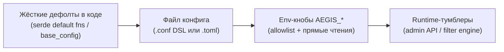

# Конфигурация (DSL и TOML)

AEGIS принимает конфигурацию в двух форматах: nginx-подобный **DSL** (файлы `.conf`) — основной формат для операторов, и legacy **TOML** (serde) — полный набор настроек для тонкого тюнинга. Поверх обоих действует слой **env-переменных** (`AEGIS_*`), которыми управляет админ-панель. Этот документ описывает каждую директиву, поле, env-кноб и порядок их применения — строго по коду ([src/dsl/lower.rs](../../src/dsl/lower.rs), [src/config.rs](../../src/config.rs), [src/proxy/pingora_admin.rs](../../src/proxy/pingora_admin.rs)).

---

## 1. Как AEGIS загружает конфиг

Точка входа — `dsl::load_any` ([src/dsl/mod.rs:41](../../src/dsl/mod.rs)). Диспетчеризация идёт **по расширению файла**:

| Расширение | Парсер | Результат |
|---|---|---|
| `.toml` | `AppConfig::from_path` (serde TOML) | `AppConfig`, без `LoadSummary` |
| `.conf` | `load_dsl` (lexer → parser → lower) | `AppConfig` + `LoadSummary` |
| прочее | сначала DSL, при ошибке — TOML fallback | зависит от того, что распарсилось |

Оба пути в конце вызывают `cfg.validate()` ([src/config.rs:1060](../../src/config.rs)). Команда проверки без запуска прокси (`aegis -t` / `aegis config test`) использует `dsl::validate_file` ([src/dsl/mod.rs:72](../../src/dsl/mod.rs)) и печатает `LoadSummary` (см. `render_summary`).

**Важно про архитектуру слоёв.** DSL — это *удобная надстройка*: парсер строит AST ([src/dsl/ast.rs](../../src/dsl/ast.rs)), а `lower::lower` ([src/dsl/lower.rs:27](../../src/dsl/lower.rs)) превращает его в тот же самый `AppConfig`, что и TOML. **DSL покрывает не все поля `AppConfig`** — многие тонкие настройки (mTLS, JA3/JA4-deny, subnet-buckets rate-limit, GeoIP-блок, anomaly-детектор, response-cache per-host, threat-intel и т. д.) доступны **только через TOML** либо через env-кнобы. Это честная оговорка: ниже у каждой DSL-директивы помечено, что именно она проставляет в `AppConfig`, а чего DSL пока не умеет.

---

## 2. nginx-подобный DSL (`aegis.conf`)

### 2.1 Общий синтаксис

DSL имитирует nginx, но это **не nginx** (комментарий в [src/dsl/lower.rs:541](../../src/dsl/lower.rs): «Aegis DSL — nginx-like syntax, not full nginx»). Каждая директива заканчивается `;`, блоки ограничены `{ }`. Ошибки несут `file:line:col` и предложение-исправление по edit-distance (например, опечатка `proxy_pas` → подсказка `proxy_pass`).

Топ-левел блоки (`TOP_LEVEL_KEYWORDS`, [src/dsl/parser.rs:67](../../src/dsl/parser.rs)):

```
admin    { ... }
defaults { ... }
xdp      { ... }
server   { ... }   # один или несколько
include  <glob>;   # подключение файлов
```

### 2.2 `include`

```nginx
include /etc/aegis/sites-enabled/*.conf;
```

- Поддерживается **единственный `*`** только в имени файла (`simple_glob`, [src/dsl/parser.rs:710](../../src/dsl/parser.rs)). Более сложные шаблоны не раскрываются.
- Относительные пути резолвятся относительно директории текущего файла.
- Пустое совпадение по glob — **мягкое предупреждение** (`tracing::warn`), не ошибка (оператор мог подготовить `sites-enabled/` до симлинков).
- Несуществующий явный (не-glob) путь — **ошибка**.
- Есть защита от циклов include (canonicalize + `visited`-множество).

### 2.3 Блок `admin`

Лоуэрится в `AdminConfig` ([src/dsl/lower.rs:32](../../src/dsl/lower.rs)).

| Директива | Тип | Смысл / дефолт |
|---|---|---|
| `listen <addr>;` | строка | Адрес админ-листенера. **Default: `127.0.0.1:9090`**, если опущен. |
| `token <role> <value>;` | enum + строка | Токен доступа. `role` ∈ `read \| write \| admin` (иначе ошибка). Можно несколько. |
| `audit_log_path <path>;` | путь | Файл аудит-лога. |
| `managed_sites_dir <path>;` | путь | Каталог, куда веб-UI пишет управляемые `.conf`. |
| `ops_sites_dir <path>;` | путь | Каталог операторских сайтов (в UI read-only). |
| `web_state_path <path>;` | путь | Файл состояния веб-панели. |

⚠️ `honeypot_state_path` есть в `AdminConfig`, но из DSL **не проставляется** (`honeypot_state_path: None` в lower.rs:68) — задаётся только через TOML или дефолтится в `/var/lib/aegis/honeypots.json`.

Роли (`AdminRole`, [src/config.rs:248](../../src/config.rs)): `read` (только чтение метрик/health/threats), `write` (+ мутации runtime, напр. xdp deny), `admin` (полный контроль, reload/stop). Подробнее — Admin API, Админ-панель.

### 2.4 Блок `defaults`

Глобальные настройки сервера и фильтров ([src/dsl/lower.rs:73](../../src/dsl/lower.rs)).

| Директива | Тип | Действие в `AppConfig` |
|---|---|---|
| `request_timeout <dur>;` | длительность | `server.request_timeout_ms` (минимум 1) |
| `graceful_shutdown <dur>;` | длительность | `server.graceful_shutdown_secs` (минимум 1) |
| `header_read_timeout <dur>;` | длительность | `server.header_read_timeout_ms` (минимум 1) — slowloris-guard |
| `body_read_timeout <dur>;` | длительность | `server.body_read_timeout_ms` — slow-POST guard (0 = выкл.) |
| `filters { ... }` | блок | см. ниже |
| `rate_limit { ... }` | блок | см. ниже |
| `cache { ... }` | блок | см. ниже |

**Единицы длительности** (`parse_duration`, [src/dsl/parser.rs](../../src/dsl/parser.rs)): суффикс обязателен — `ms`, `s`, `m`. Без суффикса — ошибка «duration needs a unit suffix (ms, s, m)». Примеры: `10s`, `5000ms`, `2m`.

#### `filters { ... }`

Тумблеры `on`/`off` (а также `true`/`1`/`yes`, [src/dsl/parser.rs:558](../../src/dsl/parser.rs)). Лоуэрятся в `apply_filters` ([src/dsl/lower.rs:288](../../src/dsl/lower.rs)):

| Директива | Проставляет | Примечание |
|---|---|---|
| `waf on\|off;` | `filters.waf.enabled` | |
| `bot_fingerprint on\|off;` | `filters.bot.enabled` | |
| `adaptive_spike_detection on\|off;` | `filters.adaptive.enabled` | |
| `challenge_ladder on\|off;` | `filters.challenge.enabled` | |
| `geoip on\|off;` | **игнорируется** | `let _ = f.geoip;` — DSL принимает токен, но GeoIP настраивается только через TOML-секцию `[geoip]` |
| `xdp on\|off;` | **игнорируется** | `let _ = f.xdp;` — XDP конфигурируется отдельным топ-левел блоком `xdp { }` |
| `plugins { lua <path>; wasm <path>; }` | `filters.plugins.lua` / `.wasm` | пути к Lua/WASM-плагинам |

🟡 `geoip`/`xdp` внутри `filters{}` — **documentation-only тумблеры**: парсер их принимает, lower честно их отбрасывает (см. комментарий [src/dsl/lower.rs:301-306](../../src/dsl/lower.rs)).

#### `rate_limit { ... }`

`apply_rate_limit` ([src/dsl/lower.rs:314](../../src/dsl/lower.rs)): **само присутствие блока включает** `rate_limit.enabled = true`.

| Директива | Проставляет |
|---|---|
| `requests_per_second <n>;` | `rate_limit.requests_per_second` |
| `burst <n>;` | `rate_limit.burst` |

⚠️ Из DSL **недоступны** `subnet_buckets`, мультипликаторы подсетей, `uri_budgets`, `hot_uri_rps_threshold` — только через TOML (см. [Rate limiting](./14-rate-limiting.md)).

#### `cache { ... }`

`apply_cache` ([src/dsl/lower.rs:327](../../src/dsl/lower.rs)): присутствие блока **включает** `response_cache.enabled = true`.

| Директива | Проставляет | Минимум |
|---|---|---|
| `default_ttl_secs <n>;` | `response_cache.default_ttl_secs` | ≥ 1 |
| `max_entries <n>;` | `response_cache.max_entries` | ≥ 1 |
| `max_body_bytes <n>;` | `response_cache.max_body_bytes` | ≥ 1024 |
| `host <name>;` (повторяемо) | `response_cache.hosts` | — |

⚠️ Per-host TTL, status-TTL, stale-if-error — **только TOML** (комментарий [src/dsl/ast.rs:63-67](../../src/dsl/ast.rs): «remain settable only via the legacy TOML path»).

### 2.5 Блок `xdp` (топ-левел)

Лоуэрится в `XdpConfig` **только если заданы И `interface`, И `bpf_object_path`** ([src/dsl/lower.rs:253](../../src/dsl/lower.rs)).

| Директива | Проставляет |
|---|---|
| `enabled on\|off;` | `xdp.enabled` |
| `interface <name>;` | `xdp.interface` (обязательно) |
| `bpf_object_path <path>;` | `xdp.bpf_object_path` (обязательно) |
| `allow <ip>;` (повторяемо) | `xdp.allow` |
| `allow_only on\|off;` | `xdp.allow_only` |
| `rate_window_ms <n>;` | `xdp.rate_window_ms` |
| `rate_burst <n>;` | `xdp.rate_burst` |
| `syn_burst <n>;` | `xdp.syn_burst` |

Подробнее — [XDP/eBPF](./13-xdp-ebpf.md).

### 2.6 Блок `server`

Главный блок маршрутизации ([src/dsl/lower.rs:108](../../src/dsl/lower.rs)).

| Директива | Тип | Смысл |
|---|---|---|
| `listen <addr> [ssl] [http2] [http3] [default_server];` | строка + модификаторы | Слушатель. Повторяемо. |
| `server_name <name>;` | строка (повторяемо) | Виртуальный хост. |
| `ssl_certificate <path>;` | путь | Сертификат (PEM). |
| `ssl_certificate_key <path>;` | путь | Приватный ключ. |
| `proxy_pass <url>;` | URL | Апстрим. |
| `filters { ... }` | блок | Принимается парсером (поле `ServerBlock.filters`), но lower применяет фильтры только из `defaults` — per-server фильтры в текущем lower **не разводятся** в `AppConfig`. |
| `rate_limit { ... }` | блок | Per-domain rate-limit (см. ниже). |
| `location <matcher> { ... }` | блок | Принимается парсером (prefix/exact + `proxy_pass`/`rate_limit`), но в текущем lower **не разворачивается** в маршруты. |

**Правила валидации (lower.rs):**

- `listen` обязателен (иначе «server block has no `listen` directive»).
- Нужен `proxy_pass` **или** хотя бы один `location` (иначе ошибка).
- `listen ... ssl` требует **обоих** `ssl_certificate` + `ssl_certificate_key` (иначе ошибка [src/dsl/lower.rs:135](../../src/dsl/lower.rs)).
- `http3` требует `ssl` на той же строке `listen` (иначе ошибка [src/dsl/lower.rs:146](../../src/dsl/lower.rs)).
- Дублирующийся `server_name` — ошибка с указанием предыдущего определения.
- Два `default_server` на один и тот же листенер (addr + tls/tcp) — ошибка.
- Сервер без `server_name` обязан объявить `default_server`, иначе ошибка.
- Два разных `default_server`-блока с разными апстримами — ошибка.

**Нормализация адреса** (`normalise_listen`, [src/dsl/lower.rs:358](../../src/dsl/lower.rs)): голый порт `80` превращается в `0.0.0.0:80`. Принимаются как `<port>` (u16), так и полный `SocketAddr` (`0.0.0.0:443`, `[::]:443`).

**Маршрутизация:**
- Сервер с `default_server` → `upstream.url` (дефолтный апстрим). Если ни один блок не дал дефолта, `upstream.url` = `http://127.0.0.1:80` ([src/dsl/lower.rs:249](../../src/dsl/lower.rs)).
- Сервер с `server_name` → запись в `domains: HashMap<host, DomainConfig>`.
- `plain_listen` (первый не-ssl) → `server.listen`; первый ssl → `tls.listen`; первый ssl+http3 → `tls.h3_listen`.

**Per-domain `rate_limit`** внутри `server { server_name ...; }` проставляет `DomainConfig.requests_per_second` и `.burst` ([src/dsl/lower.rs:222](../../src/dsl/lower.rs)).

**TLS из DSL** ([src/dsl/lower.rs:267](../../src/dsl/lower.rs)): если есть ssl-листенер и дефолтный cert/key, собирается `TlsConfig { enabled: true, ... }`. Per-`server_name` cert/key становятся `SniEntry` (SNI-роутинг). ⚠️ `ja3_deny_hashes`, `ja4_deny_prefixes` и `mtls` из DSL **всегда пустые/выключены** (`MtlsConfig::default()`) — настраиваются только через TOML. См. [TLS и сертификаты](./08-tls-certificates.md).

### 2.7 Полный пример DSL

```nginx
admin {
    listen 127.0.0.1:9090;
    token admin  super-long-random-admin-token-please-change;
    token read   read-only-dashboard-token;
    audit_log_path /var/log/aegis/admin-audit.log;
}

defaults {
    request_timeout 10s;
    graceful_shutdown 10s;
    header_read_timeout 5s;
    body_read_timeout 30s;

    filters {
        waf on;
        bot_fingerprint on;
        adaptive_spike_detection on;
        challenge_ladder off;          # включается per-domain через панель
        plugins {
            lua  /etc/aegis/plugins/geofilter.lua;
        }
    }

    rate_limit {
        requests_per_second 100;
        burst 200;
    }

    cache {
        default_ttl_secs 60;
        max_entries 10000;
        max_body_bytes 1048576;
        host static.example.com;
        host cdn.example.com;
    }
}

xdp {
    enabled on;
    interface eth0;
    bpf_object_path /usr/local/lib/aegis/xdp_filter.o;
    rate_window_ms 1000;
    rate_burst 500;
    syn_burst 100;
    allow 203.0.113.10;
    allow_only off;
}

# Дефолтный апстрим (catch-all)
server {
    listen 80 default_server;
    listen 443 ssl http2 http3 default_server;
    ssl_certificate     /etc/aegis/tls/default.crt;
    ssl_certificate_key /etc/aegis/tls/default.key;
    proxy_pass http://127.0.0.1:8000;
}

# Виртуальный хост с собственным сертификатом и лимитом
server {
    listen 80;
    listen 443 ssl http2;
    server_name api.example.com;
    ssl_certificate     /etc/aegis/tls/api.crt;
    ssl_certificate_key /etc/aegis/tls/api.key;
    proxy_pass http://127.0.0.1:3001;
    rate_limit {
        requests_per_second 20;
        burst 50;
    }
}

include /etc/aegis/sites-enabled/*.conf;
```

Проверка: `aegis -t -c /etc/aegis/aegis.conf` → печатает `config ok`, число серверов, листенеры и таблицу маршрутов.

---

## 3. TOML-конфиг (serde)

TOML — полная развёртка `AppConfig` ([src/config.rs:5](../../src/config.rs)). Используйте его, когда нужна функция, которую DSL не покрывает. Конвертация TOML → DSL: `aegis config migrate` (`migrate_from_toml`, [src/dsl/lower.rs:538](../../src/dsl/lower.rs)) — best-effort, помечает комментариями всё, что не выразимо в DSL.

### 3.1 Минимальный TOML

```toml
[server]
listen = "0.0.0.0:8080"
request_timeout_ms = 10000
graceful_shutdown_secs = 10

[upstream]
url = "http://127.0.0.1:3000"

[filters]
default_action = "allow"

[filters.ip_acl]
deny = []
allow = []

[filters.rate_limit]
enabled = false
requests_per_second = 10
burst = 10

[filters.challenge]
enabled = true
token_ttl_secs = 60
hmac_secret = "s3cure-r4ndom-hmac-key-001"   # ОБЯЗАТЕЛЬНО ≥16 симв., не плейсхолдер
```

### 3.2 `[server]` — `ServerConfig` ([src/config.rs:114](../../src/config.rs))

| Поле | Тип | Default | Смысл |
|---|---|---|---|
| `listen` | string | — (обяз.) | Адрес TCP-листенера. |
| `request_timeout_ms` | u64 | — (обяз., >0) | Таймаут запроса. |
| `graceful_shutdown_secs` | u64 | — (обяз., >0) | Окно graceful shutdown. |
| `proxy_protocol` | enum | `off` | PROXY-protocol: `off` / `v1` / `v2` / `auto`. Нужен за L4-LB (NLB, HAProxy). |
| `header_read_timeout_ms` | u64 | `5000` | Slowloris-guard на чтение заголовков. |
| `body_read_timeout_ms` | u64 | `30000` | Slow-POST guard (0 = выкл., не рекомендуется). |
| `h2_max_reset_streams` | usize | `100` | Anti-RapidReset (CVE-2023-44487): макс. одновременно сбрасываемых стримов. |
| `h2_max_concurrent_streams` | u32 | `200` | V230 — макс. одновременных HTTP/2-стримов на соединение. |
| `h2_initial_window_size` | u32 | `1048576` (1 MiB) | V230 — начальное окно стрима. |
| `h2_initial_connection_window_size` | u32 | `8388608` (8 MiB) | V230 — начальное окно соединения. |
| `tcp_nodelay` | bool | `true` | V230 — отключение алгоритма Нейгла. |
| `tcp_keepalive_secs` | u64 | `60` | V230 — TCP keepalive idle (0 = выкл.); реапит slowloris-сокеты. |

См. [Протоколы и слушатели](./07-protocols.md), [Многопроцессность](./06-workers.md).

### 3.3 `[upstream]` — `UpstreamConfig` ([src/config.rs:327](../../src/config.rs))

| Поле | Тип | Default | Смысл |
|---|---|---|---|
| `url` | string | — (обяз.) | Апстрим. Валидация требует префикс `http://` (только http в MVP, [src/config.rs:1078](../../src/config.rs)). |
| `protocol` | enum | `h1` | Протокол к апстриму: `h1` (HTTP/1.1 keep-alive) или `h2c` (HTTP/2 cleartext prior-knowledge). |

### 3.4 `[filters]` — `FiltersConfig` ([src/config.rs:353](../../src/config.rs))

| Поле | Тип | Обяз./Default |
|---|---|---|
| `default_action` | enum `allow`/`deny` | обязательно |
| `[filters.ip_acl]` | таблица | обязательно |
| `[filters.rate_limit]` | таблица | обязательно |
| `[filters.adaptive]` | таблица | опционально (default) |
| `[filters.waf]` | таблица | опционально |
| `[filters.bot]` | таблица | опционально |
| `[filters.challenge]` | таблица | опционально |
| `[filters.graphql]` | таблица | опционально |
| `[filters.bypass]` | таблица | опционально |
| `[filters.dynamic_trust]` | таблица | опционально (off) |
| `[filters.response_cache]` | таблица | опционально (off) |
| `[filters.threat_intel]` | таблица | опционально |
| `[filters.plugins]` | таблица | опционально |
| `[filters.risk_engine]` | таблица | опционально (off) |

#### `[filters.ip_acl]` — `IpAclConfig`
`deny = [...]`, `allow = [...]` — списки IP. Каждый элемент валидируется как `IpAddr` (CIDR в этом блоке **не поддерживаются** — только одиночные адреса).

#### `[filters.rate_limit]` — `RateLimitConfig` ([src/config.rs:692](../../src/config.rs))

| Поле | Тип | Default | Смысл |
|---|---|---|---|
| `enabled` | bool | — | Вкл/выкл. |
| `requests_per_second` | u64 | — | Базовый rate. |
| `burst` | u64 | — | Базовый burst. |
| `subnet_buckets` | bool | `false` | ⚠️ Лимит также по /24 (v4)//48 (v6) и /16//32 подсетям. Нужно для botnet-защиты и IPv6. |
| `subnet_24_multiplier` | u64 | `8` | Множитель для /24 (//48). |
| `subnet_16_multiplier` | u64 | `64` | Множитель для /16 (//32). |
| `uri_budgets` | array | `[]` | Per-URI лимиты: `{ pattern, requests_per_second, burst }`. First-match-wins; `pattern` — точный или с хвостовым `*`. |
| `hot_uri_rps_threshold` | u64 | `0` (выкл.) | Порог логирования «горячего» URI (только наблюдение, без блокировки). |

#### `[filters.adaptive]` — `AdaptiveConfig` ([src/config.rs:745](../../src/config.rs))

| Поле | Default |
|---|---|
| `enabled` | `false` |
| `suspicious_rps_threshold` | `200` |
| `penalty_seconds` | `10` |
| `exempt_paths` | `[]` (паттерны с `*`, для `/health`, `/metrics/*`) |

#### `[filters.waf]` — `WafConfig` ([src/config.rs:826](../../src/config.rs))

| Поле | Тип | Default | Смысл |
|---|---|---|---|
| `enabled` | bool | `false` (struct Default) / `true` в DSL base_config | См. примечание ниже. |
| `custom_rules` | array `WafRule` | `[]` | Пользовательские правила (см. 3.5). |
| `max_body_bytes` | option usize | `None` (DSL base: `Some(65536)`) | Лимит инспектируемого тела. |
| `rule_files` | array path | `[]` (DSL base: bundled Sigma corpus) | Доп. TOML-файлы с `[[rules]]`, mtime-reload. |
| `disable_signatures` | array | `[]` | Отключить категории: `sqli`, `xss`, `cmdi`. |
| `max_header_value_bytes` | usize | `8192` | Макс. длина значения заголовка. |
| `max_header_count` | usize | `64` | Макс. число заголовков. |
| `max_uri_bytes` | usize | `8192` | Макс. длина URI. |
| `allowed_methods` | array | 7 методов RFC-7231 | `GET HEAD POST PUT PATCH DELETE OPTIONS`. Пустой список = разрешить всё. |
| `block_smuggling` | bool | `true` | Блок CL/TE-рассогласований (request smuggling). |
| `max_decompress_ratio` | u32 | `100` | Лимит ratio декомпрессии (0 = выкл.). |

🟡 **Дефолт `enabled` зависит от пути загрузки.** `WafConfig::default()` (Rust struct) даёт `enabled = false`. Но `base_config()` в lower.rs ([src/dsl/lower.rs:471](../../src/dsl/lower.rs)) при загрузке DSL ставит `enabled = true`, `max_body_bytes = Some(64*1024)` и подгружает встроенный Sigma-корпус (~562 правила). То есть «из коробки» через `.conf` WAF включён. См. [WAF](./10-waf.md).

#### `[filters.bot]` — `BotConfig` ([src/config.rs:931](../../src/config.rs))

| Поле | Default |
|---|---|
| `enabled` | `false` |
| `challenge_score` | `60` |
| `deny_score` | `90` |
| `penalty_seconds` | `60` |

#### `[filters.challenge]` — `ChallengeConfig` ([src/config.rs:949](../../src/config.rs))

| Поле | Тип | Default | Смысл |
|---|---|---|---|
| `enabled` | bool | `false` (struct Default; DSL base: `true`) | Challenge-лестница. Per-domain включается через панель. |
| `token_ttl_secs` | u64 | `300` | TTL подписанного токена. |
| `hmac_secret` | string | (валидируется) | 🔴 Секрет подписи. **Валидация обязательна** (см. 3.7). |
| `captcha_site_key` | option | `None` | reCAPTCHA v2 site key. |
| `captcha_secret` | option | `None` | reCAPTCHA v2 secret. |
| `fp_ttl_secs` | u64 | `86400` (24ч) | TTL fingerprint-cookie (0 = выкл.). |
| `cookie_secure` | bool | `true` | M11 — `Secure` на cookie. Выключать только для mixed HTTP/HTTPS апстримов. |

См. [Challenge ladder](./15-challenge-ladder.md).

#### `[filters.graphql]` — `GraphqlConfig` ([src/config.rs:592](../../src/config.rs))

| Поле | Default | Смысл |
|---|---|---|
| `enabled` | `false` | |
| `paths` | `["/graphql"]` | GraphQL-эндпоинты. |
| `max_depth` | `10` | Макс. вложенность селекций. |
| `max_aliases` | `50` | Макс. число алиасов. |
| `max_query_bytes` | `16384` | Макс. длина строки query. |
| `block_introspection` | `true` | Блок `__schema`/`__type`. |
| `persisted_only` | `false` | V112 — разрешать только query из `persisted_hashes`. |
| `persisted_hashes` | `[]` | SHA-256 hex разрешённых операций (lowercase). |

#### `[filters.bypass]` — `BypassConfig` ([src/config.rs:666](../../src/config.rs))
`ips = [...]`, `paths = [...]` (хвостовой `*` для поддеревьев), `user_agents = [...]` (substring). Совпадение → запрос **минует весь pipeline фильтров**. Для доверенных webhooks (Stripe, GitHub).

#### `[filters.dynamic_trust]` — `DynamicTrustConfig` ([src/config.rs:433](../../src/config.rs))

| Поле | Default |
|---|---|
| `enabled` | `false` |
| `min_clean_requests` | `100` |
| `trust_window_secs` | `60` |
| `trust_ttl_secs` | `300` |
| `max_trusted` | `10000` |

#### `[filters.response_cache]` — `ResponseCacheConfig` ([src/config.rs:484](../../src/config.rs))

| Поле | Default | Смысл |
|---|---|---|
| `enabled` | `false` | |
| `max_entries` | `10000` | LRU-лимит. |
| `default_ttl_secs` | `60` | Fallback TTL. |
| `max_body_bytes` | `1048576` (1 MiB) | Кэшируемый размер тела. |
| `status_ttl_secs` | `{}` | Per-статус TTL: `{200=300, 404=10}`. |
| `stale_if_error_secs` | `0` (выкл.) | Окно stale-if-error. |
| `hosts` | `[]` (= все хосты) | Allow-list хостов. |
| `per_host` | `[]` | `{ host, ttl_secs?, max_body_bytes?, enabled? }`. |

⚠️ Кэш не универсален: только GET без auth/session-cookie (см. honesty-оговорки в Производительность).

#### `[filters.threat_intel]` — `ThreatIntelConfig` ([src/config.rs:647](../../src/config.rs))
`paths = [...]` — файлы deny-листов («один IP на строку», CIDR **пока не поддержаны**, `#` — комментарий); `refresh_secs` (default `300`) — период перечитывания. См. Обогащение.

#### `[filters.plugins]` — `PluginsConfig` ([src/config.rs:570](../../src/config.rs))
`lua = [...]` (каждый файл определяет `aegis_check(req)`), `wasm = [...]` (экспорт `aegis_alloc`/`aegis_check`), `lua_instruction_budget` (default `100000`). См. Плагины.

#### `[filters.risk_engine]` — `RiskEngineConfig` ([src/config.rs:406](../../src/config.rs))

| Поле | Default | Смысл |
|---|---|---|
| `mode` | `off` | `off` (не инстанцируется), `observe` (shadow-скоринг), `enforce` (эскалация при score ≥ threshold). |
| `threshold` | `90` | Порог 0..=255 для `enforce`. |

🟡 Включать `enforce` только после ≥1 недели наблюдений в `observe` (комментарий [src/config.rs:399-405](../../src/config.rs)). См. ML и risk engine.

### 3.5 `[[filters.waf.custom_rules]]` — `WafRule` ([src/config.rs:785](../../src/config.rs))

| Поле | Тип | Default | Смысл |
|---|---|---|---|
| `id` | string | — | Идентификатор. |
| `field` | string | — | Поле запроса (path/query/user_agent/method/host/header…). |
| `op` | string | — | `contains` / `equals` / `starts_with` / `ends_with`. |
| `value` | string | — | Значение для сравнения. |
| `action` | string | — | Действие при матче. |
| `severity` | option | `medium` | `critical`/`high`/`medium`/`low` (V109). |
| `tags` | array | `[]` | Метки (в метрики/события, без enforcement). |
| `score` | option u32 | derive из severity | Вклад в risk-engine. |
| `mode` | option | `enforce` | `enforce`/`shadow`(=`log`)/`disabled` (V109). |
| `all_of` | array `WafAndGroup` | `[]` | Compound (AND-of-OR): каждый `{field, op, any_of[]}`. Sigma-условия. |

Внешние файлы правил (`rule_files`) — формат `WafRuleFile`: документ TOML с `rules = [...]`. Пример правила:

```toml
[[filters.waf.custom_rules]]
id = "block-admin-post"
field = "path"
op = "contains"
value = "/admin"
action = "deny"
severity = "high"
tags = ["recon"]
mode = "shadow"     # сначала тенью, потом enforce
[[filters.waf.custom_rules.all_of]]
field = "method"
op = "equals"
any_of = ["POST"]
```

### 3.6 Прочие топ-левел TOML-секции

| Секция | Тип | Ключевые поля |
|---|---|---|
| `[admin]` | `AdminConfig` | `listen`, `[[admin.tokens]]` (`token`+`role`), `audit_log_path`, `managed_sites_dir`, `ops_sites_dir`, `web_state_path`, `honeypot_state_path` |
| `[tls]` | `TlsConfig` ([src/config.rs:258](../../src/config.rs)) | `enabled`, `listen`, `cert_path`, `key_path`, `h3_enabled`, `h3_listen`, `[[tls.sni]]`, `ja3_deny_hashes`, `ja4_deny_prefixes`, `[tls.mtls]` |
| `[tls.mtls]` | `MtlsConfig` | `enabled` (false), `ca_paths`, `require_cert` (false) |
| `[storage]` | `StorageConfig` | `redis_url` (валидация: префикс `redis://`) |
| `[xdp]` | `XdpConfig` | как в DSL-блоке `xdp` |
| `[geoip]` | `GeoIpConfig` ([src/config.rs:58](../../src/config.rs)) | `db_path` (обяз.), `asn_db_path`, `deny_countries` (ISO-2, пусто=monitor), `attack_mode_only` |
| `[anomaly]` | `AnomalyDetectorConfig` ([src/config.rs:20](../../src/config.rs)) | `enabled`, `window_secs`(10), `multiplier`(3.0), `min_baseline_rps`(10.0), `attack_duration_secs`(60), `min_challenge_level`(`javascript`) |
| `[domains.<host>]` | `DomainConfig` | `upstream_url`, `requests_per_second?`, `burst?` |

См. соответствующие документы: GeoIP, [TLS-фингерпринтинг](./11-tls-fingerprinting.md), Картография и домены.

### 3.7 Валидация конфига (`AppConfig::validate`, [src/config.rs:1060](../../src/config.rs))

При загрузке проверяется:

1. Каждый IP в `ip_acl.deny`/`allow` — валидный `IpAddr`.
2. `server.request_timeout_ms > 0`.
3. `server.graceful_shutdown_secs > 0`.
4. `upstream.url` начинается с `http://` (только http в MVP).
5. 🔴 `challenge.hmac_secret` проходит `validate_signing_secret` ([src/config.rs:1030](../../src/config.rs)):
   - не пустой;
   - не из списка плейсхолдеров (case-insensitive): `change_me`, `changeme`, `test-secret`, `secret`, `password`;
   - длина **≥ 16 символов**.
6. Если задан `[storage]`, `redis_url` начинается с `redis://`.

⚠️ Это значит: **любой конфиг с дефолтным/коротким `hmac_secret` будет отвергнут при старте** (V233). Задайте длинный случайный секрет (см. также env-кноб `AEGIS_CHALLENGE_SECRET` ниже).

---

## 4. Env-кнобы (`AEGIS_*`) — полный список `ENV_ALLOWLIST`

Слой env-переменных управляется через `GET|PUT /admin/api/env` ([src/proxy/pingora_admin.rs](../../src/proxy/pingora_admin.rs)). **Ключ не из allowlist → 400.** Каждый ключ имеет `kind`, задающий валидацию ([src/proxy/pingora_admin.rs:197](../../src/proxy/pingora_admin.rs)):

- **Bool** — только `"0"` или `"1"`.
- **Enum** — только перечисленные варианты (lowercase).
- **Path** — printable ASCII, абсолютный путь (начинается с `/`), без `..`, без метасимволов `; | & \` $ ( ) { } ' " \ пробел`.
- **Addr** — как Path по символам, но **не обязан** быть абсолютным путём (host:port / URL).
- **Uint** — неотрицательное целое.
- **Float** — парсится как f64 в `[0.0, 1.0]`.
- **Secret** — как Path по символам, но значение **никогда не возвращается** через GET (только `configured: true/false`).

Полный список ([src/proxy/pingora_admin.rs:101-169](../../src/proxy/pingora_admin.rs)):

| Ключ | Kind | Смысл |
|---|---|---|
| `AEGIS_ML_V2` | Bool | Включить ML-скорер v2. |
| `AEGIS_ML_V2_KIND` | Enum `logistic`/`gbm` | Тип ML-модели v2. |
| `AEGIS_ML_V2_GBM_FILE` | Path | Файл GBM-модели. |
| `AEGIS_ML_SCORER` | Bool | Включить базовый ML-скорер. |
| `AEGIS_ML_ADVERSARIAL` | Bool | Adversarial-режим ML. |
| `AEGIS_JA4_REPUTATION` | Path | Каталог/файл JA4-репутации (V244: ON по умолчанию; `0` отключает). |
| `AEGIS_ASN_REPUTATION` | Path | ASN-репутация (V244: ON; `0` отключает). |
| `AEGIS_REPUTATION_DIR` | Path | Каталог фидов репутации. |
| `AEGIS_ASN_PATH` | Path | Путь к ASN-DB. |
| `AEGIS_ARSENAL` | Bool | Включить Defence Arsenal. |
| `AEGIS_RISK_ENGINE_MODE` | Enum `off`/`observe`/`enforce` | Режим risk-engine (restart required). |
| `AEGIS_TLS_FINGERPRINT` | Bool | TLS-фингерпринтинг (JA3/JA4). |
| `AEGIS_LLM_HONEYPOT` | Bool | LLM-приманка. |
| `AEGIS_UPSTREAM_HEALTHCHECK` | Bool | Health-check апстримов. |
| `AEGIS_RESPONSE_CACHE_ENABLE` | Bool | Response-cache. |
| `AEGIS_DYNAMIC_TRUST_ENABLE` | Bool | Dynamic trust. |
| `AEGIS_LOG_JSON` | Bool | JSON-логи. |
| `AEGIS_FW_BACKEND` | Enum `auto`/`xdp`/`nftables`/`iptables`/`noop` | Firewall-бэкенд для дропов. |
| `AEGIS_CLAMAV_ADDR` | Addr | host:port ClamAV-сканера. |
| `AEGIS_EVENT_FORMAT` | Enum `native`/`sicherheitstacho`/`tpot` | Формат экспорта событий. |
| `AEGIS_PINGORA_REUSEPORT` | Bool | SO_REUSEPORT для Pingora-воркеров. |
| `AEGIS_HCAPTCHA_SECRET` | Secret | hCaptcha secret. |
| `AEGIS_TURNSTILE_SECRET` | Secret | Turnstile secret. |
| `AEGIS_TURNSTILE_SITEKEY` | Path | Turnstile sitekey (ПУБЛИЧНЫЙ, потому Path, не Secret). |
| `AEGIS_CROWDSEC_LAPI_URL` | Addr | URL CrowdSec LAPI. |
| `AEGIS_CROWDSEC_BOUNCER_KEY` | Secret | Ключ bouncer CrowdSec. |
| `AEGIS_BEHIND_CLOUDFLARE` | Bool | Резолв `CF-Connecting-IP` по CIDR Cloudflare. |
| `AEGIS_TRUSTED_PROXIES` | Addr | CIDR/IP доверенных прокси (XFF rightmost-non-trusted). |
| `AEGIS_SIGMA_WAF` | Bool | Загрузка встроенного Sigma-корпуса (ON по умолч.; `0` отключает). |
| `AEGIS_BGP_PIPE` | Path | exabgp file-pipe для RTBH. |
| `AEGIS_BGP_NEXTHOP` | Path | Next-hop для BGP-анонсов. |
| `AEGIS_ML_V2_SAMPLES` | Path | NDJSON-путь для labelled-сэмплов ML-тренера. |
| `AEGIS_EVENT_LOG` | Bool | Persistent event-log (ON по умолч.). |
| `AEGIS_EVENTS_DIR` | Path | Каталог шардов событий (default `/var/lib/aegis/events`). |
| `AEGIS_EVENTS_RETENTION_DAYS` | Uint | Хранение строк (default 14). |
| `AEGIS_EVENTS_SAMPLE_PASS` | Float | Доля `action=pass` строк к сохранению (default 1.0; non-pass всегда). |

> Часть изменений env применяется только при рестарте (панель помечает `restart_required: true` при сохранении, напр. `AEGIS_RISK_ENGINE_MODE`, event-log-кнобы). См. [Установка и эксплуатация](./03-installation.md).

### 4.1 Env-кнобы вне allowlist (читаются кодом напрямую)

Некоторые env читаются прямо в коде в обход панельного allowlist:

| Ключ | Где | Смысл |
|---|---|---|
| `AEGIS_SIGMA_WAF` | [src/dsl/lower.rs:411](../../src/dsl/lower.rs) | `0`/`off`/`false`/`no` отключают загрузку bundled Sigma-корпуса при сборке DSL-конфига. |
| `AEGIS_CHALLENGE_SECRET` | [src/dsl/lower.rs:487](../../src/dsl/lower.rs) | Источник `challenge.hmac_secret` для DSL-пути (`base_config`). Если не задан — плейсхолдер `change_me_replace_with_long_random_secret`, который **не пройдёт** `validate()`. **Задайте обязательно.** |

🔴 Полный список env-переменных собран в шапке [install.sh](../../install.sh) — это авторитетный источник для деплоя (конвенция брифинга: «переменные окружения — в его шапке»).

---

## 5. Приоритеты: конфиг → env → дефолт

Порядок применения значений (от низшего к высшему приоритету):



1. **Дефолты в коде.** Два источника, и они **различаются**:
   - serde `#[serde(default = ...)]` в [src/config.rs](../../src/config.rs) — действуют для TOML и для опущенных полей.
   - `base_config()` в [src/dsl/lower.rs:431](../../src/dsl/lower.rs) — стартовая точка DSL-пути. **Внимание:** base_config включает WAF (`enabled=true`), грузит Sigma-корпус и включает challenge (`enabled=true`) — в отличие от Rust-Default `WafConfig`/`ChallengeConfig`, где это `false`. То есть «дефолт из коробки» зависит от формата файла.

2. **Файл конфига.** DSL-директивы и TOML-поля переопределяют дефолты. В DSL само присутствие блока (`rate_limit`, `cache`) включает соответствующую подсистему.

3. **Env-кнобы.** `AEGIS_*` читаются при старте/рестарте и переопределяют (или дополняют) то, что задано файлом, для покрытых ими подсистем (ML, репутация, firewall-бэкенд, event-log, captcha-секреты, Sigma-корпус, challenge-секрет на DSL-пути и т. д.).

4. **Runtime-тумблеры.** Filter engine (V160) и admin-API позволяют менять часть состояния на лету (per-domain политики, xdp deny/undeny, honeypot-toggles), не трогая файл. См. Картография и домены, Admin API.

> ⚠️ **Несогласованность дефолтов DSL vs TOML — реальна, не баг документации.** Если вы переносите конфиг между форматами через `aegis config migrate`, перепроверьте `waf.enabled`/`challenge.enabled`: migrate сериализует фактические значения `AppConfig`, но Rust-struct Default для тех же полей даёт `false`. Всегда задавайте критичные тумблеры явно.

---

## 6. Что DSL пока НЕ умеет (честный список)

Эти возможности **доступны только через TOML** (или env), потому что lower их не разводит из AST:

- `[geoip]` целиком (DSL-тумблер `geoip on` игнорируется).
- `mtls`, `ja3_deny_hashes`, `ja4_deny_prefixes` в TLS (DSL ставит пустые/выключенные).
- `rate_limit`: `subnet_buckets`, мультипликаторы, `uri_budgets`, `hot_uri_rps_threshold`.
- `response_cache`: `per_host`, `status_ttl_secs`, `stale_if_error_secs` (DSL даёт только ttl/entries/body/hosts).
- `[anomaly]`, `[storage]`, `[filters.bypass]`, `[filters.dynamic_trust]`, `[filters.graphql]`, `[filters.threat_intel]`, `[filters.risk_engine]`, `[filters.bot]` тонкие пороги.
- `server { filters { ... } }` и `location { ... }` — парсятся, но в текущем lower **не разворачиваются** в per-server/per-location поведение.
- `upstream.protocol = h2c` — только TOML.
- `admin.honeypot_state_path` — только TOML/дефолт.

Если нужна любая из них — пишите TOML либо комбинируйте: основной `.conf` + точечные env-кнобы.

---

## См. также

- [Архитектура и жизненный цикл запроса](./02-architecture.md)
- [Установка и эксплуатация](./03-installation.md)
- [WAF — сигнатуры, Sigma, compound-правила](./10-waf.md)
- [Rate limiting](./14-rate-limiting.md)
- [TLS и сертификаты (ACME)](./08-tls-certificates.md)
- Картография сайтов и per-domain политики
- Admin API — справочник
- Модель безопасности и харднинг
