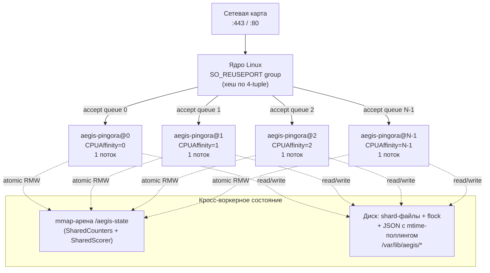
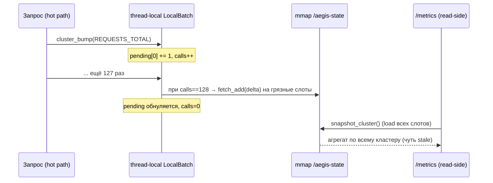

# Многопроцессность, REUSEPORT и воркеры

AEGIS масштабируется по ядрам не потоками внутри одного процесса, а **N независимыми процессами** `aegis-pingora@0..N-1`, которые слушают один и тот же порт через `SO_REUSEPORT`. Каждый процесс — это отдельное адресное пространство; ядро Linux раздаёт ему входящие соединения, а согласованность кросс-воркерного состояния достигается двумя механизмами: shared-mmap-ареной для кластерных счётчиков/скорера и дисковыми shard-файлами с mtime-поллингом для всего остального.

> Источники для этого документа: [src/bin/aegis-pingora.rs](../../src/bin/aegis-pingora.rs), [src/shared_state/](../../src/shared_state/) (`mod.rs`, `global.rs`, `counters.rs`), [src/topology.rs](../../src/topology.rs), [install.sh](../../install.sh). Исторический документ [docs/multi-process-deployment.md](../en/reference/multi-process-deployment.md) описывает раннюю (V18, гипер-путь) реализацию того же паттерна и местами устарел — приоритет имеет код.

---

## 1. Модель: N процессов, а не N потоков

Production-data plane AEGIS — это бинарь `aegis-pingora` (сборка `--features pingora`), который запускается systemd-инстансами по шаблону `aegis-pingora@.service`. Боевая топология — **N отдельных OS-процессов с `SO_REUSEPORT`**, каждый из которых пиннится 1:1 к своему ядру.

Почему именно процессы, а не потоки внутри одного рантайма:

- Pingora по умолчанию запускает рантайм в режиме **NoSteal** (`work_stealing=false`, дефолт с V81) — это N однопоточных `current_thread`-рантаймов без миграции задач между ядрами, что даёт лучшую cache-locality для коротких WAF/cache-задач ([src/bin/aegis-pingora.rs:1633-1656](../../src/bin/aegis-pingora.rs)).
- `ServerConf::threads` по умолчанию **1** в Pingora 0.8. Без явной настройки весь прокси работал бы на одном ядре (на стенде V57 это дало ~44k RPS у pingora-1 против ~238k у гипера). Поэтому бинарь сам поднимает `threads = num_cpus`, если не задан `AEGIS_PINGORA_THREADS` ([src/bin/aegis-pingora.rs:1619-1632](../../src/bin/aegis-pingora.rs)).
- В боевой раскладке `install.sh` ставит обратное: **1 поток на воркер** (`AEGIS_PINGORA_THREADS=1`), а параллелизм добирается числом процессов. Это thread-per-core паттерн nginx/envoy/HAProxy.



---

## 2. SO_REUSEPORT — как воркеры делят порт

`SO_REUSEPORT` позволяет нескольким процессам биндить один и тот же `addr:port`. Ядро держит отдельную accept-очередь на каждый сокет в группе и распределяет входящие соединения хешом по 4-tuple (src/dst IP + порт). Никакой userspace-координации accept нет.

В `aegis-pingora` это **opt-in** через переменную окружения `AEGIS_PINGORA_REUSEPORT=1`:

```rust
// src/bin/aegis-pingora.rs:1756-1781
let reuseport = std::env::var("AEGIS_PINGORA_REUSEPORT")
    .map(|v| v == "1" || v.eq_ignore_ascii_case("true"))
    .unwrap_or(false);             // default: OFF
let downstream_sock_opt = build_downstream_sock_opt(reuseport);
service.add_tcp_with_settings(&listen, downstream_sock_opt.clone());
```

Опция `so_reuseport` устанавливается в `TcpSocketOptions` Pingora ([`build_downstream_sock_opt`](../../src/bin/aegis-pingora.rs), src/bin/aegis-pingora.rs:583-609). Та же опция применяется и к TLS-листенеру (src/bin/aegis-pingora.rs:1991-1994) — оба downstream-сокета REUSEPORT-capable.

> Дефолт `AEGIS_PINGORA_REUSEPORT` — **выключено**. В production его включает именно systemd-шаблон от `install.sh` (`Environment=AEGIS_PINGORA_REUSEPORT=1`, install.sh:1252). Запуск бинаря «руками» без этой переменной даёт одиночный процесс — это нормально для одноворкерных и dev-сценариев.

### Что НЕ участвует в REUSEPORT

| Транспорт | Сокет | REUSEPORT | Поведение |
|---|---|---|---|
| HTTP/1.1, HTTP/2 (TCP, plain) | `add_tcp_with_settings` | ✅ да | каждый воркер биндит порт, ядро балансит |
| HTTP/1.1, HTTP/2 (TLS) | TLS-листенер | ✅ да | то же + общий ticket-key (см. §6) |
| **HTTP/3 (QUIC, UDP)** | quinn UDP-сокет | ❌ **нет** | **только первый воркер** биндит `:443/udp`; остальные ловят `AddrInUse` и логируют это как info, h3 им отдаёт сосед |

HTTP/3-sidecar (quinn) не имеет `SO_REUSEPORT` на UDP-сокете: первый воркер, выигравший bind `:443/udp`, обслуживает весь HTTP/3-трафик, остальные получают `AddrInUse` — это **ожидаемо и безвредно**, h1/h2 по TCP при этом не страдают ([src/bin/aegis-pingora.rs:1600-1612](../../src/bin/aegis-pingora.rs)).

### Дефолты сокета и accept-backlog (важная оговорка V231)

- **TCP_NODELAY** Pingora включает безусловно на каждом accepted-стриме (`apply_stream_settings`), отдельной настройки нет — Nagle (40 ms coalescing) всегда выключен.
- **TCP keepalive** на принятых клиентских соединениях — **opt-in** через `AEGIS_PINGORA_DOWNSTREAM_KEEPALIVE=1` (дефолт OFF). Включён он применяется per-accept синхронно и при высоком rate accept вызывает шторм `setsockopt`, переполнявший accept-backlog и дававший массовые `Connection refused (os error 111)` — поэтому по умолчанию выключен ([src/bin/aegis-pingora.rs:559-609](../../src/bin/aegis-pingora.rs)).
- **Accept-backlog** Pingora запрашивает `listen(65535)`, но ядро молча зажимает его до `net.core.somaxconn`. Поднять этот потолок из кода нельзя (нет поля `backlog` в `TcpSocketOptions`) — это sysctl-дроп-ин уровня `install.sh`, а не бинаря.

### Проверка, что воркеры слушают один порт

```bash
sudo ss -ltnp | grep ':443'
# несколько строк users:(("aegis-pingora",pid=...,fd=...)) на одном порту
sudo systemctl status 'aegis-pingora@*'
```

---

## 3. Раскладка по ядрам: N воркеров × 1 поток, CPU-пиннинг

`install.sh::resolve_workers` определяет число воркеров ([install.sh:156-191](../../install.sh)):

| Источник | Приоритет | Поведение |
|---|---|---|
| CLI `--workers N` | высший | явное число воркеров |
| Панель (topology.json) | средний | `{"workers":"auto"\|"N"}`, записанный через `PUT /admin/api/topology` (см. §5) |
| `auto` (дефолт) | низший | `AEGIS_WORKERS = nproc`, по одному воркеру на ядро |

Во всех случаях `AEGIS_THREADS_PER_WORKER=1` — это thread-per-core (V230). Инстансы нумеруются `0..N-1`, чтобы шаблонный `CPUAffinity=%i` ложился 1:1 на индекс ядра (воркер 0 → CPU 0, …, воркер N-1 → CPU N-1).

Фрагмент шаблона systemd, который пишет `install.sh` ([install.sh:1233-1287](../../install.sh)):

```ini
# /etc/systemd/system/aegis-pingora@.service
[Service]
Environment=AEGIS_PINGORA_REUSEPORT=1
Environment=AEGIS_PINGORA_THREADS=1
ExecStart=/usr/local/bin/aegis-pingora -c /etc/aegis/aegis.conf --log-level info
Restart=on-failure
RestartSec=2
LimitNOFILE=1048576
CPUAffinity=%i          # воркер %i закреплён за ядром %i
LimitMEMLOCK=infinity   # под BPF-карты / locked-кольца XDP
Nice=-10                # приоритет выше прочей userland (но не RT FIFO)
PartOf=aegis-pingora.target
```

Группирующий `aegis-pingora.target` объявляет все инстансы через **`Wants=`** (не `Requires=`), что критично для rolling-restart (см. §7), и через `PartOf` в шаблоне — чтобы рестарт цели всё-таки расходился на все инстансы.

### Сколько воркеров ставить

Дефолт `auto` = число ядер — разумная отправная точка для thread-per-core раскладки. Каждый воркер занимает по `/proc`-замеру обычно десятки МиБ RSS плюс собственные in-memory структуры (per-worker DashMap скорера, fingerprint-кеш, response-cache). Память масштабируется **линейно по N**, так как часть состояния дублируется в каждом воркере (см. §4.3 о cache-дедупликации).

> ⚠️ Демон **не масштабирует сам себя «вживую»**: запущенный процесс не может породить или убить своих siblings (для этого нужны `systemctl` + root). Это поведение нарочно зеркалит nginx, где смена `worker_processes` требует reload ([src/topology.rs:16-24](../../src/topology.rs)).

---

## 4. Кросс-воркерное состояние

Каждый REUSEPORT-воркер — это **отдельный процесс со своим адресным пространством**, поэтому его per-worker `DashMap`-структуры (ThreatScorer, DynamicTrust, AnomalyDetector) видят только свою долю трафика. Распределённый атакующий может насытить взгляд воркера A на IP, пока воркер B всё ещё считает этот IP чистым ([src/shared_state/mod.rs:5-14](../../src/shared_state/mod.rs)). AEGIS борется с этим двумя независимыми механизмами.

### 4.1. Механизм A — диск + mtime-поллинг (конфиг и накопительное состояние)

Состояние, которое мутируется редко (через админ-панель) или агрегируется для дашборда, шарится **через файлы на диске** на разделяемом `/var/lib/aegis`. Один воркер пишет файл атомарно (temp + rename), остальные подхватывают изменение, **сравнивая mtime файла на каждом чтении** — поэтому sibling-воркеры видят правку за микросекунды, а не за 30 секунд фонового тика ([src/bin/aegis-pingora.rs:965-970](../../src/bin/aegis-pingora.rs)).

mtime-поллинг троттлится, чтобы per-request-проверки не дёргали `fs::metadata` на каждый запрос: между опросами выдерживается минимальный интервал ([src/filters/engine.rs:49-67, 197-217](../../src/filters/engine.rs), `RUNTIME_TOGGLE_POLL_INTERVAL`-подобный троттл V179).

| Состояние | Env-переменная пути | Дефолтный путь | Версия | Шаринг |
|---|---|---|---|---|
| Runtime-тогглы фильтров | `AEGIS_TOGGLES_PATH` | `/var/lib/aegis/runtime-toggles.json` | V168 | атомарная запись + mtime-poll на чтении |
| Per-domain policy | `AEGIS_DOMAIN_POLICY_PATH` | `/var/lib/aegis/domain-policy.json` | V168 | то же |
| Per-domain challenge-конфиг | `AEGIS_CHALLENGE_CONFIG_PATH` | `/var/lib/aegis/domain-challenge.json` | V245 | то же |
| Leaky-bucket сценарии Arsenal | `AEGIS_SCENARIOS_PATH` | `/var/lib/aegis/scenarios.yaml` | V246 | то же |
| ACME challenge-токены | `AEGIS_ACME_STATE_DIR`/challenges | `/var/lib/aegis/acme/challenges` | V238 | дисковая папка (общая) |
| Honeypot store | `AEGIS_HONEYPOT_STATE` | `/var/lib/aegis/honeypots.json` | — | inline mtime-hot-reload в `HoneypotStore::check` |
| JA4-репутация / фиды | (см. конфиг) | файлы фидов | V138/V176/V177 | `reload()` по mtime (паттерн `threat_intel.rs`) |
| Site-map (картография) | `AEGIS_SITEMAP_DIR` | `/var/lib/aegis/site-map` | V240 | flock-shard на воркер |
| Event-store (журнал запросов) | `AEGIS_EVENTS_DIR` | `/var/lib/aegis/events` | V243 | flock-shard на воркер |
| GeoIP-агрегация по странам | `AEGIS_GEO_DIR` | `/var/lib/aegis/geo` | V242 | flock-shard на воркер |
| Time-series store (метрики) | — | `default_store_dir()` | — | один writer по advisory-flock, остальные read-only |

Зачем нужна была дисковая шара на конкретных примерах:

- **ACME challenge-токены (V238):** валидирующий GET от Let's Encrypt ядро маршрутизирует на случайный воркер; без общей папки 3/4 запросов промахивались мимо in-memory-карты и валидация падала в `state=Invalid` ([src/bin/aegis-pingora.rs:1698-1709](../../src/bin/aegis-pingora.rs)).
- **Сценарии и challenge-конфиг (V245/V246):** панель пишет PUT в один воркер; без файла настройка жила бы только в нём, а sibling-воркеры о ней не знали ([src/bin/aegis-pingora.rs:1479-1493](../../src/bin/aegis-pingora.rs)).

### 4.2. flock-shard паттерн (накопительные счётчики на дашборд)

Site-map, event-store и geo используют один и тот же приём: каждый воркер захватывает **слот** неблокирующим advisory-`flock` на `.slot-<n>.lock` и владеет ровно одним shard-файлом (`shard-<slot>.db` / `.json`) на всё время жизни процесса — то есть **ровно один writer на shard** ([src/event_store.rs:11-21](../../src/event_store.rs)). На старте воркер перечитывает свой прежний shard (счётчики переживают рестарт), а фоновый тик флашит его раз в ~30 с.

**Read-side** (админ-эндпоинты) **сканирует всю папку**, объединяет все shard'ы (`UNION ALL` для SQLite event-store, merge для site-map/geo) и возвращает стабильный результат **независимо от того, какой воркер ответил на запрос**. Так дашборд (мировая карта, журнал, картография) согласован при любой REUSEPORT-раскладке.

Time-series store (метрики) — вариация: один воркер выигрывает advisory-flock на `.sampler.lock` и пишет, остальные работают read-only и отдают запросы из общих ring-файлов ([src/bin/aegis-pingora.rs:931-961](../../src/bin/aegis-pingora.rs)).

### 4.3. Что НЕ шарится (честные ограничения)

- **Response-cache:** LRU у каждого воркера свой. Горячий URL может оказаться закеширован во всех N воркерах → N× памяти. Hit-ratio слегка падает (каждый воркер прогревает свой кеш отдельно).
- **Per-worker DashMap скорера / trust / anomaly:** при выключенной mmap-арене (см. §4.4) они остаются строго per-worker — distributed-атакующий, бьющий по всем воркерам, считается каждым из них до своего порога независимо.
- **Прогрев после рестарта:** перезапущенный воркер стартует с пустыми in-memory структурами (кеш, dynamic-trust, история скорера) и под нагрузкой прогревается за секунды; flock-shard-состояние (§4.2) при этом восстанавливается из своего файла.

### 4.4. Механизм B — shared mmap-арена (кластерные счётчики и скорер)

Для горячего пути, где дисковый файл слишком медленный, AEGIS использует **единую анонимную mmap-арену** (`shm_open` + `mmap(MAP_SHARED)`), которую открывает каждый воркер на старте. Это Phase D из roadmap, реализованная в [src/shared_state/](../../src/shared_state/).

Ключевые свойства ([src/shared_state/mod.rs](../../src/shared_state/mod.rs), [src/shared_state/global.rs](../../src/shared_state/global.rs)):

- **Только Linux.** Арена опирается на POSIX `shm_open`+`mmap`; на macOS/не-Linux компилируется no-op-заглушка (`stub.rs`), и всё деградирует к per-worker состоянию ([src/shared_state/mod.rs:37-74](../../src/shared_state/mod.rs)).
- **Имя арены** по умолчанию `/aegis-state`, переопределяется `AEGIS_SHARED_STATE_NAME` (два независимых деплоя AEGIS на одном хосте не должны коллидировать). **Размер** — `AEGIS_SHARED_STATE_SIZE_MB` (дефолт 4 МиБ) ([src/shared_state/global.rs:86-97](../../src/shared_state/global.rs)).
- **Bump-аллокатор** внутри арены: `alloc()` атомарно двигает head через CAS, индивидуальные аллокации **никогда не освобождаются** (компакция — только пересозданием всей арены). Named-аллокации (`alloc_named`) гарантируют, что все воркеры присоединяются к **тем же физическим байтам** для известной цели (например `SHARED_SCORER_V4`): первый создатель CAS'ит offset в реестр заголовка, остальные читают его и аттачатся ([src/shared_state/mod.rs:104-210](../../src/shared_state/mod.rs)).
- **Graceful degradation:** если арену открыть нельзя (нет `/dev/shm`, macOS, ограниченный контейнер) — демон логирует warning и продолжает **без** кластерного состояния; все аксессоры возвращают `None`, hot-path no-op'ит bump'ы счётчиков. Та же модель деградации, что у XDP-загрузчика ([src/shared_state/global.rs:9-12, 114-122](../../src/shared_state/global.rs)). Инициализация **не фатальна** для прокси ([src/bin/aegis-pingora.rs:911-913](../../src/bin/aegis-pingora.rs)).

Внутри арены живут две вещи:

**SharedCounters** ([src/shared_state/counters.rs](../../src/shared_state/counters.rs)) — массив `AtomicU64`-слотов фиксированного размера. Любой воркер атомарно делает `fetch_add`/`load`; POSIX shared-mmap атомики когерентны на Linux x86_64 и aarch64. Слоты адресуются стабильными порядковыми номерами (операторы могут строить дашборды по индексам — новые счётчики только APPEND'ятся) ([src/shared_state/global.rs:46-70](../../src/shared_state/global.rs)):

| idx | Счётчик | idx | Счётчик |
|---|---|---|---|
| 0 | `REQUESTS_TOTAL` | 7 | `UPSTREAM_5XX` |
| 1 | `REQUESTS_DENIED` | 8 | `COMPACTIONS_TOTAL` |
| 2 | `REQUESTS_CHALLENGED` | 9 | `COMPACTIONS_REMOVED` |
| 3 | `CACHE_HITS` | 10 | `RATE_LIMITED` |
| 4 | `CACHE_MISSES` | 11 | `TARPIT` |
| 5 | `UPSTREAM_2XX` | 12 | `RTBH` |
| 6 | `UPSTREAM_4XX` | — | (всего 16 слотов) |

**SharedScorer** ([src/ddos/shared_score.rs](../../src/ddos/shared_score.rs)) — распределённый threat-scorer поверх lock-free open-addressing хешмапы в арене (`AtomicHashMap` для IPv4, `AtomicHashMap128` для IPv6). Аттачится на старте из глобальной арены: `from_global_arena(65536, 60s)` — 65536 IPv4-слотов, окно 60 с. Если арена недоступна — `None`, скоринг остаётся per-worker ([src/bin/aegis-pingora.rs:914-929](../../src/bin/aegis-pingora.rs)). Это и есть «лекарство» от distributed-атаки из §4.3: любой воркер читает/пишет per-IP score любого другого, и кластер видит единый счёт.

#### Батчинг счётчиков (V231)

`cluster_bump`/`cluster_bump_n` **не пишут в mmap на каждый вызов**. Инкременты копятся в thread-local буфере (`LocalBatch`) и флашатся в арену одним `fetch_add` на «грязный» слот раз в `FLUSH_EVERY = 128` вызовов ([src/shared_state/global.rs:138-252](../../src/shared_state/global.rs)). При ~450k req/s × 16 воркеров это превращает миллионы контентных cross-core atomic-RMW в секунду в несколько тысяч, убирая cache-line ping-pong (~1.6% CPU в профиле). Гарантии:

- **Ни один инкремент не теряется** — каждый `pending[i]` либо уже зафлашен, либо будет зафлашен на следующей границе батча.
- **Read-path** (`cluster_counter`, `snapshot_cluster`) видит чуть устаревшие значения (до N−1 незафлашенных инкрементов на поток) — приемлемо для кластерных метрик.
- Thread-local — per-OS-thread; поскольку каждый Pingora-воркер однопоточный (1 поток на ядро), это эффективно per-process. Admin/background-потоки имеют свои буферы.



---

## 5. Интроспекция топологии для панели ([src/topology.rs](../../src/topology.rs))

Страница «Workers» в админ-панели показывает, как прокси разложен по машине. Ничего из `topology.rs` **не работает на hot-path** — `host_info()` + `enumerate_workers()` вызываются только обработчиком `/admin/api/topology` (несколько раз в минуту максимум) и читают `/proc` ([src/topology.rs:9-14](../../src/topology.rs)).

- **`host_info()`** — число логических CPU, модель CPU из `/proc/cpuinfo`, load average. Число ядер берётся через `sysconf(_SC_NPROCESSORS_ONLN)`, а **не** `available_parallelism()`: последний скоупится affinity-маской процесса, а каждый воркер пиннится к 1 ядру (`CPUAffinity=%i`), так что `available_parallelism()` внутри воркера вернул бы `1` и панель сочла бы 16-ядерную машину одноядерной ([src/topology.rs:105-135](../../src/topology.rs)).
- **`enumerate_workers()`** — сканирует `/proc`, ищет процессы с `comm == "aegis-pingora"`, по каждому собирает: pid, instance (из `AEGIS_PINGORA_INSTANCE` в `/proc/<pid>/environ`), RSS (МиБ), число OS-потоков, uptime, lifetime-average CPU (`(utime+stime)/uptime`, проценты одного ядра). Пустой результат означает «неизвестно» (нет `/proc` или нет прав), **не** «ноль воркеров» ([src/topology.rs:202-299](../../src/topology.rs)).
- **Desired-count knob** ([src/topology.rs:64-103, 301-323](../../src/topology.rs)): панель пишет *намерение* оператора в маленький JSON `/var/lib/aegis/topology.json` (`DEFAULT_TOPOLOGY_PATH`) — `{"workers":"auto"|"N"}`. Демон себя не перемасштабирует; этот файл читает `install.sh::resolve_workers` на следующем деплое/reconcile (см. §3). `effective()` резолвит `"auto"` в число ядер, явное число клампит к `1..=4096`, мусор откатывает к числу ядер. Запись атомарная (temp + rename).

---

## 6. TLS session-ticket key для REUSEPORT-воркеров (LEVER 3)

Тонкость, специфичная для N-процессной раскладки: каждый процесс по умолчанию получает свой случайный TLS 1.3 session-ticket key, поэтому клиент, переподключившийся на **другой** воркер, не сможет расшифровать тикет → тихий полный handshake на реконнекте.

Фикс ([src/bin/aegis-pingora.rs:611-867](../../src/bin/aegis-pingora.rs)): все REUSEPORT-воркеры **разделяют один ticket-key** из персистентного файла `/etc/aegis/tls_ticket.key` (override — `AEGIS_TLS_TICKET_KEY_FILE`). Файл генерится один раз на первом старте с правами 0600 через `OsRng` (CSPRNG), остальные воркеры его подгружают; `create_new` атомарен, так что при гонке двух воркеров ровно один выигрывает, проигравший читает байты победителя — все сходятся на одном ключе. Длина ключа **запрашивается у OpenSSL в рантайме** (48 байт legacy AES-128 / 80 байт на OpenSSL 3.0+), а не хардкодится. Заодно per-worker server-side session cache **выключается** (`SslSessionCacheMode::OFF`) — под REUSEPORT он бесполезен (резюмированная сессия попадает на другой воркер → cache miss) и только жрёт память.

> ⚠️ Honesty caveat: **ротация ticket-key НЕ реализована** — ключ статичен до рестарта процесса (`TODO(security): KEY ROTATION` в коде, src/bin/aegis-pingora.rs:630-641, 855-861). Forward secrecy не ослаблена (TLS 1.3 ephemeral ECDHE остаётся per-handshake), 0-RTT/early-data не включён. До появления ротации рекомендуется короткий `ssl_session_timeout`.

---

## 7. Эксплуатация: рестарт, reload, метрики

### Rolling-restart (почти нулевой downtime)

`install.sh` ставит helper `aegis-rolling-restart`, который перезапускает REUSEPORT-инстансы по одному ([install.sh:893-900](../../install.sh)). Это работает именно потому, что `aegis-pingora.target` объявляет инстансы через `Wants=`, а не `Requires=`: рестарт одного воркера не делает зависимость цели неудовлетворённой и не каскадит stop на siblings ([install.sh:1298-1303](../../install.sh)). Пока один воркер перезапускается, ядро раздаёт его долю соединений остальным N−1.

```bash
# Перезапуск всех воркеров «волной», по одному:
sudo aegis-rolling-restart
# Полный рестарт цели (все инстансы сразу):
sudo systemctl restart aegis-pingora.target
# Статус:
sudo systemctl status 'aegis-pingora@*'
```

### Изоляция падений

Если один воркер паникует или OOM'ится — systemd рестартит его (`Restart=on-failure`, `RestartSec=2`), остальные N−1 продолжают обслуживать. Одиночный процесс упал бы целиком — это реальный выигрыш в доступности.

### Метрики

Кластерные счётчики (§4.4) уже агрегированы в арене, поэтому `/metrics` любого воркера отдаёт кластерный snapshot. Per-worker Prometheus-счётчики при необходимости суммируются на стороне Prometheus (`sum by (host) (...)`). Дашбордные агрегаты (журнал, картография, geo, time-series) собираются read-side-сканированием всех shard-файлов (§4.2).

### Reload конфига

Изменения через панель (тогглы, per-domain policy, challenge-конфиг, сценарии) **не требуют рестарта**: воркер-получатель пишет файл атомарно, остальные подхватывают по mtime-поллингу за микросекунды (§4.1). WAF-правила и cert-файлы перечитываются фоновым `PingoraBackground`-поллером (тик ~30 с) у каждого воркера независимо.

---

## 8. Сводка отказоустойчивости и деградации

| Условие | Поведение |
|---|---|
| `AEGIS_PINGORA_REUSEPORT` не задан | одиночный процесс на порт (нормально для dev / 1 воркера) |
| Не-Linux / нет `/dev/shm` | mmap-арена → no-op stub; кластерные счётчики и SharedScorer выключены, состояние строго per-worker |
| Арена не открылась (контейнер, права) | warning, прокси работает, аксессоры возвращают `None` |
| HTTP/3 UDP не забиндился sibling-воркером | info-лог `AddrInUse`, h3 отдаёт воркер-победитель, TCP не страдает |
| Падение одного воркера | systemd рестартит, остальные обслуживают |
| Рестарт воркера | пустые in-memory структуры, прогрев за секунды; flock-shard состояние восстанавливается из файла |
| ARM без PMU (PERFMON) | XDP не грузится, graceful fallback to nftables (ортогонально воркерам) |

---

## Связанные документы

- [02-architecture.md](./02-architecture.md) — общий жизненный цикл запроса
- [03-installation.md](./03-installation.md) — `install.sh`, systemd, режимы
- [07-protocols.md](./07-protocols.md) — листенеры h1/h2/h3 и их биндинг
- [08-tls-certificates.md](./08-tls-certificates.md) — ACME, cert-reload, session tickets

> **Honesty caveat (общая оговорка брифинга):** цифры RPS, упоминаемые здесь и в [docs/multi-process-deployment.md](../en/reference/multi-process-deployment.md) (140k/воркер, 875k→964k cache-warm и т.п.), — это in-process / стендовые замеры. Полный `aegis-pingora` под боевой нагрузкой даёт ↓15–30% против synthetic-бенча (I/O Pingora, syscalls, TLS-handshake). В VM без SHA-NI/AES-NI PoW/HMAC в 2–3× медленнее bare-metal. Не цитируйте абсолютные RPS без этой оговорки; авторитетный источник найденных проблем — SECURITY-AUDIT-CONSOLIDATED-2026-06-07.md.
