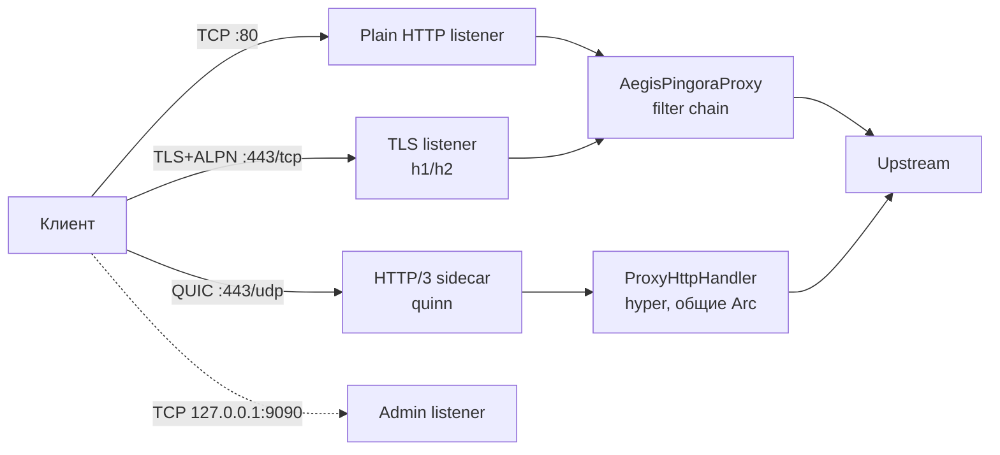

# Сетевые слушатели и протоколы

Этот документ описывает, как AEGIS принимает входящий трафик: какие слушатели (listeners) поднимаются на каких портах, как согласуются протоколы HTTP/1.1, HTTP/2 и HTTP/3 (QUIC), как работает ALPN и включение h2 (`enable_h2`), какие лимиты HTTP/2 защищают от Rapid Reset (CVE-2023-44487), и как восстанавливается реальный IP клиента за CDN/L4-балансировщиком (`real_ip` / PROXY protocol).

> Все утверждения ниже сверены с исходным кодом: [src/bin/aegis-pingora.rs](../../src/bin/aegis-pingora.rs), [src/proxy/http3.rs](../../src/proxy/http3.rs), [src/proxy/pingora_tls.rs](../../src/proxy/pingora_tls.rs), [src/real_ip.rs](../../src/real_ip.rs), [src/proxy_proto.rs](../../src/proxy_proto.rs), [src/config.rs](../../src/config.rs), [src/proxy/pingora_http.rs](../../src/proxy/pingora_http.rs).

---

## 1. Краткая карта слушателей

Production data plane — это бинарь `aegis-pingora` (V71+, собирается с `--features pingora`). Он поднимает до **четырёх** слушателей; легаси-бинарь `aegis` (hyper) поднимает аналогичный набор по своему пути. Источник истины — функция `main()` в [src/bin/aegis-pingora.rs](../../src/bin/aegis-pingora.rs).

| Слушатель | Транспорт | Протоколы | Источник адреса | Где в коде |
|---|---|---|---|---|
| **Plain HTTP** | TCP | HTTP/1.1 + HTTP/2 (h2c — нет; см. ниже) | `server.listen` / `AEGIS_LISTEN` (по умолчанию `:80`-стиль из конфига) | `service.add_tcp_with_settings(&listen, ...)` (aegis-pingora.rs:1774-1781) |
| **TLS** | TCP | HTTP/1.1 + HTTP/2 (через ALPN) | `tls.listen` / `AEGIS_LISTEN_TLS` | `service.add_tls_with_settings(&tls_listen, ...)` (aegis-pingora.rs:1995) |
| **HTTP/3 sidecar** | UDP (QUIC) | HTTP/3 (ALPN `h3`) | `tls.h3_listen` (по умолчанию = `tls.listen`) | `maybe_spawn_h3()` (aegis-pingora.rs:2307) |
| **Admin** | TCP | HTTP/1.1 (метрики, `/health`, admin API) | `admin.listen` / `AEGIS_ADMIN_LISTEN` (по умолчанию `127.0.0.1:9090`) | `admin_service` (aegis-pingora.rs:2131-2132) |

Ключевой нюанс архитектуры: **plain-HTTP и TLS — это слушатели одного и того же Pingora `http_proxy_service`** (`AegisPingoraProxy`). HTTP/3 — это **отдельный sidecar**, который поднимается на hyper-обработчике `ProxyHttpHandler` (Pingora 0.8 не умеет h3), но переиспользует те же фильтры/роутер/кэш/scorer через общие `Arc` (aegis-pingora.rs:1585-1599).



См. также: [docs/06-workers.md](./06-workers.md) (REUSEPORT и воркеры), [docs/08-tls-certificates.md](./08-tls-certificates.md) (сертификаты, ACME, SNI, mTLS).

---

## 2. Слушатель :80 (plain HTTP)

Адрес берётся из `server.listen` (DSL/TOML) с переопределением через переменную `AEGIS_LISTEN` (aegis-pingora.rs:892). Слушатель всегда регистрируется через `add_tcp_with_settings`, чтобы можно было задать `SO_REUSEPORT` (см. раздел 6) и опциональный TCP keepalive:

```rust
// aegis-pingora.rs:1773-1781
let downstream_sock_opt = build_downstream_sock_opt(reuseport);
service.add_tcp_with_settings(&listen, downstream_sock_opt.clone());
```

Особенности, зафиксированные в коде:

- **TCP_NODELAY (отключение алгоритма Нагла) включён всегда.** Pingora безусловно вызывает `set_nodelay()` для каждого принятого стрима в `apply_stream_settings` (pingora-core `listeners/l4.rs:385`). Отдельного флага под это нет — это документировано в комментарии `build_downstream_sock_opt` (aegis-pingora.rs:552-557). Конфиг-поле `server.tcp_nodelay` (default: `true`, config.rs:162) применяется на **hyper-пути**; на Pingora-пути оно по сути всегда `true`.
- **Backlog нельзя поднять из кода.** Pingora запрашивает `listen(65535)`, но ядро молча обрезает это до `net.core.somaxconn` (l4.rs:51,250). У `TcpSocketOptions` **нет** поля `backlog` (aegis-pingora.rs:574-582). Потолок очереди accept — это sysctl `net.core.somaxconn`, который выставляется в [install.sh](../../install.sh) / sysctl.d-дропине, а не в бинаре.
- **TCP keepalive на принятых соединениях по умолчанию ВЫКЛЮЧЕН** (`AEGIS_PINGORA_DOWNSTREAM_KEEPALIVE`, default: off). Это регрессионный фикс V231: keepalive применяется Pingora **на каждый accept** синхронно внутри accept-loop, что под нагрузкой (500-1000 conn) приводило к переполнению accept-очереди и `Connection refused (os error 111)`. Подробный разбор — в doc-комментарии `build_downstream_sock_opt` (aegis-pingora.rs:559-608). Reaping мёртвых клиентов и так делают request/idle-таймауты.

> Замечание про h2c (HTTP/2 cleartext): на plain-листенере h2 без TLS **не согласуется автоматически** — `enable_h2()` вызывается только на TLS-настройках (раздел 4). На незашифрованном порту едет HTTP/1.1.

### Слоулорис-гарды (общие)

В [src/config.rs](../../src/config.rs) есть таймауты, защищающие соединения от медленного исчерпания:

| Поле (`server.*`) | Default | Назначение |
|---|---|---|
| `header_read_timeout_ms` | `5000` | Slowloris: убить HTTP/1.x-соединение, не приславшее заголовки за это время (config.rs:131) |
| `body_read_timeout_ms` | `30000` | Slow-POST (R-U-Dead-Yet): убить запрос, если тело не пришло целиком; `0` отключает (config.rs:136) |
| `request_timeout_ms` | — | Общий таймаут запроса |
| `graceful_shutdown_secs` | — | Грейс при остановке (на hyper-пути) |

> 🟡 Эти поля исторически реализованы на hyper-пути ([src/server.rs](../../src/server.rs)). На Pingora-пути дренаж тела h3 защищён собственной константой (раздел 5), а грейс при shutdown задаётся через `AEGIS_PINGORA_GRACE_SECS` (default: `10`, aegis-pingora.rs:1667-1670).

---

## 3. Слушатель :443 (TLS) и ALPN

TLS-слушатель поднимается только если в конфиге есть блок `tls` с `enabled = true` (config.rs:259-260). Адрес — `tls.listen`, переопределяется через `AEGIS_LISTEN_TLS` (aegis-pingora.rs:1798).

Терминация TLS идёт через OpenSSL-фичу Pingora и кастомный коллбэк `AegisTlsAccept` ([src/proxy/pingora_tls.rs](../../src/proxy/pingora_tls.rs)), который делает:

1. **Per-SNI выбор сертификата** — `certificate_callback` читает SNI из ClientHello и ставит нужную пару cert/key через `ssl.set_certificate` / `ssl.set_private_key` (pingora_tls.rs:866-871). Дефолтный сертификат отдаётся, когда SNI отсутствует или не совпал (pingora_tls.rs:382-390).
2. **JA3/JA4-фингерпринтинг** — захват ClientHello через `set_client_hello_callback` → `capture_client_hello` (pingora_tls.rs:745, регистрация в aegis-pingora.rs:1922-1928). Подробнее: [docs/11-tls-fingerprinting.md](./11-tls-fingerprinting.md).

### ALPN: согласование h1 vs h2

ALPN (Application-Layer Protocol Negotiation) на TLS-листенере включается ровно одной строкой:

```rust
// aegis-pingora.rs:1929
tls_settings.enable_h2();
```

`enable_h2()` в Pingora 0.8.0 **только проставляет ALPN** (`h2`, `http/1.1`). После этого:

- если клиент в ClientHello предлагает `h2` — согласуется **HTTP/2**;
- иначе — **HTTP/1.1**.

Это подтверждено в коде: лог при старте пишет `"...TLS listener active (h2 + h1, per-SNI cert via TlsAccept callback)"` (aegis-pingora.rs:1996-2001).

> 🟡 **Честная оговорка про `enable_h2`.** В Pingora 0.8.0 `TlsSettings` **не экспонирует** `h2_options()` — единственный публичный h2-метод на `TlsSettings` это `enable_h2()`, который лишь задаёт ALPN (проверено против `pingora-core 0.8.0/src/listeners/tls/boringssl_openssl/mod.rs`, см. комментарий aegis-pingora.rs:1930-1941). Поэтому тонкая настройка h2-параметров на уровне TLS-листенера здесь невозможна — она делается на уровне приложения (`app.h2_options`, раздел 4).

### Фингерпринтинг можно выключить (LEVER 1)

Вычисление JA3 (MD5) + JA4 (2×SHA-256) стоит ~18-22 heap-аллокаций на полный handshake. AEGIS считает их **по умолчанию ВКЛ**, но может погасить через `AEGIS_TLS_FINGERPRINT=0` — однако только если **ни один** потребитель не активен (aegis-pingora.rs:1839-1903). Если потребитель есть (`ja3_deny_hashes`, `ja4_deny_prefixes`, Arsenal, JA4-репутация, inline-WAF-правило с `field:"ja3"|"ja4"`, или любой внешний `rule_files`), явный opt-out **переопределяется** с warn-логом — иначе это была бы тихая регрессия безопасности.

### TLS-де-фичи (управляются конфигом `tls.*`)

| Поле | Назначение | Где |
|---|---|---|
| `cert_path` / `key_path` | Дефолтная пара cert/key | config.rs:262-263 |
| `sni[]` (`SniEntry{host, cert_path, key_path}`) | Per-SNI сертификаты | config.rs:271 |
| `ja3_deny_hashes[]` | Закрыть сокет на handshake по JA3-MD5 | config.rs:278 |
| `ja4_deny_prefixes[]` | Закрыть по префиксу JA4 (`starts_with`) | config.rs:287 |
| `mtls{enabled, ca_paths, require_cert}` | mTLS (клиентские сертификаты) | config.rs:300-313 |

mTLS (по умолчанию off): при `mtls.enabled=true` ставится trust store + `SslVerifyMode::PEER` (плюс `FAIL_IF_NO_PEER_CERT` при `require_cert`), см. `MtlsSetup::apply` (pingora_tls.rs:211-221). Подробности — в [docs/08-tls-certificates.md](./08-tls-certificates.md).

> 0-RTT / early data на TLS не включается: контекст Pingora по умолчанию `max_early_data=0`, и код это не трогает (aegis-pingora.rs:652-653).

---

## 4. HTTP/2 и лимиты против floods (Rapid Reset, CVE-2023-44487)

HTTP/2-параметры на Pingora-пути задаются **на уровне приложения** (`HttpProxy.app_logic_mut().h2_options`), потому что именно там Pingora применяет их при h2-handshake (`server::handshake(stream, self.h2_options())`). Это единственный поддерживаемый хук — встроенные модули `h2_guard`/`h2_budget` не могут вклиниться, так как Pingora владеет frame-loop (aegis-pingora.rs:1718-1726).

```rust
// aegis-pingora.rs:1727-1751
if let Some(app) = service.app_logic_mut() {
    let max_streams: u32     = env "AEGIS_H2_MAX_STREAMS"     | 128;
    let max_header_list: u32 = env "AEGIS_H2_MAX_HEADER_LIST" | 65536;
    let max_reset: usize     = env "AEGIS_H2_MAX_RESET"       | 100;
    let mut h2 = H2Options::default();
    h2.max_concurrent_streams(max_streams)
      .max_header_list_size(max_header_list)
      .max_pending_accept_reset_streams(max_reset);
    app.h2_options = Some(h2);
}
```

| ENV | Default | Что защищает |
|---|---|---|
| `AEGIS_H2_MAX_STREAMS` | `128` | `max_concurrent_streams` — потолок одновременных h2-стримов на соединение (защита от stream-churn) |
| `AEGIS_H2_MAX_HEADER_LIST` | `65536` (64 KiB) | `max_header_list_size` — потолок размера блока заголовков (защита от CONTINUATION-flood, **CVE-2024-27316**) |
| `AEGIS_H2_MAX_RESET` | `100` | `max_pending_accept_reset_streams` — потолок «ресетящихся» стримов до закрытия соединения (защита от **Rapid Reset, CVE-2023-44487**) |

Без этих лимитов h2 шёл бы с пермиссивными дефолтами библиотеки `h2`, оставляя Rapid Reset и CONTINUATION-flood фактически неограниченными на публичном листенере (aegis-pingora.rs:1721-1724). Старт логируется: `"HTTP/2 flood limits applied (C3)"`.

### Соотношение с конфиг-полями

В [src/config.rs](../../src/config.rs) есть параллельные h2-поля в блоке `server`:

| Поле (`server.*`) | Default | Комментарий в коде |
|---|---|---|
| `h2_max_reset_streams` | `100` | Rapid Reset CVE-2023-44487 (config.rs:138-142) |
| `h2_max_concurrent_streams` | `200` | анти-RapidReset, «применяется и к hyper, и к pingora H2» (config.rs:143-150) |
| `h2_initial_window_size` | `1048576` (1 MiB) | начальное окно стрима (config.rs:151-154) |
| `h2_initial_window_size` (conn) | `8 MiB` | `h2_initial_connection_window_size` (config.rs:155-158) |

> 🟠 **Честная оговорка.** На Pingora-пути h2-лимиты выставляются из переменных `AEGIS_H2_*` (дефолты `128`/`64KiB`/`100`), а **не** напрямую из этих конфиг-полей `server.h2_*`. Конфиг-поля `h2_initial_window_size` / `h2_initial_connection_window_size` на TLS-листенере Pingora 0.8.0 применить нельзя — `TlsSettings` не экспонирует соответствующие сеттеры (см. явный TODO aegis-pingora.rs:1930-1941: «If we move to pingora 0.9+ this is the place to call `set_max_concurrent_streams` / `set_initial_window_size` / `set_initial_connection_window_size`»). Иными словами:
> - **Rapid Reset защита есть** (через `AEGIS_H2_MAX_RESET` → `max_pending_accept_reset_streams`), что соответствует security-matrix брифинга: «HTTP/2 Rapid Reset (нужен Pingora 0.9+)» — частично закрыто на 0.8 через app-level `h2_options`.
> - **Окна flow-control** на Pingora остаются на внутренних дефолтах Pingora до перехода на 0.9+.

Дополнительный контекст по HTTP/2 frame-budget модулям (`h2_budget`, Tempesta-стиль, V182) — см. [docs/14-rate-limiting.md](./14-rate-limiting.md); на Pingora-пути они не подключены по причине выше.

---

## 5. HTTP/3 (QUIC sidecar)

HTTP/3 реализован поверх `quinn` (QUIC) в [src/proxy/http3.rs](../../src/proxy/http3.rs) и поднимается функцией `maybe_spawn_h3` в отдельном OS-потоке с собственным single-thread tokio-рантаймом (aegis-pingora.rs:2372-2393).

### Условия запуска

```rust
// aegis-pingora.rs:2313-2319
let Some(tls) = cfg.tls.as_ref() else { return Ok(()); };
if !tls.enabled || !tls.h3_enabled { return Ok(()); }
let h3_listen_str = tls.h3_listen.as_deref().unwrap_or(&tls.listen);
```

| Поле | Default | Назначение |
|---|---|---|
| `tls.h3_enabled` | `false` (config.rs:264-265) | Мастер-выключатель HTTP/3. **По умолчанию выключен.** |
| `tls.h3_listen` | `None` → берётся `tls.listen` (config.rs:266-267) | UDP-адрес QUIC-эндпоинта |

> HTTP/3 — **opt-in**: пока `h3_enabled=true` не задано, sidecar не стартует.

### ALPN и TLS для QUIC

QUIC использует rustls (не OpenSSL) и тот же SNI-резолвер, что и h1/h2 (`SniResolver::build`, http3.rs:72-73). ALPN жёстко задан как `h3`:

```rust
// http3.rs:77
tls.alpn_protocols = vec![b"h3".to_vec()];
tls.max_early_data_size = 0;   // 0-RTT отключён (M10)
```

**0-RTT/early data в QUIC отключён намеренно** (`max_early_data_size = 0`, http3.rs:78-89): early data реплеабельна (RFC 8446 §8 / RFC 9001 §9.2), а AEGIS форвардит тело апстриму без анти-реплей-дедупликации, поэтому для security-прокси безопасный дефолт — требовать полный 1-RTT handshake.

### Ресурсные лимиты QUIC (V233)

В h3 заданы консервативные потолки (http3.rs:23-62) — это sidecar, а не основной вход:

| Константа | Значение | Что ограничивает |
|---|---|---|
| `H3_BODY_READ_TIMEOUT` | `30s` | Бюджет на полный приём тела одного h3-запроса (slow-loris/R-U-Dead-Yet). Зеркалит `body_read_timeout_ms` (http3.rs:31-39) |
| `H3_MAX_STREAMS_PER_CONN` | `256` | Макс. одновременных request-stream задач на одно QUIC-соединение |
| `H3_MAX_STREAMS_GLOBAL` | `4096` | Процесс-wide потолок одновременных h3-stream задач |
| `H3_MAX_CONCURRENT_BIDI` | `256` | `quinn` transport-кап на bidi-стримы (бэкап семафора на уровне протокола) |
| `H3_MAX_CONCURRENT_UNI` | `16` | Кап на uni-стримы (h3 control / QPACK) |

Каждый stream берёт глобальный + per-conn permit семафора перед спавном (http3.rs:252-263), что ограничивает и число задач, и суммарный буфер тел. Slow-loris-дренаж обёрнут в `tokio::time::timeout(H3_BODY_READ_TIMEOUT, ...)` (http3.rs:325-333).

### H3-фингерпринт (огрублённый)

quinn 0.11 не отдаёт сырые Initial-байты и индивидуальные transport-параметры, поэтому h3fp хеширует только стабильные сигналы: ALPN-строку и `max_datagram_size`. QUIC-версия захардкожена как `0x00000001` (RFC 9000 v1), т.к. quinn не экспонирует геттер версии соединения (http3.rs:168-208). Это грубее настоящего JA4Q, но различает основные QUIC-стеки (chromium/firefox/cronet/quiche/msquic).

> 🟡 **Честные оговорки про HTTP/3:**
> - **HTTP/3 не имеет SO_REUSEPORT-партиционирования на уровне процессов так же чисто, как TCP.** QUIC-сокет биндится с `SO_REUSEPORT` (http3.rs:108-127), но при multi-worker REUSEPORT-раскладке только **первый** воркер успешно занимает `:443/udp`, остальные падают с `AddrInUse` — это **ожидаемо и безвредно** (логируется на уровне `info`, а не `error`, aegis-pingora.rs:1600-1612). HTTP/3 продолжает обслуживать воркер, выигравший bind; h1/h2 поверх TCP не затронуты.
> - **WAF hot-reload для h3 — отдельный.** h3-обработчик строит собственный WAF из `cfg`, и его перезагрузка идёт по своему 30-секундному поллеру на h3-рантайме (aegis-pingora.rs:2448-2466). Реакция на изменение правил может расходиться по времени с Pingora h1/h2-путём.
> - **Очистка honeypot hit-tally для Pingora-пути не вынесена** (по h3-sidecar в т.ч.) — `hits_by_ip` не прунится на pingora-пути (aegis-pingora.rs:19-26). Сам honeypot store hot-reload работает (mtime inline).

### Анонс HTTP/3 клиентам (Alt-Svc)

Заголовок `alt-svc` (которым сервер сообщает клиенту о доступности h3) штампуется **на hyper-пути** (`stamp_alt_svc`, [src/proxy/http.rs](../../src/proxy/http.rs):298-305). Сам h3-sidecar помечается `for_h3()` и Alt-Svc на своих ответах **не ставит** (aegis-pingora.rs:2425-2427).

---

## 6. SO_REUSEPORT и многопроцессность (кратко)

`SO_REUSEPORT` позволяет N процессам слушать один порт; ядро балансирует входящие соединения. На Pingora-пути это opt-in:

```rust
// aegis-pingora.rs:1756-1758
let reuseport = env "AEGIS_PINGORA_REUSEPORT" == "1" | "true"  (default: false)
```

При `reuseport=true` `so_reuseport=Some(true)` ставится в `TcpSocketOptions` для plain- и TLS-листенеров (aegis-pingora.rs:583-587, 1994). Admin-листенер тоже разделяет REUSEPORT, чтобы воркеры `aegis-pingora@1..N` не дрались за admin-порт (aegis-pingora.rs:2133-2138).

Связанный нюанс — **общий TLS session-ticket key для воркеров**: иначе клиент, переподключившийся на другой воркер, не сможет возобновить сессию. Ключ читается/генерится из `/etc/aegis/tls_ticket.key` (override `AEGIS_TLS_TICKET_KEY_FILE`) и шарится между воркерами; per-worker server-side session cache при этом выключается (aegis-pingora.rs:611-654, 1943-1973). Полный разбор воркеров и REUSEPORT — в [docs/06-workers.md](./06-workers.md).

---

## 7. Реальный IP клиента: real_ip и PROXY protocol

За CDN или L4-балансировщиком TCP-peer — это не клиент, а edge-нода. AEGIS восстанавливает реальный IP двумя независимыми механизмами.

### 7.1 Forwarded-заголовки (real_ip)

Логика — в [src/real_ip.rs](../../src/real_ip.rs) (`TrustedProxies`). На Pingora-пути работает функционально идентичная inline-реализация в [src/proxy/pingora_http.rs](../../src/proxy/pingora_http.rs):1910-1948.

**Главный инвариант безопасности:** заголовки консультируются **только** если TCP-peer входит в доверенный набор CIDR. Иначе forwarded-заголовки молча игнорируются — атакующий не за доверенным прокси не может подделать свой IP через `X-Forwarded-For` / `CF-Connecting-IP` (real_ip.rs:11-16, pingora_http.rs:1924-1927).

Конфигурация — через переменные окружения, **обе off по умолчанию** (нулевое изменение поведения, пока явно не включено, real_ip.rs:24-25):

| ENV | Эффект |
|---|---|
| `AEGIS_BEHIND_CLOUDFLARE=1` | Доверять `CF-Connecting-IP`, когда TCP-peer входит во встроенный список CIDR Cloudflare (real_ip.rs:34-59) |
| `AEGIS_TRUSTED_PROXIES=cidr,cidr,...` | Дополнительно доверять этим CIDR; консультировать `X-Forwarded-For` (алгоритм rightmost-non-trusted) |

Алгоритм `resolve_client_ip` (real_ip.rs:219-263):

1. Фича выключена (нет доверенных CIDR) → вернуть peer как есть.
2. Peer **не** в доверенном наборе → вернуть peer (security-гейт).
3. `AEGIS_BEHIND_CLOUDFLARE` → прочитать `CF-Connecting-IP` (одиночный IP, авторитетный для CF); при отсутствии/ошибке парсинга — fallback на peer.
4. Иначе → пройти `X-Forwarded-For` справа-налево и вернуть первый IP, **не** входящий в доверенный набор (реальный клиент сразу перед границей доверия); fallback на peer при ошибке или если все hop'ы доверенные.

CIDR-матчер встроенный, без зависимостей, поддерживает IPv4 и IPv6 (real_ip.rs:61-128). Невалидные CIDR пропускаются с предупреждением, без паники.

> CF-режим **не** консультирует XFF: если `CF-Connecting-IP` отсутствует, возвращается peer (а не значение XFF) — чтобы избежать неоднозначности (real_ip.rs:248-255, тест `trusted_cf_peer_missing_cf_ip_ignores_xff`).

### 7.2 PROXY protocol (v1/v2)

Парсер — в [src/proxy_proto.rs](../../src/proxy_proto.rs). Нужен, когда AEGIS стоит за L4-балансировщиком (AWS NLB, HAProxy, IPVS-DR), который прибавляет к каждому соединению исходный src/dst-кортеж.

Режим — поле `server.proxy_protocol` (config.rs:127-128), значения (config.rs:174-181):

| Значение | Смысл |
|---|---|
| `off` | **Default.** Игнорировать заголовок, считать соединение прямым TCP |
| `v1` | Только текстовый формат (HAProxy 1.5+) |
| `v2` | Только бинарный формат (HAProxy 1.6+, AWS NLB) |
| `auto` | Принимать любой |

Парсер (`proxy_proto::parse`) возвращает восстановленный `client_ip` и число потреблённых байт (`consumed`), которые вызывающий должен срезать перед чтением реального payload (proxy_proto.rs:23-70). Детали:

- **v1**: ASCII-строка до `\r\n`, например `PROXY TCP4 192.0.2.1 198.51.100.2 35692 80\r\n`; жёсткий лимит 108 байт (proxy_proto.rs:72-101).
- **v2**: 12-байтная магия + 4-байтный заголовок + блок адресов; поддержаны AF_INET / AF_INET6, команды LOCAL (health-check, без override) и PROXY (proxy_proto.rs:107-166).
- `UNKNOWN` / AF_UNSPEC / AF_UNIX → `0.0.0.0` (нет override).
- Несовпадение режима (v2-магия при `mode=v1` и наоборот) → ошибка, соединение закрывается.

> 🟠 **Критичная честная оговорка про область применения PROXY protocol.** Парсер `proxy_proto.rs` сейчас подключён **только на hyper-пути** (`aegis`-бинарь, [src/server.rs](../../src/server.rs):676, 726, 892, 909). На **production data plane (`aegis-pingora`)** `proxy_proto::parse` в коде **не вызывается** — Pingora 0.8 владеет accept-loop, и peek-and-strip PROXY-заголовка туда не вклинен. Практическое следствие: за L4-балансировщиком, прокидывающим PROXY protocol, восстановление реального IP на Pingora-пути нужно делать через forwarded-заголовки (раздел 7.1) либо запускать hyper-бинарь. Поле `server.proxy_protocol` действует на hyper-пути; для Pingora ориентируйтесь на `AEGIS_BEHIND_CLOUDFLARE` / `AEGIS_TRUSTED_PROXIES`.

---

## 8. Шпаргалка по переменным окружения (этот документ)

| ENV | Default | Слой |
|---|---|---|
| `AEGIS_LISTEN` | из `server.listen` | plain HTTP адрес |
| `AEGIS_LISTEN_TLS` | из `tls.listen` | TLS адрес |
| `AEGIS_ADMIN_LISTEN` | `127.0.0.1:9090` | admin адрес |
| `AEGIS_PINGORA_REUSEPORT` | `false` | SO_REUSEPORT на листенерах |
| `AEGIS_PINGORA_DOWNSTREAM_KEEPALIVE` | `false` | TCP keepalive на принятых соединениях |
| `AEGIS_H2_MAX_STREAMS` | `128` | h2 `max_concurrent_streams` |
| `AEGIS_H2_MAX_HEADER_LIST` | `65536` | h2 `max_header_list_size` (CONTINUATION-flood) |
| `AEGIS_H2_MAX_RESET` | `100` | h2 `max_pending_accept_reset_streams` (Rapid Reset) |
| `AEGIS_TLS_FINGERPRINT` | (вкл) | `0` гасит JA3/JA4, если нет потребителей |
| `AEGIS_TLS_TICKET_KEY_FILE` | `/etc/aegis/tls_ticket.key` | общий session-ticket key для REUSEPORT |
| `AEGIS_BEHIND_CLOUDFLARE` | off | доверять `CF-Connecting-IP` из CF-диапазонов |
| `AEGIS_TRUSTED_PROXIES` | off | доверенные CIDR для `X-Forwarded-For` |

Сборка и переменные окружения деплоя — авторитетно в [install.sh](../../install.sh); пошагово их здесь не дублируем.

---

## 9. Сводные честные оговорки (обязательные)

1. **Benchmark AEGIS — internal relay, не full-stack бинарь.** Цифры RPS из `src/bin/aegis-distbench.rs` / `bench/` — это in-process filter relay без реального I/O (нет networking, TLS-handshake, syscalls). Полный `aegis-pingora` под боевой нагрузкой даёт ↓15-30% против synthetic bench. Никогда не цитируйте абсолютные RPS без пояснения «in-process filter relay, не real deployment». См. [docs/PERFORMANCE.md](../en/reference/performance.md).
2. **Hardware SHA — per-core, без HW-акселерации в VM.** На QUIC/TLS-handshake и h3-фингерпринтинге это влияет: в тестовой VM (без AES-NI/SHA-NI) handshake-CPU ↑2-3× против bare-metal. На ARM без PMU XDP не грузится (graceful fallback на nftables) — это влияет на fast-path, не на сами листенеры.
3. **Throughput не претендует на «лучше реальных прокси».** AEGIS — security-edge, а не голый форвардер: с полной L7-защитой overhead ~↓13% против C-форвардера; под атакой nginx+ModSecurity теряет ~−95% throughput. См. [docs/PERFORMANCE.md](../en/reference/performance.md).
4. **Security-matrix — единственное честное утверждение.** Что реально работает на листенерах: TLS-терминация + per-SNI, ALPN h1/h2, h2 flood-лимиты (Rapid Reset частично — через app-level `h2_options` на Pingora 0.8; полный набор окон — Pingora 0.9+), h3 sidecar с ресурс-лимитами (opt-in), real_ip за доверенными прокси. Что НЕ полная защита: L3/L4-флуды (нужен upstream BGP/CDN, см. `src/bgp_rtbh.rs`); PROXY protocol на Pingora-пути (только hyper); h2 flow-control окна из конфига на Pingora 0.8. Авторитетный источник найденных проблем и статус фиксов — SECURITY-AUDIT-CONSOLIDATED-2026-06-07.md.
5. **Кэш не универсален.** Под volumetric DDoS даже кэшированный ответ требует входящего соединения (TCP/QUIC accept), поэтому листенеры всё равно нагружаются; без upstream BGP-drop бэкенд может оставаться перегруженным. AEGIS отражает 0% атак на origin за счёт WAF + challenge, но L3-флуды требуют upstream-защиты.

---

## См. также

- [docs/02-architecture.md](./02-architecture.md) — жизненный цикл запроса
- [docs/06-workers.md](./06-workers.md) — REUSEPORT, воркеры, session-ticket key
- [docs/08-tls-certificates.md](./08-tls-certificates.md) — SNI, ACME, mTLS, ротация ключей
- [docs/11-tls-fingerprinting.md](./11-tls-fingerprinting.md) — JA3/JA4 из ClientHello
- [docs/14-rate-limiting.md](./14-rate-limiting.md) — rate limiting и h2-budget
