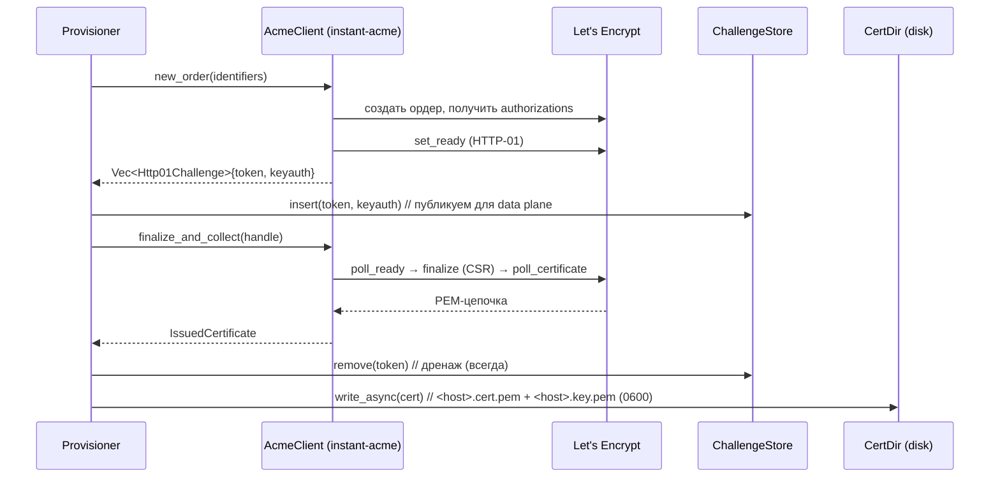

# TLS и сертификаты (ACME)

Этот документ описывает, как AEGIS обслуживает TLS на боевом data plane `aegis-pingora`: выбор сертификата по SNI, горячий reload сертификатов с диска, mTLS-аутентификацию клиента и встроенный ACME/Let's Encrypt-клиент для авто-выпуска и авто-обновления. Все утверждения опираются на исходный код: [src/proxy/pingora_tls.rs](../../src/proxy/pingora_tls.rs), [src/tls_sni.rs](../../src/tls_sni.rs), [src/acme.rs](../../src/acme.rs), [src/acme_instant.rs](../../src/acme_instant.rs), а также на оркестрацию в [src/bin/aegis-pingora.rs](../../src/bin/aegis-pingora.rs) и admin-эндпойнты в [src/proxy/pingora_admin.rs](../../src/proxy/pingora_admin.rs).

> **Где какой код работает.** Боевой TLS-стек живёт в `aegis-pingora` поверх OpenSSL (feature `pingora`). Именно он реализует выбор сертификата по SNI, mTLS, JA3/JA4-снятие отпечатков на handshake и горячий reload — см. [src/proxy/pingora_tls.rs](../../src/proxy/pingora_tls.rs). Legacy-гипер-бинарь `aegis` использует rustls и отдельный per-SNI resolver [src/tls_sni.rs](../../src/tls_sni.rs) — он проще (без ACME-резолвера путей, без mtime-поллера, без mTLS-trust-store), и в production-конфигурации не применяется. Подробнее о бинарях см. [Архитектура](./02-architecture.md) и [Протоколы и слушатели](./07-protocols.md).

---

## 1. Конфигурация TLS-листенера

TLS настраивается блоком `TlsConfig` (см. [src/config.rs](../../src/config.rs):259). Поля:

| Поле | Тип | Назначение |
|---|---|---|
| `enabled` | bool | Включить TLS-листенер. |
| `listen` | string | Адрес TLS-листенера (например, `0.0.0.0:443`). |
| `cert_path` | string | Путь к PEM-цепочке **default**-сертификата (fallback при отсутствии совпадения по SNI). |
| `key_path` | string | Путь к приватному ключу default-сертификата. |
| `h3_enabled` | bool (default: false) | Включить HTTP/3 sidecar. См. [Протоколы и слушатели](./07-protocols.md). |
| `h3_listen` | Option\<string\> | Отдельный адрес для QUIC/h3. |
| `sni` | `Vec<SniEntry>` (default: пусто) | Per-host переопределения сертификата. |
| `ja3_deny_hashes` | `Vec<String>` (default: пусто) | JA3 MD5-хэши для отклонения на handshake. См. [TLS-фингерпринтинг](./11-tls-fingerprinting.md). |
| `ja4_deny_prefixes` | `Vec<String>` (default: пусто) | JA4-префиксы (`starts_with`) для отклонения на handshake. |
| `mtls` | `MtlsConfig` (default: выключено) | Аутентификация клиента по сертификату (см. §6). |

`SniEntry` ([src/config.rs](../../src/config.rs):322) — это тройка `{ host, cert_path, key_path }`. `cert_path`/`key_path` верхнего уровня — default-пара, отдаваемая, когда ни одна SNI-запись не совпала.

> ⚠️ TLS-листенер требует **обе** половины — default-сертификат обязателен. Без fallback handshake без SNI (или с неизвестным SNI) завершится ошибкой. Это явно зафиксировано в doc-комментарии к `CertStore` ([src/proxy/pingora_tls.rs](../../src/proxy/pingora_tls.rs):100-109).

---

## 2. Выбор сертификата по SNI

### Боевой путь (`aegis-pingora`, OpenSSL)

Выбор сертификата происходит **в середине handshake**, в callback `certificate_callback` трейта `TlsAccept` ([src/proxy/pingora_tls.rs](../../src/proxy/pingora_tls.rs):866). OpenSSL вызывает его после разбора ClientHello, но до отправки ServerHello — это правильный момент, чтобы подставить нужный сертификат:

```rust
let sni = ssl.servername(NameType::HOST_NAME).map(|s| s.to_string());
self.install(ssl, sni.as_deref());
```

`CertStore::pick` ([src/proxy/pingora_tls.rs](../../src/proxy/pingora_tls.rs):382) выбирает пару:

- SNI присутствует и есть запись в `by_sni` (ключ — **lowercased** host) → её пара;
- SNI отсутствует или не совпал → **default**-пара.

Сопоставление **регистронезависимое**: и при загрузке (`e.host.to_ascii_lowercase()`), и при выборе (`host.to_ascii_lowercase()`). Это покрыто тестом `build_loads_default_and_per_sni` ([src/proxy/pingora_tls.rs](../../src/proxy/pingora_tls.rs):1190), где `B.EXAMPLE.COM` корректно матчится запросом `B.example.COM`.

`install` ([src/proxy/pingora_tls.rs](../../src/proxy/pingora_tls.rs):513) ставит на SSL:

1. `set_certificate(leaf)` — лист-сертификат (первый в PEM);
2. `set_private_key(key)`;
3. `add_chain_cert(...)` для каждого промежуточного сертификата цепочки.

Ошибки установки логируются и игнорируются — это безопасный режим отказа: SSL остаётся без сертификата и handshake естественным образом обрывается, а не отдаёт чужой ключ.

Пары предварительно распарсены в память (`CertPair` хранит `X509` + `Vec<X509>` цепочки + `PKey`), чтобы не перечитывать и не переразбирать PEM на каждом соединении — handshake горячий ([src/proxy/pingora_tls.rs](../../src/proxy/pingora_tls.rs):51-58).

### Legacy-путь (`aegis`, rustls)

В гипер-бинаре используется `SniResolver` ([src/tls_sni.rs](../../src/tls_sni.rs)), реализующий rustls-трейт `ResolvesServerCert`. Логика та же: `HashMap<host_lowercase → CertifiedKey>` + `default`; неизвестный SNI и отсутствие SNI падают в default ([src/tls_sni.rs](../../src/tls_sni.rs):52-63). Ключи читаются как PKCS#8 (`rustls_pemfile::pkcs8_private_keys`); пустой список ключей — ошибка ([src/tls_sni.rs](../../src/tls_sni.rs):78).

---

## 3. Снятие отпечатков на handshake (JA3 / JA4)

Хотя это тема [TLS-фингерпринтинга](./11-tls-fingerprinting.md), отпечатки снимаются именно здесь — на TLS-уровне, и тесно связаны с выбором сертификата.

JA3/JA4 вычисляются в **ClientHello callback** (`capture_client_hello`, [src/proxy/pingora_tls.rs](../../src/proxy/pingora_tls.rs):745), который регистрируется через `set_client_hello_callback` в [src/bin/aegis-pingora.rs](../../src/bin/aegis-pingora.rs):1922. Это единственная стадия handshake, где accessor'ы `SSL_client_hello_*` возвращают предложенные клиентом ciphers и extensions.

> 🟡 Исторически (V50/V51) расчёт делался в `certificate_callback` (OpenSSL `cert_cb`), который срабатывает **позже**, когда accessor'ы уже пусты — это давало вырожденный отпечаток `t12i000000_e3b0c44298fc`, одинаковый для всех клиентов. V246 перенёс расчёт в ClientHello callback; код в `certificate_callback` оставлен лишь как защитный fallback ([src/proxy/pingora_tls.rs](../../src/proxy/pingora_tls.rs):873-886).

Отпечатки складываются в SSL `ex_data` (`TlsFingerprints`, [src/proxy/pingora_tls.rs](../../src/proxy/pingora_tls.rs):538), затем `handshake_complete_callback` ([src/proxy/pingora_tls.rs](../../src/proxy/pingora_tls.rs):1025) публикует их в `SslDigest.extension`, а hot-path читает обратно через `read_fingerprints` ([src/proxy/pingora_tls.rs](../../src/proxy/pingora_tls.rs):1091) в `ctx.ja3`/`ctx.ja4`.

> 🟠 **LEVER 1 gate.** Расчёт JA3 (MD5) + JA4 (2×SHA-256) + ~18-22 heap-аллокаций на полный handshake можно отключить (`AEGIS_TLS_FINGERPRINT=0`), но **только** если все потребители отпечатков подтверждённо неактивны (нет `ja3_deny_hashes`/`ja4_deny_prefixes`, выключен Defence Arsenal, нет JA4-reputation, нет WAF-правил с `field:"ja3"|"ja4"`). По умолчанию gate **включён** ([src/proxy/pingora_tls.rs](../../src/proxy/pingora_tls.rs):155-156, 417). Доказательство честности: некорректный downcast в `read_fingerprints` (V245) приводил к тому, что `ctx.ja4 == None` молча на всём live-пути — см. длинный комментарий [src/proxy/pingora_tls.rs](../../src/proxy/pingora_tls.rs):1115-1134.

---

## 4. Горячий reload сертификатов

`aegis-pingora` обновляет сертификаты на лету, **без рестарта и без разрыва живых handshake**.

### Механика

- `CertStore` обёрнут в `arc_swap::ArcSwap` ([src/proxy/pingora_tls.rs](../../src/proxy/pingora_tls.rs):131). Горячий путь — один `load_full()` (≈5 нс `Arc::clone`) на `certificate_callback`.
- При загрузке снимается снимок mtime каждого отслеживаемого файла (`mtimes: Vec<(PathBuf, SystemTime)>`).
- Фоновый поллер вызывает `maybe_reload_certs` ([src/proxy/pingora_tls.rs](../../src/proxy/pingora_tls.rs):466): `stat()` тех же путей; если **любой** mtime изменился — полный пересбор `CertStore::load` и атомарный `store.store(Arc::new(...))`.
- Поллер работает за **30-секундным интервалом** (см. `proxy/pingora_background.rs`, ссылка в [src/proxy/pingora_tls.rs](../../src/proxy/pingora_tls.rs):450-453).

Reload устойчив к ошибкам: если пересбор провалился (например, наполовину записанный файл), старый `CertStore` остаётся в строю и TLS продолжает работать — `tracing::warn!` + возврат 0 ([src/proxy/pingora_tls.rs](../../src/proxy/pingora_tls.rs):499-505). Это покрыто тестом `cert_reload_picks_up_disk_change` ([src/proxy/pingora_tls.rs](../../src/proxy/pingora_tls.rs):1242).

> 🟡 Reload управляется **изменением mtime**, а не inotify. Задержка между записью нового файла и его подхватом — до 30 секунд. Если ФС имеет грубое разрешение mtime (1 с), запись в ту же секунду может быть не замечена до следующего тика.

### ACME cert-path резолвер

При загрузке SNI-записи `CertStore::load` ([src/proxy/pingora_tls.rs](../../src/proxy/pingora_tls.rs):234) не использует пути из конфига вслепую — он сначала ищет авто-выпущенные/operator-загруженные сертификаты по конвенции именования. Порядок приоритета (V238, [src/proxy/pingora_tls.rs](../../src/proxy/pingora_tls.rs):274-337):

1. **`/var/lib/aegis/certs/<host>.cert.pem` + `<host>.key.pem`** — авто-выпуск через панель/ACME. Демон под `ProtectSystem=strict` не может писать в `/etc/aegis`, поэтому ACME-provisioner кладёт PEM сюда (в `ReadWritePaths`).
2. **`/var/lib/aegis/certs/<host>.crt` + `<host>.key`** — nginx-style имена в том же корне.
3. **`/etc/aegis/certs/<host>.cert.pem` (+ `.crt`)** — operator-загруженные (read-only для демона).
4. **Пути из конфига** (`SniEntry.cert_path`/`key_path`) — fallback, сохраняет совместимость с существующими деплоями.

`<host>` санитизируется: всё, кроме `[A-Za-z0-9.-]`, заменяется на `_` ([src/proxy/pingora_tls.rs](../../src/proxy/pingora_tls.rs):263-273) — та же конвенция, что в `CertDir::paths_for`.

Важно: даже когда резолвер откатился к конфиг-путям, ACME-кандидаты **всё равно добавляются в список mtime** ([src/proxy/pingora_tls.rs](../../src/proxy/pingora_tls.rs):360-372). Поэтому первый же ACME-выпуск (mtime скакнул с `UNIX_EPOCH` на реальное значение) детектируется ближайшим тиком `maybe_reload_certs`, и новый сертификат начинает отдаваться без ручного reload.

---

## 5. ACME / Let's Encrypt: авто-выпуск и авто-обновление

AEGIS содержит встроенный ACME-клиент: HTTP-01 challenge-responder на data plane плюс оркестратор выпуска/обновления. Протокол абстрагирован трейтом, конкретная реализация — на `instant-acme`.

### 5.1. Архитектура двух слоёв

| Слой | Где | Ответственность |
|---|---|---|
| `AcmeClient` (трейт) | [src/acme.rs](../../src/acme.rs):207 | Абстракция ACME-протокола: `new_order`, `finalize_and_collect`, `days_until_expiry`. Держит ядро свободным от тяжёлых крипто-зависимостей. |
| `InstantAcmeClient` | [src/acme_instant.rs](../../src/acme_instant.rs):74 | Конкретная реализация на `instant-acme` 0.8.x (ECDSA P-256 аккаунт, ECDSA-ключ сертификата + CSR через feature `rcgen`). |
| `Provisioner` | [src/acme.rs](../../src/acme.rs):343 | Оркестратор одного цикла выпуск/обновление: публикует challenges → финализирует → пишет на диск → дренирует challenge-store. |
| `ChallengeStore` | [src/acme.rs](../../src/acme.rs):49 | Карта `token → keyauth`, читаемая HTTP-01 handler'ом на каждом запросе. |
| `CertDir` | [src/acme.rs](../../src/acme.rs):260 | Раскладка PEM на диске + tighten-perms ключа до `0600`. |

### 5.2. HTTP-01 challenge

Let's Encrypt валидирует владение доменом, делая GET на `/.well-known/acme-challenge/<token>` на порту 80. AEGIS уже занимает порт 80 (front door), поэтому внешний ACME-клиент не сможет ответить без координации — отвечает сам прокси.

На горячем пути ([src/proxy/pingora_http.rs](../../src/proxy/pingora_http.rs):2251-2257):

```rust
if path_ref.starts_with(crate::acme::HTTP01_PATH_PREFIX)
    && let Some(keyauth) = self.acme_challenges.challenge_response_for_path(path_ref)
{ /* отдать keyauth */ }
```

`challenge_response_for_path` ([src/acme.rs](../../src/acme.rs):193) безопасен для атакующего: пустые токены и токены с `/` (попытка subpath-traversal) отклоняются до lookup, без аллокаций на miss-пути, без паники. В steady state store пуст, поэтому типичный случай — hashmap miss → быстрый fall-through к обычному роутингу. Это покрыто тестами `challenge_path_matches_only_acme_prefix` и `store_method_challenge_response_for_path_matches_free_fn` (включая `../../../etc/passwd`).

> 🟠 **Cross-worker sharing (SO_REUSEPORT).** AEGIS запускает N worker-процессов, у каждого свой `DashMap`. Provisioner запускается на одном воркере, токен попадает только в его in-memory карту. GET от LE попадает в любой из N воркеров — 1/N в нужный, (N-1)/N в miss → 302 → валидация Invalid. Решение (V238): дисковый каталог токенов `/var/lib/aegis/acme/challenges/` ([src/acme.rs](../../src/acme.rs):52-65). `insert` атомарно пишет файл (tmp + rename), `remove` удаляет, `get` падает на чтение файла при memory-miss ([src/acme.rs](../../src/acme.rs):109-145). Включается через `with_disk_dir`; в бинаре — `proxy.with_acme_challenges_disk_dir(...)` ([src/bin/aegis-pingora.rs](../../src/bin/aegis-pingora.rs):1704-1709). Без него многопроцессный выпуск ненадёжен. Подробнее о воркерах — [Многопроцессность и воркеры](./06-workers.md).

После завершения ордера (успех **или** ошибка) challenge-store **всегда дренируется** ([src/acme.rs](../../src/acme.rs):391-396) — оставленные токены позволили бы пробить случайные ACME-пути и узнать keyauth. Это покрыто тестом `issue_drains_challenges_even_on_finalize_error`.

### 5.3. Цикл выпуска (`Provisioner::issue`)



Детали `InstantAcmeClient`:
- `new_order` ([src/acme_instant.rs](../../src/acme_instant.rs):237): идентификаторы → `Identifier::Dns`, собираются HTTP-01 challenges из всех `Pending`-авторизаций (уже `Valid` пропускаются), `set_ready` сообщает серверу о готовности, in-flight `Order` стэшится в `DashMap<order_url, InFlightOrder>` (обёрнут в `tokio::sync::Mutex`, т.к. `instant_acme::Order` is `!Send`).
- `finalize_and_collect` ([src/acme_instant.rs](../../src/acme_instant.rs):302): poll с `RetryPolicy` (начальная задержка 2 с, backoff ×1.5, таймаут 120 с), затем `finalize()` генерирует ECDSA-ключ + CSR, `poll_certificate` скачивает цепочку. `not_after` парсится из PEM через `x509-parser`; если не распарсилось — fallback «now + 90 дней».

### 5.4. Авто-обновление

- LE выдаёт 90-дневные сертификаты. Порог обновления — **`RENEW_AT_DAYS_REMAINING = 30`** ([src/acme.rs](../../src/acme.rs):338).
- `Provisioner::maybe_renew` ([src/acme.rs](../../src/acme.rs):360): если `days_until_expiry > 30` — пропуск (`Ok(None)`); иначе полный `issue` + `write_async`.
- `days_until_expiry` ([src/acme_instant.rs](../../src/acme_instant.rs):395) читает `<host>.cert.pem` из cert-root и считает дни до `not_after`; `None`, если файла нет.
- `next_renewal_delay` ([src/acme.rs](../../src/acme.rs):402) — чистая функция: следующее обновление в `not_after - 30 дней`; если уже наступило — `Duration::ZERO`. Покрыта тестами `next_renewal_delay_when_far_future` (90-дневный → ~60 дней) и `..._when_close_to_expiry`.

Фоновый цикл `acme_background_loop` ([src/bin/aegis-pingora.rs](../../src/bin/aegis-pingora.rs):295):
1. На старте загружает сохранённые order-state из `orders/*.json`; для каждого `issued`/`expiring` планирует обновление через `next_renewal_delay`.
2. `tokio::select!` ждёт: ближайшее запланированное обновление, **6-часовой catch-all тик** (повторная проверка всех выданных сертификатов на случай провала предыдущего обновления, [src/bin/aegis-pingora.rs](../../src/bin/aegis-pingora.rs):355), или новый `ProvisionRequest` от admin API.
3. Per-host in-flight lock (`DashMap<host, Arc<Mutex<()>>>`) предотвращает двойной ордер, когда для одного хоста одновременно срабатывают плановое обновление и ручной запрос.
4. На успех: `CertDir::write_async` пишет `<host>.cert.pem` + `<host>.key.pem`; cert-mtime поллер подхватит их в течение 30 с — явный nudge не нужен.
5. На ошибку: error пишется в order-state, лог `warn`; ретрай на следующем 6-часовом тике.

### 5.5. Раскладка на диске

`CertDir::write` / `write_async` ([src/acme.rs](../../src/acme.rs):281, 300):
- путь — по **первому (primary)** идентификатору: `<primary>.cert.pem` + `<primary>.key.pem`, имя санитизируется (`[A-Za-z0-9.-]`, остальное → `_`);
- ключ пишется **первым** и сразу `chmod 0600` (Unix), затем сертификат ([src/acme.rs](../../src/acme.rs):324-330);
- `write_async` использует `tokio::fs` и `spawn_blocking` для tighten-perms, чтобы не парковать worker-поток на flush диска во время обновления.

Корень cert-каталога: `AEGIS_ACME_CERT_DIR` (default `/var/lib/aegis/certs`, [src/bin/aegis-pingora.rs](../../src/bin/aegis-pingora.rs):2102-2103). Состояние ACME: `AEGIS_ACME_STATE_DIR` (default `/var/lib/aegis/acme`, [src/bin/aegis-pingora.rs](../../src/bin/aegis-pingora.rs):1705).

Структура `AEGIS_ACME_STATE_DIR`:

```
/var/lib/aegis/acme/
├── config.json                  # email, use_production, accepted_tos_at
├── accounts/
│   ├── staging/account.json     # ключ аккаунта LE staging (0600)
│   └── production/account.json  # ключ аккаунта LE production (0600)
├── challenges/                  # токены HTTP-01 (cross-worker)
└── orders/<host>.json           # per-host order-state
```

### 5.6. Аккаунт LE: staging vs production, rate limit, TOS

`InstantAcmeClient` ([src/acme_instant.rs](../../src/acme_instant.rs)) гарантирует:
- ключ аккаунта **лениво** создаётся при первом ордере и сохраняется с `O_CREAT|O_EXCL` + `chmod 0600` (`write_new_0600`, [src/acme_instant.rs](../../src/acme_instant.rs):414); если файл существует — он загружается, аккаунт **никогда** не перегенерируется (тест `write_new_0600_refuses_to_overwrite_existing_file`);
- ключи **разделены по директории**: `accounts/staging/account.json` и `accounts/production/account.json` ([src/bin/aegis-pingora.rs](../../src/bin/aegis-pingora.rs):2089-2096) — staging-ключ никогда не используется против production;
- email **опционален** (RFC 8555 §7.3): пустой email → contact-less аккаунт, выпуск работает, но LE не присылает напоминания об истечении ([src/acme_instant.rs](../../src/acme_instant.rs):153-191);
- `terms_of_service_agreed: true` выставляется при регистрации аккаунта ([src/acme_instant.rs](../../src/acme_instant.rs):175).

Directory URL:
- staging: `instant_acme::LetsEncrypt::Staging.url()` ([src/acme_instant.rs](../../src/acme_instant.rs):48);
- production: `...::Production.url()` ([src/acme_instant.rs](../../src/acme_instant.rs):54).

> 🔴 **Rate limit LE production.** По умолчанию AEGIS использует **staging** (`use_production = false`) — безопасно для dev/test. Production имеет жёсткий лимит **5 выпусков на зарегистрированный домен в неделю**. Переход на production требует **явного opt-in** через admin API c принятием TOS (см. ниже). При повторных выпусках staging-сертификаты **не валидны для браузеров** (LE staging — это тестовый CA).

Поведение `AcmeConfig` ([src/bin/aegis-pingora.rs](../../src/bin/aegis-pingora.rs):68): `use_production: true` **требует** установленного `accepted_tos_at`. Это инварианта, проверяемая на уровне `PUT /admin/api/acme/config`, а не в самом конфиге ([src/proxy/pingora_admin.rs](../../src/proxy/pingora_admin.rs):2900-2904):

> «`use_production=true requires accepted_tos_at to be set`»

Конфиг читается отказоустойчиво: отсутствующий или битый `config.json` трактуется как default (staging, без email), а не валит прокси ([src/bin/aegis-pingora.rs](../../src/bin/aegis-pingora.rs):93).

### 5.7. Admin API

ACME-эндпойнты ([src/proxy/pingora_admin.rs](../../src/proxy/pingora_admin.rs), диспетчер :4322-4353):

| Метод + путь | Роль | Назначение |
|---|---|---|
| `GET /admin/api/acme/config` | Read | Текущий email / use_production / accepted_tos_at. |
| `PUT /admin/api/acme/config` | Write | Частичное обновление. `use_production=true` без TOS → ошибка. |
| `GET /admin/api/acme/orders` | Read | Список order-state по всем хостам. |
| `GET /admin/api/acme/orders/<host>` | Read | Order-state одного хоста. |
| `POST /admin/api/acme/orders` | Write | Поставить выпуск для `{host}` в очередь. |
| `POST /admin/api/acme/orders/<host>/renew` | Write | Принудительное переиздание (игнорирует остаток валидности). |

`POST /admin/api/acme/orders` ([src/proxy/pingora_admin.rs](../../src/proxy/pingora_admin.rs):2956):
- валидирует hostname (`validate_host`);
- `503`, если ACME-клиент не сконфигурирован («set account_email via PUT /admin/api/acme/config and restart»);
- `409`, если ордер для хоста уже in-flight;
- **`429` cooldown**: после завершённого ордера повторный для того же хоста отклоняется в течение `MIN_ACME_ORDER_INTERVAL_SECS = 3600` (1 час, [src/proxy/pingora_admin.rs](../../src/proxy/pingora_admin.rs):411). Это защита от Write-роль-атакующего, который иначе мог бы сжечь LE-prod лимит (5/неделю) за секунды (V237, [src/proxy/pingora_admin.rs](../../src/proxy/pingora_admin.rs):2982-2988);
- успех → `202 {host, status:"pending"}`; выпуск идёт в фоновой задаче через тот же `ChallengeStore`, что и data plane.

> ⚠️ Изменение email через `PUT /admin/api/acme/config` требует **рестарта** для пересоздания клиента (сообщение `503` явно об этом говорит). Подробности по ролям и аутентификации — Admin API и Модель безопасности.

Пример (создать ордер для домена; токен Write-роли в заголовке):

```bash
curl -sS -X POST https://127.0.0.1:6280/admin/api/acme/orders \
  -H "Authorization: Bearer $AEGIS_ADMIN_TOKEN" \
  -H "Content-Type: application/json" \
  -d '{"host":"example.com"}'
# → 202 {"host":"example.com","status":"pending"}

# Переключить на production (требует уже принятого TOS):
curl -sS -X PUT https://127.0.0.1:6280/admin/api/acme/config \
  -H "Authorization: Bearer $AEGIS_ADMIN_TOKEN" \
  -H "Content-Type: application/json" \
  -d '{"use_production":true,"accepted_tos_at":1717804800}'
```

> Управление выпуском задумано **panel-first**: оператор инициирует ордер из админ-панели/API, ручной `systemctl`/`certbot` не нужен. См. Админ-панель.

---

## 6. mTLS (аутентификация клиента по сертификату)

mTLS настраивается блоком `MtlsConfig` ([src/config.rs](../../src/config.rs):300):

| Поле | Тип | Назначение |
|---|---|---|
| `enabled` | bool (default: false) | Главный выключатель. False → проверки нет, `mtls_fp` всегда `None`. |
| `ca_paths` | `Vec<String>` (default: пусто) | PEM-файлы CA, которым доверяем при проверке клиентских сертификатов. Несколько файлов конкатенируются в один trust store. |
| `require_cert` | bool (default: false) | True → handshake падает, если клиент не предъявил сертификат. False → «optional but verified if presented» (no-cert клиенты проходят с `mtls_fp = None`). |

Реализация — `MtlsSetup` ([src/proxy/pingora_tls.rs](../../src/proxy/pingora_tls.rs):162):
- `MtlsSetup::build` ([src/proxy/pingora_tls.rs](../../src/proxy/pingora_tls.rs):168): при `enabled=true` и **пустом** `ca_paths` — ошибка на старте («cannot verify client certs without a trust anchor»). Иначе собирает `X509Store` из всех CA-файлов;
- `MtlsSetup::apply` ([src/proxy/pingora_tls.rs](../../src/proxy/pingora_tls.rs):211): ставит cert-store на `SslAcceptorBuilder`, режим `SslVerifyMode::PEER`; при `require_cert=true` добавляет `FAIL_IF_NO_PEER_CERT` (drop неверифицированных handshake);
- применяется **один раз на старте** из `aegis-pingora.rs` ([src/bin/aegis-pingora.rs](../../src/bin/aegis-pingora.rs):1980), до того как pingora забирает worker-потоки.

mTLS-отпечаток вычисляется **после** handshake (клиентский сертификат приходит после ServerHello). `compute_mtls_fp_from_ssl` ([src/proxy/pingora_tls.rs](../../src/proxy/pingora_tls.rs):1054) экспортирует лист в DER и зовёт те же DER-хелперы из `mtls_fp`, что и гипер-путь — отпечатки **байт-идентичны** между обоими бинарями (V55-фикс устранил расхождение хэшей). Результат бэкфиллится в `TlsFingerprints.mtls` в `handshake_complete_callback` и попадает в `RequestContext.mtls_fp` для правил фильтрации.

> 🟡 Если `require_cert=false`, no-cert клиенты проходят и `mtls_fp` остаётся `None` — решение об отклонении таких соединений принимается downstream-правилами, а не TLS-слоем. Без блока `mtls` mTLS полностью выключен.

---

## 7. Оговорки честности (обязательный раздел)

1. **Бенчмарки — не full-stack.** Числа throughput из `bench/` и `aegis-distbench` мерят in-process filter relay без сетевого I/O. Реальный `aegis-pingora` под нагрузкой даёт ↓15-30% из-за I/O, syscalls, TCP/TLS handshake. Сам TLS-handshake (расчёт JA3/JA4, выбор cert, mTLS) — это per-connection стоимость, которая в синтетике вообще отсутствует. Никогда не цитируйте абсолютные RPS без пояснения. См. Бенчмаркинг.
2. **SHA/крипто per-core, без HW-ускорения в VM.** JA3 (MD5) и JA4 (2×SHA-256) на handshake в тестовой VM без SHA-NI/AES-NI идут в ×2-3 медленнее, чем на bare-metal Intel. LEVER 1 gate существует именно чтобы не платить эту цену, когда отпечатки никому не нужны.
3. **ACME ≠ полная защита от мисконфигурации.** По умолчанию используется LE **staging** — его сертификаты **не доверены браузерами**. Переход на production — явный opt-in с TOS и лимитом 5/неделю; cooldown-гейт (1 ч) и in-flight-lock защищают от случайного выжигания лимита, но не от неверно указанного домена.
4. **Reload — mtime-based, не event-driven.** Задержка подхвата нового сертификата — до 30 секунд; на ФС с грубым mtime возможны пропуски записи в ту же секунду.
5. **Что реально работает (security matrix).** Подтверждённо работают: per-SNI cert routing, горячий reload, ACME HTTP-01 выпуск/обновление, mTLS-верификация и снятие mTLS-отпечатка, JA3/JA4 на handshake. Авторитетный источник найденных проблем и статус фиксов — SECURITY-AUDIT-CONSOLIDATED-2026-06-07.md; резюме — Модель безопасности.

---

## 8. Переменные окружения (сводка)

| Переменная | Default | Назначение |
|---|---|---|
| `AEGIS_ACME_STATE_DIR` | `/var/lib/aegis/acme` | Корень состояния ACME (config.json, accounts/, challenges/, orders/). |
| `AEGIS_ACME_CERT_DIR` | `/var/lib/aegis/certs` | Корень для выпущенных `<host>.cert.pem`/`.key.pem`. |
| `AEGIS_TLS_FINGERPRINT` | (gate ON) | `0` отключает расчёт JA3/JA4 на handshake — **только** если ни один потребитель не активен. |

Сборка и systemd-юниты (`ProtectSystem=strict`, `ReadWritePaths=/var/lib/aegis`) автоматизированы в [install.sh](../../install.sh); переменные окружения — в его шапке. См. [Установка и эксплуатация](./03-installation.md).

---

## См. также

- [Протоколы и слушатели](./07-protocols.md) — TLS/HTTP3-листенеры, ALPN.
- [TLS-фингерпринтинг (JA3/JA4)](./11-tls-fingerprinting.md) — что делается с отпечатками, снятыми здесь.
- [Многопроцессность и воркеры](./06-workers.md) — почему ACME-challenges нужен дисковый каталог.
- Admin API и Админ-панель — управление ACME.
- Модель безопасности, SECURITY-AUDIT.
