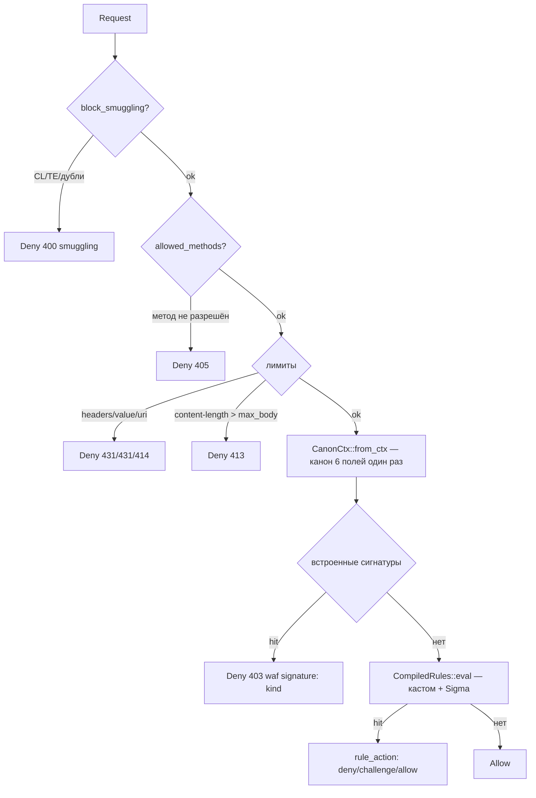

# WAF — сигнатуры, Sigma, compound-правила

WAF AEGIS — это многослойный L7-фильтр запросов: встроенный корпус сигнатур (Aho-Corasick по канонизированному тексту), компилируемый план кастомных правил с поддержкой compound-условий (`all_of`), импортированный корпус SigmaHQ и семантический SQLi-детектор. Этот документ описывает то, что **реально делает код** в `src/filters/waf.rs`, `src/sigma.rs`, `src/sql_semantic.rs`, `src/normalisation.rs`, `src/param_profile.rs`, `src/filters/sigma_overlay.rs` и `src/dsl/lower.rs` — без маркетинга.

> Связанные документы: [Конфигурация](./04-configuration.md), [Архитектура и жизненный цикл запроса](./02-architecture.md), ML и risk engine, Картография и per-domain политики, Admin API, Модель безопасности, Метрики и телеметрия.

---

## 1. Что входит в WAF и что не входит

| Подсистема | Файл | Статус | Назначение |
|---|---|---|---|
| Встроенные сигнатуры | `src/filters/waf.rs` (`BUILTIN_SIGNATURES`) | работает | литералы по категориям sqli/xss/cmdi/path_traversal/ssrf/rce/lfi/xxe/webshell |
| Канонизация | `src/filters/waf.rs` (`canon`/`canon_once`) | работает | URL-decode, HTML-числовые entity, strip SQL-комментов, lowercase, confusable-fold |
| Aho-Corasick движок | `src/filters/waf.rs` (`build_signature_automaton`) | работает | один O(n) проход по всем сигнатурам |
| Инспекция тела | `src/filters/waf.rs` (`inspect_body_with_encoding`) | работает | gzip/deflate декомпрессия + скан, fail-closed на неизвестных кодеках |
| Компилируемый план правил | `src/filters/waf.rs` (`CompiledRules`) | работает | per-field бакеты contains/equals/starts_with/ends_with + numeric fallback |
| Compound `all_of` | `src/filters/waf.rs` + `src/config.rs` | работает | AND-of-(OR) условия |
| Sigma-импортёр | `src/sigma.rs` + бинарь `aegis-sigma-import` | работает | YAML SigmaHQ → `WafRule` TOML |
| Бандл Sigma-корпуса | `rules/sigma/sigma-webserver.toml` | работает | подгружается по умолчанию (opt-out) |
| Per-rule overlay | `src/filters/sigma_overlay.rs` | работает | вкл/выкл отдельных правил из панели, cross-worker |
| Семантический SQLi | `src/sql_semantic.rs` | **частично** — см. §10 | токенайзер + распознаватель shape-паттернов; **не** включён в `WafFilter::check` |
| Parameter-profile | `src/param_profile.rs` | **частично** — см. §11 | per-endpoint обучение длины/charset/энтропии; per-process, не в WAF-вердикте |

**Честная оговорка.** Сигнатурный движок и компилируемый план — это полноценные substring/exact/prefix/suffix-матчеры по канонизированному тексту. Это **не** полный AST-разбор и **не** ML. Семантический SQLi-детектор (`src/sql_semantic.rs`) существует как самостоятельный модуль, но в основном WAF-пути (`WafFilter::check`) он не вызывается — он подключён только через `arsenal::normalisation_analyse` (`src/arsenal.rs:572`) и в тестах. Не утверждайте «WAF AEGIS делает семантический разбор SQL на каждом запросе» — на горячем пути работают именно литеральные сигнатуры + правила.

---

## 2. Жизненный цикл проверки (`WafFilter::check`)

Порядок проверок в `WafFilter::check` (`src/filters/waf.rs:2219`) фиксирован:



Ключевые детали:

- **Gate `enabled`.** С V231 `check()` **не** само-гейтится на `self.enabled`. Включение/выключение решает `FilterEngine` через `RuntimeToggles` + per-domain `domain_policy` (`src/filters/waf.rs:222-229`, комментарий в `check`). `config_enabled()` лишь возвращает значение из конфига для затравки движка.
- **Request smuggling** (`block_smuggling`, default `true`): отклоняет конфликтующие `Content-Length` (несколько разных значений → 400), множественные `Transfer-Encoding` (M5, > 1 заголовок → 400), одновременное наличие CL и `chunked` TE (400), а также неизвестные TE-токены (разрешены только `chunked|identity|compress|deflate|gzip`).
- **Method allowlist** (`allowed_methods`): сравнение в upper-case; пустой список = фильтр выключен.
- **Лимиты размера**: `max_header_count` (431), `max_header_value_bytes` (431), `max_uri_bytes` (414), объявленный `Content-Length` > `max_body_bytes` (413). Реальный размер тела перепроверяется отдельно в `inspect_body*`.
- **Канонизация один раз**: `CanonCtx::from_ctx` (`src/filters/waf.rs:1470`) канонизирует `method`, `path`, `user_agent`, `referer`, `cookie`, `host` ровно один раз и шарит результат между сигнатурным сканом и eval'ом правил (V230). До V230 каждое поле канонизировалось дважды.
- **Сигнатурный скан** идёт по полям в порядке `method → path → user_agent → referer → cookie`; первый хит → `Deny 403 "waf signature: {kind}"`.
- **Тело запроса** проверяется **не** в `check`, а отдельно после полного сбора тела — через `inspect_body_with_encoding` (см. §6). `check` инспектирует только URI/UA/несколько заголовков.

---

## 3. Встроенные сигнатуры

Корпус — это срез `BUILTIN_SIGNATURES: &[(&str, &str)]` (`src/filters/waf.rs:679`): пара `(паттерн, категория)`. Все паттерны записаны в **пост-канон форме** (lowercase, URL-декодировано, развёрнутые evasion-обёртки) — то есть только в нижнем регистре.

### Категории

| Категория | Примеры паттернов | Заметки |
|---|---|---|
| `webshell` | `eval($_post`, `assert($_get`, `eval(base64_decode`, `eval(gzinflate`, `preg_replace("/.*/e"`, `/c99.php`, `/r57.php`, `/wso.php`, `/b374k`, `/weevely`, `/p0wny` | перечислены ПЕРВЫМИ намеренно: при `LeftmostFirst` они выигрывают тай у более широкого `eval(` (xss), когда совпадение начинается с того же смещения |
| `sqli` | `union select`, `union all select`, ` or 1=1`, `' or '1'='1`, `sleep(`, `pg_sleep(`, `waitfor delay`, `benchmark(`, `drop table`, `load_file(`, `into outfile`, `information_schema`, `/*!`, `;--`, `extractvalue(`, `updatexml(` | литералы по канонизированному тексту |
| `xss` | `<script`, `</script`, `javascript:`, `data:text/html`, `vbscript:`, `onerror=`, `onload=`, `<iframe`, `<svg/onload`, `srcdoc=`, `eval(`, `settimeout(` | |
| `cmdi` | `;cat `, `;wget `, `;curl `, `;nc `, `\|bash`, `\|sh`, `\|/bin/`, `&& rm -rf`, `/bin/sh`, `$(curl`, `` `curl ``, `%0acat `, `;python -c` | |
| `path_traversal` | `../../`, `..\\..\\`, `/etc/passwd`, `/etc/shadow`, `/proc/self/`, `c:\\windows\\`, `..%2f`, `..%5c` | |
| `ssrf` | `http://169.254.169.254`, `http://metadata.google`, `http://localhost:`, `http://127.0.0.1`, `http://0.0.0.0`, `file://`, `gopher://`, `dict://`, `ldap://`, `jar:` | |
| `rce` | `${jndi:`, `jndi:ldap`, `jndi:rmi`, `jndi:dns`, `jndi:nis`, `jndi:iiop` | Log4Shell / CVE-2021-44228 и варианты |
| `lfi` | `php://`, `php://filter`, `phar://`, `expect://`, `zip://`, `data://text/` | PHP-обёртки; `data://text/` уточнён, чтобы не сталкиваться с xss `data:text/html` |
| `xxe` | `<!doctype`, `<!entity` | inline DTD / billion-laughs вектор |

> Имена категорий должны точно совпадать со значениями `disable_signatures` (см. §8). Комментарий в `config.rs` упоминает только `sqli/xss/cmdi` как «valid values», но фактически в коде (`match_signature_canon`) отключается **любая** категория из набора выше — `disabled.contains(cat)` работает по строковому имени категории.

### Семантика матчинга

Автомат строится `LeftmostFirst`, `ascii_case_insensitive(false)` (вход уже в нижнем регистре), DFA-kind выбирается авто-селектором (`build_signature_automaton`, `src/filters/waf.rs:867`). На горячем пути `match_signature_canon` (`src/filters/waf.rs:355`):

1. `find()` — один O(n) проход, возвращает самое левое совпадение (без аллокаций итератора).
2. Если категория этого совпадения **не** отключена → возврат категории.
3. Если она отключена в конфиге → fallback на `find_iter`, чтобы отключённая категория не маскировала реальную сигнатуру за ней.

Публичная обёртка `signature_category(data)` (`src/filters/waf.rs:344`) используется бенчмарком сравнения с nginx, чтобы показать, какие payload'ы AEGIS блокирует, а голый nginx — пропускает.

---

## 4. Каноникализация / нормализация

WAF матчит сигнатуры по **канонизированному** тексту. Канонизация в `waf.rs` (`canon`/`canon_once`) — это отдельная от модуля `src/normalisation.rs` реализация (см. оговорку ниже).

### `canon` (`src/filters/waf.rs:990`)

- **Fast-path**: `is_already_canon(v)` — если строка уже чистый ASCII без `%`, `+`, `\`, backtick, NUL, без uppercase, без двойных пробелов и без `/*`, `*/`, `&#` — возвращается `Cow::Borrowed` без аллокаций (горячий путь для легитимного трафика).
- **Unicode confusable-fold** (SECURITY H4): если вход не-ASCII, `fold_unicode_confusables` сворачивает full-width блок U+FF01..U+FF5E → ASCII (offset 0xFEE0) и таблицу confusable-символов (`‹›＜＞`→`<>`, `'"`-варианты, `（）；：｜！＆＝`). Это защищает от обхода `＜script＞` / `‹script›`.
- **Multi-pass**: `canon_once` гоняется до `MAX_PASSES = 4` раз, пока вывод не стабилизируется — побеждает двойное/тройное кодирование (`%2527` → `%27` → `'`).

### `canon_once` (`src/filters/waf.rs:1181`) — шаги

1. **URL-decode** (`urlencoding::decode`, propagates borrow).
2. **HTML числовые entity** (`decode_html_numeric_entities`): `&#NN;` (dec) и `&#xHH;` (hex). Именованные entity (`&lt;`) **не** декодируются намеренно (sqlmap `htmlencode` tamper эмитит только числовую форму; декод именованных расширил бы attack surface).
3. **Strip SQL line comments** (`strip_sql_line_comments`): `-- <text>\n` и `# <text>\n` → один пробел (sqlmap `space2dash` / `space2hash`). Консервативно: `--` требует за собой пробел/таб/`+`; `#` HTML-entity `&#` не трогается.
4. **Lowercase** (только при наличии uppercase).
5. **Точечные подстановки** (один проход по байтам, V233 — целиком по `&[u8]` во избежание паники на не-char-boundary): `/`/`\x2f`/`%2f` → `/`, `%5c` → `\`, `/*!50000union*/` → ` union ` (versioned comment с сохранением внутреннего содержимого), любой `/* ... */` → пробел (sqlmap `space2comment`), `+` → пробел, tab/CR/LF → пробел, backtick дропается (MySQL identifier-wrap), NUL дропается (`appendnullbyte`).
6. **Collapse whitespace runs** → один пробел.

SIMD-ускорение (V230): триггеры evasion (`/*`, `*/`, `&#`, `--`, `%2f`, `%5c`, `/`, `\x2f`) проверяются через кэшированные `memchr::memmem::Finder` (NEON/SSE4.2/AVX2 prefilter), что на payload'ах > 32 байт в 3–10× быстрее `str::contains` (`evasion_finders`, `src/filters/waf.rs:1151`).

> **Оговорка про два модуля нормализации.** В `waf.rs` confusable/NFKC-фолд **инлайнится** (`fold_unicode_confusables`), а не переиспользует `src/normalisation.rs`. Причина прямо в коде (`src/filters/waf.rs:1004-1013`): публичная точка `normalisation::normalise()` бандлит *деструктивный* percent-decode, который мояибейкит уже-UTF-8 вход, а helper-функции (`unicode_nfkc`, `confusable_fold`) приватные. Модуль `src/normalisation.rs` (V179, SafeLine-style) с его стадиями (`UrlDecode`, `HtmlEntityDecode`, `UnicodeNfkc`, `ConfusableFold`, `LowercaseAscii`, `StripNullBytes`) используется семантическим SQLi-детектором при `normalise_first=true` и аудитом цепочки трансформаций, **не** основным сигнатурным сканом.

---

## 5. Aho-Corasick: встроенные сигнатуры и компилируемый план

AC используется в двух местах:

1. **Один автомат над всем встроенным корпусом** (`sig_automaton` + параллельный `pat_categories`). Один проход на запрос вместо ~75 последовательных `s.contains(p)`.
2. **Per-field автоматы в компилируемом плане** кастомных правил (`CompiledRules`, см. §7) — отдельный AC на каждое поле для объединённого набора `contains`/`regex`.

`MatchKind::LeftmostFirst` во всех случаях: среди перекрывающихся совпадений побеждает паттерн, зарегистрированный раньше (т.е. самое раннее правило / самая ранняя сигнатура).

---

## 6. Инспекция тела (gzip/deflate)

Тело инспектируется **после** полного сбора (ловит chunked-загрузки, где клиент соврал про `content-length`). Точка входа — `inspect_body_with_encoding(body, content_encoding)` (`src/filters/waf.rs:497`); обёртка `inspect_body(body)` (`src/filters/waf.rs:466`) трактует тело как identity (для редких call-site без доступа к заголовку).

Логика (SECURITY C4):

| Условие | Действие |
|---|---|
| `!enabled` | `None` (пропуск) |
| `body.len() > max_body_bytes` | `Deny 413 "waf body too large"` |
| `Content-Encoding` отсутствует / `identity` | скан как есть |
| `gzip` / `x-gzip` / `deflate` | декомпрессия (bounded) → скан |
| `br`, `compress`, `zstd`, неизвестное | **FAIL CLOSED** → `Deny 415` |
| Несколько non-identity кодеков (`gzip, gzip`) | `Deny 415` (smuggling/evasion вектор) |
| Декомпрессия превысила границу или сломана | `Deny 400` |

**Декомпрессия с границей** (`decompress_bounded`, `src/filters/waf.rs:609`): потолок выхода = `min(max_body_bytes, ratio × input)`, где `ratio = max_decompress_ratio.max(1)`. Читается `cap + 1` байт, чтобы детектировать переполнение детерминированно — защита от decompression-bomb. `deflate` принимает и zlib-обёрнутый (RFC 1950 `ZlibDecoder`), и сырой DEFLATE (fallback `DeflateDecoder`).

**Скан декодированного тела** (V233-фиксы):
- Сканируется **всё** принятое тело (BUG 2: раньше резалось на 256 KiB, и байты после смещения 256 KiB форвардились на upstream **без скана** — байпас WAF). Теперь предел = `max_body_bytes`.
- Используется `String::from_utf8_lossy` (BUG 3: раньше `from_utf8` молча пропускал весь скан на не-UTF-8/частично-UTF-8 теле). Бинарные/частичные тела теперь сканируются с подстановкой U+FFFD.

Хит сигнатуры в теле → `Deny 403 "waf signature in body: {kind}"`.

> Для корректной защиты тела вызывающий код **обязан** маршрутизировать через `inspect_body_with_encoding`, передавая заголовок `Content-Encoding`; голый `inspect_body` не декомпрессирует.

---

## 7. Компилируемый план кастомных правил (`CompiledRules`)

Вместо «N правил × `String::contains`» на каждый запрос план (V95) компилируется один раз при загрузке/reload (`CompiledRules::build_with_overlay`, `src/filters/waf.rs:1924`) и атомарно свапается через `ArcSwap`. Раскладка:

| Бакет | Тип | Семантика |
|---|---|---|
| `contains` (+`regex`) | per-field `AhoCorasick` (`FieldAutomaton`) | substring; `regex` **деградирует до substring** (историческое поведение) |
| `equals` | per-field `HashMap<value, rule_idx>` | точное совпадение, O(1); first-write wins |
| `starts_with` | `PrefixMatcher` (anchored AC или trivial Vec для ≤1 префикса) | префикс, O(L_max_prefix) |
| `ends_with` | `SuffixMatcher` (256 бакетов по последнему байту) | суффикс; вход выбирает один бакет по терминальному байту |
| numeric / неизвестные ops | `fallback: Vec<rule_idx>` | `gt`/`lt`/`ge`/`le` через `cmp_numeric`; остальное игнорируется |

**Op-ы правил** (`WafRule.op`): `contains`, `regex` (→substring), `equals`, `starts_with`, `ends_with`, `gt`, `lt`, `ge`, `le`. Любой другой op попадает в fallback и фактически не матчится для строк.

**Поля правил** (`WafRule.field`), резолвятся в `val_with_canon` (`src/filters/waf.rs:1513`):

| field | Источник |
|---|---|
| `path` | канон URI (включая query-часть) |
| `query` | часть после `?`, канонизирована |
| `uri_length` | `ctx.path.len()` как строка |
| `method` | канон-метод (lowercase) |
| `user_agent` | канон UA |
| `content_length` | заголовок `content-length` (или `"0"`) |
| `host` | `ctx.host` (НЕ заголовок — proxy резолвит routing-host) |
| `ja3`, `ja4`, `ja4h`, `ja4t`, `ja4l`, `h2fp`, `h3fp`, `mtls_fp` | фингерпринты соединения (пусто, если не захвачены) |
| `client_ip` | строковый IP |
| `header:<name>` | значение заголовка, канонизировано (`header:referer`, `header:cookie` пре-канонизированы) |
| `cookie:<name>` | значение конкретной cookie (через `extract_cookie`) |

**Точность eval** (`CompiledRules::eval`, `src/filters/waf.rs:2057`): возвращается индекс **первого** совпавшего правила в порядке объявления (как у до-V95 последовательного цикла). Per-field bitmask `field_kinds` (`FIELD_KIND_CONTAINS/EQUALS/STARTS/ENDS`) пропускает пустые probe'ы — большинство production-наборов используют 1–2 op'а на поле. Значения полей мемоизируются per-request (`cache: FxHashMap<&str, Cow>`), чтобы `canon` каждого поля выполнялся максимум один раз.

### Compound `all_of` (AND-of-OR)

`WafRule.all_of: Vec<WafAndGroup>` (`src/config.rs:779-823`). `WafAndGroup { field, op, any_of: Vec<String> }`.

Правило срабатывает, только когда **PRIMARY** `{field, op, value}` матчится **И** каждая группа `all_of` матчится (группа = OR по `any_of`). Пустой `all_of` (legacy) → правило обычное single-condition, байт-идентичное прежнему поведению.

Проверка `all_of` (`all_of_matches`/`group_matches`, `src/filters/waf.rs:1883`) запускается **только после** primary-хита (редко на нормальном трафике, off the hot path). Поддерживаемые в группах op'ы (`op_matches`, `src/filters/waf.rs:1625`): `contains`, `regex` (→contains), `equals`, `starts_with`, `ends_with`. Любой другой op → группа fail-closed (compound не срабатывает).

Важный нюанс корректности (`eval`, `needs_rescan`): автомат отдаёт только одно самое левое совпадение на бакет. Если у этого кандидата непустой `all_of`, который **не** прошёл, движок ставит флаг и делает per-field пересканирование исходного `rules`, чтобы провалившийся compound не замаскировал более позднее матчащееся правило. Legacy-наборы (без compound) этот путь не задевают — fast-path остаётся байт-идентичным.

### Действие при хите (`rule_action`, `src/filters/waf.rs:383`)

`WafRule.action` + `WafRule.mode` определяют исход (см. §9):

| `action` | `mode = enforce` | `mode = shadow`/`log` | `mode = disabled` |
|---|---|---|---|
| `deny` (или любое не-`challenge`) | `Deny 403 "waf rule <id> deny"` | `Allow` (+ счётчик + debug-лог) | не компилируется вообще |
| `challenge` | `Challenge { level: Captcha }` | `Allow` (+ счётчик) | не компилируется |

`reason` санитизируется (`\r`/`\n` → `_`). Каждый хит инкрементит `shadow_observed` (Prometheus `aegis_waf_shadow_observed`), независимо от режима.

### Hot-reload

`maybe_reload_rules` (`src/filters/waf.rs:292`) — фоновый mtime-watcher: при изменении любого файла из `rule_files` **или** изменении overlay-файла (`sigma_overlay.refresh()`) весь набор перекомпилируется и атомарно свапается через `ArcSwap` (читатели видят либо старый, либо новый набор — без torn-состояний). `recompile_now` (`src/filters/waf.rs:245`) форсит немедленную пересборку после toggle в панели на текущем воркере; другие воркеры подхватят через mtime overlay-файла.

---

## 8. `disable_signatures`

`WafConfig.disable_signatures: Vec<String>` (`src/config.rs:840`). Имена приводятся к lower-case при загрузке (`src/filters/waf.rs:178-182`). В скане отключённая категория не маскирует более глубокую сигнатуру (fallback на `find_iter`).

```toml
[filters.waf]
# Отключить категории встроенных сигнатур, дающие FP в этом окружении.
disable_signatures = ["xss", "lfi"]
```

> Влияет **только** на встроенный корпус `BUILTIN_SIGNATURES`. Кастомные правила и Sigma-корпус отключаются иначе: per-rule overlay (§9) или `mode = "disabled"` / удаление из файла.

---

## 9. Режимы: enforce / shadow / log / disabled

`WafRule.mode` (`src/config.rs:806-814`), парсинг `rule_mode_of` (`src/filters/waf.rs:95`):

| Значение конфига | `RuleMode` | Поведение |
|---|---|---|
| `enforce` (или отсутствует) | `Enforce` | применяет `action` (deny/challenge) |
| `shadow` | `Shadow` | матч считается в метрики + debug-лог, запрос не затрагивается |
| `log` | `Log` | то же, что shadow (отдельный вариант для ясности в конфиге) |
| `disabled` / `off` | `Disabled` | правило не компилируется (нулевая стоимость на hot path) |

**Рекомендуемый workflow**: новое правило заливают в `shadow`, неделю смотрят `aegis_waf_shadow_observed` и debug-лог `target: "aegis::waf::shadow"`, затем переключают на `enforce`.

`severity` (`critical`/`high`/`medium`/`low`, default `medium`, `parse_severity` `src/filters/waf.rs:104`) не меняет блокировку, но кормит risk engine (`rule_signal` → `WafSignal`, `src/filters/waf.rs:432`) как градуированный вклад. См. ML и risk engine.

### Per-rule overlay (вкл/выкл из панели)

`src/filters/sigma_overlay.rs` (V237) — deny-list файл (default `/var/lib/aegis/sigma-overlay.json`, переопределяется `AEGIS_SIGMA_OVERLAY`). Хранит только **отключённые** ID правил; свежая установка ничего не отключает и файл не создаётся, пока оператор не выключит правило.

- Атомарная запись (tmp + rename), сортировка ID для diff-friendly вывода.
- mtime-поллинг: `WafFilter.maybe_reload` стейтит файл на том же rule-reload-поле; toggle на любом воркере подхватывается остальными.
- Отключённое правило **выкидывается на этапе компиляции** (`build_with_overlay` пропускает `overlay_disabled.contains(&r.id)`), т.е. как `mode = "disabled"` — ноль стоимости на запрос.
- API: `set_enabled(rule_id, enabled)`, `disabled_ids()`, `is_disabled(id)`. Admin-панель использует тот же `Arc`, что и compile-путь, поэтому toggle виден следующему `recompile_now()`.

---

## 10. Sigma-корпус и импортёр

`src/sigma.rs` (V196) парсит YAML SigmaHQ и эмитит `WafRule`. CLI-бинарь `aegis-sigma-import` рекурсивно обходит каталог `*.yml`/`*.yaml` и пишет консолидированный TOML, готовый для `waf.rule_files`.

### Что импортируется

Только webserver-правила (`is_webserver_rule`, `src/sigma.rs:177`): `logsource.category: webserver`/`web`, либо `product: apache | nginx | iis | haproxy | caddy`. Endpoint/sysmon/windows-eventlog/linux-auditd правила пропускаются.

**Маппинг полей** (`map_field`, `src/sigma.rs:499`):

| Sigma | Aegis `WafRule.field` |
|---|---|
| `c-uri`, `cs-uri`, `cs-uri-stem`, `uri`, `url`, `request_uri` | `path` |
| `cs-uri-query`, `c-uri-query`, `query`, `query_string` | `query` |
| `cs-method`, `method` | `method` |
| `c-useragent`, `cs-user-agent`, `cs(User-Agent)` | `user_agent` |
| `cs(Host)`, `cs-host`, `vhost` | `host` |
| `cs(Referer)` | `header:referer` |
| `cs(Cookie)` | `header:cookie` |
| `cs(X-Forwarded-For)` | `header:x-forwarded-for` |
| общий `cs(Some-Header)` | `header:some-header` |
| `c-ip`, `src_ip`, `client_ip` | `client_ip` |

**Маппинг модификаторов** (Sigma `field\|modifier` → `op`): нет → `equals`; `contains` → `contains`; `startswith` → `starts_with`; `endswith` → `ends_with`; `re`/`regex` → `regex`. Мета-модификаторы (`all`, `any`, `ignorecase`, `base64`, `windash`, `utf16*` и др.) **игнорируются** (best-effort); неизвестный модификатор → ошибка конвертации. Сложенные цепочки (`cs-uri|contains|all`) сводятся к базовому op.

**Маппинг уровня** (`level_to_aegis`, `src/sigma.rs:563`):

| Sigma `level` | severity | action | mode |
|---|---|---|---|
| `critical` | critical | `block` | enforce |
| `high` | high | `block` | enforce |
| `medium` | medium | `challenge` | enforce |
| `low` / `informational` | low | `log` | **shadow** |
| отсутствует | medium | `challenge` | enforce |

Каждое правило несёт до 8 тегов Sigma (`attack.t1190`, `cve.*`), которые попадают в `SecurityEvent.tags`. `tag_map` связывает Sigma-id → title.

### Compound-эмиссия (V197) — почему это важно

Историческая ошибка (до V197): селект-блок Sigma **расплющивался** в независимые single-condition правила с одним id. Но Sigma `selection` — это **AND** по ключам полей. Расплющивание `c-uri|contains: /x AND cs-method: POST` в два OR'нутых правила означало, что голое `method == POST` блокировало **весь** POST-трафик (FP-шторм, который ломал боевой сайт). Весь бандл пришлось отключить.

Теперь (`convert`, `src/sigma.rs:189`) эмитятся **compound**-правила:

1. Каждый ключ `field[|modifier]` собирается в группу `(aegis_field, op, [values])` (список значений = OR-набор).
2. Выбирается **селективный** primary, по приоритету: `query` (0) → `uri`/`path` (1) → `user_agent` (2) → прочее (3). `method` и `host` **никогда** не primary (`primary_selectivity`/`select_primary`, `src/sigma.rs:375`). Если в блоке нет селективного поля (только method/host) → блок пропускается с причиной `too-broad-no-selective-field`.
3. Эмитится одно `WafRule` на каждое primary-значение; все **остальные** группы кладутся в `all_of` как `WafAndGroup { field, op, any_of }` — включая method/host (они ОК как AND-ограничения, просто не как единственный триггер).
4. Сохраняются id-схема, action, severity, tags, mode.

Пример (из тестов `src/sigma.rs`): селект `c-uri|contains: [/shell.php, /cmd.jsp]` AND `cs-method: GET` → **2** правила (по одному на URI), у каждого `all_of = [{method, equals, [GET]}]`. Это AND-of-OR Sigma-семантика, а не 3 широких правила.

**Поддержка condition** (`parse_condition`, `src/sigma.rs:403`):

| Форма condition | Обработка |
|---|---|
| `selection` (один блок) | ключи AND'ятся через compound-модель |
| `1 of selection_*` / `any of selection_*` / `one of` | OR по блокам; каждый блок вносит свои compound-правила |
| `all of <prefix>*` | best-effort: каждый блок вносит правила независимо (риск over-match на операторе) |
| `X or Y` (два именованных блока) | union (OR) |
| `X and Y and not Z` | включаются известные conjunct-блоки, негация дропается |
| `selection and not filter` | эмитит selection, дропает filter |
| `keywords:` (bare list) | `path contains <each>` (LFI/RCE keyword-списки) |

> **Оговорка про честность импорта.** Негации (`not <block>`) дропаются — следите за FP в audit-логе, добавляйте исключения через `[filters.bypass]`. `|all`/`|any` редуцируются до базового op (строгое «все значения должны совпасть» в плоском списке невыразимо). Парсер libyml (RUSTSEC-2025-0067, unsound) может паниковать на части реальных Sigma-YAML — паника ловится per-document (`catch_unwind`) и правило пропускается, а не рушит весь импорт.

### Бандл и активация

Каталог `rules/sigma/`: `sigma-webserver.toml` (авто-сгенерированный, **не редактировать руками**), `README.md`, `skipped.txt`. Проверенный в репозиторий sample-файл содержит **49** primary-правил (`[[rules]]`) с 3 `all_of`-группами; поля распределены как `path` (31), `query` (15), `user_agent` (4), `method` (2 — только как AND-ограничения). README упоминает «562 rules converted» — это цифра полного импорта всего дерева SigmaHQ, а не размер checked-in sample.

**Подгрузка по умолчанию** (`default_sigma_rule_files`, `src/dsl/lower.rs:403`): DSL-конфиг по умолчанию **включает** Sigma-корпус (opt-out). Пробуются пути по порядку, берётся первый существующий:

```
/etc/aegis/rules/sigma/sigma-webserver.toml
/var/lib/aegis/rules/sigma/sigma-webserver.toml
/usr/local/src/aegis/rules/sigma/sigma-webserver.toml
rules/sigma/sigma-webserver.toml
```

Отключение: `AEGIS_SIGMA_WAF=0` (также `off`/`false`/`no`) → пустой список. Файл подгружается через `waf.rule_files` и mtime-reload'ится. `WafConfig.enabled = true` в DSL-дефолте (`src/dsl/lower.rs:471`).

Регенерация корпуса (из `rules/sigma/README.md`):

```sh
# sparse-clone SigmaHQ
git clone --depth=1 --filter=blob:none --sparse https://github.com/SigmaHQ/sigma.git src
cd src && git sparse-checkout set rules/web rules-emerging-threats rules-threat-hunting

aegis-sigma-import \
  --input /tmp/sigma/src \
  --output /etc/aegis/rules/sigma/sigma-webserver.toml \
  --skipped-log /tmp/sigma-skipped.txt --verbose
```

---

## 11. SQL-семантика (`src/sql_semantic.rs`)

V156, SafeLine-style семантический SQLi-детектор: SQL-aware токенайзер + распознаватель shape-паттернов, возвращающий `InjectionVerdict { score: f32, reasons: Vec<&'static str> }`. `is_attack()` = `score >= 0.6`.

**Токенайзер** (`tokenize`, `src/sql_semantic.rs:71`): URL-decode (single-pass `url_decode_lite`), inline `/* */` и line `--`/`#` комментарии (эмитятся как Comment-маркеры, токенизация **продолжается** — цель скоринг всех shape'ов, а не «что реально выполнится»), string-literal с doubled-quote escape, hex-литералы (`0x..`, `X'..'`), числа, идентификаторы/ключевые слова (`is_sql_keyword`), multi-char операторы. Post-pass `merge_split_keywords` склеивает `UN/**/ION` → `UNION` (V146 KeywordCommentSplit).

**Паттерны и веса** (`analyse`, `src/sql_semantic.rs:348`):

| Паттерн | Reason | Вес |
|---|---|---|
| Tautology (`1=1`, `'a'='a'`, raw-byte `'X'='X`) | `tautology` | +0.50 |
| UNION после значения | `union_after_value` | +0.65 |
| Quote-then-comment (`'admin'--`) | `quote_then_comment` | +0.40 |
| Stacked DDL/DML после `;` | `stacked_ddl` | +0.50 |
| Time-based blind (SLEEP/BENCHMARK/PG_SLEEP/WAITFOR) | `time_blind` | +0.40 |
| OR после несбалансированной кавычки | `unbalanced_quote_or` | +0.30 |

Score клампится в [0, 1]. Опциональная пред-нормализация (`analyse_with_normalisation(input, normalise_first)`, V179): прогон через `src/normalisation.rs` перед токенизацией.

> **Статус — частично интегрировано.** В коде нет вызова `sql_semantic::analyse*` из `WafFilter::check`. Подключение — только через `arsenal::normalisation_analyse` (`src/arsenal.rs:572`, дёргает `analyse_with_normalisation(payload, true)`) и в юнит-тестах. То есть на основном WAF-пути на каждом запросе работают **литеральные сигнатуры**, а семантический скорер — отдельный модуль для defence-in-depth/риск-движка, а не часть hot-path вердикта WAF. Не описывайте его как «всегда активный».

---

## 12. Parameter-profile (`src/param_profile.rs`)

V180, open-appsec-style обучение per-endpoint. Для каждого `(host, endpoint, param_name)` ведётся скользящая статистика: count, min/max длины, mean ± stddev (Welford), charset-маска, средняя Shannon-энтропия. После `learn_threshold` наблюдений профиль «обучен» и последующие значения скорятся по осям: длина вне `[mean − 3σ, mean + 3σ]`, новые символы, всплеск энтропии. Выход 0.0..1.0.

> **Статус — частично.** Per-process (без shared-state), сурфейсится в admin-UI Endpoints-tab. Это аномалийный сигнал, а не блокирующий WAF-вердикт; не путайте его с сигнатурным движком.

---

## 13. Конфигурация: справочник полей

### `[filters.waf]` (`WafConfig`, `src/config.rs:827`)

| Поле | Тип | Default | Назначение |
|---|---|---|---|
| `enabled` | bool | `false` (в `Default`; DSL-дефолт `true`) | вкл WAF (фактически гейтит `FilterEngine`/domain_policy) |
| `custom_rules` | `[[rules]]` | `[]` | inline-правила |
| `rule_files` | `[String]` | `[]` (DSL: бандл Sigma) | внешние TOML с `[[rules]]`, merge + mtime-reload |
| `disable_signatures` | `[String]` | `[]` | отключить категории встроенных сигнатур |
| `max_body_bytes` | `Option<usize>` | `64 * 1024` (через `WafFilter::new`) | потолок тела (413) |
| `max_header_value_bytes` | usize | `8 * 1024` (min 64) | макс. длина значения заголовка (431) |
| `max_header_count` | usize | `64` (min 8) | макс. число заголовков (431) |
| `max_uri_bytes` | usize | `8 * 1024` (min 64) | макс. длина URI (414) |
| `allowed_methods` | `[String]` | `GET,HEAD,POST,PUT,PATCH,DELETE,OPTIONS` | allowlist методов (405); пусто = выкл |
| `block_smuggling` | bool | `true` | CL/TE/дубли smuggling-защита (400) |
| `max_decompress_ratio` | u32 | `100` | потолок ratio декомпрессии (0 = выкл, floor 1 в коде) |

### `[[rules]]` (`WafRule`, `src/config.rs:786`)

| Поле | Тип | Назначение |
|---|---|---|
| `id` | String | идентификатор (в reason/метриках) |
| `field` | String | см. таблицу полей §7 |
| `op` | String | `contains`/`regex`/`equals`/`starts_with`/`ends_with`/`gt`/`lt`/`ge`/`le` |
| `value` | String | значение primary-условия (канонизируется при компиляции) |
| `action` | String | `deny` (default-исход) / `challenge` |
| `severity` | Option | `critical`/`high`/`medium`(def)/`low` |
| `tags` | `[String]` | в метрики/SecurityEvent |
| `score` | `Option<u32>` | явный вклад в risk engine |
| `mode` | Option | `enforce`(def)/`shadow`/`log`/`disabled` |
| `all_of` | `[WafAndGroup]` | compound AND-of-OR (см. §7) |

`WafAndGroup`: `{ field, op, any_of: [String] }`.

### Примеры

Single-condition правило:

```toml
[[rules]]
id = "block-env-file"
field = "path"
op = "contains"
value = "/.env"
action = "deny"
severity = "high"
mode = "enforce"
tags = ["recon", "leak"]
```

Compound-правило (срабатывает только если path содержит `/admin` И метод POST):

```toml
[[rules]]
id = "admin-post-guard"
field = "path"
op = "contains"
value = "/admin"
action = "challenge"
severity = "medium"

[[rules.all_of]]
field = "method"
op = "equals"
any_of = ["POST", "PUT"]
```

Numeric-правило (большое тело):

```toml
[[rules]]
id = "oversize-body"
field = "content_length"
op = "gt"
value = "1048576"
action = "deny"
```

Активация бандла Sigma + своих правил:

```toml
[filters.waf]
enabled = true
rule_files = [
  "/etc/aegis/aegis-rules.toml",
  "/etc/aegis/rules/sigma/sigma-webserver.toml",
]
```

DSL-эквивалент (см. [Конфигурация](./04-configuration.md)):

```
filters {
    waf {
        rule_files /etc/aegis/rules/sigma/sigma-webserver.toml;
    }
}
```

---

## 14. Наблюдаемость и эксплуатация

- **Prometheus**: `aegis_waf_shadow_observed` — суммарные матчи (включая shadow/log), `shadow_observed()` (`src/filters/waf.rs:424`). Подробнее — Метрики.
- **Логи**: shadow-матчи → `tracing::debug!(target: "aegis::waf::shadow", rule_id, severity)`. Reload → `tracing::info!(changed, overlay_changed, "WAF rule files reloaded")`.
- **SecurityEvent**: severity/tags правила фидятся в risk engine и SIEM-экспорт. См. ML и risk engine, Журнал запросов.
- **Диагностика**: `rule_count()` — число загруженных кастомных правил.
- **Admin-панель**: страница «Signatures» показывает правила Sigma-корпуса и позволяет toggle'ить их (overlay, §9). См. Админ-панель, Admin API.

---

## 15. Сводка честных оговорок

1. **Сигнатуры — это substring/exact/prefix/suffix-матчинг по канонизированному тексту**, а не полный парсер. `regex` op деградирует до substring (`src/filters/waf.rs:1627`, `1958`). Не утверждайте поддержку полноценных регулярок.
2. **Семантический SQLi-детектор (`src/sql_semantic.rs`) не вызывается из `WafFilter::check`** — он подключён только через arsenal/risk-движок и тесты. На hot path работают литеральные сигнатуры.
3. **Parameter-profile (`src/param_profile.rs`) — аномалийный сигнал per-process**, не блокирующий WAF-вердикт.
4. **Sigma-импорт best-effort**: негации дропаются, `|all`/`|any` редуцируются, libyml может паниковать (правило пропускается). Следите за FP в audit-логе.
5. **Checked-in бандл = 49 правил**, не 562 — последняя цифра из README относится к полному импорту всего дерева SigmaHQ.
6. **Confusable-fold покрывает только высоколевереджный набор символов** (углы, кавычки, скобки, разделители, full-width блок), а не полную Unicode confusable-таблицу.
7. **Тело инспектируется только если вызывающий код передал `Content-Encoding`** в `inspect_body_with_encoding`; неподдерживаемые кодеки fail-closed (415).
8. Полная картина найденных проблем и статус фиксов — в SECURITY-AUDIT-CONSOLIDATED-2026-06-07.md и Модель безопасности.
