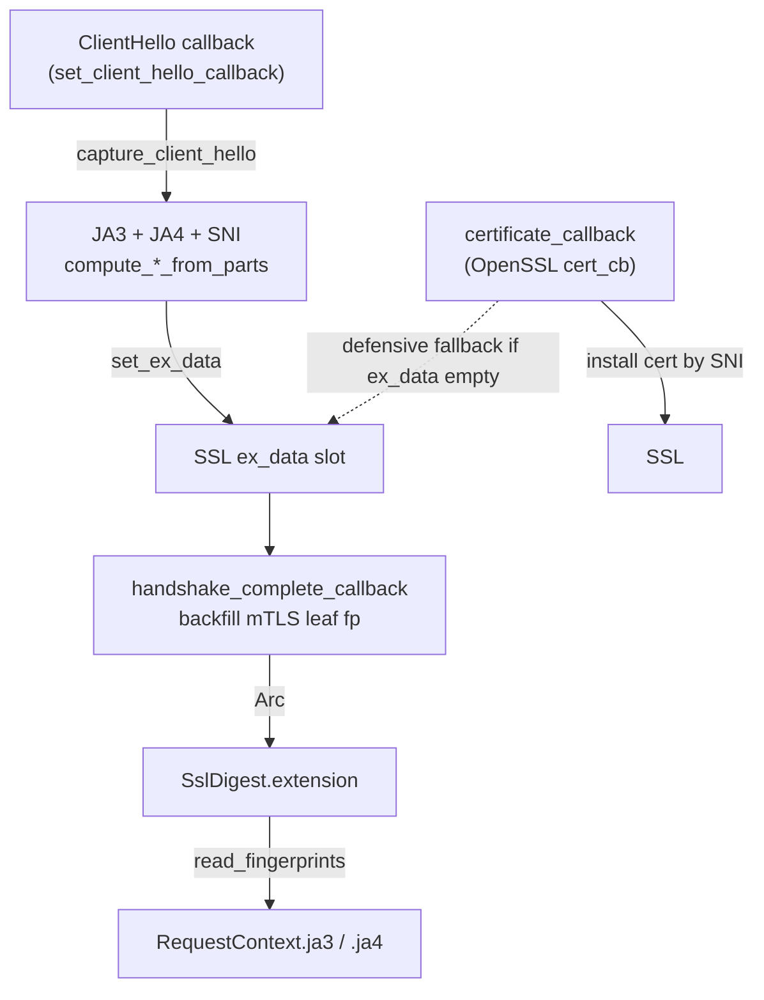

# TLS-фингерпринтинг (JA3/JA4)

AEGIS снимает с каждого TLS/QUIC-соединения семейство отпечатков (JA3, JA4, JA4H, JA4T, JA4L, плюс серверные JA4S/JA4X/JA4TS/JA4LS, h2/h3 fp и mTLS fp) и использует их как сигналы для bot-детекции, deny-листов, WAF-правил, ML-скорера и Defence Arsenal. Этот документ описывает, что именно вычисляется в коде, **где** оно захватывается на боевом пути (Pingora) и какие ограничения честно стоит учитывать.

> Связанные документы: [WAF](./10-waf.md) (правила `field:"ja3"/"ja4"`), [Репутация](./12-reputation.md) (JA4-фиды), ML и risk engine (фичи `ja4_churn`, `grease_anomaly`, корреляция), Arsenal, [TLS и сертификаты](./08-tls-certificates.md), [Архитектура](./02-architecture.md).

---

## 1. Обзор семейства отпечатков

| Отпечаток | Слой | Источник в коде | Что хеширует | Статус |
|---|---|---|---|---|
| **JA3** (legacy) | TLS ClientHello | [`src/ja3.rs`](../../src/ja3.rs) | version, ciphers, extensions, groups, ec_point_formats → MD5 | работает |
| **JA4** | TLS ClientHello | [`src/ja4.rs`](../../src/ja4.rs) `compute_ja4` | сортированные ciphers/extensions + sig_algos → SHA-256 prefix | работает |
| **JA4H** | HTTP-запрос | [`src/ja4.rs`](../../src/ja4.rs) `compute_ja4h` | method, версия, имена заголовков, cookie | работает |
| **JA4T** | TCP SYN (клиент) | [`src/ja4.rs`](../../src/ja4.rs) `compute_ja4t` | window, options, MSS, wscale | частично (см. §7) |
| **JA4L** | latency (клиент-лег) | [`src/ja4.rs`](../../src/ja4.rs) `compute_ja4l_pair` | client_to_server_us / server_to_client_us | частично (см. §7) |
| **JA4S** | TLS ServerHello | [`src/ja4_server.rs`](../../src/ja4_server.rs) `compute_ja4s_from_parts` | server version, ALPN, cipher, extensions | работает (вызывается из обвязки) |
| **JA4X** | X.509 сертификат | [`src/ja4_server.rs`](../../src/ja4_server.rs) `compute_ja4x` | issuer DN, subject DN, ext OIDs | работает (x509-parser) |
| **JA4TS** | TCP SYN-ACK (сервер) | [`src/ja4_server.rs`](../../src/ja4_server.rs) `compute_ja4ts` | window, MSS, scale, option kinds | частично (нужен SYN-capture) |
| **JA4LS** | latency (сервер-лег) | [`src/ja4_server.rs`](../../src/ja4_server.rs) `compute_ja4ls` | SYN → SYN-ACK дельта (мс) | частично |
| **H2FP** | HTTP/2 preface | [`src/h2_fp.rs`](../../src/h2_fp.rs) `parse_prefix` | SETTINGS, WINDOW_UPDATE, PRIORITY, порядок псевдо-заголовков | работает |
| **H3FP** | QUIC/HTTP3 | [`src/h3_fp.rs`](../../src/h3_fp.rs) `compute` | QUIC version, ALPN, transport-parameters | приближение (см. §6) |
| **mTLS fp** | клиентский сертификат | [`src/mtls_fp.rs`](../../src/mtls_fp.rs) `compute` | key type, chain/SAN count, issuer DN, leaf DER | работает (только при mTLS) |

Производные сигналы:

- **JA4 churn** — ротация JA4 per-IP: [`src/ja4_churn.rs`](../../src/ja4_churn.rs).
- **GREASE-аномалия** — детектор utls/curl-impersonate-спуфа: [`src/grease_anomaly.rs`](../../src/grease_anomaly.rs).
- **Корреляция fp↔UA** — кросс-проверка JA4 vs User-Agent vs H2FP: [`src/fp_correlation.rs`](../../src/fp_correlation.rs).

---

## 2. JA3 (legacy, MD5)

JA3 (Salesforce) — каноническая строка из 5 полей:

```
SSLVersion,Cipher,SSLExtension,EllipticCurve,EllipticCurvePointFormat
```

Каждое поле — список десятичных чисел через дефис, итоговый MD5-хеш (32 hex) совпадает с тем, что публикуют фиды abuse.ch / SSL Blacklist, так что оператор может вставить хеш прямо в deny-лист.

В коде две точки входа ([`src/ja3.rs`](../../src/ja3.rs)):

- `compute_ja3(buf)` — парсит сырые байты TLS-записи + ClientHello (используется в гипер-пути / тестах).
- `compute_ja3_from_parts(client_version, ciphers, extension_types, supported_groups, ec_point_formats)` — собирает строку из уже распарсенных полей. **Это путь Pingora**: внутри ClientHello-callback openssl возвращает поля через аксессоры, а не сырую запись (`src/ja3.rs:108`).

GREASE-значения (RFC 8701) выкидываются из ciphers, extensions и supported_groups — `ec_point_formats` остаётся как есть (`src/ja3.rs:121`). Это даёт стабильный хеш у браузеров, которые подсыпают случайные GREASE-кодпоинты.

Пример (из теста `from_parts_with_grease_filters_identically`, `src/ja3.rs:413`):

```
вход:  ciphers=[0x0a0a,0x1301,0x1302,0x2a2a], exts=[0x0a0a,0,10,11,0xfafa]
JA3:   771,4865-4866,0-10-11,29-23,0   (GREASE 0x0a0a/0x2a2a/0xfafa убраны)
```

Тест `from_parts_matches_byte_parser` (`src/ja3.rs:369`) гарантирует **байт-в-байт** совпадение между байт-парсером и `from_parts`: один и тот же клиент даёт одинаковый JA3 на обоих бинарях.

`is_grease(v)` (`src/ja3.rs:190`) — публичная функция: оба нибла равны, младший нибл = `a` (то есть `0x0A0A`, `0x1A1A`, …, `0xFAFA`).

---

## 3. JA4 (TLS ClientHello)

JA4 (FoxIO) — преемник JA3. Преимущества (из шапки [`src/ja4.rs`](../../src/ja4.rs)):

1. **Стабильность** — JA4 сортирует ciphers/extensions перед хешированием, поэтому косметическая перестановка не меняет отпечаток.
2. **Человекочитаемый префикс** — сегмент `a` пишется открытым текстом.
3. **Несколько вариантов** — вместе они переживают одношаговую эвазию.

### 3.1. Формат строки JA4

Каноническая форма — три сегмента через `_`:

```
<a>_<b>_<c>     например  t13d1516h2_8daaf6152771_b186095e22b6
```

**Сегмент `a`** (`src/ja4.rs:225-237`) собирается так: `{proto}{ver}{sni}{cipher_count}{ext_count}{alpn}`

| Часть | Значение | Откуда |
|---|---|---|
| `proto` | `t` (TLS over TCP) или `q` (QUIC) | флаг `is_quic` |
| `ver` | `13`/`12`/`11`/`10`/`s3`/`00` | `tls_version_label` (`src/ja4.rs:361`) — берётся **наивысшая** версия из `supported_versions`, не legacy-поле |
| `sni` | `d` если SNI присутствует, иначе `i` | extension 0 |
| `cipher_count` | hex(2), capped at `0x99` | `cap_hex_2`, GREASE уже отфильтрован |
| `ext_count` | hex(2), **исключая** SNI(0) и ALPN(16) — это квирк спецификации | `src/ja4.rs:231` |
| `alpn` | первый+последний символ первого ALPN-протокола, lowercase; пусто → `00` | `alpn_tag` (`src/ja4.rs:383`) |

**Сегмент `b`** — SHA-256-prefix(12) от отсортированного списка ciphers (hex4, через запятую) (`src/ja4.rs:239`).

**Сегмент `c`** — SHA-256-prefix(12) от отсортированных extensions (без SNI/ALPN), к которым через `_` приклеены signature_algorithms (`src/ja4.rs:249-271`).

Хеш — это первые 6 байт SHA-256 в hex = 12 символов (`sha_prefix12`, `src/ja4.rs:766`), что удобно для tracing-полей и дашбордов.

Пример из теста `computes_ja4_prefix` (`src/ja4.rs:907`): ClientHello с 2 ciphers (после strip GREASE), SNI, ALPN `h2`, supported_versions `[0x0304,0x0303]`, 2 «считаемых» extension → `a = t13d0202h2`.

### 3.2. Две точки входа

- `compute_ja4(buf, is_quic)` — парсер сырого ClientHello (`src/ja4.rs:126`).
- `compute_ja4_from_parts(...)` — из распарсенных полей; **это путь Pingora** (`src/ja4.rs:290`). Ожидает, что caller уже отфильтровал GREASE из ciphers/extensions; сам выбирает наивысшую non-GREASE версию.

Тест `from_parts_matches_byte_parser_tls13` (`src/ja4.rs:1033`) подтверждает байт-идентичность full-строки и всех трёх сегментов между двумя путями.

---

## 4. JA4H (TLS + HTTP)

JA4H фингерпринтит HTTP-запрос и защищает от UA-спуфа. Формат — 4 сегмента: `<a>_<b>_<c>_<d>` ([`src/ja4.rs`](../../src/ja4.rs) `compute_ja4h`, `src/ja4.rs:426`).

**Сегмент `a`** = `{method2}{ver}{cookie}{referer}{header_count}{lang4}`:

- `method2` — первые 2 символа метода, lowercase, добиваются `0` (например `DELETE`→`de`, `X`→`x0`).
- `ver` — `10`/`11`/`20`/`30`/`00`.
- `cookie` — `c` если есть заголовок Cookie, иначе `n`.
- `referer` — `r`/`n`.
- `header_count` — hex(2) считаемых заголовков, **исключая** cookie, referer и псевдо-заголовки HTTP/2 (`:method`, `:path`, …).
- `lang4` — нормализованный primary range из `Accept-Language` (`en-US,en;q=0.9` → `enus`), добитый до 4 символов нулями.

**Сегмент `b`** — SHA-256-prefix(12) от имён заголовков **в порядке прихода** (lowercase, через запятую; cookie/referer исключены).

**Сегменты `c`/`d`** — SHA-256-prefix(12) от **отсортированных** cookie-имён и `name=value` соответственно. Сортировка делает отпечаток устойчивым к порядку cookie (тест `ja4h_basic_get_request`, `src/ja4.rs:951`).

Пример: `GET`, HTTP/1.1, есть Cookie+Referer, 3 считаемых заголовка, `en-US` → `a = ge11cr03enus`.

Горячий путь использует zero-alloc-вариант `compute_ja4h_from_headermap` (`src/ja4.rs:539`), работающий прямо по `http::HeaderMap` — поведение идентично.

---

## 5. H2FP — отпечаток HTTP/2 (Akamai-style)

[`src/h2_fp.rs`](../../src/h2_fp.rs) снимает состояние, которое HTTP/2-клиент выдаёт в начале соединения, **до** прикладного запроса. Формат `full()` (`src/h2_fp.rs:59`):

```
SETTINGS|WINDOW_UPDATE|PRIORITY|PSEUDO
```

- **SETTINGS** — пары `id:value` в порядке прихода, через `;`.
- **WINDOW_UPDATE** — connection-level инкремент (или `0`).
- **PRIORITY** — счётчик + первый tuple `count:stream:excl:dep:weight`.
- **PSEUDO** — порядок псевдо-заголовков из первого HEADERS-фрейма: буквы `m`(method), `a`(authority), `s`(scheme), `p`(path).

`parse_prefix(buf)` читает фреймы от preface (`PRI * HTTP/2.0...`) до первого HEADERS (максимум 16 фреймов), затем останавливается. SETTINGS-ACK игнорируется. При обрыве буфера возвращается частичный отпечаток — соединение не блокируется из-за промаха снифа (`src/h2_fp.rs:90`).

Порядок псевдо-заголовков извлекается без полноценного HPACK-декодера: сканируются индексы static-table 1–7 (`:authority`, `:method GET/POST`, `:path //index.html`, `:scheme http/https`) — достаточно для любого корректного запроса (`src/h2_fp.rs:156`). Динамическая таблица не поддерживается — это сознательное упрощение.

Захват байтов до hyper делается адаптером `SniffedStream` (`src/h2_fp.rs:382`): он буферизует прочитанные байты, даёт снифу их осмотреть, затем прозрачно «переигрывает» downstream-читателю и сразу освобождает буфер.

> Большинство «JA3/JA4-as-Chrome»-спуферов не утруждаются совпадением на HTTP/2-слое, поэтому H2FP — сильный дополнительный сигнал (см. корреляцию в §9).

---

## 6. H3FP — отпечаток HTTP/3 / QUIC

⚠️ **Честная оговорка.** Полноценный JA4Q (QUIC-вариант FoxIO) требует сырых байт Initial-пакета — длины Initial-заголовка, раскладки зашифрованного CRYPTO-фрейма и порядка transport_parameters внутри внутреннего ClientHello. **quinn этого не отдаёт** в user-space (потребляет внутри стейт-машины хендшейка). Поэтому [`src/h3_fp.rs`](../../src/h3_fp.rs) даёт **приближение** на основе того, что quinn выставляет после хендшейка:

- QUIC version (u32, `00000001` = RFC 9000),
- ALPN (`h3`, `h3-29`, …),
- набор transport-параметров `(id, value)`, которые отдаёт quinn.

Формат: `q{version}{alpn}_{params_sha12}` (`src/h3_fp.rs:46`). Параметры сортируются перед хешем, поэтому порядок фреймов не влияет (тест `param_order_doesnt_change_hash`). ALPN-тег согласован с JA4 (первый+последний символ), чтобы Chrome-h3 ложился рядом с Chrome-h2.

Этого хватает на грубое различение мажорных QUIC-реализаций (chromium / firefox / cronet / quiche / msquic), но это **не** байт-точный JA4Q.

---

## 7. JA4T / JA4L и серверные варианты

### JA4T / JA4S / JA4X / JA4TS / JA4LS

- **JA4T** (`compute_ja4t`, `src/ja4.rs:666`): `{window}_{options}_{mss}_{wscale}`. ⚠️ Поля `options_order` и `window` ядро Linux не отдаёт напрямую; без eBPF SYN-capture они best-effort. При пустом вводе возвращается сентинель `0_0_0_0`.
- **JA4L** (`compute_ja4l_pair`, `src/ja4.rs:700`): `{client_us}_{server_us}` в **микросекундах**. ⚠️ `compute_ja4l(observed, done)` — legacy-форма, выдаёт `{rtt_us}_{rtt_us}` (одинаковые половины) и оставлена для совместимости миграции.
- **JA4S** (`compute_ja4s_from_parts`, `src/ja4_server.rs:54`): `t{ver}{proto}{alpn}_{cipher_hex4}_{ext_hash}`. Для детекции подмены апстрима: JA4S нашего апстрима не должен меняться между деплоями.
- **JA4X** (`compute_ja4x`, `src/ja4_server.rs:91`): `{issuer_hash}_{subject_hash}_{ext_hash}` из DER-сертификата (через `x509-parser`). Невалидный DER → `None`.
- **JA4TS** (`compute_ja4ts`, `src/ja4_server.rs:122`): SYN-ACK-вариант JA4T. ⚠️ Требует capture SYN-ACK.
- **JA4LS** (`compute_ja4ls`, `src/ja4_server.rs:147`): `{delta_ms:04}_00`, дельта SYN → SYN-ACK, capped at 9999.

Все функции [`src/ja4_server.rs`](../../src/ja4_server.rs) чистые и hot-path-safe (никаких аллокаций сверх выходной строки). V126.

---

## 8. mTLS-фингерпринт

Когда прокси настроен на клиентскую аутентификацию по сертификату, [`src/mtls_fp.rs`](../../src/mtls_fp.rs) хеширует leaf-сертификат стабильно к косметике. Формат (`src/mtls_fp.rs:60`):

```
mtls_{kty}{chain_len}{san_count}{policy_hash}_{leaf_sha256_12}
```

- `kty`: `r`(RSA) / `e`(ECDSA) / `d`(Ed25519) / `?`(прочее) — детектируется по OID-байтам в DER (`classify_key_type`, `src/mtls_fp.rs:150`).
- `chain_len`, `san_count` — один hex-символ, capped at 9.
- `policy_hash` — SHA-256-prefix(12) от issuer DN.
- `leaf_sha256_12` — SHA-256-prefix(12) от DER leaf-сертификата.

Issuer DN извлекается собственным мини-ASN.1-парсером (`extract_issuer_dn`, `src/mtls_fp.rs:188`) — пройдены два уровня SEQUENCE (Certificate → tbsCertificate). Комментарий в коде честно фиксирует, что pre-V55-версия молча возвращала `""` на каждом реальном сертификате из-за пропущенного уровня вложенности.

Назначение: детекция «утечки сертификата по флоту» — один украденный клиентский сертификат с многих IP даёт одинаковый `mtls_*` независимо от TLS-версии, JA3/JA4 и геолокации.

DER-хелперы (`classify_key_type`, `count_san_entries`, `extract_issuer_dn`) общие для hyper и Pingora — оба бинаря дают **байт-идентичный** отпечаток (V55, `src/mtls_fp.rs:137`).

---

## 9. Где захватывается: ClientHello callback (Pingora)

Это ключевой раздел для операторов. На боевом дата-плейне ([`aegis-pingora`](../../src/proxy/pingora_tls.rs)) JA3/JA4 снимаются в **ClientHello callback** OpenSSL, зарегистрированном через `set_client_hello_callback` в `aegis-pingora.rs`.

### 9.1. Почему именно ClientHello callback, а не certificate_callback

Это закреплено в коде и подкреплено реальным багом (V246). Аксессоры `SSL_client_hello_*` (offered ciphers + extensions) возвращают данные **только** на стадии ClientHello. `certificate_callback` маппится на более поздний OpenSSL `cert_cb`, где эти аксессоры **пусты**, что давало вырожденный отпечаток `t12i000000_e3b0c44298fc`, **одинаковый для каждого клиента** (`src/proxy/pingora_tls.rs:736-744`, `873-881`).

Поэтому реальный захват делает `capture_client_hello` (`src/proxy/pingora_tls.rs:745`), вызываемый из ClientHello callback. Внутри `certificate_callback` остаётся только установка сертификата по SNI + **defensive fallback** на случай, если ClientHello-захват не отработал (`src/proxy/pingora_tls.rs:882-886`).

### 9.2. Поток данных



1. **`capture_client_hello`** читает SNI, ciphers, extensions, supported_groups, ec_point_formats, sig_algorithms, supported_versions, ALPN через FFI-хелперы (`SSL_client_hello_get1_extensions_present`, `SSL_client_hello_get0_ext`) и `client_hello_ciphers()`/`client_hello_legacy_version()`, затем зовёт `compute_ja3_from_parts` + `compute_ja4_from_parts`. Результат кладётся в **SSL ex_data** (`src/proxy/pingora_tls.rs:808-857`).
2. **`handshake_complete_callback`** перечитывает ex_data, добивает mTLS leaf-fp (он становится доступен только после хендшейка — клиентский сертификат шлётся **после** ServerHello) и возвращает `TlsFingerprints` как `Arc<dyn Any>`, который pingora кладёт в `SslDigest.extension` (`src/proxy/pingora_tls.rs:1025-1071`).
3. **`read_fingerprints(session)`** на горячем пути проксирования достаёт отпечатки и проставляет `RequestContext.ja3` / `.ja4` (`src/proxy/pingora_tls.rs:1091`).

### 9.3. Критические баги type-erasure (честно)

🔴 Коммент-история кода фиксирует два реальных бага, из-за которых JA3/JA4 **молча отсутствовали на всём боевом пути**:

- **V245** — `read_fingerprints` даункастил к `Arc<TlsFingerprints>` (двойной Arc), которого никто не публикует, поэтому даункаст **всегда** падал и возвращал `None`. Следствие: `ctx.ja4 == None`, deny-листы JA3/JA4, WAF-правила `field:"ja4"/"ja3"`, ML-фичи JA4, корпус Arsenal и JA4-репутация **не срабатывали** (`src/proxy/pingora_tls.rs:1115-1130`).
- **V250** — переход на канонический `SslDigestExtension::get::<TlsFingerprints>()` (даункаст к конкретному типу `TlsFingerprints`, не к `Arc<dyn Any>`), иначе `get()` возвращает `None` (`src/proxy/pingora_tls.rs:1100-1112`).

Урок для оператора: если на боевом стенде `ctx.ja4` пусто на всех запросах, проверьте именно эту обвязку, а не парсеры. Эти баги уже исправлены, но они — пример «тихой» регрессии безопасности.

### 9.4. mTLS-листенер

mTLS настраивается через `MtlsConfig` (`mtls.enabled`, `mtls.ca_paths`, `mtls.require_cert`) и применяется к `SslAcceptorBuilder` один раз на старте (`MtlsSetup`, `src/proxy/pingora_tls.rs:162`). При `require_cert=true` ставится `FAIL_IF_NO_PEER_CERT` (хендшейк без клиентского сертификата падает); при `false` — «verify if presented», и `mtls`-fp остаётся `None` для клиентов без сертификата.

---

## 10. LEVER 1 — гейт фингерпринтинга

Вычисление JA3 (MD5) + JA4 (2×SHA-256) стоит ~18–22 heap-аллокаций на полный хендшейк. Флаг `fingerprinting_enabled` (атомарный bool в `AegisTlsAccept`) позволяет это пропустить, но при этом всё равно кладёт `TlsFingerprints` с `None`-полями, чтобы downstream-обработка `None` была единообразной (`src/proxy/pingora_tls.rs:140-156`, `756-770`).

**По умолчанию гейт ON** (`build()` ставит `true`, `src/proxy/pingora_tls.rs:417`). Бинарь выставляет `false` через `set_fingerprinting(false)` **только** когда ВСЕ детектируемые потребители отсутствуют И оператор явно отказался через `AEGIS_TLS_FINGERPRINT=0`.

Гейт ОБЯЗАН быть `true`, если активен хоть один потребитель (`src/proxy/pingora_tls.rs:142-149`):

- сконфигурированы `ja3_deny_hashes` / `ja4_deny_prefixes`;
- включён Defence Arsenal (ja4_corpus, ja4_churn, GREASE-скоринг);
- активен фид `ja4_reputation`;
- есть WAF-правила с `field:"ja3"`/`field:"ja4"` (inline-правила сканируются на старте; внешние `rule_files` **принудительно** включают гейт, т.к. их предикаты нельзя осмотреть заранее и они перезагружаются в рантайме).

> Принцип из кода: «when in doubt, compute — a miss here is a silent security regression». Включить гейт всегда безопасно (тратится лишь ~18–22 аллокации); выключить по ошибке — значит молча сломать все fingerprint-фильтры. Включается один раз на старте после сборки всех компонентов пайплайна.

---

## 11. JA4 churn — детектор ротации per-IP

[`src/ja4_churn.rs`](../../src/ja4_churn.rs) (V177) ловит атакующих с ротацией TLS-отпечатков (utls, curl-impersonate, golang fhttp), которые выдают разный JA4 каждые несколько запросов с одного IP. Реальный браузер держит один JA4 сотни запросов подряд до апгрейда Chrome.

**Скор** = доля уникальных JA4 к общему числу наблюдений в скользящем окне per-IP:

- `0.0` — все запросы с одним JA4 (нормальный браузер);
- `1.0` — каждый запрос уникален (идёт ротация);
- среднее — типично для NAT (несколько реальных браузеров за одним egress-IP).

RiskEngine трактует `> 0.6` как подозрительное, `> 0.9` — enforcement-grade (шапка `src/ja4_churn.rs:21`).

Конфигурация по умолчанию (`default_config`, `src/ja4_churn.rs:92`): окно **60 c**, последние **16** сэмплов. Хранилище — `DashMap` с 128 шардами (V230, чтобы снизить контеншн при fan-in, `src/ja4_churn.rs:83`). Фоновый `gc()` дропает окна, не видевшие трафика дольше 4×TTL. Атомарный `is_empty()` даёт fast-path без блокировки шарда при пустом трекере.

Скор подаётся в ML-скорер как фича `ja4_churn` (см. ML и risk engine).

---

## 12. GREASE-аномалии — детектор utls-спуфа

[`src/grease_anomaly.rs`](../../src/grease_anomaly.rs) (V178). Идея: клиент, заявляющий через JA4, что он Chrome, должен иметь Chrome-образные GREASE-значения в правильных позициях. Настоящий Chrome ставит GREASE одновременно в трёх слотах:

1. GREASE-cipher в начале списка ciphers;
2. GREASE-extension в начале списка extensions;
3. GREASE-значение в начале payload supported_versions.

utls/curl-impersonate часто хардкодят одну перестановку и попадают «2 из 3» или ставят GREASE не туда.

**Скор** (`src/grease_anomaly.rs:42`):

```
score = 1 - (matches / 3)   если JA4 выглядит как Chrome
score = 0                    если клиент не заявляет Chrome
```

`ja4_looks_like_chrome` (`src/grease_anomaly.rs:77`) — дешёвая эвристика: JA4 начинается с `t13d15`/`t13d16` ИЛИ содержит cipher-хеш `_8daaf6152771_` (Chrome-seed из V176). Комментарий честно отмечает, что «настоящая» реализация должна свериться с V176 Ja4Corpus.

Где считается: позиции GREASE извлекаются ещё до фильтрации — в Pingora-захвате `ciphers.first()`, `extensions.first()`, `supported_versions.first()` (это **wire-order** списки до strip) подаются в `grease_anomaly::observe`, затем `score_against_ja4` против только что посчитанного JA4 (`src/proxy/pingora_tls.rs:830-845`, `974-994`). Есть и отдельная функция `extract_grease_positions` в парсере ([`src/ja4.rs`](../../src/ja4.rs)`:63`) для байт-пути.

При наличии Arsenal инкрементятся счётчики `grease_checks` и (при score > 0.5) `grease_anomalies`. Без Arsenal — no-op.

---

## 13. Корреляция fp↔UA (cross-fingerprint consistency)

[`src/fp_correlation.rs`](../../src/fp_correlation.rs) (V137) сводит набор отпечатков в один `CorrelationScore` ∈ [0.0, 1.0], где 0 = все сигналы согласованы, 1 = противоречат друг другу (почти наверняка инструмент, прикидывающийся браузером). Каноничный кейс: Chrome JA4 + curl User-Agent.

Веса (`correlate`, `src/fp_correlation.rs:166`):

| Признак | Reason-тег | Вес |
|---|---|---|
| JA4-семейство ≠ UA-семейство, UA = Tool (curl/wget/python/Go/…) | `ja4_browser_ua_tool` | +0.55 |
| JA4-семейство ≠ UA-семейство (браузер vs браузер) | `ja4_ua_family_mismatch` | +0.45 |
| H2FP-семейство ≠ JA4-семейство | `ja4_h2fp_family_mismatch` | +0.35 |
| UA заявляет браузер, но нет `Accept-Language` | `browser_ua_no_accept_language` | +0.15 |
| UA заявляет браузер, но нет `Accept-Encoding` | `browser_ua_no_accept_encoding` | +0.10 |
| JA4 есть, JA4H отсутствует (протокол-проба) | `ja4_present_ja4h_missing` | +0.10 |

Итог клипуется в [0, 1]. Reason-теги — стабильные `&'static str`, безопасны как Prometheus-лейблы.

Семейство по JA4 (`ja4_family`, `src/fp_correlation.rs:97`) определяется по cipher-хешу (сегмент `b`); таблица префиксов в коде — иллюстративная (`8daa`/`9b0f`/`1f4f`→Chrome и т.д.), боевой деплой переопределяет её через репутационный фид (V138, см. [Репутация](./12-reputation.md)). UA-классификатор (`ua_family`, `src/fp_correlation.rs:119`) — подстроковый, порядок проверок важен (Edge до Chrome, т.к. Edge UA содержит «Chrome»).

> ⚠️ Почему скор, а не жёсткое правило: легитимные крайние случаи существуют (корпоративные MITM-прокси переписывают TLS и UA независимо, мобильные сети жмут заголовки, расширения добавляют кастомные UA). Жёсткое «mismatch → deny» дало бы ложные срабатывания, поэтому скор комбинируется с прочими сигналами в risk engine (V108). Этот скор — фича ML-скорера (V122/V136) и сигнал WAF risk engine.

Близкий, но отдельный модуль — `client_consistency.rs` (CreepJS-стиль, V145), см. [client-consistency.md](../en/reference/client-consistency.md).

---

## 14. Согласованность с гипер-путём и применение

- **Паритет бинарей.** Тесты `from_parts_matches_byte_parser` (JA3, `src/ja3.rs:369`) и `from_parts_matches_byte_parser_tls13` (JA4, `src/ja4.rs:1033`) гарантируют, что байт-парсер (rustls/quinn edge у hyper) и `from_parts` (openssl TlsAccept у Pingora) дают идентичные отпечатки. Для mTLS — общие DER-хелперы (V55).
- **Применение отпечатков.** `RequestContext.ja3`/`.ja4` потребляют: deny-листы `ja3_deny_hashes` / `ja4_deny_prefixes`, WAF-правила `field:"ja3"/"ja4"`, ML-фичи, JA4-корпус и репутация Arsenal. (JA3 в `RequestContext` не кладётся отдельно — остаётся в `TlsFingerprints` для `/admin/tls/debug`, `src/proxy/pingora_tls.rs:536`.)

---

## 15. Честные оговорки

1. **H3FP — приближение, а не JA4Q.** quinn не отдаёт сырые Initial-байты; отпечаток строится по version/ALPN/transport-params (§6). Для строгого QUIC-фингерпринтинга это недостаточно.
2. **JA4T/JA4L/JA4TS/JA4LS — best-effort.** Точные TCP-поля SYN/SYN-ACK и сабмикросекундная latency требуют eBPF SYN-capture, который ядро штатно не отдаёт; без него поля частичны или сентинельны (`0_0_0_0`).
3. **Семейства браузеров по JA4 — иллюстративные префиксы.** Таблицы в `fp_correlation.rs` и `grease_anomaly.rs` — community-derived и подлежат переопределению репутационным фидом (V138/V176). Не считайте их полным корпусом.
4. **GREASE-эвристика Chrome — грубая.** `ja4_looks_like_chrome` сверяется по префиксу/одному cipher-хешу, а не по полному корпусу.
5. **Тихая регрессия type-erasure.** Баги V245/V250 показывают: парсеры могут быть корректны, а отпечатки — отсутствовать на всём боевом пути из-за обвязки `SslDigest.extension`. Проверяйте `read_fingerprints` (§9.3).
6. **Бенчмарки фингерпринтинга — in-process.** Любые цифры скорости JA3/JA4-вычислений из синтетических тестов не учитывают I/O Pingora, syscalls и TLS-negotiation. Полный `aegis-pingora` под боевой нагрузкой даёт ↓15–30% vs synthetic; на VM без AES-NI/SHA-NI хеши ещё в ×2–3 медленнее, чем на bare-metal. Не цитируйте абсолютные числа без этих оговорок. См. Бенчмаркинг и авторитетный SECURITY-AUDIT.

---

## 16. Где искать в коде

| Тема | Файл |
|---|---|
| JA3 | [`src/ja3.rs`](../../src/ja3.rs) |
| JA4 / JA4H / JA4T / JA4L | [`src/ja4.rs`](../../src/ja4.rs) |
| JA4S / JA4X / JA4TS / JA4LS | [`src/ja4_server.rs`](../../src/ja4_server.rs) |
| H2FP | [`src/h2_fp.rs`](../../src/h2_fp.rs) |
| H3FP | [`src/h3_fp.rs`](../../src/h3_fp.rs) |
| JA4 churn | [`src/ja4_churn.rs`](../../src/ja4_churn.rs) |
| mTLS fp | [`src/mtls_fp.rs`](../../src/mtls_fp.rs) |
| Корреляция fp↔UA | [`src/fp_correlation.rs`](../../src/fp_correlation.rs) |
| GREASE-аномалия | [`src/grease_anomaly.rs`](../../src/grease_anomaly.rs) |
| Захват на Pingora (ClientHello callback, LEVER 1, ex_data) | [`src/proxy/pingora_tls.rs`](../../src/proxy/pingora_tls.rs) |
