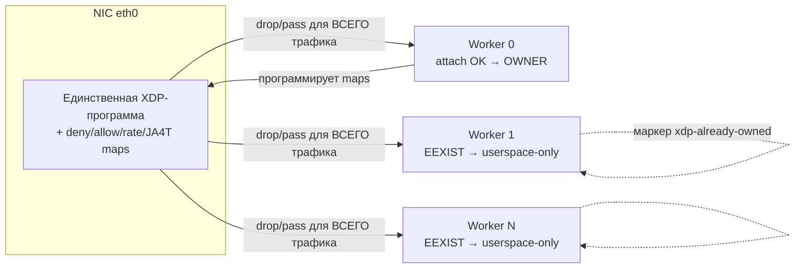

# XDP/eBPF kernel fast-path

XDP (eXpress Data Path) — это eBPF-программа, прикреплённая к сетевой карте (NIC), которая дропает пакеты **в ядре до того, как они попадут в userspace**: заведомо запрещённые IP, превышения rate-лимита и SYN-флуд отсекаются на самом раннем возможном этапе. В AEGIS это **опциональный** ускоритель грубой L3/L4-фильтрации, а не замена L7-защиты; при недоступности XDP всё корректно деградирует в userspace-фильтрацию без потери функциональности.

> Источники истины для этого документа: [`src/xdp.rs`](../../src/xdp.rs), [`install.sh`](../../install.sh) (функция `build_xdp_object`, `resolve_xdp_enable`, `resolve_xdp_iface`, генерация systemd-юнита), [`src/filters/dynamic_trust.rs`](../../src/filters/dynamic_trust.rs), [`src/server.rs`](../../src/server.rs) (загрузка и экспорт счётчиков). Все утверждения ниже сверены с этим кодом.

---

## 1. Что делает XDP в AEGIS

XDP-программа выполняется на NIC (в идеале — в драйвере) и для каждого входящего пакета принимает решение `XDP_DROP` / `XDP_PASS` ещё **до аллокации `sk_buff`** в native-режиме. Это даёт line-rate отсев мусора и снимает нагрузку с softirq-стека, conntrack, сокетов и воркеров AEGIS.

Программа в ядре (`aegis_xdp`, секция программы; см. `program_mut("aegis_xdp")` в [`src/xdp.rs:211`](../../src/xdp.rs)) выполняет следующие проверки. Порядок важен: allow-list проверяется **первым** и полностью обходит остальные.

| Этап | Что делает | Счётчик | Управляется из userspace через |
|---|---|---|---|
| **Allow-list (fast-pass)** | Пакет от IP в allow-map минует все нижестоящие проверки (deny / rate / SYN / WAF) | `fast_pass` | `ALLOW_V4` / `ALLOW_V6` map |
| **Deny-list** | Drop пакетов от IP в deny-map | `drop_deny` | `DENY_V4` / `DENY_V6` map |
| **Rate-limit (token bucket)** | Drop, если у source-IP > `burst` пакетов за `window_ns` | `drop_rate` | `RATE_CFG` (`WINDOW_NS`, `BURST`) |
| **SYN-flood guard** | Отдельный бюджет для TCP-SYN: drop при > `syn_burst` SYN/окно | `drop_syn` | `RATE_CFG` (`SYN_BURST`) |
| **Allow-only mode** | Whitelist-режим: всё, кроме allow-list, дропается | `drop_allowonly` | `RATE_CFG` (`ALLOW_ONLY`) |
| **Inline kernel WAF (Phase 3X)** | Drop пакетов, чья HTTP request-line совпала с известным scanner-префиксом пути — никогда не доходят до userspace | `drop_waf` | (сигнатуры внутри eBPF-объекта) |
| **PASS** | Пакет передан в userspace (нормальный путь) | `pass` | — |

Дополнительно XDP-программа на лету **захватывает JA4T SYN-фингерпринт** (TCP-параметры из SYN: window, MSS, WSCALE, порядок TCP-опций) в map `JA4T_V4`. Userspace читает его через `read_ja4t_v4(src_ip, src_port)` ([`src/xdp.rs:394`](../../src/xdp.rs)) — это используется как предпочтительный источник для пассивной TCP-классификации (`src/tcp_info.rs::capture_with_xdp`, см. [`src/p0f.rs`](../../src/p0f.rs)). Захват есть только для IPv4; для IPv6 `read_ja4t_v4` всегда возвращает `None`, и вызывающий код откатывается на `TCP_INFO`.

> ⚠️ Честная оговорка по покрытию. Rate-limit, SYN-guard, JA4T-захват и allow/deny — это **IPv4-first**. Для IPv6 поддерживаются только allow/deny maps (`DENY_V6` / `ALLOW_V6`); kernel rate-limiter (`RATE_V4`) и JA4T-захват (`JA4T_V4`) работают по IPv4. Это соответствует общему статусу IPv6 в AEGIS (см. Модель безопасности).

### Что XDP НЕ делает

- **XDP не отражает volumetric L3/L4-флуд сам по себе.** Он дропает уже на хосте; если канал к хосту насыщен, нужен upstream — см. BGP RTBH. XDP закрывает «последнюю милю» на сервере, BGP/CDN — провод выше.
- **XDP не заменяет L7-защиту.** Inline-WAF в ядре ловит только грубые scanner-префиксы request-line; полноценные SQLi/XSS/traversal-сигнатуры, нормализация, JA4-фингерпринтинг и ML-скоринг остаются в userspace (см. [WAF](./10-waf.md), [TLS-фингерпринтинг](./11-tls-fingerprinting.md), ML и risk engine).
- **XDP не получает earned-trust.** Earned dynamic trust **намеренно** не пушится в kernel allow-map (раздел [4](#4-взаимодействие-с-earned-trust-dynamic_trust)).

---

## 2. Сборка eBPF-объекта

eBPF-объект собирается отдельно от основного бинаря, потому что таргет ядра (`bpfel-unknown-none`) требует nightly-тулчейна и `build-std`. Логика — в `build_xdp_object()` ([`install.sh:469`](../../install.sh)).

```sh
# Из install.sh: build_xdp_object()
cargo +nightly build --release          # в каталоге xdp/aegis-xdp-ebpf
# → target/bpfel-unknown-none/release/aegis-xdp
install -m 0644 -o root -g root <obj> "$AEGIS_XDP_OBJ"   # по умолчанию /var/lib/aegis/aegis-xdp.o
```

Ключевые факты (все из кода):

- **Toolchain: nightly.** Крейт `xdp/aegis-xdp-ebpf` — отдельный workspace со своим `.cargo/config.toml`, который пинит таргет `bpfel-unknown-none` и `-Z build-std=core` ([`install.sh:476-477`](../../install.sh)). Поэтому именно `cargo +nightly`.
- **Таргет `bpfel`** = BPF little-endian. Объект — это ELF в формате, который понимает kernel-верификатор.
- **`bpf-linker`.** aya 0.13 для сборки под `bpfel-unknown-none` требует бинарь `bpf-linker` (он умеет эмитить BPF-ELF). Инсталлятор ставит его через `cargo install bpf-linker --locked` ([`install.sh:310-314`](../../install.sh)). Без него eBPF-сборка падает.
- **rust-src.** Инсталлятор ставит `nightly` + компонент `rust-src` (для `build-std`) ([`install.sh:299-301`](../../install.sh)).
- **Когда собирается.** Только если `AEGIS_ENABLE_XDP=1` (первая же строка `build_xdp_object` — ранний `return` иначе) и только в режимах `pingora` / `both` ([`install.sh:521`, `526`](../../install.sh)). В режиме `hyper` XDP отключается принудительно (`resolve_xdp_enable`, [`install.sh:137-140`](../../install.sh)), так как kernel fast-path заведён через pingora data plane.
- **Сборка падает явно.** Если сборка не произвела `aegis-xdp`, инсталлятор делает `fatal` ([`install.sh:481`](../../install.sh)) — молчаливого пропуска нет.

> Сборка автоматична в [install.sh](../../install.sh); ручные шаги дублировать не нужно. Переменные окружения — в шапке скрипта и в разделе [3](#3-включение-конфигурация-и-переменные-окружения) ниже. См. также [Установка и эксплуатация](./03-installation.md).

---

## 3. Включение, конфигурация и переменные окружения

### 3.1 Переменные окружения инсталлятора

| Переменная / флаг | Значение по умолчанию | Назначение |
|---|---|---|
| `AEGIS_ENABLE_XDP` | `auto` | `auto` \| `1` \| `0`. `auto` включает XDP на kernel ≥ 4.18 и в режиме pingora/both |
| `--xdp` / `--no-xdp` | — | Принудительно `AEGIS_ENABLE_XDP=1` / `=0` ([`install.sh:78-79`](../../install.sh)) |
| `AEGIS_XDP_IFACE` | `auto` | Интерфейс для attach. `auto` = первый non-`lo` интерфейс в состоянии `UP` |
| `--xdp-iface <ifc>` | — | Явный интерфейс ([`install.sh:81`](../../install.sh)) |
| `AEGIS_XDP_OBJ` | `/var/lib/aegis/aegis-xdp.o` | Путь установки скомпилированного eBPF-объекта |

Логика `auto`:

- **`AEGIS_MODE=hyper` → XDP всегда выключен** ([`install.sh:137`](../../install.sh)).
- **kernel < 4.18 → XDP выключен** с предупреждением (`aya-ebpf` XDP-поддержка начинается с 4.18; [`install.sh:146-150`](../../install.sh)).
- Иначе — включён.

Выбор интерфейса в `auto` (`resolve_xdp_iface`, [`install.sh:197-207`](../../install.sh)): берётся первый интерфейс из `ip -br link show`, у которого `lo != $1` и `$2 == UP`. Если ни одного UP-интерфейса нет — fallback на `eth0` с предупреждением, что attach уйдёт в skb-mode.

### 3.2 Блок `xdp { }` в конфиге

Инсталлятор генерирует следующий блок в `aegis.conf` (только при `AEGIS_ENABLE_XDP=1`, [`install.sh:1024-1040`](../../install.sh)):

```conf
# Phase A XDP fast-path. Загружается в ядро при старте; deny/allow
# maps программируются из userspace. Detach автоматически при shutdown.
xdp {
    enabled true;
    interface eth0;                       # из $AEGIS_XDP_IFACE
    bpf_object_path /var/lib/aegis/aegis-xdp.o;   # из $AEGIS_XDP_OBJ

    # Per-IPv4 kernel rate-limit. Оба поля должны быть > 0, иначе выключено.
    rate_window_ms 1000;
    rate_burst 200;
    # Per-IPv4 TCP-SYN budget (отдельный от общего лимитера).
    syn_burst 100;
}
```

Семантика полей соответствует `set_rate_config(window_ns, burst, syn_burst, allow_only)` ([`src/xdp.rs:358`](../../src/xdp.rs)):

- `window_ns == 0 || burst == 0` → общий rate-лимитер выключен.
- `syn_burst == 0` → выделенный SYN-guard выключен (общий лимитер всё ещё действует).
- `allow_only` → whitelist-режим (по умолчанию выключен; включается защитными actuator-ами).

Загрузка при старте: `server.rs` читает `cfg.xdp`, и если `enabled` — вызывает `xdp::load(interface, bpf_object_path)` ([`src/server.rs:438-457`](../../src/server.rs)).

---

## 4. Взаимодействие с earned-trust (`dynamic_trust`)

Это критичная для безопасности деталь, прямо закреплённая в коде. Earned dynamic trust (репутация, заработанная IP за серию чистых запросов) **намеренно НЕ пушится в kernel allow-map** (комментарий C2, [`src/filters/dynamic_trust.rs:241-260`](../../src/filters/dynamic_trust.rs)):

> Kernel allow-map — это line-rate kernel fast-pass: совпавший пакет пропускает **весь** нижестоящий пайплайн (deny / rate / SYN / WAF). Если продвигать earned-trust IP туда, его последующие запросы больше никогда не инспектируются, и доверие не может самокорректироваться — `observe_denied` и WAF просто не увидят трафик, чтобы отозвать доверие. Атакующий, наработавший репутацию и затем атакующий, ехал бы по kernel-bypass бесконечно.

Поэтому:

- **Промоушен доверия остаётся userspace-only.** `is_trusted` всё равно даёт bypass-fast-path в userspace-обработчике, но WAF и `observe_denied` продолжают работать, так что один плохой запрос демотирует IP.
- **Kernel allow-map зарезервирован исключительно под operator-curated СТАТИЧЕСКИЕ bypass-записи** (`sync_allow_list`, программируется из `server.rs:133`).
- **XDP-handle в `dynamic_trust` используется ТОЛЬКО для отзыва** (`unallow`), не для добавления (`with_xdp`, [`src/filters/dynamic_trust.rs:128-136`](../../src/filters/dynamic_trust.rs)). При revocation доверия (`observe_denied`), при TTL/staleness-eviction и при LRU-eviction код defensively вызывает `xdp.unallow(ip)` ([`src/filters/dynamic_trust.rs:300-302`, `342-344`, `390-392`](../../src/filters/dynamic_trust.rs)), чтобы ни одна kernel allow-запись не пережила свой userspace-грант (например, утёкшая operator-запись).

Тесты `dynamic_trust` (структура `CountingXdp`, [`src/filters/dynamic_trust.rs:428`](../../src/filters/dynamic_trust.rs)) явно проверяют, что earned trust **никогда** не дёргает `allow_v4`/`allow_v6`.

Defence-arsenal программирует kernel deny через actuator `XdpDeny` (`ActionKind::XdpDeny`, [`src/actuator.rs:51`](../../src/actuator.rs)) с revert-TTL (авто-undo). См. Defence Arsenal.

---

## 5. Single-owner на NIC (REUSEPORT siblings → EEXIST)

NIC хостит **ровно одну** XDP-программу. AEGIS в production запускается как N воркеров с `SO_REUSEPORT` (см. [Многопроцессность и воркеры](./06-workers.md)), и все они пытаются прикрепить XDP к одному интерфейсу — но выиграет только один. Остальные получают `EEXIST` (`os error 17`, «File exists»).

Это **не ошибка**, а ожидаемое single-owner-условие, и код его специально распознаёт:

- `is_already_attached()` ([`src/xdp.rs:163-178`](../../src/xdp.rs)) обходит цепочку источников ошибки и ловит `io::Error` с `raw_os_error() == Some(17)` либо строки «File exists» / «os error 17».
- При EEXIST `load_impl` возвращает ошибку с маркером-сентинелом `XDP_ALREADY_OWNED_MARKER = "xdp-already-owned-by-sibling-worker"` ([`src/xdp.rs:17`, `234`, `244`](../../src/xdp.rs)).
- Вызывающий код логирует это как информационное условие: данный воркер фильтрует в userspace, а **воркер-владелец** программы применяет deny/allow-maps на NIC для **всего** трафика. Kernel-maps глобальны для интерфейса, поэтому одного владельца достаточно.



---

## 6. Режимы attach: native (DRV) → SKB (generic)

`load_impl` сначала пробует native-режим, затем откатывается на SKB ([`src/xdp.rs:231-252`](../../src/xdp.rs)):

1. **Native / DRV** (`XdpFlags::default()`) — программа исполняется в драйвере NIC, line-rate, до аллокации `sk_buff`.
2. **SKB / generic** (`XdpFlags::SKB_MODE`) — fallback, если драйвер не умеет хостить XDP нативно. Медленнее (пакеты переинъектируются после аллокации `sk_buff`), но работает на **любом** Linux NIC, включая `virtio-net` под гипервизорами. Без этого fallback деплои на облачных VM без native-XDP молча теряли бы kernel fast-path.

EEXIST распознаётся в обеих ветках; любая другая ошибка SKB-attach даёт явный fatal с указанием, что пробовались оба режима.

---

## 7. Требования

Из комментариев генератора systemd-юнита ([`install.sh:1223-1231`](../../install.sh)) и `resolve_xdp_enable`:

| Требование | Зачем | Где задаётся |
|---|---|---|
| **Linux** + Cargo-feature `xdp` | Вне этого — `NoopXdp` (no-op на всех операциях) | `cfg(all(target_os = "linux", feature = "xdp"))` в [`src/xdp.rs:132`](../../src/xdp.rs); фичи `pingora xdp` в [`install.sh:452-453`](../../install.sh) |
| **Kernel ≥ 4.18** | Нижняя граница поддержки XDP в aya-ebpf | `resolve_xdp_enable` ([`install.sh:146`](../../install.sh)) |
| **`CAP_BPF`** | Загрузка/верификация eBPF-программы | `AmbientCapabilities` / `CapabilityBoundingSet` |
| **`CAP_PERFMON`** | На kernel 6.x верификатор гейтит pointer/packet-data операции за `perfmon_capable()`; без `CAP_PERFMON` `BPF_PROG_LOAD` падает с `EACCES` (os err 13) **даже при наличии `CAP_BPF`** | то же |
| **`CAP_NET_ADMIN`** | Attach программы к NIC | то же |
| **`AF_NETLINK`** | XDP-attach идёт через rtnetlink | `RestrictAddressFamilies` |
| **`CAP_SYS_RESOURCE`** + `LimitMEMLOCK=infinity` | Рост BPF-maps / locked-памяти выше дефолтного rlimit 64 KiB | `svc_cap`; `LimitMEMLOCK` ([`install.sh:1266`](../../install.sh)) |

При `AEGIS_ENABLE_XDP=1` инсталлятор расширяет capability-набор воркера до
`CAP_NET_BIND_SERVICE CAP_NET_ADMIN CAP_SYS_RESOURCE CAP_BPF CAP_PERFMON`
и address-families до `AF_INET AF_INET6 AF_UNIX AF_NETLINK` ([`install.sh:1230-1231`](../../install.sh)). Без XDP набор минимален (`CAP_NET_BIND_SERVICE`, без `AF_NETLINK`).

> ⚠️ ARM / VM без PMU. Если в окружении нет PMU (нет `CAP_PERFMON`-функциональности), на kernel 6.x XDP не загрузится — это штатно. Происходит graceful fallback в userspace-фильтрацию (см. раздел [8](#8-деградация-если-xdp-недоступен)), а grubый L3/L4-drop при необходимости берёт на себя nftables-бэкенд ([`src/nftables_backend.rs`](../../src/nftables_backend.rs)). См. также [Системные требования](./05-requirements.md).

См. полный systemd-харднинг (`NoNewPrivileges`, `ProtectSystem=strict`, `RestrictNamespaces` и т.д.) в Модель безопасности и [Установка и эксплуатация](./03-installation.md).

---

## 8. Деградация, если XDP недоступен

XDP — **опциональный ускоритель**. Архитектурно весь остальной код **никогда не ветвится** по `cfg(target_os)`: фасад `XdpHandle` ([`src/xdp.rs:23`](../../src/xdp.rs)) реализован двумя типами — `LinuxXdp` (реальный) и `NoopXdp` (все методы возвращают `Ok(())`, `counters()` отдаёт нули, [`src/xdp.rs:100-127`](../../src/xdp.rs)).

`NoopXdp` подставляется в следующих случаях:

- Сборка не Linux **или** без feature `xdp` (`xdp::load` сразу возвращает `NoopXdp` с warning, [`src/xdp.rs:136-142`](../../src/xdp.rs)).
- В конфиге нет блока `xdp` или `enabled = false` ([`src/server.rs:455-456`](../../src/server.rs)).
- **`xdp::load` упал** (любая причина, включая нехватку capabilities или верификатор): `server.rs` логирует warning «XDP load failed — falling back to userspace filtering» и подставляет `NoopXdp` ([`src/server.rs:446-453`](../../src/server.rs)). Старт прокси при этом **не прерывается**.
- EEXIST от sibling-воркера: handle тоже становится `NoopXdp`, но это нормальная single-owner-ситуация — фильтрация идёт через kernel-maps владельца (раздел [5](#5-single-owner-на-nic-reuseport-siblings--eexist)).

При `NoopXdp`:

- `sync_deny_list` / `sync_allow_list` отрабатывают, но ничего не программируют (no-op «успешно»); IP-фильтрация выполняется в userspace.
- Все XDP-счётчики экспортируются как нули (см. ниже).
- JA4T-захват недоступен → `read_ja4t_v4` → `None` → классификация откатывается на `TCP_INFO`.

Иными словами: при отсутствии XDP теряется только производительность kernel fast-path, а **функциональность фильтрации сохраняется** в userspace и (при наличии) в nftables/iptables-бэкендах.

---

## 9. Счётчики быстрого пути и наблюдаемость

Счётчики XDP — это per-CPU массив в ядре; userspace суммирует значения по всем CPU (`PerCpuArray`, [`src/xdp.rs:373-392`](../../src/xdp.rs)). Структура `XdpCounters` ([`src/xdp.rs:80-98`](../../src/xdp.rs)):

| Поле | Prometheus-метрика | Смысл |
|---|---|---|
| `pass` | `aegis_xdp_pass` | Пакеты, переданные в userspace |
| `drop_deny` | `aegis_xdp_drop_deny` | Drop по deny-list |
| `drop_rate` | `aegis_xdp_drop_rate` | Drop по per-IP token bucket |
| `drop_allowonly` | `aegis_xdp_drop_allowonly` | Drop в allow-only (whitelist) режиме |
| `drop_syn` | `aegis_xdp_drop_syn` | Drop SYN-flood guard-ом |
| `drop_waf` | `aegis_xdp_drop_waf` | Drop inline kernel-WAF (Phase 3X, scanner-пути) |
| `fast_pass` | — (есть в структуре) | Пакеты, прошедшие по allow-list и пропустившие все downstream-проверки |

> `fast_pass` отделён от `pass`, чтобы оператор видел долю trusted-bypass-трафика без вычитания других PASS-источников.

Экспорт: эндпоинт `GET /metrics` дописывает XDP-счётчики к основным runtime-метрикам в одном скрейпе ([`src/server.rs:1322-1336`](../../src/server.rs); `aegis_xdp_drop_waf` в этом блоке — последняя метрика). На пути hyper есть также упрощённый текстовый блок `xdp_pass`/`xdp_drop_*` ([`src/server.rs:1481-1489`](../../src/server.rs)). Когда XDP выключен, `xdp_h.counters().unwrap_or_default()` отдаёт нули — метрики присутствуют, но равны 0 (это документировано в [`src/proxy/pingora_admin.rs:3613`](../../src/proxy/pingora_admin.rs)).

Подробнее об экспорте и панели — Метрики и телеметрия и Админ-панель.

---

## 10. Обслуживание JA4T-map (eviction)

eBPF-программа **никогда не вытесняет записи сама** — JA4T SYN-фингерпринты накапливаются в `JA4T_V4`, и при port-scan-бёрстах map может заполниться мёртвыми 4-кортежами. Userspace периодически выметает старьё через `evict_ja4t_v4(max_age_ns)` ([`src/xdp.rs:413-442`](../../src/xdp.rs)): сканирует map, помечает записи с `captured_at_ns < now - max_age_ns` и удаляет их, возвращая число удалённых. Таймстемпы — это `CLOCK_MONOTONIC` в ns (то же, что `bpf_ktime_get_ns` стампит в ядре, поэтому сравнение прямое; `read_ktime_ns`, [`src/xdp.rs:291-303`](../../src/xdp.rs)). На `NoopXdp` эта операция — no-op (`Ok(0)`).

---

## 11. Краткий чек-лист для оператора

1. Режим **pingora** или **both** (в hyper XDP отключён by design).
2. Kernel **≥ 4.18** (для 6.x — обязателен `CAP_PERFMON`, иначе `BPF_PROG_LOAD` → EACCES).
3. Установка: `sudo bash install.sh` (XDP в `auto` включится сам); либо явно `--xdp` / `--no-xdp`, интерфейс — `--xdp-iface`.
4. Проверка загрузки: в логах `XDP fast-path loaded` / `XDP attached in SKB mode`; sibling-воркеры покажут информационный `xdp-already-owned-by-sibling-worker`.
5. Проверка работы: `curl http://<host>:<admin>/metrics | grep aegis_xdp_` — ненулевые `drop_*` под атакой.
6. При проблемах с верификатором/правами: смотрите warning «XDP load failed — falling back to userspace filtering» — прокси продолжит работать в userspace. Диагностика — FAQ и устранение неполадок.

---

## Связанные документы

- BGP RTBH — upstream-защита от volumetric-флуда (XDP закрывает только хост).
- [Rate limiting](./14-rate-limiting.md) — userspace per-IP/per-endpoint лимиты (XDP — грубый kernel-уровень).
- Defence Arsenal, сценарии и актуаторы — actuator `XdpDeny` и revert-TTL.
- [Многопроцессность, REUSEPORT и воркеры](./06-workers.md) — single-owner модель.
- [Системные требования](./05-requirements.md), Модель безопасности — capabilities и харднинг.
- Метрики и телеметрия — экспорт счётчиков.
