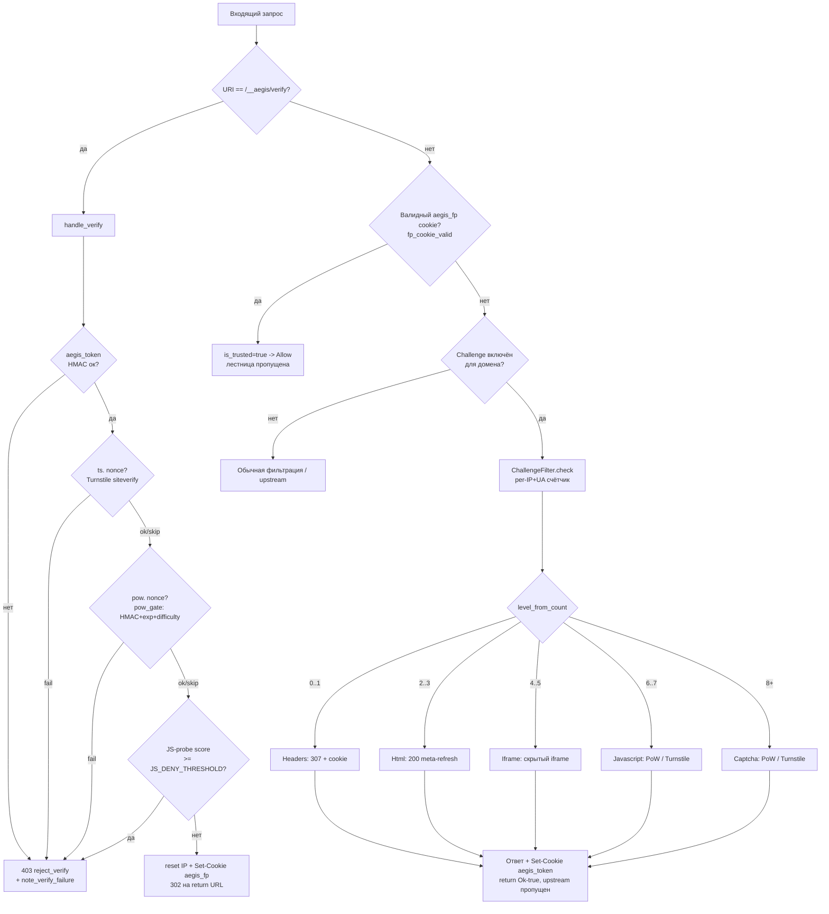

# Challenge ladder, PoW и captcha

Адаптивная лестница проверок AEGIS: эскалация от лёгкого 307-редиректа к JS-challenge, реальному proof-of-work и (опционально) к внешней captcha, с deception-слоем, пассивными bot-сигналами и cross-worker персистентностью per-domain конфигурации. Этот документ описывает то, что **реально** делает код в `src/proxy/pingora_challenge.rs`, `src/pow_captcha.rs`, `src/argon2_pow.rs`, `src/captcha_providers.rs`, `src/challenge_deception.rs`, `src/challenge_signals.rs`, `src/adaptive_ladder.rs` и `src/filters/challenge.rs` — без маркетинга.

> 🟡 **Главное про статус (читать сразу).** Production data plane — `aegis-pingora`. Лестница, которая реально обслуживает запросы, живёт в [`src/proxy/pingora_challenge.rs`](../../src/proxy/pingora_challenge.rs) и использует enum [`filters::ChallengeLevel`](../../src/filters/mod.rs) (`Headers / Html / Iframe / Javascript / Captcha`). Модуль [`src/adaptive_ladder.rs`](../../src/adaptive_ladder.rs) (V204) реализует *другой* enum (`Cookie / Reload / Interaction / Pow / Captcha`) с рандомизацией порядка и fast-track — он покрыт unit-тестами, но **в pingora-путь напрямую не подключён**: `pingora_challenge.rs` его не импортирует. То же с `captcha_providers.rs` (hCaptcha/reCAPTCHA — provider-абстракция без HTTP-транспорта в core) и `argon2_pow.rs` (Argon2id-верификатор есть, но pingora-rung его не вызывает). Ниже это явно помечено для каждого блока. Challenge-ladder по умолчанию **выключена** (`ChallengeConfig.enabled = false`) и включается per-domain.

Смежные документы: [WAF](./10-waf.md), [TLS-фингерпринтинг](./11-tls-fingerprinting.md), [Privacy Pass](./16-privacy-pass.md), Honeypot и tarpit, ML и risk engine, Defence Arsenal, Per-domain политики, Admin API.

---

## 1. Обзор: что такое лестница

Когда неверифицированный клиент попадает на маршрут, требующий проверки, AEGIS не блокирует его сразу. Вместо этого он выдаёт **последовательно усложняющиеся проверки**. Каждая повторная попытка с одного и того же клиента поднимает планку на следующую ступень. Идея: легитимный браузер пройдёт первую-вторую ступень незаметно, а голый сокет-спаммер или примитивный бот отвалится уже на 307-редиректе.

Реальные ступени (`filters::ChallengeLevel`, [`src/filters/mod.rs:68`](../../src/filters/mod.rs)):

| Ступень | Enum | HTTP-ответ | `x-aegis-step` | Что проверяет |
|--------:|------|-----------|----------------|---------------|
| 1 | `Headers` | **307** redirect + cookie + `Location` | `307` | Клиент следует за редиректом и пере-отправляет cookie. Raw-сокет спам не следует. |
| 2 | `Html` | 200 HTML + `<meta refresh>` | `200` | Клиент рендерит HTML / выполняет meta-refresh. |
| 3 | `Iframe` | 200 HTML + скрытый `<iframe>` на `/__aegis/verify` + `setTimeout` | `click` | Клиент исполняет вложенную навигацию/JS. |
| 4 | `Javascript` | 200 HTML + **реальный PoW** (SHA-256) или **Turnstile** | `high` | Клиент исполняет JS и решает proof-of-work (или проходит Turnstile). Первая ступень, которую не-браузер пройти не может. |
| 5 | `Captcha` | то же, что rung 4, но `RiskBand::Critical` для серверного бэнда | `capt` | Верхняя ступень. С V240/V243 рендерит **ту же** auto-solving PoW-страницу, что и rung 4. |

> ⚠️ **Ступень 5 (`Captcha`) ≠ внешняя captcha по умолчанию.** В живом pingora-пути обе верхние ступени (`Javascript` и `Captcha`) рендерят одну и ту же брендированную auto-solving PoW-страницу ([`pingora_challenge.rs:481`](../../src/proxy/pingora_challenge.rs), V240/V243). Старый «captcha»-stub, который буквально просил ввести слово «aegis», удалён. Реальная стороння captcha (Cloudflare Turnstile) появляется только если хост включил toggle `turnstile` И сконфигурированы оба ключа (см. §6).

### Mermaid: общий поток запроса



---

## 2. Диспетчер ступеней — `ChallengeFilter`

Файл: [`src/filters/challenge.rs`](../../src/filters/challenge.rs).

`ChallengeFilter` хранит per-клиент счётчик попыток в `DashMap<(IpAddr, u64), (u8, Instant)>` ([`challenge.rs:26`](../../src/filters/challenge.rs)). Ключ — это **пара (IP, хеш UA-префикса)**, а не просто IP:

```rust
fn fp_key(ctx: &RequestContext) -> FpKey {
    let ua_prefix = ctx.user_agent.as_deref().unwrap_or("")
        .split('/').next().unwrap_or("");
    // hash(ua_prefix) -> (client_ip, hash)
}
```

Это нарочно: клиент не может сбросить лестницу, закрыв keep-alive и переподключившись, и не может «откатиться» к нулевой ступени, просто меняя User-Agent (вернее, меняя UA он получает новый слот, но IP-часть ключа остаётся — `reset(ip)` чистит **все** UA-слоты этого IP, [`challenge.rs:69`](../../src/filters/challenge.rs)).

Маппинг счётчика на ступень ([`challenge.rs:94`](../../src/filters/challenge.rs)):

```rust
fn level_from_count(count: u8) -> ChallengeLevel {
    match count {
        0..=1 => ChallengeLevel::Headers,
        2..=3 => ChallengeLevel::Html,
        4..=5 => ChallengeLevel::Iframe,
        6..=7 => ChallengeLevel::Javascript,
        _     => ChallengeLevel::Captcha,
    }
}
```

Каждый вызов `check()` инкрементирует счётчик (`saturating_add(1)`), а если с последней попытки прошло больше `ttl` (`token_ttl_secs`, default 300с), счётчик сбрасывается на 0 ([`challenge.rs:120`](../../src/filters/challenge.rs)). Фоновая задача чистит протухшие записи через `cleanup_stale()`.

Важные оговорки про gating:
- **Доверенный клиент пропускается мгновенно.** Если `ctx.is_trusted` (например, валидный `aegis_fp` cookie или dynamic-trust IP) — `check()` сразу возвращает `Allow` ([`challenge.rs:116`](../../src/filters/challenge.rs)). WAF/honeypot при этом **продолжают** работать.
- **Фильтр не доверяет никаким заголовкам «я верифицирован».** Единственный признак прохождения — подписанный HMAC-токен (см. §4). Тест `unverified_request_always_gets_a_challenge` фиксирует, что заголовок вроде `x-aegis-verify: ok` игнорируется ([`challenge.rs:151`](../../src/filters/challenge.rs)).
- **Сам фильтр больше не self-gating** по `enabled` (V231): включение/выключение решает RuntimeToggle движка фильтров, засеянный из `config_enabled()`, чтобы per-domain override реально срабатывал ([`challenge.rs:54`](../../src/filters/challenge.rs)).

---

## 3. Конфигурация: `ChallengeConfig`

Файл: [`src/config.rs:949`](../../src/config.rs).

| Поле | Тип | Default | Назначение |
|------|-----|---------|-----------|
| `enabled` | `bool` | **`false`** | Лестница opt-in per-domain. Default-on challенжил бы весь трафик включая API/non-browser ([`config.rs:990`](../../src/config.rs)). |
| `token_ttl_secs` | `u64` | `300` | TTL `aegis_token` cookie + TTL escalation-окна `ChallengeFilter`. |
| `hmac_secret` | `String` | `"change_me"` | 🔴 Секрет для подписи `aegis_token`/`aegis_fp` и PoW-токенов. **Обязательно менять** в проде. Общий секрет позволяет флоту за LB принимать токены друг друга. |
| `captcha_site_key` | `Option<String>` | `None` | reCAPTCHA v2 site key (legacy hyper-путь). |
| `captcha_secret` | `Option<String>` | `None` | reCAPTCHA v2 secret (legacy hyper-путь). |
| `fp_ttl_secs` | `u64` | `86_400` (24ч) | TTL trust-cookie `aegis_fp`. `0` полностью выключает cookie ([`config.rs:980`](../../src/config.rs)). |
| `cookie_secure` | `bool` | **`true`** | Добавляет `; Secure` к cookie. M11: secure-by-default — data plane терминирует TLS. ⚠️ Сайтам со смешанным HTTP/HTTPS upstream надо явно ставить `false`, иначе challenge ломается на HTTP-страницах ([`config.rs:983`](../../src/config.rs)). |

### Cookie и TTL

Две cookie минтятся в [`pingora_challenge.rs`](../../src/proxy/pingora_challenge.rs):

```
aegis_token=<подпись>; Path=/; Max-Age=<token_ttl_secs>; HttpOnly; SameSite=Lax[; Secure]
aegis_fp=<подпись>;    Path=/; Max-Age=<fp_ttl_secs(min 60)>; HttpOnly; SameSite=Lax[; Secure]
```

- `aegis_token` ([`pingora_challenge.rs:253`](../../src/proxy/pingora_challenge.rs)) — короткоживущий токен, аутентифицирующий **конкретный pending-challenge**. Его nonce несёт маркер ступени (`pow.` / `ts.` / plain — см. §4).
- `aegis_fp` ([`pingora_challenge.rs:261`](../../src/proxy/pingora_challenge.rs)) — долгоживущий trust-cookie. Пока он валиден, `fp_cookie_valid()` возвращает `true` и лестница пропускается целиком. TTL принудительно `>= 60с`.
- Оба `HttpOnly` + `SameSite=Lax`. Оба подписаны HMAC (`sign_token`/`verify_token` из `security::token`).

> 🟡 **V244 — cookie НЕ привязаны к IP.** Раньше HMAC-binding включал client IP, но это ломало любой деплой за CDN: браузер за Cloudflare легитимно меняет IP между challenge и verify (happy-eyeballs v4/v6, разные CF-эджи) → HMAC mismatch → 403 → страница «Checking your browser» крутилась вечно. Теперь `CHALLENGE_BINDING = ""` ([`pingora_challenge.rs:160`](../../src/proxy/pingora_challenge.rs)): защита держится на неподделываемом HMAC, коротком TTL, proof-of-work и browser-fingerprint nonce внутри trust-cookie — не на IP. Это касается и PoW-токена (см. §4).

`fp_cookie_valid()` — горячий путь, вызывается на каждом недоверенном запросе. Использует allocation-free сканер cookie `find_cookie_borrowed` ([`pingora_challenge.rs:1000`](../../src/proxy/pingora_challenge.rs)), который не трогает heap, пока cookie не найден.

---

## 4. Proof-of-Work — `pow_captcha.rs` (SHA-256 hashcash)

Файл: [`src/pow_captcha.rs`](../../src/pow_captcha.rs) (V131). Это **рабочий, подключённый** PoW в pingora-пути.

### Протокол

Сервер выдаёт самодостаточный токен фиксированного layout: `nonce(16) ‖ difficulty(1) ‖ exp(8 BE) ‖ mac(32)`, закодированный в URL-safe base64 без padding ([`pow_captcha.rs:267`](../../src/pow_captcha.rs)):

- `nonce` — 16 случайных байт (из OS CSPRNG).
- `difficulty` — требуемое число ведущих нулевых бит в `SHA-256(nonce ‖ solution_le_bytes)`.
- `exp` — unix-секунды истечения.
- `mac` — `HMAC-SHA256(secret, nonce ‖ difficulty ‖ exp ‖ binding)`.

Клиент (JS в браузере) ищет `solution: u64`, такое что `leading_zero_bits(sha256(nonce ‖ solution.to_le_bytes())) >= difficulty`. Сервер проверяет три вещи, все O(1) ([`pow_captcha.rs:195`](../../src/proxy/pingora_challenge.rs) → `verify_bound`):

1. HMAC совпадает (`ct_eq` — **constant-time** сравнение 32 байт, [`pow_captcha.rs:250`](../../src/pow_captcha.rs)) — отбивает подделку/таймин-атаку.
2. Не истёк (`now > exp`).
3. SHA-256-префикс удовлетворяет difficulty.

Асимметрия: работа атакующего — O(2^difficulty), серверная проверка — один хеш.

### Stateless verify и общий секрет

Токен несёт свою целостность (HMAC) и срок (`exp`), поэтому per-IP server state для verify **не нужен**. Флот инстансов AEGIS за балансировщиком с общим `hmac_secret` принимает токены друг друга. Единственная поверхность для cheat — replay внутри TTL, который специально короткий.

### Difficulty bands и реальные числа

`DifficultyLadder` ([`pow_captcha.rs:74`](../../src/pow_captcha.rs)) задаёт сложность по risk-band. Хард-границы: `MIN_DIFFICULTY = 12`, `MAX_DIFFICULTY = 28`.

| Band | Default бит | Серверная роль |
|------|------------:|----------------|
| `Baseline` | 20 | — |
| `Elevated` | 22 | — |
| `Attack` | 24 | маппится на rung `Javascript` (`pow_band`) |
| `Critical` | 28 | маппится на rung `Captcha` |

> 🔴/🟡 **КРИТИЧНО про браузерную сложность (V243).** Серверные бэнды 24/28 бит (≈8M/134M хешей) рассчитаны на **нативное** хеширование и в JS браузера решаются неприемлемо долго — «Checking your browser» крутилась вечно. Поэтому in-browser interstitial PoW использует **отдельную** константу `BROWSER_POW_DIFFICULTY = 16` ([`pow_captcha.rs:357`](../../src/pow_captcha.rs)), которую batched-WebCrypto-солвер закрывает заметно меньше чем за секунду. Метод `pow_band()` в pingora помечен `let _ =` ([`pingora_challenge.rs:505`](../../src/proxy/pingora_challenge.rs)) — то есть **серверные 24/28-битные бэнды rung-ам сейчас фактически не выдаются**; реально минтится токен с `BROWSER_POW_DIFFICULTY` (плюс reputation-bump, §5.4). PoW здесь — это liveness-gate («исполнил наш JS в реальном браузере + заплатил небольшую цену»), а не основная экономическая защита. Основная защита — вся остальная цепочка.

Ориентировочные числа из docstring модуля (~30 MH/s sha256 на ядро, современный x86):

| difficulty | средняя работа клиента | серверная проверка |
|-----------:|----------------------:|-------------------:|
| 16 | ~1 мс | <100 мкс |
| 20 | ~17 мс | <100 мкс |
| 24 | ~280 мс | <100 мкс |
| 28 | ~4.5 с | <100 мкс |

> ⚠️ **Hardware caveat (из канонического брифинга).** Эти числа — per-core на железе с SHA-NI. В тестовой VM (AWS t4/GCP e2, без SHA-расширений) PoW и HMAC в ×2–3 медленнее; bare-metal Intel/AMD с SHA-расширениями даст обратное ускорение. Не цитируйте абсолютные тайминги как гарантию.

### JS-солвер

Константа `POW_CLIENT_JS` ([`pow_captcha.rs:359`](../../src/pow_captcha.rs)) — функция `aegisSolvePow(token, difficulty)` на чистом `crypto.subtle.digest('SHA-256', ...)`. V243-оптимизация: **batched** — окно из `BATCH = 512` дайджестов запускается конкурентно (`Promise.all`), а не по одному (последовательное ожидание было в тысячи раз медленнее).

### IP-binding API (V234) и почему он сейчас пустой

`pow_captcha` поддерживает `issue_bound`/`verify_bound` с произвольным `binding` (изначально — client IP), чтобы решённый челлендж нельзя было «расшарить» по ботнету ([`pow_captcha.rs:161`](../../src/pow_captcha.rs)). Но в pingora-пути `binding = CHALLENGE_BINDING = ""` (V244, та же CDN-причина, что и для cookie). Тесты `pow_gate_accepts_regardless_of_ip` ([`pingora_challenge.rs:1790`](../../src/proxy/pingora_challenge.rs)) фиксируют, что решение принимается с любого IP. Anti-botnet-свойство IP-binding'а в коде есть и протестировано (`v234_ip_bound_token_rejected_under_other_ip`), но **в проде намеренно отключено**.

### PoW-gate в verify

Nonce `aegis_token` для интерактивных rung'ов префиксуется `pow.` (или `ts.` для Turnstile). Так как nonce покрыт HMAC, атакующий не может ни подделать маркер, ни снять его. `pow_gate()` ([`pingora_challenge.rs:688`](../../src/proxy/pingora_challenge.rs)):

- nonce без `pow.` → gate пропускает (нижние rung'и PoW не выдают).
- `pow.`-nonce без `?s=` → `Err("pow solution missing")`.
- malformed `?p=` → `Err("pow token malformed")`.
- битый HMAC → `Err("pow token bad HMAC / wrong IP")`.
- истёк → `Err("pow token expired")`.
- решение ниже difficulty → `Err("pow solution insufficient")`.

Это закрыло старый bypass «просто пошли `?pow=<что угодно>`»: до V234 сервер вообще не проверял PoW.

PoW-токен и trust-токен истекают на одних часах: `pow_ttl = cfg.token_ttl_secs.max(30)` ([`pingora_challenge.rs:221`](../../src/proxy/pingora_challenge.rs)) — 30с floor, чтобы агрессивно короткий `token_ttl_secs` не сделал PoW нерешаемым до сабмита.

---

## 5. Argon2id PoW и пассивные/активные bot-сигналы

### 5.1 Argon2id — `argon2_pow.rs` (memory-hard альтернатива)

Файл: [`src/argon2_pow.rs`](../../src/argon2_pow.rs) (V200).

SHA-256 hashcash масштабируется линейно с hash-rate — GPU-ферма перемалывает его дёшево. Argon2id **memory-hard**: для решения нужно `memory_kb` RAM И `iterations` compute. Параметры ([`argon2_pow.rs:50`](../../src/argon2_pow.rs)):

| Пресет | `memory_kb` | `iterations` | `parallelism` | `difficulty_bits` | Ориентир solve |
|--------|------------:|-------------:|--------------:|------------------:|----------------|
| `default()` | 65 536 (64 MB) | 2 | 1 | 18 | ~1–2 с (desktop) |
| `high_security()` | 262 144 (256 MB) | 3 | 1 | 22 | ~5–10 с |
| `low_friction()` | 16 384 (16 MB) | 1 | 1 | 14 | ~300–500 мс |

`verify(salt, nonce, params)` ([`argon2_pow.rs:105`](../../src/argon2_pow.rs)) считает `Argon2id` над `salt ‖ nonce.to_string()` и проверяет `leading_zero_bits >= difficulty_bits`. Возвращает `Solved` / `InsufficientWork` / `BadInput` (salt < 8 байт → BadInput; реальные челленж-соли 16 байт из CSPRNG, `random_salt()`).

> 🟡 **Статус Argon2id: реализован и протестирован, но НЕ подключён к pingora-rung'ам.** `DomainChallengeConfig` имеет поля `argon2_pow` / `argon2_bits` / `argon2_memory_kb` ([`arsenal.rs:43`](../../src/arsenal.rs)), но `write_challenge_response` минтит только SHA-256 PoW (`pow_captcha`), а `argon2_pow::verify` не вызывается в `handle_verify`. Счётчики `argon2_pow_verifies` / `argon2_pow_failures` есть в арсенале. То есть Argon2id — готовый кирпич, ожидающий wiring; не считайте его активной защитой по умолчанию.

### 5.2 Пассивные сигналы — `challenge_signals.rs` / `passive_bot_score`

Файл: [`src/challenge_signals.rs`](../../src/challenge_signals.rs) (V233+). Чистый, side-effect-free скоринг (0–100) из дешёвых сигналов, уже доступных на пути запроса. **OFF by default**: каждый под-чек гейтится на `Option<bool>` = `Some(true)`; default-конфиг даёт `(0, [])`. **Zero friction**: это пассивные сигналы из того, что клиент уже прислал — никакого JS-пробинга. Высокий score только **эскалирует лестницу**, не хард-блокирует.

`passive_bot_score(headers, ja4, asn, cfg)` ([`challenge_signals.rs:65`](../../src/challenge_signals.rs)):

| Сигнал (поле конфига) | Вес | Что детектит |
|-----------------------|----:|--------------|
| `ja4_ua_consistency` | +35 | JA4 TLS-семейство противоречит заявленному User-Agent (Chrome JA4 + curl UA). Использует классификаторы `fp_correlation` (V137). Консервативен: `Unknown` на любой стороне → не срабатывает. |
| `header_fingerprint` | +20 | Набор заголовков не как у реального браузера: нет UA вообще; браузерный UA без `Accept-Language`/`Accept`/`Accept-Encoding`; tool-UA без `Accept` и `Accept-Language`. |
| `h2_fingerprint` | +15 | Low-confidence: браузерный UA + h2-запрещённый hop-by-hop заголовок (`Proxy-Connection`, не-`trailers` `TE`). |
| `datacenter_asn_challenge` | +25 | Client ASN в списке hosting/cloud/VPN (`HOSTING_ASNS`, AWS/GCP/Azure/OVH/Hetzner/NordVPN-egress и т.д., [`challenge_signals.rs:554`](../../src/challenge_signals.rs)). VPN ≠ доказательство абьюза, поэтому только эскалация. |

> ⚠️ **Честная оговорка про `h2_fingerprint` (из самого кода).** Настоящий HTTP/2-фингерпринт (Akamai-style хеш по SETTINGS/WINDOW_UPDATE/pseudo-header ordering) требует доступа к сырым h2-фреймам, а pingora их в request-filter слой **не отдаёт**. Поэтому модуль НЕ фабрикует хеш, которого не видит, а ловит только version-независимый инвариант (h2-запрещённые hop-by-hop заголовки при браузерном UA) — отсюда низкий вес 15. Полный SETTINGS-фингерпринт — future work ([`challenge_signals.rs:222`](../../src/challenge_signals.rs)). То же ограничение про header order/casing: HTTP/2 lower-кейсит имена и pingora не хранит wire-order, поэтому ловится **presence**, а не order-хеш.

### 5.3 Активные JS-пробы (Phase 3) — `js_bot_score`

Когда хост включил соответствующий toggle, интерактивный rung инжектит in-browser пробы (`PROBE_JS`, [`pingora_challenge.rs:1049`](../../src/proxy/pingora_challenge.rs)), результаты которых едут назад на `/__aegis/verify` как query-параметры `&b=`/`&w=`/`&dt=`/`&pc=`. `js_bot_score(probe, cfg)` ([`challenge_signals.rs:412`](../../src/challenge_signals.rs)) пере-скорит их на сервере:

| Проба (поле) | Параметр | Сильные биты | Веса |
|--------------|----------|--------------|------|
| `headless_detection` | `&b=` | `WEBDRIVER`, `CDC_PROPS`, `TOSTRING_TAMPERED` | decisive +70; каждый corroborating бит (no_window_chrome / no_plugins / permissions_quirk / no_languages) +15 |
| `webgl_audio_fp` | `&w=` | `SWIFTSHADER`, `NO_AUDIO` | strong +45, иначе +25 |
| `dom_timing_entropy` | `&dt=` | `FAKE_RAF_CADENCE`, `ZERO_TIMER_DRIFT` | strong +40, иначе +20 |
| `proof_of_click` | `&pc=` | — | отсутствие жеста (`Some(false)` ИЛИ `None`) → +60 |

Verify-side порог: `JS_DENY_THRESHOLD = 50` ([`challenge_signals.rs:547`](../../src/challenge_signals.rs)). Любой одиночный decisive headless-бит (70) → deny; отсутствие proof-of-click при включённом требовании (60) → deny; SwiftShader (45) + один corroborating бит (15) → deny; одинокий weak-бит (15) сам по себе **не** денит. Эта проба ловит headless-браузер, который PoW решить **может**, но проваливается на навигаторских артефактах.

### 5.4 `reputation_difficulty` — масштабирование PoW по подозрительности (Phase 4)

`reputation_difficulty(baseline, suspicion, cfg)` ([`challenge_signals.rs:524`](../../src/challenge_signals.rs)). Когда хост включил левер, браузерный PoW поднимается для подозрительных клиентов. Каждый бит удваивает работу; bump ограничен `REPUTATION_MAX_DIFFICULTY_BUMP = 4` (16 → 20, ≈16× работы, всё ещё <1–2с для batched-WebCrypto):

| suspicion (0–100) | bump |
|------------------:|-----:|
| 0..24 | +0 |
| 25..49 | +1 |
| 50..74 | +2 |
| 75..89 | +3 |
| 90..100 | +4 |

OFF (default) → `baseline` без изменений, т.е. сток-хост минтит байт-идентичный pre-Phase-4 токен.

### 5.5 `fail_to_xdp_deny` — эскалация в kernel (Phase 4)

`ChallengeFailureTracker` ([`challenge_signals.rs:608`](../../src/challenge_signals.rs)) — sliding-window per-IP счётчик провалов челленджа. Дефолты: `FAIL_TO_DENY_THRESHOLD = 5`, `FAIL_TO_DENY_WINDOW = 60с`. `record_failure_at()` возвращает `true` **ровно один раз** на пересечении порога (чтобы не пушить IP в XDP на каждом пакете). Успешный verify зовёт `clear(ip)`.

В pingora `note_verify_failure()` ([`pingora_challenge.rs:766`](../../src/proxy/pingora_challenge.rs)) считает провал всегда (окно точное даже при выключенном левере), но пушит IP в XDP deny-set только если хост включил `fail_to_xdp_deny` И порог пересечён. Push — best-effort, no-op под `NoopXdp` (XDP off / не-Linux). См. [XDP/eBPF](./13-xdp-ebpf.md).

---

## 6. Провайдеры captcha и Turnstile

### 6.1 Cloudflare Turnstile — рабочий top-rung (Phase 5)

Это **единственная** внешняя captcha, реально подключённая в pingora-пути. Файл: [`pingora_challenge.rs:56`](../../src/proxy/pingora_challenge.rs).

Активируется при выполнении **обоих** условий (`turnstile_active`, [`pingora_challenge.rs:91`](../../src/proxy/pingora_challenge.rs)):
1. Хост включил toggle `turnstile` в `DomainChallengeConfig`.
2. Заданы обе env-переменные:

| Env | Видимость | Назначение |
|-----|-----------|-----------|
| `AEGIS_TURNSTILE_SITEKEY` | PUBLIC (отдаётся в `GET /admin/api/env`) | Встраивается в HTML challenge-страницы. |
| `AEGIS_TURNSTILE_SECRET` | write-only (никогда не отдаётся GET) | Серверный secret для siteverify. |

Если toggle включён, но ключ(и) отсутствуют — **graceful fallback** на обычный PoW-rung; челлендж никогда не ломается «включённым-но-несконфигурированным» rung'ом ([`pingora_challenge.rs:87`](../../src/proxy/pingora_challenge.rs)).

Поток: rung минтит `ts.`-префиксованный nonce. Страница рендерит виджет Cloudflare (`build_turnstile_rung`, [`pingora_challenge.rs:1342`](../../src/proxy/pingora_challenge.rs)) — единственный внешний ассет, который брендированная shell когда-либо грузит. `data-callback` фетчит `/__aegis/verify?...&cf=<token>`. На verify `handle_verify` ([`pingora_challenge.rs:860`](../../src/proxy/pingora_challenge.rs)) видит `ts.`-маркер и **обязательно** валидирует токен server-side через `turnstile_siteverify()`.

> 🟡 **`turnstile_siteverify` шелит `curl`.** AEGIS-core не тащит outbound-HTTPS клиент (bundled hyper `HttpConnector` — plaintext-only). Поэтому siteverify шеллит `curl -s --max-time 5 -X POST ... siteverify` внутри `spawn_blocking` ([`pingora_challenge.rs:107`](../../src/proxy/pingora_challenge.rs)). **Fails CLOSED**: любая ошибка (нет curl, сеть, не-success JSON) → `false` → клиент остаётся на challenge-странице. Secret перечитывается на verify (не на render), чтобы ротация ключа применялась мгновенно. Зависимость от наличия `curl` в окружении — реальное эксплуатационное требование.

### 6.2 Provider-абстракция — `captcha_providers.rs` (hCaptcha / Turnstile / reCAPTCHA)

Файл: [`src/captcha_providers.rs`](../../src/captcha_providers.rs) (V132). Трейт `CaptchaProvider` ([`captcha_providers.rs:75`](../../src/captcha_providers.rs)) с тремя реализациями:

| Провайдер | `siteverify_url` | Особенности |
|-----------|------------------|-------------|
| `HCaptcha` | `https://hcaptcha.com/siteverify` | без score |
| `Turnstile` | `https://challenges.cloudflare.com/turnstile/v0/siteverify` | без score |
| `ReCaptcha` (v2+v3) | `https://www.google.com/recaptcha/api/siteverify` | v3 даёт `score` 0.0–1.0; `min_score` default 0.5 (Google cutoff), 0.7 для hardened. Score ниже порога → `success=false` + `score-below-threshold`. |

Все три шлют одинаковый form-urlencoded body `secret=...&response=...&remoteip=...` (`build_siteverify_body`) и парсят общий JSON `{success, score, action, hostname, error-codes}` (`parse_siteverify`).

> 🟡 **Статус абстракции: интерфейс есть, транспорт инъектируется.** HTTP-транспорт абстрагирован за трейтом `HttpPoster` ([`captcha_providers.rs:67`](../../src/captcha_providers.rs)) — «the Aegis core doesn't ship one for outbound HTTPS yet». То есть `captcha_providers` — pluggable интерфейс с unit-тестами на stub-постере, но в live pingora-пути challenge'а он напрямую **не** используется: Turnstile-rung (§6.1) реализован отдельно через `curl`, а функции `build_siteverify_body`/`parse_siteverify` переиспользуются как раз оттуда. hCaptcha и reCAPTCHA как rung'и лестницы сейчас **не** wired. Поля `ChallengeConfig.captcha_site_key`/`captcha_secret` относятся к legacy hyper-пути.

---

## 7. Deception-слой — `challenge_deception.rs`

Файл: [`src/challenge_deception.rs`](../../src/challenge_deception.rs) (V203). Три тактики против атакующих, прошедших высокий suspicion. Гейтятся per-domain (`varied_errors`, `decoy_captcha`, `honeypot_fields` в `DomainChallengeConfig`).

> 🟡 **Статус: builder-функции реализованы и протестированы, но wiring в `handle_verify`/`write_challenge_response` неполный.** `pingora_challenge.rs` не импортирует `challenge_deception`. Эти кирпичи готовы, но активной частью живого pingora-пути по умолчанию не являются. Документирую как есть.

### 7.1 Decoy CAPTCHA + honeypot-поля

`build_decoy_form_html(scenario_id, salt)` ([`challenge_deception.rs:33`](../../src/challenge_deception.rs)) рендерит правдоподобную capt-форму с **скрытыми honeypot-полями** (`display: none` + `tabindex="-1"`): реальный юзер их не заполнит, автоматизация заполнит всё. `detect_honeypot_fill(fields)` ([`challenge_deception.rs:84`](../../src/challenge_deception.rs)) возвращает `true`, если любое поле из пула (`email_confirm`, `phone_number`, `zip_code`, `company`, `fax`) непусто → instant deny. Форма детерминирована по salt (один клиент видит одну форму на ретраях). `DecoyVerdict::BlackHole` ([`challenge_deception.rs:24`](../../src/challenge_deception.rs)) — режим, где не принимается **ничего**, чтобы жечь 2captcha-квоту атакующего.

### 7.2 Varied error pages

`ErrorMask` ([`challenge_deception.rs:103`](../../src/challenge_deception.rs)) ротирует по salt между пятью правдоподобными 5xx-страницами вместо «blocked: reason», чтобы атакующий не понял, поймал ли его AEGIS или сайт лёг:

| Mask | HTTP status |
|------|------------:|
| `OriginDnsError` | 502 |
| `GatewayTimeout` | 504 |
| `ServiceUnavailable` | 503 |
| `ConnectionReset` | 502 |
| `UpstreamProtocolError` | 502 |

`DeceptionStats` считает `decoy_forms_rendered` / `honeypot_fills_detected` / `varied_errors_rendered`.

---

## 8. Адаптивная лестница — `adaptive_ladder.rs` (V204)

Файл: [`src/adaptive_ladder.rs`](../../src/adaptive_ladder.rs). Два улучшения поверх базовой лестницы: адаптивная сложность под атакой + рандомизация порядка ступеней.

> 🟡 **Статус: отдельный, самодостаточный модуль с тестами, НЕ подключённый к pingora-challenge напрямую.** Он определяет свой собственный enum `ChallengeLevel` (`Cookie / Reload / Interaction / Pow / Captcha`) — это **не** тот enum, что обслуживает live-запросы (`filters::ChallengeLevel`). `pingora_challenge.rs` не импортирует `AdaptiveLadder`. Поле `DomainChallengeConfig.adaptive` существует, но фактическое исполнение adaptive-логики в pingora-rung'ах не wired. Описываю поведение модуля как есть; не считайте его активным по умолчанию.

`AdaptiveLadder::decide(ip_hash, suspicion, baseline_bits)` ([`adaptive_ladder.rs:118`](../../src/adaptive_ladder.rs)):

1. **Attack-mode bump** — если `set_attack_mode(true)` (засевается V38 anomaly-детектором), каждая ступень добавляет `attack_mode_bits` (default +4) к `baseline_bits`.
2. **Fast-track** — `suspicion >= fast_track_threshold` (default 0.75) скипает дешёвые ступени: `>= 0.9` → `Captcha`, иначе → `Pow` (минимум 20 бит).
3. **Randomized order** — если `randomize_order` (default `true`), стартовая ступень детерминированно выбирается по хешу IP (`pick_by_hash`, [`adaptive_ladder.rs:166`](../../src/adaptive_ladder.rs)): ~50% Cookie, 25% Reload, 15% Interaction, 9% Pow, 1% Captcha. Атакующий не может предвычислить, что сайт пришлёт его IP. Иначе — `pick_by_floor` (atomic floor, поднимается через admin API `set_floor(0..4)`).

`AdaptiveConfig` ([`adaptive_ladder.rs:39`](../../src/adaptive_ladder.rs)): `attack_mode_bits` (4), `randomize_order` (true), `fast_track_threshold` (0.75). `LadderStats` считает `fast_track_hits` / `attack_mode_bumps` / `randomized_picks`.

---

## 9. Cross-worker состояние — `domain-challenge.json`

AEGIS запускается несколькими воркер-процессами через `REUSEPORT` (см. [Многопроцессность](./06-workers.md)). Per-domain challenge-конфиг должен быть согласован между ними. Механизм (V245) — **атомарный файл с mtime-poll**, реализован в [`src/arsenal.rs:769`](../../src/arsenal.rs).

Путь: `/var/lib/aegis/domain-challenge.json` (переопределяется env `AEGIS_CHALLENGE_CONFIG_PATH`, [`bin/aegis-pingora.rs:1482`](../../src/bin/aegis-pingora.rs)). На старте `attach_challenge_persistence(path)` ([`arsenal.rs:773`](../../src/arsenal.rs)) создаёт директорию, грузит существующий файл и запоминает mtime.

| Операция | Что делает |
|----------|-----------|
| `set_domain_challenge_config(host, cfg)` | refresh → clone-modify-swap (`ArcSwap`) → `persist_domain_challenge()` ([`arsenal.rs:848`](../../src/arsenal.rs)) |
| `clear_domain_challenge_config(host)` | refresh → remove → persist; флипает `domain_challenge_configured` если стало пусто |
| `domain_challenge_config(host)` | `refresh_domain_challenge()` → fast-path (atomic gate) → snapshot lookup, иначе default ([`arsenal.rs:831`](../../src/arsenal.rs)) |
| `domain_challenge_hosts()` | список сконфигурированных хостов (admin UI) |

- **Атомарная запись**: `persist_domain_challenge()` пишет в `*.json.tmp` и делает `rename` ([`arsenal.rs:792`](../../src/arsenal.rs)) — нет частично-записанного состояния.
- **mtime-poll reload**: `refresh_domain_challenge()` ([`arsenal.rs:807`](../../src/arsenal.rs)) перечитывает файл, только если mtime изменился другим воркером. Вызывается перед каждым lookup/set/clear, так что конфиг, записанный воркером A, виден воркеру B.
- **Fast-path gate**: `domain_challenge_configured` (`AtomicBool`) — когда ни одного override нет (дефолт), горячий путь скипает snapshot deref целиком и возвращает `DomainChallengeConfig::default()`.

Admin-запись идёт через `POST /admin/api/sites/<host>/challenge`; активность сигналов видна на `/admin/api/challenge`. Счётчики (`challenge_*_hits`) — `ShardedCounter` (per-CPU, [`arsenal.rs:176`](../../src/arsenal.rs)). См. Admin API и Метрики.

---

## 10. Полный поток `/__aegis/verify`

`handle_verify()` ([`pingora_challenge.rs:809`](../../src/proxy/pingora_challenge.rs)) вызывается до filter-chain, когда URI == `VERIFY_PATH` (`/__aegis/verify`). Порядок проверок (любой провал → `reject_verify` 403 + `note_verify_failure`):

1. **Парсинг query** (`parse_verify_query`, [`pingora_challenge.rs:616`](../../src/proxy/pingora_challenge.rs)): `?t=` токен, `?r=` return-URL, `?fp=` browser-fp, `?p=`/`?s=` PoW токен+решение, `?b=/?w=/?dt=/?pc=` JS-пробы, `?cf=` Turnstile-токен.
2. **`?r=` hardening** (`safe_return_url`, [`pingora_challenge.rs:317`](../../src/proxy/pingora_challenge.rs)): только чистый same-site относительный путь. Отбивает open-redirect / response-splitting: `//evil`, `/\evil` (браузеры нормализуют `\`→`/`), CR/LF, `"`, схему перед первым `/` (`javascript:`). Иначе → `/`.
3. **HMAC-проверка `aegis_token`** (`verify_token`). Без валидного токена fp-cookie не минтится. Из токена вынимается nonce с маркером ступени.
4. **Turnstile gate** (если nonce `ts.`): обязательный server-side siteverify, fails-closed.
5. **PoW gate** (`pow_gate`, если nonce `pow.`): HMAC + exp + difficulty.
6. **JS-probe gate** (`js_bot_score >= JS_DENY_THRESHOLD`): ловит headless-бота, прошедшего PoW. Бампит per-reason счётчики.
7. **Успех**: `failures.clear(ip)` + `filter.reset(ip)` (сброс escalation-истории) + минт `aegis_fp` + **302** на return-URL с обеими cookie.

> 🟡 **Защита от утечки.** `reject_verify` ([`pingora_challenge.rs:718`](../../src/proxy/pingora_challenge.rs)) отдаёт **идентичный** generic-403 для битого `aegis_token` и проваленного PoW — атакующий не может определить, какой именно чек сорвался. Все билдеры ответов корректно обрабатывают HEAD (RFC 9110 §9.3.2: статус+заголовки без тела, иначе HTTP/2 PROTOCOL_ERROR).

---

## 11. Эксплуатационные заметки

- **Включение per-domain.** Лестница `enabled=false` глобально; включается через web-UI / `POST /admin/api/sites/<host>/challenge`. Не включайте на чисто-API/non-browser хостах — это challенжит легитимных не-браузерных клиентов.
- **Секрет.** 🔴 Смените `hmac_secret` с `"change_me"`. Общий секрет на флоте → stateless cross-instance verify.
- **CDN.** За Cloudflare/CDN cookie и PoW намеренно НЕ IP-bound (V244). Не «чините» это обратной IP-привязкой — вернёте loop «Checking your browser».
- **`cookie_secure`.** Default `true`. Для смешанного HTTP/HTTPS upstream ставьте `false`, иначе challenge ломается на HTTP-страницах.
- **Turnstile.** Требует `curl` в PATH процесса + обе env-переменные. Fails-closed.
- **Что НЕ является активной защитой по умолчанию** (см. метки 🟡 выше): Argon2id (`argon2_pow.rs`), `adaptive_ladder.rs`, deception-builder'ы (`challenge_deception.rs`), hCaptcha/reCAPTCHA как rung'и (`captcha_providers.rs`). Это готовые/протестированные кирпичи, ожидающие/частично имеющие wiring. Активны: SHA-256 PoW, пассивные сигналы (per-domain), активные JS-пробы (per-domain), `reputation_difficulty`, `fail_to_xdp_deny`, Turnstile (при ключах).

### Honesty caveats (канонические)

1. **Benchmark — это in-process relay, не full-stack бинарь.** Числа PoW (§4) — теоретическая стоимость хешей, не end-to-end throughput. Полный `aegis-pingora` под боевой нагрузкой даёт ↓15–30% против synthetic-bench (Pingora I/O, syscalls, TLS).
2. **Hardware SHA — per-core, без HW-акселерации в VM.** PoW/HMAC тайминги в тестовой VM ×2–3 медленнее bare-metal с SHA-NI. На ARM без PMU XDP (для `fail_to_xdp_deny`) не грузится → graceful fallback на nftables.
3. **Challenge не отменяет DDoS на L3/L4.** Лестница защищает от low-rate ботов и L7-абьюза; даже challenge-страница требует входящего соединения. Объёмные флуды требуют upstream BGP/CDN (см. BGP RTBH).
4. **Авторитетный источник найденных проблем** — SECURITY-AUDIT-CONSOLIDATED-2026-06-07.md, а не этот документ.

---

*Версия документа: для AEGIS V237+ (V245 cross-worker персистентность). Все утверждения сверены с исходным кодом по состоянию ветки. Каждый помеченный 🟡 пункт — честное указание на частичную/неподключённую реализацию.*
