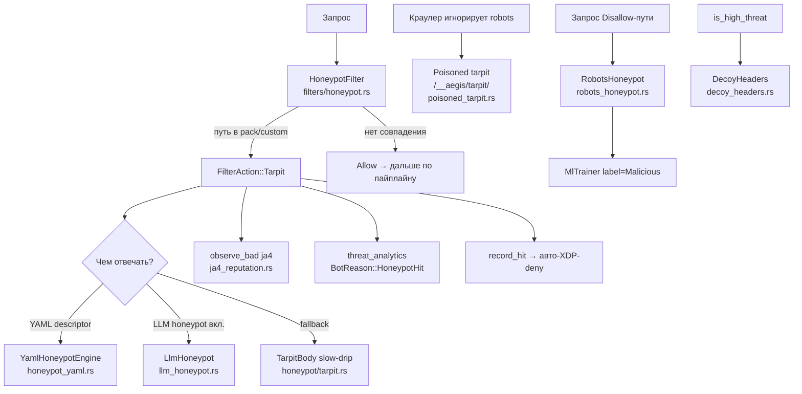

# Honeypot и tarpit

Подсистема обмана (deception) AEGIS: статические honeypot-ловушки с медленным
tarpit-ответом, YAML-сценарии многоходовых взаимодействий, LLM-honeypot с
семантическим кэшем, «отравленный» (poisoned) Markov-tarpit, авторазметка по
robots.txt и Cloudflare-decoy-заголовки. Все компоненты, кроме базового
honeypot-фильтра, являются opt-in и честно помечены ниже.

Исходники, на которые опирается этот документ:
`src/honeypot/` (`mod.rs`, `matcher.rs`, `packs.rs`, `state.rs`, `tarpit.rs`),
`src/honeypot_yaml.rs`, `src/llm_honeypot.rs`, `src/poisoned_tarpit.rs`,
`src/robots_honeypot.rs`, `src/decoy_headers.rs`, `src/latency_jitter.rs`,
а также точки интеграции: `src/filters/honeypot.rs`, `src/arsenal.rs`,
`src/proxy/pingora_http.rs`, `src/proxy/http.rs`, `src/proxy/pingora_admin.rs`,
`src/ja4_reputation.rs`, `src/threat_analytics.rs`.

---

## 1. Карта подсистемы



Каждый блок описан ниже. Базовый honeypot-фильтр включён по умолчанию; YAML,
LLM, poisoned tarpit, robots-honeypot и decoy-заголовки требуют явного
включения (env-флаг, путь к файлу или наличие arsenal/wiring).

---

## 2. Базовый honeypot-фильтр (`src/honeypot/`)

### 2.1 Принцип

Оператор не пишет ловушки руками — AEGIS поставляет **18 встроенных pack’ов**
URL-паттернов, которые встречаются исключительно в словарях автоматических
сканеров (`src/honeypot/packs.rs`, `BUILTIN_PACKS`). Попадание на любой такой
путь — это сигнал с нулевым (по замыслу) уровнем ложноположительных
срабатываний: ни один реальный пользователь не запрашивает `/.git/config`,
`/wp-config.php.bak` или `/.aws/credentials`.

Фильтр живёт в начале пайплайна (после threat_intel + ip_acl), один просмотр
матчера завершает запрос до запуска более тяжёлых фильтров
(`src/filters/honeypot.rs`, комментарий вверху файла). При совпадении он
возвращает `FilterAction::Tarpit { duration_seconds, chunk_bytes,
server_header, reason }`, а обработчик прокси превращает это в медленный
slow-drip-ответ.

### 2.2 Встроенные pack’и

`BUILTIN_PACKS` (`src/honeypot/packs.rs`):

| id | Назначение |
|----|------------|
| `wordpress` | wp-admin/xmlrpc/wp-config и т.п. |
| `secrets` | `.env`, `.git/config`, AWS/SSH/история шеллов |
| `php_admin` | phpMyAdmin / phpinfo / info.php |
| `drupal` | CHANGELOG, install/update, user/register |
| `joomla` | administrator, configuration.php |
| `xenforo` | install/, internal_data/, src/, admin.php?… |
| `magento` | downloader/, shell/, Magento_Version |
| `shells` | типовые имена webshell’ов (c99/r57/wso/alfa/2017-2026.php …) |
| `backup_dumps` | SQL-дампы и backup-архивы |
| `vendor_paths` | composer/npm-артефакты (vendor/, composer.json, …) |
| `ci_cd` | пайплайны/контейнеры (.gitlab-ci.yml, Dockerfile, …) |
| `iot_default` | Mirai/Hajime/Gafgyt-пробы роутеров (HNAP1/, luci, GponForm/…) |
| `java_admin` | Spring actuator, Tomcat manager, JMX |
| `monitoring` | server-status, nginx_status, debug/pprof/* |
| `git_repos` | .git/*, .svn/*, .hg/*, CVS/* |
| `fuzzer_noise` | топ dirb/ffuf/gobuster (/secret/, /admin/, /backup/, …) |
| `windows_iis` | IIS/ASP/.NET (Trace.axd, elmah.axd, web.config) |
| `node_npm` | source maps, dist/, __debug__ |

Инварианты закреплены тестами `packs.rs`: id уникальны, у каждого pack’а есть
пути/имя/описание, id в slug-форме (`[a-z0-9_]`), всего ≥ 12 pack’ов и
≥ 200 путей (`total_path_count()`).

> Историческая оговорка: легаси-пробы Drupal вида `/?q=admin` удалены в V234,
> потому что матчер работает только по пути (запрос-строка отбрасывается),
> и такой паттерн сколлапсировал бы в корень `/`, отравив весь сайт. См. §2.5.

### 2.3 Синтаксис паттернов и матчер

Матчер (`src/honeypot/matcher.rs`, `HoneypotMatcher`) поддерживает три формы,
зеркалящие синтаксис URI-бюджетов rate-limit:

| Форма | Семантика | Хранится как |
|-------|-----------|--------------|
| `/foo` | точное совпадение (`O(1)` через `HashSet`) | exact |
| `/foo/*` | префикс (всё под `/foo/`) | prefix `/foo/` |
| `*/foo` | суффикс на любой глубине (`*/.env` ловит `/a/b/.env`) | suffix `/foo` |

Безопасность сопоставления (важно для операторов):

- **Канонизация пути (V233)**: и паттерны, и путь запроса прогоняются через
  `crate::normalisation::canonical_path` — percent-decoding (многопроходный,
  ловит `%2561`→`%61`→`a`), схлопывание `.`/`..` и повторных слэшей,
  приведение к нижнему регистру, отбрасывание query-строки. Поэтому
  `/%61dmin/x.php` всё равно попадает в honeypot `/admin/*`. Функция
  panic-free на любом входе (тест `no_panic_on_malformed_path`).
- **Регистронезависимость**: сканеры часто рандомят регистр — матчер
  сравнивает в нижнем регистре.
- **Префикс ловит и «голую» директорию (V233)**: `canonical_path` схлопывает
  завершающий слэш, поэтому `/wp-admin/*` совпадает и с `/wp-admin`, и с
  `/wp-admin/`.

### 2.4 Состояние, persistence, hot-reload (`state.rs`)

Состояние хранится в **одном JSON-файле**, по умолчанию
`/var/lib/aegis/honeypots.json` (`DEFAULT_STATE_PATH`). React-панель и admin
API пишут в него, демон перечитывает по изменению mtime — без перезагрузки
конфига. Структура `HoneypotState`:

| Поле | Тип | Default | Назначение |
|------|-----|---------|------------|
| `enabled` | bool | `true` | мастер-выключатель; `false` → фильтр no-op |
| `packs` | map id→bool | все `true` | глобальный вкл/выкл pack’ов |
| `per_host` | map host→(id→bool) | `{}` | переопределение по `Host:` |
| `custom_paths` | `Vec<String>` | `[]` | доп. паттерны (та же грамматика) |
| `tarpit_seconds` | u64 | `30` | длительность tarpit; `0` → обычный отказ |
| `tarpit_chunk_bytes` | usize | `50` | размер чанка (один чанк каждые 5 с) |
| `score_bump` | u32 | `50` | прибавка к threat-скореру на каждое попадание |
| `auto_xdp_deny_threshold` | u32 | `3` | после N попаданий с IP → авто-XDP-deny; `0` выкл |
| `server_header` | String | `Apache/2.4.41 (Ubuntu)` | поддельный `Server:` |
| `host_disabled` | `HashSet<String>` | `{}` | полный байпас фильтра для домена |

Свежая установка приходит с «всё включено»; оператор выключает pack только
если реально держит соответствующий софт (например, свой WordPress на
`blog.acme` — выключить pack `wordpress` для этого хоста или добавить хост в
`host_disabled`).

Производительность hot-path (`HoneypotStore::check`):

- **Throttle перечитывания (V229)**: `refresh()` дросселируется до 1 раза в
  секунду через атомарную метку времени — иначе на каждый запрос уходил бы
  `statx`-syscall (профиль показал ~24% syscall-времени). Правки из панели
  применяются в пределах следующего секундного окна.
- **Три fast-path в `check()`**: (1) мастер-выключатель, (2) `host_disabled`
  (O(1)), (3) пустой матчер (все pack’и выключены для хоста) — обходят
  `canonical_path` целиком.
- **`hits_by_ip`** — 16-шардовый `DashMap` (V230) для редких попаданий;
  `record_hit(ip, threshold)` возвращает `true` при пересечении порога.
  `cleanup_stale` вызывается только из фонового GC.

Compiled-представление (`Compiled`) пересобирает по-хостовые матчеры при
смене файла. Приоритет: per-host override → глобальный pack → default-on.

### 2.5 Защита от вырожденных паттернов (V234)

Любой паттерн, чьё канонизированное тело сворачивается до корня `/`
(`/`, `/.`, `/..`, `/*`, `*`, `*/`, `/?x=1`, `/#frag` …), **отбрасывается** на
этапе `from_patterns`. Это load-bearing-защита: иначе один такой паттерн
(в т.ч. из `custom_paths` оператора) затарпитил бы каждый запрос к корню и
положил весь домен. Тесты `query_only_pattern_never_matches_root` и
`degenerate_patterns_never_match_root` фиксируют это.

### 2.6 Tarpit slow-drip (`src/honeypot/tarpit.rs`)

Обычный отказ (HTTP 403) мгновенно закрывает TCP — сканер сразу идёт дальше.
`TarpitBody` вместо этого удерживает соединение открытым на ~`duration_seconds`,
отдавая `chunk_bytes` байт каждые **5 секунд** через chunked-transfer. Воркер
сканера «висит» в ожидании ответа, пока его пул конкурентности истощается.

Реализация — кастомный `http_body::Body`: `poll_frame` возвращает
`Poll::Pending` до срабатывания таймера, затем отдаёт один чанк и перевзводит
таймер. Число чанков = `ceil(duration_seconds / 5)`. Контент чанка — точки
(`.`), похожие на «загрузку» и не триггерящие content-sniffing. Первый чанк
тоже отдаётся с задержкой (мгновенный ответ выдал бы tarpit).

На стороне `aegis-pingora` (data plane) tarpit-ветка
(`src/proxy/pingora_http.rs`, обработка `FilterAction::Tarpit`) воспроизводит
ту же семантику: dot-stream чанками, либо — если включён responder — отдаёт
синтезированный ответ (см. §3, §4). Действие логируется как `event_action =
"tarpit"`, инкрементируется кластерный слот `TARPIT`.

---

## 3. YAML-дескрипторы honeypot (`src/honeypot_yaml.rs`)

Beelzebub-подобные сценарии: оператор описывает многоходовые honeypot-эндпоинты
в YAML, а не в Rust/DSL. Каждый дескриптор связывает паттерн пути с
детерминированным state-machine: на каждом ходе (turn) — триггер и ответ.
Состояние ведётся **per (IP, дескриптор)**, поэтому инструменты, идущие по
ссылкам, естественно переходят к следующему ходу.

### 3.1 Схема

```yaml
- name: fake-phpmyadmin
  path: /phpmyadmin/*
  turns:
    - on: login_view
      response:
        status: 200
        headers:
          server: "Apache/2.4.41"
        body: "<title>phpMyAdmin login</title>…"
    - on: login_submit
      trigger_body_contains: "pma_password="
      response:
        status: 200
        body: "<title>Login error</title>…"
    - on: brute_attempt
      trigger_body_contains: "pma_password="
      repeat_after_ms: 800       # slow-replay tarpit
      response:
        status: 429
        body: "Too many requests"
```

Поля (`Descriptor` / `Turn` / `TurnResponse`):

| Поле | Уровень | Назначение |
|------|---------|------------|
| `name` | descriptor | имя; ключ сессии вместе с IP |
| `path` | descriptor | паттерн (`/exact`, `/prefix/*`, `*/suffix`) |
| `turns[].on` / `name` | turn | метка хода (`label`) |
| `turns[].trigger_body_contains` | turn | подстрока, которая должна быть в теле, иначе ход не «срабатывает» |
| `turns[].repeat_after_ms` | turn | задержка медленного повтора (slow-replay tarpit) |
| `response.status` | turn | HTTP-код (default 200) |
| `response.headers` | turn | список заголовков (`server: …` и т.п.) |
| `response.body` | turn | тело |

### 3.2 State-machine

`YamlHoneypotEngine::step(ip, descriptor_name, body)`:

- сессии — шардовый `DashMap<(IpAddr, usize), SessionState>` (V230, 128 шардов;
  ключ из двух `Copy`-полей → нет аллокаций на запрос);
- на каждом ходе проверяется `trigger_body_contains` против **текущего** хода;
  если триггер есть (или его нет в дескрипторе) и есть следующий ход —
  `next_turn += 1`;
- по достижении конца скрипта движок остаётся на последнем ходе (последующие
  запросы получают финальный ответ — удобно для tarpit-концовок);
- TTL сессии — 900 с бездействия (`with_session_ttl`), GC через `gc()`
  (фоновый путь, per-shard `retain`).

`match_descriptor(path)` — первое совпадение по порядку списка (`match_path`:
`/*`-префикс, `*/`-суффикс, либо точное равенство).

### 3.3 Парсер

`parse_descriptors(yaml)` — минимальный YAML-парсер под эту схему (без
зависимости от `serde_yaml`): один список mapping’ов, значения — скаляры или
один уровень вложенного mapping. Для более богатого YAML оператор может
подставить `serde_yaml` на стороне вызова — это zero-dep fallback.

### 3.4 Включение и дефолтный набор

YAML-движок живёт в `ArsenalState` (`src/arsenal.rs`,
`yaml_honeypot: Arc<YamlHoneypotEngine>`). Набор дескрипторов берётся из
`default_honeypot_descriptors()`:

- env-переменная **`AEGIS_HONEYPOT_YAML`** — путь к файлу; если файл читается,
  он **перекрывает** встроенный дефолт;
- иначе — встроенный `DEFAULT_HONEYPOT_YAML` (дескрипторы `fake-phpmyadmin`,
  `fake-wp-login`, `fake-dotenv`, `fake-git-config`);
- при ошибке парсинга демон **не падает**: логирует warning и работает с
  пустым набором.

---

## 4. LLM-honeypot (`src/llm_honeypot.rs`)

Galah-подобный honeypot: LLM синтезирует контекстно-правдоподобные HTTP-ответы
на лету (выглядит как настоящий WordPress / phpMyAdmin / git-config), без
заранее написанных fixture’ов. Ключевая идея, делающая это пригодным для прода —
**семантический кэш**: один и тот же сканер видит консистентные ответы на
повторах (иначе он зафингерпринтит LLM по разбросу ответов).

### 4.1 Семантический ключ

`SemanticKey::compute(method, path_template, header_names, body_shape)`:
FNV-1a 160-бит → 20 байт (криптостойкость не нужна, это ключ кэша). По замыслу
косметические вариации (значение query, request-id, timestamp) схлопываются в
один ключ, а **другая техника атаки** даёт новый синтез:

```
SemanticKey = hash( method | path_template | sorted(header_names) | body_shape )
```

`body_shape(body, content_type)` нормализует тело: для JSON — отсортированные
top-level-ключи, для form-urlencoded — имена параметров, иначе пустая строка
(тесты: `{"b":1,"a":2}` → `"a,b"`; `user=root&pass=x` → `"pass,user"`).

### 4.2 Кэш и поток

`LlmHoneypot::respond(ctx, key)`:

1. lookup в кэше → попадание возвращает ответ сразу (учёт `hits`);
2. промах → `LlmClient::synthesise(ctx)`, кэшируем и возвращаем (учёт `misses`).

Кэш — `RwLock<HashMap<SemanticKey, Entry>>` с TTL и ёмкостью; при заполнении
вытесняется самый старый элемент (линейный скан, учёт `evictions`). Без
семантического хэша получили бы либо cache-thrash (взрыв стоимости LLM), либо
переусреднённые одинаковые ответы (фингерпринт LLM).

### 4.3 Провайдер LLM

Сам вызов модели спрятан за трейтом `LlmClient` — оператор подключает любого
провайдера (OpenAI, Anthropic, vLLM, Ollama, llama.cpp). По умолчанию в
`ArsenalState` подключён **`StubLlm`** (TTL 3600 с, ёмкость 4096), который
без реального LLM рендерит правдоподобный `Index of …` (Apache 2.4.41).

> Честная оговорка: «из коробки» LLM-honeypot отвечает stub-страницами, а не
> реально сгенерированным LLM-контентом. Реальный LLM требует, чтобы оператор
> реализовал трейт `LlmClient` и подключил его на месте конструирования
> arsenal — в дереве это не зашито.

### 4.4 Включение и приоритет ответа

Включается env-флагом **`AEGIS_LLM_HONEYPOT=1`** (кэшируется в поле
`self.llm_honeypot` обработчика, без env-lookup на запрос —
`src/proxy/pingora_http.rs`). В tarpit-ветке, если флаг включён и arsenal
подключён, вызывается `arsenal.honeypot_respond(...)` (`src/arsenal.rs`),
который выбирает ответ в порядке приоритета:

1. **YAML-дескриптор** для пути (если `match_descriptor` нашёл) → шаг
   state-machine, счётчик `yaml_honeypot_engagements`;
2. иначе — **LLM-honeypot** (`SemanticKey` из method/path/host-ua/body_shape),
   счётчик `llm_honeypot_responses`.

Синтезированный ответ заменяет «точечный» dot-stream — более правдоподобное
взаимодействие удерживает сканер дольше. Если responder ничего не вернул,
ветка проваливается в обычный slow-drip.

---

## 5. Poisoned tarpit (`src/poisoned_tarpit.rs`)

Линия Iocaine / Nepenthes / HellPot / caddy-defender `garbage`. Урок после
2024: блокировать дёшево (бот просто ретраит с другого IP), а **отравление**
эффективнее — отдать скрейперу правдоподобный, но сгенерированный мусор, чтобы
разбавить его обучающий корпус и поднять стоимость краулинга. AEGIS дополняет
slow-drip-tarpit (§2.6) *контентной* стороной: Markov-генератор текста + HTML
с бесконечными внутренними ссылками внутрь tarpit’а. AI-скрейперы, игнорящие
robots.txt, попадают в лабиринт и жгут CPU, бесконечно обходя фейковые страницы.

### 5.1 Markov-генератор

`MarkovChain::train(corpus)` — биграммная цепь (`(prev,next)→count`), сэмплинг
по кумулятивным весам (бинарный поиск). Биграммы выбраны над униграммами: выход
заметно связнее при почти той же памяти. `generate(target_words, seed)`
детерминирован по `seed`; начинает с «стартового» слова (после `.`/`!`/`?` или
в начале корпуса), на тупиковых токенах берёт новый стартер.

### 5.2 Корпус

Оператору рекомендуется подать свой seed-корпус (кусок public-domain текста) по
двум причинам: (1) **детерминирован-но-уникален** — tarpit каждого деплоя
выглядит по-разному, бот не обобщит распознавание между операторами;
(2) **правдоподобный словарь** — корпус формирует выход (docs-сайт хочет
docs-подобный мусор). Без корпуса используется намеренно крошечный
`FALLBACK_CORPUS` (несколько Lorem-предложений) — чтобы подтолкнуть к
кастомизации.

### 5.3 Рендер страницы и chunked-pacing

`TarpitGenerator` (поля `paragraphs_per_page=4`, `words_per_paragraph=80`,
`links_per_page=12`, `link_prefix="/__aegis/tarpit/"`):

- `render(seed)` — детерминированный HTML: `<h1>` + N абзацев Markov-текста +
  `<nav>` со ссылками на `/__aegis/tarpit/<slug>` (slug — 8-символьный base36,
  выглядит как реальный article-slug). Тот же seed → та же страница (иначе бот
  решил бы «сайт динамический, в приоритет»).
- `render_chunks(seed, n_chunks)` — режет страницу на ~равные куски для
  медленной потоковой отдачи, безопасно по границам UTF-8.
- Весь HTML экранируется (`html_escape`) — даже инъекционные токены из корпуса
  не проходят сырыми (тест `tarpit_escapes_corpus_dangerous_chars`).

Hot-path безопасен: Markov-walk — `O(n)` по длине вывода (~100 нс/слово),
эндпоинт отдаёт на line-rate; медленным делается именно *время ответа*
(межчанковая задержка).

`seed_from_slug(slug)` — стабильный FNV-1a-хэш: один slug всегда даёт ту же
страницу.

### 5.4 Anti-fingerprint jitter (V190)

Межчанковая задержка не фиксирована, а сэмплируется из лог-нормального
распределения (`jittered_chunk_delay` → `latency_jitter::sample`,
`Distribution::default_tarpit()` = `LogNormal { median_ms: 350, sigma: 0.55 }`).
Равномерный sleep сам по себе фингерпринт; jitter имитирует сетевой джиттер и
ломает latency-фингерпринтинг.

### 5.5 Подача на data plane

Эндпоинт обслуживается в `aegis-pingora` (`src/proxy/pingora_http.rs`, V152):
если `tarpit_generator` подключён (`Option<Arc<TarpitGenerator>>`) и путь
начинается с **`/__aegis/tarpit/`**, генерируется `render_chunks(seed,
self.tarpit_chunks)` (по умолчанию `tarpit_chunks = 20`), ответ отдаётся с
`x-aegis-tarpit: 1` и `cache-control: no-store`, между чанками — jitter-задержка
(при подключённом arsenal) либо фикс-задержка `tarpit_chunk_delay`. Счётчик
`latency_jitter_emits`. В `src/filters/engine.rs` путь `/__aegis/tarpit/<slug>`
распознаётся для маршрутизации в лабиринт.

> Честная оговорка: poisoned tarpit активен только когда `tarpit_generator`
> подключён в обработчике (opt-in wiring); сами «бесконечные» ссылки в обычных
> honeypot-ответах не публикуются автоматически — лабиринт обходится тем, кто
> уже зашёл по сгенерированной ссылке `/__aegis/tarpit/<slug>`.

---

## 6. robots.txt honeypot — авторазметка (`src/robots_honeypot.rs`)

robots.txt — бесплатный источник honeypot-путей: каждая строка `Disallow:` —
путь, публично объявленный запретным для совместимых краулеров. Клиент,
посетивший `Disallow`-путь, сам себя пометил как несовместимый краулер —
именно та популяция, для которой ML-модели нужно больше меток.

### 6.1 Разбор и сопоставление

`RobotsRules::parse(contents)` загружает только правила из секции
`User-agent: *` (per-bot stanzas игнорируются), снимает inline-комментарии,
отбрасывает пустые `Disallow:`. `is_disallowed(path)`: путь сопоставляется с
`Disallow`-паттернами (`*` — glob через двухуказательный backtrack; без `*` —
префикс), при этом `Allow` переопределяет `Disallow` (конвенция robots.txt).

### 6.2 Подача метки в обучение

`RobotsHoneypot::observe_request(path, honoured_robots)` при совпадении
`Disallow` и `honoured_robots == false` кладёт в `MlTrainer` образец
`Label::Malicious` с синтезированным вектором `FeaturesV2`
(`synthesise_features`: длина/энтропия URI, отсутствие browser-заголовков и
JA4, повышенный baseline `fp_consistency_score = 0.3`). Возвращает `true`, если
метка эмитирована. Это самообучающий мост: следующий retrain учит «форму»
такого запроса. См. [18-ml-risk-engine.md](18-ml-risk-engine.md).

Опциональное уточнение: флаг `honoured_robots` снижает ложные метки (RSS-ридеры,
link-preview-боты ходят на `Disallow`-пути без злого умысла). Если оператор
подключит per-IP-трекер «забрал ли этот IP /robots.txt первым?», метки получат
только IP, которые **не** забирали. По умолчанию (флаг unwired = `false`)
размечается каждое посещение `Disallow`-пути.

### 6.3 Включение

Поле обработчика `robots_honeypot: Option<Arc<RobotsHoneypot>>` (opt-in,
по умолчанию `None`; включается через `with_robots_honeypot(...)`,
`src/proxy/pingora_http.rs`, V154). В hot-path вызывается **наблюдательно** —
не гейтит запрос, только пушит обучающий образец при совпадении `Disallow`.
AEGIS robots.txt не генерирует — это задача сайта; оператор подаёт свой файл.

> Честная оговорка: robots-honeypot выключен, пока его явно не подключат
> (`with_robots_honeypot`); это только источник ML-меток, без блокировки.

---

## 7. Decoy-заголовки (`src/decoy_headers.rs`)

Scrapling и подобные адаптивные скрейперы инспектируют заголовки/cookie ответа,
чтобы определить, какой WAF/CDN защищает сайт, и подгрузить соответствующую
стратегию обхода. Если AEGIS выдаёт **поддельные Cloudflare-заголовки**
подозрительным клиентам, атакующий выбирает не тот playbook и жжёт время на
обходы, которые к нам не применимы.

### 7.1 Семейства и заголовки

`DecoyHeaders::build(family, conn_id)` детерминирован по `conn_id` (ретраи
совпадают). Поддерживаемые семейства (`DecoyFamily`):

| Семейство | Server | Характерные заголовки |
|-----------|--------|------------------------|
| `Cloudflare` | `cloudflare` | `cf-ray: <16hex>-FRA`, `cf-cache-status: DYNAMIC`, `alt-svc`, `set-cookie: __cf_bm=…` |
| `Akamai` | `AkamaiGHost` | `x-akamai-request-id`, `x-cache: TCP_MEM_HIT …`, `x-reference` |
| `Fastly` | `Varnish` | `x-served-by`, `x-cache: HIT`, `x-fastly-request-id` (32 hex) |
| `CloudFront` | `CloudFront` | `x-amz-cf-pop`, `x-amz-cf-id`, `via: 1.1 ….cloudfront.net (CloudFront)` |

Идея альтернативных семейств: выбрать платформу, под которую у
Scrapling/Botasaurus самый глубокий код обхода, чтобы они потратили максимум
усилий впустую. Hex/decimal-значения пишутся вручную (без `format!`) — это
сборка на hot-ish пути под устойчивой атакой; тест
`hex_writers_match_format_macros` фиксирует wire-эквивалентность.

### 7.2 Политика выдачи

`should_decoy(challenge_fired, ml_score, honeypot_hit)` →
`challenge_fired || honeypot_hit || ml_score >= 0.65`. Чистому трафику decoy
**не** выдаётся — иначе обман утечёт легитимным пользователям.

### 7.3 Подача на data plane

В `aegis-pingora` (`src/proxy/pingora_http.rs`, V188, фаза
`response_filter`): при подключённом arsenal и `ctx.is_high_threat` (клиент
только что прошёл challenge или несёт высокий threat-скор) в ответ добавляются
Cloudflare-decoy-заголовки (`conn_id` выводится из client IP), счётчик
`decoy_header_emits`.

> Оговорка: в data plane сейчас жёстко используется семейство `Cloudflare`;
> остальные семейства реализованы и протестированы в модуле, но переключатель
> семейства на горячем пути не выведен.

---

## 8. Самообучение JA4 и threat-analytics

Honeypot/tarpit — высокоточные источники «подтверждённо плохих» клиентов,
поэтому они кормят несколько самообучающихся подсистем.

### 8.1 Самообучение JA4-репутации (V244)

`Ja4Reputation::observe_bad(ja4, tag)` (`src/ja4_reputation.rs`) — записывает
JA4 клиента, попавшегося на однозначно-злонамеренном исходе. Это
self-populating-сигнал без внешнего фида: тот же fingerprint будет помечен на
будущих запросах. Защиты:

- no-op, если auto-learn выключен (`observed_path` не задан), JA4 пустой или
  не содержит `_`;
- **отказ учить вырожденный JA4 (V246)**: если захват полей ClientHello пуст,
  cipher/extension-хэш = SHA256("") (одинаков для всех) — `is_degenerate_ja4`
  отсекает такие, иначе пометили бы весь трафик;
- dedup + cap (`OBSERVED_CAP`): дисковый I/O — максимум один раз на *новый*
  fingerprint; запись через `O_APPEND` (атомарна для суб-4КБ строк).

Точки вызова (`src/proxy/pingora_http.rs`):

| Исход | tag |
|-------|-----|
| Deny по фильтру `honeypot` | `"honeypot"` |
| Deny по фильтру `waf` | `"waf"` |
| Tarpit-engagement | `"tarpit"` |

См. [12-reputation.md](12-reputation.md) и [11-tls-fingerprinting.md](11-tls-fingerprinting.md).

> Тонкость точности: эффективность зависит от реального захвата полей
> ClientHello (gate fingerprinting / `set_client_hello_callback`). Без него JA4
> может выродиться, и V246-страховка просто откажется учить — это сознательный
> trade-off в пользу отсутствия ложных меток.

### 8.2 threat-analytics (V121)

При deny-исходе обработчик зовёт `record_bot(client_ip, bot_reason)`
(`src/threat_analytics.rs`). Для фильтра `honeypot` причина —
`BotReason::HoneypotHit` (строковый тег `"honeypot_hit"`), для `waf` —
`WafSignature`. Параллельно `observe_endpoint_hit(host, generalise_path(path),
ip)` разделяет «единичный IP-бот» и «распределённая атака на эндпоинт» для
admin-UI. Honeypot-попадание также бампит sliding-window threat-скорер
(`record_denied`), что ранжирует IP в `/admin/threats`. См.
[25-metrics-telemetry.md](25-metrics-telemetry.md).

### 8.3 Авто-XDP-deny и BGP RTBH

- **Авто-XDP-deny**: `HoneypotStore::record_hit(ip, threshold)` (по умолчанию
  порог 3); при пересечении IP добавляется в XDP deny-set
  (`src/proxy/http.rs`: `xdp.deny_v4/deny_v6`), и будущие SYN’ы дропаются на
  line-rate. См. [13-xdp-ebpf.md](13-xdp-ebpf.md).
- **BGP RTBH (V187)**: honeypot-deny (или threat-скор ≥ 80) при подключённом
  arsenal анонсирует /32 через ExaBGP-диспетчер (`bgp_rtbh.announce`), счётчик
  `bgp_rtbh_announces`. См. [19-bgp-rtbh.md](19-bgp-rtbh.md).

### 8.4 Online signature miner (V107)

В tarpit-ветке `self.tarpit_logger.record(path)` логирует payload для онлайн-
майнера сигнатур (no-op, пока не задан `AEGIS_TARPIT_LOG`). См.
[10-waf.md](10-waf.md).

---

## 9. Admin API и панель

Управление honeypot’ами — через admin API (`src/proxy/pingora_admin.rs`),
страница панели `/admin/ui/honeypots`. Состояние читается/пишется как
`HoneypotState` целиком (см. §2.4). Основные маршруты:

| Метод | Путь | Действие |
|-------|------|----------|
| GET | `/admin/api/honeypots` | полный `HoneypotState` |
| GET | `/admin/api/honeypots/builtin` | список встроенных pack’ов с путями |
| PUT | `/admin/api/honeypots` | заменить всё состояние |
| PUT | `/admin/api/honeypots/global` | вкл/выкл pack глобально |
| PUT | `/admin/api/honeypots/host` | вкл/выкл pack для хоста |
| PUT | `/admin/api/honeypots/host/enabled` | байпас фильтра для хоста (`host_disabled`) |
| POST | `/admin/api/honeypots/packs/<pack_id>` | вкл/выкл pack (React) |
| POST | `/admin/api/honeypots/hosts/<host>/packs/<pack_id>` | per-host pack |
| DELETE | `/admin/api/honeypots/hosts/<host>` | сбросить per-host override |

Важно: маршрут `PUT …/host/enabled` диспетчеризуется **до** более общего
`PUT …/host` (порядок в роутере значим). Полный перечень admin-маршрутов и
ролей — в [30-admin-api.md](30-admin-api.md), описание панели —
в [29-admin-panel.md](29-admin-panel.md).

Счётчики deception доступны через arsenal-метрики (`Counters`):
`yaml_honeypot_engagements`, `llm_honeypot_responses`, `decoy_header_emits`,
`latency_jitter_emits` — и попадают в Prometheus `/metrics`.

---

## 10. Сводка: что включено по умолчанию, что opt-in

| Компонент | По умолчанию | Как включить |
|-----------|--------------|--------------|
| Honeypot-фильтр + 18 pack’ов | **включён** | `HoneypotState.enabled` (мастер-выключатель) |
| Slow-drip tarpit | **включён** (30 с) при попадании | `tarpit_seconds` (0 → обычный отказ) |
| Авто-XDP-deny | **включён** (порог 3) | `auto_xdp_deny_threshold` (0 → выкл) |
| YAML-дескрипторы | дефолтный набор в arsenal | `AEGIS_HONEYPOT_YAML=<файл>` для своего набора |
| LLM-honeypot ответы | **выкл** (и stub-провайдер) | `AEGIS_LLM_HONEYPOT=1` + реализация `LlmClient` |
| Poisoned tarpit (`/__aegis/tarpit/`) | **выкл** | подключить `tarpit_generator` (опц. свой корпус) |
| robots.txt honeypot (ML-метки) | **выкл** | `with_robots_honeypot(...)` + свой robots.txt |
| Decoy-заголовки | при `is_high_threat` (нужен arsenal) | подключить arsenal; политика `should_decoy` |
| Самообучение JA4 (`observe_bad`) | при заданном `observed_path` | см. [12-reputation.md](12-reputation.md) |

---

## См. также

- [10-waf.md](10-waf.md) — WAF-сигнатуры, online signature miner
- [11-tls-fingerprinting.md](11-tls-fingerprinting.md) — JA3/JA4/JA4H/JA4T
- [12-reputation.md](12-reputation.md) — JA4-репутация, self-learn, ASN/CIDR/CrowdSec
- [13-xdp-ebpf.md](13-xdp-ebpf.md) — XDP deny-set (авто-deny)
- [18-ml-risk-engine.md](18-ml-risk-engine.md) — ML-движок и обучение (robots-метки)
- [19-bgp-rtbh.md](19-bgp-rtbh.md) — BGP RTBH через ExaBGP
- [21-arsenal-scenarios.md](21-arsenal-scenarios.md) — Defence Arsenal и сценарии
- [25-metrics-telemetry.md](25-metrics-telemetry.md) — метрики deception
- [29-admin-panel.md](29-admin-panel.md), [30-admin-api.md](30-admin-api.md) — управление
