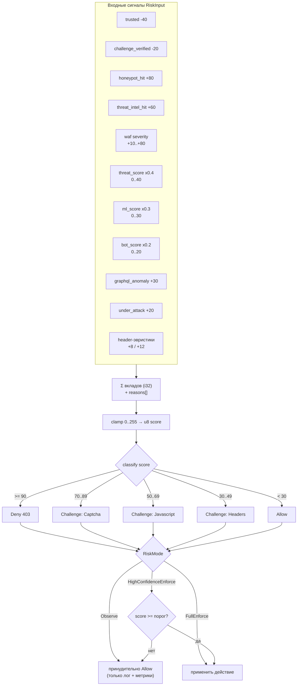
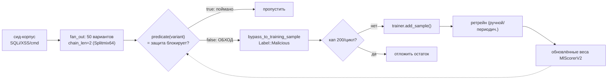

# ML и risk engine

AEGIS объединяет десятки слабых сигналов (WAF, TLS-фингерпринты, репутация, поведение, ML-инференс) в один объяснимый скоринг через **Risk Engine** (`src/ddos/risk_engine.rs`), а в качестве одного из входов этого скоринга использует встроенный **ML-движок** — логистическую регрессию V97/V122 или GBM-деревья V136 (`src/ddos/`). Весь ML работает внутри процесса `aegis-pingora`: нет Python, нет внешнего model-сервера, инференс ~50–500 нс на запрос, онлайн-дообучение и adversarial self-training.

> Соседние документы: [10-waf.md](10-waf.md), [11-tls-fingerprinting.md](11-tls-fingerprinting.md), [12-reputation.md](12-reputation.md), [15-challenge-ladder.md](15-challenge-ladder.md), [17-honeypot-tarpit.md](17-honeypot-tarpit.md), [20-geoip.md](20-geoip.md), [22-enrichment.md](22-enrichment.md), [24-request-log.md](24-request-log.md), [25-metrics-telemetry.md](25-metrics-telemetry.md). Подробный operator-гайд по ML-конвейеру: [ml-pipeline.md](../en/reference/ml-pipeline.md).

---

## 1. Два уровня: Risk Engine и ML-скорер

Важно не путать два компонента — они работают в связке, но это разные подсистемы:

| Компонент | Файл | Что делает | Шкала |
|---|---|---|---|
| **Risk Engine** (V108) | `src/ddos/risk_engine.rs` | Фьюзит ВСЕ сигналы (включая выход ML) в один скоринг с понятными `reasons`, выбирает действие (Allow/Challenge/Deny) по режиму | `0..255` (u8) |
| **ML-скорер** (V97/V122/V136) | `src/ddos/ml_score.rs`, `ml_score_v2.rs`, `ml_gbm.rs`, `ml_model.rs` | Один вектор фич → одна вероятность «вредоносности» | `0..1` → `*100` = `0..100` |

ML-скорер — это **один из входов** Risk Engine (поле `ml_score: f64` в `RiskInput`). Risk Engine может работать и без ML (тогда `ml_score = 0`), а ML-скорер может использоваться отдельно для маршрутизации кэша по `ThreatTier` (см. [ml-pipeline.md](../en/reference/ml-pipeline.md)).

---

## 2. Risk Engine: режимы Observe / HighConfidenceEnforce / FullEnforce

До V108 каждый фильтр (WAF, bot, adaptive, challenge, ml_scorer, threat_intel, honeypot) принимал собственное независимое решение `Allow/Deny/Challenge` и короткозамыкал конвейер. Это быстро, но слепо к L7-атакам, видимым только как **сумма слабых сигналов** — редкий JA4 + пустой Accept-Language + энтропия URI + всплеск 404. Risk Engine — единый объяснимый компонент: на вход берёт все сигналы, на выход даёт `RiskDecision { score, action, reasons }`.

### 2.1. Три режима (`RiskMode`)

Определены в `src/ddos/risk_engine.rs`:

| Режим | Поведение | Назначение |
|---|---|---|
| `Observe` | Скоринг считается и логируется, **действие НИКОГДА не применяется** — всегда возвращается `Allow`. Это значение по умолчанию (`#[default]`). | Безопасный старт: оператор неделю смотрит метрики/распределение скоров. |
| `HighConfidenceEnforce` | Действие применяется **только** если `score ≥ enforce_threshold`. Ниже порога возвращается `Allow`, и работает legacy-конвейер пофильтровых решений. | Рекомендуемый прод-режим, пока распределение скоров не провалидировано на реальном трафике. |
| `FullEnforce` | Применяется решение движка независимо от скора. | Только после длительного наблюдения + shadow-валидации (область V109+). |

Порог по умолчанию: `DEFAULT_ENFORCE_THRESHOLD = 90` (`with_threshold(t)` позволяет переопределить).

> **Честная оговорка (из кода).** Конфиг знает три значения режима — `Off | Observe | Enforce` (`crate::config::RiskEngineMode`). При выборе `Enforce` `aegis-pingora` создаёт движок в режиме `HighConfidenceEnforce`, но логирует предупреждение: *«action-application (Stage 3) is NOT yet wired, so the engine runs in SHADOW (scores logged, live allow/deny decisions UNCHANGED)»* (`src/proxy/pingora_http.rs`). То есть на текущем срезе кода Risk Engine фактически работает как теневой скорер: считает, логирует, отдаёт метрики, но не подменяет живые allow/deny-решения legacy-фильтров. `FullEnforce` существует в типе `RiskMode`, но из конфигурации не выбирается.

### 2.2. Включение

`AEGIS_RISK_ENGINE_MODE` переопределяет конфиг (как и прочие `AEGIS_*` runtime-кнопки):

```sh
# /etc/aegis/aegis.env
AEGIS_RISK_ENGINE_MODE=observe   # off | observe | enforce
# restart применит изменение
systemctl restart aegis-pingora.target
```

При `off` (по умолчанию) движок не создаётся вовсе (`Option<Arc<RiskEngine>> = None`), и горячий путь платит лишь одну проверку `Option`. Опечатка в значении (`OBSERVE`, `on`) **не** молча применяет дефолт — пишется громкий `warn`, после чего берётся режим из конфига.

### 2.3. Классификация скора в действие

Кривая `classify` / `classify_score` (`src/ddos/risk_engine.rs`) — намеренно консервативна, высокие скоры требуют нескольких подтверждающих сигналов:

| Скор | Действие (`RiskAction`) | Ступень challenge |
|---|---|---|
| `≥ 90` | `Deny { status: 403 }` | — |
| `70..89` | `Challenge` | `Captcha` |
| `50..69` | `Challenge` | `Javascript` |
| `30..49` | `Challenge` | `Headers` |
| `0..29` | `Allow` | — |

Ступени challenge — см. [15-challenge-ladder.md](15-challenge-ladder.md).

---

## 3. Сигналы и их веса в фьюзе

Risk Engine принимает `RiskInput<'a>` (все поля `Option`/дефолтные, движок переживает частичное состояние). Метод `evaluate()` суммирует вклады в `i32`, затем клампит в `0..255 → u8`. Каждый сработавший вклад добавляет стабильный `&'static str` в `reasons` (для агрегации в SIEM и для Prometheus-меток с ограниченной кардинальностью).

### 3.1. Таблица вкладов (точно из `evaluate()`)

| Сигнал (поле `RiskInput`) | Вклад в скор | `reason` (условие) | Источник |
|---|---|---|---|
| `trusted` | **−40** | `trusted` | bypass / dynamic-trust / fp-cookie |
| `challenge_verified` | **−20** | `challenge_verified` | пройденный challenge / fp-cookie |
| `honeypot_hit` | **+80** | `honeypot_hit` | honeypot path/pack ([17](17-honeypot-tarpit.md)) |
| `threat_intel_hit` | **+60** | `threat_intel_hit` | threat-intel feed по IP ([12](12-reputation.md)) |
| `waf` = Critical | **+80** | `waf_critical` | `WafSignal.severity` ([10](10-waf.md)) |
| `waf` = High | **+50** | `waf_high` | — |
| `waf` = Medium | **+25** | `waf_medium` | — |
| `waf` = Low | **+10** | `waf_low` | — |
| `threat_score` (0..100) | `×0.4` → `0..40` | `threat_score_high` (≥30) / `threat_score_medium` (≥15) | V37 ThreatScorer (кластерный с V90+) |
| `ml_score` (0..100) | `×0.3` → `0..30` | `ml_high` (≥20) | ML-скорер V97/V122/V136 |
| `bot_score` (0..100) | `×0.2` → `0..20` | `bot_reputation_high` (≥15) | V37 BotFilter |
| `graphql_anomaly` | **+30** | `graphql_anomaly` | GraphQL cheap-guard |
| `under_attack` | **+20** | `under_attack` | per-domain AnomalyDetector ([§5.1](#51-anomalydetector-режим-под-атакой)) |
| browser-UA без Accept-Language | **+12** | `browser_ua_no_accept_language` | эвристика по `ctx` |
| пустой/отсутствующий User-Agent (не trusted) | **+8** | `no_user_agent` | эвристика по `ctx` |

Заметьте «потолки»: ML-вклад капнут ниже ThreatScorer (`×0.3` против `×0.4`) — потому что ML эвристичен, и мы не хотим, чтобы он доминировал над установленной историей IP. Bot-репутация капнута ещё ниже (`×0.2`).

### 3.2. Trust-shortcut

`trusted` даёт сильный отрицательный сдвиг (−40), чтобы оператор-override доминировал даже при сработавших флагах. Пример из тестов: `trusted` (−40) + `waf_medium` (+25) = −15 → клампится до 0 → `Allow`, но в `reasons` останутся и `trusted`, и `waf_medium` — оператор видит, что WAF сработал, но был перебит доверием.

### 3.3. Метрики движка

`RiskEngineMetrics` (атомарные `AtomicU64`, движок остаётся `&self`): `evaluations_total`, `decisions_allow`, `decisions_challenge`, `decisions_deny`, `max_score` (диагностический gauge — помогает выбрать порог enforcement). Подробнее об экспорте — [25-metrics-telemetry.md](25-metrics-telemetry.md).

### 3.4. Mermaid: фьюз сигналов



---

## 4. ML-движок: фичи, модели, обучение

ML-скорер — это `ml_score` для Risk Engine, а также самостоятельный драйвер `ThreatTier` для кэш-маршрутизации. Единый хэндл — `MlModel` (`src/ddos/ml_model.rs`), enum-диспетчер `Logistic | Gbm` (enum, а не `dyn`-trait — на горячем пути экономит ~5 нс на вызов).

### 4.1. Версии моделей

| Модель | Файл | Фич | Тип | Онлайн-дообучение |
|---|---|---|---|---|
| **V97** | `ml_score.rs` | 8 | логистическая регрессия | да (SGD) |
| **V122/V139** | `ml_score_v2.rs` | **23** (`N_FEATURES_V2`) | логистическая регрессия | да (SGD + L2 + class-weight) |
| **V136** | `ml_gbm.rs` | 23 (тот же `FeaturesV2`) | GBM (деревья) | нет — только batch, обучают офлайн, грузят JSON |

Инференс везде заканчивается `sigmoid(z)` → вероятность в `[0,1]`; `score_pct()` = `×100`.

#### V97 — 8 фич (legacy fallback)

`Features` (`ml_score.rs`): `uri_length`, `header_count`, `body_length`, `has_user_agent`, `method_is_post`, `ja4_unusual` (FNV-bucket по JA4 против набора популярных фингерпринтов), `recent_denied_rate`, `recent_challenged_rate`. Веса по умолчанию консервативны (`has_user_agent = -1.5`, `ja4_unusual = 2.0`, `recent_denied_rate = 3.0`, bias `-2.0`). Персист — одна TOML-строка (~200 байт), hot-reload по mtime-poll.

#### V122/V139 — 23 фичи (`FeaturesV2`)

Стабильные индексы (append-only, никогда не переупорядочивать; `N_FEATURES_V2 = 23`, `schema_version = 3`):

| # | Фича | Группа | Что значит | Дефолтный вес |
|---|---|---|---|---|
| 0 | `uri_length` | shape | длина пути+query / 8192 | +0.6 |
| 1 | `query_param_count` | shape | число query-параметров / 32 | +0.3 |
| 2 | `uri_entropy` | shape | энтропия Шеннона пути (норм. на log2 128) | +1.2 |
| 3 | `query_entropy` | shape | энтропия query | +0.8 |
| 4 | `header_count` | header | число заголовков / 64 | +0.2 |
| 5 | `has_user_agent` | header | 1 = есть | **−1.5** |
| 6 | `has_accept_language` | header | 1 = есть | **−1.0** |
| 7 | `has_accept_encoding` | header | 1 = есть | **−0.8** |
| 8 | `has_referer` | header | 1 = есть | **−0.6** |
| 9 | `method_is_post` | method | POST/PUT/PATCH/DELETE | +0.1 |
| 10 | `body_length` | body | content-length / 64 КиБ | +0.3 |
| 11 | `ja4_present` | fp | JA4 захвачен | **−1.0** |
| 12 | `ja4_browser_family` | fp | **UA↔JA4 mismatch** (см. ниже) | **−1.2** |
| 13 | `h2fp_present` | fp | H2FP захвачен | **−0.7** |
| 14 | `recent_denied_rate` | rep | доля deny по IP | **+3.0** |
| 15 | `recent_challenged_rate` | rep | доля challenge по IP | +1.5 |
| 16 | `bot_score_rate` | rep | bot-репутация | +2.0 |
| 17 | `requests_per_min` | temporal | RPS×60/100 (100/мин = 1.0) | +1.0 |
| 18 | `fast_repeat` | temporal | повтор с того же IP за <1с | +1.5 |
| 19 | `night_window` | temporal | UTC-час ∈ [0,6) | +0.4 |
| 20 | `fp_consistency_score` | cross | кросс-фингерпринт-корреляция (V137+V145) | +1.5 |
| 21 | `ja4_reputation` | cross | JA4-репутация (V138) | +2.0 |
| 22 | `asn_reputation` | cross | ASN-репутация (opt-in) | **0.0** |

> **Тонкость про индекс 12 (`ja4_browser_family`).** Несмотря на дефолтный вес `−1.2`, в реальном извлечении фич (`extract_ml_features_v2`, `src/proxy/pingora_http.rs`) эта фича стала **mismatch-сигналом**, а не «это браузер?»-флагом (поправка H9c). Фича = 1.0 **только** когда обе семьи (UA и JA4) уверенно классифицированы (ни одна не `Unknown`) И различаются. Иначе 0.0. То есть отрицательный вес теперь штрафует противоречие UA↔JA4, а не вознаграждает наличие браузерного UA (который бот тривиально подделывает).

> **`asn_reputation` (индекс 22) — честно opt-in.** Дефолтный вес = 0.0: ядро AEGIS не поставляет ASN-список (у операторов сильные мнения), слот нейтрален, пока оператор не подключит фид и не переобучит модель с ненулевым весом. Тест `asn_reputation_is_neutral_by_default` это фиксирует.

### 4.2. Logistic vs GBM — когда что

| | Logistic (V122) | GBM (V136) |
|---|---|---|
| Стоимость инференса | ~50 нс (один FMA на фичу) | ~500 нс (50 деревьев × глубина 4) |
| Ловит взаимодействия фич | НЕТ (только аддитивно) | ДА (каждый лист — конъюнкция порогов) |
| Онлайн-дообучение | ДА (single-sample SGD + L2) | НЕТ (только batch, офлайн → JSON) |
| Холодный старт | разумные дефолты «из коробки» | пустая модель = только bias |
| Память | ~200 байт (вектор весов) | ~10–50 КБ (деревья) |

GBM (`GbmModel`, `ml_gbm.rs`): неглубокие деревья (`max_depth=4`, `n_trees=50`, `min_samples_leaf=10`, `learning_rate=0.1`), stage-wise fitting остатков логистической потери `y − σ(F(x))`, split по минимизации SSE. Цель — поймать конъюнкции вроде «высокая `uri_entropy` И нет UA → хуже, чем по отдельности», которые логистическая регрессия не представляет. Тест `captures_conditional_interaction_logistic_struggles_with` демонстрирует, что GBM ловит даже отмену сигнала (`высокая энтропия + есть UA → benign` как «легитимный сканер»).

Рекомендация: начинать с logistic, переключаться на GBM только при наблюдаемых operator-размеченных interaction-паттернах.

### 4.3. Включение ML-скорера

V97 (8 фич) — дефолт. V139 (23 фичи) — opt-in:

```sh
# /etc/aegis/aegis.env
AEGIS_ML_SCORER=1                              # V97 (8-фич)
AEGIS_ML_V2=1                                  # V139 (23-фич)
AEGIS_ML_V2_KIND=logistic                      # logistic | gbm
AEGIS_ML_V2_GBM_FILE=/var/lib/aegis/gbm.json   # только при kind=gbm
AEGIS_ML_WEIGHTS_FILE=/var/lib/aegis/ml-weights.toml  # персист весов (V97/logistic)
AEGIS_ML_SAMPLES_PATH=/var/lib/aegis/ml-samples.ndjson # персист размеченных образцов
AEGIS_ML_V2_SAMPLES=/var/lib/aegis/ml-samples.ndjson   # alias-путь к образцам
```

Все ключи присутствуют в allowlist админ-панели (`src/proxy/pingora_admin.rs`, `EnvEntry`). Без установленных env-переменных слот V139-скорера остаётся пустым, и панель рисует «not configured» с подсказкой. `MlModelKind::parse` принимает алиасы: `logistic|linear|lr` и `gbm|tree|trees`.

### 4.4. Где извлекаются фичи

`extract_ml_features_v2` (`src/proxy/pingora_http.rs`) собирает `FeaturesV2` из `RequestContext`. Помимо тривиальных shape/header-фич, в нём:

- **`fp_consistency_score`** = `max(server_fp_score, client_score)` — серверная кросс-фингерпринт-корреляция (V137) объединяется с клиентским CreepJS-скором (V145), если для IP есть payload (берётся максимум — любой сработавший слой доминирует). Внутри ещё прокидывается timing-entropy (V189).
- **`ja4_reputation`** — V138-lookup по CTI-фиду оператора + arsenal JA4-corpus (Deny→`max(1.0)`, Allow→soft-credit, но с защитой H9b: client-chosen JA4 не может опустить репутацию ниже baseline от non-spoofable фида) + JA4-churn (если `churn > 0.6`, фолдится в `ja4_reputation` без расширения схемы).
- **`asn_reputation`** = `self.asn_reputation.feature(ctx.client_ip)` либо 0.0, если фид не подключён (`src/asn_reputation.rs`).
- `recent_denied_rate` / `recent_challenged_rate` / `requests_per_min` / `fast_repeat` берутся из per-worker ThreatScorer (`self.scorer.*`).

> Эти фичи считаются **только** внутри `extract_ml_features_v2`, которая работает лишь при `AEGIS_ML_V2=1`. На stock-деплое без V2 это «холодный» путь.

---

## 5. Вспомогательные сигналы (входы фьюза и фич)

### 5.1. AnomalyDetector — режим «под атакой»

`src/anomaly.rs` (V230): per-domain детектор аномалий. На горячем пути — один `AtomicU64::fetch_add(1, Relaxed)` (~5 нс), EMA/детекция вынесены в фоновый тик (по умолчанию 1 с). Флаг `under_attack` ставится, когда `current_rps > baseline_ema × multiplier` И `baseline_ema ≥ min_baseline_rps`; держится `attack_duration` (дефолт 60 с). Под атакой флаг поднимает «пол» подозрительности для всех запросов домена (`+20` в Risk Engine), и challenge-ladder требует минимальную ступень. Дефолты выключены (`enabled: false`), `multiplier=3.0`, `min_baseline_rps=10.0`, `min_challenge_level=Javascript`.

### 5.2. GREASE-аномалия

`src/grease_anomaly.rs` (V178): клиенты, заявляющие Chrome через JA4, должны иметь Chrome-образные GREASE-значения (RFC 8701, `0x{n}A{n}A`) в трёх позициях — первый cipher, первое extension, голова supported_versions. Настоящий Chrome ставит GREASE во всех трёх; utls/curl-impersonate часто получают 2-из-3 или неверную позицию.

```
score = (1 − matches/3)   когда JA4 выглядит как Chrome
      = 0                 когда клиент не заявляет Chrome
```

Скармливается V139-скореру как `grease_anomaly` и Risk Engine как сильный сигнал «anti-detect врёт, что он Chrome». `ja4_looks_like_chrome` — дешёвая эвристика (`t13d15`/`t13d16` или известный cipher-hash). Захват сырых GREASE-позиций — `src/ja4.rs` (`extract_grease_positions`).

### 5.3. fp↔UA корреляция (server-side, V137)

`src/fp_correlation.rs`: превращает набор фингерпринтов (JA4/JA4H/H2FP/UA/Accept-*) в `CorrelationScore` ∈ `[0,1]` (0 = всё согласовано, 1 = противоречие). Вклады:

| Несоответствие | Вклад | reason |
|---|---|---|
| JA4-семья ≠ UA-семья, UA = Tool (curl/python/go…) | +0.55 | `ja4_browser_ua_tool` |
| JA4-семья ≠ UA-семья (браузер↔браузер) | +0.45 | `ja4_ua_family_mismatch` |
| JA4-семья ≠ H2FP-семья | +0.35 | `ja4_h2fp_family_mismatch` |
| UA-браузер без Accept-Language | +0.15 | `browser_ua_no_accept_language` |
| UA-браузер без Accept-Encoding | +0.10 | `browser_ua_no_accept_encoding` |
| JA4 есть, JA4H нет (протокольный зонд) | +0.10 | `ja4_present_ja4h_missing` |

Скор клампится в `[0,1]`. Семья выводится из cipher-hash JA4, UA-подстрок и H2FP SETTINGS. Это **скор, а не жёсткое правило** — есть легитимные edge-cases (корпоративный MITM, мобильное сжатие заголовков, расширения). Подробнее о фингерпринтах — [11-tls-fingerprinting.md](11-tls-fingerprinting.md).

### 5.4. client_consistency (client-side, V145, opt-in)

`src/client_consistency.rs`: CreepJS-style проверки. Следующий рубеж после V137 — атакующий может согласовать TLS+HTTP-фингерпринты, прогнав трафик через настоящий Chrome за SOCKS, но клиентское JS-окружение всё равно выдаёт несоответствия. JS-сниппет (`CREEPJS_CLIENT_JS`, ~3 КБ, без внешних либ) собирает `navigator.*`, timezone, WebGL vendor/renderer, `webdriver`, `hardwareConcurrency`, plugin-count, canvas-hash и POST-ит на `COLLECTION_PATH = /.well-known/aegis/consistency`. Серверное правило-множество `consistency_score`:

| Правило | Вес | reason |
|---|---|---|
| UA-заголовок ≠ navigator.userAgent | +0.4 | `ua_header_vs_navigator` |
| `navigator.webdriver == true` | +0.5 | `webdriver_true` |
| `hardwareConcurrency == 0` | +0.3 | `zero_hw_concurrency` |
| UA-платформа ≠ navigator.platform | +0.35 | `ua_platform_vs_navigator_platform` |
| Chrome-UA + Mesa/SwiftShader/llvmpipe WebGL (headless) | +0.4 | `chrome_ua_mesa_webgl` |
| desktop-браузер + 0 плагинов | +0.2 | `desktop_ua_zero_plugins` |
| timezone↔language противоречие | +0.15 | `timezone_language_mismatch` |
| timing-entropy synthetic (V189) | до +0.5 | `timing_entropy_synthetic` |

Скор клампится в `[0,1]`, хранится в LRU `ClientSignalsStore` (дефолт 10000 IP). `timezone_language_mismatch` намеренно консервативен (флагует только сильные противоречия — `ru`/`pl`/`cs`/`ja`/`ko`/`zh`/`th`/`vi` против неверного континента; `en-US` + любой TZ не флагуется). Результат сворачивается в фичу `fp_consistency_score` (берётся max с серверным V137-скором).

### 5.5. JA4-репутация и JA4-churn

- **JA4-репутация** (`src/ja4_reputation.rs`): `reputation_feature(hit)` → `Full match = 1.0`, `CipherPrefix = 0.6`, нет хита = 0.0. Self-learn из honeypot/WAF/tarpit + CTI-фид. См. [12-reputation.md](12-reputation.md).
- **JA4-churn** (`src/ja4_churn.rs`, V177): доля уникальных JA4 к числу наблюдений в скользящем окне per-IP (дефолт 60 с, последние 16 сэмплов). `0.0` = один JA4 (нормальный браузер), `1.0` = каждый запрос с новым JA4 (ротация utls/curl-impersonate/fhttp). Risk Engine трактует `> 0.6` как подозрительный, `> 0.9` как enforcement-grade; в `extract_ml_features_v2` churn `> 0.6` фолдится в `ja4_reputation`.

---

## 6. Обучение, ретрейн, персист

Тренер — `MlTrainer` (`src/ddos/ml_training.rs`, V123/V135), хранит размеченные образцы и переобучает V122-логистику.

### 6.1. Сбор образцов

Три потока «по умолчанию включены» дают модели 100+ образцов/день в продакшене:

- **V149 robots.txt honeypot** — каждый визит на `Disallow`-путь авто-метится `Malicious` (`src/robots_honeypot.rs`).
- **V151 adversarial loop** — мутационный движок генерирует SQLi/XSS/cmd-варианты, прогоняет через текущую защиту, помечает обходы `Malicious` ([§7](#7-adversarial-self-training-v146v148v151)).
- **V107 online signature miner** — промоутит намайненные ngram-сигнатуры.

Опциональный персист: `AEGIS_ML_SAMPLES_PATH` (NDJSON, append-only, перечитывается при старте). Ручная разметка через JSON-API — слот зарезервирован (`POST /admin/api/ml/sample`), см. [30-admin-api.md](30-admin-api.md).

### 6.2. Ретрейн

`retrain_ex(RetrainOptions)` → `RetrainResultEx`. Через админ-API:

```sh
curl -sS -H "x-admin-token: $T" -X POST \
  http://localhost:6280/admin/api/ml/retrain \
  -H 'Content-Type: application/json' \
  -d '{ "epochs": 50, "learning_rate": 0.1, "l2_lambda": 1e-3,
        "test_split": 0.2, "split_seed": 42, "class_balance": true }'
```

Обновление весов — online SGD с L2-декеем и per-sample-весом (`train_step_ex`): `w_i ← (1 − lr·λ)·w_i + lr·err·sample_weight·x_i` (bias НЕ декеится). Веса хранятся в `ArcSwap` — `score()`-читатели на горячем пути никогда не видят «рваную» смесь.

**Class balance** (`class_balance: true`, дефолт): в проде ~99% трафика benign, без балансировки модель учит «всегда benign» (recall ~0). Малициозные образцы взвешиваются `neg_count/pos_count`, чтобы редкий класс вносил равный вклад в градиент. Тест `class_balance_lifts_rare_class_recall` это демонстрирует.

Метрики из `RetrainResultEx` (модуль `ml_eval.rs`): `accuracy`, `precision`, `recall`, `f1` (главная метрика при дисбалансе), `fpr`, `auc`, `ece` (калибровка), `mean_squared_error` — стартовые и конечные, на train и test. Полная расшифровка и борьба с overfit — [ml-pipeline.md](../en/reference/ml-pipeline.md).

### 6.3. Объяснимость

`explain(&FeaturesV2)` → `ScoreBreakdown { feature_contributions, bias, raw_z, sigmoid, score_pct }` — каждая строка = `значение_фичи × вес` = вклад в `raw_z`. Через `POST /admin/api/ml/explain`. Сумма вкладов + bias = `raw_z` (тест `explain_breakdown_sums_to_raw_z`).

### 6.4. Персист весов

- Logistic/V97: TOML (`AEGIS_ML_WEIGHTS_FILE`), атомарная запись (temp + rename), hot-reload по mtime-poll. Формат версионирован (`schema_version`): несовместимый файл (N≠текущее) грузится как «откатиться к дефолтам», не порча модель.
- GBM: JSON-blob (`AEGIS_ML_V2_GBM_FILE`), serde-roundtrip-совместимый с `GbmModel`. Оператор тренирует офлайн (xgboost/notebook), экспортирует JSON, кладёт на место, рестартит.

---

## 7. Adversarial self-training (V146/V148/V151)

`src/ml_adversarial.rs` — WAF-A-MoLE-подобный мутационный цикл. Идея: ML-WAF побеждается семантически-сохраняющими мутациями; защита — скармливать каждый найденный обход как hard-negative обратно в тренер.

### 7.1. Мутаторы (22 шт.)

Каждый — `Mutator::mutate(input, rng) -> Option<String>` (None, когда вход не допускает мутацию). Детерминированный PRNG `Splitmix64` для воспроизводимости.

| Набор (`MutationSet`) | Мутаторы |
|---|---|
| **SQLi** (`sqli_default`) | `case_mix`, `inline_sql_comment` (` `→`/**/`), `whitespace_shuffle` (`\t\n` NBSP), `operator_swap` (`1=1`→`'a'='a'`, `=`→`LIKE`), `keyword_comment_split` (`UNION`→`UN/**/ION`), `percent_encode`, `double_encode` (`'`→`%2527`), `string_concat` (`'admin'`→`'adm'||'in'`) |
| **XSS** (`xss_default`) | `case_mix`, `html_entity_encode`, `tag_whitespace`, `event_handler_swap` (`onerror`→`onclick`), `js_unicode_escape`, `percent_encode`, `double_encode` |
| **cmd** (`cmd_default`) | `case_mix`, `ifs_substitution` (` `→`${IFS}`), `cmd_separator_swap` (`;`→`&&`/`\|\|`/`\|`), `backtick_to_dollar_paren` (`` `id` ``→`$(id)`), `path_globbing` (`/etc/passwd`→`/etc/p?sswd`), `whitespace_shuffle`, `percent_encode` |

Сид-корпуса (`default_sqli_seed_corpus`/`xss`/`cmd`) — канонические payload’ы из sqlmap/OWASP CRS/PortSwigger. `fan_out(seed, n_variants, chain_len, seed)` детерминированно разворачивает один payload в до `n_variants` уникальных мутаций.

### 7.2. Фоновый цикл `AdversarialLoop` (V151)

```sh
# /etc/aegis/aegis.env
AEGIS_ML_ADVERSARIAL=1
```

`with_default_mutation_sets`: SQLi+XSS+cmd, 50 вариантов/seed, `chain_len=2`, кап `max_bypasses_per_cycle=200` (защита от runaway-предиката, заливающего тренер дубликатами). Каждый цикл (`run_once`):

```
for (mutation_set, seed_corpus):
    for seed:
        for variant in fan_out(seed, 50, chain_len=2):
            if !predicate(variant):        # защита НЕ поймала
                bypasses_found += 1
                trainer.add_sample(bypass_to_training_sample(variant))  # Label::Malicious
```

`predicate(payload) -> bool` = «защита БЛОКИРУЕТ payload?», `false` = обход. Предикат — operator-supplied; типовая привязка — `MlModel::payload_predicate(threshold_pct)` (`ml_model.rs`), который синтезирует attacker-shaped `FeaturesV2` (высокая энтропия, нет браузерных заголовков, нет JA4 — `synth_features_from_payload`) и сравнивает скор с порогом. В бинаре `aegis-pingora` предикат привязан к wired WAF+ML-цепочке.

`bypass_to_training_sample` синтезирует **не** буквальную экстракцию фич из строки (это требовало бы полного HTTP-контекста), а *категорию* атаки: высокая `uri/query_entropy`, нулевые браузерные заголовки, `ja4_reputation=0`, `fp_consistency_score=0.5`. Так ретрейн двигает веса в сторону ловли shaped-like-входов в продакшене.

Телеметрия цикла — `AdversarialCycleStats { seeds_run, variants_tested, bypasses_found, samples_emitted }`, экспортируется в `/metrics` ([25-metrics-telemetry.md](25-metrics-telemetry.md)). Лог `INFO` пишется на циклах с найденными обходами:

```
INFO adversarial loop: bypasses fed back to trainer seeds=30 variants=1500 bypasses=12 samples=12
```

> **Честная оговорка.** Adversarial loop закрывает **слепые пятна**, а не открывает новые атаки: мутаторы — публичное знание из sqlmap/XSS-cheat-sheet. Он ловит операторов, не видевших эти классы мутаций, но НЕ обнаруживает novel CVE-class атаки. Для этого — V107-намайненные сигнатуры + традиционные WAF-фиды ([10-waf.md](10-waf.md)).

### 7.3. Mermaid: self-training цикл



---

## 8. SecurityEvent: единый выход решений

`src/security_event.rs` (V116): каждое security-решение сериализуется в `SecurityEvent` (малый, JSON, без high-cardinality). `SecurityEventEmitter` пишет в:

1. структурный tracing-лог (`target = "aegis::security_event"`) — оператор пайпит в агрегатор;
2. cardinality-bounded Prometheus-счётчики `aegis_security_decisions_total{action, reason}`.

`DecisionKind`: `Allow | Challenge | Deny | Throttle | Observed`. **`Observed`** — отдельная категория «match-but-don't-act» для V108 observe-mode Risk Engine и V109 shadow-mode WAF: дашборды отличают «заблокировал бы» от «заблокировал». Поля события включают `risk_score: Option<u8>` (из Risk Engine) и `extra_reasons: Vec<&'static str>` (вектор `reasons` движка, помимо первичного). `reason` — те же `&'static str`, что эмитят Risk Engine / WAF severity / UA-JA4 mismatch (~30 значений, ограниченная кардинальность). Подробнее об экспорте/SIEM — [24-request-log.md](24-request-log.md) и [25-metrics-telemetry.md](25-metrics-telemetry.md).

---

## 9. Сводка env-переменных

| Переменная | Назначение |
|---|---|
| `AEGIS_RISK_ENGINE_MODE` | `off`\|`observe`\|`enforce` (enforce = SHADOW/HighConfidenceEnforce) |
| `AEGIS_ML_SCORER` | вкл. V97 (8-фич) |
| `AEGIS_ML_V2` | вкл. V139 (23-фич) |
| `AEGIS_ML_V2_KIND` | `logistic`\|`gbm` |
| `AEGIS_ML_V2_GBM_FILE` | путь к GBM-JSON (при kind=gbm) |
| `AEGIS_ML_WEIGHTS_FILE` | персист весов logistic/V97 (TOML) |
| `AEGIS_ML_SAMPLES_PATH` / `AEGIS_ML_V2_SAMPLES` | персист размеченных образцов (NDJSON) |
| `AEGIS_ML_ADVERSARIAL` | вкл. V151 adversarial loop |

---

## 10. Best practices (из кода и pipeline-гайда)

- **Стартуйте в Observe.** Risk Engine по умолчанию observe-only — неделю смотрите распределение скоров и FPR на known-good IP перед enforce.
- **Тренируйте раз в день/неделю, не ежечасно.** SGD шумит; частый ретрейн раскачивает веса.
- **Держите «off»-путь.** `AEGIS_ML_V2=0` мгновенно откатывает на V97 — обе модели читают совместимую форму фич, миграция состояния не нужна.
- **Следите за FPR на benign-трафике.** Если легит-пользователи скорятся >50%, они попадут в challenge-ladder.
- **Class balance меняет смысл порога 0.5** — вы оптимизируете F1, не raw accuracy; для целевого FPR поднимайте порог в предикате (`threshold_pct`).
