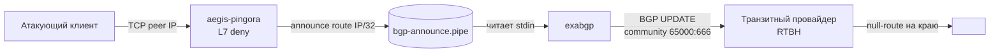

# BGP RTBH

Подсистема BGP RTBH (Remote-Triggered Black Hole) анонсирует хостовые маршруты `/32` (IPv4) или `/128` (IPv6) с blackhole-community вашему транзитному провайдеру через файл-пайп ExaBGP, чтобы дроп враждебного трафика происходил на краю сети оператора связи, а не на узком месте вашего хоста. Решение о блэкхолинге принимается на уровне L7 (вердикты WAF/honeypot/risk-engine), а не только L3/L4, поэтому одно и то же `/32` распространяется как при объёмной атаке, так и при срабатывании high-confidence-правила на ферму скрейперов.

Источники истины: [`src/bgp_rtbh.rs`](../../src/bgp_rtbh.rs) (диспетчер, аннонсер, gate `is_blackholeable`), [`src/arsenal.rs`](../../src/arsenal.rs) (инициализация, счётчики, builder `with_bgp_announcer`), [`src/bin/aegis-pingora.rs`](../../src/bin/aegis-pingora.rs) (вайринг env), [`src/proxy/pingora_http.rs`](../../src/proxy/pingora_http.rs) (триггер на deny-пути), [`src/proxy/pingora_admin.rs`](../../src/proxy/pingora_admin.rs) (admin API).

> Зрелость: модуль помечен `V187`, статус `live` в реестре арсенала ([`pingora_admin.rs`](../../src/proxy/pingora_admin.rs), запись `bgp_rtbh`). Аннонсы и ручной отзыв работают на живом пути. TTL-авто-отзыв реализован, но фоновый сборщик пока не запланирован к вызову в продакшене — см. раздел [TTL и авто-отзыв](#ttl-и-авто-отзыв-частично).

---

## Зачем это нужно

Бэкенды дропа в AEGIS (nftables/iptables/XDP — см. [13-xdp-ebpf.md](13-xdp-ebpf.md)) гасят враждебный трафик на краю самого хоста. Для объёмных (volumetric) атак, где узким местом становится канал/NIC самого хоста, правильный ответ — *вышестоящий* blackhole: анонс `/32` в RTBH-community транзитного провайдера, и дроп происходит на оборудовании оператора связи (комментарий-шапка [`src/bgp_rtbh.rs`](../../src/bgp_rtbh.rs)).

FastNetMon делает это на L3/L4; AEGIS делает это управляемым L7-вердиктами: `FullEnforce`-класс деная на скрейпер-ферме распространяет тот же список `/32`, что породила бы объёмная атака.



---

## Архитектура модуля

Модуль `bgp_rtbh` — это *диспетчер*: он принимает решения о блокировке и пишет их в реализацию трейта `BgpAnnouncer`. Диск/BGP-«тяжесть» делает внешний `exabgp`.

| Компонент | Тип | Роль |
|---|---|---|
| `BgpAnnouncer` | trait | Абстракция аннонсера: `announce(ip, community)` / `withdraw(ip)`. |
| `InMemoryAnnouncer` | struct | No-op аннонсер для тестов и dry-run; копит аннонсы/отзывы в `Vec`, ничего наружу не шлёт. **Дефолт** в `new_default()`. |
| `ExabgpPipeAnnouncer` | struct | Append-only запись в файл/пайп, совместимый со stdin-from-file режимом exabgp. Поля: `path`, `next_hop`. |
| `BgpRtbhDispatcher` | struct | Активный набор `HashMap<IpAddr, Entry>` под `RwLock`, идемпотентный `announce`, `withdraw`, `expire_ttl`, `active()`. |

`Entry` хранит `inserted: Instant` и `community: String`. Диспетчер хранит `default_community` и `ttl`.

### Трейт `BgpAnnouncer`

```rust
pub trait BgpAnnouncer: Send + Sync {
    fn announce(&self, ip: IpAddr, community: &str) -> std::io::Result<()>;
    fn withdraw(&self, ip: IpAddr) -> std::io::Result<()>;
}
```

Операторы с goBGP / FRR могут подставить собственный аннонсер, реализовав этот трейт и передав его через `ArsenalState::with_bgp_announcer(...)` ([`src/arsenal.rs`](../../src/arsenal.rs)).

### Формат строк ExaBGP

`ExabgpPipeAnnouncer` пишет (с переводом строки) ровно такие строки:

```text
announce route 1.2.3.4/32 next-hop 192.0.2.1 community 65000:666
withdraw route 1.2.3.4/32 next-hop 192.0.2.1
```

Маска формируется функцией `host_mask`: `/32` для IPv4, `/128` для IPv6. Запись делается `write_line` через `OpenOptions::new().create(true).append(true)` — файл создаётся, если отсутствует, поэтому запись безопасна даже до старта exabgp: строки просто копятся в файле (комментарий в [`src/bin/aegis-pingora.rs`](../../src/bin/aegis-pingora.rs)).

---

## Жизненный цикл решения

Из шапки [`src/bgp_rtbh.rs`](../../src/bgp_rtbh.rs):

| Метод | Поведение |
|---|---|
| `announce(ip)` | Добавляет в активный набор; аннонсер эмитит маршрут. **Идемпотентно** — повторный анонс того же IP ничего не пишет (проверка `contains_key`). Использует `default_community`. |
| `announce_with_community(ip, community)` | То же, но с явной community; здесь же проходит gate `is_blackholeable`. |
| `withdraw(ip)` | Удаляет из набора; аннонсер эмитит withdraw. Если IP не был в наборе — no-op (не пишет лишний withdraw). |
| `expire_ttl()` | Периодический GC: записи старше `ttl` авто-отзываются (чтобы атакующий не висел в блэкхоле вечно). Возвращает число отозванных. |
| `active()` | Возвращает `Vec<(IpAddr, String /*community*/, Duration /*возраст*/)>`. |
| `len()` / `is_empty()` | Размер активного набора. |

---

## Когда срабатывает анонс

Триггер на живом пути находится в [`src/proxy/pingora_http.rs`](../../src/proxy/pingora_http.rs) (блок `V187`), внутри обработки deny-вердикта (после того как запрос уже заблокирован фильтром):

```rust
if let Some(arsenal) = &self.arsenal {
    let recent = self.scorer.score(client_ip).0;
    if (recent >= 80.0 || filter_name == "honeypot")
        && arsenal.bgp_rtbh.announce(client_ip).is_ok()
    {
        arsenal.counters.bgp_rtbh_announces.fetch_add(1, Ordering::Relaxed);
        cluster_bump(cluster_idx::RTBH);
    }
}
```

Условие анонса — **логическое ИЛИ**:

| Условие | Смысл |
|---|---|
| `recent >= 80.0` | Текущий risk-score клиента (`self.scorer.score(client_ip).0`) >= 80 — high-confidence-класс деная. |
| `filter_name == "honeypot"` | Запрос сработал на honeypot-ловушку — однозначно вредоносный клиент, анонс независимо от score. |

Ключевые свойства:

- **`client_ip` — это адрес TCP-пира** (см. инвариант безопасности ниже), а не значение из заголовка.
- Анонс **best-effort**: неуспешный `announce()` (например, отказ gate-проверки) просто не считается и не сюрфейсится посетителю — счётчик `bgp_rtbh_announces` бампается только при `Ok(())`.
- Тот же deny-путь параллельно вызывает `record_bot(...)` и (при `honeypot`/`waf`) авто-обучение JA4-репутации `observe_bad(...)` — см. [12-reputation.md](12-reputation.md).
- Анонс зеркалируется в кластерный слот `cluster_idx::RTBH` для time-series-семплера, чтобы события BGP попадали в флотовую телеметрию ([25-metrics-telemetry.md](25-metrics-telemetry.md)).

> О связи со score: пороги `>=80` и режимы enforce задаются risk-engine — см. [18-ml-risk-engine.md](18-ml-risk-engine.md). RTBH-анонс происходит на этапе фактического деная; сам факт деная определяется WAF/bot/honeypot/rate-фильтрами.

---

## Инвариант безопасности (обязателен к соблюдению вызывающим)

Документация метода `announce` ([`src/bgp_rtbh.rs`](../../src/bgp_rtbh.rs)) прямо предписывает:

> `ip` **ОБЯЗАН** быть kernel-level TCP peer address соединения (удалённый конец принятого сокета по данным ОС). Он **НИКОГДА** не должен быть адресом, выведенным из заголовка запроса (`X-Forwarded-For`, `X-Real-IP`, `Forwarded`, `CF-Connecting-IP` и т.п.).

Причина: эта процедура просит *транзит-провайдера* заблэкхолить адрес. Заголовки полностью контролируются атакующим, поэтому header-derived IP позволил бы любому клиенту назвать IP **жертвы** и заставить оператора связи его null-route'ить — примитив удалённо-триггерного DoS / abuse. Адрес должен идти из сокета (подделать его нельзя, не считая on-path-спуфинга, против которого BGP RTBH всё равно бессилен).

### Defence-in-depth: gate `is_blackholeable`

В дополнение `announce_with_community` отклоняет цели, которые недопустимо блэкхолить у оператора связи, **независимо от происхождения IP**. Отклонённая цель возвращает `ErrorKind::InvalidInput` и не анонсирует ничего. Отклоняются:

| Категория | IPv4 | IPv6 |
|---|---|---|
| unspecified | `0.0.0.0` | `::` |
| loopback | `127.0.0.0/8` | `::1` |
| multicast | `224.0.0.0/4` | `ff00::/8` |
| broadcast | `255.255.255.255` | — |
| link-local | `169.254.0.0/16` | `fe80::/10` |
| private (RFC1918) | `10/8`, `172.16/12`, `192.168/16` | — |
| unique-local | — | `fc00::/7` |
| documentation (TEST-NET) | `is_documentation()` (`192.0.2/24`, `198.51.100/24`, `203.0.113/24`) | — |
| CGNAT (RFC6598) | `100.64.0.0/10` | — |

IPv4-mapped IPv6 (`::ffff:0:0/96`) разворачивается в IPv4 и проверяется по правилам IPv4, чтобы mapped-private/loopback не «проскользнул» через v6-ветку.

Это значит, что блэкхолить можно только правдоподобно публичный unicast-хост. Документационные диапазоны (`203.0.113.x` и т.п.) теперь отклоняются — в тестах диспетчера используется реальное публичное пространство (`9.9.9.x`, Quad9).

---

## Конфигурация (env)

Вайринг живёт в [`src/bin/aegis-pingora.rs`](../../src/bin/aegis-pingora.rs). `ArsenalState::new_default()` строит диспетчер с in-memory/noop-аннонсером (решения не покидают процесс). При живом старте бинарь по умолчанию ставит реальный файловый `ExabgpPipeAnnouncer`.

| Переменная | Назначение | Дефолт |
|---|---|---|
| `AEGIS_BGP_PIPE` | Путь к пайпу/файлу, в который пишутся `announce route …` / `withdraw route …`. **Пустая строка** оставляет in-memory noop-аннонсер (никакого распространения). | `/var/lib/aegis/bgp-announce.pipe` |
| `AEGIS_BGP_NEXTHOP` | BGP next-hop для анонсируемых `/32`/`/128`. | `192.0.2.1` (TEST-NET-1, RFC5737 — **нероутируемый плейсхолдер; ОБЯЗАТЕЛЬНО переопределить** реальным RTBH next-hop) |
| `AEGIS_ARSENAL` | `0` отключает весь арсенал (включая BGP RTBH) для бенч-бейзлайнинга. | включён |

> community зашита как `"65000:666"` в `new_default()` и `with_bgp_announcer()` ([`src/arsenal.rs`](../../src/arsenal.rs)). На момент написания она не имеет отдельной env-переменной. Менять её можно либо правкой кода, либо подставив собственный `BgpAnnouncer`, который сам формирует нужную community. Логика `announce_with_community` принимает произвольную community, но deny-путь зовёт `announce(ip)`, который использует `default_community`.

Логика выбора аннонсера (упрощённо, из бинаря):

```rust
let bgp_pipe = std::env::var("AEGIS_BGP_PIPE")
    .unwrap_or_else(|_| "/var/lib/aegis/bgp-announce.pipe".to_string());
if bgp_pipe.trim().is_empty() {
    // noop: блэкхол-решения остаются в процессе
    ArsenalState::new_default()
} else {
    let next_hop = std::env::var("AEGIS_BGP_NEXTHOP")
        .unwrap_or_else(|_| "192.0.2.1".to_string());
    let announcer = Arc::new(ExabgpPipeAnnouncer::new(bgp_pipe.into(), next_hop));
    ArsenalState::new_default().with_bgp_announcer(announcer)
}
```

Эти переменные также объявлены в admin-реестре env ([`pingora_admin.rs`](../../src/proxy/pingora_admin.rs): `EnvEntry { key: "AEGIS_BGP_PIPE", ... }`, `EnvEntry { key: "AEGIS_BGP_NEXTHOP", ... }`).

### Пример конфигурации exabgp

AEGIS только пишет строки в файл; запускать и подключать exabgp — задача оператора. Типовая схема:

```ini
# /etc/exabgp/exabgp.conf
neighbor 198.51.100.1 {     # ваш транзит/маршрутизатор-восходящий
    router-id 203.0.113.10;
    local-address 203.0.113.10;
    local-as 65010;
    peer-as 65000;
    family { ipv4 unicast; ipv6 unicast; }
    api { processes [ aegis-feed ]; }
}

process aegis-feed {
    run /usr/bin/tail -F /var/lib/aegis/bgp-announce.pipe;
    encoder text;
}
```

```bash
# Запуск, согласованный с дефолтом AEGIS
export AEGIS_BGP_PIPE=/var/lib/aegis/bgp-announce.pipe
export AEGIS_BGP_NEXTHOP=192.0.2.1   # замените на реальный RTBH next-hop провайдера
exabgp /etc/exabgp/exabgp.conf
```

> Точную community и next-hop для RTBH согласуйте с вашим оператором связи. `65000:666` и `192.0.2.1` — плейсхолдеры.

---

## Отзыв (unallow) и очистка

Есть три пути снятия анонса:

1. **Ручной отзыв через admin API** — `POST /admin/api/bgp/withdraw` с телом `{"ip": "1.2.3.4"}`.
2. **TTL-авто-отзыв** — `expire_ttl()` отзывает записи старше `ttl` (по умолчанию `3600` секунд) — см. оговорку ниже.
3. **Программно** — `dispatcher.withdraw(ip)`.

`withdraw` идемпотентен: если IP не в активном наборе, withdraw наружу не пишется.

### TTL и авто-отзыв (частично)

`ttl` задаётся в `BgpRtbhDispatcher::new(...)` и в `new_default()`/`with_bgp_announcer()` равен `Duration::from_secs(3600)` (1 час). Метод `expire_ttl()` корректно реализован и покрыт тестом (`expire_ttl_withdraws_old_entries`), отзывая просроченные записи и эмитя withdraw наружу.

> **Честная оговорка:** на момент написания в продакшен-коде нет фонового планировщика, который периодически вызывает `expire_ttl()` — единственные вызовы находятся в самом модуле и в тестах ([`src/bgp_rtbh.rs`](../../src/bgp_rtbh.rs)). Это значит, что *автоматический* отзыв по TTL пока не происходит сам собой при работе демона; полагайтесь на ручной отзыв через admin API (`/admin/api/bgp/withdraw`), пока периодический GC не будет подключён. До тех пор анонс держится до явного withdraw или перезапуска воркера.

> Состояние активного набора **внутрипроцессное** (`RwLock<HashMap>`), не персистентное и не разделяемое между воркерами SO_REUSEPORT. Каждый воркер `aegis-pingora@N` ведёт свой набор и пишет в один и тот же файл-пайп. Перезапуск воркера очищает его набор в памяти (но не отзывает уже записанные в файл/отданные exabgp маршруты автоматически). См. [06-workers.md](06-workers.md).

---

## Admin API и наблюдаемость

Маршруты ([`src/proxy/pingora_admin.rs`](../../src/proxy/pingora_admin.rs)):

| Метод | Путь | Действие |
|---|---|---|
| `GET` | `/admin/api/bgp/announces` | Список активных анонсов (`api_bgp_list`). |
| `POST` | `/admin/api/bgp/withdraw` | Ручной отзыв `/32` (`api_bgp_withdraw`), тело `{"ip": "..."}`. |

Аутентификация и роли — как у остального admin API (`x-admin-token`/сессия/роли), см. [30-admin-api.md](30-admin-api.md).

Пример ответа `GET /admin/api/bgp/announces`:

```json
{
  "wired": true,
  "active_count": 1,
  "active": [
    { "ip": "9.9.9.9", "community": "65000:666", "age_secs": 42 }
  ]
}
```

Если арсенал не подключён, возвращается `{ "wired": false, "active": [] }`.

`POST /admin/api/bgp/withdraw`:

```bash
curl -X POST https://<host>/admin/api/bgp/withdraw \
  -H "x-admin-token: $AEGIS_ADMIN_TOKEN" \
  -H "content-type: application/json" \
  -d '{"ip":"9.9.9.9"}'
# 200 -> {"ok":true,"ip":"9.9.9.9"}
# 400 -> {"error":"bad ip"}  при невалидном IP
# 503 -> {"error":"arsenal not wired"}  если арсенал отключён
```

### Счётчики

В `Counters`/`CounterSnapshot` ([`src/arsenal.rs`](../../src/arsenal.rs)) — два sharded-счётчика:

| Счётчик | Бампается |
|---|---|
| `bgp_rtbh_announces` | При успешном анонсе на deny-пути. |
| `bgp_rtbh_withdraws` | При отзыве (бампается в интеграционных тестах; на живом пути deny-логика инкрементит только announces). |

Они отдаются через `/admin/api/arsenal` блоком:

```json
"bgp_rtbh": { "announces": N, "withdraws": M, "active": K }
```

где `active` = `arsenal.bgp_rtbh.len()`. См. [25-metrics-telemetry.md](25-metrics-telemetry.md) и [29-admin-panel.md](29-admin-panel.md).

---

## Связь с Defence Arsenal / актуаторами

`ActionKind::BgpAnnounce` существует в реестре актуаторов ([`src/actuator.rs`](../../src/actuator.rs), строка `"bgp_announce"`), и `new_default()` предрегистрирует для него `NoopActuator`, чтобы стандартные виды действий отображались в `/admin/api/arsenal` ещё до подключения реального бэкенда. То есть путь «сценарий/актуатор → bgp_announce» на уровне реестра присутствует как **no-op-заглушка**; реальное распространение анонсов идёт через прямой вызов `arsenal.bgp_rtbh.announce(...)` на deny-пути, описанный выше. Подробнее об актуаторах и сценариях — [21-arsenal-scenarios.md](21-arsenal-scenarios.md).

---

## Чек-лист эксплуатации

1. Согласуйте с оператором связи RTBH-community и next-hop.
2. Поднимите exabgp, читающий `AEGIS_BGP_PIPE` (`tail -F` процесс или эквивалент).
3. Установите `AEGIS_BGP_PIPE` (или оставьте дефолт) и `AEGIS_BGP_NEXTHOP=<реальный next-hop>`.
4. Убедитесь, что `AEGIS_ARSENAL` не равно `0`.
5. Проверьте, что AEGIS видит реальный TCP-peer IP (а не только адрес апстрим-LB) — иначе блэкхолиться будет адрес прокси/балансировщика. См. [07-protocols.md](07-protocols.md).
6. Мониторьте активный набор через `/admin/api/bgp/announces` и снимайте ошибочные анонсы через `/admin/api/bgp/withdraw`.
7. До подключения фонового TTL-GC планируйте периодическую ручную чистку устаревших анонсов.

---

## См. также

- [13-xdp-ebpf.md](13-xdp-ebpf.md) — локальный дроп на краю хоста (XDP/eBPF).
- [14-rate-limiting.md](14-rate-limiting.md) — ограничение скорости до эскалации в блэкхол.
- [18-ml-risk-engine.md](18-ml-risk-engine.md) — risk-score (порог `>=80`) и режимы enforce.
- [17-honeypot-tarpit.md](17-honeypot-tarpit.md) — honeypot-вердикт, триггерящий анонс.
- [12-reputation.md](12-reputation.md) — авто-обучение JA4 на тех же deny-событиях.
- [21-arsenal-scenarios.md](21-arsenal-scenarios.md) — арсенал, актуаторы, сценарии.
- [25-metrics-telemetry.md](25-metrics-telemetry.md) — счётчики и кластерный слот RTBH.
- [30-admin-api.md](30-admin-api.md) — аутентификация и маршруты admin API.
