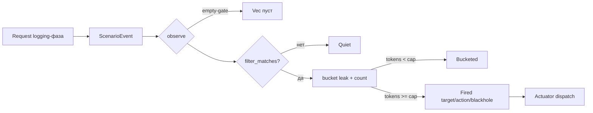

# Defence Arsenal, сценарии и актуаторы

Defence Arsenal (`src/arsenal.rs`) — это «зонтичный» держатель всех опциональных
оборонительных подсистем V176–V205+: JA4-корпус, нормализация полезной нагрузки,
H2-бюджет, honeypot'ы, route-difficulty, BGP RTBH, обогащение, поведенческие
сценарии (CrowdSec-style), актуаторы активного ответа, challenge-арсенал и слой
обмана (deception). Этот документ описывает, что именно входит в арсенал, как он
включается (`with_arsenal`), как устроен YAML-DSL сценариев (bucket-match по
событиям, действия `Fired`, кросс-воркерная персистентность
`/var/lib/aegis/scenarios.yaml`), как работают актуаторы (`ActionKind`),
route-difficulty, deception-тактики и формат событий Sicherheitstacho.

> Честная оговорка по «opt-in». Арсенал — это опциональная инфраструктура, а не
> часть критического пути корректности. Многие модули поставляются с
> `NoopActuator`/`StubLlm`/пустыми наборами, которые «фиксируют намерение» и
> двигают счётчики, но не выполняют реальный side-effect, пока оператор не подключит
> настоящий бэкенд. Ниже каждый такой случай отмечен явно.

Смежные документы: [WAF](10-waf.md), [TLS-фингерпринтинг](11-tls-fingerprinting.md),
[репутация](12-reputation.md), [XDP/eBPF](13-xdp-ebpf.md),
[rate-limiting](14-rate-limiting.md), [challenge ladder](15-challenge-ladder.md),
[Privacy Pass](16-privacy-pass.md), [honeypot/tarpit](17-honeypot-tarpit.md),
[ML risk engine](18-ml-risk-engine.md), [BGP RTBH](19-bgp-rtbh.md),
[GeoIP](20-geoip.md), [обогащение](22-enrichment.md),
[модель безопасности](23-security-model.md),
[метрики/телеметрия](25-metrics-telemetry.md),
[admin-панель](29-admin-panel.md), [admin API](30-admin-api.md).

---

## 1. Что такое Defence Arsenal

`ArsenalState` (`src/arsenal.rs`) держит каждый модуль за `Arc<…>`, чтобы код на
пути запроса мог взять разделяемый handle (`arsenal.route_difficulty`,
`arsenal.scenarios`, …) без блокировок. Счётчики активности — `ShardedCounter`
(per-CPU cache-padded шарды, V229), так что путь запроса инкрементирует их
lock-free, а эндпоинт `/admin/api/arsenal` читает снимок.

### 1.1. Состав (поля `ArsenalState`)

| Поле | Тип | Назначение | Файл |
|------|-----|------------|------|
| `ja4_corpus` | `Arc<Ja4Corpus>` | allow/deny-вердикты по JA4 | `src/ja4_corpus.rs` |
| `ja4_churn` | `Arc<Ja4ChurnTracker>` | детект ротации JA4 у одного IP | `src/ja4_churn.rs` |
| `param_profile` | `Arc<ParamProfileStore>` | профилирование значений параметров | `src/param_profile.rs` |
| `h2_budget` | `Arc<H2BudgetTracker>` | token-bucket для control-фреймов HTTP/2 (Rapid-Reset) | `src/h2_budget.rs` |
| `llm_honeypot` | `Arc<LlmHoneypot>` | LLM-honeypot (по умолчанию `StubLlm`) | `src/llm_honeypot.rs` |
| `yaml_honeypot` | `Arc<YamlHoneypotEngine>` | многошаговые YAML-honeypot'ы | `src/honeypot_yaml.rs` |
| `route_difficulty` | `Arc<DifficultyTable>` | per-route сложность challenge | `src/route_difficulty.rs` |
| `bgp_rtbh` | `Arc<BgpRtbhDispatcher>` | RTBH-анонсы (ExaBGP) | `src/bgp_rtbh.rs` |
| `rule_plan` | `ArcSwapOption<RulePlan>` | план диспетчеризации WAF-правил по фазам | `src/rule_planner.rs` |
| `actuators` | `Arc<ActuatorRegistry>` | активный ответ + timer-wheel | `src/actuator.rs` |
| `enrichment` | `Arc<RwLock<EnrichmentFacade>>` | WISE-style фасад обогащения | `src/enrichment.rs` |
| `scenarios` | `Arc<ScenarioEngine>` | поведенческий leaky-bucket DSL | `src/scenarios.rs` |
| `chained_trust` | `Arc<ChainedTrustStore>` | прогрессия доверия после captcha | `src/chained_trust.rs` |
| `privacy_pass` | `Arc<PrivacyPassVerifier>` | проверка Privacy Pass токенов | `src/privacy_pass.rs` |
| `adaptive_ladder` | `Arc<AdaptiveLadder>` | адаптивная лестница challenge | `src/adaptive_ladder.rs` |
| `deception` | `Arc<DeceptionStats>` | счётчики decoy/honeypot-полей/varied-errors | `src/challenge_deception.rs` |
| `domain_challenge` | `ArcSwap<HashMap<String, DomainChallengeConfig>>` | per-домен переопределения challenge | `src/arsenal.rs` |
| `counters` | `Arc<Counters>` | per-модуль счётчики активности | `src/arsenal.rs` |

В бинаре `aegis-pingora` (`src/bin/aegis-pingora.rs`) при старте логируется
`modules = 18` — это размер набора, привязанного к арсеналу.

### 1.2. Опциональность и defensive defaults

Если арсенал не привязан, каждый геттер возвращает `None`, и путь запроса
короткозамыкается чисто (`src/lib.rs:164`). Конструктор `ArsenalState::new_default()`
сразу регистрирует «живые» дефолты, чтобы счётчики могли реально срабатывать:

* **YAML-honeypot** — встроенные дескрипторы (`fake-phpmyadmin`, `fake-wp-login`,
  `fake-dotenv`, `fake-git-config`) из константы `DEFAULT_HONEYPOT_YAML`. Оператор
  переопределяет весь набор файлом из `AEGIS_HONEYPOT_YAML`.
* **Enrichment** — регистрируется источник `ja4-corpus`
  (`Ja4CorpusEnrichmentSource`), чтобы `enrich_ja4()` делал реальную работу.
* **Route-difficulty** — включены пресеты `enable_ai_scraper_preset(true)` и
  `enable_auth_preset(true)`.
* **Actuators** — предрегистрируются `NoopActuator` для `XdpDeny`, `NftDrop`,
  `BgpAnnounce`, `ChallengeFloorRaise`, чтобы стандартные виды действий были видны
  в `/admin/api/arsenal` ещё до подключения реального бэкенда (intent-only).

---

## 2. Включение арсенала: `with_arsenal`

Арсенал привязывается к трём подсистемам data plane тремя одноимёнными
builder-методами `with_arsenal(...)`:

| Подсистема | Файл | Что даёт привязка |
|------------|------|-------------------|
| `AegisPingoraProxy` | `src/proxy/pingora_http.rs:1120` | путь запроса получает доступ к сценариям/honeypot/route-difficulty/h2-budget |
| Admin server | `src/proxy/pingora_admin.rs:892` | эндпоинты `/admin/api/arsenal`, `/admin/api/scenarios`, `/admin/api/actions`, `/admin/api/challenge` начинают отдавать реальные данные |
| Background service | `src/proxy/pingora_background.rs:166` | фоновый tick: `actuators.tick()`, `scenarios.gc(...)`, `scenarios.maybe_reload()` |

### 2.1. Гейт окружения `AEGIS_ARSENAL`

В бинаре (`src/bin/aegis-pingora.rs:1434`):

```rust
let arsenal_enabled = std::env::var("AEGIS_ARSENAL").ok().as_deref() != Some("0");
```

То есть арсенал включён по умолчанию; `AEGIS_ARSENAL=0` его отключает (тогда все
три builder'а получают `None`). Значение видно в `/admin/api/...`
(`pingora_admin.rs:2848`: `"arsenal_enabled": ... != Some("0")`) и
зарегистрировано в реестре env-переменных (`pingora_admin.rs:115`,
`EnvKind::Bool`).

### 2.2. Связанные env-переменные старта

| Переменная | Дефолт | Назначение |
|------------|--------|------------|
| `AEGIS_ARSENAL` | (вкл.) | `0` отключает арсенал целиком |
| `AEGIS_HONEYPOT_YAML` | (встроенные) | путь к файлу YAML-honeypot дескрипторов |
| `AEGIS_BGP_PIPE` | `/var/lib/aegis/bgp-announce.pipe` | pipe/файл для ExaBGP-анонсов; пустая строка → noop-announcer |
| `AEGIS_BGP_NEXTHOP` | `192.0.2.1` (TEST-NET-1, заглушка) | next-hop для RTBH `/32`/`/128` маршрутов — ОБЯЗАТЕЛЬНО переопределить |
| `AEGIS_CHALLENGE_CONFIG_PATH` | `/var/lib/aegis/domain-challenge.json` | персистентность per-домен challenge config (V245) |
| `AEGIS_SCENARIOS_PATH` | `/var/lib/aegis/scenarios.yaml` | персистентность сценариев (V246) |
| `AEGIS_EVENT_FORMAT` | `native` | `sicherheitstacho`/`tpot` переключают формат NDJSON EventBridge |

BGP-обвязка: `new_default()` строит `BgpRtbhDispatcher` с in-memory/noop
announcer (анонсы не покидают процесс). Бинарь по умолчанию ставит файловый
`ExabgpPipeAnnouncer` через `with_bgp_announcer(...)`
(`src/bin/aegis-pingora.rs:1476`). См. [BGP RTBH](19-bgp-rtbh.md).

---

## 3. Сценарии (CrowdSec-style leaky-bucket DSL)

Модуль `src/scenarios.rs` (V199) — крошечный YAML-DSL для поведенческой
детекции «N событий за T времени», которую плоские rate-limit-кнопки
(`rps`/`burst`/`per-host`) выразить не могут.

### 3.1. Грамматика

```yaml
name: http_login_brute
description: "Много 401 на /login с одного IP"
filter:
  path_prefix: /login
  status_min: 400
  status_max: 499
groupby: client_ip       # ключ бакета
distinct: path           # опц. — считать только уникальные значения
capacity: 10             # размер бакета
leak_speed: 10s          # один токен утекает каждые 10s
blackhole: 5m            # блокировать цель на 5 минут
action: block            # block | challenge | tarpit | log
```

Парсер `ScenarioEngine::parse_yaml` принимает либо один сценарий, либо список.

### 3.2. Поля `ScenarioConfig`

| Поле | Тип | Обяз. | Примечание |
|------|-----|:-----:|------------|
| `name` | `String` | да | имя сценария; часть ключа бакета |
| `description` | `String` | нет | дефолт `""` |
| `filter` | `ScenarioFilter` | нет | дефолт — пустой (матчит всё) |
| `groupby` | `GroupBy` | да | ключ бакетизации |
| `distinct` | `Option<DistinctField>` | нет | дедуп по значению поля внутри бакета |
| `capacity` | `u32` | да | при `tokens >= capacity` сценарий срабатывает |
| `leak_speed` | `Duration` | да | строкой: `100ms`/`5s`/`2m`/`1h`/`1d`/голые секунды |
| `blackhole` | `Option<Duration>` | нет | TTL действия, передаётся актуатору |
| `action` | `ScenarioAction` | да | `block`/`challenge`/`tarpit`/`log` |

**`ScenarioFilter`** (все поля `Option`, отсутствующее не ограничивает):
`method`, `path_prefix`, `path_contains`, `path_suffix`, `host`,
`user_agent_contains`, `status`, `status_min`, `status_max`, `asn`, `country`.
Матчинг: `method`/`host` — без учёта регистра; `user_agent_contains` —
case-insensitive `contains`; диапазоны статусов — `status_min`/`status_max`
(событие без статуса не проходит min/max).

**`GroupBy`** (`snake_case`): `client_ip`, `client_ip_user_agent`, `host`,
`host_path`, `user_agent`, `asn`.

**`DistinctField`** (`snake_case`): `path`, `user_agent`, `host`, `status`.

**`ScenarioAction`** (`snake_case`): `block`, `challenge`, `tarpit`, `log`.

### 3.3. Bucket-match по событиям

События — `ScenarioEvent` (`client_ip`, `method`, `host`, `path`, `user_agent`,
`status`, `asn`, `country`). На пути запроса (`src/proxy/pingora_http.rs:3746`)
событие конструируется в logging-фазе. На сегодня заполняются `client_ip`,
`method`, `host`, `path`, `status`; поля `user_agent`, `asn`, `country` передаются
как `None` (честная оговорка: фильтры по UA/ASN/country в DSL поддержаны парсером и
сматчатся только если событие несёт эти поля — сейчас на live-пути они пустые).

`ScenarioEngine::observe(event)` проходит каждый загруженный сценарий **в порядке
загрузки** и возвращает `Vec<FireOutcome>` (не-совпадения — `Quiet`, чтобы
коррелировать по индексу). Логика бакета:

1. **Empty-gate**: если ничего не загружено — единственный relaxed-load атомика и
   пустой `Vec` (горячий logging-путь не трогает RwLock).
2. **filter_matches** — иначе `Quiet`.
3. Ключ бакета — `(scenario_name, groupby_value)` в `DashMap` (128 шардов, V230).
4. **Leak first**: `leak_ticks = floor(elapsed / leak_speed)` токенов утекает.
5. **distinct**: токен прибавляется только если `distinct`-значение ещё не
   виделось в этом бакете (`HashSet::insert`).
6. **Fire**: при `tokens >= capacity` — сброс бакета (tokens=0, очистка
   distinct/recent) и `FireOutcome::Fired { target, action, blackhole }`. Иначе —
   `FireOutcome::Bucketed { tokens, capacity }`.

Семантика «N strikes and you're out»: `capacity: 10` срабатывает на 10-м событии
(`>=`), не на 11-м. Сброс на fire гарантирует одно срабатывание, а не каждый
последующий запрос до утечки.



### 3.4. `Fired` → диспетчеризация actuator

На пути запроса (`src/proxy/pingora_http.rs:3756`) каждый `Fired` мапится в
`ActionKind` и применяется через реестр актуаторов с TTL = `blackhole`:

| `ScenarioAction` | `ActionKind` |
|------------------|--------------|
| `Block` | `ActionKind::XdpDeny` |
| `Challenge` | `ActionKind::ChallengeFloorRaise` |
| `Tarpit` | `ActionKind::Custom("scenario_tarpit")` |
| `Log` | `ActionKind::Custom("scenario_log")` |

`target` парсится в `Target::Ip(...)` либо при неудаче в `Target::Custom(...)`.
`ActionParams { reason: "scenario_fired", source_module: "scenarios", .. }`.
Каждое срабатывание двигает `counters.scenario_fires` и `counters.actuator_applies`;
каждое событие — `counters.scenario_events`.

> Честная оговорка: реальный side-effect (вставка в XDP-deny, nft, BGP) возникает
> только если оператор подменил `NoopActuator` на настоящий бэкенд для нужного
> `ActionKind`. По умолчанию `XdpDeny`/`ChallengeFloorRaise` — Noop, то есть
> «intent recorded», действие видно в `/admin/api/actions`, но не enforced.
> `Custom("scenario_tarpit"/"scenario_log")` не предрегистрированы вовсе — без
> регистрации `apply` вернёт `Outcome::Failed` (счётчик `failed`).

### 3.5. Статистика и GC

`ScenarioStats`: `events_observed`, `events_matched`, `events_bucketed`,
`buckets_fired` (атомики, снимок через `stats()`). `bucket_count()` —
число живых бакетов. `gc(idle)` удаляет бакеты без наблюдений дольше `idle`;
фоновый сервис вызывает `gc(600s)` (`pingora_background.rs:344`).

### 3.6. Кросс-воркерная персистентность (`/var/lib/aegis/scenarios.yaml`)

Из-за `SO_REUSEPORT` каждый воркер `aegis-pingora@0..N` — отдельный процесс
(см. [многопроцессность](06-workers.md)). Без диска панельная
«Load» осела бы в одном воркере. V246 решает это:

* `ScenarioEngine::set_persistence(path)` (`src/scenarios.rs:221`) — вызывается из
  бинаря (`src/bin/aegis-pingora.rs:1493`) с путём из `AEGIS_SCENARIOS_PATH`
  (дефолт `/var/lib/aegis/scenarios.yaml`); сразу загружает существующий файл.
* `save_yaml(yaml)` — атомарная запись **сырого YAML** оператора (через `.tmp` +
  `rename`). Сырой текст, а не parsed-структуры: `leak_speed`/`blackhole`
  десериализуются из строк (`"10s"`), но сериализовались бы в `{secs,nanos}`,
  который YAML-парсер при перезагрузке отверг бы.
* `maybe_reload()` — mtime-poll: дешёвый `stat()`, при изменении файла
  REPLACE in-memory набора. Вызывается из фонового tick каждого воркера
  (`pingora_background.rs:348`), так что «Load» на одном воркере сходится по всему
  флоту в пределах окна опроса и переживает рестарт.
* `load_many(cfgs)` — **REPLACE** (а не append): панель отправляет полный
  желаемый набор; пустой `load_many` корректно очищает сценарии.

Эндпоинты (см. [admin API](30-admin-api.md)): `GET /admin/api/scenarios` отдаёт
загруженный набор + статистику + `buckets_active`; запись через арсенальный
обработчик вызывает `load_many(...)` и затем `save_yaml(...)`
(`pingora_admin.rs:1898`, `:1903`).

---

## 4. Актуаторы (active-response, `ActionKind`)

Модуль `src/actuator.rs` (V197) — единый реестр активных ответов с
централизованным timer-wheel. Идея (Wazuh active-response + Falco Talon): один
реестр `(action_kind, target, params, revert_after, applied_at)` вместо того,
чтобы каждая подсистема переизобретала таймер.

### 4.1. `ActionKind`

| Вариант | `as_str()` | Предрегистрирован Noop в `new_default()` |
|---------|------------|:----------------------------------------:|
| `XdpDeny` | `xdp_deny` | да |
| `NftDrop` | `nft_drop` | да |
| `BgpAnnounce` | `bgp_announce` | да |
| `ChallengeFloorRaise` | `challenge_floor_raise` | да |
| `ResponseCachePoison` | `response_cache_poison` | нет |
| `Custom(&'static str)` | имя | нет |

`Custom` несёт `&'static str`, чтобы кардинальность map'а счётчиков оставалась
ограниченной.

### 4.2. `Target`

`Ip(IpAddr)`, `Subnet(IpAddr, u8)`, `UserAgent(String)`, `Path(String)`,
`Custom(String)`. Метод `as_display()` рендерит человекочитаемо
(`10.0.0.0/24`, `ua:curl/8`, `path:/admin`, …).

### 4.3. Трейт `Actuator` и `NoopActuator`

```rust
pub trait Actuator: Send + Sync {
    fn kind(&self) -> ActionKind;
    fn apply(&self, target: &Target, params: &ActionParams) -> Outcome;
    fn revert(&self, target: &Target) -> Outcome;
}
```

`Outcome`: `Applied` / `AlreadyApplied` / `Failed`. `NoopActuator` — эталонная
реализация: держит `HashSet<Target>`, `apply` возвращает `Applied`/`AlreadyApplied`,
`revert` чистит запись. Полезен в тестах и как «intent-only» заглушка, пока
оператор не подключил настоящий бэкенд — действие всё равно появляется в
`/admin/api/actions`.

### 4.4. `ActuatorRegistry`: семантика

* `register(actuator)` — последняя регистрация для вида побеждает (можно подменить
  Noop на реальный без рестарта).
* `apply(kind, target, params, revert_after)` — **идемпотентно**: повторное
  применение к той же `(kind, target)` сдвигает `revert_at`, а не плодит записи.
  Если для вида нет актуатора — `Failed` + счётчик `failed`. `revert_after = None`
  означает «до ручной отмены».
* `revert(kind, target)` — ручная отмена (operator/DELETE).
* `tick()` — фоновый sweep (вызывается раз в секунду из background service,
  `pingora_background.rs:336`): откатывает всё, у чего `revert_at` прошёл; двигает
  `reverted_on_expiry`.
* `active_actions()` / `active_count()` — список/счётчик активных.
* `registered_kinds()` — зарегистрированные виды (для панели).

`ActuatorStats`: `applied`, `already_applied`, `failed`, `reverted_on_expiry`,
`reverted_manually`.

Принципы дизайна: единый источник правды (`/admin/api/actions` — все активные
ответы по всем подсистемам), ограниченный blast-radius (у каждого действия есть
дедлайн отката, либо явный `Never`), идемпотентность, аудит через `SecurityEvent`.

### 4.5. Admin API

`/admin/api/actions` (GET) — список активных + статистика
(`pingora_admin.rs:1929`). DELETE-обработчик вызывает
`arsenal.actuators.revert(kind, &target)` (`pingora_admin.rs:1994`). Подробности —
[admin API](30-admin-api.md).

---

## 5. Route difficulty (per-route сложность challenge)

Модуль `src/route_difficulty.rs` (V186, Anubis-style): PoW-гейты работают лучше,
когда сложность масштабируется со стоимостью защищаемого маршрута. Дешёвые
маршруты (статика) — низкая сложность; дорогие (search, reset password) могут
позволить себе заставить клиента «заплатить» секундами CPU.

### 5.1. Типы

* `ChallengeKind`: `CookieRedirect`, `Captcha`, `JsPow { difficulty_bits: u8 }`.
* `DifficultyOverride`: `host`, `path_pattern`, `difficulty_bits`,
  `force_kind: Option<ChallengeKind>`.

### 5.2. Пресеты (включены в `new_default()`)

* **`ai-scraper-mode`** (`enable_ai_scraper_preset`): если UA содержит
  `gptbot`/`ccbot`/`claude-web`/`anthropic-ai`/`perplexitybot`/`youbot`/
  `facebookbot`/`amazonbot`/`google-extended`/`bytespider` — бонус +4 бита.
* **`auth-endpoint`** (`enable_auth_preset`): шаблоны `*/login`, `*/signup`,
  `*/register`, `*/reset`, `*/forgot` для host `*` получают `difficulty_bits = 22`
  (baseline 16 + 6) и форсированный `JsPow { 22 }`.

### 5.3. `decide(host, path, ua, baseline_bits, baseline_kind)`

Возвращает `(ChallengeKind, u8)`. Логика: берёт `max` по всем совпавшим
override-ам, применяет `force_kind`, затем добавляет UA-бонус (берётся `max`
совпавших needle), и нормализует: если итоговые биты выросли над baseline и
текущий вид не PoW — апгрейд до `JsPow` с поднятой сложностью.

### 5.4. Матчинг шаблонов (синтаксис V162 domain-policy)

| Шаблон | Семантика |
|--------|-----------|
| `/foo` | точное совпадение |
| `/foo/*` | префикс: `/foo` или `/foo/...` |
| `*/bar` | суффикс: `.../bar` или `bar` |

`host`: `*` (любой) или точное (без учёта регистра). Связка с challenge ladder —
см. [challenge ladder](15-challenge-ladder.md). Счётчик
`counters.route_difficulty_bumps`; число override-ов — в `/admin/api/arsenal`.

---

## 6. Адаптивная лестница (`adaptive_ladder.rs`)

Модуль `src/adaptive_ladder.rs` (V204) — два слоя поверх V42 ladder:

1. **Адаптивная сложность под аномалией**: когда детектор аномалий (V38) ставит
   attack-mode, каждый уровень бампится на `+attack_mode_bits` (дефолт +4).
2. **Рандомизированный порядок**: новый клиент не всегда получает cookie-уровень
   первым; порядок детерминированно ротируется по хэшу IP, чтобы атакующий не мог
   предвычислить последовательность.

### 6.1. `AdaptiveConfig`

| Поле | Дефолт | Назначение |
|------|--------|------------|
| `attack_mode_bits` | `4` | бонус битов в attack-mode |
| `randomize_order` | `true` | рандомизация уровня по хэшу IP |
| `fast_track_threshold` | `0.75` | порог suspicion для fast-track |

### 6.2. `decide(ip_hash, suspicion, baseline_bits) -> LadderDecision`

* `attack_mode` → `effective_bits = baseline + bonus`, счётчик `attack_mode_bumps`.
* **fast-track**: `suspicion >= fast_track_threshold` → `Captcha` при
  `suspicion >= 0.9`, иначе `Pow`; биты `>= 20`; `reason = "fast_track_high_suspicion"`.
* иначе при `randomize_order` — `pick_by_hash` (≈50% Cookie, 25% Reload, 15%
  Interaction, 9% Pow, 1% Captcha по младшему байту хэша), счётчик
  `randomized_picks`; при выключенной рандомизации — `pick_by_floor` (атомарный
  `current_floor`, поднимается через `set_floor(0..=4)`).

`ChallengeLevel`: `Cookie`, `Reload`, `Interaction`, `Pow`, `Captcha`.
`LadderStats`: `fast_track_hits`, `attack_mode_bumps`, `randomized_picks`.
Attack-mode ставится `set_attack_mode(on)` — admin API
`POST /admin/api/challenge/attack-mode` (`pingora_admin.rs:1786`).

---

## 7. Per-домен challenge-арсенал (`DomainChallengeConfig`)

`DomainChallengeConfig` (`src/arsenal.rs`) — per-host переопределения. Оператор
пишет через `/admin/api/sites/<host>/challenge`
(`set_domain_challenge_config`, `pingora_admin.rs:1759`); демон читает
per-request (`domain_challenge_config(host)`).

### 7.1. Поля (фаза V205)

`argon2_pow`, `argon2_bits`, `argon2_memory_kb`, `privacy_pass`, `chained_trust`,
`adaptive`, `varied_errors`, `decoy_captcha`, `honeypot_fields`, `trust_for_auth`,
`fast_track_threshold`, `attack_mode_bits`.

### 7.2. Поля challenge-арсенала (фаза V233+, opt-in)

> Честная оговорка: V233+ — это **фаза 1 (foundation)**. Все новые поля по
> умолчанию `None`/`false`, так что существующие хосты не меняются. Фаза 1 кладёт
> форму конфига + счётчики; реальная логика части сигналов приземляется в
> последующих фазах. Каждому сигналу соответствует счётчик `challenge_*_hits`
> в `Counters`, отдаваемый через `/admin/api/challenge`.

| Поле | Категория | Сигнал |
|------|-----------|--------|
| `ja4_ua_consistency` | passive | TLS JA4 vs заявленный User-Agent |
| `header_fingerprint` | passive | порядок/регистр HTTP-заголовков |
| `h2_fingerprint` | passive | HTTP/2 SETTINGS/window/pseudo-header |
| `datacenter_asn_challenge` | passive | эскалация при hosting/VPN ASN |
| `headless_detection` | JS | `navigator.webdriver`/артефакты автоматизации |
| `webgl_audio_fp` | JS | WebGL renderer + AudioContext |
| `dom_timing_entropy` | JS | rAF-каденс / timer-fake |
| `reputation_difficulty` | enforcement | масштабирование PoW от suspicion |
| `fail_to_xdp_deny` | enforcement | N провалов challenge → XDP-deny |
| `turnstile` | top rung | Cloudflare Turnstile при наличии ключей |
| `proof_of_click` | gesture | hold/click-to-verify |

### 7.3. Персистентность (`/var/lib/aegis/domain-challenge.json`)

V245 (зеркало модели `DomainPolicyStore`): без диска `ArcSwap` был бы per-воркер.
`attach_challenge_persistence(path)` (`src/arsenal.rs:773`) грузит существующий
файл; каждый `set/clear` пишет всю map атомарно (`.json.tmp` + `rename`); чтения
mtime-поллят файл (`refresh_domain_challenge`). Бинарь
(`src/bin/aegis-pingora.rs:1485`) берёт путь из `AEGIS_CHALLENGE_CONFIG_PATH`
(дефолт `/var/lib/aegis/domain-challenge.json`). Быстрый путь:
`domain_challenge_configured` — одиночный атомик, чтобы пропускать snapshot, пока
ни один хост не сконфигурирован.

См. [challenge ladder](15-challenge-ladder.md), [Privacy Pass](16-privacy-pass.md),
[картография и домены](26-sites-and-domains.md).

---

## 8. Deception (слой обмана)

Четыре кооперирующих модуля. Все включаются только для уже-подозрительного
трафика — никогда для чистого.

### 8.1. `challenge_deception.rs` — decoy CAPTCHA + honeypot-поля + varied errors

* **Decoy CAPTCHA** (`build_decoy_form_html(scenario_id, salt)`): показывает
  captcha-форму клиентам с очень высоким suspicion, не принимает ничего (режим
  `DecoyVerdict::BlackHole`), сжигая квоту solver'а. Форма детерминирована по
  `salt` (один и тот же fingerprint видит одну форму при ретраях).
* **Honeypot-поля** (`build_honeypot_fields` / `detect_honeypot_fill`): скрытые
  поля (`class="honeypot"`, `tabindex="-1"`, CSS off-screen) из пула
  `email_confirm`, `phone_number`, `zip_code`, `company`, `fax`. Реальные юзеры их
  не заполняют; автоматизация, заполняющая всё, попадается. Непустое значение
  любого honeypot-поля → instant deny.
* **Varied error pages** (`ErrorMask`): ротация по `salt` среди
  `OriginDnsError`(502), `GatewayTimeout`(504), `ServiceUnavailable`(503),
  `ConnectionReset`(502), `UpstreamProtocolError`(502). Атакующий не понимает,
  поймал ли его Aegis или сайт лежит — это замедляет реверс-инжиниринг.

`DeceptionStats`: `decoy_forms_rendered`, `honeypot_fills_detected`,
`varied_errors_rendered` (отдаются через `/admin/api/challenge`,
`pingora_admin.rs:1316`).

### 8.2. `decoy_headers.rs` — Scrapling-inverted CDN-заголовки

Модуль `src/decoy_headers.rs` (V188): адаптивные скраперы (Scrapling/Botasaurus)
по заголовкам/cookie определяют WAF/CDN и грузят соответствующий bypass. Если
Aegis выдаёт себя за чужой CDN, атакующий выбирает не тот playbook.

`DecoyFamily`: `Cloudflare`, `Akamai`, `Fastly`, `CloudFront`.
`DecoyHeaders::build(family, conn_id)` → `Vec<(&'static str, String)>`,
детерминированно по `conn_id` (ретраи совпадают). Примеры:

| Семейство | Заголовки |
|-----------|-----------|
| Cloudflare | `server: cloudflare`, `cf-ray: <16hex>-FRA`, `cf-cache-status: DYNAMIC`, `alt-svc: h3=":443"; ma=86400`, `set-cookie: __cf_bm=…` |
| Akamai | `server: AkamaiGHost`, `x-akamai-request-id`, `x-cache`, `x-reference` |
| Fastly | `server: Varnish`, `x-served-by`, `x-cache: HIT`, `x-fastly-request-id` (32 hex) |
| CloudFront | `server: CloudFront`, `x-amz-cf-pop`, `x-amz-cf-id`, `via` |

Политика: `should_decoy(challenge_fired, ml_score, honeypot_hit)` → `true`, если
сработал challenge, попался honeypot или `ml_score >= 0.65`. Счётчик
`counters.decoy_header_emits`.

### 8.3. `latency_jitter.rs` — shape-correct джиттер задержек

Модуль `src/latency_jitter.rs` (V190): наивный tarpit `sleep(N)` даёт sub-ms
равномерность, тривиально детектируемую. Этот модуль рисует задержку из:

* `LogNormal { median_ms, sigma }` — общая модель RTT; `default_tarpit()` =
  `{ median_ms: 350, sigma: 0.55 }`.
* `BimodalCdn { fast_ms, slow_ms, slow_prob }` — имитация cache-hit/miss CDN;
  `default_decoy()` = `{ fast_ms: 18, slow_ms: 220, slow_prob: 0.15 }` (пара к
  decoy-заголовкам V188).
* `Fixed(ms)` — явный override.

`sample(dist, seed)` → `Duration` (caller сам спит — модуль не привязан к
runtime). Seed = `conn_id ⊕ счётчик запроса`. Счётчик
`counters.latency_jitter_emits`.

### 8.4. `timing_entropy.rs` — ML-фичи тайминга ввода

Модуль `src/timing_entropy.rs` (V189): headed-Chrome скраперы
(Botasaurus, undetected_chromedriver) плохо имитируют **тайминг ввода человека**.
Считает по данным JS-коллектора (V145 `client_consistency`):

* `move_interval_entropy` — Shannon-энтропия inter-arrival мыши (бины 8ms; люди
  > 3.0, синтетика < 1.5).
* `move_interval_cv` — coefficient of variation (люди > 0.5, равномерный таймер
  < 0.1).
* `scroll_cadence_mad` — median absolute deviation интервалов скролла.

`extract(&TimingSample) -> TimingFeatures { …, anomaly_score }` (0.0 — человек,
1.0 — синтетика; ось скролла отбрасывается при отсутствии данных). Счётчики
`counters.timing_entropy_calls`, `counters.timing_entropy_synthetic_flags`.
Скармливается ML-движку — см. [ML risk engine](18-ml-risk-engine.md).

---

## 9. Формат событий Sicherheitstacho (T-Pot)

Модуль `src/sicherheitstacho.rs` (V185) — экспорт в нормализованный формат
Telekom CERT «Sicherheitstacho», на котором сходятся десятки honeypot'ов T-Pot.
Это даёт бесплатную интероперабельность с ELK-маппингами, агрегаторами threat-feed
и публичным дашбордом Sicherheitstacho.

### 9.1. Схема (релевантный subset)

```json
{
  "@timestamp": "2026-05-22T12:34:56.000Z",
  "type":       "Aegis",
  "src_ip":     "203.0.113.7",
  "src_port":   51234,
  "dst_port":   443,
  "country":    "RU",
  "asn":        "AS12345",
  "transport":  "TCP",
  "service":    "aegis-waf",
  "category":   "honeypot",
  "tags":       ["sqlmap", "phpmyadmin-probe"],
  "request": { "method": "POST", "host": "evil.test",
               "path": "/phpmyadmin/index.php", "ua": "sqlmap/1.7" }
}
```

### 9.2. Реализация

* `EventInput<'a>` — заимствует строки (`&'a str`/`&[&str]`), без аллокаций сверх
  выходной строки.
* `Category`: `Waf`(`waf`), `Honeypot`(`honeypot`), `Tarpit`(`tarpit`),
  `Challenge`(`challenge`), `Block`(`block`).
* `render(&EventInput) -> String` — однострочный JSON, готовый в NDJSON-сокет.
  `country`/`asn`/`ua` опускаются, если `None`. Без serde-зависимости (ручной
  сериализатор + экранирование `push_json_string`); встроенный ISO-8601 рендерер
  `unix_ms_to_iso` (алгоритм Hinnant, без chrono/jiff).

### 9.3. Выбор формата на проде

Формат NDJSON EventBridge переключается `AEGIS_EVENT_FORMAT`
(`src/event_bridge.rs:78`): `sicherheitstacho` или `tpot` → `WireFormat::Sicherheitstacho`;
иначе нативный `SecurityEvent`-JSON. Реестр env: `pingora_admin.rs:130`
(`EnvKind::Enum(["native","sicherheitstacho","tpot"])`).

> Честная оговорка по счётчику. Механизм инкремента `sicherheitstacho.emits`
> привязан (`with_sicherheitstacho_counter`, `event_bridge.rs:103`): каждый emit в
> формате Sicherheitstacho двигает арсенальный шард `sicherheitstacho_emits`.
> Счётчик растёт только когда выбран этот формат И подключён арсенал; при нативном
> формате он остаётся нулём (`pingora_admin.rs:1170`).

Подробнее об экспорте/SIEM — [метрики и телеметрия](25-metrics-telemetry.md),
[журнал запросов](24-request-log.md).

---

## 10. Счётчики арсенала (`/admin/api/arsenal`)

`Counters` (`src/arsenal.rs`) — per-модуль `ShardedCounter`; `snapshot()` отдаёт
`CounterSnapshot`. Ключевые группы, видимые в `/admin/api/arsenal`
(`pingora_admin.rs:1251`):

| Группа | Счётчики |
|--------|----------|
| `ja4_corpus` | `lookups`, `allow_hits`, `deny_hits`, `entries` |
| `ja4_churn` | `observations`, `tracked_ips` |
| `param_profile` | `observations`, `anomalies`, `keys` |
| `h2_budget` | `allows`, `rejects`, `tracked_conns` |
| `honeypot_yaml` | `engagements`, `sessions`, `descriptors` |
| `llm_honeypot` | `responses`, `cached` |
| `sicherheitstacho` | `emits` |
| `route_difficulty` | `bumps`, `overrides` |
| `bgp_rtbh` | `announces`, `withdraws`, `active` |
| `actuators` | `applied`/`failed`/`reverted_*`, `active`, `kinds` |
| `enrichment` | `lookups`, `cache_hits`, `sources` |
| `scenarios` | `events`, `fires`, `loaded`, `buckets` |
| deception/challenge | `decoy_header_emits`, `latency_jitter_emits`, `timing_entropy_*`, `challenge_*_hits`, `adaptive_ladder_decisions`, … |

Поле `wired` (`pingora_admin.rs:1163`) показывает, привязан ли арсенал. Реестр
модулей с метаданными (id/версия/семейство/label) перечислен там же
(`pingora_admin.rs:1203`).

---

## 11. Сводка путей и обвязки

| Что | Где |
|-----|-----|
| Держатель арсенала | `src/arsenal.rs` (`ArsenalState`, `Counters`) |
| Сценарии (DSL) | `src/scenarios.rs` (`ScenarioEngine`, `ScenarioConfig`, `FireOutcome`) |
| Актуаторы | `src/actuator.rs` (`ActuatorRegistry`, `ActionKind`, `Actuator`) |
| Route difficulty | `src/route_difficulty.rs` (`DifficultyTable`) |
| Adaptive ladder | `src/adaptive_ladder.rs` (`AdaptiveLadder`) |
| Deception (формы/ошибки) | `src/challenge_deception.rs` |
| Decoy CDN-заголовки | `src/decoy_headers.rs` |
| Latency jitter | `src/latency_jitter.rs` |
| Timing entropy | `src/timing_entropy.rs` |
| Sicherheitstacho | `src/sicherheitstacho.rs` |
| Привязка к proxy | `src/proxy/pingora_http.rs:1120` (`with_arsenal`), `:3756` (observe/fire) |
| Привязка к admin | `src/proxy/pingora_admin.rs:892` |
| Привязка к background | `src/proxy/pingora_background.rs:166` (tick/gc/reload) |
| Старт/персистентность | `src/bin/aegis-pingora.rs:1434`–`1504` |
| EventBridge формат | `src/event_bridge.rs:78`, `:103` |
