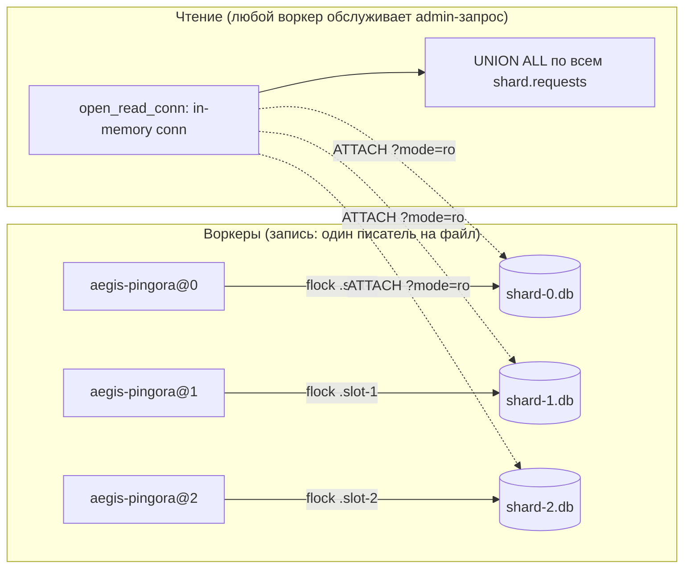

# Журнал запросов (event log)

Постоянный лог запросов AEGIS: каждый обслуженный запрос может быть записан одной строкой в локальную SQLite-БД, после чего админ-панель строит по этим данным аналитику по доменам, историю ботов/DDoS «за любой период», историю срабатываний WAF и полнотекстовый поиск по запросам. Подсистема реализована в [`src/event_store.rs`](../../src/event_store.rs); параллельно работает потоковая шина событий [`src/event_bridge.rs`](../../src/event_bridge.rs) (NDJSON по Unix-сокету) для SIEM.

> Источники, на которых грунтуется этот документ: [`src/event_store.rs`](../../src/event_store.rs), [`src/event_bridge.rs`](../../src/event_bridge.rs), обработчики `api_logs` / `api_logs_stats` в [`src/proxy/pingora_admin.rs`](../../src/proxy/pingora_admin.rs), точка записи на горячем пути в [`src/proxy/pingora_http.rs`](../../src/proxy/pingora_http.rs) и инициализация в [`src/bin/aegis-pingora.rs`](../../src/bin/aegis-pingora.rs).

Это две разные, независимые вещи, которые легко спутать:

| Подсистема | Что это | Транспорт | Назначение | Файл |
|---|---|---|---|---|
| **Event store** | Постоянный лог запросов в SQLite | Локальные файлы-шарды на диске | История/аналитика в админ-панели (`/admin/api/logs*`) | [`src/event_store.rs`](../../src/event_store.rs) |
| **EventBridge** | Потоковая шина решений безопасности | Unix-сокет, NDJSON | Экспорт в SIEM в реальном времени (Wazuh/Loki/Splunk/Vector/…) | [`src/event_bridge.rs`](../../src/event_bridge.rs) |

Подробнее про метрики, Prometheus и потоковую телеметрию — в [docs/25-metrics-telemetry.md](25-metrics-telemetry.md).

---

## 1. Event store: модель шардирования (SQLite per-worker)

AEGIS работает многопроцессно через `SO_REUSEPORT` (`aegis-pingora@0..N`, см. [docs/06-workers.md](06-workers.md)). Каждый воркер-процесс владеет **собственным** файлом SQLite `<dir>/shard-<slot>.db`, где `<slot>` берётся через неблокирующую advisory-`flock` на `<dir>/.slot-<n>.lock` — ровно та же схема, что в `site_map` (повторно используется `crate::site_map::SiteMap::acquire_slot`). Поскольку слот удерживается на всё время жизни процесса, на один файл БД приходится **ровно один писатель** — путь записи никогда не конкурирует с другим процессом и не блокируется на busy-handler SQLite.

* Каталог по умолчанию — `/var/lib/aegis/events`, переопределяется через `AEGIS_EVENTS_DIR`.
* Максимум проб слотов — `MAX_SLOTS = 16` (совпадает с `site_map::MAX_SLOTS`).
* Если свободного слота нет / каталог не создаётся / БД не открывается — стор деградирует в **no-op** (пишет warning, `record` ничего не делает, `shard_path()` возвращает `None`), но запуск процесса не падает.



### Чтение: ATTACH + UNION ALL

Read-сторона (`EventStore::query` / `EventStore::stats`) открывает свежее in-memory соединение (`Connection::open_in_memory`) и `ATTACH`-ит **каждый** существующий `shard-*.db` как `s0`, `s1`, … в режиме только-чтение через URI `file:<path>?mode=ro`. Затем по алиасам строится подзапрос `SELECT … FROM s0.requests UNION ALL SELECT … FROM s1.requests …` (`union_all_subquery`). Так запрос возвращает стабильный агрегат **по всем воркерам**, какой бы воркер ни обслуживал admin-запрос.

* Шарды, которые не удалось приаттачить (заблокирован/повреждён), молча пропускаются (`tracing::debug`), а не валят весь запрос.
* Если ни один шард не приаттачился — `query` возвращает пустой вектор, `stats` — `LogStats::default()`.
* Список шардов (`shard_files`) — все файлы вида `shard-*.db`, отсортированные для детерминизма.

---

## 2. Поля записи (`EventRow`)

Одна строка лога — структура `EventRow` (`Serialize`/`Deserialize`, так что admin API отдаёт результаты запроса напрямую как JSON). Схема таблицы `requests` зеркалит эти поля.

| Поле | Тип SQLite | Описание |
|---|---|---|
| `ts` | INTEGER | Время в Unix-**миллисекундах** |
| `host` | TEXT | Host запроса |
| `method` | TEXT | HTTP-метод |
| `path` | TEXT | Исходный путь запроса |
| `path_pattern` | TEXT | Обобщённый путь, напр. `/api/users/:id` (через `crate::site_map::generalise_path`) — используется для агрегации по эндпоинтам |
| `status` | INTEGER | HTTP-статус ответа |
| `action` | TEXT | Решение: `pass` / `deny` / `challenge` / `tarpit` / `rate` / `rtbh` |
| `reason` | TEXT | Причина (например, кто заденил — `ctx.denied_by`) |
| `waf_rule` | TEXT | Сработавшее правило WAF (если есть) |
| `client_ip` | TEXT | IP клиента |
| `country` | TEXT | Страна (GeoIP, см. [docs/20-geoip.md](20-geoip.md)) |
| `ja4` | TEXT | Отпечаток JA4 (см. [docs/11-tls-fingerprinting.md](11-tls-fingerprinting.md)) |
| `latency_ms` | INTEGER | Латентность обслуживания, мс |
| `bytes` | INTEGER | Объём ответа, байт |
| `protocol` | TEXT | Версия/протокол (`http_version_label`) |
| `user_agent` | TEXT | User-Agent |

Конструктор `EventRow::now(host, method, path, path_pattern, status, action)` ставит текущий таймстамп и оставляет остальные строковые поля пустыми — вызывающий заполняет то, что у него есть в руках.

### Индексы

Схема (`SCHEMA_SQL`) заводит пять индексов под типовые запросы аналитики:

```sql
CREATE INDEX IF NOT EXISTS idx_host_ts          ON requests (host, ts);
CREATE INDEX IF NOT EXISTS idx_host_pattern_ts  ON requests (host, path_pattern, ts);
CREATE INDEX IF NOT EXISTS idx_action_ts        ON requests (action, ts);
CREATE INDEX IF NOT EXISTS idx_client_ip_ts     ON requests (client_ip, ts);
CREATE INDEX IF NOT EXISTS idx_ts               ON requests (ts);
```

### Прагмы соединения-писателя

`open_writer_conn` открывает шард в режиме одного писателя:

```sql
PRAGMA journal_mode=WAL;
PRAGMA synchronous=NORMAL;       -- WAL-safe
PRAGMA busy_timeout=5000;
PRAGMA auto_vacuum=INCREMENTAL;  -- чтобы PRAGMA incremental_vacuum мог вернуть место
PRAGMA wal_autocheckpoint=1000;
```

---

## 3. Неблокирующая запись (горячий путь)

`EventStore::record` вызывается **на горячем пути прокси, один раз на запрос**, из фазы `logging()`. Контракт жёсткий и помечен в коде как «do not regress» (в проде уже был инцидент с латентностью из-за синхронного логирующего I/O на горячем пути; нынешний дизайн исключает это by construction):

1. **No-op**, если логирование выключено или персистентность не поднялась.
2. **Сэмплирование** (см. ниже) — счётчиком, без RNG на горячем пути.
3. `try_send` в **ограниченный** канал (`sync_channel`, ёмкость `CHANNEL_CAP = 16_384`). Если канал полон — строка **отбрасывается**, инкрементируется счётчик `dropped`. Никогда не блокирует и никогда не трогает SQLite в потоке вызывающего.

Дополнительно вся (дешёвая) сборка строки на стороне `pingora_http.rs` спрятана за `self.event_store.is_enabled()` — у выключенного стора нет затрат, кроме одной загрузки `bool`. Единственная дополнительная работа при включённом сторе — обобщение пути (`generalise_path`) и один опциональный GeoIP-lookup страны, оба O(длины пути).

### Фоновый писатель и батчинг

Отдельный поток `aegis-eventlog` дренирует канал и коммитит **батчами в одной транзакции** (`flush_batch`):

| Параметр | Значение | Смысл |
|---|---|---|
| `CHANNEL_CAP` | `16_384` | Ёмкость ограниченного канала записи (~неск. МиБ бэклога при ~200 байт/строку) |
| `BATCH_MAX` | `1_000` | Сбрасывать батч при достижении этого числа строк |
| `FLUSH_INTERVAL` | `500 ms` | Минимальная частота сброса батча, даже если он не заполнен |
| `RETENTION_INTERVAL` | `3_600 s` (1 ч) | Как часто писатель прогоняет ретеншн + чекпойнт |
| `HARD_ROW_CAP` | `5_000_000` | Жёсткий предохранитель: число строк на шард |

Писатель блокируется на `recv_timeout` (на остаток интервала сброса, минимум 10 мс), затем жадно дочитывает всё, что есть в очереди, не блокируясь. На остановке (`Drop` стора выставляет `stop`, обнуляет `tx` → канал отключается) поток дренирует остаток, делает финальный сброс и финальный `PRAGMA wal_checkpoint(TRUNCATE)`, после чего `Drop` джойнит поток, чтобы последний батч лёг до выхода процесса.

Ошибки вставки логируются и **батч отбрасывается** — на потоке-писателе никогда не паникуем.

### Диагностические счётчики

| Метод | Что считает |
|---|---|
| `dropped_count()` | Строк отброшено из-за переполнения (или отключённого) канала |
| `accepted_count()` | Строк принято в канал (ещё не обязательно закоммичено) |
| `shard_path()` | Путь шарда этого воркера (`None`, если персистентность не активна) |
| `is_enabled()` | Прошёл ли gate включения |

---

## 4. Ретеншн (`AEGIS_EVENTS_RETENTION_DAYS`)

`run_retention` запускается писателем раз в час (`RETENTION_INTERVAL`) и делает три вещи best-effort:

1. **Удаление по времени**: `DELETE FROM requests WHERE ts < cutoff`, где `cutoff = now_ms − retention_days × 86_400_000`. Окно задаётся `AEGIS_EVENTS_RETENTION_DAYS` (по умолчанию **14** дней).
2. **Жёсткий предохранитель по числу строк**: если после удаления строк всё ещё больше `HARD_ROW_CAP` (5 млн), удаляются самые старые лишние строки (`ORDER BY ts ASC LIMIT overflow`) — независимо от временного окна.
3. **Чекпойнт + возврат места**: `PRAGMA wal_checkpoint(TRUNCATE); PRAGMA incremental_vacuum;` — ограничивает размер WAL и возвращает освобождённые страницы.

Ошибки ретеншна логируются (`tracing::warn`), но не валят писателя.

---

## 5. Сэмплирование (`AEGIS_EVENTS_SAMPLE_PASS`)

`AEGIS_EVENTS_SAMPLE_PASS` — float в `0.0..=1.0`, по умолчанию `1.0`. Это **доля сохраняемых строк с `action == "pass"`**. Все **не-pass** действия (`deny` / `challenge` / `tarpit` / `rate` / `rtbh` / …) сохраняются **всегда**.

Сэмплер — дешёвый «оставляй каждую N-ю» по счётчику, без RNG на горячем пути. Доля переводится в делитель `sample_n_from_fraction`:

| `AEGIS_EVENTS_SAMPLE_PASS` | Эффективное N (`keep every Nth`) | Поведение |
|---|---|---|
| `1.0` (или ≥1) | `1` | Хранить все pass |
| `0.5` | `2` | Хранить каждый 2-й pass |
| `0.1` | `10` | Хранить каждый 10-й pass |
| `0.0` (или отрицательное) | `u64::MAX` | Практически не хранить pass (без деления на ноль) |

> Это **opt-in оптимизация**: значение по умолчанию `1.0` ничего не сэмплирует. Сэмплирование затрагивает только успешные `pass`-запросы; вся security-история (deny/challenge/tarpit/rate/rtbh) сохраняется без пропусков.

---

## 6. API: `GET /admin/api/logs` и `/admin/api/logs/stats`

Оба маршрута обслуживаются в [`src/proxy/pingora_admin.rs`](../../src/proxy/pingora_admin.rs) (`api_logs` / `api_logs_stats`), требуют admin-аутентификации (`x-admin-token` / сессия / роли — см. [docs/30-admin-api.md](30-admin-api.md)). В роутере `/admin/api/logs/stats` проверяется **раньше** `/admin/api/logs` (более длинный путь — первым). Если стор не подключён, оба отвечают `200` с пустым результатом.

### `GET /admin/api/logs` — выборка строк

Параметры query-строки парсятся в `LogFilter`. Любое отсутствующее/пустое поле = «без ограничения».

| Параметр query | Поле `LogFilter` | Семантика SQL |
|---|---|---|
| `host` | `host` | `host = ?` (точное совпадение) |
| `endpoint` | `endpoint` | `path_pattern = ?` (по обобщённому пути) |
| `action` | `action` | `action = ?` |
| `ip` | `client_ip` | `client_ip = ?` |
| `q` | `q` | свободный текст: `(path LIKE %q% OR user_agent LIKE %q%)` |
| `from` | `from_ms` | `ts >= ?` (Unix-мс) |
| `to` | `to_ms` | `ts <= ?` (Unix-мс) |
| `limit` | `limit` | размер выборки, **жёсткий потолок 1000** (`QUERY_LIMIT_CAP`) |
| `offset` | `offset` | смещение (пагинация) |

Результат — `ORDER BY ts DESC` (новые первыми). Ответ:

```json
{ "entries": [ /* EventRow[] */ ], "total": 42 }
```

`total` здесь — это число **возвращённых** строк (выборка ограничена `limit`/потолком 1000), а не общее число подходящих строк в БД.

```bash
# Последние deny по домену example.com за окно времени
curl -s -H "x-admin-token: $TOKEN" \
  'http://127.0.0.1:PORT/admin/api/logs?host=example.com&action=deny&from=1733600000000&to=1733700000000&limit=200'

# Полнотекстовый поиск по path/user-agent
curl -s -H "x-admin-token: $TOKEN" \
  'http://127.0.0.1:PORT/admin/api/logs?q=/wp-admin&limit=50'
```

### `GET /admin/api/logs/stats` — агрегированная аналитика

Параметры: `host` (опционально), `from`, `to` (Unix-мс). Если `from`/`to` опущены — по умолчанию **последние 24 часа** (`now − 86_400_000 … now`). Возвращает JSON-объект `LogStats`:

| Поле `LogStats` | Тип | Что это |
|---|---|---|
| `total` | i64 | Всего строк в окне |
| `by_action` | `Count[]` | Срез по `action` (top-20) |
| `top_endpoints` | `Count[]` | Топ по `path_pattern` (top-20) |
| `top_ips` | `IpStat[]` | Топ IP с разбивкой `hits/deny/challenge/country` (top-50) |
| `top_reasons` | `Count[]` | Топ непустых `reason` (top-20) |
| `status_dist` | `Count[]` | Распределение HTTP-статусов (top-20) |
| `endpoint_fanout` | `EndpointStat[]` | `(host, path_pattern, hits, distinct_ips)`, сорт. по `distinct_ips` — питает DDoS-вид «эндпоинт под атакой» (top-50) |
| `series` | `TimeBucket[]` | Временной ряд `(ts, hits, deny, challenge)` |
| `bucket_ms` | i64 | Ширина бакета ряда, мс |

Ширина бакета выбирается автоматически (`auto_bucket_ms`) так, чтобы получить порядка ≤120 точек на диапазон, со снапом на «человеческие» интервалы: 1с / 5с / 15с / 1м / 5м / 15м / 1ч / 6ч / 1д / 1н / 30д / 90д / 1г.

```bash
# Аналитика за последние 24 часа (по умолчанию)
curl -s -H "x-admin-token: $TOKEN" 'http://127.0.0.1:PORT/admin/api/logs/stats'

# Аналитика по домену за произвольный период
curl -s -H "x-admin-token: $TOKEN" \
  'http://127.0.0.1:PORT/admin/api/logs/stats?host=example.com&from=1733000000000&to=1733600000000'
```

### История ботов/DDoS «за период»

Именно эти агрегаты и питают разделы панели «боты/DDoS за любой период»:

* **боты/злоупотребления** — `top_ips` (с разбивкой deny/challenge) + `by_action` + `series` (всплески deny/challenge во времени);
* **DDoS / эндпоинт под атакой** — `endpoint_fanout`: число различных IP (`distinct_ips`) на `(host, path_pattern)` выдаёт точечно бомбардируемые эндпоинты, отсортированные по фан-ауту источников.

Поскольку read-сторона делает `ATTACH + UNION ALL` по всем шардам, эти цифры — кросс-воркерный агрегат за весь период удержания (с учётом ретеншна и сэмплирования pass-строк).

---

## 7. EventBridge — NDJSON по Unix-сокету (для SIEM)

Отдельная подсистема ([`src/event_bridge.rs`](../../src/event_bridge.rs)): один эндпоинт, который эмитит **по одному JSON-объекту на каждое решение безопасности**. Данные — `SecurityEvent`; EventBridge — транспорт.

Свойства:

* **Unix-сокет** (`/var/run/aegis-events.sock` по умолчанию) — нет сетевой экспозиции, ACL по правам файла (`chmod 0600` при bind; оператор chmod/chown под своего SIEM-пользователя). Подписка через `nc -U` / `socat` / unix-socket-ридер SIEM.
* **NDJSON broadcast** — каждый подключённый подписчик получает каждое событие; новые подключения стартуют «с чистого листа» (без проигрывания истории).
* **Lossy bounded queue на подписчика** (`SUBSCRIBER_CHANNEL_CAP = 1024`): если медленный подписчик не успевает — прокси никогда не блокируется, его событие для этого подписчика дропается (`try_send` Full). Мёртвые подписчики (`Closed`) вычищаются на следующем `emit`. Принцип: AEGIS — прокси, который эмитит, а не система логирования; drop > block.
* **Best-effort**: если сокет недоступен / путь не настроен — `emit` это no-op. Стоимость на горячем пути — один `try_send` на событие; sub-µs, когда подписчиков нет.

### Формат провода (`AEGIS_EVENT_FORMAT`)

| `AEGIS_EVENT_FORMAT` | `WireFormat` | Схема |
|---|---|---|
| (не задан) / `native` | `Native` (по умолчанию) | Нативный `SecurityEvent` JSON |
| `sicherheitstacho` / `tpot` | `Sicherheitstacho` | NDJSON, совместимый с T-Pot Sicherheitstacho |

В режиме `Sicherheitstacho` каждый emit, если привязан счётчик арсенала (`with_sicherheitstacho_counter`), инкрементирует `sicherheitstacho_emits`, чтобы панель Defence Arsenal (`/admin/api/arsenal` → `sicherheitstacho.emits`) отражала реальный объём экспорта в T-Pot-схеме.

```bash
# Подписка на поток событий вручную
nc -U /var/run/aegis-events.sock
# или
socat - UNIX-CONNECT:/var/run/aegis-events.sock
```

> **Честная оговорка.** EventBridge конструируется и эмитит события **только если оператор сам подключил сокет** (`socket_path = Some(...)`, env `AEGIS_EVENT_SOCKET`). На данный момент в коде [`src/bin/aegis-pingora.rs`](../../src/bin/aegis-pingora.rs) `EventBridge` на дата-плейне pingora **не конструируется по умолчанию** — поэтому модуль Sicherheitstacho в `api_arsenal` честно помечен как `planned` («код-путь готов, но до подключения оператором ничего не эмитит»). Сам же `EventStore` (журнал в SQLite) — наоборот, **включён по умолчанию** и поднимается в `aegis-pingora.rs` через `EventStore::from_env()`, после чего привязывается и к прокси (`with_event_store`), и к admin (`with_event_store`).

---

## 8. Сводка env-кнобов

| Переменная | По умолчанию | Тип | Эффект | Файл |
|---|---|---|---|---|
| `AEGIS_EVENT_LOG` | ON (вкл.) | Bool | Включает всю подсистему журнала. `0`/`false`/`off`/`no` → `record` становится no-op | `event_store.rs` |
| `AEGIS_EVENTS_DIR` | `/var/lib/aegis/events` | Path | Каталог файлов-шардов `shard-*.db` | `event_store.rs` |
| `AEGIS_EVENTS_RETENTION_DAYS` | `14` | Uint | Сколько дней хранить строки до удаления по времени | `event_store.rs` |
| `AEGIS_EVENTS_SAMPLE_PASS` | `1.0` | Float `0.0..=1.0` | Доля сохраняемых `pass`-строк (не-pass хранятся всегда) | `event_store.rs` |
| `AEGIS_EVENT_FORMAT` | `native` | Enum `native`/`sicherheitstacho`/`tpot` | Формат NDJSON шины EventBridge | `event_bridge.rs` |
| `AEGIS_EVENT_SOCKET` | (не задан) | Path | Путь Unix-сокета EventBridge (если не задан — шина в no-op) | `event_bridge.rs` |

Первые четыре переменные входят в admin-allowlist (`ENV_ALLOWLIST` в [`src/proxy/pingora_admin.rs`](../../src/proxy/pingora_admin.rs)) с типами `Bool`/`Path`/`Uint`/`Float` и **применяются на рестарте** (`restart_required: true` при сохранении). Про рестарт воркеров без простоя — [docs/06-workers.md](06-workers.md); про конфигурацию вообще — [docs/04-configuration.md](04-configuration.md).

---

## 9. Эксплуатационные заметки

* **Где лежат данные.** По умолчанию `/var/lib/aegis/events/shard-<slot>.db` (+ WAL). Каждый воркер — свой файл; читать БД напрямую можно `sqlite3` в режиме только-чтение, но штатный путь — admin API.
* **Потеря строк под перегрузкой — это by design.** При переполнении канала записи строка дропается (счётчик `dropped`), а не задерживает запрос. Журнал — наблюдаемость, а не источник истины для биллинга.
* **Сэмплирование не трогает security-события.** Даже при агрессивном `AEGIS_EVENTS_SAMPLE_PASS=0.01` все deny/challenge/tarpit/rate/rtbh сохраняются полностью.
* **Размер на диске ограничен** временным ретеншном (`AEGIS_EVENTS_RETENTION_DAYS`), жёстким потолком строк (`HARD_ROW_CAP = 5 млн`/шард) и периодическим `wal_checkpoint(TRUNCATE)` + `incremental_vacuum`.
* **Выключение.** `AEGIS_EVENT_LOG=0` полностью отключает журнал: ни потока-писателя, ни слота, ни файла БД; `/admin/api/logs*` тогда отдают пустые ответы.

### Кросс-ссылки

* [docs/25-metrics-telemetry.md](25-metrics-telemetry.md) — Prometheus `/metrics`, timeseries-ринги, потоковая телеметрия.
* [docs/26-sites-and-domains.md](26-sites-and-domains.md) — `site_map`, `generalise_path`, per-domain policy.
* [docs/29-admin-panel.md](29-admin-panel.md) — страницы, которые рендерят эти данные.
* [docs/30-admin-api.md](30-admin-api.md) — аутентификация и полный перечень маршрутов `/admin/api/*`.
* [docs/06-workers.md](06-workers.md) — слоты, `SO_REUSEPORT`, кросс-воркерное состояние.
