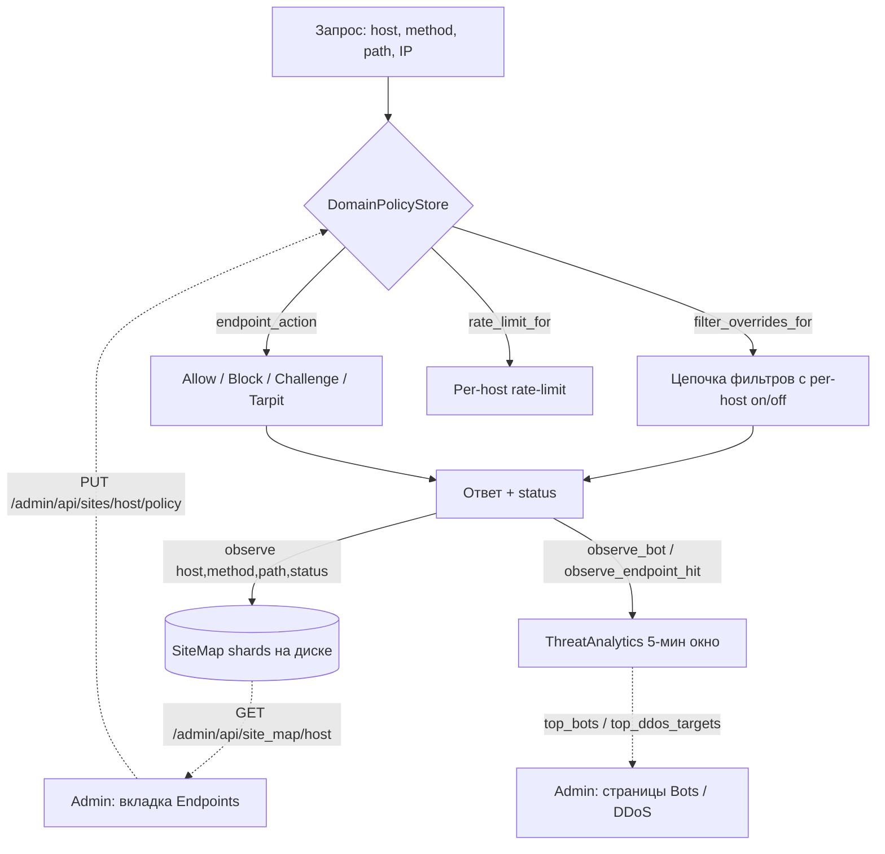

# Картография сайтов и per-domain политики

Подсистема картографии (`src/site_map.rs`) автоматически восстанавливает форму каждого сайта из живого трафика — какие эндпоинты бьются, какими методами, с каким миксом статусов — а слой per-domain политик (`src/domain_policy.rs`) и реестр доменов (`src/domains.rs`) позволяют наложить на конкретный хост (и конкретный путь) свою политику: вкл/выкл фильтров, действия `allow`/`block`/`challenge`/`tarpit` на эндпоинт, оверрайд rate-limit. Аналитика угроз (`src/threat_analytics.rs`) разделяет два разных взгляда на атаку: одиночные боты и распределённый DDoS.

Документ покрывает три тесно связанные подсистемы:

| Подсистема | Файл | Назначение |
|---|---|---|
| `site_map` — картография | `src/site_map.rs` | Авто-обнаружение эндпоинтов, генерализация путей, шарды, persistence |
| per-domain policy | `src/domain_policy.rs` | Per-host оверрайды фильтров, per-endpoint действия, rate-оверрайды |
| domain registry | `src/domains.rs` | Реестр доменов + агрегированные счётчики (`config/domains.toml`) |
| threat analytics | `src/threat_analytics.rs` | Топ ботов и топ DDoS-целей в скользящем окне |

> Все утверждения ниже сверены с исходным кодом; пути к файлам указаны для каждого. Частичные/планируемые фичи отмечены честно (см. раздел «Честные оговорки»).

Смежные доки: [WAF](10-waf.md), [rate-limiting](14-rate-limiting.md), [challenge ladder](15-challenge-ladder.md), [honeypot/tarpit](17-honeypot-tarpit.md), [метрики/телеметрия](25-metrics-telemetry.md), [журнал запросов](24-request-log.md), [многопроцессность и воркеры](06-workers.md), [админ-панель](29-admin-panel.md), [admin API](30-admin-api.md). Исходная спецификация: [`docs/per-domain-policy.md`](../en/reference/per-domain-policy.md).

---

## 1. Картография сайтов (`site_map`)

### 1.1. Идея

Оператор добавляет домен в Aegis, наводит DNS — и трафик начинает течь. За минуты прокси видит реальную форму сайта и складывает её в per-host `SiteMap`, который админ-панель показывает таблицей, чтобы можно было применять per-endpoint политику без ручного перечисления API (`src/site_map.rs:1-40`).

Ключевые свойства дизайна (док-комментарий `src/site_map.rs:10-29`):

- **Генерализация путей** — `/api/users/12345` и `/api/users/67890` схлопываются в `/api/users/:id`, чтобы карта не взрывалась на высококардинальных URL.
- **Учёт метода** — `GET /api/users` и `POST /api/users` трекаются как отдельные записи с раздельной статистикой.
- **Ограниченная память** — per-host LRU-кэп (по умолчанию 1024 эндпоинта), новые вытесняют наименее свежие.
- **Безопасность на горячем пути** — один вызов `observe()` на запрос; внутренний стор — шардированный `DashMap`, ключ `(host, method, pattern)`, так что конкурентные писатели из разных воркеров бьют в разные шарды.

### 1.2. Что наблюдается на запрос

Горячий путь — `SiteMap::observe(host, method, path, status)` (`src/site_map.rs:405-459`), вызывается один раз на запрос в фазе логирования с финальным кодом статуса.

Логика:

1. Пустой `host` игнорируется (`src/site_map.rs:406-408`).
2. Путь генерализуется через `generalise_path` (`src/site_map.rs:409`).
3. Метод приводится к верхнему регистру (`src/site_map.rs:410`).
4. Ключ `(host, method, pattern)` — сначала lookup-only `get()` (быстрый путь, инкремент атомарных счётчиков, `src/site_map.rs:427-432`); при промахе — медленный путь с проверкой per-host кэпа и `entry().or_insert_with()` для гонки двух воркеров (`src/site_map.rs:434-458`).

Каждая запись `EndpointEntry` хранит атомарные счётчики (`src/site_map.rs:128-137`): `hits`, `last_seen`, `status_2xx`, `status_3xx`, `status_4xx`, `status_5xx`. Маппинг статуса в корзину делает `bump_status` по `status / 100` (`src/site_map.rs:529-538`); коды вне 2xx–5xx (например 1xx) не учитываются ни в одну корзину.

### 1.3. Генерализация путей `/:id`

`generalise_path` (`src/site_map.rs:693-708`) отбрасывает query и fragment (`?`/`#`, `src/site_map.rs:694`) и посегментно классифицирует путь через `classify_segment`. Распознаваемые формы (порядок проверки в `src/site_map.rs:710-740`):

| Форма сегмента | Плейсхолдер | Условие |
|---|---|---|
| UUID v4 (8-4-4-4-12 hex, длина 36 байт) | `:uuid` | `looks_like_uuid` (`src/site_map.rs:742-757`) |
| Только цифры (≥1 символ) | `:id` | `is_ascii_digit` по всему сегменту |
| 24-символьный hex (MongoDB ObjectId) | `:oid` | длина 24, все hex |
| ≥16 hex (токен) | `:token` | длина ≥16, все hex |
| Дата `YYYY-MM-DD` (10 байт) | `:date` | дефисы в позициях 4 и 7, остальное цифры |
| Иначе | дословно | — |

> **Опционально / честная оговорка.** Док-комментарий в шапке файла (`src/site_map.rs:13-16`) упоминает «operator-overridable patterns» — настраиваемые операторские правила генерализации. В текущем коде `classify_segment`/`looks_like_uuid` зашиты статически; пользовательских паттернов генерализации в `site_map.rs` нет. Считайте это нереализованной частью.

Безопасность слайсинга (V233): и `classify_segment` (дата), и `looks_like_uuid` индексируют байтовый срез, а не `&str`, потому что 10-байтный/36-байтный сегмент может содержать мультибайтные UTF-8 символы; индексация `&s[..]` упала бы на границе кодпоинта → SIGABRT воркера под `panic = "abort"` (`src/site_map.rs:723-757`, тесты `src/site_map.rs:804-830`).

Примеры (из тестов `src/site_map.rs:763-851`):

```text
/api/users/12345                                  → /api/users/:id
/api/users/12345/posts/678                        → /api/users/:id/posts/:id
/api/orders/550e8400-e29b-41d4-a716-446655440000  → /api/orders/:uuid
/api/doc/507f1f77bcf86cd799439011                 → /api/doc/:oid
/auth/token/abcdef0123456789                       → /auth/token/:token
/posts/2025-01-15/comments                         → /posts/:date/comments
/api/users?page=1                                  → /api/users      (query отброшен)
```

### 1.4. Кэпы кардинальности и вытеснение

Два уровня ограничений:

**Per-host LRU в памяти.** `DEFAULT_PER_HOST_CAP = 1024` (`src/site_map.rs:67`), минимум 8 через `with_per_host_cap` (`src/site_map.rs:191-194`). Перед вставкой нового эндпоинта `enforce_host_cap` сканирует ключи этого хоста, и если их `>= cap`, удаляет самый холодный (минимальный `last_seen`) (`src/site_map.rs:465-485`). Это best-effort: гонка может на мгновение превысить кэп на единицу.

**Кэпы на снапшоте/флаше.** При экспорте применяются `SNAPSHOT_HOST_CAP = 200` (топ хостов по сумме hits) и `SNAPSHOT_ENDPOINT_CAP = 500` (топ эндпоинтов на хост, отсортированы по hits убыв.) — `src/site_map.rs:69-71`, `build_snapshot` (`src/site_map.rs:553-586`).

**Периодическая эвикция холодных.** `evict_idle(idle)` удаляет записи, не виденные дольше `idle` (`src/site_map.rs:515-526`); вызывается из тика `PingoraBackground`. `ThreatAnalytics` имеет аналогичный `evict_stale` с фиксированным окном 5 минут (см. раздел 4).

### 1.5. p99 / латентность — статус по факту

> **Честная оговорка.** Шапка файла обещает поле `p99_ms` в JSON для UI (`src/site_map.rs:34-35`), но **в текущем коде латентность не собирается и не хранится**. `EndpointStats`/`PersistedEndpoint`/`EndpointEntry` содержат только `hits`, `last_seen` и счётчики статусов 2xx/3xx/4xx/5xx (`src/site_map.rs:77-101, 128-137`); `observe()` не принимает длительность запроса. То есть p99 на сегодня — заявленный, но нереализованный пункт; не полагайтесь на него.

### 1.6. Шарды и persistence (V240+)

Каждый SO_REUSEPORT-воркер захватывает слот через `flock` на файлах `.slot-<n>.lock` в каталоге `AEGIS_SITEMAP_DIR` (по умолчанию `/var/lib/aegis/site-map`), каждые 30 с атомарно пишет свой снапшот-шард `shard-<slot>.json`, при рестарте грузит свой шард. Админ-API читает **все** шарды и мержит их (объединение ключей; сумма счётчиков; max `last_seen`), чтобы ответ был стабилен независимо от того, какой воркер ответил (`src/site_map.rs:42-50`).

Конкретика по коду:

| Механизм | Код | Детали |
|---|---|---|
| Захват слота | `acquire_slot` (`src/site_map.rs:600-608`), `try_flock_nb` (`src/site_map.rs:589-595`) | Неблокирующий `LOCK_EX|LOCK_NB`, пробует `.slot-0.lock` … `.slot-15.lock` (`MAX_SLOTS = 16`, `src/site_map.rs:73`). `File` держится живым всё время процесса. |
| Включение persistence | `with_persistence(dir)` (`src/site_map.rs:206-240`) | Создаёт каталог; если слот не захвачен — warning и режим in-memory only (`flush_shard` становится no-op). При успехе бутстрапит счётчики из своего прежнего шарда через `import_merge`. |
| Запись шарда | `flush_shard` (`src/site_map.rs:364-374`) → `write_snapshot_to` (`src/site_map.rs:618-637`) | Пишет в `.tmp`-сосед, `set_permissions(0o640)`, затем атомарный `rename`. Ошибки логируются warning'ом, обслуживание не прерывается. |
| Чтение всех шардов | `read_all_shards(dir, max_age_secs)` (`src/site_map.rs:392-394`, реализация `643-678`) | Берёт только `shard-*.json`; пропускает «осиротевшие» шарды, чьи `written_at_unix_secs` ИЛИ mtime файла старше `cutoff` (двойная проверка). |
| Мерж для админки | `merge_snapshots(&[...])` (`src/site_map.rs:322-357`) | Чистая функция: union ключей, сумма всех счётчиков, max `last_seen`, повторное применение кэпов кардинальности. |
| Бут-мерж | `import_merge(&snap)` (`src/site_map.rs:277-314`) | Складывает счётчики в существующие записи, `last_seen` берёт через CAS-max. |

Сериализуемые типы: `PersistedEndpoint` (`src/site_map.rs:91-101`), `HostSnapshot` (с `total_hits`/`last_seen`/`endpoints`, `src/site_map.rs:104-113`), `SiteMapSnapshot` (с `written_at_unix_secs` + `hosts`, `src/site_map.rs:117-124`).

Конкурентность стора: `DashMap::with_shard_amount(128)` (V230, `src/site_map.rs:179`) — много шардов для параллельной записи по эндпоинтам.

### 1.7. JSON для админ-UI

Контракт UI (`src/site_map.rs:31-40`):

```text
GET /admin/api/site_map/<host>
→ { endpoints: [{ method, path_pattern, hits, last_seen,
                  status_2xx, status_4xx, status_5xx, p99_ms }] }
```

Потребитель — страница per-domain редактирования: рендерит таблицу и кнопку «Apply rule» в каждой строке, которая прыгает в редактор per-endpoint политики с пред-заполненными path/method. Точные маршруты админ-API см. в [admin API](30-admin-api.md). (`p99_ms` — см. оговорку 1.5.)

API-поверхность `SiteMap` для интеграторов: `snapshot(host)` — эндпоинты хоста, отсортированы по hits убыв. (`src/site_map.rs:488-497`); `hosts()` — список хостов (`src/site_map.rs:500-506`); `total_endpoints()` — диагностика (`src/site_map.rs:509-511`); `export_snapshot()` — полный снапшот с кэпами (`src/site_map.rs:253-272`).

---

## 2. Реестр доменов (`domains`)

Файл `src/domains.rs` — это отдельный, более простой слой: статический реестр сконфигурированных доменов с агрегированными счётчиками, хранится в `config/domains.toml` (`src/domains.rs:14`).

### 2.1. Структура

```rust
DomainStats {
    total_requests, denied_requests, challenged_requests,
    last_seen_unix: Option<u64>,
}
DomainRegistry { domains: BTreeMap<String, DomainStats> }
```

(`src/domains.rs:16-28`). `BTreeMap` даёт детерминированный (отсортированный) порядок при сериализации.

### 2.2. CLI (бинарь `aegis`)

| Функция | Поведение | Код |
|---|---|---|
| `add_domain(d)` | Создаёт пустую запись, печатает `Domain added: <d>` | `src/domains.rs:80-86` |
| `remove_domain(d)` | Удаляет; печатает `Domain removed` / `Domain not found` | `src/domains.rs:88-97` |
| `list_domains()` | Печатает имена (или `No domains configured`) | `src/domains.rs:99-109` |
| `stats_domain(d)` | Печатает `total/denied/challenged/last_seen` | `src/domains.rs:111-133` |
| `metrics_summary()` | Строка `domains=… total_requests=… denied_requests=…` | `src/domains.rs:135-143` |

### 2.3. Persistence счётчиков

`apply_runtime(metrics)` сливает живые счётчики из `RuntimeMetrics.domain` в реестр, **замещая** прежние тоталы значением снапшота и обновляя `last_seen_unix` (`src/domains.rs:52-65`). Фоновый цикл `spawn_persister(metrics, interval)` тикает по интервалу, перечитывает файл, применяет рантайм и атомарно пишет (`src/domains.rs:148-165`). Источник счётчиков — `RuntimeMetrics::observe_domain_outcome` (см. [метрики/телеметрия](25-metrics-telemetry.md)).

> Различайте два «домен»-стора: **`domains.rs`** — конфиг + агрегаты (TOML, `config/domains.toml`), а **`domain_policy.rs`** (раздел 3) — рантайм-политика (JSON, `/var/lib/aegis/domain-policy.json`). Это разные файлы и разные жизненные циклы.

---

## 3. Per-domain политика (`domain_policy`)

До per-domain политики каждый фильтр был глобально вкл/выкл через `RuntimeToggles`. Реальным операторам нужна разная политика на хост (`src/domain_policy.rs:1-12`):

- `api.example.com` — WAF + rate-limit, но без challenge;
- `admin.example.com` — все фильтры на максимум;
- `static.example.com` — WAF выключен (там нет пользовательского ввода).

`DomainPolicyStore` держит per-host оверрайды; движок фильтров проверяет его **до** падения в глобальные `RuntimeToggles`. Per-endpoint действия (V166) — отдельный слой поверх (`src/domain_policy.rs:9-12`).

### 3.1. Три слоя политики в одном `DomainPolicy`

Структура `DomainPolicy` (`src/domain_policy.rs:100-141`) — пустая по умолчанию; каждое поле — оверрайд, при отсутствии падающий в глобальный конфиг:

| Поле | Тип | Назначение |
|---|---|---|
| `filter_enabled` | `HashMap<String, bool>` | Per-filter вкл/выкл. Имя фильтра = тот же `&'static str`, что возвращает `TrafficFilter::name()` (`"waf"`, `"bot"`, `"challenge"`, `"rate_limit"`, …) (`src/domain_policy.rs:104-107`) |
| `endpoint_policies` | `HashMap<String, EndpointAction>` | Per-endpoint короткое замыкание по паттерну пути (`src/domain_policy.rs:108-116`) |
| `rate_limit` | `Option<RateLimitOverride>` | Per-host оверрайд rate-limit (`rps`, `burst`), V234 (`src/domain_policy.rs:117-128`) |

Служебное поле `sorted_matchers: OnceLock<Arc<Vec<CompiledMatcher>>>` (`src/domain_policy.rs:139-140`) — лениво строимый кэш скомпилированных матчеров, `#[serde(skip)]`, не персистится; сбрасывается при `clone` (`src/domain_policy.rs:180-195`).

### 3.2. Оверрайды фильтров (on/off)

Эффективное состояние фильтра (из [`docs/per-domain-policy.md:141-156`](../en/reference/per-domain-policy.md)):

```text
effective_state(filter, host) =
    if host has explicit override → override
    else if global runtime toggle exists → global toggle
    else → enabled (default)
```

То есть:

- Глобально `waf: off`, оверрайд хоста `waf: on` → WAF работает для **этого** хоста.
- Глобально `waf: on`, оверрайд хоста `waf: off` → WAF пропускается для **этого** хоста.
- Глобально `waf: on`, оверрайда нет → WAF работает (дефолт).

Список фильтров, поддерживающих оверрайд (из спецификации): `waf` / `bot` / `challenge` / `rate_limit` / `honeypot` / `threat_intel` / `adaptive` / `ip_acl` (`docs/per-domain-policy.md:9-14`).

Производительность чтения (V230/V229): движок фильтров дёргает оверрайды 7–8× на запрос. `filter_overrides_for(host)` (`src/domain_policy.rs:514-542`) сворачивает это в один вызов: один lowercase-alloc (только если в host есть заглавные байты), один shard-lock, один клонированный `Arc<HashMap>`. Легаси-API `filter_override(host, name)` делегирует ему (`src/domain_policy.rs:494-497`).

### 3.3. Per-endpoint действия

`EndpointAction` (`src/domain_policy.rs:51-78`) — short-circuit, применяемый **до** обычной цепочки фильтров:

| Действие | Семантика | Из кода / док |
|---|---|---|
| `Allow` | Обход всей цепочки фильтров — запрос проходит безусловно (но подчиняется upstream) | `src/domain_policy.rs:54-56`; «bypasses entire filter chain» (`docs/per-domain-policy.md:109-113`) |
| `Block` | Жёсткий 403, причина `"endpoint_policy"`, не доходит до upstream и не челленджит | `src/domain_policy.rs:57-59`; `docs/per-domain-policy.md:115-118` |
| `Challenge` | Принудительный challenge ladder даже если глобально challenge выключен. Для `/login`, `/admin/*`, password-reset | `src/domain_policy.rs:60-62`; `docs/per-domain-policy.md:121-128` |
| `Tarpit` | Маршрутизация в poisoned tarpit (V147). Для `/.git/config`, `/.env`, `/wp-config.php` | `src/domain_policy.rs:63-66`; `docs/per-domain-policy.md:130-136` |

> **Честная оговорка по `Tarpit`.** Спецификация прямо отмечает: на сегодня `tarpit` помечает запрос и **возвращает 403 с причиной `"endpoint_tarpit"`**; полноценная маршрутизация в медленно-стримящий Markov-ответ — это будущая версия (`docs/per-domain-policy.md:130-137`). См. также [honeypot/tarpit](17-honeypot-tarpit.md).

Сериализация — snake_case (`src/domain_policy.rs:52`, тест `src/domain_policy.rs:896-902`): `"allow"`/`"block"`/`"challenge"`/`"tarpit"`. Хелпер `as_str()` (`src/domain_policy.rs:69-78`).

#### Синтаксис паттернов пути

`compile_matcher` (`src/domain_policy.rs:290-320`) и `path_matches` (`src/domain_policy.rs:332-344`) поддерживают три формы:

| Синтаксис | Совпадение | Реализация |
|---|---|---|
| `/foo` | точно `/foo` | `MatchKind::Exact` |
| `/foo/*` | `/foo` плюс всё под `/foo/` | `MatchKind::Prefix` (`starts_with("/foo/")` ИЛИ `== "/foo"`) |
| `*/foo` | любой путь, кончающийся на `/foo` (напр. `*/login` → `/auth/login`, `/api/v1/login`) | `MatchKind::Suffix` (`ends_with("/foo")` ИЛИ `== "foo"`) |

**Первым побеждает алфавитно первый паттерн** (`endpoint_action` сортирует ключи перед итерацией — детерминированно независимо от порядка вставки, `src/domain_policy.rs:264-277`). Если задать и `/admin/*` → block, и `/admin/health` → allow, то `/admin/health` побеждает, т.к. идёт алфавитно раньше (`docs/per-domain-policy.md:100-104`).

**Канонизация пути (V233 — фикс auth-bypass / path-traversal).** И путь запроса, и тело паттерна прогоняются через `crate::normalisation::canonical_path` перед сравнением (`src/domain_policy.rs:219-257`, `290-320`). Иначе `/%61dmin/users` (где `%61`=`a`) декодировался бы в `/admin/users` уже на upstream, минуя совпавшее правило, а `/public/..%2finternal` схлопывался бы в `/internal`. Сигилы `/*` и `*/` снимаются **до** канонизации, чтобы маркеры wildcard не сворачивались. Тесты — `src/domain_policy.rs:1029-1098` (включая «no panic on malformed path»).

> **Pitfall (из спецификации, `docs/per-domain-policy.md:208-214`).** Совпадение точное: `/login?foo=bar` → путь `/login` (query отброшен), совпадает с `/login`; `/login/` — другой путь, НЕ совпадает с `/login`; `/users/login` совпадает с `*/login`, но не с `/login`.

### 3.4. Rate-limit оверрайд (V234)

`RateLimitOverride { rps, burst }` (`src/domain_policy.rs:85-89`): `rps` — скорость пополнения токенов (req/sec), `burst` — ёмкость бакета (макс мгновенный расход). Оба per-IP, как у глобального фильтра. Резолвится через `rate_limit_for(host) -> Option<(u64, u64)>` (`src/domain_policy.rs:550-570`); при `None` — падение в глобальные / статические лимиты конфига.

Ключевое отличие от `[rate_limit]` в `.conf`: оверрайд ставится через admin API (`PUT /admin/api/sites/<host>/policy`), он disk-backed и cross-worker, так что панель меняет per-host лимит **без** правки read-only файлов конфига сайтов (`src/domain_policy.rs:121-127`). Подробнее о токен-бакете — [rate-limiting](14-rate-limiting.md).

### 3.5. Стор, persistence и cross-worker синхронизация

`DomainPolicyStore` (`src/domain_policy.rs:358-379`) — дешёвый клон через общий `Arc<DashMap<String, DomainPolicy>>`. Поля:

| Поле | Назначение |
|---|---|
| `inner: Arc<DashMap<...>>` | live in-memory политики, ключ — lower-case host |
| `path: Arc<Mutex<Option<PathBuf>>>` | опциональный путь для cross-worker sync |
| `last_mtime` | кэш mtime для skip чтения при неизменном файле |
| `has_entries: AtomicBool` (V229) | empty-gate: при `false` чтение коротко замыкается без локов и аллокаций |
| `persistence_attached: AtomicBool` (V229) | при detached чтения пропускают Mutex на `path` |

**Persistence.** `attach_persistence(path)` (`src/domain_policy.rs:394-417`) грузит существующие записи из файла и включает запись при каждой мутации. Хранится в `/var/lib/aegis/domain-policy.json`, путь переопределяется env `AEGIS_DOMAIN_POLICY_PATH` (`docs/per-domain-policy.md:186-188`). Атомарная запись `write_atomic` — temp `.json.tmp` + rename (`src/domain_policy.rs:665-673`). Формат на диске — `PersistedSnapshot { entries: HashMap<host, DomainPolicy> }` (`src/domain_policy.rs:349-354`).

**Cross-worker через mtime-poll.** `refresh()` (`src/domain_policy.rs:422-457`) вызывается с каждого пути чтения: при detached — мгновенный no-op (V229 atomic short-circuit); иначе один `stat()` syscall, и если mtime изменился — атомарная замена `inner` (clear + re-insert). Это тот же диск-+-mtime-poll механизм cross-worker состояния, что и в остальном Aegis (см. [многопроцессность и воркеры](06-workers.md)). Спецификация заявляет propagation ~50 мс между REUSEPORT-воркерами (`docs/per-domain-policy.md:16-18`).

Файл **безопасно править руками** (атомарный temp+rename), JSON без комментариев (`docs/per-domain-policy.md:181-184`). Это **рантайм-состояние, не часть DSL-конфига**: рестарт `aegis-pingora.target` сохранит JSON, но сбросит `RuntimeToggles` к `defaults { filters { } }` из DSL (`docs/per-domain-policy.md:240-257`). DSL-блоки `server { policy { … } }` пока не реализованы.

**Мутирующее API стора:** `put(host, policy)` (пустая политика = удаление записи, `src/domain_policy.rs:573-588`), `get(host)` (`src/domain_policy.rs:591-602`), `endpoint_action(host, path)` (`src/domain_policy.rs:606-630`), `snapshot()` (отсортирован по host, для listing-эндпоинта админки, `src/domain_policy.rs:634-643`), `remove(host)` (`src/domain_policy.rs:645-659`). Lookup хоста регистронезависимый (lower-case по RFC 9110 §5.5, `src/domain_policy.rs:485-493`).

### 3.6. Рабочий процесс через admin API

Из спецификации (`docs/per-domain-policy.md:60-88`):

```sh
export TOKEN=$(cat /etc/aegis/admin-token)
HOST=api.example.com

# 1. Прочитать текущее состояние (per-host + global view).
curl -sS -H "x-admin-token: $TOKEN" \
  http://localhost:6280/admin/api/sites/$HOST/policy | jq

# 2. Записать политику: WAF off, captcha на /login, tarpit на /.env.
curl -sS -H "x-admin-token: $TOKEN" \
  -X PUT http://localhost:6280/admin/api/sites/$HOST/policy \
  -H 'Content-Type: application/json' \
  -d '{
    "filter_enabled": { "waf": false },
    "endpoint_policies": {
      "/login": "challenge",
      "/.env": "tarpit",
      "/admin/secret": "block"
    }
  }'

# 3. Очистить все оверрайды хоста.
curl -sS -H "x-admin-token: $TOKEN" \
  -X DELETE http://localhost:6280/admin/api/sites/$HOST/policy
```

UI-процесс: вкладка **Security** сайта — для каждого глобального фильтра выбор `inherit` / `force on` / `force off` (строка показывает глобальное состояние · оверрайд · вычисленное эффективное, `docs/per-domain-policy.md:36-48`). Вкладка **Endpoints** — авто-обнаруженные из `site_map` эндпоинты с кнопками `inherit · allow · challenge · tarpit · block` (сохранение немедленное, optimistic update + персист на диск, `docs/per-domain-policy.md:50-56`). Аутентификация admin API — `x-admin-token`/сессия/роли, см. [admin API](30-admin-api.md) и [админ-панель](29-admin-panel.md).

> **Pitfall порядка применения (`docs/per-domain-policy.md:215-223`).** Политика применяется ДО цепочки фильтров, но ПОСЛЕ bypass + trusted-IP fast-path. Если IP в bypass-листе или dynamic-trust-promoted, cache fast-path обслуживает запрос, и ни политика, ни цепочка не запускаются.

> **Pitfall удаления одного ключа (`docs/per-domain-policy.md:225-237`).** API не отдаёт per-key delete — делайте GET + `jq del(...)` + PUT roundtrip (кнопка `inherit` в UI делает ровно это).

---

## 4. Аналитика угроз (`threat_analytics`)

`src/threat_analytics.rs` разделяет данные об атаке на две линзы, которые админ-UI показывает на двух отдельных страницах (`src/threat_analytics.rs:1-28`):

- **Одиночные боты** — один IP с бот-поведением (mismatch фингерпринта, UA-фейк, устойчивый per-IP rate). Действие оператора: deny / challenge / rate-limit этого IP.
- **DDoS / botnet** — много разных IP, бьющих в один эндпоинт одновременно, где ни один IP не превышает per-IP лимит, но агрегат огромен. Действие: агрессивный per-endpoint rate-limit, гео-фильтрация, attack-mode challenge floor.

### 4.1. Топ ботов

`observe_bot(ip, reason)` (`src/threat_analytics.rs:126-155`) трекает per-IP сигналы. `BotReason` (`src/threat_analytics.rs:46-70`): `UaFpMismatch`, `NoUserAgent`, `HighThreatScore`, `HighMlScore`, `HoneypotHit`, `WafSignature`, `Compound`. При втором различном сигнале на тот же IP `primary_reason` промотится в `Compound` (битмаска `reasons_seen`, `src/threat_analytics.rs:137-141`). `top_bots(limit)` отдаёт `BotEvidence { client_ip, primary_reason, hits, last_seen_unix_secs }`, отсортировано по hits убыв. (`src/threat_analytics.rs:191-205`).

### 4.2. Топ DDoS-целей

`observe_endpoint_hit(host, path_pattern, ip)` (`src/threat_analytics.rs:160-188`) копит per-эндпоинт hits + множество distinct IP. `top_ddos_targets(limit)` фильтрует эндпоинты с `distinct_ips >= DDOS_DISTINCT_IP_THRESHOLD` (= 10, `src/threat_analytics.rs:41-43`), сортирует по distinct_ips убыв., отдаёт `DdosEvidence { host, path_pattern, total_hits, distinct_ips, last_seen_unix_secs }` (`src/threat_analytics.rs:209-229`). Именно «много разных IP на один эндпоинт» отличает DDoS от одиночного бота (тесты `src/threat_analytics.rs:298-323`: 1000 хитов с одного IP — не DDoS; 12 разных IP — DDoS).

### 4.3. Границы памяти и окно

| Параметр | Значение | Код |
|---|---|---|
| Окно агрегации | 5 минут (`WINDOW = 300s`) | `src/threat_analytics.rs:38` |
| Макс трекаемых ботов | 256 | `src/threat_analytics.rs:39` |
| Макс трекаемых эндпоинтов | 256 | `src/threat_analytics.rs:40` |
| Порог DDoS | ≥10 distinct IP | `src/threat_analytics.rs:43` |

При превышении лимита вытесняется запись с наименьшим `last_seen` (`src/threat_analytics.rs:145-154`, `178-187`). Периодический `evict_stale()` дропает всё вне 5-мин окна, вызывается из тика `PingoraBackground` (`src/threat_analytics.rs:241-247`). Диагностика — `summary()` → `ThreatAnalyticsSummary { tracked_bots, tracked_endpoints }` (`src/threat_analytics.rs:232-237`). Оба `DashMap` — `with_shard_amount(128)` (V230, `src/threat_analytics.rs:110-114`).

> **Замечание по `last_seen_unix_secs`.** Это best-effort конвертация монотонного `Instant` в wall-clock UNIX-секунды (`unix_secs`, `src/threat_analytics.rs:256-267`); используется UI только для относительного «last seen», небольшой дрейф допустим.

---

## 5. Как это собирается вместе



Петля оператора: `SiteMap` обнаруживает эндпоинты из трафика → UI показывает их во вкладке Endpoints → оператор кликает действие → `DomainPolicyStore` персистит его в `domain-policy.json` → mtime-poll разносит на все воркеры → на следующем запросе `endpoint_action`/`filter_overrides_for`/`rate_limit_for` применяют его до цепочки фильтров. Параллельно `ThreatAnalytics` подсвечивает, какие IP и эндпоинты под атакой, чтобы подсказать, куда ставить политику.

---

## 6. Честные оговорки

| Заявлено | Фактически в коде |
|---|---|
| `p99_ms` в JSON site_map (`src/site_map.rs:34`) | **Не собирается и не хранится** — `observe()` не принимает латентность, `EndpointStats` её не содержит. Нереализовано. |
| Operator-overridable паттерны генерализации (`src/site_map.rs:13-16`) | Классификация сегментов зашита статически в `classify_segment`/`looks_like_uuid`. Пользовательских паттернов нет. |
| `Tarpit` маршрутизует в медленный Markov-ответ | Сейчас помечает запрос и **отдаёт 403 `"endpoint_tarpit"`**; полная маршрутизация — будущая версия (`docs/per-domain-policy.md:130-137`). |
| DSL-блоки `server { policy { … } }` | Не реализованы; единственный слой persistence политики — JSON-файл (`docs/per-domain-policy.md:240-257`). |
| `/admin/api/runtime/trust-clear` для сброса trust-grant | Не выставлен наружу; временный обход — рестарт target (`docs/per-domain-policy.md:218-223`). |
| Per-key delete эндпоинт-политики | API не отдаёт; нужен GET+PUT roundtrip (`docs/per-domain-policy.md:225-237`). |

---

## См. также

- [10-waf.md](10-waf.md) — WAF, чьё включение оверрайдится per-domain.
- [14-rate-limiting.md](14-rate-limiting.md) — токен-бакет, который оверрайдит `RateLimitOverride`.
- [15-challenge-ladder.md](15-challenge-ladder.md) — лестница challenge, форсируемая `EndpointAction::Challenge`.
- [17-honeypot-tarpit.md](17-honeypot-tarpit.md) — tarpit-движок, цель `EndpointAction::Tarpit`.
- [06-workers.md](06-workers.md) — диск-+-mtime-poll механизм cross-worker состояния.
- [25-metrics-telemetry.md](25-metrics-telemetry.md) — `RuntimeMetrics`, питающий `domains.rs`.
- [24-request-log.md](24-request-log.md) — event-store, где осаждаются те же решения.
- [29-admin-panel.md](29-admin-panel.md) / [30-admin-api.md](30-admin-api.md) — UI и маршруты `/admin/api/*`.
