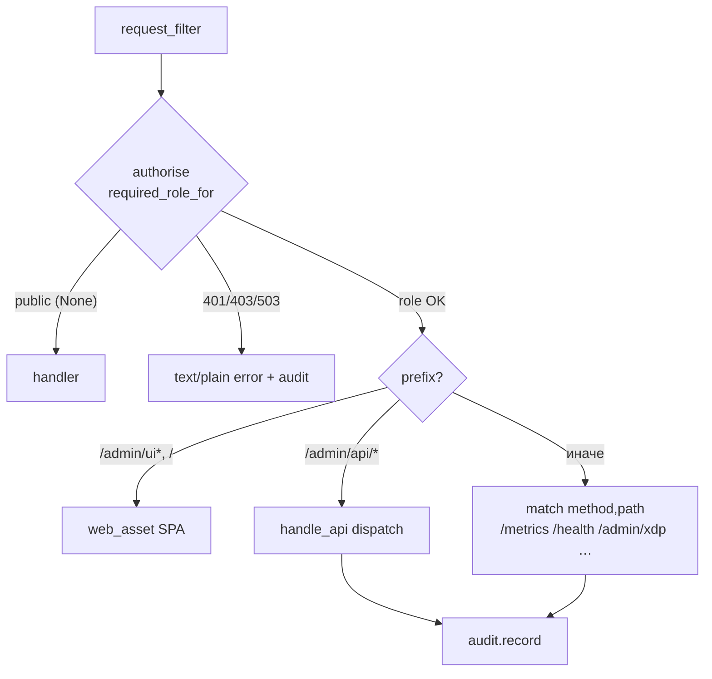

# Admin API — справочник

Полный справочник по HTTP-интерфейсу управления AEGIS: все маршруты `/admin/api/*` (диспетчер `handle_api` в [`src/proxy/pingora_admin.rs`](../../src/proxy/pingora_admin.rs)), нестандартные admin-эндпоинты (`/admin/xdp`, `/admin/threats`, `/metrics`, …), модель аутентификации (`x-admin-token` / сессия / роли) и формы JSON-ответов. Каждое утверждение в этом документе грунтуется в реальном коде — диспетчере `handle_api` ([`pingora_admin.rs:3912`](../../src/proxy/pingora_admin.rs)), функции ролей `required_role_for` ([`src/admin_auth.rs:168`](../../src/admin_auth.rs)) и типизированном клиенте панели [`web/src/api/client.ts`](../../web/src/api/client.ts).

> Этот API обслуживает `aegis-pingora` (основной data plane). Реализация — в `AdminProxy::request_filter` / `AdminProxy::handle_api`. Соседние документы: панель — [29-admin-panel.md](29-admin-panel.md), журнал запросов — [24-request-log.md](24-request-log.md), метрики — [25-metrics-telemetry.md](25-metrics-telemetry.md), многопроцессность/кросс-воркер состояние — [06-workers.md](06-workers.md).

---

## 1. Аутентификация и роли

### 1.1. Источники токена

Запрос аутентифицируется в `AdminProxy::authorise` ([`pingora_admin.rs:~5230`](../../src/proxy/pingora_admin.rs)). Принимаются (в порядке проверки):

| Источник | Где | Что проверяется |
|---|---|---|
| Заголовок `x-admin-token: <значение>` | HTTP-заголовок | Сначала реестр config-токенов (`tokens.authenticate`), затем — если не совпало — таблица web-сессий (`web_admin.validate`). |
| Cookie `aegis_admin_session` | `Cookie:` (Path=`/admin`, `HttpOnly`, `SameSite=Strict`) | Таблица web-сессий. Ставится при `POST /admin/api/login`. |

Важная деталь реализации: React-панель хранит **сессионный** токен в `localStorage` и шлёт его именно через `x-admin-token`, поэтому `authorise` пробует токен сначала как config-токен, а затем как сессионный (см. комментарий V74-RC3 в коде). Клиент агрессивно вычищает пробелы/переводы строк из токена при сохранении (`setToken` в [`client.ts:45`](../../web/src/api/client.ts)) — обрезанный `\n` после копипаста из терминала был частой причиной ложных 401.

Источники config-токенов (резолвятся при старте): секция `admin.tokens[]` в конфиге, переменная окружения `AEGIS_ADMIN_TOKEN`. Web-сессии живут в `/var/lib/aegis/web.json` (или `web_state_path`). Сброс учётки оператора: `aegis web reset-admin` (печатает новый пароль).

### 1.2. Роли

Иерархия ролей (`AdminRole`, по возрастанию прав): `Read` → `Write` → `Admin`. Сравнение по `>=` (`role >= required`).

Замечание о реализации: токен, валидированный через **web-сессию**, получает роль `Admin` (`map(|_| AdminRole::Admin)` в `authorise`). Гранулярные роли (`Read`/`Write`) различаются только для **config-токенов** с явным `role` в `admin.tokens[]`. То есть оператор, вошедший через панель, эффективно действует как `Admin`.

### 1.3. Как определяется требуемая роль

Минимальная роль для пары `(method, path)` задаётся `required_role_for` ([`admin_auth.rs:168`](../../src/admin_auth.rs)). Ключевые правила:

- `GET /admin/api/*` → `Read` (общий «catch-all» для чтения).
- `POST|PUT|DELETE /admin/api/*` → `Write` (fail-closed catch-all, [`admin_auth.rs:260`](../../src/admin_auth.rs)) — кроме явных публичных арм ниже.
- Публичные (роль `None`, аутентификация не требуется): `GET /metrics`, `GET /` и `/admin/ui*` (статика панели), `POST /admin/api/login`, `POST /admin/api/logout`, `POST /admin/api/change-credentials`, `GET /admin/api/me`, а также любой неучтённый путь (`_ => None`).
- Особые исключения по роли: `POST /admin/api/benchmark/run` и `POST /admin/api/benchmark/flood/run` требуют только **`Read`** (запускают CPU/IO-работу, ничего не мутируют в конфиге); `POST /admin/api/config/*` (кроме `apply`) — **`Read`** (dry-run/чтение); `POST /admin/api/config/apply` и `POST /admin/api/restart` — **`Write`**; `POST /admin/reload`, `POST /admin/stop` — **`Admin`**.

> Защита fail-closed: если в системе **нет** ни одного config-токена и **нет** web-admin-хранилища, любой не-публичный запрос получает `503 admin auth not configured`.

### 1.4. Коды ошибок аутентификации

| Статус | Тело | Значение |
|---|---|---|
| `401` | `invalid or missing token\n` | Токен отсутствует или неверен. |
| `403` | `insufficient role\n` | Токен валиден, но роль ниже требуемой (например `Read` шлёт `POST`). |
| `503` | `admin auth not configured\n` | Нет токенов И нет web-store — отказ закрыт. |

Эти ответы — `text/plain`. Ответы самих хэндлеров (`handle_api`) — `application/json` вида `{"error": "...", "status": <code>}` (хелпер `json_err`, [`pingora_admin.rs:5629`](../../src/proxy/pingora_admin.rs)). Неизвестный `/admin/api/*` путь → `404 {"error":"unknown admin api endpoint"}`.

### 1.5. Тело запроса и аудит

Тела `/admin/api/*` читаются до 1 МиБ; сверх — `413` (`read_request_body`, [`pingora_admin.rs:5345`](../../src/proxy/pingora_admin.rs)). Каждый запрос (включая отказы аутентификации) пишется в аудит-лог (`self.audit.record(peer, method, path, role, status)`), просматривается через `GET /admin/api/audit` (см. §6).

---

## 2. Раздел: Auth (без аутентификации)

Все четыре эндпоинта помечены `None` в `required_role_for` — доступны без токена. Хэндлеры выполняют собственную валидацию.

| Метод | Путь | Назначение | Тело запроса | Ответ |
|---|---|---|---|---|
| `POST` | `/admin/api/login` | Вход по email+паролю | `{"email","password"}` | `{ok, token, email, must_change_credentials, must_change, set_cookie}` |
| `POST` | `/admin/api/logout` | Выход, инвалидирует сессию | — (читает cookie/заголовок) | `{ok, set_cookie}` (cookie с `Max-Age=0`) |
| `GET` | `/admin/api/me` | Текущий пользователь | — | `{authenticated, email?, role, must_change/must_change_credentials, auth}` |
| `POST` | `/admin/api/change-credentials` | Смена email+пароля | `{current_password, new_email, new_password}` | `{ok, token, email, set_cookie}` |

Подробности (`api_login`, [`pingora_admin.rs:4366`](../../src/proxy/pingora_admin.rs)):

- `login` при успехе ставит cookie `aegis_admin_session=<token>; Path=/admin; HttpOnly; SameSite=Strict; Max-Age=86400` и возвращает сам token (панель кладёт его в `localStorage`). Если web-admin не настроен → `503 web admin not configured`. Неверные креды → `401 invalid credentials`. Битый JSON → `400 invalid login body`.
- Поля `must_change` и `must_change_credentials` дублируются намеренно: первоначальный пользователь install-скрипта создаётся с `must_change_credentials: true`, что форсирует смену учётки при первом входе. Клиент ([`client.ts:649`](../../web/src/api/client.ts)) читает оба ради совместимости путей login и `/me`-refresh.
- `auth` в `/me` принимает значения `"session"` или `"config_token"`.

```sh
# Вход и сохранение токена
T=$(curl -sS -X POST http://127.0.0.1:9090/admin/api/login \
  -H 'content-type: application/json' \
  -d '{"email":"admin@example.com","password":"...."}' | jq -r .token)
curl -sS -H "x-admin-token: $T" http://127.0.0.1:9090/admin/api/me | jq
```

---

## 3. Раздел: Runtime и наблюдаемость (Read)

| Метод | Путь | Назначение | Ответ |
|---|---|---|---|
| `GET` | `/admin/api/runtime/status` | KPI-снимок (счётчики live) | см. ниже |
| `GET` | `/admin/api/runtime/info` | Сводка состояния модулей для Settings (V169) | см. ниже |
| `GET` | `/admin/api/metrics/series?range=<r>` | Историческая time-series для графиков | `{resolution, points[]}` |
| `GET` | `/admin/api/geo/top` | Трафик по странам для карты мира (V239) | агрегированный JSON по странам |
| `GET` | `/admin/api/filters` | Кумулятивные счётчики per-filter | `{filters:[{name,blocks,challenges}]}` |
| `GET` | `/admin/api/audit` | Хвост аудит-лога (последние ~200 строк) | NDJSON-текст (см. ниже) |
| `GET` | `/admin/api/mined_signatures` | Кандидаты WAF-сигнатур из online-майнера (V107) | `{enabled, last_run_unix_secs?, note?, candidates[]}` |
| `GET` | `/admin/api/bots` | Per-IP сигналы (одиночные источники, V121) | `{bots[], summary:{tracked_bots}}` |
| `GET` | `/admin/api/ddos` | Распределённые атаки (≥10 уникальных IP) | `{targets[], summary:{tracked_endpoints}}` |
| `GET` | `/admin/api/site_map` | Список хостов авто-картографии (V119) | `{hosts[], host_entries?[], total_endpoints}` |
| `GET` | `/admin/api/site_map/<host>` | Эндпоинты одного хоста | `{host, endpoints[]}` |

`runtime/status` (`api_runtime_status`, [`pingora_admin.rs:4498`](../../src/proxy/pingora_admin.rs)) — топливо для KPI-полосы Dashboard:

```json
{
  "uptime_secs": 3621,
  "config_path": "/etc/aegis/aegis.conf",
  "requests": { "total": 12453, "denied": 421, "challenged": 1872 },
  "upstream": { "2xx": 9120, "4xx": 1040, "5xx": 0, "errors": 0 },
  "cache":  { "hits": 0, "misses": 0, "stores": 0, "evictions": 0,
              "not_modified": 0, "skipped_high_threat": 0, "skipped_uncacheable": 0 },
  "xdp":    { "pass": 0, "drop_deny": 0, "drop_rate": 0, "drop_allowonly": 0,
              "drop_syn": 0, "drop_waf": 0, "fast_pass": 0 },
  "anomaly_active_hosts": ["api.example"],
  "top_threats": [{"ip": "1.2.3.4", "score": 84.2}],
  "top_threats_source": "cluster"
}
```

`runtime/info` (`api_runtime_info`, [`pingora_admin.rs:2796`](../../src/proxy/pingora_admin.rs)) возвращает `null` для каждого незаведённого модуля (UI рисует подсказку «not configured» с именем env-переменной). Базовые поля: `version`, `uptime_secs`, `config_path`, `ml_v2`, `ja4_reputation`, `asn_reputation`, `honeypot{…}`, `filter_toggles_count`, `domain_policy_count`, `clamav_addr`, `adversarial_loop`. Расширенный статус env-гейтов (поля опциональны, см. интерфейс `RuntimeInfo` в [`client.ts:188`](../../web/src/api/client.ts)):

| Поле | Env-гейт |
|---|---|
| `ml_v2_enabled` | `AEGIS_ML_V2=1` |
| `ml_v1_enabled` | `AEGIS_ML_SCORER=1` |
| `ml_adversarial` | `AEGIS_ML_ADVERSARIAL=1` |
| `arsenal_enabled` | `AEGIS_ARSENAL != "0"` |
| `tls_fingerprinting` | `AEGIS_TLS_FINGERPRINT=1` |
| `llm_honeypot` | `AEGIS_LLM_HONEYPOT=1` |
| `upstream_healthcheck` | `AEGIS_UPSTREAM_HEALTHCHECK=1` |
| `risk_engine_mode` | `AEGIS_RISK_ENGINE_MODE` |
| `dynamic_trust_enabled` | `AEGIS_DYNAMIC_TRUST_ENABLE=1` |
| `response_cache_enabled` | `AEGIS_RESPONSE_CACHE_ENABLE=1` |
| `log_json` | `AEGIS_LOG_JSON=1` |
| `fw_backend` | `AEGIS_FW_BACKEND` (по умолчанию `"auto"`) |
| `reuseport` | `AEGIS_PINGORA_REUSEPORT=1` |

`metrics/series` (`api_metrics_series`, [`pingora_admin.rs:995`](../../src/proxy/pingora_admin.rs)): обязательный query `range` ∈ `1h|6h|24h|7d|30d`. Источник — mmap кластерные счётчики (`global.rs cluster_get`), сэмплируемые в `PingoraBackground` тиком ~30 с под `AEGIS_HOME` (пишет один воркер под file-lock, читают все). Ответ: `{resolution, points[]}`, где каждая точка содержит per-bucket дельты `requests/denied/challenged/rate_limited/tarpit/rtbh`, производное `allow` и `cache_hits/cache_misses/upstream_2xx/4xx/5xx`. См. [25-metrics-telemetry.md](25-metrics-telemetry.md).

`audit` (`api_audit`, [`pingora_admin.rs:4607`](../../src/proxy/pingora_admin.rs)): отдаётся как `text/plain` — по строке NDJSON на запись (`{ts, peer, method, path, role, status}`). Тейлит `audit_log_path`, если он сконфигурирован. Клиент парсит и переворачивает (новые сверху).

---

## 4. Раздел: Sites CRUD (Write)

| Метод | Путь | Роль | Назначение |
|---|---|---|---|
| `GET` | `/admin/api/sites` | Read | Объединённый список UI- и ops-managed сайтов |
| `POST` | `/admin/api/sites` | Write | Upsert сайта (тот же host перезаписывает `.conf`) |
| `DELETE` | `/admin/api/sites/<host>` | Write | Удалить UI-managed `.conf` |

`GET /admin/api/sites` (`api_sites`, [`pingora_admin.rs:4712`](../../src/proxy/pingora_admin.rs)) объединяет `/var/lib/aegis/sites.d/` (управляемые из UI) и `/etc/aegis/sites-enabled/` (ops-managed, read-only в UI). Ответ: `{sites:[…]}`.

`POST /admin/api/sites` (`api_sites_create`, [`pingora_admin.rs:4803`](../../src/proxy/pingora_admin.rs)) — **upsert**: одинаковый `host` перезаписывает `.conf`. Тело:

```json
{
  "host": "example.com",
  "upstream": "http://127.0.0.1:8080",
  "tls": true,
  "h3": true,
  "ssl_cert": "/etc/aegis/certs/example.crt",
  "ssl_key":  "/etc/aegis/certs/example.key",
  "rate_limit": { "rps": 100, "burst": 200 }
}
```

Ответ: `{ok, host, path, dsl_snippet, note}`. Сайт подхватывается следующим mtime-poll (~30 с) либо оператором через `aegis-pingora --upgrade`. `DELETE` (`api_sites_delete`) удаляет только UI-managed `.conf`; ops-managed сайты через API удалить нельзя.

> Маршрутизация: проверка `/admin/api/sites/<host>/policy` и `/challenge` стоит в диспетчере **до** catch-all `DELETE /admin/api/sites/<host>`, чтобы суффиксы `/policy` и `/challenge` выигрывали (см. порядок арм в [`pingora_admin.rs:4226`](../../src/proxy/pingora_admin.rs)).

---

## 5. Раздел: Per-domain policy (Write, V162/V164/V166/V234)

Per-host оверрайды фильтров + действия по эндпоинтам. Хранятся **в памяти + JSON на диске** в `/var/lib/aegis/domain-policy.json`, синхронизируются через mtime между REUSEPORT-воркерами.

| Метод | Путь | Назначение |
|---|---|---|
| `GET` | `/admin/api/sites/<host>/policy` | Текущая политика + глобальные фильтры |
| `PUT` | `/admin/api/sites/<host>/policy` | Атомарная замена политики |
| `DELETE` | `/admin/api/sites/<host>/policy` | Снять все оверрайды (= PUT пустого) |

`GET` (`api_site_policy_get`, [`pingora_admin.rs:3282`](../../src/proxy/pingora_admin.rs)) возвращает `{host, policy, global_filters[], note}`. Объект `DomainPolicy`:

```json
{
  "filter_enabled": { "waf": true, "challenge": false },
  "endpoint_policies": {
    "/login": "challenge",
    "/.env": "tarpit",
    "/wp-admin/install.php": "block"
  },
  "rate_limit": { "rps": 100, "burst": 200 }
}
```

- `filter_enabled` — имя фильтра → bool; отсутствующий ключ = наследовать глобальный runtime-тоггл.
- `endpoint_policies` (V166) — паттерн пути → действие. Перечисление: `allow` (обойти всю цепочку фильтров), `block` (403, reason `endpoint_policy`), `challenge` (форсировать challenge-лестницу даже если фильтр выключен), `tarpit` (V147 poisoned tarpit).
- `rate_limit` (V234, опционально) — runtime-оверлей rate-limit для хоста; работает даже для ops-managed сайтов без правки read-only `.conf`. `null`/отсутствие = глобальные/статические лимиты.

Синтаксис паттернов (как в honeypot-паках): `/foo` (точное), `/foo/*` (префикс), `*/foo` (суффикс). Побеждает первое **алфавитное** совпадение (детерминированно, независимо от порядка вставки). `PUT` — атомарная замена: что положили, то и хранится; пустой `{}` удаляет запись (хост откатывается к глобалям).

```sh
HOST=api.example.com
acurl http://127.0.0.1:9090/admin/api/sites/$HOST/policy | jq
acurl -X PUT http://127.0.0.1:9090/admin/api/sites/$HOST/policy \
  -d '{"filter_enabled":{},"endpoint_policies":{"/login":"challenge"}}'
```

См. картографию и доменные политики: [26-sites-and-domains.md](26-sites-and-domains.md).

---

## 6. Раздел: Runtime filter toggles (Write, V160)

Runtime включение/выключение фильтров. **В памяти + JSON** в `/var/lib/aegis/runtime-toggles.json`, кросс-воркер sync.

| Метод | Путь | Назначение |
|---|---|---|
| `GET` | `/admin/api/defaults/filters` | Состояние тогглов всех зарегистрированных фильтров |
| `PUT` | `/admin/api/defaults/filters` | Переключить один/несколько фильтров |

`GET` (`api_defaults_filters_get`, [`pingora_admin.rs:3331`](../../src/proxy/pingora_admin.rs)): `{filters:[{name,enabled}], note}`. Известные имена: `adaptive`, `bot`, `challenge`, `honeypot`, `ip_acl`, `rate_limit`, `threat_intel`, `waf`. `PUT` принимает обе формы тела — `{"updates":[{"name","enabled"}]}` или просто массив `[{"name","enabled"}]`. Ответ: `{ok, applied, unknown_filters}`; неизвестные имена тихо игнорируются (файл безопасно править руками). Перезапуск сбрасывает тогглы к дефолтам конфига.

```sh
# Аварийный kill-switch — выключить всё
acurl -X PUT http://127.0.0.1:9090/admin/api/defaults/filters \
  -d '{"updates":[{"name":"waf","enabled":false},{"name":"bot","enabled":false},
       {"name":"adaptive","enabled":false},{"name":"challenge","enabled":false},
       {"name":"rate_limit","enabled":false}]}'
```

---

## 7. Раздел: Honeypots / Tarpit (Write)

| Метод | Путь | Назначение |
|---|---|---|
| `GET` | `/admin/api/honeypots/builtin` | Все 18 встроенных паков (V158) с merge оверрайдов |
| `GET` | `/admin/api/honeypots` | Полный снимок `HoneypotState` |
| `PUT` | `/admin/api/honeypots` | Атомарная замена всего состояния |
| `PUT` | `/admin/api/honeypots/global` | Тоггл одного пака глобально (`{pack_id, enabled}`) |
| `PUT` | `/admin/api/honeypots/host` | Тоггл пака для хоста (`{host, pack_id, enabled}`) |
| `PUT` | `/admin/api/honeypots/host/enabled` | Bypass всего honeypot для хоста (`{host, enabled}`) |
| `POST` | `/admin/api/honeypots/packs/<pack_id>` | Канонический REST-тоггл пака |
| `POST` | `/admin/api/honeypots/hosts/<host>/packs/<pack_id>` | Канонический REST-тоггл пака для хоста |
| `DELETE` | `/admin/api/honeypots/host/<host>` или `/hosts/<host>` | Снять все per-host оверрайды (откат к global) |
| `GET` | `/admin/api/honeypot-yaml` | Дескрипторы LLM/YAML-honeypot (V184) |
| `POST` | `/admin/api/honeypot-yaml/load` | Распарсить YAML-honeypot (тело `text/yaml`) |
| `GET` | `/admin/api/tarpit/status` | Параметры tarpit |

`honeypots/builtin` (`api_honeypots_builtin`, [`pingora_admin.rs:4638`](../../src/proxy/pingora_admin.rs)) отдаёт `{global_enabled, tarpit_seconds, packs[], packs_total, packs_enabled, custom_paths_count}`; каждый пак — `{id, name, description, path_count, enabled}`. `HoneypotState` (форма для `GET`/`PUT /admin/api/honeypots`): `{enabled, packs{}, per_host{}, host_disabled[], custom_paths[], tarpit_seconds, tarpit_chunk_bytes, score_bump, auto_xdp_deny_threshold, server_header}`. Состояние mtime-синкается через `/var/lib/aegis/honeypots.json`.

`tarpit/status` (`api_tarpit_status`, [`pingora_admin.rs:2663`](../../src/proxy/pingora_admin.rs)): `{tarpit_seconds, tarpit_chunk_bytes, auto_xdp_deny_threshold, poisoned_tarpit_default_delay_ms, note}`.

> Порядок арм важен: `PUT /admin/api/honeypots/host/enabled` (bypass хоста) проверяется **раньше** `PUT /admin/api/honeypots/host` (тоггл пака), иначе более общий путь перехватил бы запрос ([`pingora_admin.rs:4257`](../../src/proxy/pingora_admin.rs)).

Подробности логики: [17-honeypot-tarpit.md](17-honeypot-tarpit.md).

---

## 8. Раздел: Config editor

| Метод | Путь | Роль | Назначение |
|---|---|---|---|
| `GET` | `/admin/api/config/raw` | Read | Сырой текст DSL-конфига |
| `PUT` | `/admin/api/config/raw` | Write | Записать конфиг (probe-parse → атомарный rename) |
| `POST` | `/admin/api/config/test` | Read | Dry-run парсинг, без записи на диск |
| `POST` | `/admin/api/config/apply` | Write | Применить = перезапуск (синоним `/admin/api/restart`) |

`PUT /admin/api/config/raw` (`api_config_raw_put`, [`pingora_admin.rs:5084`](../../src/proxy/pingora_admin.rs)): тело `{content:"..."}`. Сначала probe-парсит через временный файл; при ошибке парсинга — `400` без касания диска. При успехе — атомарный rename. **Не перезагружает работающий процесс** — оператор должен запустить `aegis-pingora --upgrade` либо `POST /admin/api/config/apply`. `POST /admin/api/config/test` (`api_config_test`): только dry-run, ответ `{ok: bool, error?: string}`. Все три — async (`tokio::fs` + `spawn_blocking`, V230).

---

## 9. Раздел: Env-флаги и перезапуск (V-env)

| Метод | Путь | Роль | Назначение |
|---|---|---|---|
| `GET` | `/admin/api/env` | Read | Список allowlisted `AEGIS_*` флагов и их статус |
| `PUT` | `/admin/api/env` | Write | Установить/снять один флаг |
| `POST` | `/admin/api/restart` | Write | `systemctl restart aegis-pingora.target` |

`PUT /admin/api/env` (`api_env_put`, [`pingora_admin.rs:3155`](../../src/proxy/pingora_admin.rs)): тело `{key, value}`; `value=null` удаляет ключ из `aegis.env`. Возвращает `restart_required=true` для startup-gated переменных. Секреты — write-only: `GET` возвращает `configured: true/false` и `value: null` (см. комментарий в [`client.ts:230`](../../web/src/api/client.ts)).

`POST /admin/api/restart` (`api_restart`, [`pingora_admin.rs:3201`](../../src/proxy/pingora_admin.rs)) спавнит `systemctl restart aegis-pingora.target`; соединение оборвётся через пару секунд. Ответ имеет ту же форму, что и `config/apply` (`{ok, note}`). Подробности тюнинга и env: [04-configuration.md](04-configuration.md), [27-performance-tuning.md](27-performance-tuning.md).

---

## 10. Раздел: Worker topology (V232)

| Метод | Путь | Роль | Назначение |
|---|---|---|---|
| `GET` | `/admin/api/topology` | Read | Хост, layout, per-worker процессы + рекомендация |
| `PUT` | `/admin/api/topology` | Write | Желаемое число воркеров (`"auto"` или числовая строка) |

`api_topology_get` / `api_topology_put` ([`pingora_admin.rs:1362`/`1483`](../../src/proxy/pingora_admin.rs)). `PUT` тело: `{"workers":"auto"}` или `{"workers":"4"}`. Этот PUT обязан требовать `Write` (никогда не публичный — он персистит state-файл; есть отдельный тест на это). Про SO_REUSEPORT и шаблон systemd: [06-workers.md](06-workers.md).

---

## 11. Раздел: Benchmark (V240/V241/V245)

| Метод | Путь | Роль | Назначение |
|---|---|---|---|
| `POST` | `/admin/api/benchmark/run` | Read | Запуск hardware-бенча (fire-and-forget) |
| `GET` | `/admin/api/benchmark/result` | Read | Результат hardware-бенча + capacity-прогноз |
| `POST` | `/admin/api/benchmark/flood/run` | Read | Запуск flood-suite (SYN/HTTP/TLS/slowloris/cache) |
| `GET` | `/admin/api/benchmark/flood/result` | Read | Результат flood-suite (poll до `status=="done"`) |
| `POST` | `/admin/api/benchmark/compare/run` | Write | Запуск head-to-head vs nginx/HAProxy/Caddy/Envoy |
| `GET` | `/admin/api/benchmark/compare/result` | Read | Результат сравнения |

Run-эндпоинты — fire-and-forget (возвращают `{ok, queued}` / 202); результат поллится отдельным GET до `status=="done"`. Результаты персистятся в файлы под `AEGIS_HOME` (`.benchmark-result.json`, `.benchmark-flood-result.json`, `.benchmark-compare-result.json`), потому что у каждого SO_REUSEPORT-воркера своё in-memory состояние — без файла прогресс-бар панели крутился бы вечно (V244, [`pingora_admin.rs:5634`](../../src/proxy/pingora_admin.rs)).

`compare/result` (`ComparisonResult` в [`client.ts:1387`](../../web/src/api/client.ts)): `{ok, status, error, started_at_unix, duration_ms, targets[], security[], caveat}`. Колонки `targets` в фиксированном порядке: AEGIS (raw), AEGIS + WAF, nginx, nginx+ModSec+CRS, HAProxy, Caddy, Envoy; недоступный бинарь → `available:false`, `throughput_rps:0`.

> ЧЕСТНЫЕ ОГОВОРКИ (поле `caveat` в ответе их явно несёт): бенч-лейны AEGIS — **in-process движок**, а НЕ полный pingora-бинарь; hardware-SHA-бенч измеряется per-core и внутри VM без аппаратного SHA-ускорения занижен, поэтому прогноз ёмкости тогда пессимистичен. AEGIS не заявляется быстрее реальных проксей по голой скорости — сильная сторона в матрице безопасности. См. [28-benchmarking.md](28-benchmarking.md).

---

## 12. Раздел: Challenge / Privacy Pass / CAPTCHA (V205-V207, V219, V226)

| Метод | Путь | Назначение |
|---|---|---|
| `GET` | `/admin/api/challenge/hosts` | Список per-host challenge-конфигов + глобальное состояние |
| `GET` | `/admin/api/sites/<host>/challenge` | Конфиг challenge одного хоста |
| `PUT` | `/admin/api/sites/<host>/challenge` | Записать конфиг (Write) |
| `DELETE` | `/admin/api/sites/<host>/challenge` | Удалить (Write) |
| `POST` | `/admin/api/challenge/attack-mode` | Глобальный attack-mode (Write, `{on:bool}`) |
| `GET` | `/admin/api/privacy-pass` | Сводка Privacy Pass (счётчики) |
| `GET` | `/admin/api/privacy-pass/issuers` | Список эмитентов |
| `POST` | `/admin/api/privacy-pass/issuers` | Добавить эмитента (Write) |
| `GET` | `/admin/api/captcha/status` | Статус PoW + внешних провайдеров |
| `GET` | `/admin/api/route-difficulty` | Per-route оверрайды сложности (V186/V227) |

`challenge/hosts` (`api_challenge_hosts`, [`pingora_admin.rs:1303`](../../src/proxy/pingora_admin.rs)): `{wired, hosts:[{host, config}], global?}`. `DomainChallengeConfig` — большой опциональный набор флагов (все опциональны): PoW (`argon2_pow`, `argon2_bits`, `argon2_memory_kb`, `attack_mode_bits`), `privacy_pass`, `chained_trust`, `adaptive`, `varied_errors`, `decoy_captcha`, `honeypot_fields`, `trust_for_auth`, `fast_track_threshold`; пассивные сигналы арсенала (`ja4_ua_consistency`, `header_fingerprint`, `h2_fingerprint`, `datacenter_asn_challenge`); браузерные проверки (`headless_detection`, `webgl_audio_fp`, `dom_timing_entropy`, `proof_of_click`); энфорсмент (`reputation_difficulty`, `fail_to_xdp_deny`, `turnstile`). Полная семантика — [15-challenge-ladder.md](15-challenge-ladder.md).

> `POST /admin/api/challenge/attack-mode` исторически проваливался в публичный `_ => None` — это исправлено fail-closed catch-all (V232); теперь требует `Write`, есть регрессионный тест.

`privacy-pass` (`api_privacy_pass_list`, [`pingora_admin.rs:2392`](../../src/proxy/pingora_admin.rs)): `{wired, issuer_count, nonce_cache_size?, note?}`. `POST /issuers` принимает `{name, key_id_hex, public_key_hex, algorithm:"ed25519"|"hmac_sha256", trust_duration_secs}`. См. [16-privacy-pass.md](16-privacy-pass.md). `captcha/status`: `{pow:{enabled, difficulty_bits, algorithm}, external_providers:{hcaptcha, turnstile, recaptcha}, note}`.

---

## 13. Раздел: Reputation / Enrichment / ML (V216-V218)

| Метод | Путь | Назначение |
|---|---|---|
| `GET` | `/admin/api/reputation/ja4` | Статус JA4-репутации (self-learn) |
| `POST` | `/admin/api/reputation/ja4/lookup` | Поиск по JA4 (`{ja4}`) |
| `GET` | `/admin/api/reputation/asn` | Статус ASN/CIDR-репутации |
| `POST` | `/admin/api/reputation/asn/lookup` | Поиск по IP (`{ip}`) |
| `GET` | `/admin/api/enrichment` | Статус источников обогащения |
| `POST` | `/admin/api/enrichment/lookup` | Lookup (`{key_kind:"ip"\|"ja4"\|"asn"\|"user_agent", value}`) |
| `GET` | `/admin/api/ml/status` | Статус ML v2 + adversarial |
| `POST` | `/admin/api/ml/retrain` | Переобучить модель (Write) |
| `POST` | `/admin/api/ml/adversarial` | Тоггл adversarial-loop (Write) |
| `GET` | `/admin/api/crowdsec/status` | Статус CrowdSec LAPI-адаптера (V157) |

`reputation/ja4` (`api_reputation_ja4`, [`pingora_admin.rs:2201`](../../src/proxy/pingora_admin.rs)): `{wired, entry_count, active, corpus_count}`. `reputation/asn`: `{wired, entry_count, active}`; `asn/lookup` → `{ip, score, tag, match_kind, matched}`. `enrichment` → `{wired, sources:[{name,queries,hits,misses}], cache?:{hits,misses,size}}`. `ml/status` (`api_ml_status`, [`pingora_admin.rs:2271`](../../src/proxy/pingora_admin.rs)): `{v2_wired, v2_kind, adversarial_loop_env, note}`; `retrain`/`adversarial` возвращают `{ok, error?/enabled, hint}`.

Подробности: репутация — [12-reputation.md](12-reputation.md), обогащение — [22-enrichment.md](22-enrichment.md), ML — [18-ml-risk-engine.md](18-ml-risk-engine.md). Режимы risk-engine (`Observe`/`HighConfidenceEnforce`/`FullEnforce`) задаются через `AEGIS_RISK_ENGINE_MODE`.

---

## 14. Раздел: Scenarios / Actuators / Sigma / Arsenal (V191, V213-V215)

| Метод | Путь | Назначение |
|---|---|---|
| `GET` | `/admin/api/arsenal` | Каталог модулей Defence Arsenal + счётчики |
| `GET` | `/admin/api/scenarios` | Список YAML-сценариев + статистика |
| `POST` | `/admin/api/scenarios/load` | Загрузить сценарии (тело `text/yaml`) |
| `POST` | `/admin/api/scenarios/test` | Распарсить сценарии без применения |
| `GET` | `/admin/api/actuators` | Активные действия + типы + статистика |
| `POST` | `/admin/api/actuators/revert` | Откатить действие (`{kind, target_kind, target_value}`) |
| `GET` | `/admin/api/sigma/rules` | Статус файла Sigma-правил |
| `POST` | `/admin/api/sigma/import` | Импорт правила (тело `text/yaml`) |
| `GET` | `/admin/api/sigma/rules/list` | Список правил корпуса (V237) |
| `PUT` | `/admin/api/sigma/rules/toggle` | Включить/выключить правило (`{id, enabled}`) |

`arsenal` (`api_arsenal`, [`pingora_admin.rs:1146`](../../src/proxy/pingora_admin.rs)): `{summary:{total_modules, families{}, version_range}, modules[], counters?}`; модуль — `{id, v, family, label, desc, status:"shipped"|"planned"|"experimental"}`. `scenarios` (`api_scenarios_list`, [`pingora_admin.rs:1865`](../../src/proxy/pingora_admin.rs)): `{wired, scenarios[], stats?}`; элемент `ScenarioConfig` = `{name, description?, filter{}, groupby, distinct?, capacity, leak_speed, blackhole?, action}`. `actuators` → `{wired, active[], kinds[], stats{}}`; `ActiveAction` = `{kind, target, reason, source_module, applied_at, remaining_secs}`.

`sigma/rules/list` (`api_sigma_rules_list`, [`pingora_admin.rs:2051`](../../src/proxy/pingora_admin.rs)): `{path, total, disabled_count, rules[]}`; правило = `{id, field, op, value, severity, action, tags[], enabled}`. Тоггл идёт через дисковый overlay (кросс-воркер, как honeypot-паки). Загрузки сценариев/Sigma принимают `text/yaml`. См. [21-arsenal-scenarios.md](21-arsenal-scenarios.md), WAF/Sigma — [10-waf.md](10-waf.md).

---

## 15. Раздел: BGP RTBH (V220)

| Метод | Путь | Назначение |
|---|---|---|
| `GET` | `/admin/api/bgp/announces` | Активные RTBH-анонсы |
| `POST` | `/admin/api/bgp/withdraw` | Отозвать анонс (`{ip}`, Write) |

`bgp/announces` (`api_bgp_list`, [`pingora_admin.rs:2472`](../../src/proxy/pingora_admin.rs)): `{wired, active_count, active:[{ip, community, age_secs}]}`. `withdraw` → `{ok, ip?, error?}`. RTBH через ExaBGP — [19-bgp-rtbh.md](19-bgp-rtbh.md).

---

## 16. Раздел: GeoIP / Cluster / Telemetry (V221-V223)

| Метод | Путь | Назначение |
|---|---|---|
| `GET` | `/admin/api/geoip/status` | Статус GeoIP/ASN-баз |
| `POST` | `/admin/api/geoip/lookup` | Lookup IP (`{ip}`) |
| `POST` | `/admin/api/geoip/update` | Обновить bundled db-ip Country Lite (Write) |
| `GET` | `/admin/api/cluster/status` | Статус shared-scorer + XDP-счётчики |
| `GET` | `/admin/api/telemetry/status` | EventBridge / ClamAV / audit-log |

`geoip/status` (`api_geoip_status`, [`pingora_admin.rs:2543`](../../src/proxy/pingora_admin.rs)): `{geoip_db_path, asn_db_path, loaded, database_type?, build_epoch?, bundled?, attribution?, note}`. `cluster/status`: `{shared_scorer_attached, counts:{ipv4_slots_active?, top?:[{ip,score}]}, note}`. `telemetry/status`: `{event_bridge:{format, format_options[], socket_path}, clamav:{enabled, addr, env_var}, audit_log_path}`. См. [20-geoip.md](20-geoip.md), [25-metrics-telemetry.md](25-metrics-telemetry.md).

---

## 17. Раздел: Request log / Журнал (V243)

| Метод | Путь | Назначение |
|---|---|---|
| `GET` | `/admin/api/logs` | Постраничные строки decision-log |
| `GET` | `/admin/api/logs/stats` | Агрегации по тому же окну фильтра |

`api_logs` / `api_logs_stats` ([`pingora_admin.rs:1052`/`1091`](../../src/proxy/pingora_admin.rs)). Маршрут `/logs/stats` проверяется **раньше** `/logs`, чтобы более длинный путь не затенялся префиксом. `logs` принимает query: `host`, `endpoint` (по `path_pattern`), `action`, `ip`, `q` (free-text по path/UA/reason), `from`/`to` (epoch ms), `limit`/`offset`. Ответ: `{entries:[LogEntry], total}`. `LogEntry`: `{ts, host, method, path, path_pattern, status, action, reason, waf_rule, client_ip, country, ja4, latency_ms, bytes, protocol, user_agent}`.

`logs/stats` учитывает только `host`/`from`/`to` (прочие поля игнорируются бэкендом). Ответ `LogStats`: `{by_action[], top_endpoints[], top_client_ips[], top_reasons[], status_distribution[], series[]}`. Источник — персистентный SQLite event-store (per-worker шарды). Подробно: [24-request-log.md](24-request-log.md).

---

## 18. Раздел: ACME / Let's Encrypt

| Метод | Путь | Роль | Назначение |
|---|---|---|---|
| `GET` | `/admin/api/acme/config` | Read | Конфиг ACME |
| `PUT` | `/admin/api/acme/config` | Write | Обновить конфиг (patch) |
| `GET` | `/admin/api/acme/orders` | Read | Список ордеров |
| `GET` | `/admin/api/acme/orders/<host>` | Read | Ордер одного хоста |
| `POST` | `/admin/api/acme/orders` | Write | Создать ордер (`{host, email}`) |
| `POST` | `/admin/api/acme/orders/<host>/renew` | Write | Перевыпустить (Write) |

`api_acme_*` ([`pingora_admin.rs:2867`+](../../src/proxy/pingora_admin.rs)). Порядок арм: `/renew` проверяется **до** `GET /orders/<host>`, а `PUT /config` — до любого `/acme/*` catch-all. `create` → `{host, status}`. См. [08-tls-certificates.md](08-tls-certificates.md).

---

## 19. Раздел: Update checker (V208, read-only)

| Метод | Путь | Назначение |
|---|---|---|
| `GET` | `/admin/api/updates/status` | Текущая версия + наличие апдейта |
| `POST` | `/admin/api/updates/check` | Принудительная проверка релизов |
| `GET` | `/admin/api/updates/releases` | Список релизов |
| `PUT` | `/admin/api/updates/config` | Канал/частота поллинга (Write) |

`api_updates_*` ([`pingora_admin.rs:1794`+](../../src/proxy/pingora_admin.rs)). `status` → `{current_version, channel, repo_api_url, latest, update_available, last_checked_at, last_error}` (+ возможно `wired`, `note`). `config`: `{repo_api_url, channel:"stable"|"beta"|"nightly", current_version, poll_interval_secs}`.

> Историческая оговорка (V233): арм-ы self-update **apply** + snapshot (`POST /admin/api/updates/apply`, `/snapshots*`, `/releases-installed`, `/apply-status`) **удалены** из бэкенда — они скачивали и исполняли неподписанный, контролируемый атакующим бинарь от имени сервис-пользователя (дизайн unauthenticated-RCE). Остался только read-only checker. Обновления ставятся вручную: `sudo bash install.sh` на хосте. См. [44-updates-migration.md](44-updates-migration.md).

---

## 20. Нестандартные admin-эндпоинты (вне `/admin/api/*`)

Обрабатываются в catch-all `match (method, path)` внутри `request_filter` ([`pingora_admin.rs:5373`](../../src/proxy/pingora_admin.rs)); ответы — `text/plain`. Роли заданы в `required_role_for`.

| Метод | Путь | Роль | Назначение / ответ |
|---|---|---|---|
| `GET` | `/metrics` | — (public) | Prometheus exposition (+ cache/XDP/cluster-статы) |
| `GET` | `/health`, `/admin/health` | public / Read | `ok\n` |
| `GET` | `/admin/xdp` | Read | Счётчики: `xdp_pass / fast_pass / drop_deny / drop_rate / drop_allowonly / drop_syn / drop_waf` |
| `POST` | `/admin/xdp/deny/<ip>` | Write | Добавить IP в kernel deny-map → `xdp_deny <ip>\n` |
| `POST` | `/admin/xdp/undeny/<ip>` | Write | Убрать из deny-map → `xdp_undeny <ip>\n` |
| `GET` | `/admin/threats` | Read | Топ-50 IP по threat-score (cluster scorer, иначе per-worker) |
| `GET` | `/admin/anomaly` | Read | Активные атаки (`<host> attack_remaining_ms=<n>`) |
| `GET` | `/admin/hot_uris` | Read | Горячие URI |
| `GET` | `/admin/cache` | Read | Сводка кэша |
| `GET` | `/admin/cache/dump` | Read | Дамп кэша |
| `POST` | `/admin/cache/purge?all=1\|?host=\|?prefix=` | Write | Очистка кэша → `purged <n>\n` |
| `POST` | `/admin/waf/reload` | Write | Перечитать WAF-правила → `reloaded <n> file(s)\n` |
| `POST` | `/admin/shared_scorer/compact` | Write | Компакция shared-scorer (503 если арена не инициализирована) |
| `POST` | `/admin/signature_mine` | Write | N-gram майнер; тело `text/plain` (атаки, `---`, benign) → ранжированные кандидаты |
| `POST` | `/admin/reload` | Admin | `501` — использовать `--upgrade` или `POST /admin/api/restart` |

`/metrics` (`render_prometheus` + `append_cache_stats`/`append_xdp_stats`/`append_cluster_stats`, [`pingora_admin.rs:5374`](../../src/proxy/pingora_admin.rs)) — content-type `text/plain; version=0.0.4`. Это единственный публичный эндпоинт наблюдаемости; его потребляют Prometheus/SIEM наряду с EventBridge NDJSON. XDP/eBPF — [13-xdp-ebpf.md](13-xdp-ebpf.md).

```sh
acurl http://127.0.0.1:9090/admin/xdp           # текстовые XDP-счётчики
acurl -X POST http://127.0.0.1:9090/admin/xdp/deny/1.2.3.4
acurl -X POST http://127.0.0.1:9090/admin/xdp/undeny/1.2.3.4   # без авто-истечения
```

> `/admin/xdp/deny/<ip>` не имеет авто-истечения — снимать бан нужно вручную через `undeny` или фоновую задачу.

---

## 21. Публичный клиентский эндпоинт (V145)

| Метод | Путь | Auth | Назначение |
|---|---|---|---|
| `POST` | `/.well-known/aegis/consistency` | нет | Сбор client-consistency сигналов из браузера |

Браузер POST-ит JSON из сниппета `CREEPJS_CLIENT_JS` ([`src/client_consistency.rs`](../../src/client_consistency.rs)). Лимит тела 8 КиБ: `204` при успехе, `400` на битый JSON, `413` на превышение. Это часть TLS/браузерного фингерпринтинга — [11-tls-fingerprinting.md](11-tls-fingerprinting.md).

---

## 22. Curl-шпаргалка

```sh
# Токен один раз
export AEGIS_TOKEN=$(cat /etc/aegis/admin-token)
alias acurl='curl -sS -H "x-admin-token: $AEGIS_TOKEN"'

# Снимок дашборда
acurl http://127.0.0.1:9090/admin/api/runtime/status | jq
acurl http://127.0.0.1:9090/admin/api/runtime/info   | jq

# Применить отредактированный конфиг (test → save → apply)
acurl -X POST http://127.0.0.1:9090/admin/api/config/test -d '{"content":"..."}'
acurl -X PUT  http://127.0.0.1:9090/admin/api/config/raw  -d '{"content":"..."}'
acurl -X POST http://127.0.0.1:9090/admin/api/config/apply -d '{}'

# Per-domain политика
acurl http://127.0.0.1:9090/admin/api/sites/api.example.com/policy | jq

# Журнал запросов с фильтром
acurl "http://127.0.0.1:9090/admin/api/logs?host=api.example.com&action=deny&limit=50" | jq
```

---

## 23. Сводная карта маршрутов

Источник истины — диспетчер `handle_api` ([`pingora_admin.rs:3912`](../../src/proxy/pingora_admin.rs)) и `required_role_for` ([`admin_auth.rs:168`](../../src/admin_auth.rs)). При добавлении новых маршрутов: любой неучтённый `POST/PUT/DELETE` под `/admin/api/` автоматически попадает под fail-closed `Write` (V232) — это сознательное поведение «по умолчанию закрыто».



> Документ покрывает все ~86 арм диспетчера `/admin/api/*` плюс нестандартные admin-маршруты и публичные `/metrics` / `/.well-known/aegis/consistency`. Глоссарий терминов (JA4, RTBH, XDP, PoW, …) — [46-glossary.md](46-glossary.md); типовые проблемы аутентификации/доступа — [47-faq-troubleshooting.md](47-faq-troubleshooting.md).
