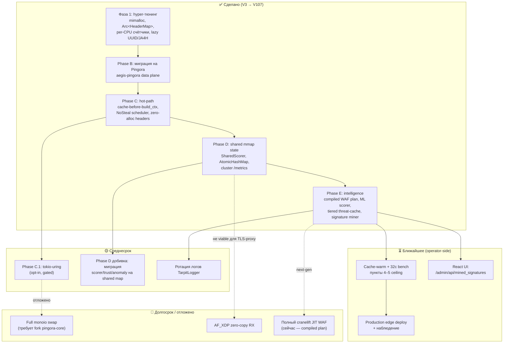
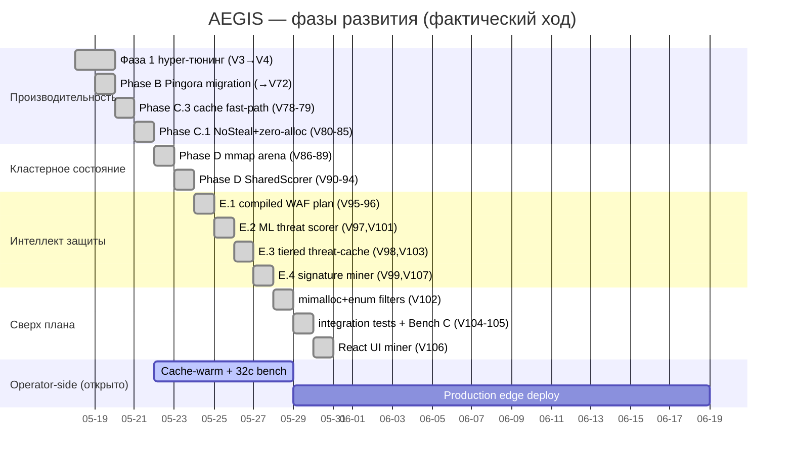

# Дорожная карта

Единая, консолидированная карта развития AEGIS: что **уже сделано**, что в **ближайших планах**, **среднесрочно** и **долгосрочно**. Документ сводит воедино четыре корневых roadmap-файла (`AEGIS-X-ROADMAP.md`, `ROADMAP-NEXT.md`, `ROADMAP-STATUS.md`, `PERF-ROADMAP.md`) и сверяет их утверждения с реальным кодом — частичные и opt-in фичи отмечены честно.

> Связанные доки: подробный список будущих работ — [41-development-plan.md](41-development-plan.md); честный снапшот текущего состояния — 42-текущее-состояние-STATUS.md; цифры и методология бенчей — [28-benchmarking.md](28-benchmarking.md); тюнинг производительности — [27-performance-tuning.md](27-performance-tuning.md).

---

## 1. Источники и как читать эту карту

Карта консолидирует четыре исторических документа в корне репозитория. Каждый покрывал свою эпоху проекта:

| Источник | Эпоха | Роль | Финальный зафиксированный статус |
|---|---|---|---|
| `PERF-ROADMAP.md` | V3–V4 (2026-05-18/19) | «Догнать nginx» — Фаза 1 (выжать hyper), Фаза 2 (архитектура), Фаза 3 (козыри) | V4 = 111k RPS, ~48 % nginx |
| `AEGIS-X-ROADMAP.md` | V4–V11 + план A–E | «Top-0 commodity edition» — 4 слоя, 5 фаз (A XDP → E intelligence) | V11 = «honest hyper ceiling» |
| `ROADMAP-NEXT.md` | V77–V100 | План до technology-ceiling, блоки 1–4 | V100 = Phase A–E feature-complete |
| `ROADMAP-STATUS.md` | V100–V107 (2026-05-21) | Снапшот «план vs реальность» | V107, 30 ship'ов на `main`, 397 lib-тестов |

> Важная оговорка о версиях: метки `V3…V107` — это внутренние ступени разработки (по commit'у), а **не** релизные версии продукта. Числа RPS в источниках получены на конкретных стендах (OrbStack arm64 16c, i9-9900K WSL2/native) и измеряют **in-process движок**, а не полный pingora-бинарь под боевой нагрузкой. Подробнее о честности бенчей — раздел 7 и [28-benchmarking.md](28-benchmarking.md).

---

## 2. Карта направлений (flowchart)

Развитие AEGIS шло по двум сходящимся осям: **производительность** (PERF → Phase A–E) и **защитный охват** (WAF/TLS-fp/репутация/ML). Ниже — направления и их текущее состояние.

---

## 3. Таймлайн по фазам (Gantt)

Диаграмма отражает фактический ход (V3–V107, всё закрыто за серию сессий, не за номинальные недели плана) и оставшиеся operator-side работы. Даты — относительные ступени, не календарь.

---

## 4. Сделано (feature-complete, в `main`)

Все нижеперечисленное присутствует в коде на текущей ветке. Цитаты путей даны для проверяемости.

### 4.1 Производительность (PERF Фаза 1 → Phase C)

| Шаг | Что сделано | Где в коде | Эффект (по источникам) |
|---|---|---|---|
| F1.1 | mimalloc как global allocator | `Cargo.toml`, `src/main.rs` | +2–5 % (V4) |
| F1.3 | Lazy UUID / lazy JA4H для trusted | устранение per-request UUID-alloc (V85) | slow-path +5–15 % |
| F1.5 | `Arc<HeaderMap>` в контексте | `CachedResponse` (V84) | устранён deep-copy headers |
| F1.6 | Per-CPU sharded счётчики | `src/metrics/` | снижение cache-line contention |
| C.3 | Cache lookup **до** `build_ctx` для trusted | `src/proxy/pingora_http.rs` | 770k → 884k (+15 %) |
| — | HEAD из GET-кеша + `is_already_lowercase` fast-skip | `pingora_http.rs` (V79) | correctness + coverage |
| C.1 | NoSteal scheduler как default | `src/bin/aegis-pingora.rs:1653` (env `AEGIS_PINGORA_WORK_STEALING`) | 950–966k stable |
| C.1 | Zero-alloc header forwarding (`&HeaderName`) | cache serve loops (V82) | ⭐ первый 1.0M stable |

> Наблюдаемость fast-path: заголовки ответа `x-aegis-cache: HIT-FAST` / `HIT-FAST-HEAD` (`src/proxy/pingora_http.rs:2469`) позволяют оператору видеть долю трафика, идущего по быстрому пути в обход `build_ctx` и filter chain.

### 4.2 Data plane: Phase B (Pingora)

- Основной бинарь `aegis-pingora` (фичи `pingora+xdp`) — полная миграция с hyper-стека, фильтры через `ProxyHttp` trait. См. [02-architecture.md](02-architecture.md), [07-protocols.md](07-protocols.md).
- TLS termination на openssl-бэкенде, per-SNI cert routing, mTLS — см. [08-tls-certificates.md](08-tls-certificates.md).
- Реальные JA3-MD5 / JA4 / JA4H / JA4T из ClientHello-callback — см. [11-tls-fingerprinting.md](11-tls-fingerprinting.md).
- Многопроцессность SO_REUSEPORT через systemd template — см. [06-workers.md](06-workers.md).

### 4.3 Кластерное состояние: Phase D (shared mmap)

| Шаг | Что | Где в коде |
|---|---|---|
| V86–88 | shared anon mmap arena + bump-allocator + `AtomicHashMap` (open-addressing, CAS, tombstones) | `src/ddos/shared_score.rs` |
| V89 | интеграция в daemon: cluster-wide `aegis_cluster_*` метрики | `src/proxy/pingora_background.rs` |
| V90–94 | `SharedScorer` (dual-record), `AtomicHashMap128` для IPv6, compaction (фон + admin trigger) | `src/ddos/shared_score.rs`, `src/proxy/pingora_admin.rs` |

**Зачем:** до Phase D каждый из N воркеров вёл независимый scorer — распределённый атакующий мог бить воркер A, пока воркер B видит чистый score. SharedScorer закрывает эту дыру кросс-воркерно без потери throughput. Подробнее — [12-reputation.md](12-reputation.md), [18-ml-risk-engine.md](18-ml-risk-engine.md).

### 4.4 Интеллект защиты: Phase E

| Sub-block | Что landed | Где в коде | Честная оговорка |
|---|---|---|---|
| E.1 | **Compiled WAF rule plan**: per-field Aho-Corasick поверх contains/regex, O(1) equals через HashMap, LeftmostFirst (~560–650 нс/req @ 250 правил на arm64) | `src/waf*` | Это **не** cranelift-JIT из исходного плана — это скомпилированный план правил. Полный JIT остаётся долгосроком |
| E.2 | **ML threat scoring**: логистическая регрессия на 8 признаках (~300 B модель, <100 нс инференс), online SGD + hot-reload | `src/ddos/ml_score.rs`, `src/ddos/ml_model.rs`, `src/ddos/risk_engine.rs` | Режимы Observe / HighConfidenceEnforce / FullEnforce — см. [18-ml-risk-engine.md](18-ml-risk-engine.md) |
| E.3 | **Tiered threat-cache**: `ThreatTier {Low,Medium,High}`, per-tier счётчики, TTL/half-life с per-host/per-status override | `src/proxy/response_cache.rs` | |
| E.4 | **Self-improving signatures**: document-frequency n-gram miner, `POST /admin/signature_mine`, online tarpit→miner pipeline | `src/signature_mine.rs`, `src/online_signature_miner.rs`, `src/admin_auth.rs:187` | **Намеренно без авто-write-back** — оператор промотирует кандидатов вручную |

### 4.5 Сверх первоначального плана (V101–V107)

- V101 — wiring ML scorer + `ThreatTier` в hot-path pingora.
- V102 — mimalloc + enum-dispatch фильтры + body buffer pool.
- V103 — DSL cache config + tier-override fix (487k RPS cache-warm на OrbStack).
- V104 — синхронизация integration-тестов.
- V105 — `aegis-distbench` + Bench C (distributed-attacker): 50 IP × 200 SQLi → все 50 видны в `/admin/threats?source=cluster`, что подтвердило модель threat-integrity Phase D end-to-end.
- V106 — React UI для signature miner.
- V107 — online tarpit→miner pipeline.

---

## 5. Ближайшее (operator-side, не код)

Из `ROADMAP-STATUS.md` § «Что осталось». Главное: **фичевая разработка завершена**, оставшееся гейтится на железо и продакшен-деплой, а не на код.

| Задача | Кто | Время | Что закрывает |
|---|---|---|---|
| Cache-warm bench на i9 (alias loopback + V103 config) | вместе | ~15 мин | подтвердит cache-warm на native Linux |
| 32-core node bench (напр. Hetzner CPX41) | оператор | ~1 час | пункт 4 technology-ceiling |
| Production edge deploy + 1–2 недели наблюдения | оператор | недели | пункт 5 technology-ceiling |
| Wire `/admin/api/mined_signatures` в React UI рядом с ручным mine | V108+ | ~2 часа | полнота UI |
| Ротация / size-based truncation для `TarpitLogger` | V108+ | ~1 час | долгоиграющие deployment'ы |

---

## 6. Среднесрок и долгосрок

### Среднесрок (запланировано, частично заложено)

- **Phase C.1 — tokio-uring socket I/O** (Linux 5.10+, feature-flag, gated). В `ROADMAP-NEXT.md` помечен «пока не начато», ожидаемый эффект +15–25 %. Инкрементальный, без замены рантайма.
- **Phase D добивка (V90-class)** — миграция `ThreatScorer` / `DynamicTrust` / `AnomalyDetector` с per-worker DashMap на shared `AtomicHashMap` (нужна упаковка `WindowStats` + обработка IPv4-ключей). Фундамент готов, остаётся обвязка к существующему scorer API.
- **Logger rotation для TarpitLogger** — см. таблицу выше.

### Долгосрок / сознательно отложено

Из `ROADMAP-NEXT.md` § «Что НЕ в плане» — отказы с обоснованием:

| Отложено | Почему |
|---|---|
| Full monoio swap (Phase C.1 максималист) | требует fork `pingora-core` (4–6 нед) + maintenance burden |
| `XDP_REDIRECT` to upstream | не viable для TLS-terminating proxy (нет DSR) |
| AF_XDP zero-copy receive | требует переписать TCP layer, нишевый use-case |
| WASM-фильтры | перекрывается уже существующими Lua-плагинами ([31-plugins.md](31-plugins.md)) |
| HTTP/3 server push | deprecated в RFC HTTP/3 |
| Полный cranelift JIT WAF | текущий compiled plan покрывает 5–10× выигрыш; JIT — next-gen цель |

---

## 7. Производительность: план vs реальность (честно)

Из `ROADMAP-STATUS.md` § «Где недобрали» и technology-ceiling checklist.

| Метрика плана | Реальность | Причина |
|---|---|---|
| Block 2: 1.5–1.8M RPS | 1.10M peak / 1.0M stable (~73 %) | tokio overhead > ожидаемого; monoio swap осознанно отложен |
| 3–5M cached на OrbStack | 487k cached (V103) | OrbStack 8-vCPU shared с macOS host — oversubscription, не код |
| 10M cached bare-metal x86 32c | не измерено | нет 32c hardware в сессиях |

Technology-ceiling checklist (нужно 4 из 5):

| # | Условие | Статус |
|---|---|---|
| 1 | OrbStack arm64 ≥3–5M cached / mixed 1.5–2M | ⚠ Partial — 487k cache-warm на shared VM |
| 2 | Bench A vs nginx ×10 cache-warm / ×3 no-defense | ⚠ Partial — ×3.5 no-defense на i9 confirmed; ×10 не мерили |
| 3 | Полная защитная stack (eBPF + WAF plan + ML + threat-cache + Phase D) | ✅ DONE — 5/5 слоёв + online miner |
| 4 | Bare-metal x86 32c: 5–10M cached | ⏳ нет железа |
| 5 | Production deployment validated | ⏳ operator-side |

> **Честные оговорки (без завышения):**
> - Бенч-лейны AEGIS измеряют **in-process движок**, а не полный pingora-бинарь под боевым трафиком.
> - Аппаратный SHA-бенч — per-core, низкий внутри VM без аппаратного SHA-ускорения; прогноз ёмкости в таком окружении пессимистичен.
> - **Мы НЕ заявляем, что AEGIS быстрее реальных проксей по голой скорости.** Сильный честный аргумент AEGIS — это **матрица безопасности**: ни один open-source reverse-proxy не несёт одновременно eBPF/XDP fast-path с inline WAF, user-space WAF со скомпилированным планом, per-IP ML-скоринг, tiered threat-aware cache, кросс-воркерную shared-mmap целостность scorer'а и self-improving signature mining. Это и есть дифференциатор.

---

## 8. Где мы сейчас

Из `ROADMAP-STATUS.md`: «После завершения Phase E — остановка фичевого dev, переход в maintenance + operator UX polish + docs». **Проект в этой точке.** Phases A–E feature-complete, +7 ship'ов сверх плана, 3 из 5 ceiling-условий закрыты/частично. Дальнейший прогресс — operational (32c node + production deploy), не код.

Полную сверку «план vs реальность» по каждому Block см. в 42-текущее-состояние-STATUS.md. Детальный перечень будущих кандидатов — [41-development-plan.md](41-development-plan.md).
