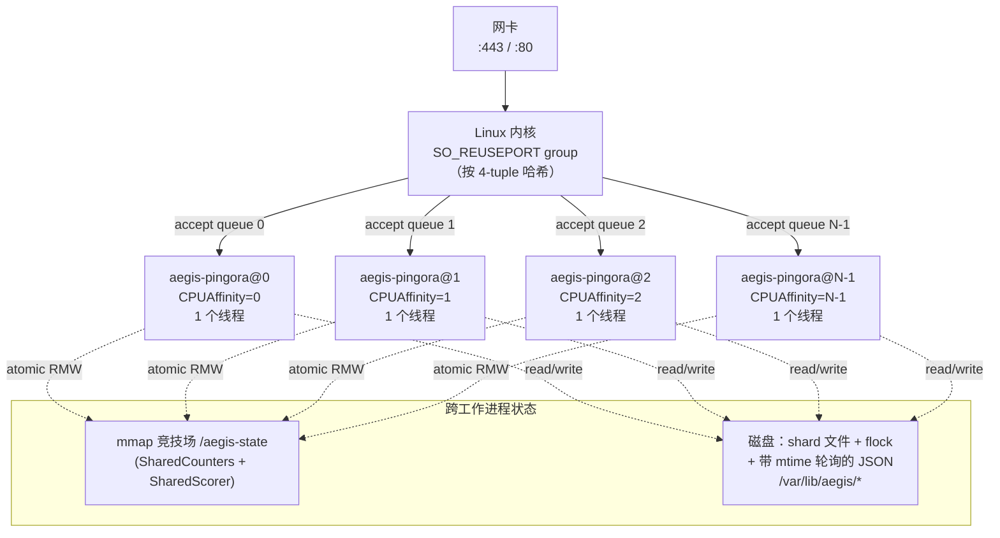
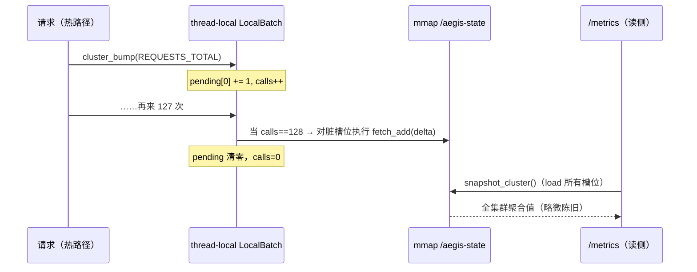

# 多进程、REUSEPORT 与工作进程

**语言：** [English](../en/06-workers.md) · [Русский](../ru/06-workers.md) · **中文**

AEGIS 并不是通过单进程内的多线程来按核扩展，而是通过 **N 个相互独立的进程** `aegis-pingora@0..N-1`，它们借助 `SO_REUSEPORT` 监听同一个端口。每个进程都是独立的地址空间；Linux 内核把入站连接分发给它，而跨工作进程状态的一致性由两种机制实现：用于集群计数器/评分器的共享 mmap 竞技场（arena），以及用于其余一切的磁盘 shard 文件加 mtime 轮询。

> 本文档的来源：[src/bin/aegis-pingora.rs](../../src/bin/aegis-pingora.rs)、[src/shared_state/](../../src/shared_state/)（`mod.rs`、`global.rs`、`counters.rs`）、[src/topology.rs](../../src/topology.rs)、[install.sh](../../install.sh)。历史文档 [docs/multi-process-deployment.md](../en/reference/multi-process-deployment.md) 描述的是同一模式的早期实现（V18，hyper 路径），部分内容已经过时——以代码为准。

---

## 1. 模型：N 个进程，而不是 N 个线程

AEGIS 的生产数据平面是 `aegis-pingora` 二进制（使用 `--features pingora` 构建），由 systemd 按 `aegis-pingora@.service` 模板启动多个实例。生产拓扑是 **N 个使用 `SO_REUSEPORT` 的独立 OS 进程**，每个都 1:1 固定到自己的核心上。

为什么用进程而不是单一运行时内的线程：

- Pingora 默认以 **NoSteal** 模式运行运行时（`work_stealing=false`，自 V81 起为默认值）——这相当于 N 个单线程 `current_thread` 运行时，任务不会在核心之间迁移，从而为短小的 WAF/缓存任务带来更好的缓存局部性（[src/bin/aegis-pingora.rs:1633-1656](../../src/bin/aegis-pingora.rs)）。
- 在 Pingora 0.8 中 `ServerConf::threads` 默认为 **1**。若不显式配置，整个代理都会跑在一个核心上（在 V57 测试台上，pingora-1 因此只有约 44k RPS，而 hyper 约为 238k）。因此在未设置 `AEGIS_PINGORA_THREADS` 时，二进制自己会把 `threads = num_cpus` 设置起来（[src/bin/aegis-pingora.rs:1619-1632](../../src/bin/aegis-pingora.rs)）。
- 而在生产部署中 `install.sh` 采取的是相反的做法：**每个工作进程 1 个线程**（`AEGIS_PINGORA_THREADS=1`），并行度靠进程数量获得。这就是 nginx/envoy/HAProxy 的 thread-per-core 模式。



---

## 2. SO_REUSEPORT——工作进程如何共享端口

`SO_REUSEPORT` 允许多个进程绑定同一个 `addr:port`。内核为该组中的每个套接字维护独立的 accept 队列，并按 4-tuple（源/目的 IP + 端口）哈希分发入站连接。完全不需要用户态的 accept 协调。

在 `aegis-pingora` 中这是通过环境变量 `AEGIS_PINGORA_REUSEPORT=1` **主动开启**的：

```rust
// src/bin/aegis-pingora.rs:1756-1781
let reuseport = std::env::var("AEGIS_PINGORA_REUSEPORT")
    .map(|v| v == "1" || v.eq_ignore_ascii_case("true"))
    .unwrap_or(false);             // default: OFF
let downstream_sock_opt = build_downstream_sock_opt(reuseport);
service.add_tcp_with_settings(&listen, downstream_sock_opt.clone());
```

`so_reuseport` 选项被设置到 Pingora 的 `TcpSocketOptions` 中（[`build_downstream_sock_opt`](../../src/bin/aegis-pingora.rs)，src/bin/aegis-pingora.rs:583-609）。同样的选项也应用于 TLS 监听器（src/bin/aegis-pingora.rs:1991-1994）——两个下游套接字都支持 REUSEPORT。

> `AEGIS_PINGORA_REUSEPORT` 的默认值是**关闭**。在生产环境中，正是由 `install.sh` 生成的 systemd 模板将其打开（`Environment=AEGIS_PINGORA_REUSEPORT=1`，install.sh:1252）。不带该变量“手工”启动二进制会得到单个进程——对于单工作进程和开发场景来说这是正常的。

### 哪些不参与 REUSEPORT

| 传输 | 套接字 | REUSEPORT | 行为 |
|---|---|---|---|
| HTTP/1.1、HTTP/2（TCP，明文） | `add_tcp_with_settings` | ✅ 是 | 每个工作进程都绑定端口，由内核负载均衡 |
| HTTP/1.1、HTTP/2（TLS） | TLS 监听器 | ✅ 是 | 同上 + 共享的 ticket key（见 §6） |
| **HTTP/3（QUIC，UDP）** | quinn UDP 套接字 | ❌ **否** | **只有第一个工作进程**绑定 `:443/udp`；其余会收到 `AddrInUse` 并以 info 级别记录，h3 由邻居工作进程提供服务 |

HTTP/3 sidecar（quinn）的 UDP 套接字没有 `SO_REUSEPORT`：赢得 `:443/udp` 绑定的第一个工作进程处理全部 HTTP/3 流量，其余的收到 `AddrInUse`——这是**预期之中且无害的**，TCP 上的 h1/h2 不受影响（[src/bin/aegis-pingora.rs:1600-1612](../../src/bin/aegis-pingora.rs)）。

### 套接字默认值与 accept backlog（V231 的重要说明）

- **TCP_NODELAY** 由 Pingora 在每个已接受的流上无条件启用（`apply_stream_settings`），没有单独的设置项——Nagle（40 ms 合并）始终关闭。
- 已接受客户端连接上的 **TCP keepalive** 需通过 `AEGIS_PINGORA_DOWNSTREAM_KEEPALIVE=1` **主动开启**（默认 OFF）。启用后它会在每次 accept 时同步应用，在高 accept 速率下会引发 `setsockopt` 风暴，使 accept backlog 溢出并产生大量 `Connection refused (os error 111)`——因此默认关闭（[src/bin/aegis-pingora.rs:559-609](../../src/bin/aegis-pingora.rs)）。
- **Accept backlog**：Pingora 请求 `listen(65535)`，但内核会悄悄将其收敛到 `net.core.somaxconn`。这个上限无法从代码中提高（`TcpSocketOptions` 中没有 `backlog` 字段）——它属于 `install.sh` 层面的 sysctl drop-in，而不属于二进制。

### 检查工作进程是否在监听同一端口

```bash
sudo ss -ltnp | grep ':443'
# 同一端口上出现多行 users:(("aegis-pingora",pid=...,fd=...))
sudo systemctl status 'aegis-pingora@*'
```

---

## 3. 按核部署：N 个工作进程 × 1 个线程，CPU 绑核

`install.sh::resolve_workers` 决定工作进程数量（[install.sh:156-191](../../install.sh)）：

| 来源 | 优先级 | 行为 |
|---|---|---|
| CLI `--workers N` | 最高 | 显式指定工作进程数 |
| 面板（topology.json） | 中 | `{"workers":"auto"\|"N"}`，通过 `PUT /admin/api/topology` 写入（见 §5） |
| `auto`（默认） | 最低 | `AEGIS_WORKERS = nproc`，每核一个工作进程 |

在所有情况下都有 `AEGIS_THREADS_PER_WORKER=1`——这就是 thread-per-core（V230）。实例编号为 `0..N-1`，以便模板中的 `CPUAffinity=%i` 与核心索引 1:1 对应（工作进程 0 → CPU 0，……，工作进程 N-1 → CPU N-1）。

`install.sh` 写出的 systemd 模板片段（[install.sh:1233-1287](../../install.sh)）：

```ini
# /etc/systemd/system/aegis-pingora@.service
[Service]
Environment=AEGIS_PINGORA_REUSEPORT=1
Environment=AEGIS_PINGORA_THREADS=1
ExecStart=/usr/local/bin/aegis-pingora -c /etc/aegis/aegis.conf --log-level info
Restart=on-failure
RestartSec=2
LimitNOFILE=1048576
CPUAffinity=%i          # 工作进程 %i 固定在核心 %i 上
LimitMEMLOCK=infinity   # 用于 BPF map / XDP 的锁定环形缓冲
Nice=-10                # 优先级高于其他用户态（但不是 RT FIFO）
PartOf=aegis-pingora.target
```

分组用的 `aegis-pingora.target` 通过 **`Wants=`**（而非 `Requires=`）声明所有实例，这对滚动重启至关重要（见 §7）；同时模板中使用 `PartOf`——以便重启该 target 仍能扩散到所有实例。

### 应该配置多少个工作进程

默认的 `auto` = 核心数，对 thread-per-core 部署来说是一个合理的起点。按 `/proc` 的测量，每个工作进程通常占用几十 MiB RSS，外加自身的内存内结构（每工作进程的评分器 DashMap、指纹缓存、响应缓存）。内存**随 N 线性增长**，因为部分状态在每个工作进程中都有一份副本（关于缓存去重见 §4.3）。

> ⚠️ 守护进程**不会“在线”自我扩缩**：运行中的进程无法派生或杀死自己的同伴进程（那需要 `systemctl` + root）。这一行为刻意与 nginx 保持一致——在 nginx 中修改 `worker_processes` 同样需要 reload（[src/topology.rs:16-24](../../src/topology.rs)）。

---

## 4. 跨工作进程状态

每个 REUSEPORT 工作进程都是**拥有自己地址空间的独立进程**，因此它的每工作进程 `DashMap` 结构（ThreatScorer、DynamicTrust、AnomalyDetector）只能看到自己那一份流量。分布式攻击者可以把工作进程 A 对某个 IP 的观察打满，而工作进程 B 仍认为该 IP 是干净的（[src/shared_state/mod.rs:5-14](../../src/shared_state/mod.rs)）。AEGIS 用两种独立机制来应对。

### 4.1. 机制 A —— 磁盘 + mtime 轮询（配置与累积状态）

那些很少变更（通过管理面板）或为仪表盘做聚合的状态，是**通过磁盘文件**在共享的 `/var/lib/aegis` 上共享的。一个工作进程原子地写文件（temp + rename），其余工作进程**在每次读取时比较文件的 mtime** 来获知变更——因此同伴工作进程能在微秒级看到修改，而不是等待 30 秒的后台 tick（[src/bin/aegis-pingora.rs:965-970](../../src/bin/aegis-pingora.rs)）。

mtime 轮询做了节流，以免每请求检查在每个请求上都调用 `fs::metadata`：两次轮询之间会保持一个最小间隔（[src/filters/engine.rs:49-67, 197-217](../../src/filters/engine.rs)，即 V179 中类似 `RUNTIME_TOGGLE_POLL_INTERVAL` 的节流）。

| 状态 | 路径环境变量 | 默认路径 | 版本 | 共享方式 |
|---|---|---|---|---|
| 过滤器运行时开关 | `AEGIS_TOGGLES_PATH` | `/var/lib/aegis/runtime-toggles.json` | V168 | 原子写入 + 读取时 mtime 轮询 |
| 按域策略 | `AEGIS_DOMAIN_POLICY_PATH` | `/var/lib/aegis/domain-policy.json` | V168 | 同上 |
| 按域 challenge 配置 | `AEGIS_CHALLENGE_CONFIG_PATH` | `/var/lib/aegis/domain-challenge.json` | V245 | 同上 |
| Arsenal 漏桶场景 | `AEGIS_SCENARIOS_PATH` | `/var/lib/aegis/scenarios.yaml` | V246 | 同上 |
| ACME challenge 令牌 | `AEGIS_ACME_STATE_DIR`/challenges | `/var/lib/aegis/acme/challenges` | V238 | 磁盘目录（共享） |
| 蜜罐存储 | `AEGIS_HONEYPOT_STATE` | `/var/lib/aegis/honeypots.json` | — | `HoneypotStore::check` 中的内联 mtime 热重载 |
| JA4 信誉 / 情报源 | （见配置） | 情报源文件 | V138/V176/V177 | 按 mtime 执行 `reload()`（`threat_intel.rs` 模式） |
| 站点地图（测绘） | `AEGIS_SITEMAP_DIR` | `/var/lib/aegis/site-map` | V240 | 每工作进程一个 flock shard |
| 事件存储（请求日志） | `AEGIS_EVENTS_DIR` | `/var/lib/aegis/events` | V243 | 每工作进程一个 flock shard |
| 按国家的 GeoIP 聚合 | `AEGIS_GEO_DIR` | `/var/lib/aegis/geo` | V242 | 每工作进程一个 flock shard |
| 时序存储（指标） | — | `default_store_dir()` | — | 由 advisory flock 选出唯一写者，其余只读 |

用具体例子说明为什么需要磁盘共享：

- **ACME challenge 令牌（V238）：** 来自 Let's Encrypt 的验证 GET 会被内核路由到随机的工作进程；没有共享目录时，3/4 的请求会错过内存内的映射表，验证会落入 `state=Invalid`（[src/bin/aegis-pingora.rs:1698-1709](../../src/bin/aegis-pingora.rs)）。
- **场景与 challenge 配置（V245/V246）：** 面板把 PUT 发给某一个工作进程；没有文件的话，设置只会存在于该进程中，同伴工作进程对此一无所知（[src/bin/aegis-pingora.rs:1479-1493](../../src/bin/aegis-pingora.rs)）。

### 4.2. flock-shard 模式（面向仪表盘的累积计数器）

站点地图、事件存储和 geo 使用同一套手法：每个工作进程用非阻塞的 advisory `flock` 在 `.slot-<n>.lock` 上抢占一个**槽位**，并在整个进程生命周期内独占一个 shard 文件（`shard-<slot>.db` / `.json`）——也就是**每个 shard 恰好一个写者**（[src/event_store.rs:11-21](../../src/event_store.rs)）。启动时工作进程会重新读取自己之前的 shard（计数器可以跨重启保留），后台 tick 大约每 30 秒刷写一次。

**读侧**（管理端点）会**扫描整个目录**，合并所有 shard（SQLite 事件存储用 `UNION ALL`，站点地图/geo 用 merge），并返回稳定的结果，**与哪个工作进程响应了该请求无关**。这样一来，在任何 REUSEPORT 部署下仪表盘（世界地图、日志、测绘）都是一致的。

时序存储（指标）是一个变体：一个工作进程赢得 `.sampler.lock` 上的 advisory flock 并负责写入，其余以只读方式工作，并从共享的 ring 文件中提供查询（[src/bin/aegis-pingora.rs:931-961](../../src/bin/aegis-pingora.rs)）。

### 4.3. 哪些不共享（诚实的局限）

- **响应缓存：** 每个工作进程有自己的 LRU。一个热点 URL 可能在所有 N 个工作进程中都被缓存 → N 倍内存。命中率略有下降（每个工作进程各自预热自己的缓存）。
- **每工作进程的评分器 / trust / anomaly DashMap：** 在 mmap 竞技场关闭时（见 §4.4），它们严格保持每工作进程独立——同时打向所有工作进程的分布式攻击者，会被每个工作进程各自独立地计到自己的阈值。
- **重启后的预热：** 重启后的工作进程以空的内存内结构（缓存、dynamic trust、评分器历史）启动，在负载下几秒内即可预热；与此同时 flock-shard 状态（§4.2）会从自己的文件中恢复。

### 4.4. 机制 B —— 共享 mmap 竞技场（集群计数器与评分器）

对于磁盘文件太慢的热路径，AEGIS 使用**单一的匿名 mmap 竞技场**（`shm_open` + `mmap(MAP_SHARED)`），每个工作进程在启动时打开它。这是路线图中的 Phase D，实现在 [src/shared_state/](../../src/shared_state/)。

关键特性（[src/shared_state/mod.rs](../../src/shared_state/mod.rs)、[src/shared_state/global.rs](../../src/shared_state/global.rs)）：

- **仅限 Linux。** 竞技场依赖 POSIX `shm_open`+`mmap`；在 macOS/非 Linux 上编译的是 no-op 桩实现（`stub.rs`），一切退化为每工作进程状态（[src/shared_state/mod.rs:37-74](../../src/shared_state/mod.rs)）。
- **竞技场名称**默认为 `/aegis-state`，可用 `AEGIS_SHARED_STATE_NAME` 覆盖（同一主机上两套独立的 AEGIS 部署不应冲突）。**大小**由 `AEGIS_SHARED_STATE_SIZE_MB` 决定（默认 4 MiB）（[src/shared_state/global.rs:86-97](../../src/shared_state/global.rs)）。
- 竞技场内部使用 **bump 分配器**：`alloc()` 通过 CAS 原子地移动 head，单个分配**永不释放**（压缩只能通过重建整个竞技场实现）。命名分配（`alloc_named`）保证所有工作进程针对某个已知用途（例如 `SHARED_SCORER_V4`）都挂接到**同一批物理字节**：第一个创建者通过 CAS 把 offset 写入头部注册表，其余进程读取它并挂接（[src/shared_state/mod.rs:104-210](../../src/shared_state/mod.rs)）。
- **优雅降级：** 如果无法打开竞技场（没有 `/dev/shm`、macOS、受限容器）——守护进程记录一条 warning 并**不带**集群状态继续运行；所有访问器返回 `None`，热路径上的计数器 bump 变成 no-op。这与 XDP 加载器的降级模型相同（[src/shared_state/global.rs:9-12, 114-122](../../src/shared_state/global.rs)）。初始化对代理而言**不是致命的**（[src/bin/aegis-pingora.rs:911-913](../../src/bin/aegis-pingora.rs)）。

竞技场内部住着两样东西：

**SharedCounters**（[src/shared_state/counters.rs](../../src/shared_state/counters.rs)）——固定大小的 `AtomicU64` 槽位数组。任何工作进程都可以原子地执行 `fetch_add`/`load`；POSIX 共享 mmap 上的原子操作在 Linux x86_64 和 aarch64 上是一致的。槽位以稳定的序号寻址（运维人员可以按索引构建仪表盘——新计数器只会 APPEND）（[src/shared_state/global.rs:46-70](../../src/shared_state/global.rs)）：

| idx | 计数器 | idx | 计数器 |
|---|---|---|---|
| 0 | `REQUESTS_TOTAL` | 7 | `UPSTREAM_5XX` |
| 1 | `REQUESTS_DENIED` | 8 | `COMPACTIONS_TOTAL` |
| 2 | `REQUESTS_CHALLENGED` | 9 | `COMPACTIONS_REMOVED` |
| 3 | `CACHE_HITS` | 10 | `RATE_LIMITED` |
| 4 | `CACHE_MISSES` | 11 | `TARPIT` |
| 5 | `UPSTREAM_2XX` | 12 | `RTBH` |
| 6 | `UPSTREAM_4XX` | — | （共 16 个槽位） |

**SharedScorer**（[src/ddos/shared_score.rs](../../src/ddos/shared_score.rs)）——建立在竞技场内无锁开放寻址哈希表之上的分布式威胁评分器（IPv4 用 `AtomicHashMap`，IPv6 用 `AtomicHashMap128`）。启动时从全局竞技场挂接：`from_global_arena(65536, 60s)`——65536 个 IPv4 槽位，60 秒窗口。若竞技场不可用则为 `None`，评分保持每工作进程独立（[src/bin/aegis-pingora.rs:914-929](../../src/bin/aegis-pingora.rs)）。这正是针对 §4.3 中分布式攻击的“解药”：任何工作进程都能读写其他进程的按 IP 分值，整个集群看到统一的分数。

#### 计数器批处理（V231）

`cluster_bump`/`cluster_bump_n` **并不会在每次调用时都写入 mmap**。增量先累积在 thread-local 缓冲区（`LocalBatch`）中，每 `FLUSH_EVERY = 128` 次调用，对每个“脏”槽位以单次 `fetch_add` 刷入竞技场（[src/shared_state/global.rs:138-252](../../src/shared_state/global.rs)）。在约 450k req/s × 16 个工作进程的情况下，这把每秒数百万次有竞争的跨核原子 RMW 变成了几千次，消除了 cache-line ping-pong（在性能剖析中约占 1.6% CPU）。保证：

- **不会丢失任何一次增量**——每个 `pending[i]` 要么已经刷写，要么会在下一个批次边界刷写。
- **读路径**（`cluster_counter`、`snapshot_cluster`）看到的值略微陈旧（每线程最多 N−1 次未刷写的增量）——对集群指标而言可以接受。
- thread-local 指的是每个 OS 线程；由于每个 Pingora 工作进程都是单线程的（每核 1 个线程），这实际上等价于每进程。管理/后台线程有各自的缓冲区。



---

## 5. 面向面板的拓扑自省（[src/topology.rs](../../src/topology.rs)）

管理面板中的 “Workers” 页面展示代理在这台机器上的分布情况。`topology.rs` 中的任何内容都**不在热路径上运行**——`host_info()` + `enumerate_workers()` 只由 `/admin/api/topology` 处理器调用（最多每分钟几次），并读取 `/proc`（[src/topology.rs:9-14](../../src/topology.rs)）。

- **`host_info()`**——逻辑 CPU 数、来自 `/proc/cpuinfo` 的 CPU 型号、负载均值。核心数通过 `sysconf(_SC_NPROCESSORS_ONLN)` 获取，而**不是** `available_parallelism()`：后者受进程亲和性掩码限制，而每个工作进程都被固定到 1 个核心（`CPUAffinity=%i`），因此在工作进程内部 `available_parallelism()` 会返回 `1`，面板就会把一台 16 核机器当成单核（[src/topology.rs:105-135](../../src/topology.rs)）。
- **`enumerate_workers()`**——扫描 `/proc`，查找 `comm == "aegis-pingora"` 的进程，并为每个进程收集：pid、instance（来自 `/proc/<pid>/environ` 中的 `AEGIS_PINGORA_INSTANCE`）、RSS（MiB）、OS 线程数、运行时长、生命周期平均 CPU（`(utime+stime)/uptime`，以单核百分比表示）。空结果表示“未知”（没有 `/proc` 或没有权限），**而不是**“零个工作进程”（[src/topology.rs:202-299](../../src/topology.rs)）。
- **期望数量旋钮**（[src/topology.rs:64-103, 301-323](../../src/topology.rs)）：面板把运维人员的*意图*写入一个很小的 JSON `/var/lib/aegis/topology.json`（`DEFAULT_TOPOLOGY_PATH`）——`{"workers":"auto"|"N"}`。守护进程不会自我扩缩；该文件会在下一次部署/协调时由 `install.sh::resolve_workers` 读取（见 §3）。`effective()` 把 `"auto"` 解析为核心数，把显式数字钳制到 `1..=4096`，遇到非法内容则回退到核心数。写入是原子的（temp + rename）。

---

## 6. 面向 REUSEPORT 工作进程的 TLS session-ticket key（LEVER 3）

这是 N 进程部署特有的一个细节：默认情况下每个进程都会得到自己的随机 TLS 1.3 session-ticket key，因此重连到**另一个**工作进程的客户端将无法解密 ticket → 重连时静默地退化为完整握手。

修复方案（[src/bin/aegis-pingora.rs:611-867](../../src/bin/aegis-pingora.rs)）：所有 REUSEPORT 工作进程**共享同一个 ticket key**，来自持久化文件 `/etc/aegis/tls_ticket.key`（可用 `AEGIS_TLS_TICKET_KEY_FILE` 覆盖）。该文件在首次启动时通过 `OsRng`（CSPRNG）以 0600 权限生成一次，其余工作进程加载它；`create_new` 是原子的，因此两个工作进程竞争时恰好有一个胜出，失败者读取胜出者写入的字节——最终所有进程收敛到同一个密钥。密钥长度是**在运行时向 OpenSSL 查询的**（legacy AES-128 为 48 字节 / OpenSSL 3.0+ 为 80 字节），而不是硬编码。同时，每工作进程的服务端 session cache 被**关闭**（`SslSessionCacheMode::OFF`）——在 REUSEPORT 下它毫无用处（被恢复的会话会落到另一个工作进程 → cache miss），只会白白吃掉内存。

> ⚠️ 诚实说明：**ticket key 轮换尚未实现**——密钥在进程重启前保持静态（代码中的 `TODO(security): KEY ROTATION`，src/bin/aegis-pingora.rs:630-641, 855-861）。前向保密性并未被削弱（TLS 1.3 的临时 ECDHE 仍然是每次握手一份），0-RTT/early data 未启用。在轮换实现之前，建议设置较短的 `ssl_session_timeout`。

---

## 7. 运维：重启、reload、指标

### 滚动重启（近乎零停机）

`install.sh` 会安装一个 `aegis-rolling-restart` 辅助脚本，逐个重启 REUSEPORT 实例（[install.sh:893-900](../../install.sh)）。它之所以能工作，正是因为 `aegis-pingora.target` 通过 `Wants=` 而非 `Requires=` 声明实例：重启一个工作进程不会让该 target 的依赖变成不满足，也不会把 stop 级联到同伴进程（[install.sh:1298-1303](../../install.sh)）。在一个工作进程重启期间，内核会把它那份连接分发给其余 N−1 个进程。

```bash
# 以“波浪式”逐个重启所有工作进程：
sudo aegis-rolling-restart
# 完整重启该 target（所有实例同时重启）：
sudo systemctl restart aegis-pingora.target
# 状态：
sudo systemctl status 'aegis-pingora@*'
```

### 崩溃隔离

如果某个工作进程 panic 或被 OOM 杀掉，systemd 会重启它（`Restart=on-failure`、`RestartSec=2`），其余 N−1 个继续提供服务。单进程方案则会整体宕掉——这是可用性上的实际收益。

### 指标

集群计数器（§4.4）已经在竞技场中聚合，因此任何工作进程的 `/metrics` 都会返回集群快照。每工作进程的 Prometheus 计数器在需要时可以在 Prometheus 侧求和（`sum by (host) (...)`）。仪表盘聚合数据（日志、测绘、geo、时序）由读侧扫描所有 shard 文件汇总而成（§4.2）。

### 配置 reload

通过面板做出的修改（开关、按域策略、challenge 配置、场景）**不需要重启**：接收请求的工作进程原子地写文件，其余进程通过 mtime 轮询在微秒级读取到（§4.1）。WAF 规则和证书文件由每个工作进程各自独立的后台 `PingoraBackground` 轮询器（约 30 秒一次 tick）重新读取。

---

## 8. 容错与降级汇总

| 条件 | 行为 |
|---|---|
| 未设置 `AEGIS_PINGORA_REUSEPORT` | 每个端口一个进程（对开发 / 1 个工作进程来说正常） |
| 非 Linux / 没有 `/dev/shm` | mmap 竞技场 → no-op 桩；集群计数器与 SharedScorer 关闭，状态严格按工作进程隔离 |
| 竞技场打开失败（容器、权限） | warning，代理继续工作，访问器返回 `None` |
| 同伴工作进程未能绑定 HTTP/3 UDP | info 日志 `AddrInUse`，h3 由绑定成功的工作进程提供，TCP 不受影响 |
| 单个工作进程崩溃 | systemd 重启它，其余继续提供服务 |
| 工作进程重启 | 内存内结构为空，几秒内预热完成；flock-shard 状态从文件中恢复 |
| 无 PMU（PERFMON）的 ARM | XDP 无法加载，优雅回退到 nftables（与工作进程正交） |

---

## 相关文档

- [02-architecture.md](./02-architecture.md) —— 总体请求生命周期
- [03-installation.md](./03-installation.md) —— `install.sh`、systemd、运行模式
- [07-protocols.md](./07-protocols.md) —— h1/h2/h3 监听器及其绑定
- [08-tls-certificates.md](./08-tls-certificates.md) —— ACME、证书重载、session tickets

> **诚实说明（简报的通用说明）：** 此处以及 [docs/multi-process-deployment.md](../en/reference/multi-process-deployment.md) 中提到的 RPS 数字（140k/工作进程、875k→964k cache-warm 等）都是 in-process / 测试台上的测量值。完整的 `aegis-pingora` 在生产负载下相比合成基准会下降 15–30%（Pingora 的 I/O、系统调用、TLS 握手）。在没有 SHA-NI/AES-NI 的虚拟机中，PoW/HMAC 比裸金属慢 2–3 倍。不要在缺少此说明的情况下引用绝对 RPS 值；已发现问题的权威来源是 SECURITY-AUDIT-CONSOLIDATED-2026-06-07.md。
