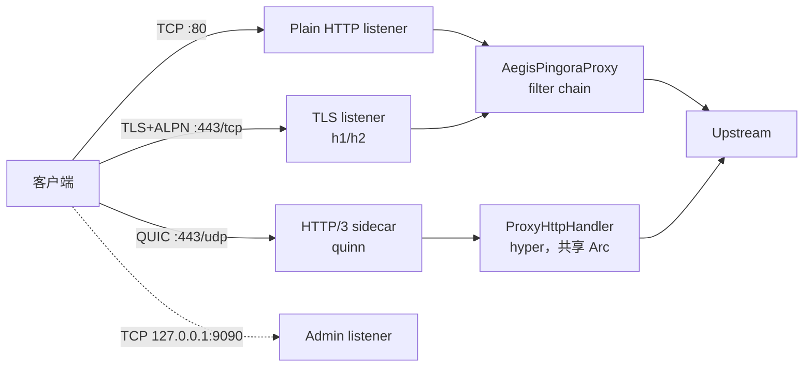

# 网络监听器与协议

**语言：** [English](../en/07-protocols.md) · [Русский](../ru/07-protocols.md) · **中文**

本文档描述 AEGIS 如何接收入站流量：在哪些端口上启动哪些监听器（listeners），HTTP/1.1、HTTP/2 和 HTTP/3（QUIC）如何协商，ALPN 与 h2 开关（`enable_h2`）如何工作，哪些 HTTP/2 限制可以防御 Rapid Reset（CVE-2023-44487），以及在 CDN 或 L4 负载均衡器后面如何还原真实客户端 IP（`real_ip` / PROXY protocol）。

> 下文所有论断都已与源码核对：[src/bin/aegis-pingora.rs](../../src/bin/aegis-pingora.rs)、[src/proxy/http3.rs](../../src/proxy/http3.rs)、[src/proxy/pingora_tls.rs](../../src/proxy/pingora_tls.rs)、[src/real_ip.rs](../../src/real_ip.rs)、[src/proxy_proto.rs](../../src/proxy_proto.rs)、[src/config.rs](../../src/config.rs)、[src/proxy/pingora_http.rs](../../src/proxy/pingora_http.rs)。

---

## 1. 监听器速览图

生产数据平面是 `aegis-pingora` 二进制（V71+，使用 `--features pingora` 构建）。它最多启动**四个**监听器；遗留的 `aegis`（hyper）二进制按自己的路径启动一组类似的监听器。真相来源是 [src/bin/aegis-pingora.rs](../../src/bin/aegis-pingora.rs) 中的 `main()` 函数。

| 监听器 | 传输 | 协议 | 地址来源 | 代码位置 |
|---|---|---|---|---|
| **Plain HTTP** | TCP | HTTP/1.1 + HTTP/2（h2c —— 不支持；见下文） | `server.listen` / `AEGIS_LISTEN`（默认取配置中的 `:80` 风格值） | `service.add_tcp_with_settings(&listen, ...)`（aegis-pingora.rs:1774-1781） |
| **TLS** | TCP | HTTP/1.1 + HTTP/2（通过 ALPN） | `tls.listen` / `AEGIS_LISTEN_TLS` | `service.add_tls_with_settings(&tls_listen, ...)`（aegis-pingora.rs:1995） |
| **HTTP/3 sidecar** | UDP（QUIC） | HTTP/3（ALPN `h3`） | `tls.h3_listen`（默认 = `tls.listen`） | `maybe_spawn_h3()`（aegis-pingora.rs:2307） |
| **Admin** | TCP | HTTP/1.1（指标、`/health`、admin API） | `admin.listen` / `AEGIS_ADMIN_LISTEN`（默认 `127.0.0.1:9090`） | `admin_service`（aegis-pingora.rs:2131-2132） |

架构上的关键细节：**plain HTTP 与 TLS 是同一个 Pingora `http_proxy_service`（`AegisPingoraProxy`）上的两个监听器**。HTTP/3 则是一个**独立的 sidecar**，运行在 hyper 处理器 `ProxyHttpHandler` 之上（Pingora 0.8 不支持 h3），但它通过共享的 `Arc` 复用同样的过滤器/路由器/缓存/评分器（aegis-pingora.rs:1585-1599）。



另见：[docs/06-workers.md](./06-workers.md)（REUSEPORT 与工作进程）、[docs/08-tls-certificates.md](./08-tls-certificates.md)（证书、ACME、SNI、mTLS）。

---

## 2. :80 监听器（plain HTTP）

地址取自 `server.listen`（DSL/TOML），可通过 `AEGIS_LISTEN` 变量覆盖（aegis-pingora.rs:892）。该监听器始终通过 `add_tcp_with_settings` 注册，以便能设置 `SO_REUSEPORT`（见第 6 节）和可选的 TCP keepalive：

```rust
// aegis-pingora.rs:1773-1781
let downstream_sock_opt = build_downstream_sock_opt(reuseport);
service.add_tcp_with_settings(&listen, downstream_sock_opt.clone());
```

代码中固化的特性：

- **TCP_NODELAY（关闭 Nagle 算法）始终开启。** Pingora 在 `apply_stream_settings` 中对每个已接受的流无条件调用 `set_nodelay()`（pingora-core `listeners/l4.rs:385`）。没有单独的开关——这在 `build_downstream_sock_opt` 的注释中有记录（aegis-pingora.rs:552-557）。配置字段 `server.tcp_nodelay`（默认 `true`，config.rs:162）作用于 **hyper 路径**；在 Pingora 路径上它本质上恒为 `true`。
- **backlog 无法从代码中调高。** Pingora 请求 `listen(65535)`，但内核会悄悄把它截断到 `net.core.somaxconn`（l4.rs:51,250）。`TcpSocketOptions` **没有** `backlog` 字段（aegis-pingora.rs:574-582）。accept 队列的上限是 sysctl `net.core.somaxconn`，它在 [install.sh](../../install.sh) / sysctl.d drop-in 中设置，而不在二进制中。
- **已接受连接上的 TCP keepalive 默认关闭**（`AEGIS_PINGORA_DOWNSTREAM_KEEPALIVE`，默认 off）。这是 V231 的回归修复：keepalive 由 Pingora **在每次 accept 时**在 accept 循环内同步应用，在高负载下（500-1000 连接）会导致 accept 队列溢出并出现 `Connection refused (os error 111)`。详细分析见 `build_downstream_sock_opt` 的文档注释（aegis-pingora.rs:559-608）。回收死亡客户端本来就由请求/空闲超时完成。

> 关于 h2c（HTTP/2 cleartext）的说明：在 plain 监听器上，不带 TLS 的 h2 **不会自动协商**——`enable_h2()` 只在 TLS 设置上调用（第 4 节）。在未加密端口上走的是 HTTP/1.1。

### Slowloris 防护（通用）

[src/config.rs](../../src/config.rs) 中有一些防止连接被缓慢耗尽的超时：

| 字段（`server.*`） | 默认值 | 用途 |
|---|---|---|
| `header_read_timeout_ms` | `5000` | Slowloris：在此时间内没有发送完请求头的 HTTP/1.x 连接会被关闭（config.rs:131） |
| `body_read_timeout_ms` | `30000` | Slow-POST（R-U-Dead-Yet）：如果请求体没有完整到达就终止请求；`0` 表示禁用（config.rs:136） |
| `request_timeout_ms` | — | 请求总超时 |
| `graceful_shutdown_secs` | — | 停止时的宽限期（hyper 路径） |

> 🟡 这些字段历史上实现在 hyper 路径上（[src/server.rs](../../src/server.rs)）。在 Pingora 路径上，h3 的请求体读取由自己的常量保护（第 5 节），而 shutdown 宽限期通过 `AEGIS_PINGORA_GRACE_SECS` 设置（默认 `10`，aegis-pingora.rs:1667-1670）。

---

## 3. :443 监听器（TLS）与 ALPN

只有当配置中存在 `enabled = true` 的 `tls` 块时才会启动 TLS 监听器（config.rs:259-260）。地址为 `tls.listen`，可通过 `AEGIS_LISTEN_TLS` 覆盖（aegis-pingora.rs:1798）。

TLS 终止通过 Pingora 的 OpenSSL feature 和自定义回调 `AegisTlsAccept`（[src/proxy/pingora_tls.rs](../../src/proxy/pingora_tls.rs)）完成，它负责：

1. **按 SNI 选择证书**——`certificate_callback` 从 ClientHello 中读取 SNI，并通过 `ssl.set_certificate` / `ssl.set_private_key` 装入相应的 cert/key 对（pingora_tls.rs:866-871）。当 SNI 缺失或未匹配时返回默认证书（pingora_tls.rs:382-390）。
2. **JA3/JA4 指纹**——通过 `set_client_hello_callback` → `capture_client_hello` 捕获 ClientHello（pingora_tls.rs:745，注册位置见 aegis-pingora.rs:1922-1928）。详见：[docs/11-tls-fingerprinting.md](./11-tls-fingerprinting.md)。

### ALPN：h1 与 h2 的协商

TLS 监听器上的 ALPN（Application-Layer Protocol Negotiation）仅由一行代码开启：

```rust
// aegis-pingora.rs:1929
tls_settings.enable_h2();
```

在 Pingora 0.8.0 中 `enable_h2()` **只设置 ALPN**（`h2`、`http/1.1`）。之后：

- 如果客户端在 ClientHello 中提供了 `h2`——协商为 **HTTP/2**；
- 否则——**HTTP/1.1**。

这在代码中得到确认：启动日志写入 `"...TLS listener active (h2 + h1, per-SNI cert via TlsAccept callback)"`（aegis-pingora.rs:1996-2001）。

> 🟡 **关于 `enable_h2` 的诚实说明。** 在 Pingora 0.8.0 中 `TlsSettings` **并不暴露** `h2_options()`——`TlsSettings` 上唯一公开的 h2 方法就是 `enable_h2()`，而它只设置 ALPN（已对照 `pingora-core 0.8.0/src/listeners/tls/boringssl_openssl/mod.rs` 验证，见 aegis-pingora.rs:1930-1941 的注释）。因此这里无法在 TLS 监听器层面精细调整 h2 参数——只能在应用层完成（`app.h2_options`，第 4 节）。

### 指纹可以关闭（LEVER 1）

计算 JA3（MD5）+ JA4（2×SHA-256）在一次完整握手中约需 18-22 次堆分配。AEGIS **默认开启**这些计算，但可以通过 `AEGIS_TLS_FINGERPRINT=0` 关闭——不过只有在**没有任何**消费方处于激活状态时才生效（aegis-pingora.rs:1839-1903）。如果存在消费方（`ja3_deny_hashes`、`ja4_deny_prefixes`、Arsenal、JA4 信誉、带 `field:"ja3"|"ja4"` 的内联 WAF 规则，或任何外部 `rule_files`），显式的关闭请求会被**覆盖**并记录 warn 日志——否则这将是一次静默的安全回归。

### TLS 相关功能（由 `tls.*` 配置控制）

| 字段 | 用途 | 位置 |
|---|---|---|
| `cert_path` / `key_path` | 默认的 cert/key 对 | config.rs:262-263 |
| `sni[]`（`SniEntry{host, cert_path, key_path}`） | 按 SNI 的证书 | config.rs:271 |
| `ja3_deny_hashes[]` | 按 JA3-MD5 在握手阶段关闭套接字 | config.rs:278 |
| `ja4_deny_prefixes[]` | 按 JA4 前缀关闭（`starts_with`） | config.rs:287 |
| `mtls{enabled, ca_paths, require_cert}` | mTLS（客户端证书） | config.rs:300-313 |

mTLS（默认关闭）：当 `mtls.enabled=true` 时会装入信任库 + `SslVerifyMode::PEER`（若设置了 `require_cert` 还会加上 `FAIL_IF_NO_PEER_CERT`），见 `MtlsSetup::apply`（pingora_tls.rs:211-221）。详情见 [docs/08-tls-certificates.md](./08-tls-certificates.md)。

> TLS 上不启用 0-RTT / early data：Pingora 上下文默认 `max_early_data=0`，代码不去改动它（aegis-pingora.rs:652-653）。

---

## 4. HTTP/2 与防洪限制（Rapid Reset，CVE-2023-44487）

在 Pingora 路径上，HTTP/2 参数是**在应用层**设置的（`HttpProxy.app_logic_mut().h2_options`），因为 Pingora 正是在那里于 h2 握手时应用它们（`server::handshake(stream, self.h2_options())`）。这是唯一受支持的挂载点——内置的 `h2_guard`/`h2_budget` 模块无法插入，因为 frame loop 由 Pingora 拥有（aegis-pingora.rs:1718-1726）。

```rust
// aegis-pingora.rs:1727-1751
if let Some(app) = service.app_logic_mut() {
    let max_streams: u32     = env "AEGIS_H2_MAX_STREAMS"     | 128;
    let max_header_list: u32 = env "AEGIS_H2_MAX_HEADER_LIST" | 65536;
    let max_reset: usize     = env "AEGIS_H2_MAX_RESET"       | 100;
    let mut h2 = H2Options::default();
    h2.max_concurrent_streams(max_streams)
      .max_header_list_size(max_header_list)
      .max_pending_accept_reset_streams(max_reset);
    app.h2_options = Some(h2);
}
```

| ENV | 默认值 | 防护对象 |
|---|---|---|
| `AEGIS_H2_MAX_STREAMS` | `128` | `max_concurrent_streams` —— 每连接并发 h2 流的上限（防 stream-churn） |
| `AEGIS_H2_MAX_HEADER_LIST` | `65536`（64 KiB） | `max_header_list_size` —— 请求头块大小上限（防 CONTINUATION flood，**CVE-2024-27316**） |
| `AEGIS_H2_MAX_RESET` | `100` | `max_pending_accept_reset_streams` —— 关闭连接前允许的“被重置”流上限（防 **Rapid Reset，CVE-2023-44487**） |

如果没有这些限制，h2 就会使用 `h2` 库宽松的默认值，使得 Rapid Reset 和 CONTINUATION flood 在公网监听器上基本不受限制（aegis-pingora.rs:1721-1724）。启动时会记录日志：`"HTTP/2 flood limits applied (C3)"`。

### 与配置字段的关系

[src/config.rs](../../src/config.rs) 的 `server` 块中存在并行的 h2 字段：

| 字段（`server.*`） | 默认值 | 代码中的注释 |
|---|---|---|
| `h2_max_reset_streams` | `100` | Rapid Reset CVE-2023-44487（config.rs:138-142） |
| `h2_max_concurrent_streams` | `200` | 反 RapidReset，“同时适用于 hyper 与 pingora H2”（config.rs:143-150） |
| `h2_initial_window_size` | `1048576`（1 MiB） | 流的初始窗口（config.rs:151-154） |
| `h2_initial_window_size`（连接级） | `8 MiB` | `h2_initial_connection_window_size`（config.rs:155-158） |

> 🟠 **诚实说明。** 在 Pingora 路径上，h2 限制是从 `AEGIS_H2_*` 变量设置的（默认 `128`/`64KiB`/`100`），**而不是**直接来自这些 `server.h2_*` 配置字段。配置字段 `h2_initial_window_size` / `h2_initial_connection_window_size` 无法应用到 Pingora 0.8.0 的 TLS 监听器上——`TlsSettings` 没有暴露相应的 setter（见 aegis-pingora.rs:1930-1941 中明确的 TODO：“If we move to pingora 0.9+ this is the place to call `set_max_concurrent_streams` / `set_initial_window_size` / `set_initial_connection_window_size`”）。换句话说：
> - **Rapid Reset 防护是存在的**（通过 `AEGIS_H2_MAX_RESET` → `max_pending_accept_reset_streams`），这与简报的 security matrix 一致：“HTTP/2 Rapid Reset（需要 Pingora 0.9+）”——在 0.8 上通过应用层 `h2_options` 已部分覆盖。
> - **流控窗口**在迁移到 0.9+ 之前，在 Pingora 上保持其内部默认值。

关于 HTTP/2 frame-budget 模块（`h2_budget`，Tempesta 风格，V182）的更多背景——见 [docs/14-rate-limiting.md](./14-rate-limiting.md)；由于上述原因，它们在 Pingora 路径上未接入。

---

## 5. HTTP/3（QUIC sidecar）

HTTP/3 基于 `quinn`（QUIC）实现于 [src/proxy/http3.rs](../../src/proxy/http3.rs)，由 `maybe_spawn_h3` 函数在一个独立的 OS 线程中以自带的单线程 tokio 运行时启动（aegis-pingora.rs:2372-2393）。

### 启动条件

```rust
// aegis-pingora.rs:2313-2319
let Some(tls) = cfg.tls.as_ref() else { return Ok(()); };
if !tls.enabled || !tls.h3_enabled { return Ok(()); }
let h3_listen_str = tls.h3_listen.as_deref().unwrap_or(&tls.listen);
```

| 字段 | 默认值 | 用途 |
|---|---|---|
| `tls.h3_enabled` | `false`（config.rs:264-265） | HTTP/3 的总开关。**默认关闭。** |
| `tls.h3_listen` | `None` → 取 `tls.listen`（config.rs:266-267） | QUIC 端点的 UDP 地址 |

> HTTP/3 是 **opt-in** 的：在没有设置 `h3_enabled=true` 之前，sidecar 不会启动。

### QUIC 的 ALPN 与 TLS

QUIC 使用 rustls（而非 OpenSSL），以及与 h1/h2 相同的 SNI 解析器（`SniResolver::build`，http3.rs:72-73）。ALPN 被硬编码为 `h3`：

```rust
// http3.rs:77
tls.alpn_protocols = vec![b"h3".to_vec()];
tls.max_early_data_size = 0;   // 0-RTT 已禁用 (M10)
```

**QUIC 中的 0-RTT/early data 是被刻意禁用的**（`max_early_data_size = 0`，http3.rs:78-89）：early data 可被重放（RFC 8446 §8 / RFC 9001 §9.2），而 AEGIS 会把请求体转发给上游且不做反重放去重，因此对安全代理而言，安全的默认做法是要求完整的 1-RTT 握手。

### QUIC 资源限制（V233）

h3 中设置了保守的上限（http3.rs:23-62）——它是 sidecar，而不是主入口：

| 常量 | 取值 | 限制内容 |
|---|---|---|
| `H3_BODY_READ_TIMEOUT` | `30s` | 完整接收单个 h3 请求体的预算（slowloris/R-U-Dead-Yet）。对应 `body_read_timeout_ms`（http3.rs:31-39） |
| `H3_MAX_STREAMS_PER_CONN` | `256` | 单个 QUIC 连接上并发 request-stream 任务的最大数量 |
| `H3_MAX_STREAMS_GLOBAL` | `4096` | 进程级并发 h3 stream 任务的上限 |
| `H3_MAX_CONCURRENT_BIDI` | `256` | `quinn` 传输层对双向流的上限（协议层面对信号量的兜底） |
| `H3_MAX_CONCURRENT_UNI` | `16` | 单向流的上限（h3 control / QPACK） |

每个 stream 在 spawn 之前都要取得全局 + 每连接的信号量许可（http3.rs:252-263），这既限制了任务数量，也限制了请求体缓冲的总量。slowloris 的读取排空被包在 `tokio::time::timeout(H3_BODY_READ_TIMEOUT, ...)` 中（http3.rs:325-333）。

### H3 指纹（粗粒度）

quinn 0.11 不提供原始的 Initial 字节和各个传输参数，因此 h3fp 只对稳定的信号做哈希：ALPN 字符串和 `max_datagram_size`。QUIC 版本被硬编码为 `0x00000001`（RFC 9000 v1），因为 quinn 没有暴露连接版本的 getter（http3.rs:168-208）。这比真正的 JA4Q 粗糙，但足以区分主要的 QUIC 栈（chromium/firefox/cronet/quiche/msquic）。

> 🟡 **关于 HTTP/3 的诚实说明：**
> - **HTTP/3 无法像 TCP 那样干净地在进程级做 SO_REUSEPORT 分区。** QUIC 套接字确实带 `SO_REUSEPORT` 绑定（http3.rs:108-127），但在多工作进程的 REUSEPORT 部署下，只有**第一个**工作进程能成功占用 `:443/udp`，其余会以 `AddrInUse` 失败——这是**预期之中且无害的**（以 `info` 而非 `error` 级别记录，aegis-pingora.rs:1600-1612）。HTTP/3 继续由赢得绑定的那个工作进程提供服务；TCP 上的 h1/h2 不受影响。
> - **h3 的 WAF 热重载是独立的。** h3 处理器从 `cfg` 构建自己的 WAF，其重载走 h3 运行时上自己的 30 秒轮询器（aegis-pingora.rs:2448-2466）。对规则变更的响应时间可能与 Pingora 的 h1/h2 路径不一致。
> - **Pingora 路径（包括 h3 sidecar）上的蜜罐命中计数清理尚未实现**——`hits_by_ip` 在 pingora 路径上不会被裁剪（aegis-pingora.rs:19-26）。蜜罐存储本身的热重载是可用的（内联 mtime）。

### 向客户端通告 HTTP/3（Alt-Svc）

`alt-svc` 头（服务器借此告知客户端 h3 可用）是**在 hyper 路径上**打上的（`stamp_alt_svc`，[src/proxy/http.rs](../../src/proxy/http.rs):298-305）。h3 sidecar 自身被标记为 `for_h3()`，**不会**在自己的响应上设置 Alt-Svc（aegis-pingora.rs:2425-2427）。

---

## 6. SO_REUSEPORT 与多进程（简述）

`SO_REUSEPORT` 允许 N 个进程监听同一个端口；内核对入站连接做负载均衡。在 Pingora 路径上这是 opt-in 的：

```rust
// aegis-pingora.rs:1756-1758
let reuseport = env "AEGIS_PINGORA_REUSEPORT" == "1" | "true"  (default: false)
```

当 `reuseport=true` 时，plain 与 TLS 监听器的 `TcpSocketOptions` 中会设置 `so_reuseport=Some(true)`（aegis-pingora.rs:583-587, 1994）。Admin 监听器同样共享 REUSEPORT，以免工作进程 `aegis-pingora@1..N` 争抢 admin 端口（aegis-pingora.rs:2133-2138）。

一个相关的细节是**工作进程之间共享的 TLS session-ticket key**：否则重连到另一个工作进程的客户端将无法恢复会话。密钥从 `/etc/aegis/tls_ticket.key` 读取/生成（可用 `AEGIS_TLS_TICKET_KEY_FILE` 覆盖）并在工作进程间共享；与此同时每工作进程的服务端 session cache 被关闭（aegis-pingora.rs:611-654, 1943-1973）。关于工作进程和 REUSEPORT 的完整分析见 [docs/06-workers.md](./06-workers.md)。

---

## 7. 真实客户端 IP：real_ip 与 PROXY protocol

在 CDN 或 L4 负载均衡器后面，TCP peer 并不是客户端，而是边缘节点。AEGIS 通过两种独立机制还原真实 IP。

### 7.1 Forwarded 请求头（real_ip）

逻辑在 [src/real_ip.rs](../../src/real_ip.rs)（`TrustedProxies`）中。在 Pingora 路径上运行的是功能等价的内联实现，位于 [src/proxy/pingora_http.rs](../../src/proxy/pingora_http.rs):1910-1948。

**核心安全不变量：** **只有**当 TCP peer 属于受信任的 CIDR 集合时，才会参考这些请求头。否则 forwarded 请求头会被静默忽略——不在受信任代理之后的攻击者无法通过 `X-Forwarded-For` / `CF-Connecting-IP` 伪造自己的 IP（real_ip.rs:11-16、pingora_http.rs:1924-1927）。

配置通过环境变量完成，**两者默认都关闭**（在显式开启之前行为零变化，real_ip.rs:24-25）：

| ENV | 效果 |
|---|---|
| `AEGIS_BEHIND_CLOUDFLARE=1` | 当 TCP peer 属于内置的 Cloudflare CIDR 列表时，信任 `CF-Connecting-IP`（real_ip.rs:34-59） |
| `AEGIS_TRUSTED_PROXIES=cidr,cidr,...` | 额外信任这些 CIDR；参考 `X-Forwarded-For`（rightmost-non-trusted 算法） |

`resolve_client_ip` 算法（real_ip.rs:219-263）：

1. 功能关闭（没有受信任的 CIDR）→ 原样返回 peer。
2. Peer **不在**受信任集合中 → 返回 peer（安全闸门）。
3. `AEGIS_BEHIND_CLOUDFLARE` → 读取 `CF-Connecting-IP`（单个 IP，对 CF 而言是权威的）；缺失或解析出错时回退到 peer。
4. 否则 → 从右向左遍历 `X-Forwarded-For`，返回第一个**不在**受信任集合中的 IP（即紧邻信任边界之前的真实客户端）；出错或所有 hop 都受信任时回退到 peer。

CIDR 匹配器是内置的、无外部依赖的，支持 IPv4 和 IPv6（real_ip.rs:61-128）。非法的 CIDR 会被跳过并给出警告，不会 panic。

> CF 模式**不会**参考 XFF：如果 `CF-Connecting-IP` 缺失，则返回 peer（而不是 XFF 的值）——以避免歧义（real_ip.rs:248-255，测试 `trusted_cf_peer_missing_cf_ip_ignores_xff`）。

### 7.2 PROXY protocol（v1/v2）

解析器位于 [src/proxy_proto.rs](../../src/proxy_proto.rs)。当 AEGIS 位于 L4 负载均衡器（AWS NLB、HAProxy、IPVS-DR）之后，而后者会在每个连接前附加原始的 src/dst 元组时，就需要它。

模式由 `server.proxy_protocol` 字段决定（config.rs:127-128），取值如下（config.rs:174-181）：

| 取值 | 含义 |
|---|---|
| `off` | **默认。** 忽略该头，将连接视为直连 TCP |
| `v1` | 仅文本格式（HAProxy 1.5+） |
| `v2` | 仅二进制格式（HAProxy 1.6+、AWS NLB） |
| `auto` | 两者皆接受 |

解析器（`proxy_proto::parse`）返回还原出的 `client_ip` 以及已消耗的字节数（`consumed`），调用方必须在读取真正的 payload 之前把这些字节裁掉（proxy_proto.rs:23-70）。细节：

- **v1**：直到 `\r\n` 的 ASCII 字符串，例如 `PROXY TCP4 192.0.2.1 198.51.100.2 35692 80\r\n`；有 108 字节的硬性上限（proxy_proto.rs:72-101）。
- **v2**：12 字节魔数 + 4 字节头部 + 地址块；支持 AF_INET / AF_INET6，以及 LOCAL（健康检查，不覆盖）和 PROXY 命令（proxy_proto.rs:107-166）。
- `UNKNOWN` / AF_UNSPEC / AF_UNIX → `0.0.0.0`（不覆盖）。
- 模式不匹配（`mode=v1` 时出现 v2 魔数，反之亦然）→ 报错，连接被关闭。

> 🟠 **关于 PROXY protocol 适用范围的关键诚实说明。** `proxy_proto.rs` 解析器目前**只接入了 hyper 路径**（`aegis` 二进制，[src/server.rs](../../src/server.rs):676, 726, 892, 909）。在**生产数据平面（`aegis-pingora`）**中，代码里**不会调用** `proxy_proto::parse`——accept 循环由 Pingora 0.8 拥有，PROXY 头的 peek-and-strip 没有插入其中。实际后果：在转发 PROXY protocol 的 L4 负载均衡器之后，Pingora 路径上还原真实 IP 需要改用 forwarded 请求头（第 7.1 节），或者改跑 hyper 二进制。`server.proxy_protocol` 字段作用于 hyper 路径；对 Pingora 请使用 `AEGIS_BEHIND_CLOUDFLARE` / `AEGIS_TRUSTED_PROXIES`。

---

## 8. 环境变量速查表（本文档相关）

| ENV | 默认值 | 层次 |
|---|---|---|
| `AEGIS_LISTEN` | 取自 `server.listen` | plain HTTP 地址 |
| `AEGIS_LISTEN_TLS` | 取自 `tls.listen` | TLS 地址 |
| `AEGIS_ADMIN_LISTEN` | `127.0.0.1:9090` | admin 地址 |
| `AEGIS_PINGORA_REUSEPORT` | `false` | 监听器上的 SO_REUSEPORT |
| `AEGIS_PINGORA_DOWNSTREAM_KEEPALIVE` | `false` | 已接受连接上的 TCP keepalive |
| `AEGIS_H2_MAX_STREAMS` | `128` | h2 `max_concurrent_streams` |
| `AEGIS_H2_MAX_HEADER_LIST` | `65536` | h2 `max_header_list_size`（CONTINUATION flood） |
| `AEGIS_H2_MAX_RESET` | `100` | h2 `max_pending_accept_reset_streams`（Rapid Reset） |
| `AEGIS_TLS_FINGERPRINT` | （开启） | 在没有消费方时，`0` 可关闭 JA3/JA4 |
| `AEGIS_TLS_TICKET_KEY_FILE` | `/etc/aegis/tls_ticket.key` | 供 REUSEPORT 共享的 session-ticket key |
| `AEGIS_BEHIND_CLOUDFLARE` | off | 信任来自 CF 网段的 `CF-Connecting-IP` |
| `AEGIS_TRUSTED_PROXIES` | off | 用于 `X-Forwarded-For` 的受信任 CIDR |

构建和部署相关的环境变量以 [install.sh](../../install.sh) 为准；此处不逐条重复。

---

## 9. 汇总的诚实说明（必读）

1. **AEGIS 的 benchmark 是 internal relay，而不是完整栈的二进制。** 来自 `src/bin/aegis-distbench.rs` / `bench/` 的 RPS 数字是没有真实 I/O 的 in-process filter relay（没有网络、TLS 握手、系统调用）。完整的 `aegis-pingora` 在生产负载下相比合成基准会下降 15-30%。绝不要在缺少“in-process filter relay，非真实部署”这一说明的情况下引用绝对 RPS 值。见 [docs/PERFORMANCE.md](../en/reference/performance.md)。
2. **硬件 SHA 是按核的，虚拟机中没有硬件加速。** 这会影响 QUIC/TLS 握手和 h3 指纹计算：在测试虚拟机中（没有 AES-NI/SHA-NI），握手的 CPU 开销相比裸金属增加 2-3 倍。在没有 PMU 的 ARM 上 XDP 无法加载（优雅回退到 nftables）——这影响的是 fast-path，而不是监听器本身。
3. **吞吐量并不宣称“优于真实的代理”。** AEGIS 是安全边缘，而不是纯粹的转发器：在完整 L7 防护下，相比 C 语言转发器的开销约为下降 13%；在攻击下 nginx+ModSecurity 会损失约 −95% 的吞吐量。见 [docs/PERFORMANCE.md](../en/reference/performance.md)。
4. **security matrix 才是唯一诚实的陈述。** 监听器上真正生效的能力有：TLS 终止 + 按 SNI 选证书、ALPN h1/h2、h2 防洪限制（Rapid Reset 为部分覆盖——在 Pingora 0.8 上通过应用层 `h2_options`；完整的窗口设置需要 Pingora 0.9+）、带资源限制的 h3 sidecar（opt-in）、受信任代理后的 real_ip。而**不构成**完整防护的有：L3/L4 洪水（需要上游 BGP/CDN，见 `src/bgp_rtbh.rs`）；Pingora 路径上的 PROXY protocol（仅 hyper）；Pingora 0.8 上来自配置的 h2 流控窗口。已发现问题及修复状态的权威来源是 SECURITY-AUDIT-CONSOLIDATED-2026-06-07.md。
5. **缓存不是万能的。** 在 volumetric DDoS 下，即便是被缓存的响应也需要一次入站连接（TCP/QUIC accept），因此监听器照样承压；没有上游 BGP drop，后端仍可能过载。AEGIS 依靠 WAF + challenge 做到 0% 攻击回源，但 L3 洪水需要上游防护。

---

## 另见

- [docs/02-architecture.md](./02-architecture.md) —— 请求生命周期
- [docs/06-workers.md](./06-workers.md) —— REUSEPORT、工作进程、session-ticket key
- [docs/08-tls-certificates.md](./08-tls-certificates.md) —— SNI、ACME、mTLS、密钥轮换
- [docs/11-tls-fingerprinting.md](./11-tls-fingerprinting.md) —— 从 ClientHello 提取 JA3/JA4
- [docs/14-rate-limiting.md](./14-rate-limiting.md) —— 限流与 h2-budget
