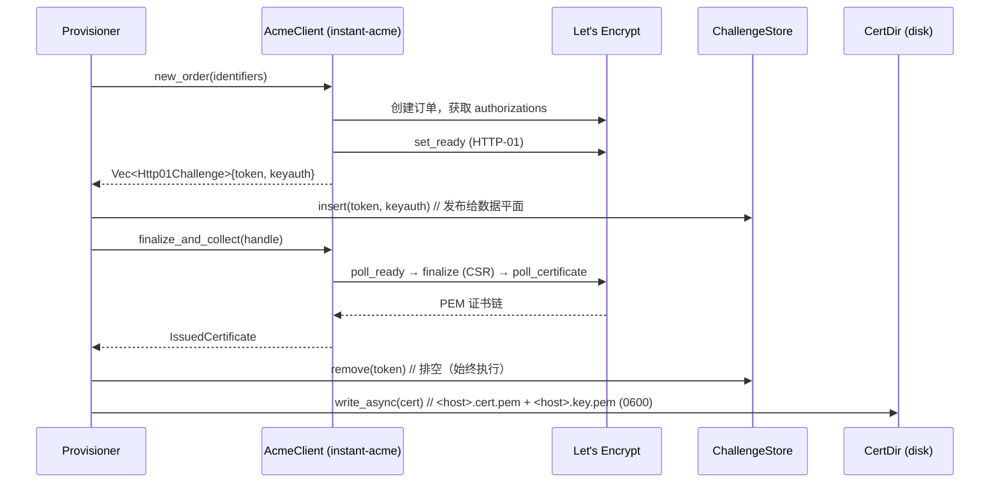

# TLS 与证书（ACME）

**语言：** [English](../en/08-tls-certificates.md) · [Русский](../ru/08-tls-certificates.md) · **中文**

本文档说明 AEGIS 如何在生产数据平面 `aegis-pingora` 上提供 TLS 服务：按 SNI 选择证书、从磁盘热重载证书、mTLS 客户端认证，以及用于自动签发和自动续期的内置 ACME/Let's Encrypt 客户端。所有论断均以源代码为依据：[src/proxy/pingora_tls.rs](../../src/proxy/pingora_tls.rs)、[src/tls_sni.rs](../../src/tls_sni.rs)、[src/acme.rs](../../src/acme.rs)、[src/acme_instant.rs](../../src/acme_instant.rs)，以及 [src/bin/aegis-pingora.rs](../../src/bin/aegis-pingora.rs) 中的编排逻辑和 [src/proxy/pingora_admin.rs](../../src/proxy/pingora_admin.rs) 中的 admin 端点。

> **哪部分代码在哪里运行。** 生产 TLS 栈位于 `aegis-pingora` 中，基于 OpenSSL（feature `pingora`）。正是它实现了按 SNI 选择证书、mTLS、握手期间的 JA3/JA4 指纹提取以及热重载 —— 参见 [src/proxy/pingora_tls.rs](../../src/proxy/pingora_tls.rs)。遗留的 hyper 二进制 `aegis` 使用 rustls 和独立的 per-SNI 解析器 [src/tls_sni.rs](../../src/tls_sni.rs) —— 它更简单（没有 ACME 路径解析器、没有 mtime 轮询器、没有 mTLS 信任库），并且不用于生产配置。关于二进制的更多信息参见[架构](./02-architecture.md)和[协议与监听器](./07-protocols.md)。

---

## 1. TLS 监听器配置

TLS 通过 `TlsConfig` 块配置（参见 [src/config.rs](../../src/config.rs):259）。字段：

| 字段 | 类型 | 用途 |
|---|---|---|
| `enabled` | bool | 启用 TLS 监听器。 |
| `listen` | string | TLS 监听器地址（例如 `0.0.0.0:443`）。 |
| `cert_path` | string | **默认**证书 PEM 链的路径（SNI 未匹配时的回退）。 |
| `key_path` | string | 默认证书私钥的路径。 |
| `h3_enabled` | bool（默认：false） | 启用 HTTP/3 sidecar。参见[协议与监听器](./07-protocols.md)。 |
| `h3_listen` | Option\<string\> | QUIC/h3 的独立地址。 |
| `sni` | `Vec<SniEntry>`（默认：空） | 按主机的证书覆盖配置。 |
| `ja3_deny_hashes` | `Vec<String>`（默认：空） | 在握手阶段拒绝的 JA3 MD5 哈希。参见 [TLS 指纹](./11-tls-fingerprinting.md)。 |
| `ja4_deny_prefixes` | `Vec<String>`（默认：空） | 在握手阶段拒绝的 JA4 前缀（`starts_with`）。 |
| `mtls` | `MtlsConfig`（默认：关闭） | 基于证书的客户端认证（见 §6）。 |

`SniEntry`（[src/config.rs](../../src/config.rs):322）是一个三元组 `{ host, cert_path, key_path }`。顶层的 `cert_path`/`key_path` 是默认证书对，在没有任何 SNI 条目匹配时使用。

> ⚠️ TLS 监听器需要**两个**部分都齐全 —— 默认证书是必需的。没有回退时，无 SNI（或 SNI 未知）的握手将失败。这一点在 `CertStore` 的文档注释中被明确记录（[src/proxy/pingora_tls.rs](../../src/proxy/pingora_tls.rs):100-109）。

---

## 2. 按 SNI 选择证书

### 生产路径（`aegis-pingora`，OpenSSL）

证书选择发生在**握手过程中**，位于 `TlsAccept` trait 的 `certificate_callback` 回调中（[src/proxy/pingora_tls.rs](../../src/proxy/pingora_tls.rs):866）。OpenSSL 在解析 ClientHello 之后、发送 ServerHello 之前调用它 —— 这正是替换所需证书的正确时机：

```rust
let sni = ssl.servername(NameType::HOST_NAME).map(|s| s.to_string());
self.install(ssl, sni.as_deref());
```

`CertStore::pick`（[src/proxy/pingora_tls.rs](../../src/proxy/pingora_tls.rs):382）选择证书对：

- SNI 存在且 `by_sni` 中有对应条目（键为**小写**主机名）→ 使用该证书对；
- SNI 不存在或未匹配 → 使用**默认**证书对。

匹配是**大小写不敏感**的：加载时（`e.host.to_ascii_lowercase()`）和选择时（`host.to_ascii_lowercase()`）都会转换。这由测试 `build_loads_default_and_per_sni`（[src/proxy/pingora_tls.rs](../../src/proxy/pingora_tls.rs):1190）覆盖，其中 `B.EXAMPLE.COM` 能被 `B.example.COM` 的请求正确匹配。

`install`（[src/proxy/pingora_tls.rs](../../src/proxy/pingora_tls.rs):513）在 SSL 上设置：

1. `set_certificate(leaf)` —— 叶子证书（PEM 中的第一个）；
2. `set_private_key(key)`；
3. 对链中每个中间证书调用 `add_chain_cert(...)`。

安装错误会被记录日志并忽略 —— 这是安全的失败模式：SSL 保持没有证书的状态，握手自然中断，而不会交出别人的密钥。

证书对被预先解析到内存中（`CertPair` 保存 `X509` + 链的 `Vec<X509>` + `PKey`），以避免在每个连接上重新读取和重新解析 PEM —— 握手是热路径（[src/proxy/pingora_tls.rs](../../src/proxy/pingora_tls.rs):51-58）。

### 遗留路径（`aegis`，rustls）

hyper 二进制使用 `SniResolver`（[src/tls_sni.rs](../../src/tls_sni.rs)），它实现了 rustls 的 `ResolvesServerCert` trait。逻辑相同：`HashMap<host_lowercase → CertifiedKey>` + `default`；未知 SNI 和缺失 SNI 都回退到 default（[src/tls_sni.rs](../../src/tls_sni.rs):52-63）。密钥按 PKCS#8 读取（`rustls_pemfile::pkcs8_private_keys`）；密钥列表为空则报错（[src/tls_sni.rs](../../src/tls_sni.rs):78）。

---

## 3. 握手期间的指纹提取（JA3 / JA4）

虽然这是 [TLS 指纹](./11-tls-fingerprinting.md)的主题，但指纹恰恰是在这里提取的 —— 在 TLS 层，并且与证书选择紧密相关。

JA3/JA4 在 **ClientHello 回调**中计算（`capture_client_hello`，[src/proxy/pingora_tls.rs](../../src/proxy/pingora_tls.rs):745），该回调通过 [src/bin/aegis-pingora.rs](../../src/bin/aegis-pingora.rs):1922 中的 `set_client_hello_callback` 注册。这是握手中唯一一个 `SSL_client_hello_*` 访问器能返回客户端所提供的密码套件和扩展的阶段。

> 🟡 历史上（V50/V51）计算是在 `certificate_callback`（OpenSSL `cert_cb`）中进行的，它触发得**更晚**，此时访问器已经为空 —— 这产生了一个退化的指纹 `t12i000000_e3b0c44298fc`，对所有客户端都相同。V246 把计算移到了 ClientHello 回调中；`certificate_callback` 中的代码仅作为防御性回退保留（[src/proxy/pingora_tls.rs](../../src/proxy/pingora_tls.rs):873-886）。

指纹被存入 SSL 的 `ex_data`（`TlsFingerprints`，[src/proxy/pingora_tls.rs](../../src/proxy/pingora_tls.rs):538），随后 `handshake_complete_callback`（[src/proxy/pingora_tls.rs](../../src/proxy/pingora_tls.rs):1025）把它们发布到 `SslDigest.extension`，热路径再通过 `read_fingerprints`（[src/proxy/pingora_tls.rs](../../src/proxy/pingora_tls.rs):1091）读回到 `ctx.ja3`/`ctx.ja4`。

> 🟠 **LEVER 1 门控。** 计算 JA3（MD5）+ JA4（2×SHA-256）以及每次完整握手约 18-22 次堆分配是可以关闭的（`AEGIS_TLS_FINGERPRINT=0`），但**仅当**所有指纹消费方都已确认不活跃时（没有 `ja3_deny_hashes`/`ja4_deny_prefixes`，Defence Arsenal 已关闭，没有 JA4 信誉，没有带 `field:"ja3"|"ja4"` 的 WAF 规则）。默认情况下门控是**开启**的（[src/proxy/pingora_tls.rs](../../src/proxy/pingora_tls.rs):155-156, 417）。诚实性佐证：`read_fingerprints` 中一个错误的 downcast（V245）导致整个线上路径上 `ctx.ja4 == None` 而毫无提示 —— 参见 [src/proxy/pingora_tls.rs](../../src/proxy/pingora_tls.rs):1115-1134 处的长注释。

---

## 4. 证书热重载

`aegis-pingora` 会即时更新证书，**无需重启、也不中断进行中的握手**。

### 机制

- `CertStore` 被包裹在 `arc_swap::ArcSwap` 中（[src/proxy/pingora_tls.rs](../../src/proxy/pingora_tls.rs):131）。热路径是每次 `certificate_callback` 一次 `load_full()`（约 5 ns 的 `Arc::clone`）。
- 加载时会对每个被跟踪文件的 mtime 拍快照（`mtimes: Vec<(PathBuf, SystemTime)>`）。
- 后台轮询器调用 `maybe_reload_certs`（[src/proxy/pingora_tls.rs](../../src/proxy/pingora_tls.rs):466）：对相同路径执行 `stat()`；如果**任一** mtime 发生变化 —— 通过 `CertStore::load` 完整重建，并原子地执行 `store.store(Arc::new(...))`。
- 轮询器以 **30 秒间隔**运行（参见 `proxy/pingora_background.rs`，引用见 [src/proxy/pingora_tls.rs](../../src/proxy/pingora_tls.rs):450-453）。

重载对错误具有容忍性：如果重建失败（例如文件只写了一半），旧的 `CertStore` 继续服役，TLS 继续工作 —— `tracing::warn!` + 返回 0（[src/proxy/pingora_tls.rs](../../src/proxy/pingora_tls.rs):499-505）。这由测试 `cert_reload_picks_up_disk_change`（[src/proxy/pingora_tls.rs](../../src/proxy/pingora_tls.rs):1242）覆盖。

> 🟡 重载由 **mtime 变化**驱动，而非 inotify。从写入新文件到被拾取之间的延迟最多 30 秒。如果文件系统的 mtime 精度较粗（1 秒），同一秒内的写入可能直到下一个 tick 才被发现。

### ACME 证书路径解析器

在加载 SNI 条目时，`CertStore::load`（[src/proxy/pingora_tls.rs](../../src/proxy/pingora_tls.rs):234）不会盲目使用配置中的路径 —— 它首先按命名约定查找自动签发/运维上传的证书。优先级顺序（V238，[src/proxy/pingora_tls.rs](../../src/proxy/pingora_tls.rs):274-337）：

1. **`/var/lib/aegis/certs/<host>.cert.pem` + `<host>.key.pem`** —— 通过面板/ACME 自动签发。在 `ProtectSystem=strict` 下运行的守护进程无法写入 `/etc/aegis`，因此 ACME provisioner 把 PEM 放在这里（位于 `ReadWritePaths` 内）。
2. **`/var/lib/aegis/certs/<host>.crt` + `<host>.key`** —— 同一根目录下的 nginx 风格命名。
3. **`/etc/aegis/certs/<host>.cert.pem`（+ `.crt`）** —— 运维上传（对守护进程只读）。
4. **配置中的路径**（`SniEntry.cert_path`/`key_path`）—— 回退项，保持与既有部署的兼容性。

`<host>` 会被净化：除 `[A-Za-z0-9.-]` 之外的所有字符都替换为 `_`（[src/proxy/pingora_tls.rs](../../src/proxy/pingora_tls.rs):263-273）—— 与 `CertDir::paths_for` 中相同的约定。

重要的是：即使解析器已经回退到配置路径，ACME 候选路径**仍然会被加入 mtime 列表**（[src/proxy/pingora_tls.rs](../../src/proxy/pingora_tls.rs):360-372）。因此第一次 ACME 签发（mtime 从 `UNIX_EPOCH` 跳到真实值）会被最近一次 `maybe_reload_certs` tick 检测到，新证书无需手动重载即可开始提供服务。

---

## 5. ACME / Let's Encrypt：自动签发与自动续期

AEGIS 内置了 ACME 客户端：数据平面上的 HTTP-01 challenge 应答器，加上签发/续期编排器。协议被一个 trait 抽象，具体实现基于 `instant-acme`。

### 5.1. 两层架构

| 层 | 位置 | 职责 |
|---|---|---|
| `AcmeClient`（trait） | [src/acme.rs](../../src/acme.rs):207 | ACME 协议的抽象：`new_order`、`finalize_and_collect`、`days_until_expiry`。使内核保持不依赖重量级加密库。 |
| `InstantAcmeClient` | [src/acme_instant.rs](../../src/acme_instant.rs):74 | 基于 `instant-acme` 0.8.x 的具体实现（ECDSA P-256 账户，通过 `rcgen` feature 生成 ECDSA 证书密钥 + CSR）。 |
| `Provisioner` | [src/acme.rs](../../src/acme.rs):343 | 单次签发/续期周期的编排器：发布 challenges → 完成签发 → 写入磁盘 → 排空 challenge store。 |
| `ChallengeStore` | [src/acme.rs](../../src/acme.rs):49 | `token → keyauth` 映射，由 HTTP-01 handler 在每个请求上读取。 |
| `CertDir` | [src/acme.rs](../../src/acme.rs):260 | 磁盘上的 PEM 布局 + 将密钥权限收紧到 `0600`。 |

### 5.2. HTTP-01 challenge

Let's Encrypt 通过在 80 端口对 `/.well-known/acme-challenge/<token>` 发起 GET 来验证域名所有权。AEGIS 已经占用了 80 端口（front door），因此外部 ACME 客户端在没有协调的情况下无法应答 —— 由代理自己应答。

在热路径上（[src/proxy/pingora_http.rs](../../src/proxy/pingora_http.rs):2251-2257）：

```rust
if path_ref.starts_with(crate::acme::HTTP01_PATH_PREFIX)
    && let Some(keyauth) = self.acme_challenges.challenge_response_for_path(path_ref)
{ /* 返回 keyauth */ }
```

`challenge_response_for_path`（[src/acme.rs](../../src/acme.rs):193）对攻击者是安全的：空 token 以及包含 `/` 的 token（子路径穿越尝试）在查找之前就被拒绝，未命中路径上没有分配、不会 panic。在稳定状态下 store 是空的，因此典型情况是 hashmap 未命中 → 快速下落到常规路由。这由测试 `challenge_path_matches_only_acme_prefix` 和 `store_method_challenge_response_for_path_matches_free_fn`（包括 `../../../etc/passwd`）覆盖。

> 🟠 **跨 worker 共享（SO_REUSEPORT）。** AEGIS 启动 N 个 worker 进程，每个都有自己的 `DashMap`。Provisioner 在其中一个 worker 上运行，token 只会进入它的内存映射。来自 LE 的 GET 会落到 N 个 worker 中的任意一个 —— 1/N 命中正确的那个，(N-1)/N 未命中 → 302 → 验证结果 Invalid。解决方案（V238）：基于磁盘的 token 目录 `/var/lib/aegis/acme/challenges/`（[src/acme.rs](../../src/acme.rs):52-65）。`insert` 原子地写文件（tmp + rename），`remove` 删除文件，`get` 在内存未命中时回退到读取文件（[src/acme.rs](../../src/acme.rs):109-145）。通过 `with_disk_dir` 启用；在二进制中是 `proxy.with_acme_challenges_disk_dir(...)`（[src/bin/aegis-pingora.rs](../../src/bin/aegis-pingora.rs):1704-1709）。没有它，多进程签发是不可靠的。关于 worker 的更多信息参见[多进程与 worker](./06-workers.md)。

订单结束后（无论成功**还是**失败），challenge store **始终会被排空**（[src/acme.rs](../../src/acme.rs):391-396）—— 遗留的 token 会让攻击者可以探测随机 ACME 路径并获知 keyauth。这由测试 `issue_drains_challenges_even_on_finalize_error` 覆盖。

### 5.3. 签发周期（`Provisioner::issue`）



`InstantAcmeClient` 细节：
- `new_order`（[src/acme_instant.rs](../../src/acme_instant.rs):237）：标识符 → `Identifier::Dns`，从所有 `Pending` 授权中收集 HTTP-01 challenges（已经是 `Valid` 的会被跳过），`set_ready` 告知服务器已就绪，进行中的 `Order` 被暂存到 `DashMap<order_url, InFlightOrder>` 中（包裹在 `tokio::sync::Mutex` 内，因为 `instant_acme::Order` 是 `!Send`）。
- `finalize_and_collect`（[src/acme_instant.rs](../../src/acme_instant.rs):302）：带 `RetryPolicy` 的轮询（初始延迟 2 秒，退避 ×1.5，超时 120 秒），随后 `finalize()` 生成 ECDSA 密钥 + CSR，`poll_certificate` 下载证书链。`not_after` 通过 `x509-parser` 从 PEM 中解析；若解析失败 —— 回退为「现在 + 90 天」。

### 5.4. 自动续期

- LE 签发 90 天的证书。续期阈值为 **`RENEW_AT_DAYS_REMAINING = 30`**（[src/acme.rs](../../src/acme.rs):338）。
- `Provisioner::maybe_renew`（[src/acme.rs](../../src/acme.rs):360）：如果 `days_until_expiry > 30` —— 跳过（`Ok(None)`）；否则执行完整的 `issue` + `write_async`。
- `days_until_expiry`（[src/acme_instant.rs](../../src/acme_instant.rs):395）从证书根目录读取 `<host>.cert.pem` 并计算距 `not_after` 的天数；文件不存在则返回 `None`。
- `next_renewal_delay`（[src/acme.rs](../../src/acme.rs):402）是一个纯函数：下一次续期在 `not_after - 30 天`；如果该时刻已经到来 —— 返回 `Duration::ZERO`。由测试 `next_renewal_delay_when_far_future`（90 天 → 约 60 天）和 `..._when_close_to_expiry` 覆盖。

后台循环 `acme_background_loop`（[src/bin/aegis-pingora.rs](../../src/bin/aegis-pingora.rs):295）：
1. 启动时从 `orders/*.json` 加载已保存的订单状态；对每个 `issued`/`expiring` 的订单，通过 `next_renewal_delay` 安排续期。
2. `tokio::select!` 等待：最近的已排期续期、**6 小时的兜底 tick**（重新检查所有已签发证书，以防上一次续期失败，[src/bin/aegis-pingora.rs](../../src/bin/aegis-pingora.rs):355），或来自 admin API 的新 `ProvisionRequest`。
3. 按主机的进行中锁（`DashMap<host, Arc<Mutex<()>>>`）可防止同一主机的计划续期与手动请求同时触发时产生重复订单。
4. 成功时：`CertDir::write_async` 写入 `<host>.cert.pem` + `<host>.key.pem`；证书 mtime 轮询器会在 30 秒内拾取它们 —— 无需显式推动。
5. 失败时：错误写入订单状态，以 `warn` 记录日志；在下一个 6 小时 tick 重试。

### 5.5. 磁盘布局

`CertDir::write` / `write_async`（[src/acme.rs](../../src/acme.rs):281, 300）：
- 路径依据**第一个（primary）**标识符：`<primary>.cert.pem` + `<primary>.key.pem`，名称会被净化（`[A-Za-z0-9.-]`，其余 → `_`）；
- 密钥**先**写入并立即 `chmod 0600`（Unix），然后写证书（[src/acme.rs](../../src/acme.rs):324-330）；
- `write_async` 使用 `tokio::fs`，并用 `spawn_blocking` 执行权限收紧，以免在续期期间让 worker 线程停在磁盘 flush 上。

证书目录根：`AEGIS_ACME_CERT_DIR`（默认 `/var/lib/aegis/certs`，[src/bin/aegis-pingora.rs](../../src/bin/aegis-pingora.rs):2102-2103）。ACME 状态：`AEGIS_ACME_STATE_DIR`（默认 `/var/lib/aegis/acme`，[src/bin/aegis-pingora.rs](../../src/bin/aegis-pingora.rs):1705）。

`AEGIS_ACME_STATE_DIR` 的结构：

```
/var/lib/aegis/acme/
├── config.json                  # email, use_production, accepted_tos_at
├── accounts/
│   ├── staging/account.json     # LE staging 账户密钥 (0600)
│   └── production/account.json  # LE production 账户密钥 (0600)
├── challenges/                  # HTTP-01 令牌（跨 worker）
└── orders/<host>.json           # 按主机的订单状态
```

### 5.6. LE 账户：staging vs production、速率限制、TOS

`InstantAcmeClient`（[src/acme_instant.rs](../../src/acme_instant.rs)）保证：
- 账户密钥在第一次下单时**惰性**创建，并以 `O_CREAT|O_EXCL` + `chmod 0600` 保存（`write_new_0600`，[src/acme_instant.rs](../../src/acme_instant.rs):414）；如果文件已存在则加载它，账户**绝不**重新生成（测试 `write_new_0600_refuses_to_overwrite_existing_file`）；
- 密钥**按目录分离**：`accounts/staging/account.json` 和 `accounts/production/account.json`（[src/bin/aegis-pingora.rs](../../src/bin/aegis-pingora.rs):2089-2096）—— staging 密钥绝不会用于 production；
- email 是**可选的**（RFC 8555 §7.3）：空 email → 无联系方式账户，签发仍可工作，但 LE 不会发送到期提醒（[src/acme_instant.rs](../../src/acme_instant.rs):153-191）；
- 注册账户时设置 `terms_of_service_agreed: true`（[src/acme_instant.rs](../../src/acme_instant.rs):175）。

Directory URL：
- staging：`instant_acme::LetsEncrypt::Staging.url()`（[src/acme_instant.rs](../../src/acme_instant.rs):48）；
- production：`...::Production.url()`（[src/acme_instant.rs](../../src/acme_instant.rs):54）。

> 🔴 **LE production 速率限制。** 默认情况下 AEGIS 使用 **staging**（`use_production = false`）—— 对 dev/test 是安全的。Production 有严格限制：**每个注册域名每周 5 次签发**。切换到 production 需要通过 admin API 并接受 TOS 进行**显式 opt-in**（见下文）。反复签发时，staging 证书**对浏览器无效**（LE staging 是测试 CA）。

`AcmeConfig` 的行为（[src/bin/aegis-pingora.rs](../../src/bin/aegis-pingora.rs):68）：`use_production: true` **要求**已设置 `accepted_tos_at`。这是一个在 `PUT /admin/api/acme/config` 层面校验的不变量，而不是在配置本身中（[src/proxy/pingora_admin.rs](../../src/proxy/pingora_admin.rs):2900-2904）：

> 「`use_production=true requires accepted_tos_at to be set`」

配置的读取具有容错性：缺失或损坏的 `config.json` 被当作默认值（staging，无 email）处理，而不会让代理崩溃（[src/bin/aegis-pingora.rs](../../src/bin/aegis-pingora.rs):93）。

### 5.7. Admin API

ACME 端点（[src/proxy/pingora_admin.rs](../../src/proxy/pingora_admin.rs)，分发器 :4322-4353）：

| 方法 + 路径 | 角色 | 用途 |
|---|---|---|
| `GET /admin/api/acme/config` | Read | 当前的 email / use_production / accepted_tos_at。 |
| `PUT /admin/api/acme/config` | Write | 部分更新。`use_production=true` 而无 TOS → 报错。 |
| `GET /admin/api/acme/orders` | Read | 所有主机的订单状态列表。 |
| `GET /admin/api/acme/orders/<host>` | Read | 单个主机的订单状态。 |
| `POST /admin/api/acme/orders` | Write | 为 `{host}` 排队一次签发。 |
| `POST /admin/api/acme/orders/<host>/renew` | Write | 强制重新签发（忽略剩余有效期）。 |

`POST /admin/api/acme/orders`（[src/proxy/pingora_admin.rs](../../src/proxy/pingora_admin.rs):2956）：
- 校验主机名（`validate_host`）；
- 若 ACME 客户端未配置，返回 `503`（「set account_email via PUT /admin/api/acme/config and restart」）；
- 若该主机的订单已在进行中，返回 `409`；
- **`429` cooldown**：订单完成之后，同一主机的重复请求在 `MIN_ACME_ORDER_INTERVAL_SECS = 3600`（1 小时，[src/proxy/pingora_admin.rs](../../src/proxy/pingora_admin.rs):411）内会被拒绝。这是针对 Write 角色攻击者的防护，否则他可能在几秒内烧掉 LE prod 的限额（每周 5 次）（V237，[src/proxy/pingora_admin.rs](../../src/proxy/pingora_admin.rs):2982-2988）；
- 成功 → `202 {host, status:"pending"}`；签发在后台任务中进行，使用与数据平面相同的 `ChallengeStore`。

> ⚠️ 通过 `PUT /admin/api/acme/config` 修改 email 需要**重启**才能重建客户端（`503` 消息对此有明确说明）。关于角色与认证的细节 —— 参见 Admin API 与安全模型。

示例（为某域名创建订单；Write 角色令牌放在请求头中）：

```bash
curl -sS -X POST https://127.0.0.1:6280/admin/api/acme/orders \
  -H "Authorization: Bearer $AEGIS_ADMIN_TOKEN" \
  -H "Content-Type: application/json" \
  -d '{"host":"example.com"}'
# → 202 {"host":"example.com","status":"pending"}

# 切换到 production（要求已经接受 TOS）：
curl -sS -X PUT https://127.0.0.1:6280/admin/api/acme/config \
  -H "Authorization: Bearer $AEGIS_ADMIN_TOKEN" \
  -H "Content-Type: application/json" \
  -d '{"use_production":true,"accepted_tos_at":1717804800}'
```

> 签发管理被设计为 **panel-first**：运维人员从管理面板/API 发起订单，不需要手动执行 `systemctl`/`certbot`。参见管理面板。

---

## 6. mTLS（基于证书的客户端认证）

mTLS 通过 `MtlsConfig` 块配置（[src/config.rs](../../src/config.rs):300）：

| 字段 | 类型 | 用途 |
|---|---|---|
| `enabled` | bool（默认：false） | 主开关。False → 不做校验，`mtls_fp` 始终为 `None`。 |
| `ca_paths` | `Vec<String>`（默认：空） | 校验客户端证书时信任的 CA PEM 文件。多个文件会被拼接成单个信任库。 |
| `require_cert` | bool（默认：false） | True → 客户端未出示证书时握手失败。False → 「optional but verified if presented」（无证书客户端可以通过，`mtls_fp = None`）。 |

实现是 `MtlsSetup`（[src/proxy/pingora_tls.rs](../../src/proxy/pingora_tls.rs):162）：
- `MtlsSetup::build`（[src/proxy/pingora_tls.rs](../../src/proxy/pingora_tls.rs):168）：当 `enabled=true` 且 `ca_paths` 为**空**时 —— 启动时报错（「cannot verify client certs without a trust anchor」）。否则从所有 CA 文件构建 `X509Store`；
- `MtlsSetup::apply`（[src/proxy/pingora_tls.rs](../../src/proxy/pingora_tls.rs):211）：把 cert store 设置到 `SslAcceptorBuilder` 上，模式为 `SslVerifyMode::PEER`；当 `require_cert=true` 时追加 `FAIL_IF_NO_PEER_CERT`（丢弃未通过校验的握手）；
- 它在启动时从 `aegis-pingora.rs` **只应用一次**（[src/bin/aegis-pingora.rs](../../src/bin/aegis-pingora.rs):1980），在 pingora 接管 worker 线程之前。

mTLS 指纹在握手**之后**计算（客户端证书在 ServerHello 之后才到达）。`compute_mtls_fp_from_ssl`（[src/proxy/pingora_tls.rs](../../src/proxy/pingora_tls.rs):1054）把叶子证书导出为 DER，并调用与 hyper 路径相同的 `mtls_fp` DER 辅助函数 —— 两个二进制之间的指纹**逐字节一致**（V55 修复消除了哈希差异）。结果在 `handshake_complete_callback` 中回填到 `TlsFingerprints.mtls`，并进入 `RequestContext.mtls_fp` 供过滤规则使用。

> 🟡 如果 `require_cert=false`，无证书的客户端可以通过，`mtls_fp` 保持为 `None` —— 是否拒绝这类连接由下游规则决定，而不是 TLS 层。没有 `mtls` 块时，mTLS 完全关闭。

---

## 7. 诚实性说明（必备章节）

1. **基准测试不是 full-stack 的。** 来自 `bench/` 和 `aegis-distbench` 的吞吐数字测量的是没有网络 I/O 的进程内 filter relay。真实的 `aegis-pingora` 在负载下会因 I/O、系统调用、TCP/TLS 握手而下降 15-30%。TLS 握手本身（计算 JA3/JA4、选择证书、mTLS）是每连接的开销，在合成测试中根本不存在。绝不要在没有说明的情况下引用绝对 RPS 数值。参见基准测试。
2. **SHA/加密是按核心的，在 VM 中没有硬件加速。** 在没有 SHA-NI/AES-NI 的测试 VM 中，握手期间的 JA3（MD5）和 JA4（2×SHA-256）比在裸金属 Intel 上慢 2-3 倍。LEVER 1 门控存在的意义正是：当没人需要指纹时不必付出这个代价。
3. **ACME ≠ 对错误配置的完全防护。** 默认使用 LE **staging** —— 其证书**不被浏览器信任**。切换到 production 是显式 opt-in，需要 TOS 且有每周 5 次的限额；cooldown 门控（1 小时）和进行中锁可防止意外烧掉限额，但无法防止域名填错。
4. **重载是基于 mtime 的，不是事件驱动的。** 新证书被拾取的延迟最多 30 秒；在 mtime 精度较粗的文件系统上，同一秒内的写入可能被漏掉。
5. **哪些确实可用（安全矩阵）。** 已确认可用：per-SNI 证书路由、热重载、ACME HTTP-01 签发/续期、mTLS 校验与 mTLS 指纹提取、握手期间的 JA3/JA4。已发现问题及修复状态的权威来源是 SECURITY-AUDIT-CONSOLIDATED-2026-06-07.md；摘要见安全模型。

---

## 8. 环境变量（汇总）

| 变量 | 默认值 | 用途 |
|---|---|---|
| `AEGIS_ACME_STATE_DIR` | `/var/lib/aegis/acme` | ACME 状态根目录（config.json、accounts/、challenges/、orders/）。 |
| `AEGIS_ACME_CERT_DIR` | `/var/lib/aegis/certs` | 已签发的 `<host>.cert.pem`/`.key.pem` 的根目录。 |
| `AEGIS_TLS_FINGERPRINT` | （门控 ON） | `0` 关闭握手期间的 JA3/JA4 计算 —— **仅当**没有任何消费方处于活跃状态时。 |

构建与 systemd 单元（`ProtectSystem=strict`、`ReadWritePaths=/var/lib/aegis`）在 [install.sh](../../install.sh) 中已自动化；环境变量在其文件头部。参见[安装与运维](./03-installation.md)。

---

## 参见

- [协议与监听器](./07-protocols.md) —— TLS/HTTP3 监听器、ALPN。
- [TLS 指纹（JA3/JA4）](./11-tls-fingerprinting.md) —— 对这里提取的指纹做了什么。
- [多进程与 worker](./06-workers.md) —— 为什么 ACME challenges 需要磁盘目录。
- Admin API 与管理面板 —— ACME 的管理。
- 安全模型、SECURITY-AUDIT。
