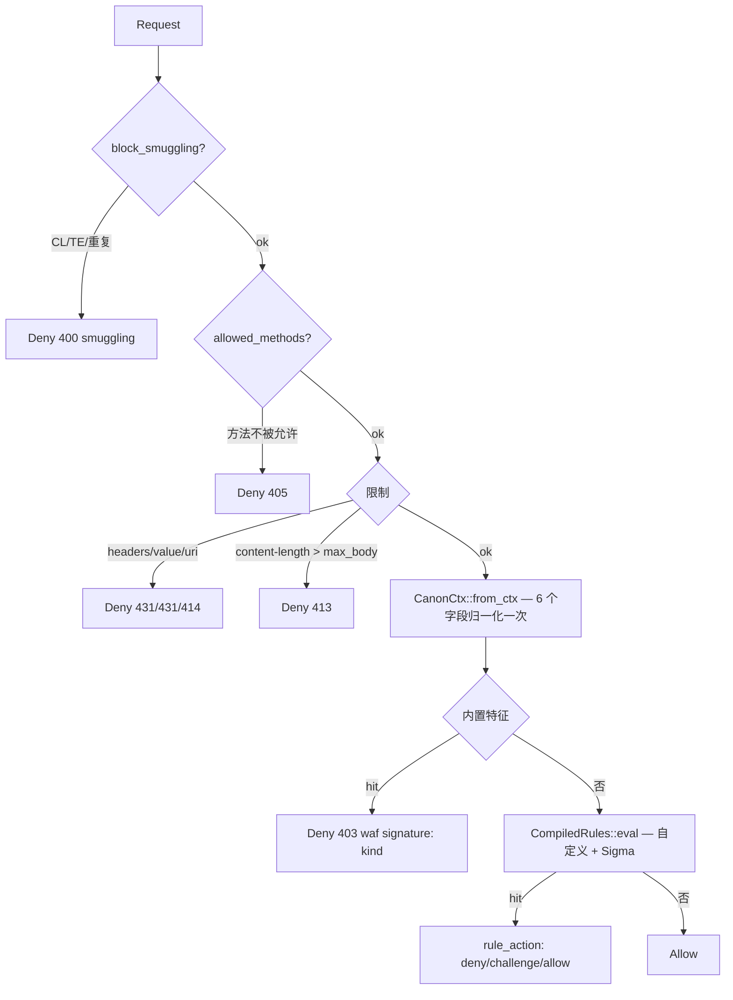

# WAF — 特征、Sigma、compound 规则

**语言：** [English](../en/10-waf.md) · [Русский](../ru/10-waf.md) · **中文**

AEGIS 的 WAF 是一个多层 L7 请求过滤器：内置特征库（在归一化文本上运行 Aho-Corasick）、支持 compound 条件（`all_of`）的可编译自定义规则计划、导入的 SigmaHQ 语料库，以及语义 SQLi 检测器。本文描述 `src/filters/waf.rs`、`src/sigma.rs`、`src/sql_semantic.rs`、`src/normalisation.rs`、`src/param_profile.rs`、`src/filters/sigma_overlay.rs` 和 `src/dsl/lower.rs` 中**代码实际做的事**——没有营销辞令。

> 相关文档：[配置](./04-configuration.md)、[架构与请求生命周期](./02-architecture.md)、ML 与风险引擎、站点测绘与 per-domain 策略、Admin API、安全模型、指标与遥测。

---

## 1. WAF 包含什么、不包含什么

| 子系统 | 文件 | 状态 | 用途 |
|---|---|---|---|
| 内置特征 | `src/filters/waf.rs` (`BUILTIN_SIGNATURES`) | 可用 | 按 sqli/xss/cmdi/path_traversal/ssrf/rce/lfi/xxe/webshell 分类的字面量 |
| 归一化 | `src/filters/waf.rs` (`canon`/`canon_once`) | 可用 | URL-decode、HTML 数字实体、剥离 SQL 注释、转小写、confusable-fold |
| Aho-Corasick 引擎 | `src/filters/waf.rs` (`build_signature_automaton`) | 可用 | 对所有特征一次 O(n) 扫描 |
| 请求体检查 | `src/filters/waf.rs` (`inspect_body_with_encoding`) | 可用 | gzip/deflate 解压 + 扫描，对未知编解码器 fail-closed |
| 可编译规则计划 | `src/filters/waf.rs` (`CompiledRules`) | 可用 | per-field 的 contains/equals/starts_with/ends_with 分桶 + numeric fallback |
| Compound `all_of` | `src/filters/waf.rs` + `src/config.rs` | 可用 | AND-of-(OR) 条件 |
| Sigma 导入器 | `src/sigma.rs` + 二进制 `aegis-sigma-import` | 可用 | YAML SigmaHQ → `WafRule` TOML |
| Sigma 语料库捆绑包 | `rules/sigma/sigma-webserver.toml` | 可用 | 默认加载（可选择退出） |
| Per-rule overlay | `src/filters/sigma_overlay.rs` | 可用 | 从面板开关单条规则，跨 worker |
| 语义 SQLi | `src/sql_semantic.rs` | **部分** — 见 §10 | 分词器 + shape 模式识别器；**未**接入 `WafFilter::check` |
| Parameter-profile | `src/param_profile.rs` | **部分** — 见 §11 | per-endpoint 学习长度/字符集/熵；per-process，不参与 WAF 裁决 |

**诚实声明。** 特征引擎与可编译计划是在归一化文本上运行的完整 substring/exact/prefix/suffix 匹配器。这**不是**完整 AST 解析，也**不是** ML。语义 SQLi 检测器（`src/sql_semantic.rs`）作为独立模块存在，但在主 WAF 路径（`WafFilter::check`）中并不会被调用——它只通过 `arsenal::normalisation_analyse`（`src/arsenal.rs:572`）以及测试接入。不要宣称「AEGIS 的 WAF 对每个请求都做 SQL 语义解析」——热路径上工作的正是字面特征 + 规则。

---

## 2. 检查生命周期（`WafFilter::check`）

`WafFilter::check`（`src/filters/waf.rs:2219`）中的检查顺序是固定的：



关键细节：

- **`enabled` 门控。** 自 V231 起，`check()` **不再**自行按 `self.enabled` 门控。开启/关闭由 `FilterEngine` 通过 `RuntimeToggles` + per-domain `domain_policy` 决定（`src/filters/waf.rs:222-229`，见 `check` 中的注释）。`config_enabled()` 只是返回配置中的值用于给引擎播种。
- **Request smuggling**（`block_smuggling`，默认 `true`）：拒绝冲突的 `Content-Length`（多个不同值 → 400）、多个 `Transfer-Encoding`（M5，> 1 个头 → 400）、同时存在 CL 与 `chunked` TE（400），以及未知 TE token（只允许 `chunked|identity|compress|deflate|gzip`）。
- **方法白名单**（`allowed_methods`）：按大写比较；空列表 = 该过滤关闭。
- **大小限制**：`max_header_count`（431）、`max_header_value_bytes`（431）、`max_uri_bytes`（414）、声明的 `Content-Length` > `max_body_bytes`（413）。请求体的实际大小在 `inspect_body*` 中另行复核。
- **只归一化一次**：`CanonCtx::from_ctx`（`src/filters/waf.rs:1470`）对 `method`、`path`、`user_agent`、`referer`、`cookie`、`host` 恰好归一化一次，并在特征扫描与规则 eval 之间共享结果（V230）。在 V230 之前每个字段都会被归一化两次。
- **特征扫描**按 `method → path → user_agent → referer → cookie` 的顺序遍历字段；首次命中 → `Deny 403 "waf signature: {kind}"`。
- **请求体**并**不**在 `check` 中检查，而是在请求体完整收集之后单独通过 `inspect_body_with_encoding` 检查（见 §6）。`check` 只检查 URI/UA/若干请求头。

---

## 3. 内置特征

语料库是切片 `BUILTIN_SIGNATURES: &[(&str, &str)]`（`src/filters/waf.rs:679`）：一对 `(模式, 类别)`。所有模式都以**归一化后的形态**书写（小写、已 URL 解码、已展开的 evasion 包装）——也就是说全部为小写。

### 类别

| 类别 | 模式示例 | 说明 |
|---|---|---|
| `webshell` | `eval($_post`、`assert($_get`、`eval(base64_decode`、`eval(gzinflate`、`preg_replace("/.*/e"`、`/c99.php`、`/r57.php`、`/wso.php`、`/b374k`、`/weevely`、`/p0wny` | 故意排在最前：在 `LeftmostFirst` 下，当匹配从同一偏移开始时，它们会赢过更宽泛的 `eval(`（xss） |
| `sqli` | `union select`、`union all select`、` or 1=1`、`' or '1'='1`、`sleep(`、`pg_sleep(`、`waitfor delay`、`benchmark(`、`drop table`、`load_file(`、`into outfile`、`information_schema`、`/*!`、`;--`、`extractvalue(`、`updatexml(` | 在归一化文本上的字面量 |
| `xss` | `<script`、`</script`、`javascript:`、`data:text/html`、`vbscript:`、`onerror=`、`onload=`、`<iframe`、`<svg/onload`、`srcdoc=`、`eval(`、`settimeout(` | |
| `cmdi` | `;cat `、`;wget `、`;curl `、`;nc `、`\|bash`、`\|sh`、`\|/bin/`、`&& rm -rf`、`/bin/sh`、`$(curl`、`` `curl ``、`%0acat `、`;python -c` | |
| `path_traversal` | `../../`、`..\\..\\`、`/etc/passwd`、`/etc/shadow`、`/proc/self/`、`c:\\windows\\`、`..%2f`、`..%5c` | |
| `ssrf` | `http://169.254.169.254`、`http://metadata.google`、`http://localhost:`、`http://127.0.0.1`、`http://0.0.0.0`、`file://`、`gopher://`、`dict://`、`ldap://`、`jar:` | |
| `rce` | `${jndi:`、`jndi:ldap`、`jndi:rmi`、`jndi:dns`、`jndi:nis`、`jndi:iiop` | Log4Shell / CVE-2021-44228 及其变体 |
| `lfi` | `php://`、`php://filter`、`phar://`、`expect://`、`zip://`、`data://text/` | PHP 包装器；`data://text/` 特意收紧，以免与 xss 的 `data:text/html` 冲突 |
| `xxe` | `<!doctype`、`<!entity` | 内联 DTD / billion-laughs 向量 |

> 类别名必须与 `disable_signatures` 的取值完全一致（见 §8）。`config.rs` 中的注释只提到 `sqli/xss/cmdi` 作为「valid values」，但实际代码（`match_signature_canon`）可以关闭上表中的**任意**类别——`disabled.contains(cat)` 是按类别的字符串名工作的。

### 匹配语义

自动机以 `LeftmostFirst`、`ascii_case_insensitive(false)` 构建（输入已是小写），DFA 类型由自动选择器决定（`build_signature_automaton`，`src/filters/waf.rs:867`）。热路径 `match_signature_canon`（`src/filters/waf.rs:355`）：

1. `find()` — 一次 O(n) 扫描，返回最左匹配（无迭代器分配）。
2. 若该匹配的类别**未**被关闭 → 返回类别。
3. 若它在配置中被关闭 → 回退到 `find_iter`，以免被关闭的类别遮蔽其后真实的特征。

公共封装 `signature_category(data)`（`src/filters/waf.rs:344`）被与 nginx 的对比基准测试使用，用来展示哪些 payload 会被 AEGIS 拦截、而裸 nginx 会放行。

---

## 4. 规范化 / 归一化

WAF 在**归一化后的**文本上匹配特征。`waf.rs` 中的归一化（`canon`/`canon_once`）是独立于 `src/normalisation.rs` 模块的实现（见下面的声明）。

### `canon`（`src/filters/waf.rs:990`）

- **Fast-path**：`is_already_canon(v)` — 如果字符串已经是纯 ASCII，不含 `%`、`+`、`\`、反引号、NUL，没有大写，没有连续双空格，也没有 `/*`、`*/`、`&#` — 则返回 `Cow::Borrowed`，零分配（合法流量的热路径）。
- **Unicode confusable-fold**（SECURITY H4）：如果输入是非 ASCII，`fold_unicode_confusables` 会把全角块 U+FF01..U+FF5E 折叠为 ASCII（偏移 0xFEE0）以及一张 confusable 字符表（`‹›＜＞`→`<>`、`'"` 的各种变体、`（）；：｜！＆＝`）。这防御 `＜script＞` / `‹script›` 之类的绕过。
- **Multi-pass**：`canon_once` 最多运行 `MAX_PASSES = 4` 次，直到输出稳定——可击破双重/三重编码（`%2527` → `%27` → `'`）。

### `canon_once`（`src/filters/waf.rs:1181`）— 步骤

1. **URL-decode**（`urlencoding::decode`，传播 borrow）。
2. **HTML 数字实体**（`decode_html_numeric_entities`）：`&#NN;`（十进制）和 `&#xHH;`（十六进制）。命名实体（`&lt;`）**故意不**解码（sqlmap 的 `htmlencode` tamper 只发出数字形式；解码命名实体会扩大攻击面）。
3. **剥离 SQL 行注释**（`strip_sql_line_comments`）：`-- <text>\n` 和 `# <text>\n` → 一个空格（sqlmap 的 `space2dash` / `space2hash`）。保守处理：`--` 后面必须跟空格/制表符/`+`；HTML 实体的 `&#` 中的 `#` 不动。
4. **转小写**（仅当存在大写时）。
5. **定点替换**（对字节做一次遍历，V233 — 完全基于 `&[u8]` 以避免在非 char 边界处 panic）：`/`/`\x2f`/`%2f` → `/`，`%5c` → `\`，`/*!50000union*/` → ` union `（保留内部内容的 versioned comment），任意 `/* ... */` → 空格（sqlmap `space2comment`），`+` → 空格，tab/CR/LF → 空格，反引号被丢弃（MySQL 标识符包裹），NUL 被丢弃（`appendnullbyte`）。
6. **折叠连续空白** → 一个空格。

SIMD 加速（V230）：evasion 触发器（`/*`、`*/`、`&#`、`--`、`%2f`、`%5c`、`/`、`\x2f`）通过缓存的 `memchr::memmem::Finder`（NEON/SSE4.2/AVX2 预过滤）检查，在 > 32 字节的 payload 上比 `str::contains` 快 3–10 倍（`evasion_finders`，`src/filters/waf.rs:1151`）。

> **关于两个归一化模块的声明。** 在 `waf.rs` 中，confusable/NFKC 折叠是**内联**的（`fold_unicode_confusables`），并没有复用 `src/normalisation.rs`。原因直接写在代码里（`src/filters/waf.rs:1004-1013`）：公开入口 `normalisation::normalise()` 捆绑了*破坏性的* percent-decode，会把已经是 UTF-8 的输入弄坏，而 helper 函数（`unicode_nfkc`、`confusable_fold`）是私有的。模块 `src/normalisation.rs`（V179，SafeLine 风格）及其各阶段（`UrlDecode`、`HtmlEntityDecode`、`UnicodeNfkc`、`ConfusableFold`、`LowercaseAscii`、`StripNullBytes`）被语义 SQLi 检测器在 `normalise_first=true` 时使用，以及用于变换链审计，**而不是**主特征扫描。

---

## 5. Aho-Corasick：内置特征与可编译计划

AC 用在两个地方：

1. **对整个内置语料库的单一自动机**（`sig_automaton` + 并行的 `pat_categories`）。每个请求一次扫描，取代约 75 次顺序 `s.contains(p)`。
2. **自定义规则可编译计划中的 per-field 自动机**（`CompiledRules`，见 §7）——为每个字段的 `contains`/`regex` 合并集合各建一个 AC。

所有情形都使用 `MatchKind::LeftmostFirst`：在重叠匹配中，先注册的模式胜出（即最早的规则 / 最早的特征）。

---

## 6. 请求体检查（gzip/deflate）

请求体在完整收集**之后**才检查（可捕获客户端谎报 `content-length` 的 chunked 上传）。入口是 `inspect_body_with_encoding(body, content_encoding)`（`src/filters/waf.rs:497`）；封装 `inspect_body(body)`（`src/filters/waf.rs:466`）将请求体当作 identity 处理（用于少数无法访问该请求头的调用点）。

逻辑（SECURITY C4）：

| 条件 | 行为 |
|---|---|
| `!enabled` | `None`（跳过） |
| `body.len() > max_body_bytes` | `Deny 413 "waf body too large"` |
| 无 `Content-Encoding` / `identity` | 原样扫描 |
| `gzip` / `x-gzip` / `deflate` | 解压（有界）→ 扫描 |
| `br`、`compress`、`zstd`、未知 | **FAIL CLOSED** → `Deny 415` |
| 多个 non-identity 编解码器（`gzip, gzip`） | `Deny 415`（smuggling/evasion 向量） |
| 解压超出边界或数据损坏 | `Deny 400` |

**有界解压**（`decompress_bounded`，`src/filters/waf.rs:609`）：输出上限 = `min(max_body_bytes, ratio × input)`，其中 `ratio = max_decompress_ratio.max(1)`。会读取 `cap + 1` 字节以便确定性地检测溢出——防御解压炸弹。`deflate` 同时接受 zlib 包装（RFC 1950 `ZlibDecoder`）与裸 DEFLATE（回退到 `DeflateDecoder`）。

**解码后请求体的扫描**（V233 修复）：
- 扫描**全部**接收到的请求体（BUG 2：以前会截断到 256 KiB，256 KiB 偏移之后的字节会**未经扫描**转发到 upstream —— WAF 旁路）。现在上限 = `max_body_bytes`。
- 使用 `String::from_utf8_lossy`（BUG 3：以前 `from_utf8` 会在非 UTF-8/部分 UTF-8 的请求体上静默跳过整个扫描）。二进制/部分请求体现在会以 U+FFFD 替换后扫描。

请求体中命中特征 → `Deny 403 "waf signature in body: {kind}"`。

> 为了正确保护请求体，调用方**必须**通过 `inspect_body_with_encoding` 路由，并传入 `Content-Encoding` 请求头；裸 `inspect_body` 不做解压。

---

## 7. 自定义规则的可编译计划（`CompiledRules`）

计划（V95）不是每个请求都做「N 条规则 × `String::contains`」，而是在加载/reload 时编译一次（`CompiledRules::build_with_overlay`，`src/filters/waf.rs:1924`），并通过 `ArcSwap` 原子换入。布局：

| 桶 | 类型 | 语义 |
|---|---|---|
| `contains`（+`regex`） | per-field `AhoCorasick`（`FieldAutomaton`） | 子串；`regex` **降级为子串**（历史行为） |
| `equals` | per-field `HashMap<value, rule_idx>` | 精确匹配，O(1)；first-write wins |
| `starts_with` | `PrefixMatcher`（anchored AC，或 ≤1 个前缀时用简单 Vec） | 前缀，O(L_max_prefix) |
| `ends_with` | `SuffixMatcher`（按最后一个字节的 256 个桶） | 后缀；输入按末字节选中一个桶 |
| numeric / 未知 op | `fallback: Vec<rule_idx>` | `gt`/`lt`/`ge`/`le` 走 `cmp_numeric`；其余被忽略 |

**规则 op**（`WafRule.op`）：`contains`、`regex`（→substring）、`equals`、`starts_with`、`ends_with`、`gt`、`lt`、`ge`、`le`。任何其他 op 都会落入 fallback，对字符串而言实际上不会匹配。

**规则字段**（`WafRule.field`），在 `val_with_canon`（`src/filters/waf.rs:1513`）中解析：

| field | 来源 |
|---|---|
| `path` | 归一化 URI（含 query 部分） |
| `query` | `?` 之后的部分，已归一化 |
| `uri_length` | `ctx.path.len()` 的字符串形式 |
| `method` | 归一化方法（小写） |
| `user_agent` | 归一化 UA |
| `content_length` | `content-length` 请求头（或 `"0"`） |
| `host` | `ctx.host`（不是请求头 —— 由 proxy 解析出的 routing-host） |
| `ja3`、`ja4`、`ja4h`、`ja4t`、`ja4l`、`h2fp`、`h3fp`、`mtls_fp` | 连接指纹（未捕获时为空） |
| `client_ip` | IP 字符串 |
| `header:<name>` | 请求头的值，已归一化（`header:referer`、`header:cookie` 已预先归一化） |
| `cookie:<name>` | 特定 cookie 的值（通过 `extract_cookie`） |

**eval 的精确性**（`CompiledRules::eval`，`src/filters/waf.rs:2057`）：返回按声明顺序**第一条**匹配规则的索引（与 V95 之前的顺序循环一致）。per-field 位掩码 `field_kinds`（`FIELD_KIND_CONTAINS/EQUALS/STARTS/ENDS`）会跳过空探测——多数生产规则集在每个字段上只用 1–2 个 op。字段值按请求做记忆化（`cache: FxHashMap<&str, Cow>`），使每个字段的 `canon` 最多执行一次。

### Compound `all_of`（AND-of-OR）

`WafRule.all_of: Vec<WafAndGroup>`（`src/config.rs:779-823`）。`WafAndGroup { field, op, any_of: Vec<String> }`。

只有当 **PRIMARY** `{field, op, value}` 匹配**且**每个 `all_of` 组都匹配（组 = 对 `any_of` 的 OR）时，规则才会触发。空的 `all_of`（legacy）→ 规则就是普通的单条件规则，与此前行为字节级一致。

`all_of` 的检查（`all_of_matches`/`group_matches`，`src/filters/waf.rs:1883`）**只在** primary 命中之后运行（在正常流量上很罕见，位于热路径之外）。组内支持的 op（`op_matches`，`src/filters/waf.rs:1625`）：`contains`、`regex`（→contains）、`equals`、`starts_with`、`ends_with`。任何其他 op → 该组 fail-closed（compound 不触发）。

一个重要的正确性细节（`eval`，`needs_rescan`）：自动机每个桶只返回一个最左匹配。如果这个候选带有非空的 `all_of` 且**未**通过，引擎会置位标志并对原始 `rules` 做 per-field 重扫描，以免失败的 compound 遮蔽了后面某条本应匹配的规则。Legacy 规则集（无 compound）不会走到这条路径——fast-path 保持字节级一致。

### 命中时的动作（`rule_action`，`src/filters/waf.rs:383`）

`WafRule.action` + `WafRule.mode` 决定结果（见 §9）：

| `action` | `mode = enforce` | `mode = shadow`/`log` | `mode = disabled` |
|---|---|---|---|
| `deny`（或任何非 `challenge`） | `Deny 403 "waf rule <id> deny"` | `Allow`（+ 计数器 + debug 日志） | 根本不会被编译 |
| `challenge` | `Challenge { level: Captcha }` | `Allow`（+ 计数器） | 不编译 |

`reason` 会被消毒（`\r`/`\n` → `_`）。每次命中都会增加 `shadow_observed`（Prometheus `aegis_waf_shadow_observed`），与模式无关。

### 热重载

`maybe_reload_rules`（`src/filters/waf.rs:292`）——后台 mtime 监视器：当 `rule_files` 中任一文件发生变化**或** overlay 文件发生变化（`sigma_overlay.refresh()`）时，整个规则集会被重新编译并通过 `ArcSwap` 原子换入（读者要么看到旧集合，要么看到新集合——不存在撕裂状态）。`recompile_now`（`src/filters/waf.rs:245`）在面板上切换开关后强制当前 worker 立即重建；其他 worker 会通过 overlay 文件的 mtime 感知到。

---

## 8. `disable_signatures`

`WafConfig.disable_signatures: Vec<String>`（`src/config.rs:840`）。名称在加载时转为小写（`src/filters/waf.rs:178-182`）。在扫描中，被关闭的类别不会遮蔽更深处的特征（回退到 `find_iter`）。

```toml
[filters.waf]
# 关闭在本环境中产生误报的内置特征类别。
disable_signatures = ["xss", "lfi"]
```

> **仅**影响内置语料库 `BUILTIN_SIGNATURES`。自定义规则和 Sigma 语料库要用别的方式关闭：per-rule overlay（§9），或 `mode = "disabled"` / 从文件中删除。

---

## 9. 模式：enforce / shadow / log / disabled

`WafRule.mode`（`src/config.rs:806-814`），解析函数 `rule_mode_of`（`src/filters/waf.rs:95`）：

| 配置取值 | `RuleMode` | 行为 |
|---|---|---|
| `enforce`（或缺省） | `Enforce` | 应用 `action`（deny/challenge） |
| `shadow` | `Shadow` | 匹配计入指标 + debug 日志，不影响请求 |
| `log` | `Log` | 与 shadow 相同（单独的变体，便于配置中表意清晰） |
| `disabled` / `off` | `Disabled` | 规则不被编译（热路径零成本） |

**推荐工作流**：新规则先以 `shadow` 上线，观察一周 `aegis_waf_shadow_observed` 和 debug 日志 `target: "aegis::waf::shadow"`，然后切到 `enforce`。

`severity`（`critical`/`high`/`medium`/`low`，默认 `medium`，`parse_severity` 见 `src/filters/waf.rs:104`）不改变拦截与否，但作为分级贡献喂给风险引擎（`rule_signal` → `WafSignal`，`src/filters/waf.rs:432`）。见 ML 与风险引擎。

### Per-rule overlay（从面板开/关）

`src/filters/sigma_overlay.rs`（V237）——deny-list 文件（默认 `/var/lib/aegis/sigma-overlay.json`，可用 `AEGIS_SIGMA_OVERLAY` 覆盖）。只保存**被关闭**的规则 ID；全新安装不会关闭任何东西，在运维人员关闭某条规则之前文件也不会创建。

- 原子写入（tmp + rename），ID 排序以便产出对 diff 友好。
- mtime 轮询：`WafFilter.maybe_reload` 在同一个 rule-reload 字段上 stat 该文件；任一 worker 上的开关都会被其他 worker 感知。
- 被关闭的规则**在编译阶段就被剔除**（`build_with_overlay` 跳过 `overlay_disabled.contains(&r.id)`），即等同于 `mode = "disabled"` —— 每个请求零成本。
- API：`set_enabled(rule_id, enabled)`、`disabled_ids()`、`is_disabled(id)`。管理面板使用与编译路径相同的 `Arc`，因此开关对下一次 `recompile_now()` 可见。

---

## 10. Sigma 语料库与导入器

`src/sigma.rs`（V196）解析 YAML SigmaHQ 并产出 `WafRule`。CLI 二进制 `aegis-sigma-import` 递归遍历目录中的 `*.yml`/`*.yaml`，写出可直接用于 `waf.rule_files` 的合并 TOML。

### 导入什么

只导入 webserver 规则（`is_webserver_rule`，`src/sigma.rs:177`）：`logsource.category: webserver`/`web`，或 `product: apache | nginx | iis | haproxy | caddy`。Endpoint/sysmon/windows-eventlog/linux-auditd 规则会被跳过。

**字段映射**（`map_field`，`src/sigma.rs:499`）：

| Sigma | Aegis `WafRule.field` |
|---|---|
| `c-uri`、`cs-uri`、`cs-uri-stem`、`uri`、`url`、`request_uri` | `path` |
| `cs-uri-query`、`c-uri-query`、`query`、`query_string` | `query` |
| `cs-method`、`method` | `method` |
| `c-useragent`、`cs-user-agent`、`cs(User-Agent)` | `user_agent` |
| `cs(Host)`、`cs-host`、`vhost` | `host` |
| `cs(Referer)` | `header:referer` |
| `cs(Cookie)` | `header:cookie` |
| `cs(X-Forwarded-For)` | `header:x-forwarded-for` |
| 通用 `cs(Some-Header)` | `header:some-header` |
| `c-ip`、`src_ip`、`client_ip` | `client_ip` |

**修饰符映射**（Sigma `field\|modifier` → `op`）：无 → `equals`；`contains` → `contains`；`startswith` → `starts_with`；`endswith` → `ends_with`；`re`/`regex` → `regex`。元修饰符（`all`、`any`、`ignorecase`、`base64`、`windash`、`utf16*` 等）会被**忽略**（best-effort）；未知修饰符 → 转换报错。叠加的链（`cs-uri|contains|all`）会归约为基础 op。

**级别映射**（`level_to_aegis`，`src/sigma.rs:563`）：

| Sigma `level` | severity | action | mode |
|---|---|---|---|
| `critical` | critical | `block` | enforce |
| `high` | high | `block` | enforce |
| `medium` | medium | `challenge` | enforce |
| `low` / `informational` | low | `log` | **shadow** |
| 缺省 | medium | `challenge` | enforce |

每条规则最多携带 8 个 Sigma 标签（`attack.t1190`、`cve.*`），它们会进入 `SecurityEvent.tags`。`tag_map` 关联 Sigma-id → title。

### Compound 产出（V197）—— 为什么这很重要

历史错误（V197 之前）：Sigma 的 select 块会被**压平**成若干共享同一 id 的独立单条件规则。但 Sigma 的 `selection` 是按字段键做 **AND**。把 `c-uri|contains: /x AND cs-method: POST` 压平成两条 OR 规则，意味着裸的 `method == POST` 会拦截**全部** POST 流量（误报风暴，直接搞垮了线上站点）。整个捆绑包不得不被关闭。

现在（`convert`，`src/sigma.rs:189`）产出的是 **compound** 规则：

1. 每个键 `field[|modifier]` 被收集为一个组 `(aegis_field, op, [values])`（值列表 = OR 集合）。
2. 选出一个**有选择性的** primary，按优先级：`query`（0）→ `uri`/`path`（1）→ `user_agent`（2）→ 其余（3）。`method` 与 `host` **永远不会**作为 primary（`primary_selectivity`/`select_primary`，`src/sigma.rs:375`）。如果块中没有选择性字段（只有 method/host）→ 该块被跳过，原因为 `too-broad-no-selective-field`。
3. 为每个 primary 值产出一条 `WafRule`；**其余**所有组作为 `WafAndGroup { field, op, any_of }` 放入 `all_of` —— 包括 method/host（它们作为 AND 约束是可以的，只是不能作为唯一触发条件）。
4. id 方案、action、severity、tags、mode 均被保留。

示例（来自 `src/sigma.rs` 的测试）：select 为 `c-uri|contains: [/shell.php, /cmd.jsp]` AND `cs-method: GET` → **2** 条规则（每个 URI 一条），每条的 `all_of = [{method, equals, [GET]}]`。这才是 Sigma 的 AND-of-OR 语义，而不是 3 条宽泛规则。

**condition 支持**（`parse_condition`，`src/sigma.rs:403`）：

| condition 形式 | 处理方式 |
|---|---|
| `selection`（单个块） | 键之间通过 compound 模型做 AND |
| `1 of selection_*` / `any of selection_*` / `one of` | 块之间 OR；每个块各自贡献其 compound 规则 |
| `all of <prefix>*` | best-effort：每个块独立贡献规则（该操作符上存在过度匹配风险） |
| `X or Y`（两个具名块） | 并集（OR） |
| `X and Y and not Z` | 纳入已知的合取块，否定被丢弃 |
| `selection and not filter` | 产出 selection，丢弃 filter |
| `keywords:`（裸列表） | `path contains <each>`（LFI/RCE 关键词列表） |

> **关于导入诚实性的声明。** 否定（`not <block>`）会被丢弃 —— 请在审计日志中留意误报，并通过 `[filters.bypass]` 添加例外。`|all`/`|any` 被归约为基础 op（在扁平列表中无法表达严格的「所有值都必须匹配」）。libyml 解析器（RUSTSEC-2025-0067，unsound）在部分真实 Sigma-YAML 上可能 panic —— panic 会按文档粒度被捕获（`catch_unwind`）并跳过该规则，而不会毁掉整个导入。

### 捆绑包与启用

目录 `rules/sigma/`：`sigma-webserver.toml`（自动生成，**不要手工编辑**）、`README.md`、`skipped.txt`。仓库中签入的示例文件包含 **49** 条 primary 规则（`[[rules]]`）与 3 个 `all_of` 组；字段分布为 `path`（31）、`query`（15）、`user_agent`（4）、`method`（2 —— 仅作为 AND 约束）。README 提到「562 rules converted」——那是对整个 SigmaHQ 树做完整导入的数字，而不是签入示例的规模。

**默认加载**（`default_sigma_rule_files`，`src/dsl/lower.rs:403`）：DSL 配置默认**启用** Sigma 语料库（可选择退出）。按顺序尝试路径，取第一个存在的：

```
/etc/aegis/rules/sigma/sigma-webserver.toml
/var/lib/aegis/rules/sigma/sigma-webserver.toml
/usr/local/src/aegis/rules/sigma/sigma-webserver.toml
rules/sigma/sigma-webserver.toml
```

关闭方式：`AEGIS_SIGMA_WAF=0`（也可用 `off`/`false`/`no`）→ 空列表。文件通过 `waf.rule_files` 加载，并按 mtime 重载。DSL 默认中 `WafConfig.enabled = true`（`src/dsl/lower.rs:471`）。

重新生成语料库（摘自 `rules/sigma/README.md`）：

```sh
# sparse-clone SigmaHQ
git clone --depth=1 --filter=blob:none --sparse https://github.com/SigmaHQ/sigma.git src
cd src && git sparse-checkout set rules/web rules-emerging-threats rules-threat-hunting

aegis-sigma-import \
  --input /tmp/sigma/src \
  --output /etc/aegis/rules/sigma/sigma-webserver.toml \
  --skipped-log /tmp/sigma-skipped.txt --verbose
```

---

## 11. SQL 语义（`src/sql_semantic.rs`）

V156，SafeLine 风格的语义 SQLi 检测器：SQL-aware 分词器 + shape 模式识别器，返回 `InjectionVerdict { score: f32, reasons: Vec<&'static str> }`。`is_attack()` = `score >= 0.6`。

**分词器**（`tokenize`，`src/sql_semantic.rs:71`）：URL-decode（单遍 `url_decode_lite`）、内联 `/* */` 与行注释 `--`/`#`（作为 Comment 标记产出，分词**继续进行** —— 目标是给所有 shape 打分，而不是「实际会执行什么」）、带双引号转义的字符串字面量、十六进制字面量（`0x..`、`X'..'`）、数字、标识符/关键字（`is_sql_keyword`）、多字符运算符。后处理 `merge_split_keywords` 会把 `UN/**/ION` 粘合为 `UNION`（V146 KeywordCommentSplit）。

**模式与权重**（`analyse`，`src/sql_semantic.rs:348`）：

| 模式 | Reason | 权重 |
|---|---|---|
| 恒真式（`1=1`、`'a'='a'`、raw-byte `'X'='X`） | `tautology` | +0.50 |
| 值之后出现 UNION | `union_after_value` | +0.65 |
| 引号后接注释（`'admin'--`） | `quote_then_comment` | +0.40 |
| `;` 之后堆叠的 DDL/DML | `stacked_ddl` | +0.50 |
| 时间盲注（SLEEP/BENCHMARK/PG_SLEEP/WAITFOR） | `time_blind` | +0.40 |
| 不配对引号之后的 OR | `unbalanced_quote_or` | +0.30 |

Score 被钳制到 [0, 1]。可选的前置归一化（`analyse_with_normalisation(input, normalise_first)`，V179）：在分词前先过一遍 `src/normalisation.rs`。

> **状态 —— 部分集成。** 代码中不存在从 `WafFilter::check` 调用 `sql_semantic::analyse*` 的地方。接入点只有 `arsenal::normalisation_analyse`（`src/arsenal.rs:572`，调用 `analyse_with_normalisation(payload, true)`）以及单元测试。也就是说，主 WAF 路径上每个请求跑的是**字面特征**，而语义打分器是用于纵深防御/风险引擎的独立模块，并不是 WAF 热路径裁决的一部分。不要把它描述成「始终启用」。

---

## 12. Parameter-profile（`src/param_profile.rs`）

V180，open-appsec 风格的 per-endpoint 学习。对每个 `(host, endpoint, param_name)` 维护滑动统计：count、长度 min/max、mean ± stddev（Welford）、字符集掩码、平均 Shannon 熵。在 `learn_threshold` 次观测之后档案即「已学习」，后续的值会按以下维度打分：长度落在 `[mean − 3σ, mean + 3σ]` 之外、出现新字符、熵突增。输出 0.0..1.0。

> **状态 —— 部分。** Per-process（无共享状态），在 admin UI 的 Endpoints 标签页中呈现。这是异常信号，不是拦截性的 WAF 裁决；不要把它与特征引擎混为一谈。

---

## 13. 配置：字段参考

### `[filters.waf]`（`WafConfig`，`src/config.rs:827`）

| 字段 | 类型 | 默认值 | 用途 |
|---|---|---|---|
| `enabled` | bool | `false`（在 `Default` 中；DSL 默认为 `true`） | 开启 WAF（实际由 `FilterEngine`/domain_policy 门控） |
| `custom_rules` | `[[rules]]` | `[]` | 内联规则 |
| `rule_files` | `[String]` | `[]`（DSL：Sigma 捆绑包） | 含 `[[rules]]` 的外部 TOML，合并 + mtime 重载 |
| `disable_signatures` | `[String]` | `[]` | 关闭内置特征类别 |
| `max_body_bytes` | `Option<usize>` | `64 * 1024`（经由 `WafFilter::new`） | 请求体上限（413） |
| `max_header_value_bytes` | usize | `8 * 1024`（最小 64） | 请求头值最大长度（431） |
| `max_header_count` | usize | `64`（最小 8） | 请求头最大数量（431） |
| `max_uri_bytes` | usize | `8 * 1024`（最小 64） | URI 最大长度（414） |
| `allowed_methods` | `[String]` | `GET,HEAD,POST,PUT,PATCH,DELETE,OPTIONS` | 方法白名单（405）；为空 = 关闭 |
| `block_smuggling` | bool | `true` | CL/TE/重复头的 smuggling 防护（400） |
| `max_decompress_ratio` | u32 | `100` | 解压比率上限（0 = 关闭，代码中下限为 1） |

### `[[rules]]`（`WafRule`，`src/config.rs:786`）

| 字段 | 类型 | 用途 |
|---|---|---|
| `id` | String | 标识符（出现在 reason/指标中） |
| `field` | String | 见 §7 的字段表 |
| `op` | String | `contains`/`regex`/`equals`/`starts_with`/`ends_with`/`gt`/`lt`/`ge`/`le` |
| `value` | String | primary 条件的值（编译时会被归一化） |
| `action` | String | `deny`（默认结果）/ `challenge` |
| `severity` | Option | `critical`/`high`/`medium`(默认)/`low` |
| `tags` | `[String]` | 进入指标/SecurityEvent |
| `score` | `Option<u32>` | 对风险引擎的显式贡献 |
| `mode` | Option | `enforce`(默认)/`shadow`/`log`/`disabled` |
| `all_of` | `[WafAndGroup]` | compound AND-of-OR（见 §7） |

`WafAndGroup`：`{ field, op, any_of: [String] }`。

### 示例

单条件规则：

```toml
[[rules]]
id = "block-env-file"
field = "path"
op = "contains"
value = "/.env"
action = "deny"
severity = "high"
mode = "enforce"
tags = ["recon", "leak"]
```

Compound 规则（仅当 path 含 `/admin` 且方法为 POST 时触发）：

```toml
[[rules]]
id = "admin-post-guard"
field = "path"
op = "contains"
value = "/admin"
action = "challenge"
severity = "medium"

[[rules.all_of]]
field = "method"
op = "equals"
any_of = ["POST", "PUT"]
```

Numeric 规则（大请求体）：

```toml
[[rules]]
id = "oversize-body"
field = "content_length"
op = "gt"
value = "1048576"
action = "deny"
```

启用 Sigma 捆绑包 + 自有规则：

```toml
[filters.waf]
enabled = true
rule_files = [
  "/etc/aegis/aegis-rules.toml",
  "/etc/aegis/rules/sigma/sigma-webserver.toml",
]
```

DSL 等价写法（见[配置](./04-configuration.md)）：

```
filters {
    waf {
        rule_files /etc/aegis/rules/sigma/sigma-webserver.toml;
    }
}
```

---

## 14. 可观测性与运维

- **Prometheus**：`aegis_waf_shadow_observed` —— 匹配总数（含 shadow/log），`shadow_observed()`（`src/filters/waf.rs:424`）。详见指标。
- **日志**：shadow 匹配 → `tracing::debug!(target: "aegis::waf::shadow", rule_id, severity)`。Reload → `tracing::info!(changed, overlay_changed, "WAF rule files reloaded")`。
- **SecurityEvent**：规则的 severity/tags 会喂给风险引擎与 SIEM 导出。见 ML 与风险引擎、请求日志。
- **诊断**：`rule_count()` —— 已加载自定义规则的数量。
- **管理面板**：「Signatures」页面展示 Sigma 语料库的规则并允许开关它们（overlay，§9）。见管理面板、Admin API。

---

## 15. 诚实声明汇总

1. **特征是在归一化文本上的 substring/exact/prefix/suffix 匹配**，而不是完整解析器。`regex` op 降级为子串（`src/filters/waf.rs:1627`、`1958`）。不要宣称支持完整正则。
2. **语义 SQLi 检测器（`src/sql_semantic.rs`）不会被 `WafFilter::check` 调用** —— 它只通过 arsenal/风险引擎和测试接入。热路径上运行的是字面特征。
3. **Parameter-profile（`src/param_profile.rs`）是 per-process 的异常信号**，不是拦截性的 WAF 裁决。
4. **Sigma 导入是 best-effort**：否定被丢弃，`|all`/`|any` 被归约，libyml 可能 panic（该规则被跳过）。请在审计日志中留意误报。
5. **签入的捆绑包 = 49 条规则**，不是 562 —— 后一个数字来自 README，指的是对整个 SigmaHQ 树的完整导入。
6. **Confusable-fold 只覆盖高杠杆的字符集合**（尖括号、引号、圆括号、分隔符、全角块），而不是完整的 Unicode confusable 表。
7. **只有当调用方在 `inspect_body_with_encoding` 中传入了 `Content-Encoding` 时请求体才会被检查**；不支持的编解码器 fail-closed（415）。
8. 已发现问题的完整图景与修复状态见 SECURITY-AUDIT-CONSOLIDATED-2026-06-07.md 和安全模型。
