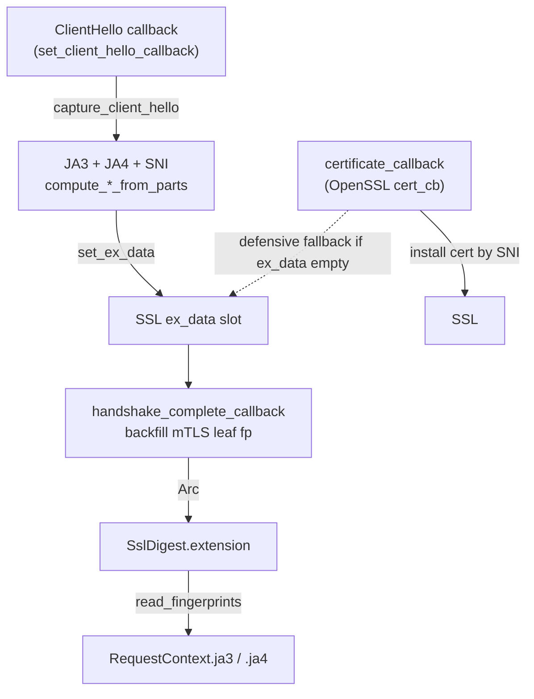

# TLS 指纹（JA3/JA4）

**语言：** [English](../en/11-tls-fingerprinting.md) · [Русский](../ru/11-tls-fingerprinting.md) · **中文**

AEGIS 从每个 TLS/QUIC 连接上采集一整族指纹（JA3、JA4、JA4H、JA4T、JA4L，以及服务端的 JA4S/JA4X/JA4TS/JA4LS、h2/h3 fp 和 mTLS fp），并把它们用作机器人检测、拒绝名单、WAF 规则、ML 打分器和 Defence Arsenal 的信号。本文档说明代码中究竟计算了什么、它在生产路径（Pingora）上**在哪里**被捕获，以及有哪些应当诚实考虑的局限。

> 相关文档：[WAF](./10-waf.md)（`field:"ja3"/"ja4"` 规则）、[信誉](./12-reputation.md)（JA4 数据源）、ML 与风险引擎（`ja4_churn`、`grease_anomaly` 特征，关联性）、Arsenal、[TLS 与证书](./08-tls-certificates.md)、[架构](./02-architecture.md)。

---

## 1. 指纹族概览

| 指纹 | 层 | 代码来源 | 哈希的内容 | 状态 |
|---|---|---|---|---|
| **JA3**（legacy） | TLS ClientHello | [`src/ja3.rs`](../../src/ja3.rs) | version、ciphers、extensions、groups、ec_point_formats → MD5 | 可用 |
| **JA4** | TLS ClientHello | [`src/ja4.rs`](../../src/ja4.rs) `compute_ja4` | 排序后的 ciphers/extensions + sig_algos → SHA-256 前缀 | 可用 |
| **JA4H** | HTTP 请求 | [`src/ja4.rs`](../../src/ja4.rs) `compute_ja4h` | method、版本、请求头名称、cookie | 可用 |
| **JA4T** | TCP SYN（客户端） | [`src/ja4.rs`](../../src/ja4.rs) `compute_ja4t` | window、options、MSS、wscale | 部分可用（见 §7） |
| **JA4L** | 延迟（客户端一侧） | [`src/ja4.rs`](../../src/ja4.rs) `compute_ja4l_pair` | client_to_server_us / server_to_client_us | 部分可用（见 §7） |
| **JA4S** | TLS ServerHello | [`src/ja4_server.rs`](../../src/ja4_server.rs) `compute_ja4s_from_parts` | 服务端版本、ALPN、cipher、extensions | 可用（由外围代码调用） |
| **JA4X** | X.509 证书 | [`src/ja4_server.rs`](../../src/ja4_server.rs) `compute_ja4x` | issuer DN、subject DN、扩展 OID | 可用（x509-parser） |
| **JA4TS** | TCP SYN-ACK（服务端） | [`src/ja4_server.rs`](../../src/ja4_server.rs) `compute_ja4ts` | window、MSS、scale、option kinds | 部分可用（需要 SYN 抓取） |
| **JA4LS** | 延迟（服务端一侧） | [`src/ja4_server.rs`](../../src/ja4_server.rs) `compute_ja4ls` | SYN → SYN-ACK 时间差（毫秒） | 部分可用 |
| **H2FP** | HTTP/2 preface | [`src/h2_fp.rs`](../../src/h2_fp.rs) `parse_prefix` | SETTINGS、WINDOW_UPDATE、PRIORITY、伪首部顺序 | 可用 |
| **H3FP** | QUIC/HTTP3 | [`src/h3_fp.rs`](../../src/h3_fp.rs) `compute` | QUIC version、ALPN、transport-parameters | 近似（见 §6） |
| **mTLS fp** | 客户端证书 | [`src/mtls_fp.rs`](../../src/mtls_fp.rs) `compute` | 密钥类型、链/SAN 数量、issuer DN、叶子 DER | 可用（仅在启用 mTLS 时） |

派生信号：

- **JA4 churn** —— 按 IP 的 JA4 轮换：[`src/ja4_churn.rs`](../../src/ja4_churn.rs)。
- **GREASE 异常** —— utls/curl-impersonate 伪装检测器：[`src/grease_anomaly.rs`](../../src/grease_anomaly.rs)。
- **fp↔UA 关联** —— JA4 与 User-Agent 与 H2FP 的交叉校验：[`src/fp_correlation.rs`](../../src/fp_correlation.rs)。

---

## 2. JA3（legacy，MD5）

JA3（Salesforce）是由 5 个字段构成的规范字符串：

```
SSLVersion,Cipher,SSLExtension,EllipticCurve,EllipticCurvePointFormat
```

每个字段是用连字符分隔的十进制数字列表，最终的 MD5 哈希（32 位十六进制）与 abuse.ch / SSL Blacklist 数据源发布的一致，因此运维人员可以把哈希直接放进拒绝名单。

代码中有两个入口（[`src/ja3.rs`](../../src/ja3.rs)）：

- `compute_ja3(buf)` —— 解析 TLS 记录 + ClientHello 的原始字节（用于 hyper 路径 / 测试）。
- `compute_ja3_from_parts(client_version, ciphers, extension_types, supported_groups, ec_point_formats)` —— 从已经解析好的字段拼装字符串。**这是 Pingora 的路径**：在 ClientHello 回调内部，openssl 通过访问器而不是原始记录返回这些字段（`src/ja3.rs:108`）。

GREASE 值（RFC 8701）会从 ciphers、extensions 和 supported_groups 中剔除 —— `ec_point_formats` 保持原样（`src/ja3.rs:121`）。这使得那些掺入随机 GREASE 码点的浏览器也能得到稳定的哈希。

示例（来自测试 `from_parts_with_grease_filters_identically`，`src/ja3.rs:413`）：

```
输入： ciphers=[0x0a0a,0x1301,0x1302,0x2a2a], exts=[0x0a0a,0,10,11,0xfafa]
JA3:   771,4865-4866,0-10-11,29-23,0   (GREASE 0x0a0a/0x2a2a/0xfafa 已移除)
```

测试 `from_parts_matches_byte_parser`（`src/ja3.rs:369`）保证字节解析器与 `from_parts` **逐字节一致**：同一个客户端在两个二进制上得到相同的 JA3。

`is_grease(v)`（`src/ja3.rs:190`）是公开函数：两个半字节相等，且低半字节为 `a`（即 `0x0A0A`、`0x1A1A`、……、`0xFAFA`）。

---

## 3. JA4（TLS ClientHello）

JA4（FoxIO）是 JA3 的继任者。优点（摘自 [`src/ja4.rs`](../../src/ja4.rs) 的文件头）：

1. **稳定性** —— JA4 在哈希前对 ciphers/extensions 排序，因此表面上的重排不会改变指纹。
2. **人类可读的前缀** —— 片段 `a` 以明文书写。
3. **多个变体** —— 组合起来可以经受住单步规避。

### 3.1. JA4 字符串格式

规范形式是用 `_` 分隔的三个片段：

```
<a>_<b>_<c>     例如  t13d1516h2_8daaf6152771_b186095e22b6
```

**片段 `a`**（`src/ja4.rs:225-237`）按如下方式组成：`{proto}{ver}{sni}{cipher_count}{ext_count}{alpn}`

| 部分 | 取值 | 来源 |
|---|---|---|
| `proto` | `t`（TLS over TCP）或 `q`（QUIC） | `is_quic` 标志 |
| `ver` | `13`/`12`/`11`/`10`/`s3`/`00` | `tls_version_label`（`src/ja4.rs:361`）—— 取 `supported_versions` 中的**最高**版本，而非 legacy 字段 |
| `sni` | 存在 SNI 时为 `d`，否则为 `i` | extension 0 |
| `cipher_count` | hex(2)，上限为 `0x99` | `cap_hex_2`，GREASE 已被过滤 |
| `ext_count` | hex(2)，**排除** SNI(0) 和 ALPN(16) —— 这是规范的一个怪癖 | `src/ja4.rs:231` |
| `alpn` | 第一个 ALPN 协议的首字符+末字符，小写；为空 → `00` | `alpn_tag`（`src/ja4.rs:383`） |

**片段 `b`** —— 排序后的 cipher 列表（hex4，逗号分隔）的 SHA-256-prefix(12)（`src/ja4.rs:239`）。

**片段 `c`** —— 排序后的 extensions（不含 SNI/ALPN）的 SHA-256-prefix(12)，其后用 `_` 拼接 signature_algorithms（`src/ja4.rs:249-271`）。

哈希是 SHA-256 的前 6 个字节的十六进制表示 = 12 个字符（`sha_prefix12`，`src/ja4.rs:766`），便于用作 tracing 字段和仪表盘。

来自测试 `computes_ja4_prefix` 的示例（`src/ja4.rs:907`）：一个带 2 个 cipher（剥离 GREASE 之后）、SNI、ALPN `h2`、supported_versions `[0x0304,0x0303]`、2 个「计入」扩展的 ClientHello → `a = t13d0202h2`。

### 3.2. 两个入口

- `compute_ja4(buf, is_quic)` —— 原始 ClientHello 解析器（`src/ja4.rs:126`）。
- `compute_ja4_from_parts(...)` —— 从已解析字段计算；**这是 Pingora 的路径**（`src/ja4.rs:290`）。它期望调用方已经从 ciphers/extensions 中过滤掉 GREASE；它自己选取最高的非 GREASE 版本。

测试 `from_parts_matches_byte_parser_tls13`（`src/ja4.rs:1033`）确认两条路径的完整字符串以及三个片段都逐字节一致。

---

## 4. JA4H（TLS + HTTP）

JA4H 对 HTTP 请求做指纹，并防范 UA 伪装。格式为 4 个片段：`<a>_<b>_<c>_<d>`（[`src/ja4.rs`](../../src/ja4.rs) `compute_ja4h`，`src/ja4.rs:426`）。

**片段 `a`** = `{method2}{ver}{cookie}{referer}{header_count}{lang4}`：

- `method2` —— 方法的前 2 个字符，小写，用 `0` 补齐（例如 `DELETE`→`de`，`X`→`x0`）。
- `ver` —— `10`/`11`/`20`/`30`/`00`。
- `cookie` —— 存在 Cookie 请求头时为 `c`，否则为 `n`。
- `referer` —— `r`/`n`。
- `header_count` —— 计入请求头数量的 hex(2)，**排除** cookie、referer 以及 HTTP/2 伪首部（`:method`、`:path`、……）。
- `lang4` —— 来自 `Accept-Language` 的归一化 primary range（`en-US,en;q=0.9` → `enus`），用零补齐到 4 个字符。

**片段 `b`** —— **按到达顺序**排列的请求头名称的 SHA-256-prefix(12)（小写，逗号分隔；排除 cookie/referer）。

**片段 `c`/`d`** —— 分别是**排序后**的 cookie 名称和 `name=value` 的 SHA-256-prefix(12)。排序使指纹不受 cookie 顺序影响（测试 `ja4h_basic_get_request`，`src/ja4.rs:951`）。

示例：`GET`、HTTP/1.1、存在 Cookie+Referer、3 个计入的请求头、`en-US` → `a = ge11cr03enus`。

热路径使用零分配变体 `compute_ja4h_from_headermap`（`src/ja4.rs:539`），直接在 `http::HeaderMap` 上工作 —— 行为完全一致。

---

## 5. H2FP —— HTTP/2 指纹（Akamai 风格）

[`src/h2_fp.rs`](../../src/h2_fp.rs) 采集 HTTP/2 客户端在连接开始时、**早于**应用层请求所暴露的状态。`full()` 的格式（`src/h2_fp.rs:59`）：

```
SETTINGS|WINDOW_UPDATE|PRIORITY|PSEUDO
```

- **SETTINGS** —— 按到达顺序排列的 `id:value` 对，用 `;` 分隔。
- **WINDOW_UPDATE** —— 连接级别的增量（或 `0`）。
- **PRIORITY** —— 计数器 + 第一个元组 `count:stream:excl:dep:weight`。
- **PSEUDO** —— 第一个 HEADERS 帧中的伪首部顺序：字母 `m`(method)、`a`(authority)、`s`(scheme)、`p`(path)。

`parse_prefix(buf)` 从 preface（`PRI * HTTP/2.0...`）开始读取帧，直到第一个 HEADERS（最多 16 个帧），然后停止。SETTINGS-ACK 会被忽略。缓冲区被截断时返回部分指纹 —— 不会因为嗅探未命中而阻断连接（`src/h2_fp.rs:90`）。

伪首部顺序的提取不使用完整的 HPACK 解码器：只扫描静态表索引 1–7（`:authority`、`:method GET/POST`、`:path //index.html`、`:scheme http/https`）—— 对任何格式正确的请求都足够（`src/h2_fp.rs:156`）。不支持动态表 —— 这是有意的简化。

在 hyper 之前抓取字节由适配器 `SniffedStream`（`src/h2_fp.rs:382`）完成：它缓冲已读取的字节，让嗅探器查看，然后透明地把它们「重放」给下游读取方，并立即释放缓冲区。

> 大多数「JA3/JA4-as-Chrome」伪装工具懒得在 HTTP/2 层做匹配，因此 H2FP 是一个很强的补充信号（关联性见 §9）。

---

## 6. H3FP —— HTTP/3 / QUIC 指纹

⚠️ **诚实说明。** 完整的 JA4Q（FoxIO 的 QUIC 变体）需要 Initial 报文的原始字节 —— Initial 头部长度、加密 CRYPTO 帧的布局，以及内层 ClientHello 中 transport_parameters 的顺序。**quinn 不会**把这些暴露到用户态（它在握手状态机内部消费掉了）。因此 [`src/h3_fp.rs`](../../src/h3_fp.rs) 只给出基于 quinn 在握手后所暴露内容的**近似值**：

- QUIC version（u32，`00000001` = RFC 9000），
- ALPN（`h3`、`h3-29`、……），
- quinn 提供的 transport 参数集合 `(id, value)`。

格式：`q{version}{alpn}_{params_sha12}`（`src/h3_fp.rs:46`）。参数在哈希前会排序，因此帧的顺序没有影响（测试 `param_order_doesnt_change_hash`）。ALPN 标签与 JA4 保持一致（首字符+末字符），使 Chrome-h3 与 Chrome-h2 落在相邻位置。

这足以粗略区分主要的 QUIC 实现（chromium / firefox / cronet / quiche / msquic），但它**不是**逐字节精确的 JA4Q。

---

## 7. JA4T / JA4L 及服务端变体

### JA4T / JA4S / JA4X / JA4TS / JA4LS

- **JA4T**（`compute_ja4t`，`src/ja4.rs:666`）：`{window}_{options}_{mss}_{wscale}`。⚠️ `options_order` 和 `window` 字段 Linux 内核不会直接给出；没有 eBPF SYN 抓取时它们只能是 best-effort。输入为空时返回哨兵值 `0_0_0_0`。
- **JA4L**（`compute_ja4l_pair`，`src/ja4.rs:700`）：`{client_us}_{server_us}`，单位为**微秒**。⚠️ `compute_ja4l(observed, done)` 是遗留形式，输出 `{rtt_us}_{rtt_us}`（两半相同），为迁移兼容性而保留。
- **JA4S**（`compute_ja4s_from_parts`，`src/ja4_server.rs:54`）：`t{ver}{proto}{alpn}_{cipher_hex4}_{ext_hash}`。用于检测上游被替换：我们上游的 JA4S 在多次部署之间不应发生变化。
- **JA4X**（`compute_ja4x`，`src/ja4_server.rs:91`）：由 DER 证书（通过 `x509-parser`）得到的 `{issuer_hash}_{subject_hash}_{ext_hash}`。DER 无效 → `None`。
- **JA4TS**（`compute_ja4ts`，`src/ja4_server.rs:122`）：JA4T 的 SYN-ACK 变体。⚠️ 需要抓取 SYN-ACK。
- **JA4LS**（`compute_ja4ls`，`src/ja4_server.rs:147`）：`{delta_ms:04}_00`，SYN → SYN-ACK 的时间差，上限为 9999。

[`src/ja4_server.rs`](../../src/ja4_server.rs) 中的所有函数都是纯函数且 hot-path 安全的（除输出字符串外没有任何分配）。V126。

---

## 8. mTLS 指纹

当代理被配置为基于证书的客户端认证时，[`src/mtls_fp.rs`](../../src/mtls_fp.rs) 会以对表面变化稳定的方式对叶子证书做哈希。格式（`src/mtls_fp.rs:60`）：

```
mtls_{kty}{chain_len}{san_count}{policy_hash}_{leaf_sha256_12}
```

- `kty`：`r`(RSA) / `e`(ECDSA) / `d`(Ed25519) / `?`(其他) —— 通过 DER 中的 OID 字节检测（`classify_key_type`，`src/mtls_fp.rs:150`）。
- `chain_len`、`san_count` —— 各一个十六进制字符，上限为 9。
- `policy_hash` —— issuer DN 的 SHA-256-prefix(12)。
- `leaf_sha256_12` —— 叶子证书 DER 的 SHA-256-prefix(12)。

issuer DN 由自研的迷你 ASN.1 解析器提取（`extract_issuer_dn`，`src/mtls_fp.rs:188`）—— 需要穿过两层 SEQUENCE（Certificate → tbsCertificate）。代码中的注释诚实地记录了：V55 之前的版本由于漏掉一层嵌套，对每一个真实证书都会静默返回 `""`。

用途：检测「证书在机群中泄露」—— 一张被窃取的客户端证书从多个 IP 使用时，无论 TLS 版本、JA3/JA4 和地理位置如何，都会给出相同的 `mtls_*`。

DER 辅助函数（`classify_key_type`、`count_san_entries`、`extract_issuer_dn`）在 hyper 和 Pingora 之间共用 —— 两个二进制给出**逐字节一致**的指纹（V55，`src/mtls_fp.rs:137`）。

---

## 9. 在哪里捕获：ClientHello 回调（Pingora）

这是面向运维人员的关键章节。在生产数据平面（[`aegis-pingora`](../../src/proxy/pingora_tls.rs)）上，JA3/JA4 在 OpenSSL 的 **ClientHello 回调**中采集，该回调通过 `aegis-pingora.rs` 中的 `set_client_hello_callback` 注册。

### 9.1. 为什么是 ClientHello 回调，而不是 certificate_callback

这一点已固化在代码中，并由一个真实的 bug（V246）佐证。`SSL_client_hello_*` 访问器（客户端提供的 ciphers + extensions）**仅**在 ClientHello 阶段返回数据。`certificate_callback` 映射到更晚的 OpenSSL `cert_cb`，那里这些访问器是**空的**，从而产生一个退化的指纹 `t12i000000_e3b0c44298fc`，**对每个客户端都相同**（`src/proxy/pingora_tls.rs:736-744`、`873-881`）。

因此真正的捕获由 `capture_client_hello`（`src/proxy/pingora_tls.rs:745`）完成，它从 ClientHello 回调中被调用。`certificate_callback` 内部只保留按 SNI 安装证书的逻辑，外加一个**防御性回退**，以防 ClientHello 捕获没有执行（`src/proxy/pingora_tls.rs:882-886`）。

### 9.2. 数据流



1. **`capture_client_hello`** 通过 FFI 辅助函数（`SSL_client_hello_get1_extensions_present`、`SSL_client_hello_get0_ext`）以及 `client_hello_ciphers()`/`client_hello_legacy_version()` 读取 SNI、ciphers、extensions、supported_groups、ec_point_formats、sig_algorithms、supported_versions、ALPN，然后调用 `compute_ja3_from_parts` + `compute_ja4_from_parts`。结果被放入 **SSL ex_data**（`src/proxy/pingora_tls.rs:808-857`）。
2. **`handshake_complete_callback`** 重新读取 ex_data，补上 mTLS 叶子指纹（它只有在握手之后才可用 —— 客户端证书是在 ServerHello **之后**发送的），并把 `TlsFingerprints` 作为 `Arc<dyn Any>` 返回，pingora 会将其放入 `SslDigest.extension`（`src/proxy/pingora_tls.rs:1025-1071`）。
3. **`read_fingerprints(session)`** 在代理转发的热路径上取出指纹并填充 `RequestContext.ja3` / `.ja4`（`src/proxy/pingora_tls.rs:1091`）。

### 9.3. 关键的 type-erasure bug（诚实记录）

🔴 代码的注释历史记录了两个真实的 bug，它们导致 JA3/JA4 在**整个生产路径上静默缺失**：

- **V245** —— `read_fingerprints` 向下转型到 `Arc<TlsFingerprints>`（双重 Arc），而没有任何地方发布这种类型，因此转型**始终**失败并返回 `None`。后果：`ctx.ja4 == None`，JA3/JA4 拒绝名单、`field:"ja4"/"ja3"` WAF 规则、JA4 的 ML 特征、Arsenal 语料库和 JA4 信誉**都不会触发**（`src/proxy/pingora_tls.rs:1115-1130`）。
- **V250** —— 改用规范的 `SslDigestExtension::get::<TlsFingerprints>()`（向下转型到具体类型 `TlsFingerprints`，而不是 `Arc<dyn Any>`），否则 `get()` 会返回 `None`（`src/proxy/pingora_tls.rs:1100-1112`）。

给运维人员的教训：如果在生产环境中所有请求的 `ctx.ja4` 都为空，请检查正是这段外围代码，而不是解析器。这些 bug 已经修复，但它们是「静默」安全回归的典型例子。

### 9.4. mTLS 监听器

mTLS 通过 `MtlsConfig`（`mtls.enabled`、`mtls.ca_paths`、`mtls.require_cert`）配置，并在启动时一次性应用到 `SslAcceptorBuilder`（`MtlsSetup`，`src/proxy/pingora_tls.rs:162`）。当 `require_cert=true` 时会设置 `FAIL_IF_NO_PEER_CERT`（没有客户端证书的握手会失败）；当为 `false` 时是「verify if presented」，对没有证书的客户端 `mtls` 指纹保持为 `None`。

---

## 10. LEVER 1 —— 指纹门控

计算 JA3（MD5）+ JA4（2×SHA-256）在每次完整握手上大约花费 18–22 次堆分配。标志 `fingerprinting_enabled`（`AegisTlsAccept` 中的原子 bool）允许跳过这些计算，但仍然会放入一个各字段为 `None` 的 `TlsFingerprints`，以便下游对 `None` 的处理保持统一（`src/proxy/pingora_tls.rs:140-156`、`756-770`）。

**门控默认为 ON**（`build()` 设置为 `true`，`src/proxy/pingora_tls.rs:417`）。二进制**只有**在所有可检测的消费方都不存在，且运维人员通过 `AEGIS_TLS_FINGERPRINT=0` 显式选择退出时，才会通过 `set_fingerprinting(false)` 设为 `false`。

只要有任何一个消费方处于活跃状态，门控就**必须**为 `true`（`src/proxy/pingora_tls.rs:142-149`）：

- 配置了 `ja3_deny_hashes` / `ja4_deny_prefixes`；
- 启用了 Defence Arsenal（ja4_corpus、ja4_churn、GREASE 打分）；
- `ja4_reputation` 数据源处于活跃状态；
- 存在带 `field:"ja3"`/`field:"ja4"` 的 WAF 规则（内联规则在启动时被扫描；外部 `rule_files` 会**强制**启用门控，因为它们的谓词无法预先检查，而且它们会在运行时重新加载）。

> 代码中的原则：「when in doubt, compute — a miss here is a silent security regression」。启用门控总是安全的（只多花约 18–22 次分配）；误关它则意味着静默地破坏所有指纹过滤器。它在所有流水线组件组装完毕后于启动时设置一次。

---

## 11. JA4 churn —— 按 IP 的轮换检测器

[`src/ja4_churn.rs`](../../src/ja4_churn.rs)（V177）捕捉那些轮换 TLS 指纹的攻击者（utls、curl-impersonate、golang fhttp），它们从同一个 IP 每隔几个请求就给出不同的 JA4。真实浏览器会在连续数百个请求中保持同一个 JA4，直到 Chrome 升级。

**分数** = 在按 IP 的滑动窗口内，唯一 JA4 数量与观测总数之比：

- `0.0` —— 所有请求都使用同一个 JA4（正常浏览器）；
- `1.0` —— 每个请求都是唯一的（正在轮换）；
- 中间值 —— NAT 场景下的典型情况（同一出口 IP 后面有多个真实浏览器）。

RiskEngine 把 `> 0.6` 视为可疑，`> 0.9` 视为可执行处置级别（`src/ja4_churn.rs:21` 的文件头）。

默认配置（`default_config`，`src/ja4_churn.rs:92`）：窗口 **60 秒**，最近 **16** 个样本。存储是带 128 个分片的 `DashMap`（V230，用于降低 fan-in 时的争用，`src/ja4_churn.rs:83`）。后台的 `gc()` 会丢弃超过 4×TTL 未见流量的窗口。原子的 `is_empty()` 在跟踪器为空时提供无需锁定分片的快速路径。

该分数作为特征 `ja4_churn` 送入 ML 打分器（参见 ML 与风险引擎）。

---

## 12. GREASE 异常 —— utls 伪装检测器

[`src/grease_anomaly.rs`](../../src/grease_anomaly.rs)（V178）。思路：一个通过 JA4 宣称自己是 Chrome 的客户端，应当在正确的位置上具有 Chrome 风格的 GREASE 值。真正的 Chrome 会同时在三个位置放置 GREASE：

1. cipher 列表开头的 GREASE cipher；
2. extension 列表开头的 GREASE extension；
3. supported_versions payload 开头的 GREASE 值。

utls/curl-impersonate 常常硬编码某一种排列，结果只命中「3 中的 2」，或者把 GREASE 放错了位置。

**分数**（`src/grease_anomaly.rs:42`）：

```
score = 1 - (matches / 3)   如果 JA4 看起来像 Chrome
score = 0                    如果客户端并未声称自己是 Chrome
```

`ja4_looks_like_chrome`（`src/grease_anomaly.rs:77`）是一个廉价的启发式：JA4 以 `t13d15`/`t13d16` 开头，或者包含 cipher 哈希 `_8daaf6152771_`（来自 V176 的 Chrome 种子）。注释诚实地指出，「真正的」实现应当与 V176 的 Ja4Corpus 进行比对。

在哪里计算：GREASE 的位置在过滤之前就被提取出来 —— 在 Pingora 的捕获中，`ciphers.first()`、`extensions.first()`、`supported_versions.first()`（这些是剥离之前的 **wire-order** 列表）被送入 `grease_anomaly::observe`，随后 `score_against_ja4` 针对刚刚计算出的 JA4 打分（`src/proxy/pingora_tls.rs:830-845`、`974-994`）。解析器中也有一个独立的函数 `extract_grease_positions`（[`src/ja4.rs`](../../src/ja4.rs)`:63`）用于字节路径。

在存在 Arsenal 时，计数器 `grease_checks` 以及（当 score > 0.5 时）`grease_anomalies` 会递增。没有 Arsenal 时是 no-op。

---

## 13. fp↔UA 关联（跨指纹一致性）

[`src/fp_correlation.rs`](../../src/fp_correlation.rs)（V137）把一组指纹归结为单个 `CorrelationScore` ∈ [0.0, 1.0]，其中 0 = 所有信号彼此一致，1 = 彼此矛盾（几乎可以肯定是伪装成浏览器的工具）。经典案例：Chrome 的 JA4 + curl 的 User-Agent。

权重（`correlate`，`src/fp_correlation.rs:166`）：

| 特征 | Reason 标签 | 权重 |
|---|---|---|
| JA4 家族 ≠ UA 家族，UA = 工具（curl/wget/python/Go/…） | `ja4_browser_ua_tool` | +0.55 |
| JA4 家族 ≠ UA 家族（浏览器 vs 浏览器） | `ja4_ua_family_mismatch` | +0.45 |
| H2FP 家族 ≠ JA4 家族 | `ja4_h2fp_family_mismatch` | +0.35 |
| UA 声称是浏览器，却没有 `Accept-Language` | `browser_ua_no_accept_language` | +0.15 |
| UA 声称是浏览器，却没有 `Accept-Encoding` | `browser_ua_no_accept_encoding` | +0.10 |
| 有 JA4，但缺少 JA4H（协议探测） | `ja4_present_ja4h_missing` | +0.10 |

结果被裁剪到 [0, 1]。Reason 标签是稳定的 `&'static str`，可以安全地用作 Prometheus 标签。

按 JA4 判定家族（`ja4_family`，`src/fp_correlation.rs:97`）依据的是 cipher 哈希（片段 `b`）；代码中的前缀表只是示意性的（`8daa`/`9b0f`/`1f4f`→Chrome 等等），生产部署会通过信誉数据源覆盖它（V138，参见[信誉](./12-reputation.md)）。UA 分类器（`ua_family`，`src/fp_correlation.rs:119`）基于子串匹配，检查顺序很重要（Edge 要在 Chrome 之前，因为 Edge 的 UA 中含有「Chrome」）。

> ⚠️ 为什么用分数而不是硬性规则：合法的边界情况确实存在（企业 MITM 代理会独立地改写 TLS 和 UA，移动网络会压缩请求头，浏览器扩展会添加自定义 UA）。硬性的「mismatch → deny」会产生误报，因此该分数会在风险引擎中与其他信号组合使用（V108）。这个分数既是 ML 打分器的特征（V122/V136），也是 WAF 风险引擎的信号。

一个相近但独立的模块是 `client_consistency.rs`（CreepJS 风格，V145），参见 [client-consistency.md](../en/reference/client-consistency.md)。

---

## 14. 与 hyper 路径的一致性及应用

- **二进制间的一致性。** 测试 `from_parts_matches_byte_parser`（JA3，`src/ja3.rs:369`）和 `from_parts_matches_byte_parser_tls13`（JA4，`src/ja4.rs:1033`）保证字节解析器（hyper 中的 rustls/quinn 边缘）与 `from_parts`（Pingora 中基于 openssl 的 TlsAccept）给出完全相同的指纹。对于 mTLS —— 使用共用的 DER 辅助函数（V55）。
- **指纹的应用。** 消费 `RequestContext.ja3`/`.ja4` 的有：`ja3_deny_hashes` / `ja4_deny_prefixes` 拒绝名单、`field:"ja3"/"ja4"` 的 WAF 规则、ML 特征、JA4 语料库以及 Arsenal 的信誉。（JA3 不会单独放入 `RequestContext` —— 它保留在 `TlsFingerprints` 中供 `/admin/tls/debug` 使用，`src/proxy/pingora_tls.rs:536`。）

---

## 15. 诚实说明

1. **H3FP 是近似，而非 JA4Q。** quinn 不提供原始的 Initial 字节；指纹是基于 version/ALPN/transport-params 构建的（§6）。对严格的 QUIC 指纹而言这并不够。
2. **JA4T/JA4L/JA4TS/JA4LS 是 best-effort 的。** 精确的 SYN/SYN-ACK TCP 字段和亚微秒级延迟需要 eBPF SYN 抓取，而内核默认并不提供；没有它时这些字段是部分的或哨兵值（`0_0_0_0`）。
3. **按 JA4 划分的浏览器家族只是示意性前缀。** `fp_correlation.rs` 和 `grease_anomaly.rs` 中的表来自社区，应由信誉数据源覆盖（V138/V176）。不要把它们当作完整语料库。
4. **Chrome 的 GREASE 启发式很粗糙。** `ja4_looks_like_chrome` 只按前缀/单个 cipher 哈希比对，而不是按完整语料库。
5. **type-erasure 的静默回归。** V245/V250 的 bug 表明：解析器可能是正确的，但由于 `SslDigest.extension` 这段外围代码，指纹在整个生产路径上都可能缺失。请检查 `read_fingerprints`（§9.3）。
6. **指纹的基准测试是进程内的。** 来自合成测试的任何 JA3/JA4 计算速度数字都没有计入 Pingora 的 I/O、系统调用和 TLS 协商。完整的 `aegis-pingora` 在生产负载下比合成测试下降 15–30%；在没有 AES-NI/SHA-NI 的 VM 上，哈希还要比裸金属慢 2–3 倍。不要在没有这些说明的情况下引用绝对数值。参见基准测试以及权威的 SECURITY-AUDIT。

---

## 16. 在代码中何处查找

| 主题 | 文件 |
|---|---|
| JA3 | [`src/ja3.rs`](../../src/ja3.rs) |
| JA4 / JA4H / JA4T / JA4L | [`src/ja4.rs`](../../src/ja4.rs) |
| JA4S / JA4X / JA4TS / JA4LS | [`src/ja4_server.rs`](../../src/ja4_server.rs) |
| H2FP | [`src/h2_fp.rs`](../../src/h2_fp.rs) |
| H3FP | [`src/h3_fp.rs`](../../src/h3_fp.rs) |
| JA4 churn | [`src/ja4_churn.rs`](../../src/ja4_churn.rs) |
| mTLS fp | [`src/mtls_fp.rs`](../../src/mtls_fp.rs) |
| fp↔UA 关联 | [`src/fp_correlation.rs`](../../src/fp_correlation.rs) |
| GREASE 异常 | [`src/grease_anomaly.rs`](../../src/grease_anomaly.rs) |
| Pingora 上的捕获（ClientHello 回调、LEVER 1、ex_data） | [`src/proxy/pingora_tls.rs`](../../src/proxy/pingora_tls.rs) |
