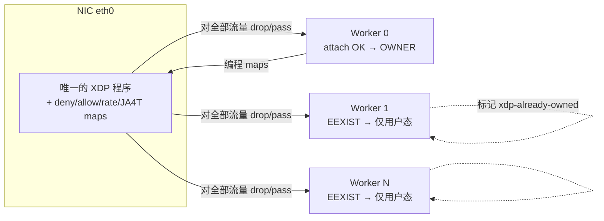

# XDP/eBPF 内核快速路径

**语言：** [English](../en/13-xdp-ebpf.md) · [Русский](../ru/13-xdp-ebpf.md) · **中文**

XDP (eXpress Data Path) 是一段挂载在网卡 (NIC) 上的 eBPF 程序，它**在报文进入用户态之前就在内核态丢包**：明确被禁止的 IP、超过速率限制的流量以及 SYN 洪水都会在尽可能早的阶段被截断。在 AEGIS 中，这是一个**可选**的粗粒度 L3/L4 过滤加速器，而不是 L7 防护的替代品；当 XDP 不可用时，一切都会正确降级为用户态过滤，功能不会丢失。

> 本文档的真值来源：[`src/xdp.rs`](../../src/xdp.rs)、[`install.sh`](../../install.sh)（函数 `build_xdp_object`、`resolve_xdp_enable`、`resolve_xdp_iface`，以及 systemd 单元的生成）、[`src/filters/dynamic_trust.rs`](../../src/filters/dynamic_trust.rs)、[`src/server.rs`](../../src/server.rs)（加载与计数器导出）。下文所有论断都已与这些代码核对。

---

## 1. XDP 在 AEGIS 中做什么

XDP 程序运行在网卡上（理想情况下运行在驱动中），在 native 模式下会**在分配 `sk_buff` 之前**就对每个入站报文做出 `XDP_DROP` / `XDP_PASS` 决策。这带来了 line-rate 的垃圾流量过滤，并为 softirq 栈、conntrack、套接字和 AEGIS worker 减负。

内核中的程序（`aegis_xdp`，程序段；见 [`src/xdp.rs:211`](../../src/xdp.rs) 中的 `program_mut("aegis_xdp")`）执行以下检查。顺序很重要：allow-list **最先**被检查，并完全绕过其余所有检查。

| 阶段 | 做什么 | 计数器 | 从用户态通过什么控制 |
|---|---|---|---|
| **Allow-list (fast-pass)** | 来自 allow map 中 IP 的报文绕过所有下游检查（deny / rate / SYN / WAF） | `fast_pass` | `ALLOW_V4` / `ALLOW_V6` map |
| **Deny-list** | 丢弃来自 deny map 中 IP 的报文 | `drop_deny` | `DENY_V4` / `DENY_V6` map |
| **Rate-limit（令牌桶）** | 若某个源 IP 在 `window_ns` 内超过 `burst` 个报文则丢包 | `drop_rate` | `RATE_CFG`（`WINDOW_NS`、`BURST`） |
| **SYN-flood guard** | 为 TCP SYN 单独设预算：每窗口超过 `syn_burst` 个 SYN 则丢包 | `drop_syn` | `RATE_CFG`（`SYN_BURST`） |
| **Allow-only 模式** | 白名单模式：除 allow-list 之外的一切都被丢弃 | `drop_allowonly` | `RATE_CFG`（`ALLOW_ONLY`） |
| **内联内核 WAF (Phase 3X)** | 丢弃 HTTP 请求行命中已知扫描器路径前缀的报文——它们永远到不了用户态 | `drop_waf` | （签名在 eBPF 对象内部） |
| **PASS** | 报文被交给用户态（正常路径） | `pass` | — |

此外，XDP 程序还会即时**捕获 JA4T SYN 指纹**（来自 SYN 的 TCP 参数：window、MSS、WSCALE、TCP 选项顺序）并存入 map `JA4T_V4`。用户态通过 `read_ja4t_v4(src_ip, src_port)`（[`src/xdp.rs:394`](../../src/xdp.rs)）读取它——这被用作被动 TCP 分类的首选来源（`src/tcp_info.rs::capture_with_xdp`，参见 [`src/p0f.rs`](../../src/p0f.rs)）。该捕获仅针对 IPv4；对于 IPv6，`read_ja4t_v4` 永远返回 `None`，调用方代码回退到 `TCP_INFO`。

> ⚠️ 关于覆盖范围的诚实说明。速率限制、SYN guard、JA4T 捕获以及 allow/deny 都是 **IPv4 优先**的。对于 IPv6 只支持 allow/deny map（`DENY_V6` / `ALLOW_V6`）；内核态限速器（`RATE_V4`）和 JA4T 捕获（`JA4T_V4`）按 IPv4 工作。这与 AEGIS 中 IPv6 的总体状态一致（参见安全模型）。

### XDP 不做什么

- **XDP 本身并不能抵御 volumetric L3/L4 洪水。** 它是在主机上丢包；如果通往主机的链路已经饱和，就需要上游手段——参见 BGP RTBH。XDP 封住的是服务器上的“最后一公里”，BGP/CDN 负责更上游的线路。
- **XDP 不能替代 L7 防护。** 内核中的内联 WAF 只能抓住请求行中粗粒度的扫描器前缀；完整的 SQLi/XSS/traversal 签名、归一化、JA4 指纹与 ML 打分仍留在用户态（参见 [WAF](./10-waf.md)、[TLS 指纹](./11-tls-fingerprinting.md)、ML 与风险引擎）。
- **XDP 不会接收 earned-trust。** 挣得的动态信任是**有意**不推送到内核 allow map 的（见第 [4](#4-与-earned-trust-的交互-dynamic_trust) 节）。

---

## 2. 构建 eBPF 对象

eBPF 对象与主二进制分开构建，因为内核目标（`bpfel-unknown-none`）需要 nightly 工具链和 `build-std`。逻辑在 `build_xdp_object()` 中（[`install.sh:469`](../../install.sh)）。

```sh
# 来自 install.sh: build_xdp_object()
cargo +nightly build --release          # 在 xdp/aegis-xdp-ebpf 目录中
# → target/bpfel-unknown-none/release/aegis-xdp
install -m 0644 -o root -g root <obj> "$AEGIS_XDP_OBJ"   # 默认 /var/lib/aegis/aegis-xdp.o
```

关键事实（全部来自代码）：

- **工具链：nightly。** crate `xdp/aegis-xdp-ebpf` 是一个独立的 workspace，有自己的 `.cargo/config.toml`，其中固定了目标 `bpfel-unknown-none` 和 `-Z build-std=core`（[`install.sh:476-477`](../../install.sh)）。因此必须用 `cargo +nightly`。
- **目标 `bpfel`** = BPF little-endian。该对象是内核校验器能够理解的格式的 ELF。
- **`bpf-linker`。** aya 0.13 为 `bpfel-unknown-none` 构建时需要 `bpf-linker` 二进制（它能够输出 BPF-ELF）。安装器通过 `cargo install bpf-linker --locked` 安装它（[`install.sh:310-314`](../../install.sh)）。没有它 eBPF 构建会失败。
- **rust-src。** 安装器会安装 `nightly` 以及 `rust-src` 组件（供 `build-std` 使用）（[`install.sh:299-301`](../../install.sh)）。
- **何时构建。** 仅当 `AEGIS_ENABLE_XDP=1` 时（`build_xdp_object` 的第一行就是否则提前 `return`），且仅在 `pingora` / `both` 模式下（[`install.sh:521`、`526`](../../install.sh)）。在 `hyper` 模式下 XDP 被强制关闭（`resolve_xdp_enable`，[`install.sh:137-140`](../../install.sh)），因为内核快速路径是通过 pingora 数据平面接入的。
- **构建失败会明确报错。** 如果构建没有产出 `aegis-xdp`，安装器会执行 `fatal`（[`install.sh:481`](../../install.sh)）——不存在静默跳过。

> 构建在 [install.sh](../../install.sh) 中是自动的；无需重复手工步骤。环境变量见脚本头部以及下面的第 [3](#3-启用配置与环境变量) 节。另见[安装与运维](./03-installation.md)。

---

## 3. 启用、配置与环境变量

### 3.1 安装器的环境变量

| 变量 / 标志 | 默认值 | 用途 |
|---|---|---|
| `AEGIS_ENABLE_XDP` | `auto` | `auto` \| `1` \| `0`。`auto` 在 kernel ≥ 4.18 且处于 pingora/both 模式时启用 XDP |
| `--xdp` / `--no-xdp` | — | 强制 `AEGIS_ENABLE_XDP=1` / `=0`（[`install.sh:78-79`](../../install.sh)） |
| `AEGIS_XDP_IFACE` | `auto` | 用于 attach 的接口。`auto` = 第一个处于 `UP` 状态的非 `lo` 接口 |
| `--xdp-iface <ifc>` | — | 显式指定接口（[`install.sh:81`](../../install.sh)） |
| `AEGIS_XDP_OBJ` | `/var/lib/aegis/aegis-xdp.o` | 已编译 eBPF 对象的安装路径 |

`auto` 的逻辑：

- **`AEGIS_MODE=hyper` → XDP 始终关闭**（[`install.sh:137`](../../install.sh)）。
- **kernel < 4.18 → XDP 关闭**并给出警告（`aya-ebpf` 的 XDP 支持从 4.18 开始；[`install.sh:146-150`](../../install.sh)）。
- 否则启用。

`auto` 下的接口选择（`resolve_xdp_iface`，[`install.sh:197-207`](../../install.sh)）：取 `ip -br link show` 输出中第一个满足 `lo != $1` 且 `$2 == UP` 的接口。如果一个 UP 接口都没有，则回退到 `eth0` 并警告 attach 将进入 skb 模式。

### 3.2 配置中的 `xdp { }` 块

安装器会在 `aegis.conf` 中生成以下块（仅当 `AEGIS_ENABLE_XDP=1` 时，[`install.sh:1024-1040`](../../install.sh)）：

```conf
# Phase A XDP 快速路径。启动时加载进内核；deny/allow
# map 由用户态编程。关机时自动 detach。
xdp {
    enabled true;
    interface eth0;                       # 来自 $AEGIS_XDP_IFACE
    bpf_object_path /var/lib/aegis/aegis-xdp.o;   # 来自 $AEGIS_XDP_OBJ

    # 按 IPv4 的内核态限速。两个字段都必须 > 0，否则关闭。
    rate_window_ms 1000;
    rate_burst 200;
    # 按 IPv4 的 TCP-SYN 预算（独立于通用限速器）。
    syn_burst 100;
}
```

各字段的语义对应 `set_rate_config(window_ns, burst, syn_burst, allow_only)`（[`src/xdp.rs:358`](../../src/xdp.rs)）：

- `window_ns == 0 || burst == 0` → 通用限速器关闭。
- `syn_burst == 0` → 专用 SYN guard 关闭（通用限速器仍然生效）。
- `allow_only` → 白名单模式（默认关闭；由防御性 actuator 启用）。

启动时的加载：`server.rs` 读取 `cfg.xdp`，若 `enabled` 则调用 `xdp::load(interface, bpf_object_path)`（[`src/server.rs:438-457`](../../src/server.rs)）。

---

## 4. 与 earned-trust 的交互 (`dynamic_trust`)

这是一个对安全至关重要的细节，并已直接固化在代码中。挣得的动态信任（某个 IP 通过一系列干净请求积累的信誉）是**有意不推送到内核 allow map 的**（注释 C2，[`src/filters/dynamic_trust.rs:241-260`](../../src/filters/dynamic_trust.rs)）：

> 内核 allow map 是 line-rate 的内核快速放行：命中的报文会跳过**整条**下游流水线（deny / rate / SYN / WAF）。如果把 earned-trust 的 IP 提升进去，它后续的请求就再也不会被检查，信任也就无法自我纠正——`observe_denied` 和 WAF 根本看不到流量，也就无从撤销信任。一个先积累信誉、随后发动攻击的攻击者，将可以无限期地享受内核旁路。

因此：

- **信任提升仅限用户态。** `is_trusted` 依然会在用户态处理器中提供 bypass 快速路径，但 WAF 与 `observe_denied` 继续工作，因此一次恶意请求就会把该 IP 降级。
- **内核 allow map 仅保留给运维人工整理的静态 bypass 记录**（`sync_allow_list`，从 `server.rs:133` 编程写入）。
- **`dynamic_trust` 中的 XDP 句柄只用于撤销**（`unallow`），不用于添加（`with_xdp`，[`src/filters/dynamic_trust.rs:128-136`](../../src/filters/dynamic_trust.rs)）。在撤销信任时（`observe_denied`）、在 TTL/陈旧性驱逐时以及在 LRU 驱逐时，代码都会防御性地调用 `xdp.unallow(ip)`（[`src/filters/dynamic_trust.rs:300-302`、`342-344`、`390-392`](../../src/filters/dynamic_trust.rs)），以确保没有任何内核 allow 记录的存活时间超过其用户态授权（例如泄漏的运维记录）。

`dynamic_trust` 的测试（结构体 `CountingXdp`，[`src/filters/dynamic_trust.rs:428`](../../src/filters/dynamic_trust.rs)）明确验证了 earned trust **永远**不会触碰 `allow_v4`/`allow_v6`。

Defence arsenal 通过 actuator `XdpDeny`（`ActionKind::XdpDeny`，[`src/actuator.rs:51`](../../src/actuator.rs)）编程内核 deny，并带有 revert-TTL（自动撤销）。参见 Defence Arsenal。

---

## 5. NIC 上的单一所有者：REUSEPORT 兄弟进程 → EEXIST

一块 NIC **恰好只承载一个** XDP 程序。AEGIS 在生产环境中以 N 个使用 `SO_REUSEPORT` 的 worker 运行（参见[多进程与 worker](./06-workers.md)），它们都会尝试把 XDP 挂载到同一个接口上——但只有一个能成功。其余的会拿到 `EEXIST`（`os error 17`，“File exists”）。

这**不是错误**，而是预期中的单一所有者条件，代码专门对它做了识别：

- `is_already_attached()`（[`src/xdp.rs:163-178`](../../src/xdp.rs)）遍历错误来源链，捕获 `raw_os_error() == Some(17)` 的 `io::Error`，或者字符串 “File exists” / “os error 17”。
- 遇到 EEXIST 时，`load_impl` 返回带哨兵标记 `XDP_ALREADY_OWNED_MARKER = "xdp-already-owned-by-sibling-worker"` 的错误（[`src/xdp.rs:17`、`234`、`244`](../../src/xdp.rs)）。
- 调用方代码把这记录为信息性状况：该 worker 在用户态过滤，而程序的**所有者 worker** 在 NIC 上对**全部**流量应用 deny/allow map。内核 map 对整个接口是全局的，因此一个所有者就足够了。



---

## 6. attach 模式：native (DRV) → SKB (generic)

`load_impl` 先尝试 native 模式，然后回退到 SKB（[`src/xdp.rs:231-252`](../../src/xdp.rs)）：

1. **Native / DRV**（`XdpFlags::default()`）——程序在 NIC 驱动中执行，line-rate，在分配 `sk_buff` 之前。
2. **SKB / generic**（`XdpFlags::SKB_MODE`）——当驱动无法原生承载 XDP 时的回退方案。更慢（报文在分配 `sk_buff` 之后被重新注入），但可以在**任何** Linux 网卡上工作，包括虚拟化环境下的 `virtio-net`。没有这个回退，部署在没有 native XDP 的云虚拟机上就会静默地失去内核快速路径。

两个分支都会识别 EEXIST；SKB attach 的任何其他错误都会给出明确的 fatal，并指出两种模式都已尝试过。

---

## 7. 要求

来自 systemd 单元生成器的注释（[`install.sh:1223-1231`](../../install.sh)）以及 `resolve_xdp_enable`：

| 要求 | 为什么 | 在哪里设置 |
|---|---|---|
| **Linux** + Cargo feature `xdp` | 除此之外——使用 `NoopXdp`（所有操作都是空操作） | [`src/xdp.rs:132`](../../src/xdp.rs) 中的 `cfg(all(target_os = "linux", feature = "xdp"))`；[`install.sh:452-453`](../../install.sh) 中的 `pingora xdp` feature |
| **Kernel ≥ 4.18** | aya-ebpf 中 XDP 支持的下界 | `resolve_xdp_enable`（[`install.sh:146`](../../install.sh)） |
| **`CAP_BPF`** | 加载/校验 eBPF 程序 | `AmbientCapabilities` / `CapabilityBoundingSet` |
| **`CAP_PERFMON`** | 在 kernel 6.x 上，校验器把指针/包数据操作限制在 `perfmon_capable()` 之后；没有 `CAP_PERFMON` 时，**即使拥有 `CAP_BPF`**，`BPF_PROG_LOAD` 也会以 `EACCES`（os err 13）失败 | 同上 |
| **`CAP_NET_ADMIN`** | 把程序 attach 到 NIC | 同上 |
| **`AF_NETLINK`** | XDP attach 通过 rtnetlink 进行 | `RestrictAddressFamilies` |
| **`CAP_SYS_RESOURCE`** + `LimitMEMLOCK=infinity` | BPF map / locked 内存增长超过默认的 64 KiB rlimit | `svc_cap`；`LimitMEMLOCK`（[`install.sh:1266`](../../install.sh)） |

当 `AEGIS_ENABLE_XDP=1` 时，安装器会把 worker 的 capability 集合扩展为
`CAP_NET_BIND_SERVICE CAP_NET_ADMIN CAP_SYS_RESOURCE CAP_BPF CAP_PERFMON`，
并把地址族扩展为 `AF_INET AF_INET6 AF_UNIX AF_NETLINK`（[`install.sh:1230-1231`](../../install.sh)）。不启用 XDP 时该集合是最小的（`CAP_NET_BIND_SERVICE`，没有 `AF_NETLINK`）。

> ⚠️ ARM / 无 PMU 的虚拟机。如果环境中没有 PMU（没有 `CAP_PERFMON` 的功能），在 kernel 6.x 上 XDP 将无法加载——这是正常现象。此时会优雅地回退到用户态过滤（见第 [8](#8-xdp-不可用时的降级) 节），必要时粗粒度的 L3/L4 丢包由 nftables 后端接管（[`src/nftables_backend.rs`](../../src/nftables_backend.rs)）。另见[系统需求](./05-requirements.md)。

完整的 systemd 加固（`NoNewPrivileges`、`ProtectSystem=strict`、`RestrictNamespaces` 等）参见安全模型与[安装与运维](./03-installation.md)。

---

## 8. XDP 不可用时的降级

XDP 是**可选的加速器**。在架构上，其余所有代码**从不**按 `cfg(target_os)` 分支：门面 `XdpHandle`（[`src/xdp.rs:23`](../../src/xdp.rs)）由两种类型实现——`LinuxXdp`（真实实现）与 `NoopXdp`（所有方法返回 `Ok(())`，`counters()` 返回全零，[`src/xdp.rs:100-127`](../../src/xdp.rs)）。

在以下情况下会替换为 `NoopXdp`：

- 构建目标不是 Linux **或**没有启用 feature `xdp`（`xdp::load` 立即返回 `NoopXdp` 并给出 warning，[`src/xdp.rs:136-142`](../../src/xdp.rs)）。
- 配置中没有 `xdp` 块，或 `enabled = false`（[`src/server.rs:455-456`](../../src/server.rs)）。
- **`xdp::load` 失败**（任何原因，包括 capability 不足或校验器拒绝）：`server.rs` 记录 warning “XDP load failed — falling back to userspace filtering” 并替换为 `NoopXdp`（[`src/server.rs:446-453`](../../src/server.rs)）。此时代理启动**不会中断**。
- 来自兄弟 worker 的 EEXIST：句柄同样变成 `NoopXdp`，但这是正常的单一所有者情形——过滤由所有者的内核 map 完成（见第 [5](#5-nic-上的单一所有者reuseport-兄弟进程--eexist) 节）。

在 `NoopXdp` 下：

- `sync_deny_list` / `sync_allow_list` 会执行，但不会编程任何东西（空操作式的“成功”）；IP 过滤在用户态完成。
- 所有 XDP 计数器都以零导出（见下文）。
- JA4T 捕获不可用 → `read_ja4t_v4` → `None` → 分类回退到 `TCP_INFO`。

换句话说：没有 XDP 时，损失的只是内核快速路径的性能，而**过滤功能得以保留**，由用户态以及（若存在）nftables/iptables 后端承担。

---

## 9. 快速路径计数器与可观测性

XDP 计数器是内核中的 per-CPU 数组；用户态把所有 CPU 上的值求和（`PerCpuArray`，[`src/xdp.rs:373-392`](../../src/xdp.rs)）。结构体 `XdpCounters`（[`src/xdp.rs:80-98`](../../src/xdp.rs)）：

| 字段 | Prometheus 指标 | 含义 |
|---|---|---|
| `pass` | `aegis_xdp_pass` | 交给用户态的报文 |
| `drop_deny` | `aegis_xdp_drop_deny` | 因 deny-list 而丢弃 |
| `drop_rate` | `aegis_xdp_drop_rate` | 因 per-IP 令牌桶而丢弃 |
| `drop_allowonly` | `aegis_xdp_drop_allowonly` | 在 allow-only（白名单）模式下丢弃 |
| `drop_syn` | `aegis_xdp_drop_syn` | 被 SYN-flood guard 丢弃 |
| `drop_waf` | `aegis_xdp_drop_waf` | 被内联内核 WAF 丢弃（Phase 3X，扫描器路径） |
| `fast_pass` | —（存在于结构体中） | 经 allow-list 放行并跳过全部下游检查的报文 |

> `fast_pass` 与 `pass` 分开统计，以便运维无需减去其他 PASS 来源就能看到 trusted-bypass 流量的占比。

导出：端点 `GET /metrics` 会在同一次抓取中把 XDP 计数器附加到主要运行时指标之后（[`src/server.rs:1322-1336`](../../src/server.rs)；`aegis_xdp_drop_waf` 是该块中的最后一个指标）。在 hyper 路径上还有一个简化的文本块 `xdp_pass`/`xdp_drop_*`（[`src/server.rs:1481-1489`](../../src/server.rs)）。当 XDP 关闭时，`xdp_h.counters().unwrap_or_default()` 返回全零——指标依然存在，但等于 0（这一点记录在 [`src/proxy/pingora_admin.rs:3613`](../../src/proxy/pingora_admin.rs)）。

关于导出与面板的更多内容，参见指标与遥测以及管理面板。

---

## 10. JA4T map 的维护（驱逐）

eBPF 程序**从不自行驱逐记录**——JA4T SYN 指纹在 `JA4T_V4` 中不断累积，在端口扫描的突发流量下 map 可能被填满死掉的四元组。用户态定期通过 `evict_ja4t_v4(max_age_ns)`（[`src/xdp.rs:413-442`](../../src/xdp.rs)）清扫陈旧项：扫描 map，标记 `captured_at_ns < now - max_age_ns` 的记录并删除它们，返回删除的数量。时间戳是以 ns 计的 `CLOCK_MONOTONIC`（与内核中 `bpf_ktime_get_ns` 打的时间戳相同，因此可以直接比较；`read_ktime_ns`，[`src/xdp.rs:291-303`](../../src/xdp.rs)）。在 `NoopXdp` 上该操作是空操作（`Ok(0)`）。

---

## 11. 运维简明检查清单

1. 模式为 **pingora** 或 **both**（在 hyper 中 XDP 按设计关闭）。
2. Kernel **≥ 4.18**（对 6.x 而言 `CAP_PERFMON` 是必须的，否则 `BPF_PROG_LOAD` → EACCES）。
3. 安装：`sudo bash install.sh`（`auto` 下 XDP 会自行启用）；或显式使用 `--xdp` / `--no-xdp`，接口用 `--xdp-iface` 指定。
4. 检查加载：日志中出现 `XDP fast-path loaded` / `XDP attached in SKB mode`；兄弟 worker 会显示信息性的 `xdp-already-owned-by-sibling-worker`。
5. 检查运行：`curl http://<host>:<admin>/metrics | grep aegis_xdp_`——受攻击时 `drop_*` 非零。
6. 遇到校验器/权限问题时：查看 warning “XDP load failed — falling back to userspace filtering”——代理会继续在用户态工作。诊断参见 FAQ 与故障排查。

---

## 相关文档

- BGP RTBH——针对 volumetric 洪水的上游防护（XDP 只覆盖主机）。
- [Rate limiting](./14-rate-limiting.md)——用户态的 per-IP/per-endpoint 限制（XDP 是粗粒度的内核层面）。
- Defence Arsenal、场景与 actuator——actuator `XdpDeny` 与 revert-TTL。
- [多进程、REUSEPORT 与 worker](./06-workers.md)——单一所有者模型。
- [系统需求](./05-requirements.md)、安全模型——capability 与加固。
- 指标与遥测——计数器导出。
