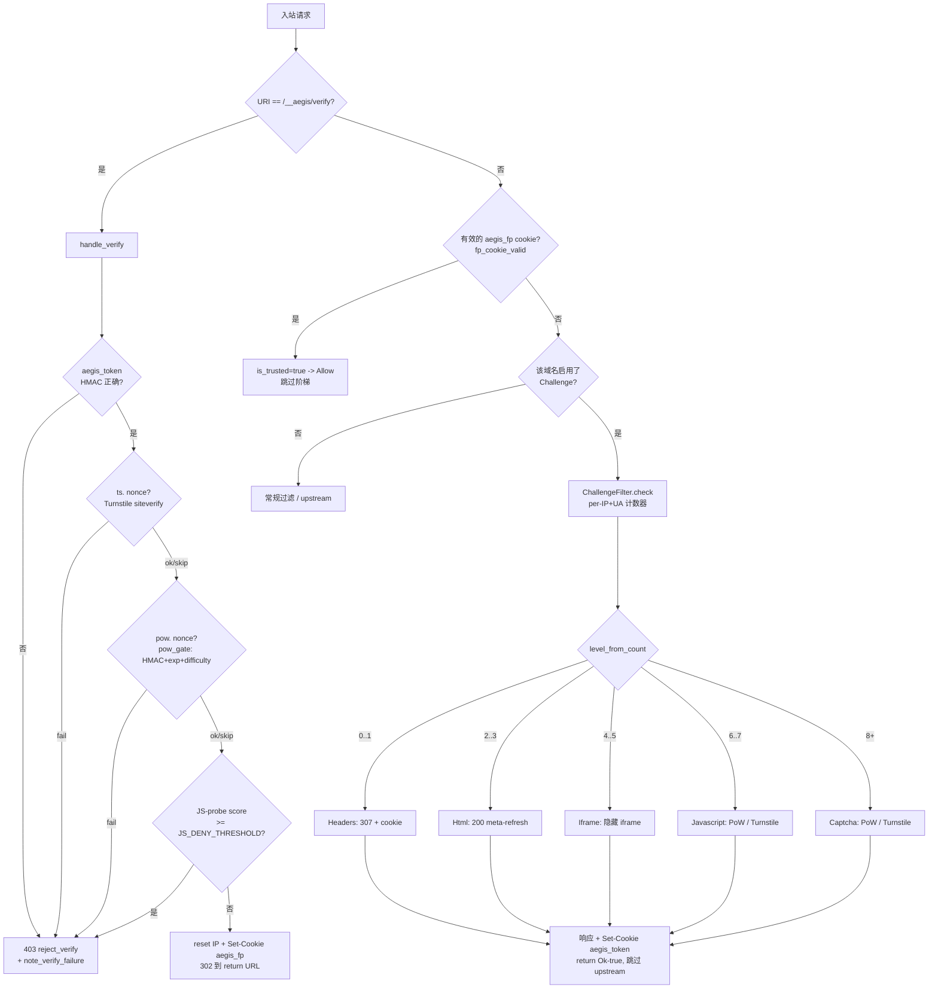

# 验证挑战阶梯、PoW 与 CAPTCHA

**语言：** [English](../en/15-challenge-ladder.md) · [Русский](../ru/15-challenge-ladder.md) · **中文**

AEGIS 的自适应验证阶梯：从轻量的 307 重定向逐级升级到 JS 挑战、真正的 proof-of-work，以及（可选的）外部 CAPTCHA，并配有欺骗层、被动 bot 信号和跨 worker 持久化的 per-domain 配置。本文描述 `src/proxy/pingora_challenge.rs`、`src/pow_captcha.rs`、`src/argon2_pow.rs`、`src/captcha_providers.rs`、`src/challenge_deception.rs`、`src/challenge_signals.rs`、`src/adaptive_ladder.rs` 和 `src/filters/challenge.rs` 中代码**实际**做的事——没有营销辞令。

> 🟡 **关于状态的要点（请先读）。** 生产数据平面是 `aegis-pingora`。真正服务请求的阶梯位于 [`src/proxy/pingora_challenge.rs`](../../src/proxy/pingora_challenge.rs)，使用枚举 [`filters::ChallengeLevel`](../../src/filters/mod.rs)（`Headers / Html / Iframe / Javascript / Captcha`）。模块 [`src/adaptive_ladder.rs`](../../src/adaptive_ladder.rs)（V204）实现的是*另一个*枚举（`Cookie / Reload / Interaction / Pow / Captcha`），带顺序随机化和 fast-track —— 它有单元测试覆盖，但**未直接接入 pingora 路径**：`pingora_challenge.rs` 并不 import 它。`captcha_providers.rs`（hCaptcha/reCAPTCHA —— 只有 provider 抽象，core 中没有 HTTP 传输）和 `argon2_pow.rs`（有 Argon2id 校验器，但 pingora 的 rung 不调用它）同理。下文对每个模块都明确标注了这一点。验证挑战阶梯默认是**关闭**的（`ChallengeConfig.enabled = false`），需按域名开启。

相关文档：[WAF](./10-waf.md)、[TLS 指纹](./11-tls-fingerprinting.md)、[Privacy Pass](./16-privacy-pass.md)、蜜罐与 tarpit、ML 与风险引擎、Defence Arsenal、Per-domain 策略、Admin API。

---

## 1. 概览：阶梯是什么

当一个未验证的客户端访问需要验证的路由时，AEGIS 不会立刻拦截它。相反，它会下发**逐级加难的验证**。来自同一客户端的每次重试都会把门槛抬高一级。思路是：合法浏览器会在第一、第二级无感通过，而裸 socket 刷量器或原始 bot 在 307 重定向那一步就掉队了。

真实的级别（`filters::ChallengeLevel`，[`src/filters/mod.rs:68`](../../src/filters/mod.rs)）：

| 级别 | Enum | HTTP 响应 | `x-aegis-step` | 检验什么 |
|--------:|------|-----------|----------------|---------------|
| 1 | `Headers` | **307** 重定向 + cookie + `Location` | `307` | 客户端跟随重定向并重新发送 cookie。裸 socket 刷量不会跟随。 |
| 2 | `Html` | 200 HTML + `<meta refresh>` | `200` | 客户端渲染 HTML / 执行 meta-refresh。 |
| 3 | `Iframe` | 200 HTML + 指向 `/__aegis/verify` 的隐藏 `<iframe>` + `setTimeout` | `click` | 客户端执行嵌套导航/JS。 |
| 4 | `Javascript` | 200 HTML + **真实 PoW**（SHA-256）或 **Turnstile** | `high` | 客户端执行 JS 并求解 proof-of-work（或通过 Turnstile）。这是第一个非浏览器无法通过的级别。 |
| 5 | `Captcha` | 与 rung 4 相同，但服务端 band 为 `RiskBand::Critical` | `capt` | 最高级别。自 V240/V243 起渲染与 rung 4 **相同**的自动求解 PoW 页面。 |

> ⚠️ **级别 5（`Captcha`）≠ 默认使用外部 CAPTCHA。** 在实际运行的 pingora 路径中，两个最高级别（`Javascript` 和 `Captcha`）渲染的是同一个带品牌的自动求解 PoW 页面（[`pingora_challenge.rs:481`](../../src/proxy/pingora_challenge.rs)，V240/V243）。那个字面上要求输入单词「aegis」的旧「captcha」桩已被删除。真正的第三方 CAPTCHA（Cloudflare Turnstile）只有在主机开启了 `turnstile` 开关**且**配置了两个密钥时才会出现（见 §6）。

### Mermaid：请求总体流程



---

## 2. 级别调度器 —— `ChallengeFilter`

文件：[`src/filters/challenge.rs`](../../src/filters/challenge.rs)。

`ChallengeFilter` 在 `DashMap<(IpAddr, u64), (u8, Instant)>` 中保存 per-客户端的尝试计数（[`challenge.rs:26`](../../src/filters/challenge.rs)）。键是 **(IP, UA 前缀哈希) 二元组**，而不只是 IP：

```rust
fn fp_key(ctx: &RequestContext) -> FpKey {
    let ua_prefix = ctx.user_agent.as_deref().unwrap_or("")
        .split('/').next().unwrap_or("");
    // hash(ua_prefix) -> (client_ip, hash)
}
```

这是有意为之：客户端无法通过关闭 keep-alive 并重连来重置阶梯，也无法仅靠更换 User-Agent 就「回退」到第 0 级（更准确地说，换 UA 会得到一个新槽位，但键的 IP 部分不变 —— `reset(ip)` 会清理该 IP 的**所有** UA 槽位，[`challenge.rs:69`](../../src/filters/challenge.rs)）。

计数到级别的映射（[`challenge.rs:94`](../../src/filters/challenge.rs)）：

```rust
fn level_from_count(count: u8) -> ChallengeLevel {
    match count {
        0..=1 => ChallengeLevel::Headers,
        2..=3 => ChallengeLevel::Html,
        4..=5 => ChallengeLevel::Iframe,
        6..=7 => ChallengeLevel::Javascript,
        _     => ChallengeLevel::Captcha,
    }
}
```

每次调用 `check()` 都会递增计数（`saturating_add(1)`），而如果距上次尝试已超过 `ttl`（`token_ttl_secs`，默认 300 秒），计数会被重置为 0（[`challenge.rs:120`](../../src/filters/challenge.rs)）。后台任务通过 `cleanup_stale()` 清理过期条目。

关于门控的重要说明：
- **受信任的客户端会被立即放行。** 若 `ctx.is_trusted`（例如有效的 `aegis_fp` cookie 或 dynamic-trust IP）—— `check()` 立即返回 `Allow`（[`challenge.rs:116`](../../src/filters/challenge.rs)）。此时 WAF/蜜罐**仍会**继续工作。
- **过滤器不信任任何「我已验证」类的请求头。** 唯一的通过凭证是签名的 HMAC 令牌（见 §4）。测试 `unverified_request_always_gets_a_challenge` 固化了 `x-aegis-verify: ok` 这类请求头会被忽略的行为（[`challenge.rs:151`](../../src/filters/challenge.rs)）。
- **过滤器本身不再按 `enabled` 自我门控**（V231）：开启/关闭由过滤引擎的 RuntimeToggle 决定，其初值来自 `config_enabled()`，以便 per-domain override 真正生效（[`challenge.rs:54`](../../src/filters/challenge.rs)）。

---

## 3. 配置：`ChallengeConfig`

文件：[`src/config.rs:949`](../../src/config.rs)。

| 字段 | 类型 | 默认值 | 用途 |
|------|-----|---------|-----------|
| `enabled` | `bool` | **`false`** | 阶梯按域名 opt-in。默认开启会对包括 API/非浏览器在内的全部流量下发验证（[`config.rs:990`](../../src/config.rs)）。 |
| `token_ttl_secs` | `u64` | `300` | `aegis_token` cookie 的 TTL + `ChallengeFilter` 升级窗口的 TTL。 |
| `hmac_secret` | `String` | `"change_me"` | 🔴 用于签名 `aegis_token`/`aegis_fp` 和 PoW 令牌的密钥。生产环境**必须更改**。共享密钥可让 LB 后的机群互相接受彼此的令牌。 |
| `captcha_site_key` | `Option<String>` | `None` | reCAPTCHA v2 site key（legacy hyper 路径）。 |
| `captcha_secret` | `Option<String>` | `None` | reCAPTCHA v2 secret（legacy hyper 路径）。 |
| `fp_ttl_secs` | `u64` | `86_400`（24 小时） | 信任 cookie `aegis_fp` 的 TTL。`0` 完全关闭该 cookie（[`config.rs:980`](../../src/config.rs)）。 |
| `cookie_secure` | `bool` | **`true`** | 给 cookie 加上 `; Secure`。M11：secure-by-default —— 数据平面终结 TLS。⚠️ 混合 HTTP/HTTPS upstream 的站点需要显式设为 `false`，否则验证挑战会在 HTTP 页面上失效（[`config.rs:983`](../../src/config.rs)）。 |

### Cookie 与 TTL

两个 cookie 在 [`pingora_challenge.rs`](../../src/proxy/pingora_challenge.rs) 中签发：

```
aegis_token=<签名>; Path=/; Max-Age=<token_ttl_secs>; HttpOnly; SameSite=Lax[; Secure]
aegis_fp=<签名>;    Path=/; Max-Age=<fp_ttl_secs(min 60)>; HttpOnly; SameSite=Lax[; Secure]
```

- `aegis_token`（[`pingora_challenge.rs:253`](../../src/proxy/pingora_challenge.rs)）—— 短生命周期令牌，用于认证**某个具体的待处理挑战**。其 nonce 携带级别标记（`pow.` / `ts.` / 纯文本 —— 见 §4）。
- `aegis_fp`（[`pingora_challenge.rs:261`](../../src/proxy/pingora_challenge.rs)）—— 长生命周期的信任 cookie。只要它有效，`fp_cookie_valid()` 返回 `true`，整个阶梯被跳过。TTL 被强制 `>= 60 秒`。
- 两者均为 `HttpOnly` + `SameSite=Lax`。两者都用 HMAC 签名（`security::token` 中的 `sign_token`/`verify_token`）。

> 🟡 **V244 —— cookie 不再与 IP 绑定。** 以前 HMAC 绑定包含 client IP，但这会破坏任何位于 CDN 之后的部署：Cloudflare 后面的浏览器在 challenge 和 verify 之间合法地更换 IP（happy-eyeballs v4/v6、不同的 CF 边缘节点）→ HMAC 不匹配 → 403 → 「Checking your browser」页面无限转圈。现在 `CHALLENGE_BINDING = ""`（[`pingora_challenge.rs:160`](../../src/proxy/pingora_challenge.rs)）：防护依靠不可伪造的 HMAC、短 TTL、proof-of-work 以及信任 cookie 内的浏览器指纹 nonce —— 而不是 IP。这同样适用于 PoW 令牌（见 §4）。

`fp_cookie_valid()` 是热路径，在每个不受信任的请求上都会调用。它使用零分配的 cookie 扫描器 `find_cookie_borrowed`（[`pingora_challenge.rs:1000`](../../src/proxy/pingora_challenge.rs)），在找到 cookie 之前完全不碰堆。

---

## 4. Proof-of-Work —— `pow_captcha.rs`（SHA-256 hashcash）

文件：[`src/pow_captcha.rs`](../../src/pow_captcha.rs)（V131）。这是 pingora 路径中**已接入、可工作的** PoW。

### 协议

服务端签发一个固定布局的自包含令牌：`nonce(16) ‖ difficulty(1) ‖ exp(8 BE) ‖ mac(32)`，以无 padding 的 URL-safe base64 编码（[`pow_captcha.rs:267`](../../src/pow_captcha.rs)）：

- `nonce` —— 16 个随机字节（来自 OS CSPRNG）。
- `difficulty` —— `SHA-256(nonce ‖ solution_le_bytes)` 中要求的前导零比特数。
- `exp` —— 过期时间的 unix 秒。
- `mac` —— `HMAC-SHA256(secret, nonce ‖ difficulty ‖ exp ‖ binding)`。

客户端（浏览器中的 JS）寻找 `solution: u64`，使得 `leading_zero_bits(sha256(nonce ‖ solution.to_le_bytes())) >= difficulty`。服务端检查三件事，全部 O(1)（[`pow_captcha.rs:195`](../../src/proxy/pingora_challenge.rs) → `verify_bound`）：

1. HMAC 匹配（`ct_eq` —— 对 32 字节做**常数时间**比较，[`pow_captcha.rs:250`](../../src/pow_captcha.rs)）—— 挡住伪造/时序攻击。
2. 未过期（`now > exp`）。
3. SHA-256 前缀满足 difficulty。

不对称性：攻击者的工作量是 O(2^difficulty)，服务端校验只是一次哈希。

### 无状态 verify 与共享密钥

令牌自带完整性（HMAC）和有效期（`exp`），因此 verify **不需要** per-IP 的服务端状态。负载均衡器后共享同一 `hmac_secret` 的 AEGIS 实例机群可以互相接受令牌。唯一的作弊面是 TTL 内的重放，而 TTL 被特意设得很短。

### Difficulty band 与真实数字

`DifficultyLadder`（[`pow_captcha.rs:74`](../../src/pow_captcha.rs)）按 risk-band 设定难度。硬边界：`MIN_DIFFICULTY = 12`，`MAX_DIFFICULTY = 28`。

| Band | 默认比特 | 服务端角色 |
|------|------------:|----------------|
| `Baseline` | 20 | — |
| `Elevated` | 22 | — |
| `Attack` | 24 | 映射到 rung `Javascript`（`pow_band`） |
| `Critical` | 28 | 映射到 rung `Captcha` |

> 🔴/🟡 **关于浏览器难度的关键说明（V243）。** 服务端 band 的 24/28 比特（约 8M/134M 次哈希）是按**原生**哈希设计的，在浏览器 JS 中求解耗时长得不可接受 —— 「Checking your browser」会无限转圈。因此浏览器内的插页式 PoW 使用**单独的**常量 `BROWSER_POW_DIFFICULTY = 16`（[`pow_captcha.rs:357`](../../src/pow_captcha.rs)），批处理的 WebCrypto 求解器能在明显不到一秒内完成。pingora 中的 `pow_band()` 方法被标记为 `let _ =`（[`pingora_challenge.rs:505`](../../src/proxy/pingora_challenge.rs)）—— 也就是说**服务端的 24/28 比特 band 目前实际上并不会下发给各 rung**；实际签发的是带 `BROWSER_POW_DIFFICULTY` 的令牌（再加上 reputation bump，§5.4）。这里的 PoW 是一个 liveness 门（「在真实浏览器中执行了我们的 JS + 付出了一点小代价」），而不是主要的经济防护。主要防护来自整条链路的其余部分。

模块 docstring 中的参考数字（约 30 MH/s 的 sha256 每核，现代 x86）：

| difficulty | 客户端平均工作量 | 服务端校验 |
|-----------:|----------------------:|-------------------:|
| 16 | ~1 毫秒 | <100 微秒 |
| 20 | ~17 毫秒 | <100 微秒 |
| 24 | ~280 毫秒 | <100 微秒 |
| 28 | ~4.5 秒 | <100 微秒 |

> ⚠️ **硬件注意事项（来自权威简报）。** 这些数字是带 SHA-NI 的硬件上的 per-core 数值。在测试 VM（AWS t4/GCP e2，无 SHA 扩展）中，PoW 与 HMAC 会慢 2–3 倍；带 SHA 扩展的裸金属 Intel/AMD 则会相应加速。不要把绝对时延当作保证来引用。

### JS 求解器

常量 `POW_CLIENT_JS`（[`pow_captcha.rs:359`](../../src/pow_captcha.rs)）是纯粹基于 `crypto.subtle.digest('SHA-256', ...)` 的函数 `aegisSolvePow(token, difficulty)`。V243 优化：**批处理** —— 以 `BATCH = 512` 个摘要为窗口并发执行（`Promise.all`），而不是逐个执行（顺序等待要慢上千倍）。

### IP 绑定 API（V234）以及它现在为什么是空的

`pow_captcha` 支持带任意 `binding`（最初是 client IP）的 `issue_bound`/`verify_bound`，使已求解的挑战无法在僵尸网络中「共享」（[`pow_captcha.rs:161`](../../src/pow_captcha.rs)）。但在 pingora 路径中 `binding = CHALLENGE_BINDING = ""`（V244，与 cookie 相同的 CDN 原因）。测试 `pow_gate_accepts_regardless_of_ip`（[`pingora_challenge.rs:1790`](../../src/proxy/pingora_challenge.rs)）固化了「来自任意 IP 的解都被接受」这一行为。IP 绑定的 anti-botnet 特性在代码中存在且有测试（`v234_ip_bound_token_rejected_under_other_ip`），但在生产中**被有意关闭**。

### verify 中的 PoW 门

交互式 rung 的 `aegis_token` nonce 会加上 `pow.` 前缀（Turnstile 则为 `ts.`）。由于 nonce 被 HMAC 覆盖，攻击者既不能伪造也不能去掉该标记。`pow_gate()`（[`pingora_challenge.rs:688`](../../src/proxy/pingora_challenge.rs)）：

- nonce 无 `pow.` → 门放行（低级 rung 不下发 PoW）。
- 带 `pow.` 的 nonce 但无 `?s=` → `Err("pow solution missing")`。
- `?p=` 格式错误 → `Err("pow token malformed")`。
- HMAC 损坏 → `Err("pow token bad HMAC / wrong IP")`。
- 已过期 → `Err("pow token expired")`。
- 解低于 difficulty → `Err("pow solution insufficient")`。

这堵上了旧的「随便发个 `?pow=<任意内容>`」旁路：V234 之前服务端根本不校验 PoW。

PoW 令牌与信任令牌按同一时钟过期：`pow_ttl = cfg.token_ttl_secs.max(30)`（[`pingora_challenge.rs:221`](../../src/proxy/pingora_challenge.rs)）—— 30 秒下限，以免过于激进的 `token_ttl_secs` 导致 PoW 在提交前就无法求解。

---

## 5. Argon2id PoW 与被动/主动 bot 信号

### 5.1 Argon2id —— `argon2_pow.rs`（memory-hard 替代方案）

文件：[`src/argon2_pow.rs`](../../src/argon2_pow.rs)（V200）。

SHA-256 hashcash 随算力线性扩展 —— GPU 农场可以廉价碾压它。Argon2id 是 **memory-hard** 的：求解需要 `memory_kb` 的 RAM **和** `iterations` 的计算。参数（[`argon2_pow.rs:50`](../../src/argon2_pow.rs)）：

| 预设 | `memory_kb` | `iterations` | `parallelism` | `difficulty_bits` | 求解参考 |
|--------|------------:|-------------:|--------------:|------------------:|----------------|
| `default()` | 65 536（64 MB） | 2 | 1 | 18 | ~1–2 秒（桌面） |
| `high_security()` | 262 144（256 MB） | 3 | 1 | 22 | ~5–10 秒 |
| `low_friction()` | 16 384（16 MB） | 1 | 1 | 14 | ~300–500 毫秒 |

`verify(salt, nonce, params)`（[`argon2_pow.rs:105`](../../src/argon2_pow.rs)）对 `salt ‖ nonce.to_string()` 计算 `Argon2id` 并检查 `leading_zero_bits >= difficulty_bits`。返回 `Solved` / `InsufficientWork` / `BadInput`（salt < 8 字节 → BadInput；真实挑战的盐是来自 CSPRNG 的 16 字节，`random_salt()`）。

> 🟡 **Argon2id 状态：已实现且有测试，但未接入 pingora 的 rung。** `DomainChallengeConfig` 有 `argon2_pow` / `argon2_bits` / `argon2_memory_kb` 字段（[`arsenal.rs:43`](../../src/arsenal.rs)），但 `write_challenge_response` 只签发 SHA-256 PoW（`pow_captcha`），并且 `handle_verify` 中不会调用 `argon2_pow::verify`。arsenal 中存在计数器 `argon2_pow_verifies` / `argon2_pow_failures`。也就是说 Argon2id 是一块现成的积木，等待接线；不要把它当作默认启用的防护。

### 5.2 被动信号 —— `challenge_signals.rs` / `passive_bot_score`

文件：[`src/challenge_signals.rs`](../../src/challenge_signals.rs)（V233+）。纯粹、无副作用的打分（0–100），来自请求路径上已有的廉价信号。**默认 OFF**：每个子检查都由 `Option<bool>` = `Some(true)` 门控；默认配置返回 `(0, [])`。**零摩擦**：这些是从客户端已经发送的内容中提取的被动信号 —— 不做任何 JS 探测。高分只会**升级阶梯**，不会硬拦截。

`passive_bot_score(headers, ja4, asn, cfg)`（[`challenge_signals.rs:65`](../../src/challenge_signals.rs)）：

| 信号（配置字段） | 权重 | 检测什么 |
|-----------------------|----:|--------------|
| `ja4_ua_consistency` | +35 | JA4 TLS 家族与声称的 User-Agent 矛盾（Chrome JA4 + curl UA）。使用 `fp_correlation` 分类器（V137）。保守：任一侧为 `Unknown` → 不触发。 |
| `header_fingerprint` | +20 | 请求头集合不像真实浏览器：完全没有 UA；浏览器 UA 却没有 `Accept-Language`/`Accept`/`Accept-Encoding`；工具类 UA 且没有 `Accept` 与 `Accept-Language`。 |
| `h2_fingerprint` | +15 | 低置信度：浏览器 UA + h2 禁止的 hop-by-hop 请求头（`Proxy-Connection`、非 `trailers` 的 `TE`）。 |
| `datacenter_asn_challenge` | +25 | 客户端 ASN 在 hosting/cloud/VPN 列表中（`HOSTING_ASNS`，AWS/GCP/Azure/OVH/Hetzner/NordVPN 出口等，[`challenge_signals.rs:554`](../../src/challenge_signals.rs)）。VPN ≠ 滥用的证据，因此只做升级。 |

> ⚠️ **关于 `h2_fingerprint` 的诚实声明（来自代码本身）。** 真正的 HTTP/2 指纹（Akamai 风格的 SETTINGS/WINDOW_UPDATE/伪头顺序哈希）需要访问原始 h2 帧，而 pingora 在 request-filter 层**并不提供**它们。因此本模块不会伪造一个它看不到的哈希，而只捕获与版本无关的不变量（浏览器 UA 下出现 h2 禁止的 hop-by-hop 请求头）—— 因此权重仅为 15。完整的 SETTINGS 指纹属于 future work（[`challenge_signals.rs:222`](../../src/challenge_signals.rs)）。请求头顺序/大小写也有同样的限制：HTTP/2 会把名称转小写，而 pingora 不保存 wire-order，因此捕获的是**存在性**，而非顺序哈希。

### 5.3 主动 JS 探针（Phase 3）—— `js_bot_score`

当主机开启了相应开关时，交互式 rung 会注入浏览器内探针（`PROBE_JS`，[`pingora_challenge.rs:1049`](../../src/proxy/pingora_challenge.rs)），其结果作为 query 参数 `&b=`/`&w=`/`&dt=`/`&pc=` 回传到 `/__aegis/verify`。`js_bot_score(probe, cfg)`（[`challenge_signals.rs:412`](../../src/challenge_signals.rs)）在服务端重新为它们打分：

| 探针（字段） | 参数 | 强信号比特 | 权重 |
|--------------|----------|--------------|------|
| `headless_detection` | `&b=` | `WEBDRIVER`、`CDC_PROPS`、`TOSTRING_TAMPERED` | 决定性 +70；每个佐证比特（no_window_chrome / no_plugins / permissions_quirk / no_languages）+15 |
| `webgl_audio_fp` | `&w=` | `SWIFTSHADER`、`NO_AUDIO` | 强 +45，否则 +25 |
| `dom_timing_entropy` | `&dt=` | `FAKE_RAF_CADENCE`、`ZERO_TIMER_DRIFT` | 强 +40，否则 +20 |
| `proof_of_click` | `&pc=` | — | 缺少手势（`Some(false)` 或 `None`）→ +60 |

verify 侧阈值：`JS_DENY_THRESHOLD = 50`（[`challenge_signals.rs:547`](../../src/challenge_signals.rs)）。任意单个决定性 headless 比特（70）→ deny；在开启要求的情况下缺少 proof-of-click（60）→ deny；SwiftShader（45）+ 一个佐证比特（15）→ deny；单独一个弱比特（15）本身**不会** deny。这个探针能抓住那些**能**求解 PoW、却在 navigator 相关痕迹上露馅的 headless 浏览器。

### 5.4 `reputation_difficulty` —— 按可疑度缩放 PoW（Phase 4）

`reputation_difficulty(baseline, suspicion, cfg)`（[`challenge_signals.rs:524`](../../src/challenge_signals.rs)）。当主机开启该开关时，浏览器 PoW 会对可疑客户端提高难度。每个比特让工作量翻倍；bump 受 `REPUTATION_MAX_DIFFICULTY_BUMP = 4` 限制（16 → 20，约 16 倍工作量，对批处理 WebCrypto 仍然 <1–2 秒）：

| suspicion（0–100） | bump |
|------------------:|-----:|
| 0..24 | +0 |
| 25..49 | +1 |
| 50..74 | +2 |
| 75..89 | +3 |
| 90..100 | +4 |

OFF（默认）→ `baseline` 不变，即原生主机签发的令牌与 Phase 4 之前字节级一致。

### 5.5 `fail_to_xdp_deny` —— 升级到内核（Phase 4）

`ChallengeFailureTracker`（[`challenge_signals.rs:608`](../../src/challenge_signals.rs)）—— per-IP 的滑动窗口挑战失败计数器。默认值：`FAIL_TO_DENY_THRESHOLD = 5`、`FAIL_TO_DENY_WINDOW = 60 秒`。`record_failure_at()` 在跨越阈值时**恰好返回一次** `true`（避免每个包都把 IP 推入 XDP）。成功的 verify 会调用 `clear(ip)`。

在 pingora 中，`note_verify_failure()`（[`pingora_challenge.rs:766`](../../src/proxy/pingora_challenge.rs)）总是记录失败（即使开关关闭，窗口也是准确的），但只有当主机开启了 `fail_to_xdp_deny` **且**跨越阈值时才会把 IP 推入 XDP deny-set。推送是 best-effort，在 `NoopXdp` 下（XDP 关闭 / 非 Linux）为 no-op。见 [XDP/eBPF](./13-xdp-ebpf.md)。

---

## 6. CAPTCHA 提供方与 Turnstile

### 6.1 Cloudflare Turnstile —— 可工作的最高 rung（Phase 5）

这是 pingora 路径中**唯一**真正接入的外部 CAPTCHA。文件：[`pingora_challenge.rs:56`](../../src/proxy/pingora_challenge.rs)。

在满足**两个**条件时启用（`turnstile_active`，[`pingora_challenge.rs:91`](../../src/proxy/pingora_challenge.rs)）：
1. 主机在 `DomainChallengeConfig` 中开启了 `turnstile` 开关。
2. 设置了两个环境变量：

| Env | 可见性 | 用途 |
|-----|-----------|-----------|
| `AEGIS_TURNSTILE_SITEKEY` | PUBLIC（会在 `GET /admin/api/env` 中返回） | 嵌入到 HTML 挑战页面中。 |
| `AEGIS_TURNSTILE_SECRET` | write-only（GET 永不返回） | 用于 siteverify 的服务端密钥。 |

如果开关已开启但密钥缺失 —— 会**优雅回退**到普通 PoW rung；验证挑战绝不会因为「已开启但未配置」的 rung 而损坏（[`pingora_challenge.rs:87`](../../src/proxy/pingora_challenge.rs)）。

流程：rung 签发带 `ts.` 前缀的 nonce。页面渲染 Cloudflare 组件（`build_turnstile_rung`，[`pingora_challenge.rs:1342`](../../src/proxy/pingora_challenge.rs)）—— 这是带品牌的外壳页面唯一会加载的外部资源。`data-callback` 会 fetch `/__aegis/verify?...&cf=<token>`。在 verify 中 `handle_verify`（[`pingora_challenge.rs:860`](../../src/proxy/pingora_challenge.rs)）看到 `ts.` 标记后，**必须**通过 `turnstile_siteverify()` 在服务端校验令牌。

> 🟡 **`turnstile_siteverify` 会 shell 出 `curl`。** AEGIS core 不携带 outbound HTTPS 客户端（内置的 hyper `HttpConnector` 只支持明文）。因此 siteverify 在 `spawn_blocking` 中 shell 执行 `curl -s --max-time 5 -X POST ... siteverify`（[`pingora_challenge.rs:107`](../../src/proxy/pingora_challenge.rs)）。**Fails CLOSED**：任何错误（没有 curl、网络问题、非 success 的 JSON）→ `false` → 客户端停留在挑战页面。secret 在 verify 时重新读取（而非渲染时），以便密钥轮换立即生效。对环境中存在 `curl` 的依赖是一项真实的运维要求。

### 6.2 Provider 抽象 —— `captcha_providers.rs`（hCaptcha / Turnstile / reCAPTCHA）

文件：[`src/captcha_providers.rs`](../../src/captcha_providers.rs)（V132）。trait `CaptchaProvider`（[`captcha_providers.rs:75`](../../src/captcha_providers.rs)）有三个实现：

| 提供方 | `siteverify_url` | 特点 |
|-----------|------------------|-------------|
| `HCaptcha` | `https://hcaptcha.com/siteverify` | 无 score |
| `Turnstile` | `https://challenges.cloudflare.com/turnstile/v0/siteverify` | 无 score |
| `ReCaptcha`（v2+v3） | `https://www.google.com/recaptcha/api/siteverify` | v3 提供 0.0–1.0 的 `score`；`min_score` 默认 0.5（Google 的 cutoff），加固时为 0.7。低于阈值的 score → `success=false` + `score-below-threshold`。 |

三者都发送相同的 form-urlencoded body `secret=...&response=...&remoteip=...`（`build_siteverify_body`），并解析共同的 JSON `{success, score, action, hostname, error-codes}`（`parse_siteverify`）。

> 🟡 **抽象的状态：接口存在，传输层靠注入。** HTTP 传输被抽象在 trait `HttpPoster`（[`captcha_providers.rs:67`](../../src/captcha_providers.rs)）之后 —— 「the Aegis core doesn't ship one for outbound HTTPS yet」。也就是说 `captcha_providers` 是一个可插拔接口，带有基于 stub poster 的单元测试，但在实时的 pingora 挑战路径中它**并未**被直接使用：Turnstile rung（§6.1）是通过 `curl` 单独实现的，而 `build_siteverify_body`/`parse_siteverify` 函数正是被那里复用的。hCaptcha 与 reCAPTCHA 作为阶梯 rung 目前**未**接线。`ChallengeConfig.captcha_site_key`/`captcha_secret` 字段属于 legacy hyper 路径。

---

## 7. 欺骗层 —— `challenge_deception.rs`

文件：[`src/challenge_deception.rs`](../../src/challenge_deception.rs)（V203）。针对通过了高可疑度判定的攻击者的三种战术。按域名门控（`DomainChallengeConfig` 中的 `varied_errors`、`decoy_captcha`、`honeypot_fields`）。

> 🟡 **状态：builder 函数已实现且有测试，但在 `handle_verify`/`write_challenge_response` 中的接线不完整。** `pingora_challenge.rs` 并不 import `challenge_deception`。这些积木已经就绪，但默认情况下并不是实时 pingora 路径的活跃部分。此处如实记录。

### 7.1 诱饵 CAPTCHA + 蜜罐字段

`build_decoy_form_html(scenario_id, salt)`（[`challenge_deception.rs:33`](../../src/challenge_deception.rs)）渲染一个看似可信的验证码表单，其中带有**隐藏的蜜罐字段**（`display: none` + `tabindex="-1"`）：真实用户不会填写它们，自动化程序会把所有字段都填满。`detect_honeypot_fill(fields)`（[`challenge_deception.rs:84`](../../src/challenge_deception.rs)）在池中任一字段（`email_confirm`、`phone_number`、`zip_code`、`company`、`fax`）非空时返回 `true` → 立即拒绝。表单由 salt 决定（同一客户端在重试时看到同一个表单）。`DecoyVerdict::BlackHole`（[`challenge_deception.rs:24`](../../src/challenge_deception.rs)）—— 一种**什么都不接受**的模式，用来烧掉攻击者的 2captcha 配额。

### 7.2 多样化错误页

`ErrorMask`（[`challenge_deception.rs:103`](../../src/challenge_deception.rs)）按 salt 在五个看似可信的 5xx 页面之间轮换，取代「blocked: reason」，让攻击者无法判断是被 AEGIS 抓住了还是站点挂了：

| Mask | HTTP status |
|------|------------:|
| `OriginDnsError` | 502 |
| `GatewayTimeout` | 504 |
| `ServiceUnavailable` | 503 |
| `ConnectionReset` | 502 |
| `UpstreamProtocolError` | 502 |

`DeceptionStats` 统计 `decoy_forms_rendered` / `honeypot_fills_detected` / `varied_errors_rendered`。

---

## 8. 自适应阶梯 —— `adaptive_ladder.rs`（V204）

文件：[`src/adaptive_ladder.rs`](../../src/adaptive_ladder.rs)。在基础阶梯之上的两项增强：攻击下的自适应难度 + 级别顺序随机化。

> 🟡 **状态：独立、自包含且有测试的模块，未直接接入 pingora-challenge。** 它定义了自己的枚举 `ChallengeLevel`（`Cookie / Reload / Interaction / Pow / Captcha`）—— 这**不是**服务实时请求的那个枚举（`filters::ChallengeLevel`）。`pingora_challenge.rs` 并不 import `AdaptiveLadder`。字段 `DomainChallengeConfig.adaptive` 存在，但自适应逻辑在 pingora rung 中的实际执行并未接线。此处如实描述模块行为；不要把它当作默认启用。

`AdaptiveLadder::decide(ip_hash, suspicion, baseline_bits)`（[`adaptive_ladder.rs:118`](../../src/adaptive_ladder.rs)）：

1. **Attack-mode bump** —— 若 `set_attack_mode(true)`（由 V38 异常检测器播种），每一级都会在 `baseline_bits` 上追加 `attack_mode_bits`（默认 +4）。
2. **Fast-track** —— `suspicion >= fast_track_threshold`（默认 0.75）会跳过廉价级别：`>= 0.9` → `Captcha`，否则 → `Pow`（最少 20 比特）。
3. **Randomized order** —— 若 `randomize_order`（默认 `true`），起始级别按 IP 哈希确定性地选取（`pick_by_hash`，[`adaptive_ladder.rs:166`](../../src/adaptive_ladder.rs)）：约 50% Cookie、25% Reload、15% Interaction、9% Pow、1% Captcha。攻击者无法预先算出站点会给他的 IP 发什么。否则使用 `pick_by_floor`（原子 floor，可通过 admin API `set_floor(0..4)` 抬升）。

`AdaptiveConfig`（[`adaptive_ladder.rs:39`](../../src/adaptive_ladder.rs)）：`attack_mode_bits`（4）、`randomize_order`（true）、`fast_track_threshold`（0.75）。`LadderStats` 统计 `fast_track_hits` / `attack_mode_bumps` / `randomized_picks`。

---

## 9. 跨 worker 状态 —— `domain-challenge.json`

AEGIS 通过 `REUSEPORT` 以多个 worker 进程启动（见[多进程](./06-workers.md)）。per-domain 的 challenge 配置必须在它们之间保持一致。机制（V245）是**带 mtime 轮询的原子文件**，实现于 [`src/arsenal.rs:769`](../../src/arsenal.rs)。

路径：`/var/lib/aegis/domain-challenge.json`（可用环境变量 `AEGIS_CHALLENGE_CONFIG_PATH` 覆盖，[`bin/aegis-pingora.rs:1482`](../../src/bin/aegis-pingora.rs)）。启动时 `attach_challenge_persistence(path)`（[`arsenal.rs:773`](../../src/arsenal.rs)）创建目录、加载已有文件并记住 mtime。

| 操作 | 做什么 |
|----------|-----------|
| `set_domain_challenge_config(host, cfg)` | refresh → clone-modify-swap（`ArcSwap`）→ `persist_domain_challenge()`（[`arsenal.rs:848`](../../src/arsenal.rs)） |
| `clear_domain_challenge_config(host)` | refresh → remove → persist；若变为空则翻转 `domain_challenge_configured` |
| `domain_challenge_config(host)` | `refresh_domain_challenge()` → fast-path（原子门）→ snapshot 查找，否则返回 default（[`arsenal.rs:831`](../../src/arsenal.rs)） |
| `domain_challenge_hosts()` | 已配置主机列表（admin UI） |

- **原子写入**：`persist_domain_challenge()` 写入 `*.json.tmp` 后 `rename`（[`arsenal.rs:792`](../../src/arsenal.rs)）—— 不存在部分写入的状态。
- **mtime 轮询重载**：`refresh_domain_challenge()`（[`arsenal.rs:807`](../../src/arsenal.rs)）只有在另一个 worker 修改了 mtime 时才重新读取文件。它在每次 lookup/set/clear 之前被调用，因此 worker A 写入的配置对 worker B 可见。
- **Fast-path 门**：`domain_challenge_configured`（`AtomicBool`）—— 当不存在任何 override 时（默认），热路径完全跳过 snapshot deref，直接返回 `DomainChallengeConfig::default()`。

Admin 写入走 `POST /admin/api/sites/<host>/challenge`；信号活动可在 `/admin/api/challenge` 查看。计数器（`challenge_*_hits`）是 `ShardedCounter`（per-CPU，[`arsenal.rs:176`](../../src/arsenal.rs)）。见 Admin API 与指标。

---

## 10. `/__aegis/verify` 完整流程

当 URI == `VERIFY_PATH`（`/__aegis/verify`）时，`handle_verify()`（[`pingora_challenge.rs:809`](../../src/proxy/pingora_challenge.rs)）会在过滤链之前被调用。检查顺序（任一失败 → `reject_verify` 403 + `note_verify_failure`）：

1. **解析 query**（`parse_verify_query`，[`pingora_challenge.rs:616`](../../src/proxy/pingora_challenge.rs)）：`?t=` 令牌、`?r=` 返回 URL、`?fp=` 浏览器指纹、`?p=`/`?s=` PoW 令牌+解、`?b=/?w=/?dt=/?pc=` JS 探针、`?cf=` Turnstile 令牌。
2. **`?r=` 加固**（`safe_return_url`，[`pingora_challenge.rs:317`](../../src/proxy/pingora_challenge.rs)）：只接受纯粹的同站相对路径。挡住 open-redirect / 响应拆分：`//evil`、`/\evil`（浏览器会把 `\` 归一化为 `/`）、CR/LF、`"`、第一个 `/` 之前的 scheme（`javascript:`）。否则 → `/`。
3. **`aegis_token` 的 HMAC 校验**（`verify_token`）。没有有效令牌就不会签发 fp cookie。会从令牌中取出带级别标记的 nonce。
4. **Turnstile 门**（若 nonce 为 `ts.`）：强制的服务端 siteverify，fails-closed。
5. **PoW 门**（`pow_gate`，若 nonce 为 `pow.`）：HMAC + exp + difficulty。
6. **JS 探针门**（`js_bot_score >= JS_DENY_THRESHOLD`）：抓住通过了 PoW 的 headless bot。会按 reason 递增计数器。
7. **成功**：`failures.clear(ip)` + `filter.reset(ip)`（重置升级历史）+ 签发 `aegis_fp` + 带上两个 cookie **302** 到返回 URL。

> 🟡 **防信息泄露。** `reject_verify`（[`pingora_challenge.rs:718`](../../src/proxy/pingora_challenge.rs)）对 `aegis_token` 损坏和 PoW 失败返回**完全一致**的通用 403 —— 攻击者无法判断到底是哪一项检查没过。所有响应构造器都正确处理 HEAD（RFC 9110 §9.3.2：只有状态码+头、无 body，否则会产生 HTTP/2 PROTOCOL_ERROR）。

---

## 11. 运维笔记

- **按域名开启。** 阶梯全局 `enabled=false`；通过 web-UI / `POST /admin/api/sites/<host>/challenge` 开启。不要在纯 API/非浏览器主机上开启 —— 那会对合法的非浏览器客户端下发验证挑战。
- **密钥。** 🔴 把 `hmac_secret` 从 `"change_me"` 改掉。机群共享同一密钥 → 无状态的跨实例 verify。
- **CDN。** 在 Cloudflare/CDN 之后，cookie 与 PoW 有意**不**绑定 IP（V244）。不要通过恢复 IP 绑定来「修复」它 —— 那会把「Checking your browser」循环带回来。
- **`cookie_secure`。** 默认 `true`。对混合 HTTP/HTTPS 的 upstream 请设为 `false`，否则验证挑战会在 HTTP 页面上失效。
- **Turnstile。** 需要进程 PATH 中有 `curl` + 两个环境变量。Fails-closed。
- **默认情况下哪些不是活跃防护**（见上文 🟡 标记）：Argon2id（`argon2_pow.rs`）、`adaptive_ladder.rs`、欺骗层 builder（`challenge_deception.rs`）、作为 rung 的 hCaptcha/reCAPTCHA（`captcha_providers.rs`）。它们是已就绪/已测试、等待或仅部分接线的积木。活跃的是：SHA-256 PoW、被动信号（per-domain）、主动 JS 探针（per-domain）、`reputation_difficulty`、`fail_to_xdp_deny`、Turnstile（在有密钥时）。

### 诚实声明（权威版）

1. **基准测试是进程内 relay，不是完整二进制。** PoW 的数字（§4）是哈希的理论成本，不是端到端吞吐。完整的 `aegis-pingora` 在实战负载下相比合成基准会下降 15–30%（Pingora I/O、系统调用、TLS）。
2. **硬件 SHA 是 per-core 的，VM 中没有硬件加速。** 测试 VM 中的 PoW/HMAC 时延比带 SHA-NI 的裸金属慢 2–3 倍。在没有 PMU 的 ARM 上 XDP（用于 `fail_to_xdp_deny`）无法加载 → 优雅回退到 nftables。
3. **验证挑战不能取代 L3/L4 的 DDoS 防护。** 阶梯防的是低速率 bot 和 L7 滥用；即使是挑战页面也需要一个入站连接。体积型洪水需要上游 BGP/CDN（见 BGP RTBH）。
4. **已发现问题的权威来源**是 SECURITY-AUDIT-CONSOLIDATED-2026-06-07.md，而不是本文。

---

*文档版本：面向 AEGIS V237+（V245 跨 worker 持久化）。所有陈述均按分支当前状态与源码核对。每个标注 🟡 的条目都是对部分实现/未接线实现的诚实说明。*
