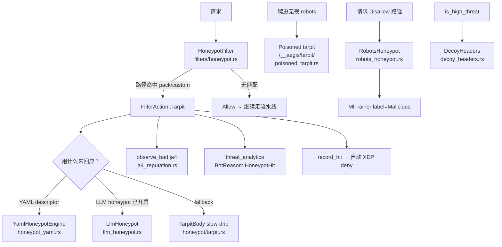

# 蜜罐与焦油坑

**语言：** [English](../en/17-honeypot-tarpit.md) · [Русский](../ru/17-honeypot-tarpit.md) · **中文**

AEGIS 的欺骗防御（deception）子系统：带慢速焦油坑响应的静态蜜罐陷阱、描述多轮
交互的 YAML 场景、带语义缓存的 LLM 蜜罐、「投毒」（poisoned）Markov 焦油坑、
基于 robots.txt 的自动打标，以及 Cloudflare 诱饵响应头。除基础蜜罐过滤器外，
所有组件均为 opt-in（需显式启用），下文均如实标注。

本文所依据的源码：
`src/honeypot/`（`mod.rs`、`matcher.rs`、`packs.rs`、`state.rs`、`tarpit.rs`）、
`src/honeypot_yaml.rs`、`src/llm_honeypot.rs`、`src/poisoned_tarpit.rs`、
`src/robots_honeypot.rs`、`src/decoy_headers.rs`、`src/latency_jitter.rs`，
以及各集成点：`src/filters/honeypot.rs`、`src/arsenal.rs`、
`src/proxy/pingora_http.rs`、`src/proxy/http.rs`、`src/proxy/pingora_admin.rs`、
`src/ja4_reputation.rs`、`src/threat_analytics.rs`。

---

## 1. 子系统全景



下文逐块说明。基础蜜罐过滤器默认开启；YAML、LLM、投毒焦油坑、robots 蜜罐和
诱饵响应头都需要显式启用（env 标志、文件路径，或者接入 arsenal/wiring）。

---

## 2. 基础蜜罐过滤器（`src/honeypot/`）

### 2.1 原理

运维人员无需手写陷阱——AEGIS 内置 **18 个 pack**，包含只会出现在自动化扫描器
字典中的 URL 模式（`src/honeypot/packs.rs`，`BUILTIN_PACKS`）。命中任一此类路径
都是一个（按设计）误报率为零的信号：没有任何真实用户会请求 `/.git/config`、
`/wp-config.php.bak` 或 `/.aws/credentials`。

该过滤器位于流水线的开头（在 threat_intel + ip_acl 之后），一次匹配器查找即可在
更重的过滤器启动前结束请求（`src/filters/honeypot.rs`，文件顶部的注释）。命中时
它返回 `FilterAction::Tarpit { duration_seconds, chunk_bytes, server_header,
reason }`，代理处理器再把它变成慢速的 slow-drip 响应。

### 2.2 内置 pack

`BUILTIN_PACKS`（`src/honeypot/packs.rs`）：

| id | 用途 |
|----|------------|
| `wordpress` | wp-admin/xmlrpc/wp-config 等 |
| `secrets` | `.env`、`.git/config`、AWS/SSH/shell 历史 |
| `php_admin` | phpMyAdmin / phpinfo / info.php |
| `drupal` | CHANGELOG、install/update、user/register |
| `joomla` | administrator、configuration.php |
| `xenforo` | install/、internal_data/、src/、admin.php?… |
| `magento` | downloader/、shell/、Magento_Version |
| `shells` | 典型 webshell 文件名（c99/r57/wso/alfa/2017-2026.php …） |
| `backup_dumps` | SQL 导出与备份归档 |
| `vendor_paths` | composer/npm 产物（vendor/、composer.json、…） |
| `ci_cd` | 流水线/容器（.gitlab-ci.yml、Dockerfile、…） |
| `iot_default` | Mirai/Hajime/Gafgyt 的路由器探测（HNAP1/、luci、GponForm/…） |
| `java_admin` | Spring actuator、Tomcat manager、JMX |
| `monitoring` | server-status、nginx_status、debug/pprof/* |
| `git_repos` | .git/*、.svn/*、.hg/*、CVS/* |
| `fuzzer_noise` | dirb/ffuf/gobuster 的高频条目（/secret/、/admin/、/backup/、…） |
| `windows_iis` | IIS/ASP/.NET（Trace.axd、elmah.axd、web.config） |
| `node_npm` | source map、dist/、__debug__ |

相关不变量由 `packs.rs` 中的测试固化：id 唯一、每个 pack 都有路径/名称/描述、
id 为 slug 形式（`[a-z0-9_]`）、pack 总数 ≥ 12 且路径总数 ≥ 200
（`total_path_count()`）。

> 历史说明：形如 `/?q=admin` 的遗留 Drupal 探测在 V234 中被删除，因为匹配器只按
> 路径工作（查询字符串被丢弃），这类模式会坍缩为根路径 `/`，从而毒化整个站点。
> 参见 §2.5。

### 2.3 模式语法与匹配器

匹配器（`src/honeypot/matcher.rs`，`HoneypotMatcher`）支持三种形式，与限速 URI
预算的语法保持一致：

| 形式 | 语义 | 存储方式 |
|-------|-----------|--------------|
| `/foo` | 精确匹配（通过 `HashSet` 实现 `O(1)`） | exact |
| `/foo/*` | 前缀（`/foo/` 下的一切） | prefix `/foo/` |
| `*/foo` | 任意深度的后缀（`*/.env` 可捕获 `/a/b/.env`） | suffix `/foo` |

匹配的安全性（对运维人员很重要）：

- **路径规范化（V233）**：模式和请求路径都会经过
  `crate::normalisation::canonical_path`——百分号解码（多轮，可捕获
  `%2561`→`%61`→`a`）、折叠 `.`/`..` 与重复斜杠、转为小写、丢弃查询字符串。
  因此 `/%61dmin/x.php` 依然会落入蜜罐 `/admin/*`。该函数对任意输入都不会 panic
  （测试 `no_panic_on_malformed_path`）。
- **大小写不敏感**：扫描器常常随机化大小写——匹配器按小写比较。
- **前缀也能捕获「裸」目录（V233）**：`canonical_path` 会折叠结尾斜杠，因此
  `/wp-admin/*` 同时匹配 `/wp-admin` 和 `/wp-admin/`。

### 2.4 状态、持久化、热重载（`state.rs`）

状态保存在**单个 JSON 文件**中，默认为 `/var/lib/aegis/honeypots.json`
（`DEFAULT_STATE_PATH`）。React 面板和 admin API 写入该文件，守护进程在 mtime
变化时重新读取——无需重载配置。`HoneypotState` 结构：

| 字段 | 类型 | 默认值 | 用途 |
|------|-----|---------|------------|
| `enabled` | bool | `true` | 总开关；`false` → 过滤器变为 no-op |
| `packs` | map id→bool | 全部 `true` | pack 的全局开/关 |
| `per_host` | map host→(id→bool) | `{}` | 按 `Host:` 覆盖 |
| `custom_paths` | `Vec<String>` | `[]` | 附加模式（语法相同） |
| `tarpit_seconds` | u64 | `30` | 焦油坑时长；`0` → 普通拒绝 |
| `tarpit_chunk_bytes` | usize | `50` | 分块大小（每 5 秒一个分块） |
| `score_bump` | u32 | `50` | 每次命中给威胁评分器的加分 |
| `auto_xdp_deny_threshold` | u32 | `3` | 同一 IP 命中 N 次后 → 自动 XDP deny；`0` 表示关闭 |
| `server_header` | String | `Apache/2.4.41 (Ubuntu)` | 伪造的 `Server:` |
| `host_disabled` | `HashSet<String>` | `{}` | 对某域名完全绕过过滤器 |

全新安装默认「全部开启」；只有当运维方确实运行着对应软件时才关闭某个 pack
（例如在 `blog.acme` 上自建 WordPress——就为该主机关闭 `wordpress` pack，或把该
主机加入 `host_disabled`）。

热路径性能（`HoneypotStore::check`）：

- **重读节流（V229）**：`refresh()` 通过原子时间戳被节流到每秒最多一次——否则每个
  请求都要付出一次 `statx` 系统调用（性能剖析显示约占 24% 的系统调用时间）。面板
  中的修改会在下一个一秒窗口内生效。
- **`check()` 中的三条 fast-path**：(1) 总开关，(2) `host_disabled`（O(1)），
  (3) 空匹配器（该主机的所有 pack 都被关闭）——它们完全绕过 `canonical_path`。
- **`hits_by_ip`**——用于稀疏命中的 16 分片 `DashMap`（V230）；
  `record_hit(ip, threshold)` 在越过阈值时返回 `true`。`cleanup_stale` 只从后台
  GC 中调用。

编译后的表示（`Compiled`）会在文件变化时重建各主机的匹配器。优先级：per-host
覆盖 → 全局 pack → 默认开启。

### 2.5 针对退化模式的防护（V234）

任何规范化后的主体会坍缩到根路径 `/` 的模式（`/`、`/.`、`/..`、`/*`、`*`、`*/`、
`/?x=1`、`/#frag` …）都会在 `from_patterns` 阶段被**丢弃**。这是承重性的防护：
否则一个这样的模式（包括来自运维方 `custom_paths` 的）就会把对根路径的每个请求
都拖入焦油坑，从而搞垮整个域名。测试 `query_only_pattern_never_matches_root` 和
`degenerate_patterns_never_match_root` 固化了这一点。

### 2.6 焦油坑 slow-drip（`src/honeypot/tarpit.rs`）

普通拒绝（HTTP 403）会立刻关闭 TCP——扫描器马上就去下一个目标。`TarpitBody`
则相反：把连接保持打开约 `duration_seconds`，通过 chunked-transfer 每 **5 秒**
发送 `chunk_bytes` 字节。扫描器的工作线程「挂」在等待响应上，同时其并发池被耗尽。

实现是一个自定义的 `http_body::Body`：`poll_frame` 在定时器触发前返回
`Poll::Pending`，然后发出一个分块并重新装填定时器。分块数量为
`ceil(duration_seconds / 5)`。分块内容是点号（`.`），看起来像「正在加载」，且不会
触发内容嗅探。第一个分块同样是延迟发送的（立即响应会暴露焦油坑）。

在 `aegis-pingora`（数据平面）一侧，焦油坑分支（`src/proxy/pingora_http.rs`，对
`FilterAction::Tarpit` 的处理）复现了相同语义：按分块输出点号流，或者——若启用了
responder——返回合成的响应（参见 §3、§4）。该动作记录为 `event_action =
"tarpit"`，并递增集群槽位 `TARPIT`。

---

## 3. YAML 蜜罐描述符（`src/honeypot_yaml.rs`）

类 Beelzebub 的场景：运维人员用 YAML 而非 Rust/DSL 来描述多轮蜜罐端点。每个描述符
把一个路径模式绑定到一个确定性状态机：每一轮（turn）都有一个触发条件和一个响应。
状态按 **(IP, 描述符)** 维护，因此顺着链接爬行的工具会自然地推进到下一轮。

### 3.1 Schema

```yaml
- name: fake-phpmyadmin
  path: /phpmyadmin/*
  turns:
    - on: login_view
      response:
        status: 200
        headers:
          server: "Apache/2.4.41"
        body: "<title>phpMyAdmin login</title>…"
    - on: login_submit
      trigger_body_contains: "pma_password="
      response:
        status: 200
        body: "<title>Login error</title>…"
    - on: brute_attempt
      trigger_body_contains: "pma_password="
      repeat_after_ms: 800       # 慢速重放焦油坑
      response:
        status: 429
        body: "Too many requests"
```

字段（`Descriptor` / `Turn` / `TurnResponse`）：

| 字段 | 层级 | 用途 |
|------|---------|------------|
| `name` | descriptor | 名称；与 IP 一起构成会话键 |
| `path` | descriptor | 模式（`/exact`、`/prefix/*`、`*/suffix`） |
| `turns[].on` / `name` | turn | 该轮的标签（`label`） |
| `turns[].trigger_body_contains` | turn | 必须出现在请求体中的子串，否则该轮不「触发」 |
| `turns[].repeat_after_ms` | turn | 慢速重放焦油坑的延迟 |
| `response.status` | turn | HTTP 状态码（默认 200） |
| `response.headers` | turn | 响应头列表（`server: …` 等） |
| `response.body` | turn | 响应体 |

### 3.2 状态机

`YamlHoneypotEngine::step(ip, descriptor_name, body)`：

- 会话是分片的 `DashMap<(IpAddr, usize), SessionState>`（V230，128 个分片；键由两个
  `Copy` 字段构成 → 每请求零分配）；
- 每一轮都针对**当前**轮检查 `trigger_body_contains`；若触发条件满足（或描述符中
  没有该条件）且还存在下一轮——则 `next_turn += 1`；
- 到达脚本末尾后引擎停留在最后一轮（后续请求都得到最终响应——很适合做焦油坑收尾）；
- 会话 TTL 为 900 秒无活动（`with_session_ttl`），通过 `gc()` 回收（后台路径，
  按分片 `retain`）。

`match_descriptor(path)`——按列表顺序取首个匹配（`match_path`：`/*` 前缀、
`*/` 后缀，或完全相等）。

### 3.3 解析器

`parse_descriptors(yaml)`——针对该 schema 的最小 YAML 解析器（不依赖
`serde_yaml`）：一个 mapping 列表，取值为标量或一层嵌套 mapping。若需要更丰富的
YAML，运维方可以在调用侧换成 `serde_yaml`——这里是零依赖的 fallback。

### 3.4 启用方式与默认集合

YAML 引擎位于 `ArsenalState` 中（`src/arsenal.rs`，
`yaml_honeypot: Arc<YamlHoneypotEngine>`）。描述符集合取自
`default_honeypot_descriptors()`：

- 环境变量 **`AEGIS_HONEYPOT_YAML`**——文件路径；若文件可读，它会**覆盖**内置默认值；
- 否则使用内置的 `DEFAULT_HONEYPOT_YAML`（描述符 `fake-phpmyadmin`、
  `fake-wp-login`、`fake-dotenv`、`fake-git-config`）；
- 解析出错时守护进程**不会崩溃**：记录一条 warning 并以空集合运行。

---

## 4. LLM 蜜罐（`src/llm_honeypot.rs`）

类 Galah 的蜜罐：由 LLM 即时合成上下文上可信的 HTTP 响应（看起来像真正的
WordPress / phpMyAdmin / git-config），无需预先编写的 fixture。使其适用于生产的
关键点是**语义缓存**：同一个扫描器在重复请求时看到一致的响应（否则它会通过响应
的离散程度对 LLM 进行指纹识别）。

### 4.1 语义键

`SemanticKey::compute(method, path_template, header_names, body_shape)`：
FNV-1a 160 位 → 20 字节（不需要密码学强度，这只是缓存键）。按设计，表面性的变化
（query 取值、request-id、时间戳）会坍缩为同一个键，而**不同的攻击手法**会产生新的
合成结果：

```
SemanticKey = hash( method | path_template | sorted(header_names) | body_shape )
```

`body_shape(body, content_type)` 对请求体做归一化：JSON 取排序后的顶层键，
form-urlencoded 取参数名，其他情况为空字符串（测试：`{"b":1,"a":2}` → `"a,b"`；
`user=root&pass=x` → `"pass,user"`）。

### 4.2 缓存与流程

`LlmHoneypot::respond(ctx, key)`：

1. 在缓存中查找 → 命中则立即返回响应（计入 `hits`）；
2. 未命中 → `LlmClient::synthesise(ctx)`，缓存并返回（计入 `misses`）。

缓存是带 TTL 和容量上限的 `RwLock<HashMap<SemanticKey, Entry>>`；写满时淘汰最旧的
元素（线性扫描，计入 `evictions`）。若没有语义哈希，我们要么会遇到缓存抖动
（LLM 成本爆炸），要么得到过度平均化的雷同响应（形成 LLM 指纹）。

### 4.3 LLM 提供方

模型调用本身被隐藏在 `LlmClient` trait 之后——运维方可以接入任意提供方
（OpenAI、Anthropic、vLLM、Ollama、llama.cpp）。`ArsenalState` 中默认接入的是
**`StubLlm`**（TTL 3600 秒，容量 4096），它在没有真实 LLM 的情况下渲染一个可信的
`Index of …`（Apache 2.4.41）。

> 如实说明：「开箱即用」时 LLM 蜜罐返回的是 stub 页面，而不是真正由 LLM 生成的
> 内容。要接入真实的 LLM，运维方需要实现 `LlmClient` trait，并在构造 arsenal 的
> 位置把它接进去——代码树里并没有硬编码这一步。

### 4.4 启用方式与响应优先级

通过环境变量标志 **`AEGIS_LLM_HONEYPOT=1`** 启用（缓存在处理器的
`self.llm_honeypot` 字段中，每请求不再查 env——`src/proxy/pingora_http.rs`）。在
焦油坑分支中，若该标志开启且 arsenal 已接入，则调用
`arsenal.honeypot_respond(...)`（`src/arsenal.rs`），它按以下优先级选择响应：

1. 该路径对应的 **YAML 描述符**（如果 `match_descriptor` 找到了）→ 走一步状态机，
   计数器 `yaml_honeypot_engagements`；
2. 否则使用 **LLM 蜜罐**（`SemanticKey` 由 method/path/host-ua/body_shape 得出），
   计数器 `llm_honeypot_responses`。

合成的响应取代「点号」点流——更可信的交互能把扫描器留住更久。如果 responder 什么
都没返回，该分支会退回到普通的 slow-drip。

---

## 5. 投毒焦油坑（`src/poisoned_tarpit.rs`）

Iocaine / Nepenthes / HellPot / caddy-defender `garbage` 这一路线。2024 年之后的
教训是：封禁很廉价（机器人换个 IP 重试即可），而**投毒**更有效——给爬虫返回貌似
可信但实为生成的垃圾内容，以稀释其训练语料并抬高爬取成本。AEGIS 在 slow-drip 焦油坑
（§2.6）之外补上了*内容*侧：Markov 文本生成器 + 带有无穷内部链接、通向焦油坑深处的
HTML。无视 robots.txt 的 AI 爬虫会掉进迷宫，在无尽地遍历伪造页面的过程中烧掉 CPU。

### 5.1 Markov 生成器

`MarkovChain::train(corpus)`——二元（bigram）链（`(prev,next)→count`），按累积权重
采样（二分查找）。之所以选择二元而非一元：在内存开销几乎相同的情况下，输出明显更
连贯。`generate(target_words, seed)` 对 `seed` 是确定性的；它从一个「起始」词开始
（位于 `.`/`!`/`?` 之后或语料开头），遇到死胡同 token 时改取一个新的起始词。

### 5.2 语料

建议运维方提供自己的种子语料（一段公有领域文本），原因有二：(1) **确定但唯一**——
每个部署的焦油坑看起来都不一样，机器人无法把识别能力在不同运维方之间泛化；
(2) **可信的词汇**——语料塑造输出（文档站点需要类似文档风格的垃圾内容）。若不提供
语料，则使用刻意做得很小的 `FALLBACK_CORPUS`（几句 Lorem 句子）——以促使用户去做
定制。

### 5.3 页面渲染与分块节奏

`TarpitGenerator`（字段 `paragraphs_per_page=4`、`words_per_paragraph=80`、
`links_per_page=12`、`link_prefix="/__aegis/tarpit/"`）：

- `render(seed)`——确定性 HTML：`<h1>` + N 段 Markov 文本 + 一个指向
  `/__aegis/tarpit/<slug>` 的 `<nav>`（slug 为 8 字符的 base36，看起来像真实的
  文章 slug）。相同 seed → 相同页面（否则机器人会判断「这站点是动态的，应优先
  抓取」）。
- `render_chunks(seed, n_chunks)`——把页面切成大致等长的若干块以便慢速流式输出，
  切分在 UTF-8 边界上是安全的。
- 所有 HTML 都会被转义（`html_escape`）——即使语料中含有注入类 token 也不会原样透出
  （测试 `tarpit_escapes_corpus_dangerous_chars`）。

热路径是安全的：Markov 游走对输出长度是 `O(n)`（约 100 纳秒/词），端点以线速产出；
真正被放慢的恰恰是*响应时间*（分块之间的延迟）。

`seed_from_slug(slug)`——稳定的 FNV-1a 哈希：同一个 slug 永远产出同一页面。

### 5.4 反指纹抖动（V190）

分块之间的延迟并非固定值，而是从对数正态分布中采样（`jittered_chunk_delay` →
`latency_jitter::sample`，`Distribution::default_tarpit()` =
`LogNormal { median_ms: 350, sigma: 0.55 }`）。均匀的 sleep 本身就是一种指纹；
抖动模拟网络抖动，破坏基于延迟的指纹识别。

### 5.5 数据平面上的提供

该端点在 `aegis-pingora` 中提供服务（`src/proxy/pingora_http.rs`，V152）：若
`tarpit_generator` 已接入（`Option<Arc<TarpitGenerator>>`）且路径以
**`/__aegis/tarpit/`** 开头，则生成 `render_chunks(seed, self.tarpit_chunks)`
（默认 `tarpit_chunks = 20`），响应带 `x-aegis-tarpit: 1` 与
`cache-control: no-store`，分块之间是抖动延迟（当 arsenal 已接入时）或固定延迟
`tarpit_chunk_delay`。计数器 `latency_jitter_emits`。在 `src/filters/engine.rs`
中，路径 `/__aegis/tarpit/<slug>` 被识别出来以便路由进迷宫。

> 如实说明：只有当处理器中接入了 `tarpit_generator` 时（opt-in wiring）投毒焦油坑
> 才是激活的；那些「无穷」链接本身不会自动出现在普通蜜罐响应里——只有已经顺着生成
> 的链接 `/__aegis/tarpit/<slug>` 进来的访客才会走进这座迷宫。

---

## 6. robots.txt 蜜罐——自动打标（`src/robots_honeypot.rs`）

robots.txt 是一份免费的蜜罐路径来源：每一行 `Disallow:` 都是公开声明为禁止合规
爬虫访问的路径。访问了 `Disallow` 路径的客户端等于给自己贴上了「不合规爬虫」的
标签——而这正是 ML 模型最需要更多标注样本的那一类群体。

### 6.1 解析与匹配

`RobotsRules::parse(contents)` 只加载 `User-agent: *` 段中的规则（忽略针对具体 bot
的 stanza），去掉行内注释，丢弃空的 `Disallow:`。`is_disallowed(path)`：把路径与
`Disallow` 模式匹配（含 `*` 时用双指针回溯做 glob；不含 `*` 时按前缀），其中
`Allow` 会覆盖 `Disallow`（robots.txt 的惯例）。

### 6.2 把标签送入训练

`RobotsHoneypot::observe_request(path, honoured_robots)` 在命中 `Disallow` 且
`honoured_robots == false` 时，会向 `MlTrainer` 放入一个 `Label::Malicious` 样本，
其 `FeaturesV2` 向量是合成的（`synthesise_features`：URI 长度/熵、缺少浏览器请求头
和 JA4、抬高的基线 `fp_consistency_score = 0.3`）。若发出了标签则返回 `true`。这是
一座自训练的桥梁：下一次重训会学到此类请求的「形状」。参见
[18-ml-risk-engine.md](18-ml-risk-engine.md)。

一个可选的细化：`honoured_robots` 标志可降低错误标注（RSS 阅读器、链接预览机器人
访问 `Disallow` 路径并无恶意）。如果运维方接入一个「该 IP 是否先取过 /robots.txt」
的按 IP 跟踪器，那么只有**没有**取过的 IP 才会被打标。默认情况下（该标志未接线 =
`false`）对 `Disallow` 路径的每一次访问都会被打标。

### 6.3 启用方式

处理器字段 `robots_honeypot: Option<Arc<RobotsHoneypot>>`（opt-in，默认为 `None`；
通过 `with_robots_honeypot(...)` 启用，`src/proxy/pingora_http.rs`，V154）。在热路径
上它以**观察者**方式被调用——不拦截请求，仅在命中 `Disallow` 时推送一个训练样本。
AEGIS 不生成 robots.txt——那是站点自己的事；由运维方提供自己的文件。

> 如实说明：robots 蜜罐在未显式接入前是关闭的（`with_robots_honeypot`）；它只是一个
> ML 标签来源，并不做封禁。

---

## 7. 诱饵响应头（`src/decoy_headers.rs`）

Scrapling 及类似的自适应爬虫会检查响应头/Cookie，以判断站点由哪种 WAF/CDN 保护，
并加载相应的绕过策略。如果 AEGIS 对可疑客户端返回**伪造的 Cloudflare 响应头**，
攻击者就会选错 playbook，把时间浪费在对我们并不适用的绕过手法上。

### 7.1 家族与响应头

`DecoyHeaders::build(family, conn_id)` 对 `conn_id` 是确定性的（重试结果一致）。
支持的家族（`DecoyFamily`）：

| 家族 | Server | 标志性响应头 |
|-----------|--------|------------------------|
| `Cloudflare` | `cloudflare` | `cf-ray: <16hex>-FRA`、`cf-cache-status: DYNAMIC`、`alt-svc`、`set-cookie: __cf_bm=…` |
| `Akamai` | `AkamaiGHost` | `x-akamai-request-id`、`x-cache: TCP_MEM_HIT …`、`x-reference` |
| `Fastly` | `Varnish` | `x-served-by`、`x-cache: HIT`、`x-fastly-request-id`（32 位十六进制） |
| `CloudFront` | `CloudFront` | `x-amz-cf-pop`、`x-amz-cf-id`、`via: 1.1 ….cloudfront.net (CloudFront)` |

设置多个家族的思路是：挑一个 Scrapling/Botasaurus 绕过代码最深入的平台，让它们把
最大的力气白白花掉。十六进制/十进制取值是手写的（不用 `format!`）——这是在持续攻击
下位于「较热」路径上的组装代码；测试 `hex_writers_match_format_macros` 固化了其
wire 层等价性。

### 7.2 下发策略

`should_decoy(challenge_fired, ml_score, honeypot_hit)` →
`challenge_fired || honeypot_hit || ml_score >= 0.65`。干净流量**不会**收到诱饵——
否则这套欺骗会泄漏给正当用户。

### 7.3 数据平面上的下发

在 `aegis-pingora` 中（`src/proxy/pingora_http.rs`，V188，`response_filter` 阶段）：
当 arsenal 已接入且 `ctx.is_high_threat`（客户端刚刚通过 challenge，或带有较高的
威胁评分）时，会在响应中加入 Cloudflare 诱饵响应头（`conn_id` 由客户端 IP 推出），
计数器 `decoy_header_emits`。

> 说明：数据平面目前硬编码使用 `Cloudflare` 家族；其余家族在模块中已实现并经过测试，
> 但热路径上没有暴露家族切换开关。

---

## 8. JA4 自学习与 threat-analytics

蜜罐/焦油坑是「已确认为恶意」客户端的高精度来源，因此它们为多个自学习子系统供料。

### 8.1 JA4 信誉自学习（V244）

`Ja4Reputation::observe_bad(ja4, tag)`（`src/ja4_reputation.rs`）——记录在明确恶意
结果中被抓到的客户端的 JA4。这是一个无需外部情报源的自填充信号：同一指纹在后续
请求中会被标记。防护措施：

- 若自学习关闭（未设置 `observed_path`）、JA4 为空或不含 `_`，则为 no-op；
- **拒绝学习退化的 JA4（V246）**：若 ClientHello 字段抓取为空，则
  cipher/extension 哈希 = SHA256("")（对所有人都一样）——`is_degenerate_ja4` 会把
  这类过滤掉，否则会把全部流量都标记上；
- 去重 + 上限（`OBSERVED_CAP`）：磁盘 I/O 对每个*新*指纹最多发生一次；写入使用
  `O_APPEND`（对小于 4KB 的行是原子的）。

调用点（`src/proxy/pingora_http.rs`）：

| 结果 | tag |
|-------|-----|
| 被 `honeypot` 过滤器 deny | `"honeypot"` |
| 被 `waf` 过滤器 deny | `"waf"` |
| 焦油坑 engagement | `"tarpit"` |

参见 [12-reputation.md](12-reputation.md) 和 [11-tls-fingerprinting.md](11-tls-fingerprinting.md)。

> 关于精度的一点细节：其效果取决于是否真的抓到了 ClientHello 字段
> （gate fingerprinting / `set_client_hello_callback`）。没有它，JA4 可能退化，而
> V246 的保险会直接拒绝学习——这是为「不产生错误标签」而有意做出的取舍。

### 8.2 threat-analytics（V121）

在 deny 结果上，处理器会调用 `record_bot(client_ip, bot_reason)`
（`src/threat_analytics.rs`）。对 `honeypot` 过滤器，原因是
`BotReason::HoneypotHit`（字符串标签 `"honeypot_hit"`），对 `waf` 则是
`WafSignature`。与此并行，`observe_endpoint_hit(host, generalise_path(path), ip)`
为 admin UI 区分「单 IP 机器人」与「针对某端点的分布式攻击」。蜜罐命中同时也会推高
滑动窗口威胁评分器（`record_denied`），从而在 `/admin/threats` 中对 IP 排序。参见
[25-metrics-telemetry.md](25-metrics-telemetry.md)。

### 8.3 自动 XDP deny 与 BGP RTBH

- **自动 XDP deny**：`HoneypotStore::record_hit(ip, threshold)`（默认阈值 3）；越过
  阈值时该 IP 会被加入 XDP deny-set（`src/proxy/http.rs`：`xdp.deny_v4/deny_v6`），
  后续的 SYN 会在线速被丢弃。参见 [13-xdp-ebpf.md](13-xdp-ebpf.md)。
- **BGP RTBH（V187）**：在 arsenal 已接入的情况下，蜜罐 deny（或威胁评分 ≥ 80）会
  通过 ExaBGP 调度器通告一条 /32（`bgp_rtbh.announce`），计数器
  `bgp_rtbh_announces`。参见 [19-bgp-rtbh.md](19-bgp-rtbh.md)。

### 8.4 在线签名挖掘器（V107）

在焦油坑分支中，`self.tarpit_logger.record(path)` 会为在线签名挖掘器记录 payload
（在未设置 `AEGIS_TARPIT_LOG` 前为 no-op）。参见 [10-waf.md](10-waf.md)。

---

## 9. Admin API 与面板

蜜罐通过 admin API 管理（`src/proxy/pingora_admin.rs`），面板页面为
`/admin/ui/honeypots`。状态以整个 `HoneypotState` 的形式读写（见 §2.4）。主要路由：

| 方法 | 路径 | 动作 |
|-------|------|----------|
| GET | `/admin/api/honeypots` | 完整的 `HoneypotState` |
| GET | `/admin/api/honeypots/builtin` | 内置 pack 及其路径的列表 |
| PUT | `/admin/api/honeypots` | 替换整个状态 |
| PUT | `/admin/api/honeypots/global` | 全局开/关某个 pack |
| PUT | `/admin/api/honeypots/host` | 为某主机开/关某个 pack |
| PUT | `/admin/api/honeypots/host/enabled` | 为某主机绕过过滤器（`host_disabled`） |
| POST | `/admin/api/honeypots/packs/<pack_id>` | 开/关某个 pack（React） |
| POST | `/admin/api/honeypots/hosts/<host>/packs/<pack_id>` | 按主机的 pack |
| DELETE | `/admin/api/honeypots/hosts/<host>` | 重置按主机的覆盖 |

要点：路由 `PUT …/host/enabled` 的分发在更通用的 `PUT …/host` **之前**（路由器中的
顺序有意义）。admin 路由与角色的完整清单见 [30-admin-api.md](30-admin-api.md)，
面板说明见 [29-admin-panel.md](29-admin-panel.md)。

欺骗防御的计数器通过 arsenal 指标（`Counters`）暴露：
`yaml_honeypot_engagements`、`llm_honeypot_responses`、`decoy_header_emits`、
`latency_jitter_emits`——并进入 Prometheus 的 `/metrics`。

---

## 10. 汇总：默认开启的与 opt-in 的

| 组件 | 默认 | 如何启用 |
|-----------|--------------|--------------|
| 蜜罐过滤器 + 18 个 pack | **开启** | `HoneypotState.enabled`（总开关） |
| Slow-drip 焦油坑 | 命中时**开启**（30 秒） | `tarpit_seconds`（0 → 普通拒绝） |
| 自动 XDP deny | **开启**（阈值 3） | `auto_xdp_deny_threshold`（0 → 关闭） |
| YAML 描述符 | arsenal 中的默认集合 | 用 `AEGIS_HONEYPOT_YAML=<文件>` 指定自己的集合 |
| LLM 蜜罐响应 | **关闭**（且为 stub 提供方） | `AEGIS_LLM_HONEYPOT=1` + 实现 `LlmClient` |
| 投毒焦油坑（`/__aegis/tarpit/`） | **关闭** | 接入 `tarpit_generator`（可选自备语料） |
| robots.txt 蜜罐（ML 标签） | **关闭** | `with_robots_honeypot(...)` + 自备 robots.txt |
| 诱饵响应头 | 在 `is_high_threat` 时（需要 arsenal） | 接入 arsenal；策略 `should_decoy` |
| JA4 自学习（`observe_bad`） | 设置了 `observed_path` 时 | 参见 [12-reputation.md](12-reputation.md) |

---

## 另见

- [10-waf.md](10-waf.md)——WAF 签名、在线签名挖掘器
- [11-tls-fingerprinting.md](11-tls-fingerprinting.md)——JA3/JA4/JA4H/JA4T
- [12-reputation.md](12-reputation.md)——JA4 信誉、自学习、ASN/CIDR/CrowdSec
- [13-xdp-ebpf.md](13-xdp-ebpf.md)——XDP deny-set（自动 deny）
- [18-ml-risk-engine.md](18-ml-risk-engine.md)——ML 引擎与训练（robots 标签）
- [19-bgp-rtbh.md](19-bgp-rtbh.md)——通过 ExaBGP 的 BGP RTBH
- [21-arsenal-scenarios.md](21-arsenal-scenarios.md)——Defence Arsenal 与场景
- [25-metrics-telemetry.md](25-metrics-telemetry.md)——欺骗防御指标
- [29-admin-panel.md](29-admin-panel.md)、[30-admin-api.md](30-admin-api.md)——管理
