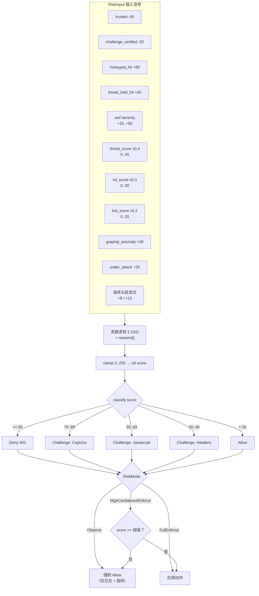
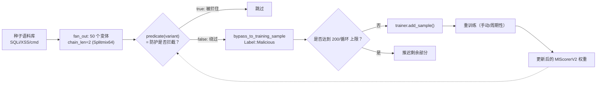

# ML 与风险引擎

**语言：** [English](../en/18-ml-risk-engine.md) · [Русский](../ru/18-ml-risk-engine.md) · **中文**

AEGIS 通过 **Risk Engine（风险引擎）**（`src/ddos/risk_engine.rs`）把数十种弱信号（WAF、TLS 指纹、信誉、行为、ML 推理）融合成一个可解释的评分，而该评分的输入之一就是内置的 **ML 引擎** —— V97/V122 逻辑回归或 V136 GBM 树（`src/ddos/`）。全部 ML 都在 `aegis-pingora` 进程内运行：没有 Python，没有外部模型服务器，每请求推理约 50–500 ns，支持在线增量训练与对抗式自训练。

> 相邻文档：[10-waf.md](10-waf.md)、[11-tls-fingerprinting.md](11-tls-fingerprinting.md)、[12-reputation.md](12-reputation.md)、[15-challenge-ladder.md](15-challenge-ladder.md)、[17-honeypot-tarpit.md](17-honeypot-tarpit.md)、[20-geoip.md](20-geoip.md)、[22-enrichment.md](22-enrichment.md)、[24-request-log.md](24-request-log.md)、[25-metrics-telemetry.md](25-metrics-telemetry.md)。ML 流水线的详细运维指南：[ml-pipeline.md](../en/reference/ml-pipeline.md)。

---

## 1. 两个层次：Risk Engine 与 ML 打分器

务必不要把这两个组件混淆 —— 它们协同工作，但属于不同的子系统：

| 组件 | 文件 | 作用 | 取值范围 |
|---|---|---|---|
| **Risk Engine**（V108） | `src/ddos/risk_engine.rs` | 把所有信号（包括 ML 的输出）融合成一个带可读 `reasons` 的评分，并按模式选择动作（Allow/Challenge/Deny） | `0..255`（u8） |
| **ML 打分器**（V97/V122/V136） | `src/ddos/ml_score.rs`、`ml_score_v2.rs`、`ml_gbm.rs`、`ml_model.rs` | 一个特征向量 → 一个"恶意性"概率 | `0..1` → `*100` = `0..100` |

ML 打分器是 Risk Engine 的**输入之一**（`RiskInput` 中的 `ml_score: f64` 字段）。Risk Engine 没有 ML 也能工作（此时 `ml_score = 0`），而 ML 打分器也可以单独用于按 `ThreatTier` 做缓存路由（见 [ml-pipeline.md](../en/reference/ml-pipeline.md)）。

---

## 2. Risk Engine：Observe / HighConfidenceEnforce / FullEnforce 三种模式

在 V108 之前，每个过滤器（WAF、bot、adaptive、challenge、ml_scorer、threat_intel、honeypot）各自独立作出 `Allow/Deny/Challenge` 决策并短路整条流水线。这样很快，但对那些只能表现为**弱信号之和**的 L7 攻击是盲的 —— 罕见 JA4 + 空 Accept-Language + URI 熵 + 404 突增。Risk Engine 是统一的可解释组件：输入所有信号，输出 `RiskDecision { score, action, reasons }`。

### 2.1. 三种模式（`RiskMode`）

定义于 `src/ddos/risk_engine.rs`：

| 模式 | 行为 | 用途 |
|---|---|---|
| `Observe` | 计算并记录评分，**动作永不生效** —— 始终返回 `Allow`。这是默认值（`#[default]`）。 | 安全起步：运维人员用一周时间观察指标/评分分布。 |
| `HighConfidenceEnforce` | **仅当** `score ≥ enforce_threshold` 时才应用动作。低于阈值则返回 `Allow`，并由旧的逐过滤器决策流水线接管。 | 在评分分布尚未用真实流量验证之前，推荐的生产模式。 |
| `FullEnforce` | 无论评分高低，都应用引擎的决策。 | 只有在长期观察 + 影子验证之后才用（属于 V109+ 的范围）。 |

默认阈值：`DEFAULT_ENFORCE_THRESHOLD = 90`（可用 `with_threshold(t)` 覆盖）。

> **诚实的说明（来自代码）。** 配置只认识三个模式取值 —— `Off | Observe | Enforce`（`crate::config::RiskEngineMode`）。选择 `Enforce` 时，`aegis-pingora` 会以 `HighConfidenceEnforce` 模式创建引擎，但会记录一条警告：*"action-application (Stage 3) is NOT yet wired, so the engine runs in SHADOW (scores logged, live allow/deny decisions UNCHANGED)"*（`src/proxy/pingora_http.rs`）。也就是说，在当前代码切面上 Risk Engine 实际上作为影子打分器工作：计算、记录、导出指标，但不会替换旧过滤器的实时 allow/deny 决策。`FullEnforce` 存在于 `RiskMode` 类型中，但无法从配置中选择。

### 2.2. 启用

`AEGIS_RISK_ENGINE_MODE` 会覆盖配置（与其他 `AEGIS_*` 运行时开关一样）：

```sh
# /etc/aegis/aegis.env
AEGIS_RISK_ENGINE_MODE=observe   # off | observe | enforce
# 重启后生效
systemctl restart aegis-pingora.target
```

当取值为 `off`（默认）时，引擎根本不会被创建（`Option<Arc<RiskEngine>> = None`），热路径只需付出一次 `Option` 检查的代价。取值拼写错误（`OBSERVE`、`on`）**不会**静默套用默认值 —— 会打印醒目的 `warn`，随后采用配置中的模式。

### 2.3. 把评分归类为动作

`classify` / `classify_score` 曲线（`src/ddos/risk_engine.rs`）刻意保守，高分需要多个互相印证的信号：

| 评分 | 动作（`RiskAction`） | challenge 级别 |
|---|---|---|
| `≥ 90` | `Deny { status: 403 }` | — |
| `70..89` | `Challenge` | `Captcha` |
| `50..69` | `Challenge` | `Javascript` |
| `30..49` | `Challenge` | `Headers` |
| `0..29` | `Allow` | — |

challenge 各级别参见 [15-challenge-ladder.md](15-challenge-ladder.md)。

---

## 3. 信号及其在融合中的权重

Risk Engine 接收 `RiskInput<'a>`（所有字段都是 `Option`/带默认值，引擎能承受部分状态缺失）。`evaluate()` 方法把各项贡献累加到 `i32`，然后钳位到 `0..255 → u8`。每一项被触发的贡献都会向 `reasons` 追加一个稳定的 `&'static str`（用于在 SIEM 中聚合，以及用于基数受限的 Prometheus 标签）。

### 3.1. 贡献表（完全取自 `evaluate()`）

| 信号（`RiskInput` 字段） | 对评分的贡献 | `reason`（条件） | 来源 |
|---|---|---|---|
| `trusted` | **−40** | `trusted` | bypass / dynamic-trust / fp-cookie |
| `challenge_verified` | **−20** | `challenge_verified` | 已通过的 challenge / fp-cookie |
| `honeypot_hit` | **+80** | `honeypot_hit` | honeypot path/pack（[17](17-honeypot-tarpit.md)） |
| `threat_intel_hit` | **+60** | `threat_intel_hit` | 按 IP 的 threat-intel 情报源（[12](12-reputation.md)） |
| `waf` = Critical | **+80** | `waf_critical` | `WafSignal.severity`（[10](10-waf.md)） |
| `waf` = High | **+50** | `waf_high` | — |
| `waf` = Medium | **+25** | `waf_medium` | — |
| `waf` = Low | **+10** | `waf_low` | — |
| `threat_score`（0..100） | `×0.4` → `0..40` | `threat_score_high`（≥30）/ `threat_score_medium`（≥15） | V37 ThreatScorer（自 V90+ 起为集群式） |
| `ml_score`（0..100） | `×0.3` → `0..30` | `ml_high`（≥20） | ML 打分器 V97/V122/V136 |
| `bot_score`（0..100） | `×0.2` → `0..20` | `bot_reputation_high`（≥15） | V37 BotFilter |
| `graphql_anomaly` | **+30** | `graphql_anomaly` | GraphQL cheap-guard |
| `under_attack` | **+20** | `under_attack` | per-domain AnomalyDetector（[§5.1](#51-anomalydetector-under-attack-模式)） |
| 浏览器 UA 但无 Accept-Language | **+12** | `browser_ua_no_accept_language` | 基于 `ctx` 的启发式 |
| User-Agent 为空/缺失（且非 trusted） | **+8** | `no_user_agent` | 基于 `ctx` 的启发式 |

注意这些"上限"：ML 的贡献被压在 ThreatScorer 之下（`×0.3` 对 `×0.4`）—— 因为 ML 是启发式的，我们不希望它压过某个 IP 已经确立的历史记录。Bot 信誉的上限更低（`×0.2`）。

### 3.2. Trust 捷径

`trusted` 带来很强的负向偏移（−40），使得运维人员的 override 即使在多个标志被触发时也占主导。测试中的例子：`trusted`（−40）+ `waf_medium`（+25）= −15 → 钳位到 0 → `Allow`，但 `reasons` 中仍会保留 `trusted` 和 `waf_medium` —— 运维人员能看到 WAF 触发过，只是被信任压过了。

### 3.3. 引擎指标

`RiskEngineMetrics`（原子的 `AtomicU64`，引擎保持 `&self`）：`evaluations_total`、`decisions_allow`、`decisions_challenge`、`decisions_deny`、`max_score`（诊断用 gauge —— 有助于选择 enforcement 阈值）。关于导出的更多内容见 [25-metrics-telemetry.md](25-metrics-telemetry.md)。

### 3.4. Mermaid：信号融合



---

## 4. ML 引擎：特征、模型、训练

ML 打分器既是给 Risk Engine 的 `ml_score`，也是缓存路由中 `ThreatTier` 的独立驱动来源。统一句柄是 `MlModel`（`src/ddos/ml_model.rs`），一个 `Logistic | Gbm` 的枚举分发器（用枚举而非 `dyn` trait —— 在热路径上每次调用可省约 5 ns）。

### 4.1. 模型版本

| 模型 | 文件 | 特征数 | 类型 | 在线增量训练 |
|---|---|---|---|---|
| **V97** | `ml_score.rs` | 8 | 逻辑回归 | 是（SGD） |
| **V122/V139** | `ml_score_v2.rs` | **23**（`N_FEATURES_V2`） | 逻辑回归 | 是（SGD + L2 + 类别权重） |
| **V136** | `ml_gbm.rs` | 23（同一套 `FeaturesV2`） | GBM（树） | 否 —— 只支持 batch，离线训练，从 JSON 加载 |

各处的推理最后都以 `sigmoid(z)` 结束 → 得到 `[0,1]` 区间的概率；`score_pct()` = `×100`。

#### V97 —— 8 个特征（legacy 回退）

`Features`（`ml_score.rs`）：`uri_length`、`header_count`、`body_length`、`has_user_agent`、`method_is_post`、`ja4_unusual`（用 FNV 分桶把 JA4 与一组常见指纹比对）、`recent_denied_rate`、`recent_challenged_rate`。默认权重偏保守（`has_user_agent = -1.5`、`ja4_unusual = 2.0`、`recent_denied_rate = 3.0`、bias `-2.0`）。持久化是一行 TOML（约 200 字节），通过 mtime 轮询热重载。

#### V122/V139 —— 23 个特征（`FeaturesV2`）

稳定索引（只追加，永不重排；`N_FEATURES_V2 = 23`，`schema_version = 3`）：

| # | 特征 | 分组 | 含义 | 默认权重 |
|---|---|---|---|---|
| 0 | `uri_length` | shape | path+query 长度 / 8192 | +0.6 |
| 1 | `query_param_count` | shape | query 参数个数 / 32 | +0.3 |
| 2 | `uri_entropy` | shape | path 的香农熵（按 log2 128 归一化） | +1.2 |
| 3 | `query_entropy` | shape | query 的熵 | +0.8 |
| 4 | `header_count` | header | 请求头个数 / 64 | +0.2 |
| 5 | `has_user_agent` | header | 1 = 存在 | **−1.5** |
| 6 | `has_accept_language` | header | 1 = 存在 | **−1.0** |
| 7 | `has_accept_encoding` | header | 1 = 存在 | **−0.8** |
| 8 | `has_referer` | header | 1 = 存在 | **−0.6** |
| 9 | `method_is_post` | method | POST/PUT/PATCH/DELETE | +0.1 |
| 10 | `body_length` | body | content-length / 64 KiB | +0.3 |
| 11 | `ja4_present` | fp | 已捕获 JA4 | **−1.0** |
| 12 | `ja4_browser_family` | fp | **UA↔JA4 不一致**（见下） | **−1.2** |
| 13 | `h2fp_present` | fp | 已捕获 H2FP | **−0.7** |
| 14 | `recent_denied_rate` | rep | 该 IP 的 deny 占比 | **+3.0** |
| 15 | `recent_challenged_rate` | rep | 该 IP 的 challenge 占比 | +1.5 |
| 16 | `bot_score_rate` | rep | bot 信誉 | +2.0 |
| 17 | `requests_per_min` | temporal | RPS×60/100（100/分钟 = 1.0） | +1.0 |
| 18 | `fast_repeat` | temporal | 同一 IP 在 <1 秒内重复请求 | +1.5 |
| 19 | `night_window` | temporal | UTC 小时 ∈ [0,6) | +0.4 |
| 20 | `fp_consistency_score` | cross | 跨指纹相关性（V137+V145） | +1.5 |
| 21 | `ja4_reputation` | cross | JA4 信誉（V138） | +2.0 |
| 22 | `asn_reputation` | cross | ASN 信誉（opt-in） | **0.0** |

> **关于索引 12（`ja4_browser_family`）的细节。** 尽管默认权重是 `−1.2`，但在实际的特征提取中（`extract_ml_features_v2`，`src/proxy/pingora_http.rs`）这个特征已变成**不一致（mismatch）信号**，而不是"这是浏览器吗？"的标志（修正 H9c）。**只有当**两个家族（UA 与 JA4）都被确信地分类（都不是 `Unknown`）**且**互不相同时，该特征才为 1.0。否则为 0.0。也就是说，负权重现在惩罚的是 UA↔JA4 的矛盾，而不是奖励浏览器 UA 的存在（后者机器人可以轻易伪造）。

> **`asn_reputation`（索引 22）—— 诚实地说是 opt-in。** 默认权重 = 0.0：AEGIS 核心不附带 ASN 列表（运维人员对此各有强烈主张），在运维人员接入情报源并用非零权重重新训练模型之前，该槽位保持中性。测试 `asn_reputation_is_neutral_by_default` 固定了这一点。

### 4.2. Logistic vs GBM —— 何时用哪个

| | Logistic（V122） | GBM（V136） |
|---|---|---|
| 推理开销 | 约 50 ns（每个特征一次 FMA） | 约 500 ns（50 棵树 × 深度 4） |
| 能否捕捉特征交互 | 否（只有可加性） | 是（每个叶子都是阈值的合取） |
| 在线增量训练 | 是（单样本 SGD + L2） | 否（只支持 batch，离线 → JSON） |
| 冷启动 | 开箱即用的合理默认值 | 空模型 = 只有 bias |
| 内存 | 约 200 字节（权重向量） | 约 10–50 KB（树） |

GBM（`GbmModel`，`ml_gbm.rs`）：浅树（`max_depth=4`、`n_trees=50`、`min_samples_leaf=10`、`learning_rate=0.1`），按阶段拟合逻辑损失的残差 `y − σ(F(x))`，按 SSE 最小化进行分裂。目标是捕捉诸如"高 `uri_entropy` 且 无 UA → 比二者单独出现更糟"这类合取关系，而逻辑回归无法表达这些。测试 `captures_conditional_interaction_logistic_struggles_with` 表明，GBM 甚至能捕捉信号的相互抵消（`高熵 + 有 UA → benign`，即"合法扫描器"）。

建议：从 logistic 开始，只有在观察到运维人员标注的交互模式时才切换到 GBM。

### 4.3. 启用 ML 打分器

V97（8 个特征）是默认。V139（23 个特征）是 opt-in：

```sh
# /etc/aegis/aegis.env
AEGIS_ML_SCORER=1                              # V97（8 特征）
AEGIS_ML_V2=1                                  # V139（23 特征）
AEGIS_ML_V2_KIND=logistic                      # logistic | gbm
AEGIS_ML_V2_GBM_FILE=/var/lib/aegis/gbm.json   # 仅当 kind=gbm 时
AEGIS_ML_WEIGHTS_FILE=/var/lib/aegis/ml-weights.toml  # 权重持久化（V97/logistic）
AEGIS_ML_SAMPLES_PATH=/var/lib/aegis/ml-samples.ndjson # 已标注样本的持久化
AEGIS_ML_V2_SAMPLES=/var/lib/aegis/ml-samples.ndjson   # 样本路径的别名
```

所有键都在管理面板的 allowlist 中（`src/proxy/pingora_admin.rs`，`EnvEntry`）。若未设置这些环境变量，V139 打分器槽位保持为空，面板会显示"not configured"并给出提示。`MlModelKind::parse` 接受别名：`logistic|linear|lr` 和 `gbm|tree|trees`。

### 4.4. 特征在哪里提取

`extract_ml_features_v2`（`src/proxy/pingora_http.rs`）从 `RequestContext` 组装 `FeaturesV2`。除了平凡的 shape/header 特征外，其中还有：

- **`fp_consistency_score`** = `max(server_fp_score, client_score)` —— 服务端跨指纹相关性（V137）与客户端 CreepJS 评分（V145）合并，前提是该 IP 有对应的 payload（取最大值 —— 任一被触发的层次都占主导）。其内部还传入了 timing-entropy（V189）。
- **`ja4_reputation`** —— 基于运维人员的 CTI 情报源 + arsenal JA4 语料库的 V138 查询（Deny→`max(1.0)`，Allow→soft-credit，但带有 H9b 保护：客户端自选的 JA4 不能把信誉压到低于来自不可伪造情报源的基线）+ JA4 churn（若 `churn > 0.6`，则在不扩展 schema 的前提下折叠进 `ja4_reputation`）。
- **`asn_reputation`** = `self.asn_reputation.feature(ctx.client_ip)`，若未接入情报源则为 0.0（`src/asn_reputation.rs`）。
- `recent_denied_rate` / `recent_challenged_rate` / `requests_per_min` / `fast_repeat` 取自 per-worker 的 ThreatScorer（`self.scorer.*`）。

> 这些特征**只**在 `extract_ml_features_v2` 内部计算，而该函数仅在 `AEGIS_ML_V2=1` 时运行。在未启用 V2 的原装部署上，这是一条"冷"路径。

---

## 5. 辅助信号（融合与特征的输入）

### 5.1. AnomalyDetector —— "under attack" 模式

`src/anomaly.rs`（V230）：per-domain 的异常检测器。热路径上只有一次 `AtomicU64::fetch_add(1, Relaxed)`（约 5 ns），EMA/检测被移到后台 tick（默认 1 秒）。当 `current_rps > baseline_ema × multiplier` **且** `baseline_ema ≥ min_baseline_rps` 时置起 `under_attack` 标志；该标志保持 `attack_duration`（默认 60 秒）。处于攻击状态时，该标志抬高该域名所有请求的可疑度"下限"（Risk Engine 中 `+20`），且 challenge 阶梯要求一个最低级别。默认是关闭的（`enabled: false`），`multiplier=3.0`、`min_baseline_rps=10.0`、`min_challenge_level=Javascript`。

### 5.2. GREASE 异常

`src/grease_anomaly.rs`（V178）：通过 JA4 自称是 Chrome 的客户端，应当在三个位置带有 Chrome 式的 GREASE 值（RFC 8701，`0x{n}A{n}A`）—— 第一个 cipher、第一个 extension、supported_versions 的开头。真正的 Chrome 三处都会放 GREASE；utls/curl-impersonate 常常只中 3 之 2 或位置不对。

```
score = (1 − matches/3)   当 JA4 看起来像 Chrome 时
      = 0                 当客户端并不自称 Chrome 时
```

它作为 `grease_anomaly` 喂给 V139 打分器，并作为"反检测工具在谎称自己是 Chrome"的强信号喂给 Risk Engine。`ja4_looks_like_chrome` 是一个廉价的启发式（`t13d15`/`t13d16` 或已知的 cipher-hash）。原始 GREASE 位置的捕获在 `src/ja4.rs`（`extract_grease_positions`）。

### 5.3. fp↔UA 相关性（服务端，V137）

`src/fp_correlation.rs`：把一组指纹（JA4/JA4H/H2FP/UA/Accept-*）转换成 `CorrelationScore` ∈ `[0,1]`（0 = 完全一致，1 = 矛盾）。各项贡献：

| 不一致项 | 贡献 | reason |
|---|---|---|
| JA4 家族 ≠ UA 家族，UA = Tool（curl/python/go…） | +0.55 | `ja4_browser_ua_tool` |
| JA4 家族 ≠ UA 家族（浏览器↔浏览器） | +0.45 | `ja4_ua_family_mismatch` |
| JA4 家族 ≠ H2FP 家族 | +0.35 | `ja4_h2fp_family_mismatch` |
| 浏览器 UA 但无 Accept-Language | +0.15 | `browser_ua_no_accept_language` |
| 浏览器 UA 但无 Accept-Encoding | +0.10 | `browser_ua_no_accept_encoding` |
| 有 JA4，无 JA4H（协议探测） | +0.10 | `ja4_present_ja4h_missing` |

评分被钳位到 `[0,1]`。家族由 JA4 的 cipher-hash、UA 子串和 H2FP SETTINGS 推导。这是**一个评分，而非硬性规则** —— 存在合法的边界情况（企业 MITM、移动端请求头压缩、扩展程序）。关于指纹的更多内容见 [11-tls-fingerprinting.md](11-tls-fingerprinting.md)。

### 5.4. client_consistency（客户端，V145，opt-in）

`src/client_consistency.rs`：CreepJS 式的检查。这是 V137 之后的下一道防线 —— 攻击者可以通过 SOCKS 把流量经由真实 Chrome 转发，从而使 TLS+HTTP 指纹自洽，但客户端的 JS 环境仍会暴露不一致。一段 JS 代码（`CREEPJS_CLIENT_JS`，约 3 KB，不依赖外部库）收集 `navigator.*`、时区、WebGL vendor/renderer、`webdriver`、`hardwareConcurrency`、插件数量、canvas 哈希，并 POST 到 `COLLECTION_PATH = /.well-known/aegis/consistency`。服务端规则集 `consistency_score`：

| 规则 | 权重 | reason |
|---|---|---|
| UA 请求头 ≠ navigator.userAgent | +0.4 | `ua_header_vs_navigator` |
| `navigator.webdriver == true` | +0.5 | `webdriver_true` |
| `hardwareConcurrency == 0` | +0.3 | `zero_hw_concurrency` |
| UA 平台 ≠ navigator.platform | +0.35 | `ua_platform_vs_navigator_platform` |
| Chrome UA + Mesa/SwiftShader/llvmpipe WebGL（headless） | +0.4 | `chrome_ua_mesa_webgl` |
| 桌面浏览器 + 0 个插件 | +0.2 | `desktop_ua_zero_plugins` |
| 时区↔语言矛盾 | +0.15 | `timezone_language_mismatch` |
| timing-entropy 呈合成特征（V189） | 最多 +0.5 | `timing_entropy_synthetic` |

评分被钳位到 `[0,1]`，保存在 LRU `ClientSignalsStore` 中（默认 10000 个 IP）。`timezone_language_mismatch` 刻意保守（只标记强矛盾 —— `ru`/`pl`/`cs`/`ja`/`ko`/`zh`/`th`/`vi` 与错误的大洲搭配；`en-US` + 任意时区都不会被标记）。结果被折叠进 `fp_consistency_score` 特征（与服务端 V137 评分取最大值）。

### 5.5. JA4 信誉与 JA4 churn

- **JA4 信誉**（`src/ja4_reputation.rs`）：`reputation_feature(hit)` → `Full match = 1.0`，`CipherPrefix = 0.6`，无命中 = 0.0。从 honeypot/WAF/tarpit + CTI 情报源自学习。见 [12-reputation.md](12-reputation.md)。
- **JA4 churn**（`src/ja4_churn.rs`，V177）：per-IP 滑动窗口内唯一 JA4 数与观测次数之比（默认 60 秒，最近 16 个样本）。`0.0` = 单一 JA4（正常浏览器），`1.0` = 每个请求都带新 JA4（utls/curl-impersonate/fhttp 的轮换）。Risk Engine 把 `> 0.6` 视为可疑，`> 0.9` 视为可执行阻断级别；在 `extract_ml_features_v2` 中，churn `> 0.6` 会被折叠进 `ja4_reputation`。

---

## 6. 训练、重训练、持久化

训练器是 `MlTrainer`（`src/ddos/ml_training.rs`，V123/V135），它保存已标注样本并重新训练 V122 逻辑回归模型。

### 6.1. 样本采集

三条"默认开启"的数据流在生产中每天可为模型提供 100+ 个样本：

- **V149 robots.txt honeypot** —— 每次访问 `Disallow` 路径都会被自动标注为 `Malicious`（`src/robots_honeypot.rs`）。
- **V151 对抗循环** —— 变异引擎生成 SQLi/XSS/cmd 变体，让它们穿过当前防护，把绕过成功的样本标注为 `Malicious`（[§7](#7-对抗式自训练v146v148v151)）。
- **V107 在线签名挖掘器** —— 提升被挖掘出的 ngram 签名。

可选的持久化：`AEGIS_ML_SAMPLES_PATH`（NDJSON，只追加，启动时重新读取）。通过 JSON API 手动标注 —— 槽位已预留（`POST /admin/api/ml/sample`），见 [30-admin-api.md](30-admin-api.md)。

### 6.2. 重训练

`retrain_ex(RetrainOptions)` → `RetrainResultEx`。通过管理 API：

```sh
curl -sS -H "x-admin-token: $T" -X POST \
  http://localhost:6280/admin/api/ml/retrain \
  -H 'Content-Type: application/json' \
  -d '{ "epochs": 50, "learning_rate": 0.1, "l2_lambda": 1e-3,
        "test_split": 0.2, "split_seed": 42, "class_balance": true }'
```

权重更新采用带 L2 衰减和逐样本权重的在线 SGD（`train_step_ex`）：`w_i ← (1 − lr·λ)·w_i + lr·err·sample_weight·x_i`（bias 不做衰减）。权重保存在 `ArcSwap` 中 —— 热路径上的 `score()` 读者永远不会看到"撕裂"的混合状态。

**类别平衡**（`class_balance: true`，默认）：生产环境中约 99% 的流量是 benign，不做平衡的话模型就会学成"永远 benign"（recall ≈ 0）。恶意样本按 `neg_count/pos_count` 加权，使稀有类别对梯度的贡献相等。测试 `class_balance_lifts_rare_class_recall` 展示了这一点。

来自 `RetrainResultEx` 的指标（`ml_eval.rs` 模块）：`accuracy`、`precision`、`recall`、`f1`（类别不平衡时的主要指标）、`fpr`、`auc`、`ece`（校准度）、`mean_squared_error` —— 包含起始值和最终值，分别在 train 和 test 上。完整解读以及如何对抗过拟合见 [ml-pipeline.md](../en/reference/ml-pipeline.md)。

### 6.3. 可解释性

`explain(&FeaturesV2)` → `ScoreBreakdown { feature_contributions, bias, raw_z, sigmoid, score_pct }` —— 每一行 = `特征值 × 权重` = 对 `raw_z` 的贡献。通过 `POST /admin/api/ml/explain` 调用。各项贡献之和 + bias = `raw_z`（测试 `explain_breakdown_sums_to_raw_z`）。

### 6.4. 权重持久化

- Logistic/V97：TOML（`AEGIS_ML_WEIGHTS_FILE`），原子写入（temp + rename），按 mtime 轮询热重载。格式带版本号（`schema_version`）：不兼容的文件（N ≠ 当前值）会按"回退到默认值"加载，而不会破坏模型。
- GBM：JSON blob（`AEGIS_ML_V2_GBM_FILE`），与 `GbmModel` 的 serde 往返兼容。运维人员离线训练（xgboost/notebook），导出 JSON，放到指定位置，然后重启。

---

## 7. 对抗式自训练（V146/V148/V151）

`src/ml_adversarial.rs` —— 一个类似 WAF-A-MoLE 的变异循环。思路：ML-WAF 会被保持语义的变异击败；防御手段就是把每一个发现的绕过样本作为 hard-negative 反馈回训练器。

### 7.1. 变异器（22 个）

每个都是 `Mutator::mutate(input, rng) -> Option<String>`（当输入不适用该变异时返回 None）。使用确定性 PRNG `Splitmix64` 以保证可复现。

| 集合（`MutationSet`） | 变异器 |
|---|---|
| **SQLi**（`sqli_default`） | `case_mix`、`inline_sql_comment`（` `→`/**/`）、`whitespace_shuffle`（`\t\n` NBSP）、`operator_swap`（`1=1`→`'a'='a'`，`=`→`LIKE`）、`keyword_comment_split`（`UNION`→`UN/**/ION`）、`percent_encode`、`double_encode`（`'`→`%2527`）、`string_concat`（`'admin'`→`'adm'||'in'`） |
| **XSS**（`xss_default`） | `case_mix`、`html_entity_encode`、`tag_whitespace`、`event_handler_swap`（`onerror`→`onclick`）、`js_unicode_escape`、`percent_encode`、`double_encode` |
| **cmd**（`cmd_default`） | `case_mix`、`ifs_substitution`（` `→`${IFS}`）、`cmd_separator_swap`（`;`→`&&`/`\|\|`/`\|`）、`backtick_to_dollar_paren`（`` `id` ``→`$(id)`）、`path_globbing`（`/etc/passwd`→`/etc/p?sswd`）、`whitespace_shuffle`、`percent_encode` |

种子语料库（`default_sqli_seed_corpus`/`xss`/`cmd`）是来自 sqlmap/OWASP CRS/PortSwigger 的经典 payload。`fan_out(seed, n_variants, chain_len, seed)` 确定性地把一个 payload 展开为最多 `n_variants` 个唯一变异。

### 7.2. 后台循环 `AdversarialLoop`（V151）

```sh
# /etc/aegis/aegis.env
AEGIS_ML_ADVERSARIAL=1
```

`with_default_mutation_sets`：SQLi+XSS+cmd，每个 seed 50 个变体，`chain_len=2`，上限 `max_bypasses_per_cycle=200`（防止失控的谓词用重复样本淹没训练器）。每个循环（`run_once`）：

```
for (mutation_set, seed_corpus):
    for seed:
        for variant in fan_out(seed, 50, chain_len=2):
            if !predicate(variant):        # 防护没有拦住
                bypasses_found += 1
                trainer.add_sample(bypass_to_training_sample(variant))  # Label::Malicious
```

`predicate(payload) -> bool` = "防护是否拦截该 payload？"，`false` = 绕过。谓词由运维人员提供；典型的接法是 `MlModel::payload_predicate(threshold_pct)`（`ml_model.rs`），它合成攻击者形态的 `FeaturesV2`（高熵、无浏览器请求头、无 JA4 —— `synth_features_from_payload`）并把评分与阈值比较。在 `aegis-pingora` 二进制中，谓词被接到已接线的 WAF+ML 链路上。

`bypass_to_training_sample` 合成的**不是**从字符串直接逐字提取的特征（那需要完整的 HTTP 上下文），而是该攻击的*类别*：高 `uri/query_entropy`、浏览器请求头为零、`ja4_reputation=0`、`fp_consistency_score=0.5`。这样重训练就会把权重推向在生产中捕捉这类形态的输入。

循环遥测为 `AdversarialCycleStats { seeds_run, variants_tested, bypasses_found, samples_emitted }`，导出到 `/metrics`（[25-metrics-telemetry.md](25-metrics-telemetry.md)）。在发现绕过的循环中会写入 `INFO` 日志：

```
INFO adversarial loop: bypasses fed back to trainer seeds=30 variants=1500 bypasses=12 samples=12
```

> **诚实的说明。** 对抗循环封堵的是**盲区**，而不是发现新的攻击：这些变异器都是来自 sqlmap/XSS cheat-sheet 的公开知识。它能抓住那些没见过这些变异类别的运维场景，但**不能**发现全新的 CVE 级攻击。要应对那种情况，请用 V107 挖掘出的签名 + 传统 WAF 情报源（[10-waf.md](10-waf.md)）。

### 7.3. Mermaid：自训练循环



---

## 8. SecurityEvent：决策的统一输出

`src/security_event.rs`（V116）：每一个安全决策都会被序列化为 `SecurityEvent`（体积小、JSON、不含高基数字段）。`SecurityEventEmitter` 写入：

1. 结构化 tracing 日志（`target = "aegis::security_event"`）—— 运维人员把它管道输出到聚合系统；
2. 基数受限的 Prometheus 计数器 `aegis_security_decisions_total{action, reason}`。

`DecisionKind`：`Allow | Challenge | Deny | Throttle | Observed`。**`Observed`** 是一个独立的"匹配但不动作"类别，服务于 V108 observe 模式的 Risk Engine 和 V109 shadow 模式的 WAF：仪表盘可以区分"本会拦截"和"已经拦截"。事件字段包含 `risk_score: Option<u8>`（来自 Risk Engine）和 `extra_reasons: Vec<&'static str>`（引擎的 `reasons` 向量中除首要原因之外的部分）。`reason` 就是 Risk Engine / WAF severity / UA-JA4 mismatch 所发出的那些 `&'static str`（约 30 个取值，基数受限）。关于导出/SIEM 的更多内容见 [24-request-log.md](24-request-log.md) 和 [25-metrics-telemetry.md](25-metrics-telemetry.md)。

---

## 9. 环境变量汇总

| 变量 | 用途 |
|---|---|
| `AEGIS_RISK_ENGINE_MODE` | `off`\|`observe`\|`enforce`（enforce = SHADOW/HighConfidenceEnforce） |
| `AEGIS_ML_SCORER` | 启用 V97（8 特征） |
| `AEGIS_ML_V2` | 启用 V139（23 特征） |
| `AEGIS_ML_V2_KIND` | `logistic`\|`gbm` |
| `AEGIS_ML_V2_GBM_FILE` | GBM JSON 的路径（当 kind=gbm 时） |
| `AEGIS_ML_WEIGHTS_FILE` | logistic/V97 的权重持久化（TOML） |
| `AEGIS_ML_SAMPLES_PATH` / `AEGIS_ML_V2_SAMPLES` | 已标注样本的持久化（NDJSON） |
| `AEGIS_ML_ADVERSARIAL` | 启用 V151 对抗循环 |

---

## 10. 最佳实践（来自代码与流水线指南）

- **从 Observe 开始。** Risk Engine 默认只观察 —— 在启用 enforce 之前，先用一周观察评分分布以及 known-good IP 上的误报率（FPR）。
- **每天/每周训练一次，而不是每小时。** SGD 有噪声；频繁重训练会让权重来回震荡。
- **保留"off"这条路径。** `AEGIS_ML_V2=0` 可立刻回退到 V97 —— 两个模型读取兼容的特征形态，无需状态迁移。
- **关注 benign 流量上的误报率。** 如果正常用户的评分超过 50%，他们就会掉进 challenge 阶梯。
- **类别平衡改变了 0.5 阈值的含义** —— 你优化的是 F1，而不是原始 accuracy；若要达到目标 FPR，请提高谓词中的阈值（`threshold_pct`）。
