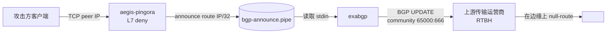

# BGP RTBH

**语言：** [English](../en/19-bgp-rtbh.md) · [Русский](../ru/19-bgp-rtbh.md) · **中文**

BGP RTBH（Remote-Triggered Black Hole，远程触发黑洞路由）子系统会通过 ExaBGP 的文件管道，向你的上游传输运营商通告带黑洞 community 的主机路由 `/32`（IPv4）或 `/128`（IPv6），从而让敌对流量在运营商的网络边缘被丢弃，而不是堵在你自己主机的瓶颈上。黑洞化的决策是在 L7 层（WAF/蜜罐/风险引擎的裁决）做出的，而不仅仅在 L3/L4，因此同一个 `/32` 既会在流量型攻击时被扩散，也会在针对爬虫农场的高置信度规则命中时被扩散。

事实来源：[`src/bgp_rtbh.rs`](../../src/bgp_rtbh.rs)（调度器、通告器、`is_blackholeable` 门禁）、[`src/arsenal.rs`](../../src/arsenal.rs)（初始化、计数器、`with_bgp_announcer` builder）、[`src/bin/aegis-pingora.rs`](../../src/bin/aegis-pingora.rs)（env 接线）、[`src/proxy/pingora_http.rs`](../../src/proxy/pingora_http.rs)（deny 路径上的触发点）、[`src/proxy/pingora_admin.rs`](../../src/proxy/pingora_admin.rs)（admin API）。

> 成熟度：该模块标记为 `V187`，在 arsenal 注册表中状态为 `live`（[`pingora_admin.rs`](../../src/proxy/pingora_admin.rs) 中的 `bgp_rtbh` 条目）。通告与手动撤销在实时路径上可用。TTL 自动撤销已实现，但后台收集器目前尚未计划在生产中被调用——参见 [TTL 与自动撤销](#ttl-与自动撤销部分实现) 一节。

---

## 为什么需要它

AEGIS 中的丢包后端（nftables/iptables/XDP——参见 [13-xdp-ebpf.md](13-xdp-ebpf.md)）在主机自身的边缘上消化敌对流量。对于流量型（volumetric）攻击，当瓶颈变成主机自己的链路/网卡时，正确的应对是*上游*黑洞：把 `/32` 通告进上游运营商的 RTBH community，丢包发生在运营商的设备上（[`src/bgp_rtbh.rs`](../../src/bgp_rtbh.rs) 的文件头注释）。

FastNetMon 在 L3/L4 层做这件事；AEGIS 则由 L7 裁决来驱动：对爬虫农场做出的 `FullEnforce` 级别拒绝，会扩散出与流量型攻击所产生的同一份 `/32` 列表。



---

## 模块架构

`bgp_rtbh` 模块是一个*调度器*：它做出封禁决策，并把决策写入 `BgpAnnouncer` trait 的某个实现。磁盘/BGP 这些「重活」由外部的 `exabgp` 完成。

| 组件 | 类型 | 角色 |
|---|---|---|
| `BgpAnnouncer` | trait | 通告器抽象：`announce(ip, community)` / `withdraw(ip)`。 |
| `InMemoryAnnouncer` | struct | 用于测试和 dry-run 的 no-op 通告器；把通告/撤销累积在 `Vec` 中，不向外发送任何东西。`new_default()` 中的**默认值**。 |
| `ExabgpPipeAnnouncer` | struct | 以 append-only 方式写入文件/管道，兼容 exabgp 的 stdin-from-file 模式。字段：`path`、`next_hop`。 |
| `BgpRtbhDispatcher` | struct | `RwLock` 保护下的活动集合 `HashMap<IpAddr, Entry>`，幂等的 `announce`、`withdraw`、`expire_ttl`、`active()`。 |

`Entry` 保存 `inserted: Instant` 和 `community: String`。调度器保存 `default_community` 和 `ttl`。

### `BgpAnnouncer` trait

```rust
pub trait BgpAnnouncer: Send + Sync {
    fn announce(&self, ip: IpAddr, community: &str) -> std::io::Result<()>;
    fn withdraw(&self, ip: IpAddr) -> std::io::Result<()>;
}
```

使用 goBGP / FRR 的运维方可以实现该 trait 来替换成自己的通告器，并通过 `ArsenalState::with_bgp_announcer(...)` 传入（[`src/arsenal.rs`](../../src/arsenal.rs)）。

### ExaBGP 行格式

`ExabgpPipeAnnouncer` 写入的正是这样的行（带换行符）：

```text
announce route 1.2.3.4/32 next-hop 192.0.2.1 community 65000:666
withdraw route 1.2.3.4/32 next-hop 192.0.2.1
```

掩码由 `host_mask` 函数生成：IPv4 用 `/32`，IPv6 用 `/128`。写入通过 `write_line` 使用 `OpenOptions::new().create(true).append(true)` 完成——文件不存在时会被创建，因此即使在 exabgp 启动之前写入也是安全的：这些行只是先堆积在文件里（[`src/bin/aegis-pingora.rs`](../../src/bin/aegis-pingora.rs) 中的注释）。

---

## 决策的生命周期

摘自 [`src/bgp_rtbh.rs`](../../src/bgp_rtbh.rs) 的文件头：

| 方法 | 行为 |
|---|---|
| `announce(ip)` | 加入活动集合；通告器发出该路由。**幂等**——对同一 IP 重复通告不会写出任何内容（`contains_key` 检查）。使用 `default_community`。 |
| `announce_with_community(ip, community)` | 同上，但使用显式的 community；`is_blackholeable` 门禁也在这里生效。 |
| `withdraw(ip)` | 从集合中移除；通告器发出 withdraw。若该 IP 本就不在集合中——则为 no-op（不会写出多余的 withdraw）。 |
| `expire_ttl()` | 周期性 GC：早于 `ttl` 的条目会被自动撤销（以免攻击方永远挂在黑洞里）。返回被撤销的数量。 |
| `active()` | 返回 `Vec<(IpAddr, String /*community*/, Duration /*年龄*/)>`。 |
| `len()` / `is_empty()` | 活动集合的大小。 |

---

## 何时触发通告

实时路径上的触发点位于 [`src/proxy/pingora_http.rs`](../../src/proxy/pingora_http.rs)（`V187` 代码块）中，处于 deny 裁决的处理逻辑内部（在请求已被某个过滤器拦截之后）：

```rust
if let Some(arsenal) = &self.arsenal {
    let recent = self.scorer.score(client_ip).0;
    if (recent >= 80.0 || filter_name == "honeypot")
        && arsenal.bgp_rtbh.announce(client_ip).is_ok()
    {
        arsenal.counters.bgp_rtbh_announces.fetch_add(1, Ordering::Relaxed);
        cluster_bump(cluster_idx::RTBH);
    }
}
```

通告条件是**逻辑或**：

| 条件 | 含义 |
|---|---|
| `recent >= 80.0` | 客户端当前的风险评分（`self.scorer.score(client_ip).0`）>= 80——属于高置信度的拒绝类别。 |
| `filter_name == "honeypot"` | 请求命中了蜜罐陷阱——明确无疑的恶意客户端，无论评分如何都通告。 |

关键特性：

- **`client_ip` 是 TCP 对端地址**（见下文的安全不变量），而不是取自请求头的值。
- 通告是 **best-effort** 的：`announce()` 失败（例如被门禁检查拒绝）只是不计数，也不会暴露给访问者——计数器 `bgp_rtbh_announces` 只在 `Ok(())` 时才递增。
- 同一条 deny 路径还会并行调用 `record_bot(...)`，并在（`honeypot`/`waf` 的情况下）调用 JA4 信誉自学习 `observe_bad(...)`——参见 [12-reputation.md](12-reputation.md)。
- 通告会被镜像到集群槽位 `cluster_idx::RTBH` 供时间序列采样器使用，使 BGP 事件进入机群遥测（[25-metrics-telemetry.md](25-metrics-telemetry.md)）。

> 关于与评分的关系：`>=80` 阈值与 enforce 模式由风险引擎设定——参见 [18-ml-risk-engine.md](18-ml-risk-engine.md)。RTBH 通告发生在实际拒绝的那一步；而拒绝这件事本身由 WAF/bot/蜜罐/限速过滤器决定。

---

## 安全不变量（调用方必须遵守）

`announce` 方法的文档（[`src/bgp_rtbh.rs`](../../src/bgp_rtbh.rs)）直接规定：

> `ip` **必须**是连接的内核级 TCP 对端地址（按操作系统所见，已接受套接字的远端）。它**绝不能**是从请求头推导出的地址（`X-Forwarded-For`、`X-Real-IP`、`Forwarded`、`CF-Connecting-IP` 等）。

原因：该流程是在请求*上游运营商*把某个地址黑洞掉。请求头完全受攻击者控制，因此从请求头推导 IP 会让任何客户端都能报出**受害者**的 IP，迫使运营商去 null-route 它——这就是一个远程触发式 DoS / 滥用原语。地址必须来自套接字（无法伪造，除非是 on-path 欺骗，而对这种情况 BGP RTBH 本来也无能为力）。

### 纵深防御：`is_blackholeable` 门禁

此外，`announce_with_community` 会拒绝那些不允许在运营商侧被黑洞化的目标，**无论该 IP 从何而来**。被拒绝的目标会返回 `ErrorKind::InvalidInput`，并且什么都不通告。被拒绝的有：

| 类别 | IPv4 | IPv6 |
|---|---|---|
| unspecified | `0.0.0.0` | `::` |
| loopback | `127.0.0.0/8` | `::1` |
| multicast | `224.0.0.0/4` | `ff00::/8` |
| broadcast | `255.255.255.255` | — |
| link-local | `169.254.0.0/16` | `fe80::/10` |
| private (RFC1918) | `10/8`、`172.16/12`、`192.168/16` | — |
| unique-local | — | `fc00::/7` |
| documentation (TEST-NET) | `is_documentation()`（`192.0.2/24`、`198.51.100/24`、`203.0.113/24`） | — |
| CGNAT (RFC6598) | `100.64.0.0/10` | — |

IPv4-mapped IPv6（`::ffff:0:0/96`）会被展开成 IPv4 并按 IPv4 规则检查，以免 mapped 的私有/回环地址从 v6 分支「溜过去」。

这意味着只有看起来确实是公网单播的主机才能被黑洞化。文档用途的地址段（`203.0.113.x` 之类）现在会被拒绝——调度器的测试中使用的是真实的公网空间（`9.9.9.x`，Quad9）。

---

## 配置（env）

接线代码位于 [`src/bin/aegis-pingora.rs`](../../src/bin/aegis-pingora.rs)。`ArsenalState::new_default()` 构建的调度器使用 in-memory/noop 通告器（决策不会离开进程）。在实际启动时，二进制默认装配真实的基于文件的 `ExabgpPipeAnnouncer`。

| 变量 | 用途 | 默认值 |
|---|---|---|
| `AEGIS_BGP_PIPE` | 写入 `announce route …` / `withdraw route …` 的管道/文件路径。**空字符串**表示保留 in-memory noop 通告器（完全不对外扩散）。 | `/var/lib/aegis/bgp-announce.pipe` |
| `AEGIS_BGP_NEXTHOP` | 所通告的 `/32`/`/128` 的 BGP next-hop。 | `192.0.2.1`（TEST-NET-1，RFC5737——**不可路由的占位符；必须**用真实的 RTBH next-hop 覆盖） |
| `AEGIS_ARSENAL` | 设为 `0` 会关闭整个 arsenal（包括 BGP RTBH），用于基准测试的基线对比。 | 启用 |

> community 在 `new_default()` 与 `with_bgp_announcer()` 中被硬编码为 `"65000:666"`（[`src/arsenal.rs`](../../src/arsenal.rs)）。截至撰写时它没有独立的环境变量。要修改它，要么改代码，要么替换成自己的 `BgpAnnouncer`，由它自行构造所需的 community。`announce_with_community` 的逻辑接受任意 community，但 deny 路径调用的是 `announce(ip)`，后者使用 `default_community`。

通告器的选择逻辑（简化自二进制代码）：

```rust
let bgp_pipe = std::env::var("AEGIS_BGP_PIPE")
    .unwrap_or_else(|_| "/var/lib/aegis/bgp-announce.pipe".to_string());
if bgp_pipe.trim().is_empty() {
    // noop: 黑洞决策留在进程内部
    ArsenalState::new_default()
} else {
    let next_hop = std::env::var("AEGIS_BGP_NEXTHOP")
        .unwrap_or_else(|_| "192.0.2.1".to_string());
    let announcer = Arc::new(ExabgpPipeAnnouncer::new(bgp_pipe.into(), next_hop));
    ArsenalState::new_default().with_bgp_announcer(announcer)
}
```

这些变量也在 admin 的 env 注册表中声明（[`pingora_admin.rs`](../../src/proxy/pingora_admin.rs)：`EnvEntry { key: "AEGIS_BGP_PIPE", ... }`、`EnvEntry { key: "AEGIS_BGP_NEXTHOP", ... }`）。

### exabgp 配置示例

AEGIS 只负责把行写入文件；启动并对接 exabgp 是运维方的任务。典型方案：

```ini
# /etc/exabgp/exabgp.conf
neighbor 198.51.100.1 {     # 你的上游传输/上联路由器
    router-id 203.0.113.10;
    local-address 203.0.113.10;
    local-as 65010;
    peer-as 65000;
    family { ipv4 unicast; ipv6 unicast; }
    api { processes [ aegis-feed ]; }
}

process aegis-feed {
    run /usr/bin/tail -F /var/lib/aegis/bgp-announce.pipe;
    encoder text;
}
```

```bash
# 与 AEGIS 默认值保持一致的启动方式
export AEGIS_BGP_PIPE=/var/lib/aegis/bgp-announce.pipe
export AEGIS_BGP_NEXTHOP=192.0.2.1   # 请替换为运营商真实的 RTBH next-hop
exabgp /etc/exabgp/exabgp.conf
```

> 请与你的上游运营商确认 RTBH 所用的确切 community 与 next-hop。`65000:666` 和 `192.0.2.1` 都是占位符。

---

## 撤销（unallow）与清理

撤下通告有三条途径：

1. **通过 admin API 手动撤销**——`POST /admin/api/bgp/withdraw`，请求体为 `{"ip": "1.2.3.4"}`。
2. **TTL 自动撤销**——`expire_ttl()` 会撤销早于 `ttl` 的条目（默认 `3600` 秒）——参见下面的说明。
3. **程序化**——`dispatcher.withdraw(ip)`。

`withdraw` 是幂等的：若该 IP 不在活动集合中，则不会向外写出 withdraw。

### TTL 与自动撤销（部分实现）

`ttl` 在 `BgpRtbhDispatcher::new(...)` 中设置，在 `new_default()`/`with_bgp_announcer()` 中等于 `Duration::from_secs(3600)`（1 小时）。`expire_ttl()` 方法实现正确且有测试覆盖（`expire_ttl_withdraws_old_entries`），它会撤销过期条目并向外发出 withdraw。

> **如实说明：** 截至撰写时，生产代码中还没有周期性调用 `expire_ttl()` 的后台调度器——唯一的调用点在模块自身和测试中（[`src/bgp_rtbh.rs`](../../src/bgp_rtbh.rs)）。这意味着在守护进程运行期间，按 TTL 的*自动*撤销暂时不会自行发生；在周期性 GC 接入之前，请依赖通过 admin API 的手动撤销（`/admin/api/bgp/withdraw`）。在此之前，通告会一直保持到显式 withdraw 或工作进程重启为止。

> 活动集合的状态是**进程内的**（`RwLock<HashMap>`），既不持久化，也不在 SO_REUSEPORT 的各工作进程之间共享。每个 `aegis-pingora@N` 工作进程维护自己的集合，并写入同一个文件管道。重启某个工作进程会清空它在内存中的集合（但不会自动撤销已写入文件/已交给 exabgp 的路由）。参见 [06-workers.md](06-workers.md)。

---

## Admin API 与可观测性

路由（[`src/proxy/pingora_admin.rs`](../../src/proxy/pingora_admin.rs)）：

| 方法 | 路径 | 动作 |
|---|---|---|
| `GET` | `/admin/api/bgp/announces` | 活动通告列表（`api_bgp_list`）。 |
| `POST` | `/admin/api/bgp/withdraw` | 手动撤销某个 `/32`（`api_bgp_withdraw`），请求体 `{"ip": "..."}`。 |

认证与角色与 admin API 的其余部分一致（`x-admin-token`/会话/角色），参见 [30-admin-api.md](30-admin-api.md)。

`GET /admin/api/bgp/announces` 的响应示例：

```json
{
  "wired": true,
  "active_count": 1,
  "active": [
    { "ip": "9.9.9.9", "community": "65000:666", "age_secs": 42 }
  ]
}
```

若 arsenal 未接入，则返回 `{ "wired": false, "active": [] }`。

`POST /admin/api/bgp/withdraw`：

```bash
curl -X POST https://<host>/admin/api/bgp/withdraw \
  -H "x-admin-token: $AEGIS_ADMIN_TOKEN" \
  -H "content-type: application/json" \
  -d '{"ip":"9.9.9.9"}'
# 200 -> {"ok":true,"ip":"9.9.9.9"}
# 400 -> {"error":"bad ip"}  IP 无效时
# 503 -> {"error":"arsenal not wired"}  若 arsenal 被关闭
```

### 计数器

在 `Counters`/`CounterSnapshot`（[`src/arsenal.rs`](../../src/arsenal.rs)）中有两个分片计数器：

| 计数器 | 递增时机 |
|---|---|
| `bgp_rtbh_announces` | 在 deny 路径上通告成功时。 |
| `bgp_rtbh_withdraws` | 在撤销时（在集成测试中会递增；实时路径上的 deny 逻辑只递增 announces）。 |

它们通过 `/admin/api/arsenal` 以如下代码块的形式给出：

```json
"bgp_rtbh": { "announces": N, "withdraws": M, "active": K }
```

其中 `active` = `arsenal.bgp_rtbh.len()`。参见 [25-metrics-telemetry.md](25-metrics-telemetry.md) 和 [29-admin-panel.md](29-admin-panel.md)。

---

## 与 Defence Arsenal / 执行器的关系

`ActionKind::BgpAnnounce` 存在于执行器（actuator）注册表中（[`src/actuator.rs`](../../src/actuator.rs)，字符串 `"bgp_announce"`），并且 `new_default()` 会为它预注册一个 `NoopActuator`，以便在接入真实后端之前，标准的动作类型就能显示在 `/admin/api/arsenal` 中。也就是说，「场景/执行器 → bgp_announce」这条路径在注册表层面是以 **no-op 占位**形式存在的；通告的真实扩散走的是上文所述 deny 路径上对 `arsenal.bgp_rtbh.announce(...)` 的直接调用。关于执行器与场景的更多内容——[21-arsenal-scenarios.md](21-arsenal-scenarios.md)。

---

## 运维检查清单

1. 与上游运营商确认 RTBH 的 community 与 next-hop。
2. 启动读取 `AEGIS_BGP_PIPE` 的 exabgp（`tail -F` 进程或等效方式）。
3. 设置 `AEGIS_BGP_PIPE`（或保留默认值）以及 `AEGIS_BGP_NEXTHOP=<真实 next-hop>`。
4. 确认 `AEGIS_ARSENAL` 不等于 `0`。
5. 确认 AEGIS 看到的是真实的 TCP 对端 IP（而不只是上游 LB 的地址）——否则被黑洞化的将是代理/负载均衡器的地址。参见 [07-protocols.md](07-protocols.md)。
6. 通过 `/admin/api/bgp/announces` 监控活动集合，并通过 `/admin/api/bgp/withdraw` 撤下误报的通告。
7. 在后台 TTL GC 接入之前，请规划定期手动清理过期通告。

---

## 另见

- [13-xdp-ebpf.md](13-xdp-ebpf.md)——主机边缘上的本地丢包（XDP/eBPF）。
- [14-rate-limiting.md](14-rate-limiting.md)——升级到黑洞之前的限速。
- [18-ml-risk-engine.md](18-ml-risk-engine.md)——风险评分（`>=80` 阈值）与 enforce 模式。
- [17-honeypot-tarpit.md](17-honeypot-tarpit.md)——触发通告的蜜罐裁决。
- [12-reputation.md](12-reputation.md)——基于同一批 deny 事件的 JA4 自学习。
- [21-arsenal-scenarios.md](21-arsenal-scenarios.md)——arsenal、执行器、场景。
- [25-metrics-telemetry.md](25-metrics-telemetry.md)——计数器与 RTBH 集群槽位。
- [30-admin-api.md](30-admin-api.md)——admin API 的认证与路由。
