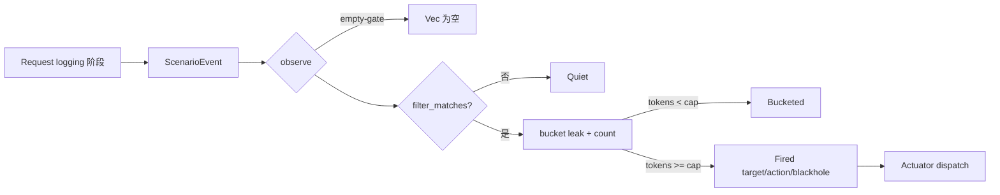

# Defence Arsenal、场景与处置器

**语言：** [English](../en/21-arsenal-scenarios.md) · [Русский](../ru/21-arsenal-scenarios.md) · **中文**

Defence Arsenal（`src/arsenal.rs`）是 V176–V205+ 全部可选防御子系统的"伞形"
持有者：JA4 语料库、载荷归一化、H2 预算、蜜罐、route-difficulty、BGP RTBH、
情报聚合（enrichment）、行为场景（CrowdSec 风格）、主动响应处置器、challenge
军械库以及欺骗层（deception）。本文描述军械库究竟包含什么、如何启用
（`with_arsenal`）、场景 YAML-DSL 的构造方式（按事件进行 bucket 匹配、`Fired`
动作、跨 worker 持久化 `/var/lib/aegis/scenarios.yaml`）、处置器如何工作
（`ActionKind`）、route-difficulty、欺骗战术以及 Sicherheitstacho 事件格式。

> 关于"opt-in"的坦诚说明。军械库是可选基础设施，并非正确性关键路径的
> 一部分。许多模块随附 `NoopActuator`/`StubLlm`/空集合，它们"记录意图"并
> 推动计数器，但在运维人员接入真正的后端之前不会执行真实的副作用。
> 下文对每一处这样的情况都做了明确标注。

相关文档：[WAF](10-waf.md)、[TLS 指纹](11-tls-fingerprinting.md)、
[信誉](12-reputation.md)、[XDP/eBPF](13-xdp-ebpf.md)、
[限速](14-rate-limiting.md)、[challenge ladder](15-challenge-ladder.md)、
[Privacy Pass](16-privacy-pass.md)、[蜜罐/tarpit](17-honeypot-tarpit.md)、
[ML 风险引擎](18-ml-risk-engine.md)、[BGP RTBH](19-bgp-rtbh.md)、
[GeoIP](20-geoip.md)、[情报聚合](22-enrichment.md)、
[安全模型](23-security-model.md)、
[指标/遥测](25-metrics-telemetry.md)、
[admin 面板](29-admin-panel.md)、[admin API](30-admin-api.md)。

---

## 1. 什么是 Defence Arsenal

`ArsenalState`（`src/arsenal.rs`）把每个模块都放在 `Arc<…>` 之后，使请求路径上的
代码可以无锁地取得共享句柄（`arsenal.route_difficulty`、
`arsenal.scenarios`……）。活动计数器是 `ShardedCounter`
（per-CPU cache-padded 分片，V229），因此请求路径以无锁方式递增它们，
而 `/admin/api/arsenal` 端点读取快照。

### 1.1. 组成（`ArsenalState` 字段）

| 字段 | 类型 | 用途 | 文件 |
|------|-----|------------|------|
| `ja4_corpus` | `Arc<Ja4Corpus>` | 按 JA4 给出 allow/deny 裁决 | `src/ja4_corpus.rs` |
| `ja4_churn` | `Arc<Ja4ChurnTracker>` | 检测同一 IP 的 JA4 轮换 | `src/ja4_churn.rs` |
| `param_profile` | `Arc<ParamProfileStore>` | 参数取值画像 | `src/param_profile.rs` |
| `h2_budget` | `Arc<H2BudgetTracker>` | HTTP/2 控制帧的令牌桶（Rapid-Reset） | `src/h2_budget.rs` |
| `llm_honeypot` | `Arc<LlmHoneypot>` | LLM 蜜罐（默认 `StubLlm`） | `src/llm_honeypot.rs` |
| `yaml_honeypot` | `Arc<YamlHoneypotEngine>` | 多步 YAML 蜜罐 | `src/honeypot_yaml.rs` |
| `route_difficulty` | `Arc<DifficultyTable>` | 按路由的 challenge 难度 | `src/route_difficulty.rs` |
| `bgp_rtbh` | `Arc<BgpRtbhDispatcher>` | RTBH 通告（ExaBGP） | `src/bgp_rtbh.rs` |
| `rule_plan` | `ArcSwapOption<RulePlan>` | WAF 规则按阶段的调度计划 | `src/rule_planner.rs` |
| `actuators` | `Arc<ActuatorRegistry>` | 主动响应 + timer-wheel | `src/actuator.rs` |
| `enrichment` | `Arc<RwLock<EnrichmentFacade>>` | WISE 风格的情报聚合门面 | `src/enrichment.rs` |
| `scenarios` | `Arc<ScenarioEngine>` | 行为漏桶 DSL | `src/scenarios.rs` |
| `chained_trust` | `Arc<ChainedTrustStore>` | 通过 captcha 之后的信任递进 | `src/chained_trust.rs` |
| `privacy_pass` | `Arc<PrivacyPassVerifier>` | Privacy Pass 令牌校验 | `src/privacy_pass.rs` |
| `adaptive_ladder` | `Arc<AdaptiveLadder>` | 自适应 challenge 阶梯 | `src/adaptive_ladder.rs` |
| `deception` | `Arc<DeceptionStats>` | decoy/蜜罐字段/varied-errors 的计数器 | `src/challenge_deception.rs` |
| `domain_challenge` | `ArcSwap<HashMap<String, DomainChallengeConfig>>` | 按域名的 challenge 覆盖 | `src/arsenal.rs` |
| `counters` | `Arc<Counters>` | 按模块的活动计数器 | `src/arsenal.rs` |

`aegis-pingora` 二进制（`src/bin/aegis-pingora.rs`）在启动时记录
`modules = 18` —— 这是绑定到军械库的集合大小。

### 1.2. 可选性与防御性默认值

如果军械库未绑定，每个 getter 返回 `None`，请求路径会干净地短路
（`src/lib.rs:164`）。构造函数 `ArsenalState::new_default()`
会立即注册"活的"默认值，以便计数器真的能够触发：

* **YAML 蜜罐** —— 来自常量 `DEFAULT_HONEYPOT_YAML` 的内置描述符
  （`fake-phpmyadmin`、`fake-wp-login`、`fake-dotenv`、`fake-git-config`）。运维人员
  用 `AEGIS_HONEYPOT_YAML` 指定的文件覆盖整个集合。
* **Enrichment** —— 注册源 `ja4-corpus`
  （`Ja4CorpusEnrichmentSource`），使 `enrich_ja4()` 真正做事。
* **Route-difficulty** —— 启用预设 `enable_ai_scraper_preset(true)` 与
  `enable_auth_preset(true)`。
* **Actuators** —— 为 `XdpDeny`、`NftDrop`、`BgpAnnounce`、`ChallengeFloorRaise`
  预注册 `NoopActuator`，使得在接入真实后端之前，标准动作种类就已经能在
  `/admin/api/arsenal` 中看到（仅记录意图）。

---

## 2. 启用军械库：`with_arsenal`

军械库通过三个同名 builder 方法 `with_arsenal(...)` 绑定到数据平面的
三个子系统：

| 子系统 | 文件 | 绑定带来什么 |
|------------|------|-------------------|
| `AegisPingoraProxy` | `src/proxy/pingora_http.rs:1120` | 请求路径获得对场景/蜜罐/route-difficulty/h2-budget 的访问 |
| Admin server | `src/proxy/pingora_admin.rs:892` | `/admin/api/arsenal`、`/admin/api/scenarios`、`/admin/api/actions`、`/admin/api/challenge` 端点开始返回真实数据 |
| Background service | `src/proxy/pingora_background.rs:166` | 后台 tick：`actuators.tick()`、`scenarios.gc(...)`、`scenarios.maybe_reload()` |

### 2.1. 环境变量开关 `AEGIS_ARSENAL`

在二进制中（`src/bin/aegis-pingora.rs:1434`）：

```rust
let arsenal_enabled = std::env::var("AEGIS_ARSENAL").ok().as_deref() != Some("0");
```

也就是说军械库默认启用；`AEGIS_ARSENAL=0` 将其关闭（此时三个 builder
都收到 `None`）。该值可在 `/admin/api/...` 中看到
（`pingora_admin.rs:2848`：`"arsenal_enabled": ... != Some("0")`），并已
登记在环境变量注册表中（`pingora_admin.rs:115`，
`EnvKind::Bool`）。

### 2.2. 相关的启动环境变量

| 变量 | 默认值 | 用途 |
|------------|--------|------------|
| `AEGIS_ARSENAL` | （开启） | `0` 完全关闭军械库 |
| `AEGIS_HONEYPOT_YAML` | （内置） | YAML 蜜罐描述符文件的路径 |
| `AEGIS_BGP_PIPE` | `/var/lib/aegis/bgp-announce.pipe` | 用于 ExaBGP 通告的 pipe/文件；空字符串 → noop announcer |
| `AEGIS_BGP_NEXTHOP` | `192.0.2.1`（TEST-NET-1，占位） | RTBH `/32`/`/128` 路由的 next-hop —— 必须覆盖 |
| `AEGIS_CHALLENGE_CONFIG_PATH` | `/var/lib/aegis/domain-challenge.json` | 按域名 challenge 配置的持久化（V245） |
| `AEGIS_SCENARIOS_PATH` | `/var/lib/aegis/scenarios.yaml` | 场景的持久化（V246） |
| `AEGIS_EVENT_FORMAT` | `native` | `sicherheitstacho`/`tpot` 切换 EventBridge 的 NDJSON 格式 |

BGP 接线：`new_default()` 构造带 in-memory/noop announcer 的
`BgpRtbhDispatcher`（通告不会离开进程）。二进制默认通过
`with_bgp_announcer(...)` 装上基于文件的 `ExabgpPipeAnnouncer`
（`src/bin/aegis-pingora.rs:1476`）。参见 [BGP RTBH](19-bgp-rtbh.md)。

---

## 3. 场景（CrowdSec 风格的漏桶 DSL）

模块 `src/scenarios.rs`（V199）是一个极小的 YAML-DSL，用于"在 T 时间内
N 个事件"这类行为检测 —— 扁平的限速旋钮
（`rps`/`burst`/`per-host`）无法表达这一点。

### 3.1. 语法

```yaml
name: http_login_brute
description: "同一 IP 对 /login 产生大量 401"
filter:
  path_prefix: /login
  status_min: 400
  status_max: 499
groupby: client_ip       # 桶的键
distinct: path           # 可选 —— 只统计唯一值
capacity: 10             # 桶的容量
leak_speed: 10s          # 每 10s 漏出一个令牌
blackhole: 5m            # 封禁目标 5 分钟
action: block            # block | challenge | tarpit | log
```

解析器 `ScenarioEngine::parse_yaml` 接受单个场景或一个列表。

### 3.2. `ScenarioConfig` 的字段

| 字段 | 类型 | 必填 | 备注 |
|------|-----|:-----:|------------|
| `name` | `String` | 是 | 场景名；桶键的一部分 |
| `description` | `String` | 否 | 默认 `""` |
| `filter` | `ScenarioFilter` | 否 | 默认为空（匹配一切） |
| `groupby` | `GroupBy` | 是 | 分桶的键 |
| `distinct` | `Option<DistinctField>` | 否 | 在桶内按字段值去重 |
| `capacity` | `u32` | 是 | 当 `tokens >= capacity` 时场景触发 |
| `leak_speed` | `Duration` | 是 | 字符串形式：`100ms`/`5s`/`2m`/`1h`/`1d`/裸秒数 |
| `blackhole` | `Option<Duration>` | 否 | 动作的 TTL，传给处置器 |
| `action` | `ScenarioAction` | 是 | `block`/`challenge`/`tarpit`/`log` |

**`ScenarioFilter`**（所有字段均为 `Option`，缺省即不做限制）：
`method`、`path_prefix`、`path_contains`、`path_suffix`、`host`、
`user_agent_contains`、`status`、`status_min`、`status_max`、`asn`、`country`。
匹配规则：`method`/`host` 不区分大小写；`user_agent_contains` 为
不区分大小写的 `contains`；状态码区间用 `status_min`/`status_max`
（无状态码的事件不通过 min/max）。

**`GroupBy`**（`snake_case`）：`client_ip`、`client_ip_user_agent`、`host`、
`host_path`、`user_agent`、`asn`。

**`DistinctField`**（`snake_case`）：`path`、`user_agent`、`host`、`status`。

**`ScenarioAction`**（`snake_case`）：`block`、`challenge`、`tarpit`、`log`。

### 3.3. 按事件的 bucket 匹配

事件即 `ScenarioEvent`（`client_ip`、`method`、`host`、`path`、`user_agent`、
`status`、`asn`、`country`）。在请求路径上（`src/proxy/pingora_http.rs:3746`）
事件在 logging 阶段构造。目前填充的是 `client_ip`、
`method`、`host`、`path`、`status`；`user_agent`、`asn`、`country` 字段传
`None`（坦诚说明：DSL 中按 UA/ASN/country 的过滤器解析器已经支持，但只有当
事件携带这些字段时才会匹配 —— 目前在实时路径上它们是空的）。

`ScenarioEngine::observe(event)` **按加载顺序**遍历每一个已加载的场景，
返回 `Vec<FireOutcome>`（不匹配的为 `Quiet`，以便按下标做关联）。桶的
逻辑：

1. **Empty-gate**：如果什么都没加载 —— 只有一次 relaxed 原子读取和一个
   空 `Vec`（热的 logging 路径不碰 RwLock）。
2. **filter_matches** —— 否则为 `Quiet`。
3. 桶键是 `DashMap`（128 分片，V230）中的 `(scenario_name, groupby_value)`。
4. **Leak first**：漏出 `leak_ticks = floor(elapsed / leak_speed)` 个令牌。
5. **distinct**：只有当该 `distinct` 值在此桶中尚未出现过时才增加令牌
   （`HashSet::insert`）。
6. **Fire**：当 `tokens >= capacity` —— 重置桶（tokens=0，清空
   distinct/recent）并返回 `FireOutcome::Fired { target, action, blackhole }`。否则为
   `FireOutcome::Bucketed { tokens, capacity }`。

语义是"N strikes and you're out"：`capacity: 10` 在第 10 个事件时触发
（`>=`），而不是第 11 个。触发时的重置保证只触发一次，而不是在漏空之前
对之后的每一个请求都触发。



### 3.4. `Fired` → 处置器调度

在请求路径上（`src/proxy/pingora_http.rs:3756`）每个 `Fired` 都被映射为
`ActionKind`，并通过处置器注册表以 TTL = `blackhole` 施加：

| `ScenarioAction` | `ActionKind` |
|------------------|--------------|
| `Block` | `ActionKind::XdpDeny` |
| `Challenge` | `ActionKind::ChallengeFloorRaise` |
| `Tarpit` | `ActionKind::Custom("scenario_tarpit")` |
| `Log` | `ActionKind::Custom("scenario_log")` |

`target` 被解析为 `Target::Ip(...)`，失败时解析为 `Target::Custom(...)`。
`ActionParams { reason: "scenario_fired", source_module: "scenarios", .. }`。
每次触发都会推动 `counters.scenario_fires` 与 `counters.actuator_applies`；
每个事件推动 `counters.scenario_events`。

> 坦诚说明：只有当运维人员为相应的 `ActionKind` 把 `NoopActuator` 换成真正的
> 后端时，才会产生真实的副作用（写入 XDP-deny、nft、BGP）。默认情况下
> `XdpDeny`/`ChallengeFloorRaise` 是 Noop，也就是
> "intent recorded"，动作在 `/admin/api/actions` 中可见，但并未强制执行。
> `Custom("scenario_tarpit"/"scenario_log")` 根本没有预注册 —— 没有注册时
> `apply` 会返回 `Outcome::Failed`（计数器 `failed`）。

### 3.5. 统计与 GC

`ScenarioStats`：`events_observed`、`events_matched`、`events_bucketed`、
`buckets_fired`（原子量，通过 `stats()` 取快照）。`bucket_count()` 是
存活桶的数量。`gc(idle)` 删除超过 `idle` 未被观测的桶；
后台服务调用 `gc(600s)`（`pingora_background.rs:344`）。

### 3.6. 跨 worker 持久化（`/var/lib/aegis/scenarios.yaml`）

由于 `SO_REUSEPORT`，每个 worker `aegis-pingora@0..N` 都是独立进程
（参见[多进程](06-workers.md)）。没有磁盘的话，面板上的
"Load" 只会落在一个 worker 上。V246 解决了这一点：

* `ScenarioEngine::set_persistence(path)`（`src/scenarios.rs:221`）—— 从
  二进制（`src/bin/aegis-pingora.rs:1493`）以 `AEGIS_SCENARIOS_PATH` 的路径调用
  （默认 `/var/lib/aegis/scenarios.yaml`）；随即加载已有文件。
* `save_yaml(yaml)` —— 对运维人员的**原始 YAML** 做原子写入（通过 `.tmp` +
  `rename`）。之所以是原始文本而非解析后的结构：`leak_speed`/`blackhole`
  从字符串（`"10s"`）反序列化，但序列化时会写成 `{secs,nanos}`，
  重新加载时 YAML 解析器会拒绝它。
* `maybe_reload()` —— mtime 轮询：便宜的 `stat()`，文件变化时
  REPLACE 内存中的集合。由每个 worker 的后台 tick 调用
  （`pingora_background.rs:348`），因此在一个 worker 上的"Load"会在轮询窗口内
  收敛到整个机群，并且能挺过重启。
* `load_many(cfgs)` —— **REPLACE**（而非追加）：面板发送完整的
  期望集合；空的 `load_many` 会正确地清空场景。

端点（参见 [admin API](30-admin-api.md)）：`GET /admin/api/scenarios` 返回
已加载的集合 + 统计 + `buckets_active`；通过军械库处理器写入时会调用
`load_many(...)`，随后调用 `save_yaml(...)`
（`pingora_admin.rs:1898`、`:1903`）。

---

## 4. 处置器（主动响应，`ActionKind`）

模块 `src/actuator.rs`（V197）是带集中式 timer-wheel 的统一主动响应
注册表。思路（Wazuh active-response + Falco Talon）：用一个
`(action_kind, target, params, revert_after, applied_at)` 的注册表，取代
每个子系统各自重新发明定时器。

### 4.1. `ActionKind`

| 变体 | `as_str()` | 在 `new_default()` 中预注册 Noop |
|---------|------------|:----------------------------------------:|
| `XdpDeny` | `xdp_deny` | 是 |
| `NftDrop` | `nft_drop` | 是 |
| `BgpAnnounce` | `bgp_announce` | 是 |
| `ChallengeFloorRaise` | `challenge_floor_raise` | 是 |
| `ResponseCachePoison` | `response_cache_poison` | 否 |
| `Custom(&'static str)` | 名称 | 否 |

`Custom` 携带 `&'static str`，以便计数器 map 的基数保持
有界。

### 4.2. `Target`

`Ip(IpAddr)`、`Subnet(IpAddr, u8)`、`UserAgent(String)`、`Path(String)`、
`Custom(String)`。方法 `as_display()` 渲染为人类可读形式
（`10.0.0.0/24`、`ua:curl/8`、`path:/admin` 等）。

### 4.3. `Actuator` trait 与 `NoopActuator`

```rust
pub trait Actuator: Send + Sync {
    fn kind(&self) -> ActionKind;
    fn apply(&self, target: &Target, params: &ActionParams) -> Outcome;
    fn revert(&self, target: &Target) -> Outcome;
}
```

`Outcome`：`Applied` / `AlreadyApplied` / `Failed`。`NoopActuator` 是参考
实现：持有 `HashSet<Target>`，`apply` 返回 `Applied`/`AlreadyApplied`，
`revert` 清除记录。在测试中有用，也可作为"仅记录意图"的占位，直到
运维人员接入真正的后端 —— 动作依然会出现在
`/admin/api/actions` 中。

### 4.4. `ActuatorRegistry`：语义

* `register(actuator)` —— 同一种类的最后一次注册获胜（可以在不重启的情况下
  把 Noop 换成真实实现）。
* `apply(kind, target, params, revert_after)` —— **幂等**：对同一
  `(kind, target)` 重复施加只会推移 `revert_at`，而不会产生多条记录。
  如果该种类没有处置器 —— 返回 `Failed` + 计数器 `failed`。`revert_after = None`
  意为"直到手动撤销"。
* `revert(kind, target)` —— 手动撤销（运维/DELETE）。
* `tick()` —— 后台清扫（由后台服务每秒调用一次，
  `pingora_background.rs:336`）：回滚所有 `revert_at` 已过期的项；推动
  `reverted_on_expiry`。
* `active_actions()` / `active_count()` —— 活动项的列表/计数。
* `registered_kinds()` —— 已注册的种类（供面板使用）。

`ActuatorStats`：`applied`、`already_applied`、`failed`、`reverted_on_expiry`、
`reverted_manually`。

设计原则：单一事实来源（`/admin/api/actions` —— 所有子系统的全部主动
响应）、有限的影响半径（每个动作都有回滚截止时间，或显式的 `Never`）、
幂等性、通过 `SecurityEvent` 审计。

### 4.5. Admin API

`/admin/api/actions`（GET）—— 活动项列表 + 统计
（`pingora_admin.rs:1929`）。DELETE 处理器调用
`arsenal.actuators.revert(kind, &target)`（`pingora_admin.rs:1994`）。详情见
[admin API](30-admin-api.md)。

---

## 5. Route difficulty（按路由的 challenge 难度）

模块 `src/route_difficulty.rs`（V186，Anubis 风格）：当难度随被保护路由的
成本而伸缩时，PoW 闸门的效果更好。廉价的
路由（静态资源）—— 低难度；昂贵的（search、reset password）则可以
让客户端用数秒 CPU 来"付费"。

### 5.1. 类型

* `ChallengeKind`：`CookieRedirect`、`Captcha`、`JsPow { difficulty_bits: u8 }`。
* `DifficultyOverride`：`host`、`path_pattern`、`difficulty_bits`、
  `force_kind: Option<ChallengeKind>`。

### 5.2. 预设（在 `new_default()` 中启用）

* **`ai-scraper-mode`**（`enable_ai_scraper_preset`）：如果 UA 包含
  `gptbot`/`ccbot`/`claude-web`/`anthropic-ai`/`perplexitybot`/`youbot`/
  `facebookbot`/`amazonbot`/`google-extended`/`bytespider` —— 加成 +4 位。
* **`auth-endpoint`**（`enable_auth_preset`）：模式 `*/login`、`*/signup`、
  `*/register`、`*/reset`、`*/forgot` 对 host `*` 获得 `difficulty_bits = 22`
  （baseline 16 + 6）以及强制的 `JsPow { 22 }`。

### 5.3. `decide(host, path, ua, baseline_bits, baseline_kind)`

返回 `(ChallengeKind, u8)`。逻辑：在所有命中的 override 中取 `max`，
应用 `force_kind`，然后加上 UA 加成（取命中 needle 的 `max`），
并归一化：如果最终位数超过 baseline 且当前种类不是 PoW —— 则升级为
`JsPow`，并采用提升后的难度。

### 5.4. 模式匹配（V162 domain-policy 语法）

| 模式 | 语义 |
|--------|-----------|
| `/foo` | 精确匹配 |
| `/foo/*` | 前缀：`/foo` 或 `/foo/...` |
| `*/bar` | 后缀：`.../bar` 或 `bar` |

`host`：`*`（任意）或精确值（不区分大小写）。与 challenge ladder 的关联 ——
参见 [challenge ladder](15-challenge-ladder.md)。计数器
`counters.route_difficulty_bumps`；override 的数量在 `/admin/api/arsenal` 中。

---

## 6. 自适应阶梯（`adaptive_ladder.rs`）

模块 `src/adaptive_ladder.rs`（V204）—— 在 V42 ladder 之上的两层：

1. **异常下的自适应难度**：当异常检测器（V38）置于
   attack-mode 时，每一级都提升 `+attack_mode_bits`（默认 +4）。
2. **随机化顺序**：新客户端不总是先拿到 cookie 级；
   顺序按 IP 哈希确定性地轮转，使攻击者无法
   预先计算出序列。

### 6.1. `AdaptiveConfig`

| 字段 | 默认值 | 用途 |
|------|--------|------------|
| `attack_mode_bits` | `4` | attack-mode 下的位数加成 |
| `randomize_order` | `true` | 按 IP 哈希随机化等级 |
| `fast_track_threshold` | `0.75` | 触发 fast-track 的 suspicion 阈值 |

### 6.2. `decide(ip_hash, suspicion, baseline_bits) -> LadderDecision`

* `attack_mode` → `effective_bits = baseline + bonus`，计数器 `attack_mode_bumps`。
* **fast-track**：`suspicion >= fast_track_threshold` → 当
  `suspicion >= 0.9` 时为 `Captcha`，否则为 `Pow`；位数 `>= 20`；`reason = "fast_track_high_suspicion"`。
* 否则在 `randomize_order` 下 —— `pick_by_hash`（按哈希低位字节约 50% Cookie、25% Reload、15%
  Interaction、9% Pow、1% Captcha），计数器
  `randomized_picks`；关闭随机化时 —— `pick_by_floor`（原子的
  `current_floor`，通过 `set_floor(0..=4)` 提升）。

`ChallengeLevel`：`Cookie`、`Reload`、`Interaction`、`Pow`、`Captcha`。
`LadderStats`：`fast_track_hits`、`attack_mode_bumps`、`randomized_picks`。
Attack-mode 通过 `set_attack_mode(on)` 设置 —— admin API
`POST /admin/api/challenge/attack-mode`（`pingora_admin.rs:1786`）。

---

## 7. 按域名的 challenge 军械库（`DomainChallengeConfig`）

`DomainChallengeConfig`（`src/arsenal.rs`）—— 按 host 的覆盖。运维人员
通过 `/admin/api/sites/<host>/challenge` 写入
（`set_domain_challenge_config`，`pingora_admin.rs:1759`）；守护进程按
请求读取（`domain_challenge_config(host)`）。

### 7.1. 字段（V205 阶段）

`argon2_pow`、`argon2_bits`、`argon2_memory_kb`、`privacy_pass`、`chained_trust`、
`adaptive`、`varied_errors`、`decoy_captcha`、`honeypot_fields`、`trust_for_auth`、
`fast_track_threshold`、`attack_mode_bits`。

### 7.2. challenge 军械库字段（V233+ 阶段，opt-in）

> 坦诚说明：V233+ 是**第 1 阶段（foundation）**。所有新字段默认为
> `None`/`false`，因此已有的 host 不会发生变化。第 1 阶段铺设
> 配置形状 + 计数器；部分信号的真实逻辑会在
> 后续阶段落地。每个信号在 `Counters` 中都有对应的 `challenge_*_hits`
> 计数器，通过 `/admin/api/challenge` 暴露。

| 字段 | 类别 | 信号 |
|------|-----------|--------|
| `ja4_ua_consistency` | passive | TLS JA4 与声称的 User-Agent 对比 |
| `header_fingerprint` | passive | HTTP 头的顺序/大小写 |
| `h2_fingerprint` | passive | HTTP/2 SETTINGS/window/伪首部 |
| `datacenter_asn_challenge` | passive | 在 hosting/VPN ASN 上升级 |
| `headless_detection` | JS | `navigator.webdriver`/自动化痕迹 |
| `webgl_audio_fp` | JS | WebGL renderer + AudioContext |
| `dom_timing_entropy` | JS | rAF 节奏 / timer 伪造 |
| `reputation_difficulty` | enforcement | 依 suspicion 缩放 PoW |
| `fail_to_xdp_deny` | enforcement | N 次 challenge 失败 → XDP-deny |
| `turnstile` | top rung | 存在密钥时使用 Cloudflare Turnstile |
| `proof_of_click` | gesture | hold/click-to-verify |

### 7.3. 持久化（`/var/lib/aegis/domain-challenge.json`）

V245（镜像 `DomainPolicyStore` 模型）：没有磁盘时 `ArcSwap` 会是按 worker 的。
`attach_challenge_persistence(path)`（`src/arsenal.rs:773`）加载已有
文件；每次 `set/clear` 都原子地写入整张 map（`.json.tmp` + `rename`）；读取时
对文件做 mtime 轮询（`refresh_domain_challenge`）。二进制
（`src/bin/aegis-pingora.rs:1485`）从 `AEGIS_CHALLENGE_CONFIG_PATH` 取路径
（默认 `/var/lib/aegis/domain-challenge.json`）。快路径：
`domain_challenge_configured` —— 单个原子量，用于在尚未配置任何 host 时
跳过快照。

参见 [challenge ladder](15-challenge-ladder.md)、[Privacy Pass](16-privacy-pass.md)、
[制图与域名](26-sites-and-domains.md)。

---

## 8. Deception（欺骗层）

四个协作模块。它们只对已然可疑的流量启用 ——
绝不对干净流量启用。

### 8.1. `challenge_deception.rs` —— decoy CAPTCHA + 蜜罐字段 + varied errors

* **Decoy CAPTCHA**（`build_decoy_form_html(scenario_id, salt)`）：向 suspicion
  极高的客户端展示 captcha 表单，但什么都不接受（`DecoyVerdict::BlackHole`
  模式），从而烧掉 solver 的配额。表单按 `salt` 确定性生成
  （同一指纹在重试时看到同一张表单）。
* **蜜罐字段**（`build_honeypot_fields` / `detect_honeypot_fill`）：来自
  `email_confirm`、`phone_number`、`zip_code`、`company`、`fax` 池的隐藏
  字段（`class="honeypot"`、`tabindex="-1"`、CSS off-screen）。真实用户不会
  填写它们；把所有字段都填满的自动化程序会被抓住。任何蜜罐字段的
  非空值 → 立即 deny。
* **Varied error pages**（`ErrorMask`）：按 `salt` 在
  `OriginDnsError`(502)、`GatewayTimeout`(504)、`ServiceUnavailable`(503)、
  `ConnectionReset`(502)、`UpstreamProtocolError`(502) 之间轮换。攻击者搞不清
  是被 Aegis 抓住了还是站点挂了 —— 这会拖慢逆向工程。

`DeceptionStats`：`decoy_forms_rendered`、`honeypot_fills_detected`、
`varied_errors_rendered`（通过 `/admin/api/challenge` 暴露，
`pingora_admin.rs:1316`）。

### 8.2. `decoy_headers.rs` —— Scrapling-inverted CDN 头

模块 `src/decoy_headers.rs`（V188）：自适应爬虫（Scrapling/Botasaurus）
通过头/cookie 判定 WAF/CDN 并加载相应的绕过方案。如果
Aegis 把自己伪装成别家的 CDN，攻击者就会选错 playbook。

`DecoyFamily`：`Cloudflare`、`Akamai`、`Fastly`、`CloudFront`。
`DecoyHeaders::build(family, conn_id)` → `Vec<(&'static str, String)>`，
按 `conn_id` 确定性生成（重试时一致）。示例：

| 家族 | 头 |
|-----------|-----------|
| Cloudflare | `server: cloudflare`、`cf-ray: <16hex>-FRA`、`cf-cache-status: DYNAMIC`、`alt-svc: h3=":443"; ma=86400`、`set-cookie: __cf_bm=…` |
| Akamai | `server: AkamaiGHost`、`x-akamai-request-id`、`x-cache`、`x-reference` |
| Fastly | `server: Varnish`、`x-served-by`、`x-cache: HIT`、`x-fastly-request-id`（32 hex） |
| CloudFront | `server: CloudFront`、`x-amz-cf-pop`、`x-amz-cf-id`、`via` |

策略：`should_decoy(challenge_fired, ml_score, honeypot_hit)` → 若
challenge 触发、蜜罐命中或 `ml_score >= 0.65` 则为 `true`。计数器
`counters.decoy_header_emits`。

### 8.3. `latency_jitter.rs` —— 形状正确的延迟抖动

模块 `src/latency_jitter.rs`（V190）：朴素的 tarpit `sleep(N)` 会给出亚毫秒级的
均匀性，极易被检测。本模块从下列分布中抽取延迟：

* `LogNormal { median_ms, sigma }` —— 通用 RTT 模型；`default_tarpit()` =
  `{ median_ms: 350, sigma: 0.55 }`。
* `BimodalCdn { fast_ms, slow_ms, slow_prob }` —— 模拟 CDN 的 cache-hit/miss；
  `default_decoy()` = `{ fast_ms: 18, slow_ms: 220, slow_prob: 0.15 }`（与
  V188 的 decoy 头配对）。
* `Fixed(ms)` —— 显式覆盖。

`sample(dist, seed)` → `Duration`（由调用方自己 sleep —— 模块不绑定到任何
runtime）。Seed = `conn_id ⊕ 请求计数器`。计数器
`counters.latency_jitter_emits`。

### 8.4. `timing_entropy.rs` —— 输入时序的 ML 特征

模块 `src/timing_entropy.rs`（V189）：headed-Chrome 爬虫
（Botasaurus、undetected_chromedriver）很难模仿**人类的输入时序**。
它基于 JS 采集器的数据（V145 `client_consistency`）计算：

* `move_interval_entropy` —— 鼠标 inter-arrival 的 Shannon 熵（8ms 分箱；人类
  > 3.0，合成 < 1.5）。
* `move_interval_cv` —— 变异系数（人类 > 0.5，均匀定时器
  < 0.1）。
* `scroll_cadence_mad` —— 滚动间隔的中位绝对偏差。

`extract(&TimingSample) -> TimingFeatures { …, anomaly_score }`（0.0 为人类，
1.0 为合成；无数据时丢弃滚动这一维）。计数器
`counters.timing_entropy_calls`、`counters.timing_entropy_synthetic_flags`。
会喂给 ML 引擎 —— 参见 [ML 风险引擎](18-ml-risk-engine.md)。

---

## 9. Sicherheitstacho（T-Pot）事件格式

模块 `src/sicherheitstacho.rs`（V185）—— 导出为德国电信 CERT 的归一化
"Sicherheitstacho" 格式，数十个 T-Pot 蜜罐都汇聚到该格式。
这带来了与 ELK 映射、threat-feed 聚合器以及公开的
Sicherheitstacho 仪表盘的免费互操作性。

### 9.1. Schema（相关子集）

```json
{
  "@timestamp": "2026-05-22T12:34:56.000Z",
  "type":       "Aegis",
  "src_ip":     "203.0.113.7",
  "src_port":   51234,
  "dst_port":   443,
  "country":    "RU",
  "asn":        "AS12345",
  "transport":  "TCP",
  "service":    "aegis-waf",
  "category":   "honeypot",
  "tags":       ["sqlmap", "phpmyadmin-probe"],
  "request": { "method": "POST", "host": "evil.test",
               "path": "/phpmyadmin/index.php", "ua": "sqlmap/1.7" }
}
```

### 9.2. 实现

* `EventInput<'a>` —— 借用字符串（`&'a str`/`&[&str]`），除输出字符串外
  没有额外分配。
* `Category`：`Waf`(`waf`)、`Honeypot`(`honeypot`)、`Tarpit`(`tarpit`)、
  `Challenge`(`challenge`)、`Block`(`block`)。
* `render(&EventInput) -> String` —— 单行 JSON，可直接写入 NDJSON socket。
  当为 `None` 时省略 `country`/`asn`/`ua`。不依赖 serde（手写
  序列化器 + `push_json_string` 转义）；内置的 ISO-8601 渲染器
  `unix_ms_to_iso`（Hinnant 算法，不用 chrono/jiff）。

### 9.3. 生产中的格式选择

EventBridge 的 NDJSON 格式由 `AEGIS_EVENT_FORMAT` 切换
（`src/event_bridge.rs:78`）：`sicherheitstacho` 或 `tpot` → `WireFormat::Sicherheitstacho`；
否则为原生的 `SecurityEvent` JSON。环境变量注册表：`pingora_admin.rs:130`
（`EnvKind::Enum(["native","sicherheitstacho","tpot"])`）。

> 关于计数器的坦诚说明。`sicherheitstacho.emits` 的递增机制已经
> 接上（`with_sicherheitstacho_counter`，`event_bridge.rs:103`）：每一次以
> Sicherheitstacho 格式的 emit 都会推动军械库分片 `sicherheitstacho_emits`。
> 该计数器只有在选择了此格式**并且**绑定了军械库时才增长；在原生
> 格式下它保持为零（`pingora_admin.rs:1170`）。

关于导出/SIEM 的更多内容 —— [指标与遥测](25-metrics-telemetry.md)、
[请求日志](24-request-log.md)。

---

## 10. 军械库计数器（`/admin/api/arsenal`）

`Counters`（`src/arsenal.rs`）—— 按模块的 `ShardedCounter`；`snapshot()` 返回
`CounterSnapshot`。在 `/admin/api/arsenal` 中可见的关键分组
（`pingora_admin.rs:1251`）：

| 分组 | 计数器 |
|--------|----------|
| `ja4_corpus` | `lookups`、`allow_hits`、`deny_hits`、`entries` |
| `ja4_churn` | `observations`、`tracked_ips` |
| `param_profile` | `observations`、`anomalies`、`keys` |
| `h2_budget` | `allows`、`rejects`、`tracked_conns` |
| `honeypot_yaml` | `engagements`、`sessions`、`descriptors` |
| `llm_honeypot` | `responses`、`cached` |
| `sicherheitstacho` | `emits` |
| `route_difficulty` | `bumps`、`overrides` |
| `bgp_rtbh` | `announces`、`withdraws`、`active` |
| `actuators` | `applied`/`failed`/`reverted_*`、`active`、`kinds` |
| `enrichment` | `lookups`、`cache_hits`、`sources` |
| `scenarios` | `events`、`fires`、`loaded`、`buckets` |
| deception/challenge | `decoy_header_emits`、`latency_jitter_emits`、`timing_entropy_*`、`challenge_*_hits`、`adaptive_ladder_decisions`…… |

字段 `wired`（`pingora_admin.rs:1163`）显示军械库是否已绑定。带元数据
（id/版本/家族/label）的模块注册表也列在同一处
（`pingora_admin.rs:1203`）。

---

## 11. 路径与接线一览

| 内容 | 位置 |
|-----|-----|
| 军械库持有者 | `src/arsenal.rs`（`ArsenalState`、`Counters`） |
| 场景（DSL） | `src/scenarios.rs`（`ScenarioEngine`、`ScenarioConfig`、`FireOutcome`） |
| 处置器 | `src/actuator.rs`（`ActuatorRegistry`、`ActionKind`、`Actuator`） |
| Route difficulty | `src/route_difficulty.rs`（`DifficultyTable`） |
| Adaptive ladder | `src/adaptive_ladder.rs`（`AdaptiveLadder`） |
| Deception（表单/错误页） | `src/challenge_deception.rs` |
| Decoy CDN 头 | `src/decoy_headers.rs` |
| Latency jitter | `src/latency_jitter.rs` |
| Timing entropy | `src/timing_entropy.rs` |
| Sicherheitstacho | `src/sicherheitstacho.rs` |
| 与 proxy 的绑定 | `src/proxy/pingora_http.rs:1120`（`with_arsenal`）、`:3756`（observe/fire） |
| 与 admin 的绑定 | `src/proxy/pingora_admin.rs:892` |
| 与 background 的绑定 | `src/proxy/pingora_background.rs:166`（tick/gc/reload） |
| 启动/持久化 | `src/bin/aegis-pingora.rs:1434`–`1504` |
| EventBridge 格式 | `src/event_bridge.rs:78`、`:103` |
