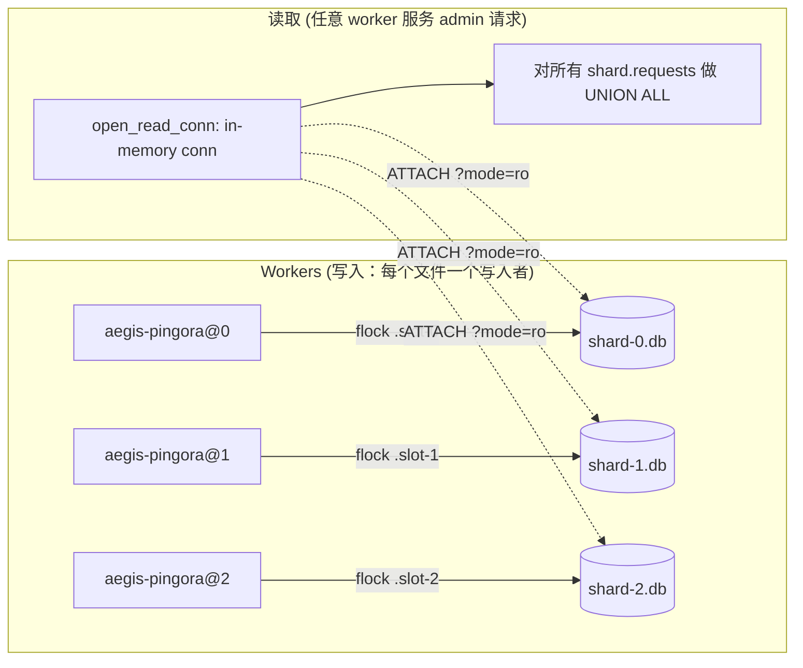

# 请求日志（事件日志）

**语言：** [English](../en/24-request-log.md) · [Русский](../ru/24-request-log.md) · **中文**

AEGIS 的持久化请求日志：每个被服务的请求都可以作为一行写入本地 SQLite 数据库，随后管理面板基于这些数据构建按域名的分析、"任意时间段"的机器人/DDoS 历史、WAF 触发历史以及对请求的全文检索。该子系统实现于 [`src/event_store.rs`](../../src/event_store.rs)；与之并行运行的还有流式事件总线 [`src/event_bridge.rs`](../../src/event_bridge.rs)（通过 Unix 套接字输出 NDJSON），供 SIEM 使用。

> 本文档所依据的源码：[`src/event_store.rs`](../../src/event_store.rs)、[`src/event_bridge.rs`](../../src/event_bridge.rs)、[`src/proxy/pingora_admin.rs`](../../src/proxy/pingora_admin.rs) 中的 `api_logs` / `api_logs_stats` 处理器、[`src/proxy/pingora_http.rs`](../../src/proxy/pingora_http.rs) 中的热路径写入点，以及 [`src/bin/aegis-pingora.rs`](../../src/bin/aegis-pingora.rs) 中的初始化。

这是两个不同的、彼此独立的东西，很容易混淆：

| 子系统 | 是什么 | 传输 | 用途 | 文件 |
|---|---|---|---|---|
| **Event store** | SQLite 中的持久化请求日志 | 磁盘上的本地分片文件 | 管理面板中的历史/分析（`/admin/api/logs*`） | [`src/event_store.rs`](../../src/event_store.rs) |
| **EventBridge** | 安全决策的流式总线 | Unix 套接字，NDJSON | 实时导出到 SIEM（Wazuh/Loki/Splunk/Vector/…） | [`src/event_bridge.rs`](../../src/event_bridge.rs) |

关于指标、Prometheus 和流式遥测的更多内容，见 [docs/25-metrics-telemetry.md](25-metrics-telemetry.md)。

---

## 1. Event store：分片模型（每个 worker 一个 SQLite）

AEGIS 通过 `SO_REUSEPORT` 以多进程方式运行（`aegis-pingora@0..N`，见 [docs/06-workers.md](06-workers.md)）。每个 worker 进程拥有**自己的** SQLite 文件 `<dir>/shard-<slot>.db`，其中 `<slot>` 通过对 `<dir>/.slot-<n>.lock` 的非阻塞 advisory `flock` 获取——与 `site_map` 中完全相同的方案（复用 `crate::site_map::SiteMap::acquire_slot`）。由于该槽位在进程的整个生命周期内被持有，每个数据库文件**恰好只有一个写入者**——写入路径永远不会与其他进程竞争，也不会阻塞在 SQLite 的 busy handler 上。

* 默认目录为 `/var/lib/aegis/events`，可通过 `AEGIS_EVENTS_DIR` 覆盖。
* 槽位探测的最大次数为 `MAX_SLOTS = 16`（与 `site_map::MAX_SLOTS` 一致）。
* 如果没有空闲槽位／目录无法创建／数据库无法打开，存储会降级为 **no-op**（打印 warning，`record` 什么都不做，`shard_path()` 返回 `None`），但进程启动不会失败。



### 读取：ATTACH + UNION ALL

读取侧（`EventStore::query` / `EventStore::stats`）打开一个全新的内存连接（`Connection::open_in_memory`），并通过 URI `file:<path>?mode=ro` 以只读模式 `ATTACH` **每一个**已存在的 `shard-*.db`，别名为 `s0`、`s1`、…。随后基于这些别名构建子查询 `SELECT … FROM s0.requests UNION ALL SELECT … FROM s1.requests …`（`union_all_subquery`）。这样，无论由哪个 worker 服务该 admin 请求，查询都会返回**跨所有 worker** 的稳定聚合结果。

* 无法附加的分片（被锁定/损坏）会被静默跳过（`tracing::debug`），而不会让整个查询失败。
* 如果没有任何分片被附加成功，`query` 返回空向量，`stats` 返回 `LogStats::default()`。
* 分片列表（`shard_files`）是所有形如 `shard-*.db` 的文件，并排序以保证确定性。

---

## 2. 记录字段（`EventRow`）

一条日志行就是 `EventRow` 结构体（`Serialize`/`Deserialize`，因此 admin API 可以直接把查询结果作为 JSON 返回）。`requests` 表结构镜像了这些字段。

| 字段 | SQLite 类型 | 说明 |
|---|---|---|
| `ts` | INTEGER | 时间，Unix **毫秒** |
| `host` | TEXT | 请求的 Host |
| `method` | TEXT | HTTP 方法 |
| `path` | TEXT | 原始请求路径 |
| `path_pattern` | TEXT | 泛化后的路径，例如 `/api/users/:id`（通过 `crate::site_map::generalise_path`）——用于按端点聚合 |
| `status` | INTEGER | 响应的 HTTP 状态码 |
| `action` | TEXT | 决策：`pass` / `deny` / `challenge` / `tarpit` / `rate` / `rtbh` |
| `reason` | TEXT | 原因（例如是谁拦截的——`ctx.denied_by`） |
| `waf_rule` | TEXT | 触发的 WAF 规则（如果有） |
| `client_ip` | TEXT | 客户端 IP |
| `country` | TEXT | 国家（GeoIP，见 [docs/20-geoip.md](20-geoip.md)） |
| `ja4` | TEXT | JA4 指纹（见 [docs/11-tls-fingerprinting.md](11-tls-fingerprinting.md)） |
| `latency_ms` | INTEGER | 服务延迟，毫秒 |
| `bytes` | INTEGER | 响应体量，字节 |
| `protocol` | TEXT | 版本/协议（`http_version_label`） |
| `user_agent` | TEXT | User-Agent |

构造函数 `EventRow::now(host, method, path, path_pattern, status, action)` 设置当前时间戳，其余字符串字段留空——由调用方填入手头已有的内容。

### 索引

表结构（`SCHEMA_SQL`）为典型的分析查询建立了五个索引：

```sql
CREATE INDEX IF NOT EXISTS idx_host_ts          ON requests (host, ts);
CREATE INDEX IF NOT EXISTS idx_host_pattern_ts  ON requests (host, path_pattern, ts);
CREATE INDEX IF NOT EXISTS idx_action_ts        ON requests (action, ts);
CREATE INDEX IF NOT EXISTS idx_client_ip_ts     ON requests (client_ip, ts);
CREATE INDEX IF NOT EXISTS idx_ts               ON requests (ts);
```

### 写入者连接的 pragma

`open_writer_conn` 以单写入者模式打开分片：

```sql
PRAGMA journal_mode=WAL;
PRAGMA synchronous=NORMAL;       -- WAL-safe
PRAGMA busy_timeout=5000;
PRAGMA auto_vacuum=INCREMENTAL;  -- 以便 PRAGMA incremental_vacuum 能够回收空间
PRAGMA wal_autocheckpoint=1000;
```

---

## 3. 非阻塞写入（热路径）

`EventStore::record` 在 `logging()` 阶段**于代理热路径上、每个请求调用一次**。契约很严格，并在代码中标注为 "do not regress"（生产环境曾因热路径上的同步日志 I/O 出现过延迟事故；当前设计从构造上排除了这一点）：

1. 若日志被关闭或持久化未启动，则 **no-op**。
2. **采样**（见下文）——基于计数器，热路径上不使用 RNG。
3. `try_send` 到**有界**通道（`sync_channel`，容量 `CHANNEL_CAP = 16_384`）。如果通道已满，该行会被**丢弃**，并递增 `dropped` 计数器。永不阻塞，也绝不在调用方线程中触碰 SQLite。

此外，`pingora_http.rs` 侧全部（廉价的）行组装都被隐藏在 `self.event_store.is_enabled()` 之后——关闭状态下的存储除了一次 `bool` 加载外没有任何开销。启用存储时唯一的额外工作是路径泛化（`generalise_path`）和一次可选的 GeoIP 国家查询，两者都是 O(路径长度)。

### 后台写入者与批处理

一个独立的 `aegis-eventlog` 线程消费该通道，并**在单个事务中按批**提交（`flush_batch`）：

| 参数 | 值 | 含义 |
|---|---|---|
| `CHANNEL_CAP` | `16_384` | 有界写入通道的容量（按每行约 200 字节计，约合数 MiB 积压） |
| `BATCH_MAX` | `1_000` | 达到该行数时刷写批次 |
| `FLUSH_INTERVAL` | `500 ms` | 批次刷写的最低频率，即使批次未满 |
| `RETENTION_INTERVAL` | `3_600 s`（1 小时） | 写入者多久执行一次保留清理 + checkpoint |
| `HARD_ROW_CAP` | `5_000_000` | 硬性保险：每个分片的行数上限 |

写入者阻塞在 `recv_timeout` 上（等待刷写间隔的剩余时间，最少 10 毫秒），然后贪婪地、非阻塞地读完队列中现有的全部内容。在停止时（存储的 `Drop` 置位 `stop`、清空 `tx` → 通道断开），该线程会消费完剩余内容，执行最后一次刷写和最后一次 `PRAGMA wal_checkpoint(TRUNCATE)`，之后 `Drop` join 该线程，以保证最后一个批次在进程退出前落盘。

插入错误会被记录，并且**丢弃该批次**——写入者线程绝不 panic。

### 诊断计数器

| 方法 | 统计什么 |
|---|---|
| `dropped_count()` | 因通道溢出（或通道已断开）而丢弃的行数 |
| `accepted_count()` | 被接收进通道的行数（不一定已经提交） |
| `shard_path()` | 本 worker 的分片路径（若持久化未激活则为 `None`） |
| `is_enabled()` | 是否通过了启用门控 |

---

## 4. 保留策略（`AEGIS_EVENTS_RETENTION_DAYS`）

`run_retention` 由写入者每小时运行一次（`RETENTION_INTERVAL`），以 best-effort 方式做三件事：

1. **按时间删除**：`DELETE FROM requests WHERE ts < cutoff`，其中 `cutoff = now_ms − retention_days × 86_400_000`。窗口由 `AEGIS_EVENTS_RETENTION_DAYS` 设定（默认 **14** 天）。
2. **按行数的硬性保险**：如果删除之后行数仍然超过 `HARD_ROW_CAP`（500 万），则删除最旧的多余行（`ORDER BY ts ASC LIMIT overflow`）——与时间窗口无关。
3. **checkpoint + 回收空间**：`PRAGMA wal_checkpoint(TRUNCATE); PRAGMA incremental_vacuum;`——限制 WAL 大小并归还已释放的页。

保留清理的错误会被记录（`tracing::warn`），但不会拖垮写入者。

---

## 5. 采样（`AEGIS_EVENTS_SAMPLE_PASS`）

`AEGIS_EVENTS_SAMPLE_PASS` 是 `0.0..=1.0` 范围内的浮点数，默认 `1.0`。它表示**保留的 `action == "pass"` 行的比例**。所有**非 pass** 的动作（`deny` / `challenge` / `tarpit` / `rate` / `rtbh` / …）**始终**保留。

采样器是基于计数器的廉价"每 N 条留一条"，热路径上不使用 RNG。该比例通过 `sample_n_from_fraction` 转换为除数：

| `AEGIS_EVENTS_SAMPLE_PASS` | 有效 N（`keep every Nth`） | 行为 |
|---|---|---|
| `1.0`（或 ≥1） | `1` | 保留全部 pass |
| `0.5` | `2` | 每 2 条 pass 保留 1 条 |
| `0.1` | `10` | 每 10 条 pass 保留 1 条 |
| `0.0`（或负值） | `u64::MAX` | 实际上不保留 pass（且不会除以零） |

> 这是一项 **opt-in 优化**：默认值 `1.0` 不做任何采样。采样只影响成功的 `pass` 请求；全部安全历史（deny/challenge/tarpit/rate/rtbh）都完整保留、无遗漏。

---

## 6. API：`GET /admin/api/logs` 与 `/admin/api/logs/stats`

两个路由都在 [`src/proxy/pingora_admin.rs`](../../src/proxy/pingora_admin.rs) 中处理（`api_logs` / `api_logs_stats`），需要 admin 认证（`x-admin-token` / 会话 / 角色——见 [docs/30-admin-api.md](30-admin-api.md)）。在路由器中，`/admin/api/logs/stats` 会**先于** `/admin/api/logs` 被检查（更长的路径优先）。如果存储未接入，两者都返回 `200` 和空结果。

### `GET /admin/api/logs` —— 行查询

query 字符串参数被解析为 `LogFilter`。任何缺失/为空的字段都表示"无限制"。

| query 参数 | `LogFilter` 字段 | SQL 语义 |
|---|---|---|
| `host` | `host` | `host = ?`（精确匹配） |
| `endpoint` | `endpoint` | `path_pattern = ?`（按泛化路径） |
| `action` | `action` | `action = ?` |
| `ip` | `client_ip` | `client_ip = ?` |
| `q` | `q` | 自由文本：`(path LIKE %q% OR user_agent LIKE %q%)` |
| `from` | `from_ms` | `ts >= ?`（Unix 毫秒） |
| `to` | `to_ms` | `ts <= ?`（Unix 毫秒） |
| `limit` | `limit` | 结果集大小，**硬上限 1000**（`QUERY_LIMIT_CAP`） |
| `offset` | `offset` | 偏移量（分页） |

结果按 `ORDER BY ts DESC` 排序（新的在前）。响应：

```json
{ "entries": [ /* EventRow[] */ ], "total": 42 }
```

这里的 `total` 是**返回的**行数（结果集受 `limit`/上限 1000 约束），而不是数据库中所有匹配行的总数。

```bash
# 某时间窗口内域名 example.com 的最新 deny
curl -s -H "x-admin-token: $TOKEN" \
  'http://127.0.0.1:PORT/admin/api/logs?host=example.com&action=deny&from=1733600000000&to=1733700000000&limit=200'

# 对 path/user-agent 的全文检索
curl -s -H "x-admin-token: $TOKEN" \
  'http://127.0.0.1:PORT/admin/api/logs?q=/wp-admin&limit=50'
```

### `GET /admin/api/logs/stats` —— 聚合分析

参数：`host`（可选）、`from`、`to`（Unix 毫秒）。若省略 `from`/`to`，默认取**最近 24 小时**（`now − 86_400_000 … now`）。返回 JSON 对象 `LogStats`：

| `LogStats` 字段 | 类型 | 是什么 |
|---|---|---|
| `total` | i64 | 窗口内的总行数 |
| `by_action` | `Count[]` | 按 `action` 的切分（top-20） |
| `top_endpoints` | `Count[]` | 按 `path_pattern` 的 Top（top-20） |
| `top_ips` | `IpStat[]` | Top IP，按 `hits/deny/challenge/country` 拆分（top-50） |
| `top_reasons` | `Count[]` | 非空 `reason` 的 Top（top-20） |
| `status_dist` | `Count[]` | HTTP 状态码分布（top-20） |
| `endpoint_fanout` | `EndpointStat[]` | `(host, path_pattern, hits, distinct_ips)`，按 `distinct_ips` 排序——为 DDoS 视图"遭受攻击的端点"提供数据（top-50） |
| `series` | `TimeBucket[]` | 时间序列 `(ts, hits, deny, challenge)` |
| `bucket_ms` | i64 | 序列的桶宽，毫秒 |

桶宽自动选择（`auto_bucket_ms`），使整个范围大致得到 ≤120 个点，并对齐到"人类友好"的间隔：1秒 / 5秒 / 15秒 / 1分 / 5分 / 15分 / 1小时 / 6小时 / 1天 / 1周 / 30天 / 90天 / 1年。

```bash
# 最近 24 小时的分析（默认）
curl -s -H "x-admin-token: $TOKEN" 'http://127.0.0.1:PORT/admin/api/logs/stats'

# 任意时间段内按域名的分析
curl -s -H "x-admin-token: $TOKEN" \
  'http://127.0.0.1:PORT/admin/api/logs/stats?host=example.com&from=1733000000000&to=1733600000000'
```

### "任意时间段"的机器人/DDoS 历史

正是这些聚合数据支撑着面板中的"任意时间段的机器人/DDoS"板块：

* **机器人/滥用**——`top_ips`（带 deny/challenge 拆分）+ `by_action` + `series`（deny/challenge 随时间的尖峰）；
* **DDoS / 遭受攻击的端点**——`endpoint_fanout`：每个 `(host, path_pattern)` 上不同 IP 的数量（`distinct_ips`）可以定位被定点轰击的端点，并按来源扇出排序。

由于读取侧对所有分片执行 `ATTACH + UNION ALL`，这些数字是整个保留期内的跨 worker 聚合（受保留策略和 pass 行采样的影响）。

---

## 7. EventBridge —— 通过 Unix 套接字输出 NDJSON（供 SIEM）

一个独立的子系统（[`src/event_bridge.rs`](../../src/event_bridge.rs)）：单个端点，**每个安全决策发出一个 JSON 对象**。数据是 `SecurityEvent`；EventBridge 是传输层。

特性：

* **Unix 套接字**（默认 `/var/run/aegis-events.sock`）——没有网络暴露，ACL 由文件权限决定（bind 时 `chmod 0600`；由运维自行 chmod/chown 给自己的 SIEM 用户）。通过 `nc -U` / `socat` / SIEM 的 unix-socket 读取器订阅。
* **NDJSON 广播**——每个已连接的订阅者都会收到每个事件；新连接从"干净状态"开始（不回放历史）。
* **每订阅者的有损有界队列**（`SUBSCRIBER_CHANNEL_CAP = 1024`）：如果慢速订阅者跟不上，代理绝不会阻塞，而是对该订阅者丢弃该事件（`try_send` Full）。已死亡的订阅者（`Closed`）会在下一次 `emit` 时被清理。原则：AEGIS 是一个会发出事件的代理，而不是日志系统；drop > block。
* **Best-effort**：如果套接字不可用／路径未配置，`emit` 就是 no-op。热路径开销为每个事件一次 `try_send`；没有订阅者时为亚微秒级。

### 线路格式（`AEGIS_EVENT_FORMAT`）

| `AEGIS_EVENT_FORMAT` | `WireFormat` | 模式 |
|---|---|---|
| （未设置）/ `native` | `Native`（默认） | 原生 `SecurityEvent` JSON |
| `sicherheitstacho` / `tpot` | `Sicherheitstacho` | 与 T-Pot Sicherheitstacho 兼容的 NDJSON |

在 `Sicherheitstacho` 模式下，如果绑定了 arsenal 计数器（`with_sicherheitstacho_counter`），每次 emit 都会递增 `sicherheitstacho_emits`，从而让 Defence Arsenal 面板（`/admin/api/arsenal` → `sicherheitstacho.emits`）反映 T-Pot 模式下的真实导出量。

```bash
# 手动订阅事件流
nc -U /var/run/aegis-events.sock
# 或者
socat - UNIX-CONNECT:/var/run/aegis-events.sock
```

> **诚实声明。** EventBridge **只有在运维自行接入套接字时**才会被构造并发出事件（`socket_path = Some(...)`，环境变量 `AEGIS_EVENT_SOCKET`）。目前在 [`src/bin/aegis-pingora.rs`](../../src/bin/aegis-pingora.rs) 的代码中，pingora 数据平面上的 `EventBridge` **默认不会被构造**——因此 `api_arsenal` 中的 Sicherheitstacho 模块被如实标记为 `planned`（"代码路径已就绪，但在运维接入之前不会发出任何东西"）。而 `EventStore`（SQLite 日志）恰恰相反，它**默认启用**，在 `aegis-pingora.rs` 中通过 `EventStore::from_env()` 启动，随后同时绑定到代理（`with_event_store`）和 admin（`with_event_store`）。

---

## 8. 环境变量旋钮汇总

| 变量 | 默认值 | 类型 | 效果 | 文件 |
|---|---|---|---|---|
| `AEGIS_EVENT_LOG` | ON（开启） | Bool | 启用整个日志子系统。`0`/`false`/`off`/`no` → `record` 变为 no-op | `event_store.rs` |
| `AEGIS_EVENTS_DIR` | `/var/lib/aegis/events` | Path | `shard-*.db` 分片文件所在目录 | `event_store.rs` |
| `AEGIS_EVENTS_RETENTION_DAYS` | `14` | Uint | 按时间删除前保留行的天数 | `event_store.rs` |
| `AEGIS_EVENTS_SAMPLE_PASS` | `1.0` | Float `0.0..=1.0` | 保留 `pass` 行的比例（非 pass 始终保留） | `event_store.rs` |
| `AEGIS_EVENT_FORMAT` | `native` | Enum `native`/`sicherheitstacho`/`tpot` | EventBridge 总线的 NDJSON 格式 | `event_bridge.rs` |
| `AEGIS_EVENT_SOCKET` | （未设置） | Path | EventBridge 的 Unix 套接字路径（未设置则总线为 no-op） | `event_bridge.rs` |

前四个变量属于 admin 白名单（[`src/proxy/pingora_admin.rs`](../../src/proxy/pingora_admin.rs) 中的 `ENV_ALLOWLIST`），类型为 `Bool`/`Path`/`Uint`/`Float`，并**在重启时生效**（保存时 `restart_required: true`）。关于无停机重启 worker，见 [docs/06-workers.md](06-workers.md)；关于配置总体，见 [docs/04-configuration.md](04-configuration.md)。

---

## 9. 运维要点

* **数据存放在哪里。** 默认为 `/var/lib/aegis/events/shard-<slot>.db`（外加 WAL）。每个 worker 一个文件；可以用 `sqlite3` 以只读模式直接读取数据库，但常规途径是 admin API。
* **过载下丢行是 by design。** 写入通道溢出时，该行会被丢弃（`dropped` 计数器），而不是拖延请求。日志是可观测性手段，而不是计费的真相来源。
* **采样不触碰安全事件。** 即使设置激进的 `AEGIS_EVENTS_SAMPLE_PASS=0.01`，所有 deny/challenge/tarpit/rate/rtbh 也会被完整保留。
* **磁盘占用受限**于时间保留策略（`AEGIS_EVENTS_RETENTION_DAYS`）、硬性行数上限（`HARD_ROW_CAP = 500 万`/分片）以及周期性的 `wal_checkpoint(TRUNCATE)` + `incremental_vacuum`。
* **关闭。** `AEGIS_EVENT_LOG=0` 会完全关闭日志：没有写入者线程、没有槽位、没有数据库文件；此时 `/admin/api/logs*` 返回空响应。

### 交叉引用

* [docs/25-metrics-telemetry.md](25-metrics-telemetry.md) —— Prometheus `/metrics`、时间序列环形缓冲、流式遥测。
* [docs/26-sites-and-domains.md](26-sites-and-domains.md) —— `site_map`、`generalise_path`、按域名的策略。
* [docs/29-admin-panel.md](29-admin-panel.md) —— 渲染这些数据的页面。
* [docs/30-admin-api.md](30-admin-api.md) —— 认证以及 `/admin/api/*` 路由的完整清单。
* [docs/06-workers.md](06-workers.md) —— 槽位、`SO_REUSEPORT`、跨 worker 状态。
