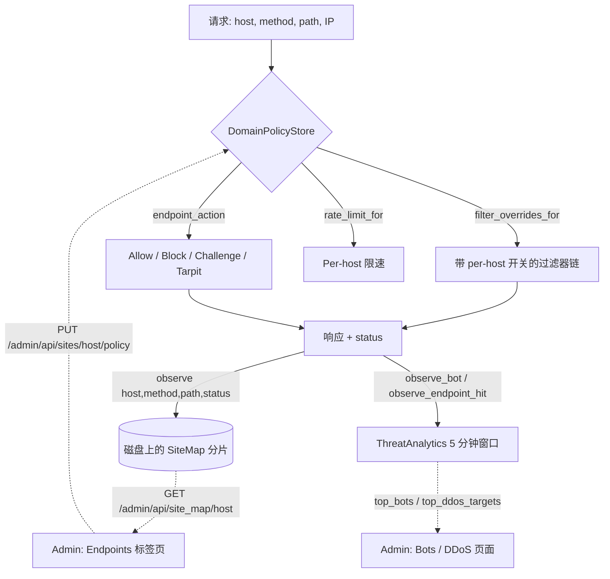

# 站点测绘与 per-domain 策略

**语言：** [English](../en/26-sites-and-domains.md) · [Русский](../ru/26-sites-and-domains.md) · **中文**

测绘子系统（`src/site_map.rs`）会从实时流量中自动还原每个站点的形态——哪些端点被访问、使用什么方法、状态码的分布如何；而 per-domain 策略层（`src/domain_policy.rs`）与域名注册表（`src/domains.rs`）则允许你对某个具体主机（以及具体路径）叠加自己的策略：过滤器开/关、针对端点的 `allow`/`block`/`challenge`/`tarpit` 动作、rate-limit 覆盖。威胁分析（`src/threat_analytics.rs`）把攻击拆成两种不同视角：单体机器人与分布式 DDoS。

本文档覆盖三个紧密关联的子系统：

| 子系统 | 文件 | 用途 |
|---|---|---|
| `site_map` — 测绘 | `src/site_map.rs` | 端点自动发现、路径泛化、分片、持久化 |
| per-domain policy | `src/domain_policy.rs` | Per-host 过滤器覆盖、per-endpoint 动作、限速覆盖 |
| domain registry | `src/domains.rs` | 域名注册表 + 聚合计数器（`config/domains.toml`） |
| threat analytics | `src/threat_analytics.rs` | 滑动窗口内的 Top 机器人与 Top DDoS 目标 |

> 下文所有结论均已与源码核对；每条都给出了文件路径。部分实现/计划中的特性均如实标注（见「诚实说明」一节）。

相关文档：[WAF](10-waf.md)、[限速](14-rate-limiting.md)、[challenge ladder](15-challenge-ladder.md)、[honeypot/tarpit](17-honeypot-tarpit.md)、[指标/遥测](25-metrics-telemetry.md)、[请求日志](24-request-log.md)、[多进程与工作进程](06-workers.md)、[管理面板](29-admin-panel.md)、[admin API](30-admin-api.md)。原始规范：[`docs/per-domain-policy.md`](../en/reference/per-domain-policy.md)。

---

## 1. 站点测绘（`site_map`）

### 1.1. 思路

运维在 Aegis 中添加一个域名，把 DNS 指过来——流量就开始流入。几分钟内代理就能看到站点的真实形态，并把它落到 per-host 的 `SiteMap` 中；管理面板以表格形式展示它，从而无需手工枚举 API 即可施加 per-endpoint 策略（`src/site_map.rs:1-40`）。

关键设计属性（文档注释 `src/site_map.rs:10-29`）：

- **路径泛化** —— `/api/users/12345` 与 `/api/users/67890` 合并为 `/api/users/:id`，使地图不会因高基数 URL 而爆炸。
- **区分方法** —— `GET /api/users` 与 `POST /api/users` 作为独立记录跟踪，统计分离。
- **内存受限** —— per-host LRU 上限（默认 1024 个端点），新条目淘汰最不新鲜的。
- **热路径安全** —— 每个请求只调用一次 `observe()`；内部存储是分片的 `DashMap`，键为 `(host, method, pattern)`，因此来自不同工作进程的并发写入会落到不同分片。

### 1.2. 每个请求观测什么

热路径是 `SiteMap::observe(host, method, path, status)`（`src/site_map.rs:405-459`），在日志阶段以最终状态码对每个请求调用一次。

逻辑：

1. 空 `host` 被忽略（`src/site_map.rs:406-408`）。
2. 路径经 `generalise_path` 泛化（`src/site_map.rs:409`）。
3. 方法转为大写（`src/site_map.rs:410`）。
4. 键 `(host, method, pattern)` —— 先做只读的 `get()`（快路径，递增原子计数器，`src/site_map.rs:427-432`）；未命中则走慢路径，检查 per-host 上限并用 `entry().or_insert_with()` 处理两个工作进程的竞态（`src/site_map.rs:434-458`）。

每条 `EndpointEntry` 记录保存原子计数器（`src/site_map.rs:128-137`）：`hits`、`last_seen`、`status_2xx`、`status_3xx`、`status_4xx`、`status_5xx`。状态到桶的映射由 `bump_status` 按 `status / 100` 完成（`src/site_map.rs:529-538`）；2xx–5xx 之外的状态码（例如 1xx）不计入任何桶。

### 1.3. 路径泛化 `/:id`

`generalise_path`（`src/site_map.rs:693-708`）丢弃 query 与 fragment（`?`/`#`，`src/site_map.rs:694`），并通过 `classify_segment` 逐段分类路径。可识别的形式（检查顺序见 `src/site_map.rs:710-740`）：

| 段的形式 | 占位符 | 条件 |
|---|---|---|
| UUID v4（8-4-4-4-12 hex，长度 36 字节） | `:uuid` | `looks_like_uuid`（`src/site_map.rs:742-757`） |
| 纯数字（≥1 个字符） | `:id` | 整段满足 `is_ascii_digit` |
| 24 字符 hex（MongoDB ObjectId） | `:oid` | 长度 24，全为 hex |
| ≥16 位 hex（token） | `:token` | 长度 ≥16，全为 hex |
| 日期 `YYYY-MM-DD`（10 字节） | `:date` | 第 4 与第 7 位是连字符，其余为数字 |
| 否则 | 原样保留 | — |

> **可选项 / 诚实说明。** 文件头部的文档注释（`src/site_map.rs:13-16`）提到 "operator-overridable patterns"——可由运维配置的泛化规则。在当前代码中 `classify_segment`/`looks_like_uuid` 是静态硬编码的；`site_map.rs` 中没有用户自定义的泛化模式。请视其为尚未实现的部分。

切片安全性（V233）：`classify_segment`（日期）与 `looks_like_uuid` 都是对字节切片而非 `&str` 做索引，因为 10 字节/36 字节的段可能包含多字节 UTF-8 字符；对 `&s[..]` 索引会在码点边界上失败 → 在 `panic = "abort"` 下导致工作进程 SIGABRT（`src/site_map.rs:723-757`，测试 `src/site_map.rs:804-830`）。

示例（取自测试 `src/site_map.rs:763-851`）：

```text
/api/users/12345                                  → /api/users/:id
/api/users/12345/posts/678                        → /api/users/:id/posts/:id
/api/orders/550e8400-e29b-41d4-a716-446655440000  → /api/orders/:uuid
/api/doc/507f1f77bcf86cd799439011                 → /api/doc/:oid
/auth/token/abcdef0123456789                       → /auth/token/:token
/posts/2025-01-15/comments                         → /posts/:date/comments
/api/users?page=1                                  → /api/users      (query 被丢弃)
```

### 1.4. 基数上限与淘汰

两级限制：

**内存中的 per-host LRU。** `DEFAULT_PER_HOST_CAP = 1024`（`src/site_map.rs:67`），通过 `with_per_host_cap` 最小为 8（`src/site_map.rs:191-194`）。插入新端点前，`enforce_host_cap` 扫描该主机的键，若数量 `>= cap`，则删除最冷的一条（`last_seen` 最小）（`src/site_map.rs:465-485`）。这是 best-effort 的：竞态可能瞬时超出上限 1 个。

**快照/刷盘时的上限。** 导出时应用 `SNAPSHOT_HOST_CAP = 200`（按 hits 总和取 Top 主机）与 `SNAPSHOT_ENDPOINT_CAP = 500`（每主机 Top 端点，按 hits 降序排序）—— `src/site_map.rs:69-71`，`build_snapshot`（`src/site_map.rs:553-586`）。

**周期性淘汰冷条目。** `evict_idle(idle)` 删除超过 `idle` 未见到的记录（`src/site_map.rs:515-526`）；由 `PingoraBackground` 的 tick 调用。`ThreatAnalytics` 有类似的 `evict_stale`，窗口固定为 5 分钟（见第 4 节）。

### 1.5. p99 / 延迟 —— 实际状态

> **诚实说明。** 文件头承诺 JSON 中会有给 UI 用的 `p99_ms` 字段（`src/site_map.rs:34-35`），但**在当前代码中延迟既不采集也不存储**。`EndpointStats`/`PersistedEndpoint`/`EndpointEntry` 只包含 `hits`、`last_seen` 以及 2xx/3xx/4xx/5xx 状态计数器（`src/site_map.rs:77-101, 128-137`）；`observe()` 不接收请求耗时。也就是说 p99 目前只是声明而未实现的条目；不要依赖它。

### 1.6. 分片与持久化（V240+）

每个 SO_REUSEPORT 工作进程通过对 `AEGIS_SITEMAP_DIR` 目录（默认 `/var/lib/aegis/site-map`）中的 `.slot-<n>.lock` 文件 `flock` 来抢占一个槽位，每 30 秒原子地写出自己的快照分片 `shard-<slot>.json`，重启时加载自己的分片。Admin API 读取**所有**分片并合并（键取并集；计数器求和；`last_seen` 取 max），使得无论哪个工作进程应答，响应都是稳定的（`src/site_map.rs:42-50`）。

代码细节：

| 机制 | 代码 | 细节 |
|---|---|---|
| 抢占槽位 | `acquire_slot`（`src/site_map.rs:600-608`）、`try_flock_nb`（`src/site_map.rs:589-595`） | 非阻塞的 `LOCK_EX|LOCK_NB`，依次尝试 `.slot-0.lock` … `.slot-15.lock`（`MAX_SLOTS = 16`，`src/site_map.rs:73`）。`File` 在整个进程生命周期内保持存活。 |
| 启用持久化 | `with_persistence(dir)`（`src/site_map.rs:206-240`） | 创建目录；若未抢到槽位——发出 warning 并进入 in-memory only 模式（`flush_shard` 变为 no-op）。成功时通过 `import_merge` 用自己此前的分片引导计数器。 |
| 写入分片 | `flush_shard`（`src/site_map.rs:364-374`）→ `write_snapshot_to`（`src/site_map.rs:618-637`） | 写入相邻的 `.tmp` 文件，`set_permissions(0o640)`，随后原子 `rename`。错误以 warning 记录，服务不中断。 |
| 读取所有分片 | `read_all_shards(dir, max_age_secs)`（`src/site_map.rs:392-394`，实现见 `643-678`） | 只取 `shard-*.json`；跳过 `written_at_unix_secs` 或文件 mtime 早于 `cutoff` 的「孤儿」分片（双重检查）。 |
| 管理端合并 | `merge_snapshots(&[...])`（`src/site_map.rs:322-357`） | 纯函数：键取并集、所有计数器求和、`last_seen` 取 max、重新施加基数上限。 |
| 启动合并 | `import_merge(&snap)`（`src/site_map.rs:277-314`） | 把计数器累加到已有记录，`last_seen` 通过 CAS-max 取值。 |

可序列化类型：`PersistedEndpoint`（`src/site_map.rs:91-101`）、`HostSnapshot`（含 `total_hits`/`last_seen`/`endpoints`，`src/site_map.rs:104-113`）、`SiteMapSnapshot`（含 `written_at_unix_secs` + `hosts`，`src/site_map.rs:117-124`）。

存储并发度：`DashMap::with_shard_amount(128)`（V230，`src/site_map.rs:179`）—— 大量分片以便按端点并行写入。

### 1.7. 供管理 UI 使用的 JSON

UI 契约（`src/site_map.rs:31-40`）：

```text
GET /admin/api/site_map/<host>
→ { endpoints: [{ method, path_pattern, hits, last_seen,
                  status_2xx, status_4xx, status_5xx, p99_ms }] }
```

消费方是 per-domain 编辑页面：它渲染表格，并在每一行放一个「Apply rule」按钮，点击后跳转到 per-endpoint 策略编辑器并预填 path/method。确切的 admin API 路由见 [admin API](30-admin-api.md)。（`p99_ms` —— 见 1.5 的说明。）

给集成方的 `SiteMap` API 面：`snapshot(host)` —— 该主机的端点，按 hits 降序（`src/site_map.rs:488-497`）；`hosts()` —— 主机列表（`src/site_map.rs:500-506`）；`total_endpoints()` —— 诊断用（`src/site_map.rs:509-511`）；`export_snapshot()` —— 带上限的完整快照（`src/site_map.rs:253-272`）。

---

## 2. 域名注册表（`domains`）

文件 `src/domains.rs` 是一个独立、更简单的层：已配置域名的静态注册表加上聚合计数器，存放于 `config/domains.toml`（`src/domains.rs:14`）。

### 2.1. 结构

```rust
DomainStats {
    total_requests, denied_requests, challenged_requests,
    last_seen_unix: Option<u64>,
}
DomainRegistry { domains: BTreeMap<String, DomainStats> }
```

（`src/domains.rs:16-28`）。`BTreeMap` 在序列化时给出确定性（已排序）的顺序。

### 2.2. CLI（`aegis` 二进制）

| 函数 | 行为 | 代码 |
|---|---|---|
| `add_domain(d)` | 创建空记录，打印 `Domain added: <d>` | `src/domains.rs:80-86` |
| `remove_domain(d)` | 删除；打印 `Domain removed` / `Domain not found` | `src/domains.rs:88-97` |
| `list_domains()` | 打印名称（或 `No domains configured`） | `src/domains.rs:99-109` |
| `stats_domain(d)` | 打印 `total/denied/challenged/last_seen` | `src/domains.rs:111-133` |
| `metrics_summary()` | 输出行 `domains=… total_requests=… denied_requests=…` | `src/domains.rs:135-143` |

### 2.3. 计数器持久化

`apply_runtime(metrics)` 把 `RuntimeMetrics.domain` 中的实时计数器合并进注册表，用快照值**替换**原有总量并更新 `last_seen_unix`（`src/domains.rs:52-65`）。后台循环 `spawn_persister(metrics, interval)` 按间隔触发，重新读取文件、应用运行时数据并原子写入（`src/domains.rs:148-165`）。计数器来源是 `RuntimeMetrics::observe_domain_outcome`（见[指标/遥测](25-metrics-telemetry.md)）。

> 请区分两个「域名」存储：**`domains.rs`** 是配置 + 聚合（TOML，`config/domains.toml`），而 **`domain_policy.rs`**（第 3 节）是运行时策略（JSON，`/var/lib/aegis/domain-policy.json`）。它们是不同的文件、不同的生命周期。

---

## 3. Per-domain 策略（`domain_policy`）

在 per-domain 策略出现之前，每个过滤器都是通过 `RuntimeToggles` 全局开/关的。真实的运维需要按主机区分策略（`src/domain_policy.rs:1-12`）：

- `api.example.com` —— WAF + 限速，但不做 challenge；
- `admin.example.com` —— 所有过滤器拉满；
- `static.example.com` —— 关闭 WAF（那里没有用户输入）。

`DomainPolicyStore` 持有 per-host 覆盖；过滤器引擎在回落到全局 `RuntimeToggles` **之前**先查询它。Per-endpoint 动作（V166）是叠加其上的独立一层（`src/domain_policy.rs:9-12`）。

### 3.1. 一个 `DomainPolicy` 中的三层策略

`DomainPolicy` 结构（`src/domain_policy.rs:100-141`）默认为空；每个字段都是一个覆盖项，缺失时回落到全局配置：

| 字段 | 类型 | 用途 |
|---|---|---|
| `filter_enabled` | `HashMap<String, bool>` | Per-filter 开/关。过滤器名即 `TrafficFilter::name()` 返回的同一个 `&'static str`（`"waf"`、`"bot"`、`"challenge"`、`"rate_limit"` 等）（`src/domain_policy.rs:104-107`） |
| `endpoint_policies` | `HashMap<String, EndpointAction>` | 按路径模式的 per-endpoint 短路（`src/domain_policy.rs:108-116`） |
| `rate_limit` | `Option<RateLimitOverride>` | Per-host 限速覆盖（`rps`、`burst`），V234（`src/domain_policy.rs:117-128`） |

辅助字段 `sorted_matchers: OnceLock<Arc<Vec<CompiledMatcher>>>`（`src/domain_policy.rs:139-140`）是惰性构建的已编译匹配器缓存，`#[serde(skip)]`，不持久化；在 `clone` 时被重置（`src/domain_policy.rs:180-195`）。

### 3.2. 过滤器覆盖（on/off）

过滤器的有效状态（出自 [`docs/per-domain-policy.md:141-156`](../en/reference/per-domain-policy.md)）：

```text
effective_state(filter, host) =
    if host has explicit override → override
    else if global runtime toggle exists → global toggle
    else → enabled (default)
```

也就是说：

- 全局 `waf: off`，主机覆盖 `waf: on` → WAF 对**该**主机生效。
- 全局 `waf: on`，主机覆盖 `waf: off` → WAF 对**该**主机被跳过。
- 全局 `waf: on`，无覆盖 → WAF 生效（默认）。

支持覆盖的过滤器列表（出自规范）：`waf` / `bot` / `challenge` / `rate_limit` / `honeypot` / `threat_intel` / `adaptive` / `ip_acl`（`docs/per-domain-policy.md:9-14`）。

读取性能（V230/V229）：过滤器引擎每个请求会拉取覆盖 7–8 次。`filter_overrides_for(host)`（`src/domain_policy.rs:514-542`）把这些收敛为一次调用：一次 lowercase 分配（仅当 host 中含大写字节时）、一次分片加锁、一个克隆的 `Arc<HashMap>`。遗留 API `filter_override(host, name)` 委托给它（`src/domain_policy.rs:494-497`）。

### 3.3. Per-endpoint 动作

`EndpointAction`（`src/domain_policy.rs:51-78`）是在常规过滤器链**之前**应用的短路：

| 动作 | 语义 | 出自代码 / 文档 |
|---|---|---|
| `Allow` | 绕过整条过滤器链——请求无条件通过（但仍受上游约束） | `src/domain_policy.rs:54-56`；"bypasses entire filter chain"（`docs/per-domain-policy.md:109-113`） |
| `Block` | 硬性 403，原因 `"endpoint_policy"`，不会到达上游，也不做 challenge | `src/domain_policy.rs:57-59`；`docs/per-domain-policy.md:115-118` |
| `Challenge` | 即使全局关闭 challenge 也强制走 challenge ladder。用于 `/login`、`/admin/*`、密码重置 | `src/domain_policy.rs:60-62`；`docs/per-domain-policy.md:121-128` |
| `Tarpit` | 路由到投毒 tarpit（V147）。用于 `/.git/config`、`/.env`、`/wp-config.php` | `src/domain_policy.rs:63-66`；`docs/per-domain-policy.md:130-136` |

> **关于 `Tarpit` 的诚实说明。** 规范直言：截至今天 `tarpit` 只是给请求打标记并**返回 403，原因为 `"endpoint_tarpit"`**；完整的、路由到慢速流式 Markov 响应的实现属于未来版本（`docs/per-domain-policy.md:130-137`）。另见 [honeypot/tarpit](17-honeypot-tarpit.md)。

序列化为 snake_case（`src/domain_policy.rs:52`，测试 `src/domain_policy.rs:896-902`）：`"allow"`/`"block"`/`"challenge"`/`"tarpit"`。辅助函数 `as_str()`（`src/domain_policy.rs:69-78`）。

#### 路径模式语法

`compile_matcher`（`src/domain_policy.rs:290-320`）与 `path_matches`（`src/domain_policy.rs:332-344`）支持三种形式：

| 语法 | 匹配 | 实现 |
|---|---|---|
| `/foo` | 精确匹配 `/foo` | `MatchKind::Exact` |
| `/foo/*` | `/foo` 以及 `/foo/` 之下的一切 | `MatchKind::Prefix`（`starts_with("/foo/")` 或 `== "/foo"`） |
| `*/foo` | 任何以 `/foo` 结尾的路径（例如 `*/login` → `/auth/login`、`/api/v1/login`） | `MatchKind::Suffix`（`ends_with("/foo")` 或 `== "foo"`） |

**按字母序排在最前的模式获胜**（`endpoint_action` 在迭代前对键排序——与插入顺序无关，具有确定性，`src/domain_policy.rs:264-277`）。如果同时设置 `/admin/*` → block 与 `/admin/health` → allow，那么 `/admin/health` 获胜，因为它在字母序上更靠前（`docs/per-domain-policy.md:100-104`）。

**路径规范化（V233 —— 修复 auth-bypass / path-traversal）。** 请求路径与模式主体在比较前都会经过 `crate::normalisation::canonical_path`（`src/domain_policy.rs:219-257`、`290-320`）。否则 `/%61dmin/users`（其中 `%61`=`a`）会在上游解码成 `/admin/users`，绕过本应命中的规则；而 `/public/..%2finternal` 会塌缩成 `/internal`。`/*` 与 `*/` 这两个标记会在规范化**之前**被剥离，以免通配符标记被折叠掉。测试见 `src/domain_policy.rs:1029-1098`（包含 "no panic on malformed path"）。

> **陷阱（出自规范，`docs/per-domain-policy.md:208-214`）。** 匹配是精确的：`/login?foo=bar` → 路径为 `/login`（query 被丢弃），匹配 `/login`；`/login/` 是另一个路径，**不**匹配 `/login`；`/users/login` 匹配 `*/login`，但不匹配 `/login`。

### 3.4. 限速覆盖（V234）

`RateLimitOverride { rps, burst }`（`src/domain_policy.rs:85-89`）：`rps` 是令牌补充速率（req/sec），`burst` 是桶容量（最大瞬时消耗）。两者都是 per-IP 的，与全局过滤器一致。通过 `rate_limit_for(host) -> Option<(u64, u64)>` 解析（`src/domain_policy.rs:550-570`）；为 `None` 时回落到配置中的全局 / 静态限制。

与 `.conf` 中 `[rate_limit]` 的关键区别：该覆盖通过 admin API（`PUT /admin/api/sites/<host>/policy`）设置，是 disk-backed 且跨工作进程的，因此面板可以**无需**修改只读的站点配置文件就改变 per-host 限额（`src/domain_policy.rs:121-127`）。关于令牌桶的更多内容见[限速](14-rate-limiting.md)。

### 3.5. 存储、持久化与跨工作进程同步

`DomainPolicyStore`（`src/domain_policy.rs:358-379`）通过共享的 `Arc<DashMap<String, DomainPolicy>>` 实现廉价克隆。字段：

| 字段 | 用途 |
|---|---|
| `inner: Arc<DashMap<...>>` | 内存中的实时策略，键为小写 host |
| `path: Arc<Mutex<Option<PathBuf>>>` | 用于跨工作进程同步的可选路径 |
| `last_mtime` | mtime 缓存，文件未变化时跳过读取 |
| `has_entries: AtomicBool`（V229） | empty-gate：为 `false` 时读取路径短路，无锁、无分配 |
| `persistence_attached: AtomicBool`（V229） | detached 时读取路径跳过 `path` 上的 Mutex |

**持久化。** `attach_persistence(path)`（`src/domain_policy.rs:394-417`）从文件加载已有记录，并在每次变更时启用写入。存放于 `/var/lib/aegis/domain-policy.json`，路径可用环境变量 `AEGIS_DOMAIN_POLICY_PATH` 覆盖（`docs/per-domain-policy.md:186-188`）。原子写入 `write_atomic` —— 临时 `.json.tmp` + rename（`src/domain_policy.rs:665-673`）。磁盘格式是 `PersistedSnapshot { entries: HashMap<host, DomainPolicy> }`（`src/domain_policy.rs:349-354`）。

**通过 mtime 轮询实现跨工作进程同步。** `refresh()`（`src/domain_policy.rs:422-457`）在每条读取路径上被调用：detached 时——瞬时 no-op（V229 原子短路）；否则执行一次 `stat()` 系统调用，若 mtime 发生变化——原子替换 `inner`（clear + 重新插入）。这与 Aegis 其余部分使用的跨工作进程状态机制相同，即 磁盘 + mtime 轮询（见[多进程与工作进程](06-workers.md)）。规范声称 REUSEPORT 工作进程之间的传播约 ~50 ms（`docs/per-domain-policy.md:16-18`）。

该文件**可以安全地手工编辑**（原子 temp+rename），JSON 不带注释（`docs/per-domain-policy.md:181-184`）。它是**运行时状态，而非 DSL 配置的一部分**：重启 `aegis-pingora.target` 会保留 JSON，但会把 `RuntimeToggles` 重置为 DSL 中的 `defaults { filters { } }`（`docs/per-domain-policy.md:240-257`）。DSL 块 `server { policy { … } }` 目前尚未实现。

**存储的变更 API：** `put(host, policy)`（空策略 = 删除该记录，`src/domain_policy.rs:573-588`）、`get(host)`（`src/domain_policy.rs:591-602`）、`endpoint_action(host, path)`（`src/domain_policy.rs:606-630`）、`snapshot()`（按 host 排序，供管理端 listing 端点使用，`src/domain_policy.rs:634-643`）、`remove(host)`（`src/domain_policy.rs:645-659`）。主机查找不区分大小写（按 RFC 9110 §5.5 转小写，`src/domain_policy.rs:485-493`）。

### 3.6. 通过 admin API 的工作流程

出自规范（`docs/per-domain-policy.md:60-88`）：

```sh
export TOKEN=$(cat /etc/aegis/admin-token)
HOST=api.example.com

# 1. 读取当前状态（per-host + global view）。
curl -sS -H "x-admin-token: $TOKEN" \
  http://localhost:6280/admin/api/sites/$HOST/policy | jq

# 2. 写入策略：关闭 WAF，对 /login 做 captcha，对 /.env 做 tarpit。
curl -sS -H "x-admin-token: $TOKEN" \
  -X PUT http://localhost:6280/admin/api/sites/$HOST/policy \
  -H 'Content-Type: application/json' \
  -d '{
    "filter_enabled": { "waf": false },
    "endpoint_policies": {
      "/login": "challenge",
      "/.env": "tarpit",
      "/admin/secret": "block"
    }
  }'

# 3. 清除该主机的全部覆盖。
curl -sS -H "x-admin-token: $TOKEN" \
  -X DELETE http://localhost:6280/admin/api/sites/$HOST/policy
```

UI 流程：站点的 **Security** 标签页 —— 为每个全局过滤器提供 `inherit` / `force on` / `force off` 的选择（该行显示 全局状态 · 覆盖 · 计算出的有效值，`docs/per-domain-policy.md:36-48`）。**Endpoints** 标签页 —— 从 `site_map` 自动发现的端点，带 `inherit · allow · challenge · tarpit · block` 按钮（保存是即时的，乐观更新 + 持久化到磁盘，`docs/per-domain-policy.md:50-56`）。Admin API 的认证 —— `x-admin-token`/会话/角色，见 [admin API](30-admin-api.md) 与[管理面板](29-admin-panel.md)。

> **应用顺序的陷阱（`docs/per-domain-policy.md:215-223`）。** 策略在过滤器链之前应用，但在 bypass + trusted-IP 快路径之后。如果某 IP 在 bypass 列表中或被 dynamic-trust 提升，cache 快路径会直接服务该请求，策略与过滤器链都不会运行。

> **删除单个键的陷阱（`docs/per-domain-policy.md:225-237`）。** API 不提供 per-key 删除——请做 GET + `jq del(...)` + PUT 的往返（UI 中的 `inherit` 按钮做的正是这件事）。

---

## 4. 威胁分析（`threat_analytics`）

`src/threat_analytics.rs` 把攻击数据拆成两种视角，管理 UI 分别在两个独立页面展示（`src/threat_analytics.rs:1-28`）：

- **单体机器人** —— 单个 IP 表现出机器人行为（指纹不匹配、UA 造假、持续的 per-IP 速率）。运维动作：对该 IP 执行 deny / challenge / 限速。
- **DDoS / 僵尸网络** —— 大量不同 IP 同时打向同一个端点，其中没有任何单个 IP 超过 per-IP 限额，但聚合量巨大。动作：激进的 per-endpoint 限速、地理过滤、attack-mode challenge floor。

### 4.1. Top 机器人

`observe_bot(ip, reason)`（`src/threat_analytics.rs:126-155`）跟踪 per-IP 信号。`BotReason`（`src/threat_analytics.rs:46-70`）：`UaFpMismatch`、`NoUserAgent`、`HighThreatScore`、`HighMlScore`、`HoneypotHit`、`WafSignature`、`Compound`。当同一 IP 出现第二个不同信号时，`primary_reason` 会被提升为 `Compound`（位掩码 `reasons_seen`，`src/threat_analytics.rs:137-141`）。`top_bots(limit)` 返回 `BotEvidence { client_ip, primary_reason, hits, last_seen_unix_secs }`，按 hits 降序排序（`src/threat_analytics.rs:191-205`）。

### 4.2. Top DDoS 目标

`observe_endpoint_hit(host, path_pattern, ip)`（`src/threat_analytics.rs:160-188`）累积 per-endpoint 的 hits 以及不同 IP 的集合。`top_ddos_targets(limit)` 过滤出 `distinct_ips >= DDOS_DISTINCT_IP_THRESHOLD`（= 10，`src/threat_analytics.rs:41-43`）的端点，按 distinct_ips 降序排序，返回 `DdosEvidence { host, path_pattern, total_hits, distinct_ips, last_seen_unix_secs }`（`src/threat_analytics.rs:209-229`）。正是「大量不同 IP 打向同一端点」把 DDoS 与单体机器人区分开（测试 `src/threat_analytics.rs:298-323`：来自一个 IP 的 1000 次命中——不是 DDoS；12 个不同 IP——是 DDoS）。

### 4.3. 内存边界与窗口

| 参数 | 取值 | 代码 |
|---|---|---|
| 聚合窗口 | 5 分钟（`WINDOW = 300s`） | `src/threat_analytics.rs:38` |
| 最多跟踪的机器人数 | 256 | `src/threat_analytics.rs:39` |
| 最多跟踪的端点数 | 256 | `src/threat_analytics.rs:40` |
| DDoS 阈值 | ≥10 个不同 IP | `src/threat_analytics.rs:43` |

超出限制时，`last_seen` 最小的记录会被淘汰（`src/threat_analytics.rs:145-154`、`178-187`）。周期性的 `evict_stale()` 丢弃 5 分钟窗口之外的一切，由 `PingoraBackground` 的 tick 调用（`src/threat_analytics.rs:241-247`）。诊断 —— `summary()` → `ThreatAnalyticsSummary { tracked_bots, tracked_endpoints }`（`src/threat_analytics.rs:232-237`）。两个 `DashMap` 都是 `with_shard_amount(128)`（V230，`src/threat_analytics.rs:110-114`）。

> **关于 `last_seen_unix_secs` 的说明。** 这是把单调的 `Instant` best-effort 转换为墙钟 UNIX 秒（`unix_secs`，`src/threat_analytics.rs:256-267`）；UI 只用它显示相对的「last seen」，轻微漂移可以接受。

---

## 5. 这一切如何组合起来



运维闭环：`SiteMap` 从流量中发现端点 → UI 在 Endpoints 标签页展示它们 → 运维点击某个动作 → `DomainPolicyStore` 把它持久化到 `domain-policy.json` → mtime 轮询把它分发到所有工作进程 → 下一个请求时 `endpoint_action`/`filter_overrides_for`/`rate_limit_for` 会在过滤器链之前应用它。与此并行，`ThreatAnalytics` 高亮出哪些 IP 与端点正在遭受攻击，提示策略该往哪里放。

---

## 6. 诚实说明

| 声称的 | 代码中的实际情况 |
|---|---|
| site_map JSON 中的 `p99_ms`（`src/site_map.rs:34`） | **既不采集也不存储** —— `observe()` 不接收延迟，`EndpointStats` 中也没有它。未实现。 |
| 可由运维覆盖的泛化模式（`src/site_map.rs:13-16`） | 段的分类在 `classify_segment`/`looks_like_uuid` 中静态硬编码。没有用户自定义模式。 |
| `Tarpit` 路由到慢速 Markov 响应 | 目前只是给请求打标记并**返回 403 `"endpoint_tarpit"`**；完整路由属于未来版本（`docs/per-domain-policy.md:130-137`）。 |
| DSL 块 `server { policy { … } }` | 未实现；策略持久化的唯一一层是 JSON 文件（`docs/per-domain-policy.md:240-257`）。 |
| 用于清除 trust-grant 的 `/admin/api/runtime/trust-clear` | 未对外暴露；临时变通办法是重启 target（`docs/per-domain-policy.md:218-223`）。 |
| 端点策略的 per-key 删除 | API 不提供；需要 GET+PUT 往返（`docs/per-domain-policy.md:225-237`）。 |

---

## 另见

- [10-waf.md](10-waf.md) —— WAF，其启用状态可被 per-domain 覆盖。
- [14-rate-limiting.md](14-rate-limiting.md) —— 被 `RateLimitOverride` 覆盖的令牌桶。
- [15-challenge-ladder.md](15-challenge-ladder.md) —— 被 `EndpointAction::Challenge` 强制触发的 challenge ladder。
- [17-honeypot-tarpit.md](17-honeypot-tarpit.md) —— tarpit 引擎，`EndpointAction::Tarpit` 的目标。
- [06-workers.md](06-workers.md) —— 跨工作进程状态的 磁盘 + mtime 轮询 机制。
- [25-metrics-telemetry.md](25-metrics-telemetry.md) —— 为 `domains.rs` 供数的 `RuntimeMetrics`。
- [24-request-log.md](24-request-log.md) —— 沉淀同样这些决策的事件存储。
- [29-admin-panel.md](29-admin-panel.md) / [30-admin-api.md](30-admin-api.md) —— UI 与 `/admin/api/*` 路由。
