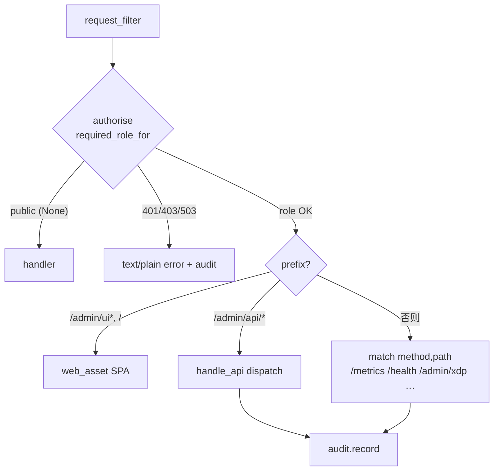

# Admin API — 参考手册

**语言：** [English](../en/30-admin-api.md) · [Русский](../ru/30-admin-api.md) · **中文**

AEGIS 管理用 HTTP 接口的完整参考：所有 `/admin/api/*` 路由（调度器 `handle_api`，位于 [`src/proxy/pingora_admin.rs`](../../src/proxy/pingora_admin.rs)）、非标准 admin 端点（`/admin/xdp`、`/admin/threats`、`/metrics`、…）、认证模型（`x-admin-token` / 会话 / 角色）以及 JSON 响应的结构。本文档中的每一条论断都以实际代码为依据 —— 调度器 `handle_api`（[`pingora_admin.rs:3912`](../../src/proxy/pingora_admin.rs)）、角色函数 `required_role_for`（[`src/admin_auth.rs:168`](../../src/admin_auth.rs)）以及面板的类型化客户端 [`web/src/api/client.ts`](../../web/src/api/client.ts)。

> 该 API 由 `aegis-pingora`（主 data plane）提供服务。实现位于 `AdminProxy::request_filter` / `AdminProxy::handle_api`。相邻文档：面板 — [29-admin-panel.md](29-admin-panel.md)，请求日志 — [24-request-log.md](24-request-log.md)，指标 — [25-metrics-telemetry.md](25-metrics-telemetry.md)，多进程 / 跨 worker 状态 — [06-workers.md](06-workers.md)。

---

## 1. 认证与角色

### 1.1. 令牌来源

请求在 `AdminProxy::authorise`（[`pingora_admin.rs:~5230`](../../src/proxy/pingora_admin.rs)）中完成认证。接受以下来源（按检查顺序）：

| 来源 | 位置 | 检查内容 |
|---|---|---|
| 请求头 `x-admin-token: <值>` | HTTP 请求头 | 先查 config 令牌注册表（`tokens.authenticate`），若未匹配则再查 web 会话表（`web_admin.validate`）。 |
| Cookie `aegis_admin_session` | `Cookie:`（Path=`/admin`、`HttpOnly`、`SameSite=Strict`） | web 会话表。在 `POST /admin/api/login` 时设置。 |

一个重要的实现细节：React 面板把**会话**令牌存放在 `localStorage` 中，并且正是通过 `x-admin-token` 发送它，因此 `authorise` 会先把令牌当作 config 令牌尝试，然后再当作会话令牌（参见代码中的 V74-RC3 注释）。客户端在保存令牌时会激进地清除其中的空格/换行符（[`client.ts:45`](../../web/src/api/client.ts) 中的 `setToken`）—— 从终端复制粘贴时被带上的 `\n` 曾是误报 401 的常见原因。

config 令牌的来源（在启动时解析）：配置中的 `admin.tokens[]` 段、环境变量 `AEGIS_ADMIN_TOKEN`。web 会话保存在 `/var/lib/aegis/web.json`（或 `web_state_path`）。重置运维人员账号：`aegis web reset-admin`（会打印新密码）。

### 1.2. 角色

角色层级（`AdminRole`，权限由低到高）：`Read` → `Write` → `Admin`。比较使用 `>=`（`role >= required`）。

关于实现的说明：通过 **web 会话**校验的令牌会获得 `Admin` 角色（`authorise` 中的 `map(|_| AdminRole::Admin)`）。细粒度角色（`Read`/`Write`）只对 `admin.tokens[]` 中显式带 `role` 的 **config 令牌**才有区分。也就是说，通过面板登录的运维人员实际上以 `Admin` 身份操作。

### 1.3. 所需角色如何确定

`(method, path)` 组合的最低角色由 `required_role_for`（[`admin_auth.rs:168`](../../src/admin_auth.rs)）给出。关键规则：

- `GET /admin/api/*` → `Read`（通用的只读「catch-all」）。
- `POST|PUT|DELETE /admin/api/*` → `Write`（fail-closed catch-all，[`admin_auth.rs:260`](../../src/admin_auth.rs)）—— 下面列出的显式公开分支除外。
- 公开（角色 `None`，无需认证）：`GET /metrics`、`GET /` 和 `/admin/ui*`（面板静态资源）、`POST /admin/api/login`、`POST /admin/api/logout`、`POST /admin/api/change-credentials`、`GET /admin/api/me`，以及任何未被覆盖的路径（`_ => None`）。
- 角色上的特殊例外：`POST /admin/api/benchmark/run` 和 `POST /admin/api/benchmark/flood/run` 只要求 **`Read`**（它们启动 CPU/IO 工作，不会改动配置）；`POST /admin/api/config/*`（除 `apply` 外）—— **`Read`**（dry-run/只读）；`POST /admin/api/config/apply` 和 `POST /admin/api/restart` —— **`Write`**；`POST /admin/reload`、`POST /admin/stop` —— **`Admin`**。

> fail-closed 保护：如果系统中**既没有**任何 config 令牌，**也没有** web-admin 存储，那么任何非公开请求都会得到 `503 admin auth not configured`。

### 1.4. 认证错误码

| 状态码 | 响应体 | 含义 |
|---|---|---|
| `401` | `invalid or missing token\n` | 令牌缺失或不正确。 |
| `403` | `insufficient role\n` | 令牌有效，但角色低于所需角色（例如 `Read` 发送了 `POST`）。 |
| `503` | `admin auth not configured\n` | 既无令牌也无 web-store —— 拒绝为默认关闭。 |

这些响应是 `text/plain`。处理器自身（`handle_api`）的响应是 `application/json`，形如 `{"error": "...", "status": <code>}`（辅助函数 `json_err`，[`pingora_admin.rs:5629`](../../src/proxy/pingora_admin.rs)）。未知的 `/admin/api/*` 路径 → `404 {"error":"unknown admin api endpoint"}`。

### 1.5. 请求体与审计

`/admin/api/*` 的请求体最多读取 1 MiB；超出则返回 `413`（`read_request_body`，[`pingora_admin.rs:5345`](../../src/proxy/pingora_admin.rs)）。每个请求（包括认证被拒的请求）都会写入审计日志（`self.audit.record(peer, method, path, role, status)`），可通过 `GET /admin/api/audit` 查看（见 §6）。

---

## 2. 分区：Auth（无需认证）

这四个端点在 `required_role_for` 中都标记为 `None` —— 无需令牌即可访问。处理器会执行自身的校验。

| 方法 | 路径 | 用途 | 请求体 | 响应 |
|---|---|---|---|---|
| `POST` | `/admin/api/login` | 使用 email+密码登录 | `{"email","password"}` | `{ok, token, email, must_change_credentials, must_change, set_cookie}` |
| `POST` | `/admin/api/logout` | 登出，使会话失效 | —（读取 cookie/请求头） | `{ok, set_cookie}`（cookie 带 `Max-Age=0`） |
| `GET` | `/admin/api/me` | 当前用户 | — | `{authenticated, email?, role, must_change/must_change_credentials, auth}` |
| `POST` | `/admin/api/change-credentials` | 修改 email+密码 | `{current_password, new_email, new_password}` | `{ok, token, email, set_cookie}` |

细节（`api_login`，[`pingora_admin.rs:4366`](../../src/proxy/pingora_admin.rs)）：

- `login` 成功时会设置 cookie `aegis_admin_session=<token>; Path=/admin; HttpOnly; SameSite=Strict; Max-Age=86400`，并返回 token 本身（面板会把它存进 `localStorage`）。如果 web-admin 未配置 → `503 web admin not configured`。凭据错误 → `401 invalid credentials`。JSON 损坏 → `400 invalid login body`。
- 字段 `must_change` 和 `must_change_credentials` 是有意重复的：安装脚本创建的初始用户带有 `must_change_credentials: true`，从而强制在首次登录时修改账号。客户端（[`client.ts:649`](../../web/src/api/client.ts)）会同时读取两者，以兼容 login 和 `/me`-refresh 两条路径。
- `/me` 中的 `auth` 取值为 `"session"` 或 `"config_token"`。

```sh
# 登录并保存令牌
T=$(curl -sS -X POST http://127.0.0.1:9090/admin/api/login \
  -H 'content-type: application/json' \
  -d '{"email":"admin@example.com","password":"...."}' | jq -r .token)
curl -sS -H "x-admin-token: $T" http://127.0.0.1:9090/admin/api/me | jq
```

---

## 3. 分区：Runtime 与可观测性（Read）

| 方法 | 路径 | 用途 | 响应 |
|---|---|---|---|
| `GET` | `/admin/api/runtime/status` | KPI 快照（实时计数器） | 见下文 |
| `GET` | `/admin/api/runtime/info` | 供 Settings 使用的模块状态汇总（V169） | 见下文 |
| `GET` | `/admin/api/metrics/series?range=<r>` | 用于绘图的历史 time-series | `{resolution, points[]}` |
| `GET` | `/admin/api/geo/top` | 用于世界地图的按国家流量（V239） | 按国家聚合的 JSON |
| `GET` | `/admin/api/filters` | 每个 filter 的累计计数器 | `{filters:[{name,blocks,challenges}]}` |
| `GET` | `/admin/api/audit` | 审计日志尾部（最后约 200 行） | NDJSON 文本（见下文） |
| `GET` | `/admin/api/mined_signatures` | 在线挖掘器产出的 WAF 签名候选（V107） | `{enabled, last_run_unix_secs?, note?, candidates[]}` |
| `GET` | `/admin/api/bots` | 每 IP 信号（单一来源，V121） | `{bots[], summary:{tracked_bots}}` |
| `GET` | `/admin/api/ddos` | 分布式攻击（≥10 个唯一 IP） | `{targets[], summary:{tracked_endpoints}}` |
| `GET` | `/admin/api/site_map` | 自动测绘的主机列表（V119） | `{hosts[], host_entries?[], total_endpoints}` |
| `GET` | `/admin/api/site_map/<host>` | 单个主机的端点 | `{host, endpoints[]}` |

`runtime/status`（`api_runtime_status`，[`pingora_admin.rs:4498`](../../src/proxy/pingora_admin.rs)）—— Dashboard KPI 条的数据来源：

```json
{
  "uptime_secs": 3621,
  "config_path": "/etc/aegis/aegis.conf",
  "requests": { "total": 12453, "denied": 421, "challenged": 1872 },
  "upstream": { "2xx": 9120, "4xx": 1040, "5xx": 0, "errors": 0 },
  "cache":  { "hits": 0, "misses": 0, "stores": 0, "evictions": 0,
              "not_modified": 0, "skipped_high_threat": 0, "skipped_uncacheable": 0 },
  "xdp":    { "pass": 0, "drop_deny": 0, "drop_rate": 0, "drop_allowonly": 0,
              "drop_syn": 0, "drop_waf": 0, "fast_pass": 0 },
  "anomaly_active_hosts": ["api.example"],
  "top_threats": [{"ip": "1.2.3.4", "score": 84.2}],
  "top_threats_source": "cluster"
}
```

`runtime/info`（`api_runtime_info`，[`pingora_admin.rs:2796`](../../src/proxy/pingora_admin.rs)）对每个未启用的模块返回 `null`（UI 会绘制带有 env 变量名的「not configured」提示）。基础字段：`version`、`uptime_secs`、`config_path`、`ml_v2`、`ja4_reputation`、`asn_reputation`、`honeypot{…}`、`filter_toggles_count`、`domain_policy_count`、`clamav_addr`、`adversarial_loop`。env 门控的扩展状态（字段可选，参见 [`client.ts:188`](../../web/src/api/client.ts) 中的 `RuntimeInfo` 接口）：

| 字段 | Env 门控 |
|---|---|
| `ml_v2_enabled` | `AEGIS_ML_V2=1` |
| `ml_v1_enabled` | `AEGIS_ML_SCORER=1` |
| `ml_adversarial` | `AEGIS_ML_ADVERSARIAL=1` |
| `arsenal_enabled` | `AEGIS_ARSENAL != "0"` |
| `tls_fingerprinting` | `AEGIS_TLS_FINGERPRINT=1` |
| `llm_honeypot` | `AEGIS_LLM_HONEYPOT=1` |
| `upstream_healthcheck` | `AEGIS_UPSTREAM_HEALTHCHECK=1` |
| `risk_engine_mode` | `AEGIS_RISK_ENGINE_MODE` |
| `dynamic_trust_enabled` | `AEGIS_DYNAMIC_TRUST_ENABLE=1` |
| `response_cache_enabled` | `AEGIS_RESPONSE_CACHE_ENABLE=1` |
| `log_json` | `AEGIS_LOG_JSON=1` |
| `fw_backend` | `AEGIS_FW_BACKEND`（默认 `"auto"`） |
| `reuseport` | `AEGIS_PINGORA_REUSEPORT=1` |

`metrics/series`（`api_metrics_series`，[`pingora_admin.rs:995`](../../src/proxy/pingora_admin.rs)）：必需的 query 参数 `range` ∈ `1h|6h|24h|7d|30d`。数据源是 mmap 集群计数器（`global.rs cluster_get`），由 `PingoraBackground` 在 `AEGIS_HOME` 下以约 30 秒的 tick 采样（在 file-lock 下由一个 worker 写入，所有 worker 读取）。响应：`{resolution, points[]}`，其中每个点包含每 bucket 的增量 `requests/denied/challenged/rate_limited/tarpit/rtbh`、派生出的 `allow`，以及 `cache_hits/cache_misses/upstream_2xx/4xx/5xx`。参见 [25-metrics-telemetry.md](25-metrics-telemetry.md)。

`audit`（`api_audit`，[`pingora_admin.rs:4607`](../../src/proxy/pingora_admin.rs)）：以 `text/plain` 返回 —— 每条记录一行 NDJSON（`{ts, peer, method, path, role, status}`）。如果配置了 `audit_log_path`，则对其做 tail。客户端会解析并倒序排列（新的在上）。

---

## 4. 分区：Sites CRUD（Write）

| 方法 | 路径 | 角色 | 用途 |
|---|---|---|---|
| `GET` | `/admin/api/sites` | Read | UI-managed 与 ops-managed 站点的合并列表 |
| `POST` | `/admin/api/sites` | Write | Upsert 站点（相同 host 会覆盖 `.conf`） |
| `DELETE` | `/admin/api/sites/<host>` | Write | 删除 UI-managed 的 `.conf` |

`GET /admin/api/sites`（`api_sites`，[`pingora_admin.rs:4712`](../../src/proxy/pingora_admin.rs)）合并 `/var/lib/aegis/sites.d/`（从 UI 管理）与 `/etc/aegis/sites-enabled/`（ops-managed，在 UI 中只读）。响应：`{sites:[…]}`。

`POST /admin/api/sites`（`api_sites_create`，[`pingora_admin.rs:4803`](../../src/proxy/pingora_admin.rs)）—— **upsert**：相同的 `host` 会覆盖 `.conf`。请求体：

```json
{
  "host": "example.com",
  "upstream": "http://127.0.0.1:8080",
  "tls": true,
  "h3": true,
  "ssl_cert": "/etc/aegis/certs/example.crt",
  "ssl_key":  "/etc/aegis/certs/example.key",
  "rate_limit": { "rps": 100, "burst": 200 }
}
```

响应：`{ok, host, path, dsl_snippet, note}`。站点会在下一次 mtime 轮询（约 30 秒）时被加载，或由运维人员通过 `aegis-pingora --upgrade` 触发。`DELETE`（`api_sites_delete`）只删除 UI-managed 的 `.conf`；ops-managed 站点无法通过 API 删除。

> 路由：对 `/admin/api/sites/<host>/policy` 和 `/challenge` 的检查在调度器中位于 catch-all `DELETE /admin/api/sites/<host>` **之前**，以便 `/policy` 和 `/challenge` 后缀优先匹配（参见 [`pingora_admin.rs:4226`](../../src/proxy/pingora_admin.rs) 中的分支顺序）。

---

## 5. 分区：Per-domain policy（Write，V162/V164/V166/V234）

针对每个 host 的 filter 覆盖 + 按端点的动作。以**内存 + 磁盘 JSON** 的形式保存在 `/var/lib/aegis/domain-policy.json`，并通过 mtime 在 REUSEPORT worker 之间同步。

| 方法 | 路径 | 用途 |
|---|---|---|
| `GET` | `/admin/api/sites/<host>/policy` | 当前策略 + 全局 filters |
| `PUT` | `/admin/api/sites/<host>/policy` | 原子替换策略 |
| `DELETE` | `/admin/api/sites/<host>/policy` | 移除所有覆盖（等价于 PUT 空对象） |

`GET`（`api_site_policy_get`，[`pingora_admin.rs:3282`](../../src/proxy/pingora_admin.rs)）返回 `{host, policy, global_filters[], note}`。`DomainPolicy` 对象：

```json
{
  "filter_enabled": { "waf": true, "challenge": false },
  "endpoint_policies": {
    "/login": "challenge",
    "/.env": "tarpit",
    "/wp-admin/install.php": "block"
  },
  "rate_limit": { "rps": 100, "burst": 200 }
}
```

- `filter_enabled` —— filter 名 → bool；缺失的键 = 继承全局 runtime 开关。
- `endpoint_policies`（V166）—— 路径模式 → 动作。枚举值：`allow`（绕过整条 filter 链）、`block`（403，reason 为 `endpoint_policy`）、`challenge`（即使 filter 被关闭也强制走 challenge 阶梯）、`tarpit`（V147 poisoned tarpit）。
- `rate_limit`（V234，可选）—— 针对该 host 的 runtime rate-limit 覆盖层；即使对于 ops-managed 站点也有效，无需修改只读的 `.conf`。`null`/缺失 = 使用全局/静态限制。

模式语法（与 honeypot 包相同）：`/foo`（精确）、`/foo/*`（前缀）、`*/foo`（后缀）。第一个**按字母序**的匹配获胜（确定性的，与插入顺序无关）。`PUT` 是原子替换：放进去什么就存什么；空的 `{}` 会删除该条目（该 host 回退到全局设置）。

```sh
HOST=api.example.com
acurl http://127.0.0.1:9090/admin/api/sites/$HOST/policy | jq
acurl -X PUT http://127.0.0.1:9090/admin/api/sites/$HOST/policy \
  -d '{"filter_enabled":{},"endpoint_policies":{"/login":"challenge"}}'
```

站点测绘与域名策略详见：[26-sites-and-domains.md](26-sites-and-domains.md)。

---

## 6. 分区：Runtime filter toggles（Write，V160）

在 runtime 启用/停用 filter。**内存 + JSON**，保存在 `/var/lib/aegis/runtime-toggles.json`，跨 worker 同步。

| 方法 | 路径 | 用途 |
|---|---|---|
| `GET` | `/admin/api/defaults/filters` | 所有已注册 filter 的开关状态 |
| `PUT` | `/admin/api/defaults/filters` | 切换一个/多个 filter |

`GET`（`api_defaults_filters_get`，[`pingora_admin.rs:3331`](../../src/proxy/pingora_admin.rs)）：`{filters:[{name,enabled}], note}`。已知名称：`adaptive`、`bot`、`challenge`、`honeypot`、`ip_acl`、`rate_limit`、`threat_intel`、`waf`。`PUT` 接受两种请求体形式 —— `{"updates":[{"name","enabled"}]}` 或直接是数组 `[{"name","enabled"}]`。响应：`{ok, applied, unknown_filters}`；未知名称会被静默忽略（该文件可以安全地手工编辑）。重启会把开关重置为配置中的默认值。

```sh
# 紧急 kill-switch —— 全部关闭
acurl -X PUT http://127.0.0.1:9090/admin/api/defaults/filters \
  -d '{"updates":[{"name":"waf","enabled":false},{"name":"bot","enabled":false},
       {"name":"adaptive","enabled":false},{"name":"challenge","enabled":false},
       {"name":"rate_limit","enabled":false}]}'
```

---

## 7. 分区：Honeypots / Tarpit（Write）

| 方法 | 路径 | 用途 |
|---|---|---|
| `GET` | `/admin/api/honeypots/builtin` | 全部 18 个内置包（V158），已合并覆盖项 |
| `GET` | `/admin/api/honeypots` | `HoneypotState` 的完整快照 |
| `PUT` | `/admin/api/honeypots` | 原子替换整个状态 |
| `PUT` | `/admin/api/honeypots/global` | 全局切换单个包（`{pack_id, enabled}`） |
| `PUT` | `/admin/api/honeypots/host` | 针对某 host 切换包（`{host, pack_id, enabled}`） |
| `PUT` | `/admin/api/honeypots/host/enabled` | 针对某 host 绕过整个 honeypot（`{host, enabled}`） |
| `POST` | `/admin/api/honeypots/packs/<pack_id>` | 规范的 REST 包开关 |
| `POST` | `/admin/api/honeypots/hosts/<host>/packs/<pack_id>` | 规范的 REST per-host 包开关 |
| `DELETE` | `/admin/api/honeypots/host/<host>` 或 `/hosts/<host>` | 移除该 host 的所有覆盖（回退到 global） |
| `GET` | `/admin/api/honeypot-yaml` | LLM/YAML honeypot 描述符（V184） |
| `POST` | `/admin/api/honeypot-yaml/load` | 解析 YAML honeypot（请求体 `text/yaml`） |
| `GET` | `/admin/api/tarpit/status` | tarpit 参数 |

`honeypots/builtin`（`api_honeypots_builtin`，[`pingora_admin.rs:4638`](../../src/proxy/pingora_admin.rs)）返回 `{global_enabled, tarpit_seconds, packs[], packs_total, packs_enabled, custom_paths_count}`；每个包为 `{id, name, description, path_count, enabled}`。`HoneypotState`（`GET`/`PUT /admin/api/honeypots` 的结构）：`{enabled, packs{}, per_host{}, host_disabled[], custom_paths[], tarpit_seconds, tarpit_chunk_bytes, score_bump, auto_xdp_deny_threshold, server_header}`。状态通过 `/var/lib/aegis/honeypots.json` 做 mtime 同步。

`tarpit/status`（`api_tarpit_status`，[`pingora_admin.rs:2663`](../../src/proxy/pingora_admin.rs)）：`{tarpit_seconds, tarpit_chunk_bytes, auto_xdp_deny_threshold, poisoned_tarpit_default_delay_ms, note}`。

> 分支顺序很重要：`PUT /admin/api/honeypots/host/enabled`（host 绕过）在 `PUT /admin/api/honeypots/host`（包开关）**之前**检查，否则更宽泛的路径会截获该请求（[`pingora_admin.rs:4257`](../../src/proxy/pingora_admin.rs)）。

逻辑细节：[17-honeypot-tarpit.md](17-honeypot-tarpit.md)。

---

## 8. 分区：Config editor

| 方法 | 路径 | 角色 | 用途 |
|---|---|---|---|
| `GET` | `/admin/api/config/raw` | Read | DSL 配置的原始文本 |
| `PUT` | `/admin/api/config/raw` | Write | 写入配置（probe-parse → 原子 rename） |
| `POST` | `/admin/api/config/test` | Read | Dry-run 解析，不写磁盘 |
| `POST` | `/admin/api/config/apply` | Write | 应用 = 重启（等同于 `/admin/api/restart`） |

`PUT /admin/api/config/raw`（`api_config_raw_put`，[`pingora_admin.rs:5084`](../../src/proxy/pingora_admin.rs)）：请求体 `{content:"..."}`。先通过临时文件做 probe 解析；解析出错时返回 `400`，不触碰磁盘。成功时执行原子 rename。**不会重载正在运行的进程** —— 运维人员必须执行 `aegis-pingora --upgrade` 或 `POST /admin/api/config/apply`。`POST /admin/api/config/test`（`api_config_test`）：仅 dry-run，响应为 `{ok: bool, error?: string}`。三者都是异步的（`tokio::fs` + `spawn_blocking`，V230）。

---

## 9. 分区：Env 标志与重启（V-env）

| 方法 | 路径 | 角色 | 用途 |
|---|---|---|---|
| `GET` | `/admin/api/env` | Read | 白名单内的 `AEGIS_*` 标志列表及其状态 |
| `PUT` | `/admin/api/env` | Write | 设置/移除单个标志 |
| `POST` | `/admin/api/restart` | Write | `systemctl restart aegis-pingora.target` |

`PUT /admin/api/env`（`api_env_put`，[`pingora_admin.rs:3155`](../../src/proxy/pingora_admin.rs)）：请求体 `{key, value}`；`value=null` 会从 `aegis.env` 中删除该键。对于启动时门控的变量会返回 `restart_required=true`。机密项是只写的：`GET` 返回 `configured: true/false` 和 `value: null`（参见 [`client.ts:230`](../../web/src/api/client.ts) 中的注释）。

`POST /admin/api/restart`（`api_restart`，[`pingora_admin.rs:3201`](../../src/proxy/pingora_admin.rs)）会 spawn `systemctl restart aegis-pingora.target`；连接会在几秒内断开。响应结构与 `config/apply` 相同（`{ok, note}`）。调优与 env 细节：[04-configuration.md](04-configuration.md)、[27-performance-tuning.md](27-performance-tuning.md)。

---

## 10. 分区：Worker topology（V232）

| 方法 | 路径 | 角色 | 用途 |
|---|---|---|---|
| `GET` | `/admin/api/topology` | Read | 主机、layout、每 worker 进程 + 建议值 |
| `PUT` | `/admin/api/topology` | Write | 期望的 worker 数量（`"auto"` 或数字字符串） |

`api_topology_get` / `api_topology_put`（[`pingora_admin.rs:1362`/`1483`](../../src/proxy/pingora_admin.rs)）。`PUT` 请求体：`{"workers":"auto"}` 或 `{"workers":"4"}`。这个 PUT 必须要求 `Write`（绝不能是公开的 —— 它会持久化 state 文件；为此有专门的测试）。关于 SO_REUSEPORT 与 systemd 模板：[06-workers.md](06-workers.md)。

---

## 11. 分区：Benchmark（V240/V241/V245）

| 方法 | 路径 | 角色 | 用途 |
|---|---|---|---|
| `POST` | `/admin/api/benchmark/run` | Read | 启动硬件基准测试（fire-and-forget） |
| `GET` | `/admin/api/benchmark/result` | Read | 硬件基准结果 + 容量预测 |
| `POST` | `/admin/api/benchmark/flood/run` | Read | 启动 flood 套件（SYN/HTTP/TLS/slowloris/cache） |
| `GET` | `/admin/api/benchmark/flood/result` | Read | flood 套件结果（轮询直到 `status=="done"`） |
| `POST` | `/admin/api/benchmark/compare/run` | Write | 启动与 nginx/HAProxy/Caddy/Envoy 的正面对比 |
| `GET` | `/admin/api/benchmark/compare/result` | Read | 对比结果 |

Run 类端点是 fire-and-forget（返回 `{ok, queued}` / 202）；结果通过单独的 GET 轮询直到 `status=="done"`。结果会持久化到 `AEGIS_HOME` 下的文件（`.benchmark-result.json`、`.benchmark-flood-result.json`、`.benchmark-compare-result.json`），因为每个 SO_REUSEPORT worker 都有自己的内存状态 —— 没有该文件，面板的进度条会一直转下去（V244，[`pingora_admin.rs:5634`](../../src/proxy/pingora_admin.rs)）。

`compare/result`（[`client.ts:1387`](../../web/src/api/client.ts) 中的 `ComparisonResult`）：`{ok, status, error, started_at_unix, duration_ms, targets[], security[], caveat}`。`targets` 的列顺序固定：AEGIS (raw)、AEGIS + WAF、nginx、nginx+ModSec+CRS、HAProxy、Caddy、Envoy；二进制不可用时 → `available:false`、`throughput_rps:0`。

> 诚实的免责说明（响应中的 `caveat` 字段会显式携带它们）：AEGIS 的基准 lane 是**进程内引擎**，而**不是**完整的 pingora 二进制；硬件 SHA 基准按核心测量，在没有硬件 SHA 加速的 VM 内会被低估，因此此时的容量预测是偏悲观的。AEGIS 并不宣称在纯速度上快过真实的代理 —— 其强项在于安全能力矩阵。参见 [28-benchmarking.md](28-benchmarking.md)。

---

## 12. 分区：Challenge / Privacy Pass / CAPTCHA（V205-V207、V219、V226）

| 方法 | 路径 | 用途 |
|---|---|---|
| `GET` | `/admin/api/challenge/hosts` | per-host challenge 配置列表 + 全局状态 |
| `GET` | `/admin/api/sites/<host>/challenge` | 单个 host 的 challenge 配置 |
| `PUT` | `/admin/api/sites/<host>/challenge` | 写入配置（Write） |
| `DELETE` | `/admin/api/sites/<host>/challenge` | 删除（Write） |
| `POST` | `/admin/api/challenge/attack-mode` | 全局 attack-mode（Write，`{on:bool}`） |
| `GET` | `/admin/api/privacy-pass` | Privacy Pass 汇总（计数器） |
| `GET` | `/admin/api/privacy-pass/issuers` | 签发者列表 |
| `POST` | `/admin/api/privacy-pass/issuers` | 添加签发者（Write） |
| `GET` | `/admin/api/captcha/status` | PoW + 外部提供商状态 |
| `GET` | `/admin/api/route-difficulty` | 每路由的难度覆盖（V186/V227） |

`challenge/hosts`（`api_challenge_hosts`，[`pingora_admin.rs:1303`](../../src/proxy/pingora_admin.rs)）：`{wired, hosts:[{host, config}], global?}`。`DomainChallengeConfig` 是一大组可选标志（全部可选）：PoW（`argon2_pow`、`argon2_bits`、`argon2_memory_kb`、`attack_mode_bits`）、`privacy_pass`、`chained_trust`、`adaptive`、`varied_errors`、`decoy_captcha`、`honeypot_fields`、`trust_for_auth`、`fast_track_threshold`；arsenal 的被动信号（`ja4_ua_consistency`、`header_fingerprint`、`h2_fingerprint`、`datacenter_asn_challenge`）；浏览器检查（`headless_detection`、`webgl_audio_fp`、`dom_timing_entropy`、`proof_of_click`）；强制执行（`reputation_difficulty`、`fail_to_xdp_deny`、`turnstile`）。完整语义见 [15-challenge-ladder.md](15-challenge-ladder.md)。

> `POST /admin/api/challenge/attack-mode` 历史上曾落入公开的 `_ => None` —— 该问题已由 fail-closed catch-all 修复（V232）；现在它要求 `Write`，并有回归测试。

`privacy-pass`（`api_privacy_pass_list`，[`pingora_admin.rs:2392`](../../src/proxy/pingora_admin.rs)）：`{wired, issuer_count, nonce_cache_size?, note?}`。`POST /issuers` 接受 `{name, key_id_hex, public_key_hex, algorithm:"ed25519"|"hmac_sha256", trust_duration_secs}`。参见 [16-privacy-pass.md](16-privacy-pass.md)。`captcha/status`：`{pow:{enabled, difficulty_bits, algorithm}, external_providers:{hcaptcha, turnstile, recaptcha}, note}`。

---

## 13. 分区：Reputation / Enrichment / ML（V216-V218）

| 方法 | 路径 | 用途 |
|---|---|---|
| `GET` | `/admin/api/reputation/ja4` | JA4 信誉状态（self-learn） |
| `POST` | `/admin/api/reputation/ja4/lookup` | 按 JA4 查询（`{ja4}`） |
| `GET` | `/admin/api/reputation/asn` | ASN/CIDR 信誉状态 |
| `POST` | `/admin/api/reputation/asn/lookup` | 按 IP 查询（`{ip}`） |
| `GET` | `/admin/api/enrichment` | 富化数据源状态 |
| `POST` | `/admin/api/enrichment/lookup` | Lookup（`{key_kind:"ip"\|"ja4"\|"asn"\|"user_agent", value}`） |
| `GET` | `/admin/api/ml/status` | ML v2 + adversarial 状态 |
| `POST` | `/admin/api/ml/retrain` | 重新训练模型（Write） |
| `POST` | `/admin/api/ml/adversarial` | 切换 adversarial-loop（Write） |
| `GET` | `/admin/api/crowdsec/status` | CrowdSec LAPI 适配器状态（V157） |

`reputation/ja4`（`api_reputation_ja4`，[`pingora_admin.rs:2201`](../../src/proxy/pingora_admin.rs)）：`{wired, entry_count, active, corpus_count}`。`reputation/asn`：`{wired, entry_count, active}`；`asn/lookup` → `{ip, score, tag, match_kind, matched}`。`enrichment` → `{wired, sources:[{name,queries,hits,misses}], cache?:{hits,misses,size}}`。`ml/status`（`api_ml_status`，[`pingora_admin.rs:2271`](../../src/proxy/pingora_admin.rs)）：`{v2_wired, v2_kind, adversarial_loop_env, note}`；`retrain`/`adversarial` 返回 `{ok, error?/enabled, hint}`。

细节：信誉 — [12-reputation.md](12-reputation.md)，富化 — [22-enrichment.md](22-enrichment.md)，ML — [18-ml-risk-engine.md](18-ml-risk-engine.md)。risk-engine 的模式（`Observe`/`HighConfidenceEnforce`/`FullEnforce`）通过 `AEGIS_RISK_ENGINE_MODE` 设置。

---

## 14. 分区：Scenarios / Actuators / Sigma / Arsenal（V191、V213-V215）

| 方法 | 路径 | 用途 |
|---|---|---|
| `GET` | `/admin/api/arsenal` | Defence Arsenal 模块目录 + 计数器 |
| `GET` | `/admin/api/scenarios` | YAML 场景列表 + 统计 |
| `POST` | `/admin/api/scenarios/load` | 加载场景（请求体 `text/yaml`） |
| `POST` | `/admin/api/scenarios/test` | 解析场景但不应用 |
| `GET` | `/admin/api/actuators` | 生效中的动作 + 类型 + 统计 |
| `POST` | `/admin/api/actuators/revert` | 回滚动作（`{kind, target_kind, target_value}`） |
| `GET` | `/admin/api/sigma/rules` | Sigma 规则文件状态 |
| `POST` | `/admin/api/sigma/import` | 导入规则（请求体 `text/yaml`） |
| `GET` | `/admin/api/sigma/rules/list` | 规则语料列表（V237） |
| `PUT` | `/admin/api/sigma/rules/toggle` | 启用/停用规则（`{id, enabled}`） |

`arsenal`（`api_arsenal`，[`pingora_admin.rs:1146`](../../src/proxy/pingora_admin.rs)）：`{summary:{total_modules, families{}, version_range}, modules[], counters?}`；模块为 `{id, v, family, label, desc, status:"shipped"|"planned"|"experimental"}`。`scenarios`（`api_scenarios_list`，[`pingora_admin.rs:1865`](../../src/proxy/pingora_admin.rs)）：`{wired, scenarios[], stats?}`；元素 `ScenarioConfig` = `{name, description?, filter{}, groupby, distinct?, capacity, leak_speed, blackhole?, action}`。`actuators` → `{wired, active[], kinds[], stats{}}`；`ActiveAction` = `{kind, target, reason, source_module, applied_at, remaining_secs}`。

`sigma/rules/list`（`api_sigma_rules_list`，[`pingora_admin.rs:2051`](../../src/proxy/pingora_admin.rs)）：`{path, total, disabled_count, rules[]}`；规则为 `{id, field, op, value, severity, action, tags[], enabled}`。开关通过磁盘 overlay 生效（跨 worker，与 honeypot 包相同）。场景/Sigma 的加载接受 `text/yaml`。参见 [21-arsenal-scenarios.md](21-arsenal-scenarios.md)，WAF/Sigma — [10-waf.md](10-waf.md)。

---

## 15. 分区：BGP RTBH（V220）

| 方法 | 路径 | 用途 |
|---|---|---|
| `GET` | `/admin/api/bgp/announces` | 生效中的 RTBH 通告 |
| `POST` | `/admin/api/bgp/withdraw` | 撤回通告（`{ip}`，Write） |

`bgp/announces`（`api_bgp_list`，[`pingora_admin.rs:2472`](../../src/proxy/pingora_admin.rs)）：`{wired, active_count, active:[{ip, community, age_secs}]}`。`withdraw` → `{ok, ip?, error?}`。通过 ExaBGP 实现 RTBH — [19-bgp-rtbh.md](19-bgp-rtbh.md)。

---

## 16. 分区：GeoIP / Cluster / Telemetry（V221-V223）

| 方法 | 路径 | 用途 |
|---|---|---|
| `GET` | `/admin/api/geoip/status` | GeoIP/ASN 数据库状态 |
| `POST` | `/admin/api/geoip/lookup` | 查询 IP（`{ip}`） |
| `POST` | `/admin/api/geoip/update` | 更新内置的 db-ip Country Lite（Write） |
| `GET` | `/admin/api/cluster/status` | shared-scorer 状态 + XDP 计数器 |
| `GET` | `/admin/api/telemetry/status` | EventBridge / ClamAV / audit-log |

`geoip/status`（`api_geoip_status`，[`pingora_admin.rs:2543`](../../src/proxy/pingora_admin.rs)）：`{geoip_db_path, asn_db_path, loaded, database_type?, build_epoch?, bundled?, attribution?, note}`。`cluster/status`：`{shared_scorer_attached, counts:{ipv4_slots_active?, top?:[{ip,score}]}, note}`。`telemetry/status`：`{event_bridge:{format, format_options[], socket_path}, clamav:{enabled, addr, env_var}, audit_log_path}`。参见 [20-geoip.md](20-geoip.md)、[25-metrics-telemetry.md](25-metrics-telemetry.md)。

---

## 17. 分区：Request log / 请求日志（V243）

| 方法 | 路径 | 用途 |
|---|---|---|
| `GET` | `/admin/api/logs` | 分页的 decision-log 记录 |
| `GET` | `/admin/api/logs/stats` | 同一过滤窗口内的聚合结果 |

`api_logs` / `api_logs_stats`（[`pingora_admin.rs:1052`/`1091`](../../src/proxy/pingora_admin.rs)）。路由 `/logs/stats` 在 `/logs` **之前**检查，以免更长的路径被前缀遮蔽。`logs` 接受的 query 参数：`host`、`endpoint`（按 `path_pattern`）、`action`、`ip`、`q`（对 path/UA/reason 的全文检索）、`from`/`to`（epoch ms）、`limit`/`offset`。响应：`{entries:[LogEntry], total}`。`LogEntry`：`{ts, host, method, path, path_pattern, status, action, reason, waf_rule, client_ip, country, ja4, latency_ms, bytes, protocol, user_agent}`。

`logs/stats` 只考虑 `host`/`from`/`to`（其余字段被后端忽略）。响应 `LogStats`：`{by_action[], top_endpoints[], top_client_ips[], top_reasons[], status_distribution[], series[]}`。数据源是持久化的 SQLite event-store（按 worker 分片）。详见 [24-request-log.md](24-request-log.md)。

---

## 18. 分区：ACME / Let's Encrypt

| 方法 | 路径 | 角色 | 用途 |
|---|---|---|---|
| `GET` | `/admin/api/acme/config` | Read | ACME 配置 |
| `PUT` | `/admin/api/acme/config` | Write | 更新配置（patch） |
| `GET` | `/admin/api/acme/orders` | Read | 订单列表 |
| `GET` | `/admin/api/acme/orders/<host>` | Read | 单个 host 的订单 |
| `POST` | `/admin/api/acme/orders` | Write | 创建订单（`{host, email}`） |
| `POST` | `/admin/api/acme/orders/<host>/renew` | Write | 重新签发（Write） |

`api_acme_*`（[`pingora_admin.rs:2867`+](../../src/proxy/pingora_admin.rs)）。分支顺序：`/renew` 在 `GET /orders/<host>` **之前**检查，而 `PUT /config` 在任何 `/acme/*` catch-all 之前。`create` → `{host, status}`。参见 [08-tls-certificates.md](08-tls-certificates.md)。

---

## 19. 分区：Update checker（V208，只读）

| 方法 | 路径 | 用途 |
|---|---|---|
| `GET` | `/admin/api/updates/status` | 当前版本 + 是否有更新 |
| `POST` | `/admin/api/updates/check` | 强制检查发行版 |
| `GET` | `/admin/api/updates/releases` | 发行版列表 |
| `PUT` | `/admin/api/updates/config` | 通道/轮询频率（Write） |

`api_updates_*`（[`pingora_admin.rs:1794`+](../../src/proxy/pingora_admin.rs)）。`status` → `{current_version, channel, repo_api_url, latest, update_available, last_checked_at, last_error}`（可能还有 `wired`、`note`）。`config`：`{repo_api_url, channel:"stable"|"beta"|"nightly", current_version, poll_interval_secs}`。

> 历史说明（V233）：self-update **apply** + snapshot 相关分支（`POST /admin/api/updates/apply`、`/snapshots*`、`/releases-installed`、`/apply-status`）已从后端**移除** —— 它们会以服务用户身份下载并执行未签名、受攻击者控制的二进制（这是一种 unauthenticated-RCE 设计）。现在只保留只读的 checker。更新需手动安装：在主机上执行 `sudo bash install.sh`。参见 [44-updates-migration.md](44-updates-migration.md)。

---

## 20. 非标准 admin 端点（`/admin/api/*` 之外）

它们在 `request_filter` 内的 catch-all `match (method, path)` 中处理（[`pingora_admin.rs:5373`](../../src/proxy/pingora_admin.rs)）；响应为 `text/plain`。角色在 `required_role_for` 中定义。

| 方法 | 路径 | 角色 | 用途 / 响应 |
|---|---|---|---|
| `GET` | `/metrics` | —（public） | Prometheus exposition（含 cache/XDP/cluster 统计） |
| `GET` | `/health`、`/admin/health` | public / Read | `ok\n` |
| `GET` | `/admin/xdp` | Read | 计数器：`xdp_pass / fast_pass / drop_deny / drop_rate / drop_allowonly / drop_syn / drop_waf` |
| `POST` | `/admin/xdp/deny/<ip>` | Write | 将 IP 加入内核 deny-map → `xdp_deny <ip>\n` |
| `POST` | `/admin/xdp/undeny/<ip>` | Write | 从 deny-map 中移除 → `xdp_undeny <ip>\n` |
| `GET` | `/admin/threats` | Read | 按 threat-score 排名前 50 的 IP（cluster scorer，否则为 per-worker） |
| `GET` | `/admin/anomaly` | Read | 生效中的攻击（`<host> attack_remaining_ms=<n>`） |
| `GET` | `/admin/hot_uris` | Read | 热点 URI |
| `GET` | `/admin/cache` | Read | 缓存摘要 |
| `GET` | `/admin/cache/dump` | Read | 缓存转储 |
| `POST` | `/admin/cache/purge?all=1\|?host=\|?prefix=` | Write | 清空缓存 → `purged <n>\n` |
| `POST` | `/admin/waf/reload` | Write | 重新读取 WAF 规则 → `reloaded <n> file(s)\n` |
| `POST` | `/admin/shared_scorer/compact` | Write | 压缩 shared-scorer（若 arena 未初始化则返回 503） |
| `POST` | `/admin/signature_mine` | Write | N-gram 挖掘器；请求体 `text/plain`（攻击样本、`---`、benign）→ 排序后的候选 |
| `POST` | `/admin/reload` | Admin | `501` —— 请使用 `--upgrade` 或 `POST /admin/api/restart` |

`/metrics`（`render_prometheus` + `append_cache_stats`/`append_xdp_stats`/`append_cluster_stats`，[`pingora_admin.rs:5374`](../../src/proxy/pingora_admin.rs)）—— content-type 为 `text/plain; version=0.0.4`。这是唯一公开的可观测性端点；Prometheus/SIEM 会连同 EventBridge NDJSON 一起消费它。XDP/eBPF — [13-xdp-ebpf.md](13-xdp-ebpf.md)。

```sh
acurl http://127.0.0.1:9090/admin/xdp           # 文本形式的 XDP 计数器
acurl -X POST http://127.0.0.1:9090/admin/xdp/deny/1.2.3.4
acurl -X POST http://127.0.0.1:9090/admin/xdp/undeny/1.2.3.4   # 无自动过期
```

> `/admin/xdp/deny/<ip>` 没有自动过期 —— 解封需要手动通过 `undeny` 或后台任务完成。

---

## 21. 公开的客户端端点（V145）

| 方法 | 路径 | Auth | 用途 |
|---|---|---|---|
| `POST` | `/.well-known/aegis/consistency` | 无 | 从浏览器收集 client-consistency 信号 |

浏览器会 POST 由代码片段 `CREEPJS_CLIENT_JS`（[`src/client_consistency.rs`](../../src/client_consistency.rs)）生成的 JSON。请求体上限 8 KiB：成功返回 `204`，JSON 损坏返回 `400`，超限返回 `413`。这是 TLS/浏览器指纹识别的一部分 — [11-tls-fingerprinting.md](11-tls-fingerprinting.md)。

---

## 22. Curl 速查表

```sh
# 令牌只需设置一次
export AEGIS_TOKEN=$(cat /etc/aegis/admin-token)
alias acurl='curl -sS -H "x-admin-token: $AEGIS_TOKEN"'

# 仪表盘快照
acurl http://127.0.0.1:9090/admin/api/runtime/status | jq
acurl http://127.0.0.1:9090/admin/api/runtime/info   | jq

# 应用编辑后的配置（test → save → apply）
acurl -X POST http://127.0.0.1:9090/admin/api/config/test -d '{"content":"..."}'
acurl -X PUT  http://127.0.0.1:9090/admin/api/config/raw  -d '{"content":"..."}'
acurl -X POST http://127.0.0.1:9090/admin/api/config/apply -d '{}'

# Per-domain 策略
acurl http://127.0.0.1:9090/admin/api/sites/api.example.com/policy | jq

# 带过滤条件的请求日志
acurl "http://127.0.0.1:9090/admin/api/logs?host=api.example.com&action=deny&limit=50" | jq
```

---

## 23. 路由总览图

事实来源是调度器 `handle_api`（[`pingora_admin.rs:3912`](../../src/proxy/pingora_admin.rs)）和 `required_role_for`（[`admin_auth.rs:168`](../../src/admin_auth.rs)）。添加新路由时：`/admin/api/` 下任何未被覆盖的 `POST/PUT/DELETE` 都会自动落入 fail-closed 的 `Write`（V232）—— 这是有意为之的「默认关闭」行为。



> 本文档覆盖了 `/admin/api/*` 调度器的全部约 86 个分支，以及非标准 admin 路由和公开的 `/metrics` / `/.well-known/aegis/consistency`。术语表（JA4、RTBH、XDP、PoW、…）— [46-glossary.md](46-glossary.md)；常见的认证/访问问题 — [47-faq-troubleshooting.md](47-faq-troubleshooting.md)。
