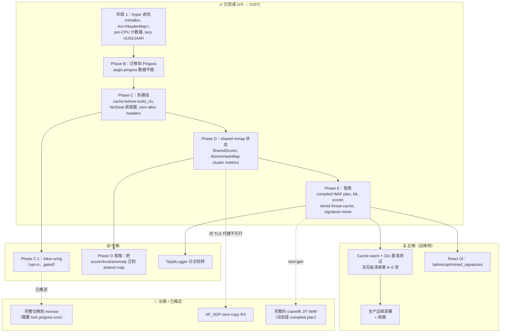
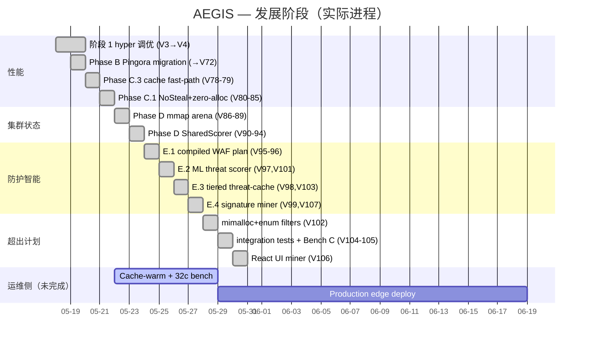

# 路线图

**语言：** [English](../en/40-roadmap.md) · [Русский](../ru/40-roadmap.md) · **中文**

一份统一、整合的 AEGIS 发展路线图：**已经完成**了什么、**近期计划**是什么、**中期**和**长期**分别有什么。本文档把四个位于仓库根目录的 roadmap 文件（`AEGIS-X-ROADMAP.md`、`ROADMAP-NEXT.md`、`ROADMAP-STATUS.md`、`PERF-ROADMAP.md`）汇总到一起，并将其中的说法与真实代码进行核对——部分实现和 opt-in 的特性都如实标注。

> 相关文档：未来工作的详细清单 — [41-development-plan.md](41-development-plan.md)；当前状态的诚实快照 — 42-текущее-состояние-STATUS.md；基准测试的数字与方法论 — [28-benchmarking.md](28-benchmarking.md)；性能调优 — [27-performance-tuning.md](27-performance-tuning.md)。

---

## 1. 来源以及如何阅读这份路线图

本路线图整合了仓库根目录下的四份历史文档。每一份都覆盖了项目的一个阶段：

| 来源 | 阶段 | 角色 | 最终记录的状态 |
|---|---|---|---|
| `PERF-ROADMAP.md` | V3–V4（2026-05-18/19） | 「追赶 nginx」——阶段 1（榨干 hyper）、阶段 2（架构）、阶段 3（王牌） | V4 = 111k RPS，约为 nginx 的 48 % |
| `AEGIS-X-ROADMAP.md` | V4–V11 + 计划 A–E | 「Top-0 commodity edition」——4 层，5 个阶段（A XDP → E intelligence） | V11 = 「honest hyper ceiling」 |
| `ROADMAP-NEXT.md` | V77–V100 | 直到技术天花板的计划，模块 1–4 | V100 = Phase A–E 功能完备 |
| `ROADMAP-STATUS.md` | V100–V107（2026-05-21） | 「计划 vs 现实」快照 | V107，`main` 上 30 次 ship，397 个 lib 测试 |

> 关于版本的重要说明：`V3…V107` 这些标记是内部开发步骤（按 commit 计），**不是**产品的发布版本。来源中的 RPS 数字是在特定测试台上获得的（OrbStack arm64 16c，i9-9900K WSL2/native），衡量的是**进程内引擎**，而不是生产负载下的完整 pingora 二进制。关于基准测试诚实性的更多内容 — 见第 7 节和 [28-benchmarking.md](28-benchmarking.md)。

---

## 2. 方向图（flowchart）

AEGIS 的发展沿着两条相互交汇的轴线推进：**性能**（PERF → Phase A–E）和**防护覆盖面**（WAF/TLS-fp/信誉/ML）。下面是各个方向及其当前状态。

---

## 3. 按阶段的时间线（Gantt）

该图反映的是实际进程（V3–V107，全部在一系列会话中完成，而不是计划中名义上的周数）以及剩余的运维侧工作。日期是相对的步骤，而非日历。

---

## 4. 已完成（功能完备，已在 `main`）

以下所有内容都存在于当前分支的代码中。给出路径引用是为了便于核验。

### 4.1 性能（PERF 阶段 1 → Phase C）

| 步骤 | 做了什么 | 代码位置 | 效果（据来源文档） |
|---|---|---|---|
| F1.1 | mimalloc 作为全局分配器 | `Cargo.toml`、`src/main.rs` | +2–5 %（V4） |
| F1.3 | 对 trusted 采用 lazy UUID / lazy JA4H | 消除每请求的 UUID 分配（V85） | 慢路径 +5–15 % |
| F1.5 | 上下文中使用 `Arc<HeaderMap>` | `CachedResponse`（V84） | 消除了 headers 的深拷贝 |
| F1.6 | Per-CPU 分片计数器 | `src/metrics/` | 降低 cache-line 争用 |
| C.3 | 对 trusted 在 `build_ctx` **之前**做缓存查找 | `src/proxy/pingora_http.rs` | 770k → 884k（+15 %） |
| — | 从 GET 缓存服务 HEAD + `is_already_lowercase` fast-skip | `pingora_http.rs`（V79） | 正确性 + 覆盖率 |
| C.1 | NoSteal 调度器作为默认 | `src/bin/aegis-pingora.rs:1653`（环境变量 `AEGIS_PINGORA_WORK_STEALING`） | 950–966k 稳定 |
| C.1 | Zero-alloc 头转发（`&HeaderName`） | cache serve loops（V82） | ⭐ 首次达到 1.0M 稳定 |

> 快路径的可观测性：响应头 `x-aegis-cache: HIT-FAST` / `HIT-FAST-HEAD`（`src/proxy/pingora_http.rs:2469`）让运维人员能看到走快路径、绕过 `build_ctx` 和过滤器链的流量占比。

### 4.2 数据平面：Phase B（Pingora）

- 主二进制 `aegis-pingora`（特性 `pingora+xdp`）——从 hyper 栈的完整迁移，过滤器通过 `ProxyHttp` trait 接入。见 [02-architecture.md](02-architecture.md)、[07-protocols.md](07-protocols.md)。
- 基于 openssl 后端的 TLS 终止、per-SNI 证书路由、mTLS — 见 [08-tls-certificates.md](08-tls-certificates.md)。
- 来自 ClientHello 回调的真实 JA3-MD5 / JA4 / JA4H / JA4T — 见 [11-tls-fingerprinting.md](11-tls-fingerprinting.md)。
- 通过 systemd 模板实现的 SO_REUSEPORT 多进程 — 见 [06-workers.md](06-workers.md)。

### 4.3 集群状态：Phase D（shared mmap）

| 步骤 | 内容 | 代码位置 |
|---|---|---|
| V86–88 | 共享匿名 mmap arena + bump 分配器 + `AtomicHashMap`（开放寻址、CAS、墓碑） | `src/ddos/shared_score.rs` |
| V89 | 集成进 daemon：cluster-wide `aegis_cluster_*` 指标 | `src/proxy/pingora_background.rs` |
| V90–94 | `SharedScorer`（dual-record）、面向 IPv6 的 `AtomicHashMap128`、compaction（后台 + admin 触发） | `src/ddos/shared_score.rs`、`src/proxy/pingora_admin.rs` |

**为什么：** 在 Phase D 之前，N 个工作进程各自维护独立的 scorer——分布式攻击者可以打工作进程 A，而工作进程 B 看到的是干净的分数。SharedScorer 在跨工作进程层面堵上了这个漏洞，且不损失吞吐。更多内容 — [12-reputation.md](12-reputation.md)、[18-ml-risk-engine.md](18-ml-risk-engine.md)。

### 4.4 防护智能：Phase E

| 子模块 | 落地了什么 | 代码位置 | 诚实的说明 |
|---|---|---|---|
| E.1 | **Compiled WAF rule plan**：在 contains/regex 之上的 per-field Aho-Corasick，通过 HashMap 实现 O(1) equals，LeftmostFirst（arm64 上 250 条规则约 560–650 ns/req） | `src/waf*` | 这**不是**原计划中的 cranelift JIT，而是编译后的规则计划。完整 JIT 仍属长期目标 |
| E.2 | **ML 威胁评分**：基于 8 个特征的逻辑回归（模型约 300 B，推理 <100 ns），online SGD + 热重载 | `src/ddos/ml_score.rs`、`src/ddos/ml_model.rs`、`src/ddos/risk_engine.rs` | 模式 Observe / HighConfidenceEnforce / FullEnforce — 见 [18-ml-risk-engine.md](18-ml-risk-engine.md) |
| E.3 | **Tiered threat-cache**：`ThreatTier {Low,Medium,High}`、per-tier 计数器、带 per-host/per-status 覆盖的 TTL/半衰期 | `src/proxy/response_cache.rs` | |
| E.4 | **自我改进的签名**：document-frequency n-gram miner、`POST /admin/signature_mine`、online tarpit→miner 流水线 | `src/signature_mine.rs`、`src/online_signature_miner.rs`、`src/admin_auth.rs:187` | **刻意不做自动回写**——由运维人员手动提升候选签名 |

### 4.5 超出最初计划的部分（V101–V107）

- V101 — 把 ML scorer + `ThreatTier` 接入 pingora 热路径。
- V102 — mimalloc + enum-dispatch 过滤器 + body buffer pool。
- V103 — DSL 缓存配置 + tier-override 修复（OrbStack 上 487k RPS cache-warm）。
- V104 — 集成测试的同步。
- V105 — `aegis-distbench` + Bench C（分布式攻击者）：50 个 IP × 200 次 SQLi → 全部 50 个都在 `/admin/threats?source=cluster` 中可见，端到端验证了 Phase D 的 threat-integrity 模型。
- V106 — signature miner 的 React UI。
- V107 — online tarpit→miner 流水线。

---

## 5. 近期（运维侧，非代码）

摘自 `ROADMAP-STATUS.md` §「还剩什么」。要点：**功能开发已经结束**，剩下的取决于硬件和生产部署，而不是代码。

| 任务 | 由谁 | 耗时 | 解决什么 |
|---|---|---|---|
| 在 i9 上做 cache-warm 基准测试（alias loopback + V103 配置） | 一起 | ~15 分钟 | 将验证 native Linux 上的 cache-warm |
| 32 核节点基准测试（例如 Hetzner CPX41） | 运维 | ~1 小时 | 技术天花板第 4 项 |
| 生产边缘部署 + 1–2 周观察 | 运维 | 数周 | 技术天花板第 5 项 |
| 在 React UI 中把 `/admin/api/mined_signatures` 接到手动 mine 旁边 | V108+ | ~2 小时 | UI 的完整性 |
| 为 `TarpitLogger` 做轮转 / 基于大小的截断 | V108+ | ~1 小时 | 长期运行的部署 |

---

## 6. 中期与长期

### 中期（已规划，部分已铺垫）

- **Phase C.1 — tokio-uring socket I/O**（Linux 5.10+，feature flag，gated）。在 `ROADMAP-NEXT.md` 中标记为「尚未开始」，预期效果 +15–25 %。增量式的，不替换运行时。
- **Phase D 收尾（V90 级别）** — 把 `ThreatScorer` / `DynamicTrust` / `AnomalyDetector` 从 per-worker DashMap 迁移到共享的 `AtomicHashMap`（需要打包 `WindowStats` + 处理 IPv4 键）。基础已经就绪，剩下的是与现有 scorer API 的对接。
- **TarpitLogger 的日志轮转** — 见上表。

### 长期 / 有意识地推迟

摘自 `ROADMAP-NEXT.md` §「不在计划内的内容」——附带理由的取舍：

| 已推迟 | 原因 |
|---|---|
| 完整切换到 monoio（Phase C.1 的极端方案） | 需要 fork `pingora-core`（4–6 周）+ 维护负担 |
| `XDP_REDIRECT` 到上游 | 对做 TLS 终止的代理不可行（没有 DSR） |
| AF_XDP zero-copy receive | 需要重写 TCP 层，用例小众 |
| WASM 过滤器 | 已被现有的 Lua 插件覆盖（[31-plugins.md](31-plugins.md)） |
| HTTP/3 server push | 在 HTTP/3 RFC 中已废弃 |
| 完整的 cranelift JIT WAF | 当前的 compiled plan 已覆盖 5–10× 的收益；JIT 属于下一代目标 |

---

## 7. 性能：计划 vs 现实（如实说明）

摘自 `ROADMAP-STATUS.md` §「哪里没达标」以及技术天花板清单。

| 计划指标 | 现实 | 原因 |
|---|---|---|
| Block 2：1.5–1.8M RPS | 1.10M 峰值 / 1.0M 稳定（约 73 %） | tokio 开销高于预期；monoio 切换被有意识地推迟 |
| OrbStack 上 3–5M cached | 487k cached（V103） | OrbStack 的 8 vCPU 与 macOS 宿主共享——超额分配，而非代码问题 |
| 裸金属 x86 32c 上 10M cached | 未测量 | 会话期间没有 32 核硬件 |

技术天花板清单（需满足 5 项中的 4 项）：

| # | 条件 | 状态 |
|---|---|---|
| 1 | OrbStack arm64 ≥3–5M cached / mixed 1.5–2M | ⚠ Partial — 共享 VM 上 487k cache-warm |
| 2 | Bench A 对比 nginx ×10 cache-warm / ×3 no-defense | ⚠ Partial — i9 上已确认 ×3.5 no-defense；×10 未测量 |
| 3 | 完整的防护栈（eBPF + WAF plan + ML + threat-cache + Phase D） | ✅ DONE — 5/5 层 + online miner |
| 4 | 裸金属 x86 32c：5–10M cached | ⏳ 没有硬件 |
| 5 | 生产部署已验证 | ⏳ 运维侧 |

> **诚实的说明（不夸大）：**
> - AEGIS 的基准测试通道衡量的是**进程内引擎**，而不是生产流量下的完整 pingora 二进制。
> - 硬件 SHA 基准是 per-core 的，在没有硬件 SHA 加速的 VM 内数值偏低；在这种环境下的容量预测是偏悲观的。
> - **我们并不宣称 AEGIS 在纯速度上快过真实的代理。** AEGIS 强有力且诚实的论点是其**安全矩阵**：没有任何一个开源反向代理能同时具备带内联 WAF 的 eBPF/XDP 快路径、带编译规则计划的用户态 WAF、per-IP 的 ML 评分、tiered threat-aware 缓存、跨工作进程的 shared-mmap scorer 完整性，以及自我改进的签名挖掘。这才是差异化所在。

---

## 8. 我们现在处于什么位置

摘自 `ROADMAP-STATUS.md`：「Phase E 完成之后——停止功能开发，转入维护 + 运维 UX 打磨 + 文档」。**项目正处于这个节点。** Phases A–E 功能完备，超出计划 +7 次 ship，5 项天花板条件中有 3 项已关闭/部分关闭。后续进展属于运营层面（32 核节点 + 生产部署），而不是代码。

按 Block 逐项的完整「计划 vs 现实」核对见 42-текущее-состояние-STATUS.md。未来候选项的详细清单 — [41-development-plan.md](41-development-plan.md)。
